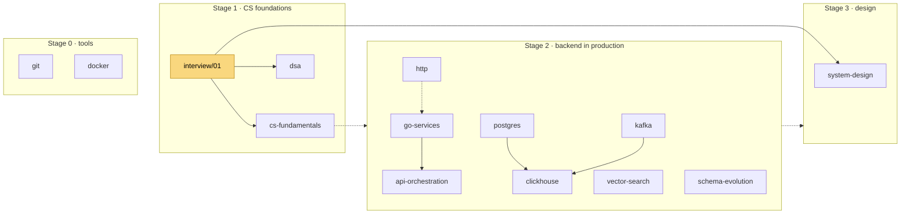
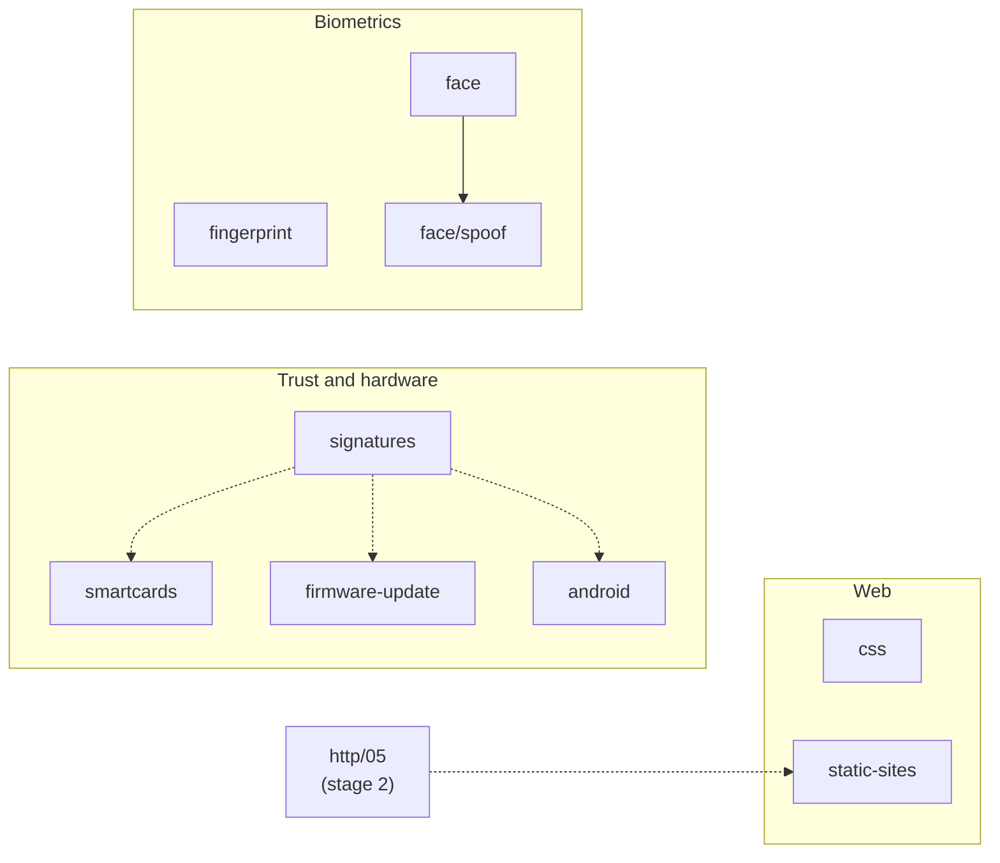
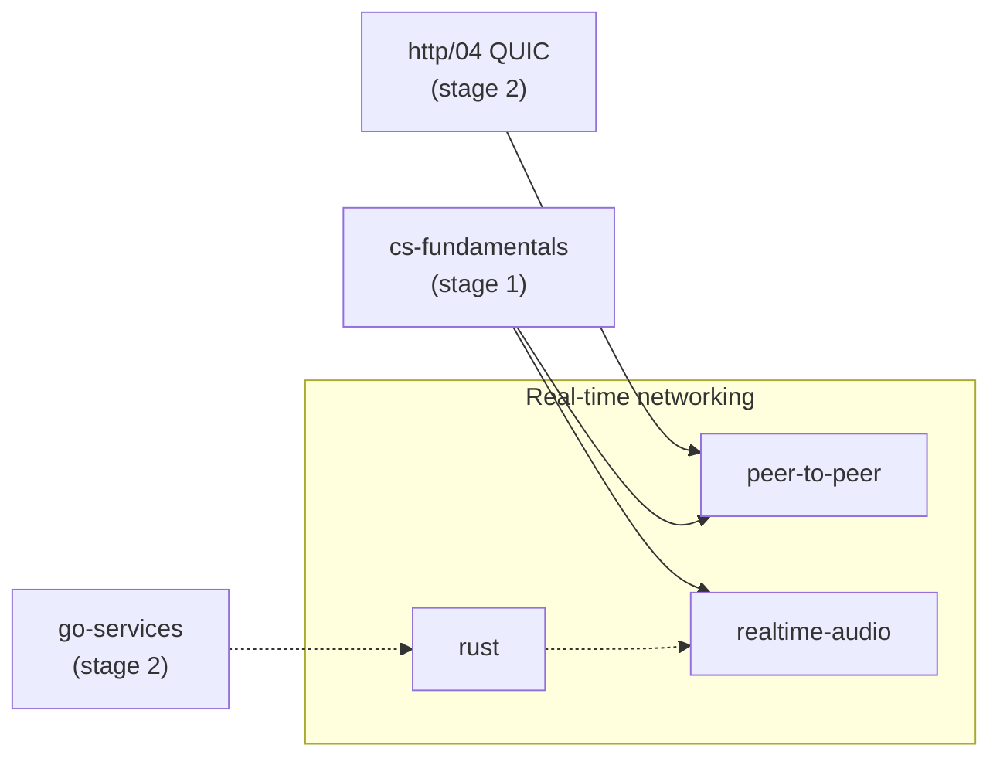

# Learning

A personal library of courses, one folder per subject, written to teach rather than to
brief. Every course follows the contract in [`CLAUDE.md`](CLAUDE.md): why before how,
sources cited, **Check yourself** questions at the end of every chapter, worked answers
in each course's exercises file.

**This page is the roadmap.** It says which courses exist, how they group, and in what order
to read them. Each course's own README has the detailed reading order inside it. This page
only decides *which course next*.

---

## The map

The plain-text version renders anywhere. The diagrams below it need a Mermaid-capable viewer
(GitHub, or VS Code with a Mermaid extension).

```
★ start here
  │
  ▼
Stage 0 · tools ............ git, docker
  │
  ▼
Stage 1 · CS foundations ... interview/01 ──► cs-fundamentals
                                         └──► dsa
  │
  ▼
Stage 2 · backend .......... http ──► go-services ──► api-orchestration
                             postgres ──┬──► clickhouse
                             kafka ─────┘
                             vector-search, schema-evolution   (any time)
  │
  ▼
Stage 3 · design ........... interview/system-design

Side tracks — independent, start any time
  web ................ css, static-sites   (http/01 and 05 help)
  trust & hardware ... signatures ──► smartcards, firmware-update, android
  biometrics ......... fingerprint;  face ──► face/spoof

Track — real-time networking   (after stage 1, plus http/04)
  rust ──► realtime-audio
  http/04 + cs-fundamentals ──► peer-to-peer
```

In the diagrams, solid arrows mean a chapter in the later course says "read this first".
Dashed arrows mean the earlier course gives useful depth but isn't required. Those are my
suggestions, not dependencies stated in the courses. The highlighted node is the general
entry point.

**The main path**



**The side tracks**



**The real-time networking track**



---

## The tracks

| Stage / track | Courses | Read it for | Order inside the track |
|---|---|---|---|
| **0 — Tools** | [git](git/README.md), [docker](docker/README.md) | The two tools under all other work. Rewriting history safely; the build cache | Any order. Read early; both are short |
| **1 — CS foundations** | [interview/01](interview/01-how-the-loop-works.md), [cs-fundamentals](interview/cs-fundamentals/README.md), [dsa](interview/dsa/README.md) | What happens under your code (process, memory, transactions, TCP), and algorithms by pattern | `interview/01` first. Then cs-fundamentals and dsa in either order, or together |
| **2 — Backend in production** | [http](http/README.md), [go-services](go-services/README.md), [api-orchestration](api-orchestration/README.md), [postgres](postgres/README.md), [kafka](kafka/README.md), [clickhouse](clickhouse/README.md), [vector-search](vector-search/README.md), [schema-evolution](schema-evolution/README.md) | How the pieces of a real service fail, one at a time | http → go-services → postgres → kafka → clickhouse (needs postgres/10 and kafka/03). api-orchestration after go-services (needs its files 01, 02, 04 and 05). vector-search and schema-evolution any time |
| **3 — Putting it together** | [system-design](interview/system-design/README.md) | Designing a whole system and defending it. Links back into stage 2 for depth | After stage 1. Stage 2 makes it far richer but isn't required |
| **Web** | [css](css/README.md), [static-sites](static-sites/README.md) | Building and shipping front ends | Independent of each other. static-sites assumes general HTTP/TLS; http/01 and 05 cover it |
| **Trust and hardware** | [signatures](signatures/README.md), [smartcards](smartcards/README.md), [firmware-update](firmware-update/README.md), [android](android/README.md) | What "signed" and "verified" actually prove, and how devices take, run and attest code | signatures first gives the vocabulary (integrity vs authenticity) the others lean on. android stands alone otherwise |
| **Real-time networking** | [rust](rust/README.md), [peer-to-peer](peer-to-peer/README.md), [realtime-audio](realtime-audio/README.md) | Building networked, live systems: Rust for a Go programmer, direct connections through NATs, and voice end to end | peer-to-peer needs http/04 (QUIC) and cs-fundamentals file 09 (stated). realtime-audio builds on cs-fundamentals files 02 and 04; its examples use Rust crates, so rust first helps. rust assumes you already write Go |
| **Biometrics** | [fingerprint](fingerprint/README.md), [face](face/README.md) → [face/spoof](face/spoof/README.md) | Recognition, its metrics, and attacks on it | `face/01` before `face/spoof` (stated). fingerprint is independent; its metrics chapter complements `face/01` |

---

## Suggested paths

- **Backend engineer, starting fresh.** git → `interview/01` → cs-fundamentals → http →
  go-services → postgres → kafka → system-design. Add clickhouse, vector-search and
  schema-evolution when you meet them at work.
- **Interview soon.** `interview/01` → dsa → cs-fundamentals → system-design. Each course's
  "If you're short on time" section cuts it further. See the [interview README](interview/README.md).
- **Something broke in production.** Go straight to the course for that component. Every
  course opens with a foundations chapter, so you won't land mid-story.
- **Building a live, networked app.** cs-fundamentals → http/01 and http/04 → rust →
  peer-to-peer → realtime-audio.
- **Building a workflow or integration platform.** http → go-services (01, 02, 04 and 05
  at least) → api-orchestration.
- **A side track for its own sake.** Each side track stands alone. Start with its first
  course in the table above.

---

## Every course, at a glance

| Course | One line | Start at |
|---|---|---|
| [android](android/README.md) | How an Android app is isolated, signed, booted and attested, and how each defence is attacked | `01-the-android-platform` |
| [api-orchestration](api-orchestration/README.md) | Engines that chain API calls: graphs, data between steps, retries, SSRF, API contracts, and agents that build workflows | `01-foundations` |
| [clickhouse](clickhouse/README.md) | What ClickHouse does with the rows an application sends it | `01-what-clickhouse-does-with-a-table` |
| [css](css/README.md) | Stateful, animated UI with little or no JavaScript | `01-foundations` |
| [docker](docker/README.md) | The build cache, and how it ships broken images silently | `01-images-and-layers` |
| [face](face/README.md) | Face biometrics: shared statistics, then areas (`spoof/`) | `01-estimating-error-rates` |
| [fingerprint](fingerprint/README.md) | Fingerprint matching and templates, from scratch | `01-what-is-a-fingerprint` |
| [firmware-update](firmware-update/README.md) | Replacing the code inside a USB device, and proving it worked | `01-why-firmware-updates-are-hard` |
| [git](git/README.md) | Rebasing, force-pushing and commit identity without losing work | `01-what-a-commit-is` |
| [go-services](go-services/README.md) | The parts of a Go service that fail slowly in production | `01-how-a-go-service-runs` |
| [http](http/README.md) | What HTTP is and rides on, framing, version negotiation, QUIC, TLS trust, origins and CORS | `01-foundations` |
| [interview](interview/README.md) | Interview preparation as learning: dsa, cs-fundamentals, system-design | `01-how-the-loop-works` |
| [kafka](kafka/README.md) | What Kafka actually promises an application | `01-what-kafka-is` |
| [peer-to-peer](peer-to-peer/README.md) | Connecting two machines directly when both sit behind NATs and firewalls | `01-foundations` |
| [postgres](postgres/README.md) | Indexes, live schema changes and migrations on a busy database | `01-what-postgres-does-with-a-query` |
| [realtime-audio](realtime-audio/README.md) | Capturing, sending and playing voice live, and where the milliseconds go | `01-foundations` |
| [rust](rust/README.md) | Rust taught by contrast with Go: ownership, errors, traits, async and tokio | `01-foundations` |
| [schema-evolution](schema-evolution/README.md) | Changing a data format when you don't control the reader | `01-the-installed-client-problem` |
| [signatures](signatures/README.md) | Hashes, MACs and signatures: what each proves, and SSH signing | `01-foundations` |
| [smartcards](smartcards/README.md) | Contact smart cards, from power-up to proving genuineness | `01-what-a-smart-card-is` |
| [static-sites](static-sites/README.md) | Static sites from build to your own domain | `01-foundations` |
| [vector-search](vector-search/README.md) | What a vector database does with embeddings, and the settings that change answers | `01-what-vector-search-is` |

---

## Keeping this map current

This page is meant to change. When a course is added or split:

1. **Add a row** to "Every course, at a glance", in alphabetical order.
2. **Place it in a track.** If it fits none, add a side track, but only if it isn't
   plausibly stage 0–3 material. A new track should be a real cluster, not a single course
   with a heading.
3. **Draw only edges you can point to.** Solid arrow: a chapter in the new course says "read
   X first". Dashed arrow: real, useful depth. Don't draw an edge for "related topic". Too
   many arrows make the map unreadable.
4. **Revisit the suggested paths** if the new course belongs on one.
5. **Child areas** (like `face/spoof`) go in the map as their own node under the parent, and
   in the parent's README. They don't get a row here unless people would go to them
   directly.
