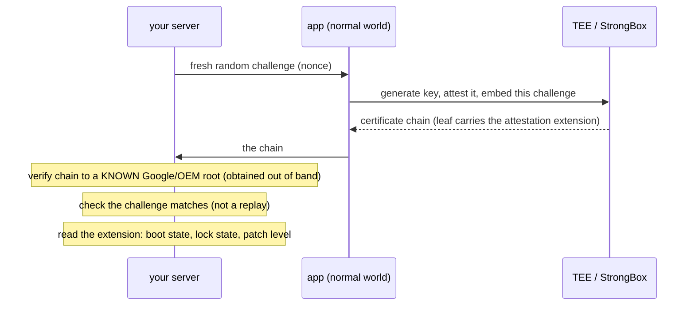

# 10. Hardware-backed attestation

## The problem every earlier chapter failed to solve

File 09 ended on a wall. Every on-device defence fails against a determined attacker because
it runs *inside the process on a device the attacker controls* — the attacker is below it and
can edit what it sees. Two properties were always missing:

1. a secret or a signing key the attacker **cannot reach even as root**, and
2. a verdict checked by someone **off the device**, where the attacker can't hook the check
   out.

This chapter is the mechanism that finally has both. It's also the point where "trust the
client" is abandoned entirely: instead of the app judging its own environment, *hardware*
makes a signed statement and a *server* judges it.

## 10.1 The TEE and StrongBox: a key root can't reach

Modern SoCs run two worlds on the same chip. The **normal world** runs Android — including
root, if the device is rooted. Alongside it runs a **Trusted Execution Environment (TEE)**: a
separate, hardware-isolated execution environment (on ARM, built on TrustZone) with its own
tiny trusted OS. Code and keys inside the TEE are not reachable from the normal world, *even
by root*, because the isolation is enforced by the processor, not by the Android OS that root
controls.

Android's key management lives partly in there. **KeyMint** (renamed from **Keymaster** in
Android 12) runs in the TEE and guards Keystore keys: a hardware-backed key is generated
inside the secure environment and **never leaves it** — you ask the TEE to *use* the key, and
the operation happens inside
([source.android.com/docs/security/keystore](https://source.android.com/docs/security/keystore/attestation)).

**StrongBox** is the stronger tier: an optional *second* KeyMint instance running in a
dedicated, physically separate tamper-resistant chip (a secure element), rather than sharing
the main SoC. Same contract, higher isolation.

> **Teacher's aside.** This is the first secret in the whole course that root cannot get. Root
> is UID 0 in the *normal world* (file 06); the TEE is not in the normal world. That one fact
> is why everything below works and nothing in file 09 did. A root check asked the compromised
> system about itself; a hardware attestation asks a component the compromise *cannot enter*.
> The guarantee comes entirely from where the key sits, not from how clever the check is.

## 10.2 Key Attestation: a signed statement about the key and the device

Holding a key root can't extract is useful, but the real power is **Key Attestation**: the
TEE will issue a **certificate chain** vouching for a key it generated — and, crucially, for
the *state of the device* at the time.

When you generate a key with attestation, the secure environment returns a chain:

```
   leaf cert  ──▶  intermediate(s)  ──▶  root cert (controlled by Google/the OEM)
      │
      ├─ the key's public key
      └─ an ATTESTATION EXTENSION describing, signed by the TEE:
             • is the key hardware-backed? StrongBox?
             • Verified Boot state — the GREEN/YELLOW/ORANGE colour (file 05!)
             • is the bootloader locked?
             • OS version and security patch level
             • the challenge the verifier supplied (anti-replay)
```

Key Attestation was introduced in **Android 7.0**, with an `ATTESTATION_CHALLENGE` input so a
verifier can bind the attestation to a fresh challenge
([source.android.com/docs/security/keystore/attestation](https://source.android.com/docs/security/keystore/attestation)).
The flow a server runs:



Why it holds: the leaf is signed by a key that lives in the TEE and chains to a **root the
attacker doesn't control**, which the server knows independently. Root in the normal world
can't forge a chain to that root, and can't change the boot-state fields because the TEE — not
Android — fills them in. And the server verifies it, so there's no on-device check to hook.

Newer devices provision those attestation signing keys at runtime from Google rather than in
factory batches, via **Remote Key Provisioning** (the `IRemotelyProvisionedComponent` HAL);
each app gets a different attestation key and they rotate, for privacy
([AOSP security HAL README](https://android.googlesource.com/platform/hardware/interfaces/+/main/security/README.md)).

## 10.3 Play Integrity: the managed verdict most apps actually use

Rolling your own Key Attestation verification is fiddly. The **Play Integrity API** is
Google's higher-level service that wraps device, app and account checks into one signed
verdict — the mainstream path.

The app requests an integrity token (binding a request hash / nonce); Google returns an
encrypted, signed token; and — the essential part — **your server** sends that token to
Google's servers to decrypt and verify. The verdict comes back with these fields
([developer.android.com/google/play/integrity/verdicts](https://developer.android.com/google/play/integrity/verdicts)):

**`deviceIntegrity.deviceRecognitionVerdict`** — a list of labels (absent entirely if the
device earns none):

| Label | Meaning |
|---|---|
| `MEETS_DEVICE_INTEGRITY` | Genuine, certified Android device. **On Android 13+, backed by hardware proof that the bootloader is locked and the OS is a certified manufacturer image** (file 05) |
| `MEETS_BASIC_INTEGRITY` (opt-in) | Passes basic checks; bootloader **may be unlocked**, device may not be certified |
| `MEETS_STRONG_INTEGRITY` (opt-in) | Genuine and certified **with a recent security update** (Android 13+: patched within the last year) |
| `MEETS_VIRTUAL_INTEGRITY` (conditional) | A Google Play Games for PC emulator that passes integrity checks |
| *(empty — no label)* | Signs of attack (API hooking) or compromise (root), or not a physical device |

**`appIntegrity.appRecognitionVerdict`** — is this your unmodified binary (file 03)?
`PLAY_RECOGNIZED` (app and certificate match what Google Play distributes), `UNRECOGNIZED_VERSION`
(certificate or package name doesn't match), or `UNEVALUATED`.

**`accountDetails.appLicensingVerdict`** — did the user obtain the app from Play?
`LICENSED`, `UNLICENSED` (e.g. sideloaded), or `UNEVALUATED`.

As of a change Google made in **May 2025**, `MEETS_DEVICE_INTEGRITY` requires a hardware-backed
positive verified-boot verdict, tightening the link to file 05's lock state.

Notice how the verdicts line up with the whole course: `appRecognitionVerdict` is file 03's
signature identity, reported server-side; the empty device label is file 06/08's root and
hooking; `MEETS_DEVICE_INTEGRITY` is file 05's locked, verified boot — each on-device thing an
attacker could spoof, now asserted from hardware and judged off-device.

## 10.4 The SafetyNet → Play Integrity transition

Play Integrity replaced an older service, the **SafetyNet Attestation API**, and the
transition is worth knowing because you'll meet both names.

SafetyNet returned two key fields:

| SafetyNet field | Meaning | Rough Play Integrity successor |
|---|---|---|
| `basicIntegrity` | Device passes basic integrity checks | `MEETS_BASIC_INTEGRITY` |
| `ctsProfileMatch` | Device matches a Google-certified **CTS** (Compatibility Test Suite) profile — the stricter signal | `MEETS_DEVICE_INTEGRITY` |

(The mapping is the conceptual correspondence, not a field-for-field guarantee — I'm
describing the retired SafetyNet fields from the general record, since the live docs no longer
publish them.)

The timeline: SafetyNet Attestation was **deprecated in 2022 and fully turned down in January
2025**; calls now fail with an error, and Google directs everyone to Play Integrity
([developer.android.com/training/safetynet/attestation](https://developer.android.com/training/safetynet/attestation)).
(Google revised the intermediate dates more than once before the January 2025 shutdown, so
older posts cite a 2023/2024 schedule — the shutdown date to remember is January 2025.)

The change that matters beyond the rebrand: Play Integrity leans harder on **hardware-backed**
verdicts, especially on Android 13+. SafetyNet historically had a software-based evaluation
path that was more spoofable; tying the strong verdict to hardware verified-boot is the
tightening.

## 10.5 Why this holds — and the honest limits

It holds because it has exactly the two properties file 09 lacked: the signing key is in
**hardware root can't reach**, and the verdict is checked by a **server the attacker doesn't
control**. Remove either and it collapses straight back into file 09 — verify the token on the
client and an attacker hooks the verifier; rely on a software-only signal and root spoofs it.

But "holds" is not "infallible", and the drive's rule is to say so plainly:

- **The TEE is not unbreakable.** TEE implementations have had exploitable bugs, and in past
  incidents attestation private keys were extracted from some vendors' secure environments —
  letting attackers forge valid-looking attestations until those keys were revoked.
  Hardware-backed is the strongest tier available; it is not a mathematical certainty.
- **It's a dependency on Google.** Play Integrity needs Google Play services. Honest devices
  without GMS — some regions, de-Googled or pure-AOSP ROMs — can't produce a verdict, so they
  fail *as if* compromised. That's a real population of legitimate users turned away, and it's
  the standing cost of choosing this control.
- **It attests the *container*, not your logic.** `MEETS_DEVICE_INTEGRITY` says the device and
  OS are genuine and locked. It does **not** say the user is honest, or that your app isn't
  being attacked in ways that don't require breaking the device. A determined attacker can
  operate on a perfectly attested stock phone. Attestation raises the floor; it is not a
  ceiling over all abuse.
- **Freshness and server-side verification are load-bearing.** The challenge/nonce must be
  fresh and the token verified on your server against a root you obtained independently. Skip
  the nonce and an old token replays; verify on the client and you're back in file 09.

> ⚠️ The most common misuse is over-reading the verdict. `MEETS_DEVICE_INTEGRITY` is not a
> trust score for the *user* and not proof your app is unhooked at the UI layer — it's a
> statement that the *device and OS* are genuine and (13+) verified-boot-locked. Gate on it
> for what it says; don't treat it as a verdict on things it never measured.

## 10.6 The course in one arc

Read top to bottom, the whole thing is one argument. An app is isolated by a **UID** (file 01)
and shipped as reversible **DEX** in a signed **APK** (files 02–03). A **static** attacker
rewrites the file and is contained only by the **signature** (files 03, 07); a **dynamic**
attacker rewrites the running process and is contained by nothing on-device (files 04, 08) —
once they have **root**, which needs an unlocked **bootloader** (files 05–06). Every on-device
defence therefore loses on a controlled device (file 09). The escape is to stop trusting the
device: let **hardware** the attacker can't reach sign a statement about the boot state and
the app, and let a **server** the attacker doesn't own judge it (file 10). That — and
genuinely only that — is what still stands when the client belongs to the adversary.

## Check yourself

1. Root is UID 0 and can read any app's files, yet it cannot extract a TEE-held key or forge
   a Key Attestation chain. Explain the precise reason, in terms of *which world* root
   controls.
2. A server verifies a Play Integrity token **on the client** to save a round trip, then
   proceeds on the result. Explain exactly how an attacker defeats this, and why it has thrown
   away the entire guarantee.
3. Walk the Key Attestation flow and identify the two things a server must check about the
   returned chain. What attack does each one stop?
4. A device returns `MEETS_BASIC_INTEGRITY` but not `MEETS_DEVICE_INTEGRITY`. What can you
   infer about its bootloader, and how does that tie back to file 05's lock states?
5. `appRecognitionVerdict` comes back `UNRECOGNIZED_VERSION`. Which earlier-chapter attack
   does that most likely indicate, and why could the app's *own* on-device signature check
   have missed what the server caught?
6. SafetyNet's `ctsProfileMatch` and Play Integrity's `MEETS_DEVICE_INTEGRITY` play similar
   roles, but the transition tightened one thing. What, and against which spoofing technique?
7. Give two situations where hardware attestation turns away a *legitimate* user, and explain
   why that's an inherent cost of this control rather than a bug to be fixed.
8. The finale: state the two properties that make attestation hold where every file-09 defence
   failed, and show that removing either one collapses it back into a file-09 defence.
