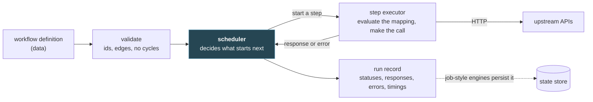
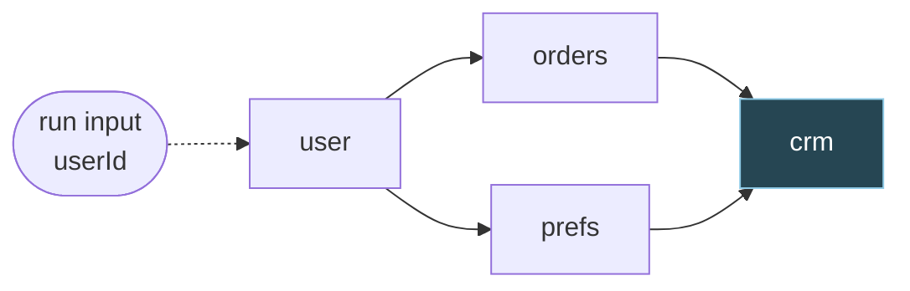

# 1. Foundations: what an orchestration engine does

> **Read this first.** Every other chapter assumes it. File 02 talks about a step's
> parents, its finished ancestors and the data document; this is where those words are
> explained.

**Who can skip it:** if you can say why a hand-written chain of API calls stops scaling,
what separates a job-style engine from request-style composition (and why that's a
spectrum rather than two boxes), what a step's mapping is allowed to see, and why
"upstream" means something different here from what it means in Airflow, skim the
vocabulary in §1.3 and the landscape in §1.6, then go to
[file 02](02-graphs-and-scheduling.md).

This course assumes [go-services](../go-services/README.md), particularly
[file 01](../go-services/01-how-a-go-service-runs.md) (goroutines, channels, `context`)
and [file 05](../go-services/05-fanning-out.md) (`errgroup`). Where something here leans
on them, I link to the section instead of teaching it again.

## The problem

Here's a small, ordinary job. Fetch a user. Then fetch their orders and their preferences,
which don't depend on each other, so fetch those at the same time. Then post a summary of
all three to a CRM. Four HTTP calls, one of which has to wait for two others.

Written by hand it's about thirty lines of Go (§1.1), and it works. The trouble starts when
there are fifty of these, each slightly different, some written by people who don't write
Go, some that change every week, some that must answer within 800 ms and some that run
overnight. Each hand-written chain makes four decisions in its control flow, where nobody
can see them, reuse them or change them without a deploy:

- **Sequencing:** which call waits for which.
- **Parallelism:** which calls run at the same time, and how many at once.
- **Partial failure:** what happens to the other calls when one fails, and what's safe to
  repeat.
- **Visibility:** what anyone can find out afterwards about what happened.

An **orchestration engine** is what you get when you take those four decisions out of the
code and put them into data. This chapter shows the hand-written version, then the same
thing as data, the vocabulary the rest of the course uses, the two broad styles of engine,
and where the well-known products sit.

## 1.1 Chaining calls by hand

This is the running example of the whole course, written directly:

```go
type User struct {
	ID     string `json:"id"`
	Name   string `json:"name"`
	Active bool   `json:"active"`
}

type Order struct {
	ID    string  `json:"id"`
	Total float64 `json:"total"`
}

type Prefs struct {
	Channel string `json:"channel"`
}

type Summary struct {
	CustomerID string `json:"customerId"`
	OrderCount int    `json:"orderCount"`
	Channel    string `json:"channel"`
}

// summarise is the running example written by hand: fetch a user, then their
// orders and preferences in parallel, then post a summary to a CRM.
func summarise(ctx context.Context, c *http.Client, api, crm, userID string) error {
	var user User
	if err := getJSON(ctx, c, api+"/users/"+url.PathEscape(userID), &user); err != nil {
		return fmt.Errorf("user: %w", err)
	}

	var orders struct {
		Orders []Order `json:"orders"`
	}
	var prefs Prefs
	g, gctx := errgroup.WithContext(ctx)
	g.Go(func() error {
		return getJSON(gctx, c, api+"/orders?user="+url.QueryEscape(user.ID), &orders)
	})
	g.Go(func() error {
		return getJSON(gctx, c, api+"/users/"+url.PathEscape(user.ID)+"/preferences", &prefs)
	})
	if err := g.Wait(); err != nil {
		return fmt.Errorf("orders or prefs: %w", err)
	}

	return postJSON(ctx, c, crm+"/summaries", Summary{
		CustomerID: user.ID,
		OrderCount: len(orders.Orders),
		Channel:    prefs.Channel,
	})
}
```

I've trimmed two helpers, `getJSON` and `postJSON`, which build a request with the context,
check the status, decode or drain the body and close it (the usual ten lines each, with the
body handling from [go-services file 02](../go-services/02-the-http-client.md)), and the
test harness. I ran it with Go 1.26.0 and `golang.org/x/sync` v0.24.0 against a local
`httptest` server serving canned responses, under a 200 ms deadline per attempt, in three
scenarios:

```
1. everything healthy
   err=<nil> calls=map[crm:1 orders:1 prefs:1 user:1] summaries=1
2. prefs returns 503
   err=orders or prefs: GET /users/u-42/preferences: 503 Service Unavailable
   calls=map[orders:1 prefs:1 user:1] summaries=0
3. CRM stores the summary but replies too late; the caller retries the whole function
   first attempt: err=Post "http://127.0.0.1:64578/summaries": context deadline exceeded (deadline exceeded: true)
   retry:         err=<nil>
   calls=map[crm:2 orders:2 prefs:2 user:2] summaries=2
```

Read the second and third against the four decisions:

| Decision | Where it lives in `summarise` | What the runs show |
|---|---|---|
| Sequencing | The order of the statements | Changing the shape, say so that `prefs` no longer needs `user`, means editing, reviewing and deploying code |
| Parallelism | The `errgroup` | Fine here. Fifty variants means fifty hand-placed `errgroup`s and no shared limit on how hard they hit each upstream |
| Partial failure | `errgroup.WithContext`, which fails fast, and whatever the caller does next | In scenario 2, `errgroup` cancelled `orders` part-way through its call when `prefs` failed. In scenario 3 the caller retried the whole function, so `user`, `orders` and `prefs` were fetched twice and **the CRM stored two summaries** |
| Visibility | One wrapped error string | Scenario 2's error names `prefs`. It doesn't say that `user` succeeded or that `orders` was cancelled half-way. That was known for a moment, inside the function, and then thrown away |

Scenario 3 is the one to dwell on. The CRM stored the summary and then replied too slowly,
and from the caller's side a timeout looks exactly like a failure: the request may have
worked and only the reply was lost (go-services file 04,
["Retry only what can succeed"](../go-services/04-deadlines-and-retries.md#retry-only-what-can-succeed)).
Retrying the function as a unit repeated a POST that had already succeeded. Avoiding that by
hand means remembering, per call, which calls finished, which is a record of the run's
progress. That record is the first thing an engine gives you, and making it survive a crash
is [file 04](04-retries-idempotency-and-durability.md).

> ⚠️ **With `errgroup`, a cancelled sibling's error carries the first failure's text.**
> `errgroup.WithContext` cancels its context with the first error as the *cause*
> (`context.WithCancelCause`, in `golang.org/x/sync` v0.24.0's source), and `net/http`
> reports the cause when a request is cancelled. In scenario 2 I printed what the `orders`
> call itself returned: `Get "http://127.0.0.1:64596/orders?user=u-42": GET
> /users/u-42/preferences: 503 Service Unavailable`. If each call logs its own error, the
> logs say `orders` failed with a 503 from preferences. It didn't fail; it was cancelled.

## 1.2 The chain as data

An orchestration engine takes a **workflow definition** as data — the steps, what each one
depends on, and how each step's request is built — and runs it. Here's the running example
as a definition:

```json
{
  "steps": [
    {
      "id": "user",
      "request": {
        "method": "GET",
        "url": "'https://api.example.com/users/' & $encodeUrlComponent(input.userId)"
      }
    },
    {
      "id": "orders",
      "dependsOn": ["user"],
      "request": {
        "method": "GET",
        "url": "'https://api.example.com/orders?user=' & $encodeUrlComponent(steps.user.body.id)"
      }
    },
    {
      "id": "prefs",
      "dependsOn": ["user"],
      "request": {
        "method": "GET",
        "url": "'https://api.example.com/users/' & $encodeUrlComponent(steps.user.body.id) & '/preferences'"
      }
    },
    {
      "id": "crm",
      "dependsOn": ["orders", "prefs"],
      "request": {
        "method": "POST",
        "url": "'https://crm.example.com/summaries'",
        "body": "{ 'customerId': steps.user.body.id, 'orderCount': $count(steps.orders.body.orders), 'channel': steps.prefs.body.channel }"
      }
    }
  ]
}
```

The format is this course's own, kept small on purpose; real products each have their own
(§1.6). Three things to notice:

- **`dependsOn` is the whole graph.** Nothing says "run `orders` and `prefs` in parallel".
  The engine works that out from the fact that neither depends on the other.
- **Each request field is an expression**, here in JSONata ([file 03](03-mapping-data-between-steps.md)),
  evaluated against the run's data so far. In JSONata `&` joins strings, and
  `$encodeUrlComponent` is what stops a user id such as `u/42?admin=1` from changing the
  shape of the URL. (File 05 is the larger version of that problem.)
- **`steps` is an array, not an object keyed by id.** File 02 §2.1 explains why: JSON
  objects are unordered, and a duplicate key disappears without an error.

I evaluated the four mappings with the `jsonata` library, version 2.2.2, against canned
responses, giving each step only what it's allowed to see (rule 2 in §1.5):

```
user   sees steps: []
       GET https://api.example.com/users/u-42
orders sees steps: [user]
       GET https://api.example.com/orders?user=u-42
prefs  sees steps: [user]
       GET https://api.example.com/users/u-42/preferences
crm    sees steps: [user, orders, prefs]
       POST https://crm.example.com/summaries  body {"customerId":"u-42","orderCount":2,"channel":"email"}
```

With the id `u/42?admin=1`, the `orders` URL came out as
`https://api.example.com/orders?user=u%2F42%3Fadmin%3D1`, which is what the encoding is
for.

### What the engine does with a definition



| Job | What it means | Chapter |
|---|---|---|
| Validate | Reject definitions that can't run: duplicate ids, dependencies on steps that don't exist, cycles | [02](02-graphs-and-scheduling.md) |
| Schedule | Start each step when its dependencies are done, within a concurrency limit, and work out what a failure or a condition means for the rest | [02](02-graphs-and-scheduling.md) |
| Map | Build each step's request from the run's data | [03](03-mapping-data-between-steps.md) |
| Retry and persist | Repeat what's safe to repeat, and record progress so a crash doesn't lose the run | [04](04-retries-idempotency-and-durability.md) |
| Call | Make the HTTP call, safely, to a URL that a user may have chosen, against an API you've described | [05](05-calling-urls-you-dont-control.md), [06](06-describing-apis.md) |

The highlighted box is the heart of it. Everything `summarise` did with statement order and
an `errgroup`, the scheduler does by reading the graph.

### What you give up

The move from code to data isn't free, and the costs are real enough that some teams
rightly stay with code:

- **The compiler stops checking the data flow.** In `summarise`, `prefs.Channel` is a field
  the compiler knows about. In the definition, `steps.prefs.body.channel` is a string
  evaluated at run time. Misspell it and nothing complains: in JSONata, reading a path that
  isn't there gives `undefined`, not an error (I checked; §1.5). Files 03 and 06 recover
  some of this with guardrails and API descriptions. Nobody has recovered all of it.
- **Your debugging tools stop working.** A stack trace through `summarise` points at a line.
  A failed run points at a step id and a stored response. You debug with the engine's run
  record, so the run record has to be good.
- **Control flow gets awkward.** Loops, early exits and "retry this pair of calls together"
  are trivial in code and clumsy in a graph. Engines add special step types for them, such
  as Kestra's `Parallel`, `Dag` and `Loop` tasks or Windmill's `forloopflow` and `branchall`
  modules, and each one makes the definition format more like a programming language.

The word "orchestration" also has a narrower meaning worth pinning down. Chris Richardson's
pattern catalogue describes two ways to coordinate an operation that spans services:
"Orchestration - an orchestrator (object) tells the participants what local transactions to
execute", and "Choreography - each local transaction publishes domain events that trigger
local transactions in other services" ([microservices.io: Saga](https://microservices.io/patterns/data/saga.html)).
This course is entirely about the first kind: one component holds the plan and makes the
calls.

## 1.3 Vocabulary

| Term | Meaning |
|---|---|
| **Workflow** | A definition: steps and the dependencies between them |
| **Step** | One unit of work; in this course almost always one HTTP call. Graph theory calls it a **node**; from here on it's "step" |
| **Edge** | "B depends on A". It may carry a condition ([file 02 §2.6](02-graphs-and-scheduling.md#26-conditional-edges-and-skip-cascades)) |
| **Parent, child** | In the edge A → B, A is B's parent and B is A's child |
| **Ancestor, descendant** | A step's parents, their parents, and so on; its children, theirs, and so on |
| **DAG** | Directed acyclic graph: every edge has a direction, and no path leads back to where it started. A workflow must be one ([file 02 §2.1](02-graphs-and-scheduling.md#21-validating-the-graph)) |
| **Upstream** | The API a step calls |
| **Run** | One execution of a workflow with one input |
| **Data document** | The JSON a run builds up: its input, and each finished step's response, keyed by step id |
| **Mapping** | An expression that builds a step's request, or the run's output, from the data document |
| **Fan-out, fan-in** | One step feeding several; several feeding one |
| **Trigger** | What starts a run: an inbound request, a schedule, a webhook, a queue message |
| **Scheduler** | The part of the engine that decides which step starts next |
| **Run record** | What's known about a run: each step's status, response, error and timing |

> ⚠️ **Two of these words mean something else in other tools.** *Upstream* here is the API a
> step calls, as in a reverse proxy's upstream server. Airflow uses it for a task's
> dependencies: a task "has dependencies on other tasks (those *upstream* of it)"
> ([Airflow: Dags](https://airflow.apache.org/docs/apache-airflow/stable/core-concepts/dags.html)).
> When I quote Airflow I translate "upstream task" to "parent". *Scheduler* is the other. In
> Kestra, the component that moves a run from task to task is the **Executor**, "responsible
> for driving the execution state machine", and the component called **Scheduler** "is
> responsible for managing all triggers"
> ([Kestra: server components](https://kestra.io/docs/architecture/server-components)).
> Airflow's scheduler does both jobs: it "handles both triggering scheduled workflows, and
> submitting Tasks to the executor to run"
> ([Airflow: architecture overview](https://airflow.apache.org/docs/apache-airflow/stable/core-concepts/overview.html)).
> Check which meaning a document uses before you compare products.

Airflow also spells its graph a "Dag" rather than a "DAG" these days, because, in its own
words, "the meaning in Airflow has evolved well beyond just the literal data structure"
([Airflow docs, home page](https://airflow.apache.org/docs/apache-airflow/stable/index.html)).
In this course "DAG" means the data structure.

## 1.4 Job-style and request-style

Two quite different kinds of system get called "workflow engines", and most confusion in
this field comes from comparing one kind with the other.

A **job-style** engine starts a run when something triggers it, such as a schedule, an
event or an API call that returns at once, and works through the run over seconds, hours or
days. Nobody is waiting on the other end of a connection. Results are stored, and whoever cares reads them later. Airflow, Kestra
and Temporal are built this way.

**Request-style composition** is called synchronously. A request comes in, the steps run,
and the response goes back on the same connection. Its first constraint is the caller's
deadline ([go-services file 04](../go-services/04-deadlines-and-retries.md#a-deadline-belongs-to-the-request-not-to-the-call):
"a deadline belongs to the request, not to the call"). An API gateway that aggregates several
backends into one response works like this; KrakenD is one, written in Go. So does an n8n
workflow that starts with a Webhook node and ends with a Respond to Webhook node.

| | Job-style | Request-style |
|---|---|---|
| Started by | A trigger: schedule, event, queue message, or an API call that returns a run id at once | An inbound request that waits for the answer |
| Who's waiting | Nobody, on a connection. Someone reads the result later | The caller, with a connection open |
| Typical length | Seconds to days | Whatever the caller's timeout allows |
| Where run state lives | A durable store, written as steps finish | Memory, for the length of the request |
| A crash mid-run | The run can be resumed or retried from what was recorded | The run is gone. The caller gets an error, and may retry the whole thing |
| Failure handling | Retry with long backoff, wait for a person, resume tomorrow | Fail fast, return a partial answer, or degrade |
| Cost per step | At least one write to the store | Close to none beyond the call itself |

### It's a spectrum

Most products sit somewhere between the two columns, and several deliberately offer both
ends:

| Product | Job-style side | Request-style side |
|---|---|---|
| AWS Step Functions | **Standard** workflows run "up to one year", and their "Execution state internally persists between state transitions" | **Synchronous Express** workflows "start a workflow, wait until it completes, and then return the result", for up to five minutes, and their "Execution state doesn't persist between state transitions" ([choosing a workflow type](https://docs.aws.amazon.com/step-functions/latest/dg/choosing-workflow-type.html)) |
| Kestra | Flows started by schedules and events, with state in its repository | The Webhook trigger's `wait` ("Wait for the flow to finish") and `returnOutputs` ("Send outputs of the flows as response for webhook caller") ([Webhook trigger](https://kestra.io/plugins/core/trigger/io.kestra.plugin.core.trigger.webhook)). The create-execution API has a `wait` flag too, "If the server will wait the end of the execution" (`ExecutionController.java` in [kestra-io/kestra](https://github.com/kestra-io/kestra)) |
| Windmill | Asynchronous endpoints, where "the returning value is the uuid of the job" | Synchronous endpoints, where "the webhook returns the result of the script directly", up to an instance-wide maximum timeout ([webhooks](https://www.windmill.dev/docs/core_concepts/webhooks)) |
| n8n | Schedules and other triggers; a Webhook node set to respond "Immediately" | A Webhook node that responds "When Last Node Finishes", or from a Respond to Webhook node ([Webhook node](https://docs.n8n.io/integrations/builtin/core-nodes/n8n-nodes-base.webhook/), [Respond to Webhook](https://docs.n8n.io/integrations/builtin/core-nodes/n8n-nodes-base.respondtowebhook/)) |
| Temporal | Durable workflows: if a process crashes, "the Temporal Service hands the work to another process", "which rebuilds the state of the execution and resumes at the point where it stopped" ([understanding Temporal](https://docs.temporal.io/evaluate/understanding-temporal)) | A client can block on a run's result (the Go SDK's `WorkflowRun.Get` is "a blocking API", [pkg.go.dev](https://pkg.go.dev/go.temporal.io/sdk/client)), and Updates are "synchronous, tracked write requests" ([message passing](https://docs.temporal.io/encyclopedia/workflow-message-passing)) |
| Apache Airflow | Its home ground: "Airflow is a platform for orchestrating batch workflows" | Since 3.1, an endpoint that "repeatedly emits JSON updates at specified intervals until the DAG run reaches a finished state" ([3.1.0 release notes](https://airflow.apache.org/docs/apache-airflow/stable/release_notes.html)). Airflow's own API description tags it "experimental" |
| KrakenD | None | Its whole design: "KrakenD is stateless and needs no database" ([KrakenD open source](https://www.krakend.io/open-source/)) |

What puts a product at a particular point? Three properties, all visible in that table:

1. **Where run state lives between steps.** Writing each step's result down is what lets a
   job-style run survive a crash. It's also a write on the request path for every step.
   Step Functions states the trade most plainly: the type that persists state is the one
   that runs for a year, and the types that don't are the ones that can answer
   synchronously.
2. **How many hand-offs a step makes.** Job-style engines usually separate the component
   that decides from the components that make calls. Kestra's Executor "drives the
   execution state machine" while Workers execute "runnable tasks"; in Windmill every job
   passes through Postgres, which "contains the entire state of Windmill, including the job
   queue" ([self-hosting](https://www.windmill.dev/docs/advanced/self_host)). Airflow's wait
   endpoint is itself a poll, with an `interval` you choose. Each hand-off is time a
   waiting caller sits through. A gateway makes its calls in the process that received the
   request.
3. **Whether anybody holds a connection.** A request-style run has a deadline it didn't
   choose. A job-style run sets its own.

> **Teacher's aside.** People classify engines by product: "Airflow is batch, the gateway is
> real time". The more useful question is about the run: **is anybody holding a connection
> open, waiting for this answer?** If yes, the caller's deadline dominates every decision.
> The scheduler fails fast, retries are few and short, and state can stay in memory because
> the run won't outlive the request. If no, durability dominates. Every step's result is
> written down, because the run may well outlive the process running it. The same
> four-step graph can be run either way. Step Functions makes you pick per state machine,
> and its documentation adds that the type "can **not** be updated after you create a state
> machine". Work out which kind of run you have before you pick the engine.

## 1.5 The running example, end to end

### The graph



The dashed arrow is the run's input, which isn't a step. `crm` is highlighted because it's
the fan-in, and most of file 02's questions are about steps like it: when it may start,
what it sees, and what happens to it if one of its parents fails.

### The timeline

Suppose the four calls take 120, 300, 80 and 150 ms. Those are invented numbers, to make the
picture concrete, not measurements:

```
time (ms)    0          120     200               420          570
             |---user---|
                        |--------orders-----------|
                        |-prefs-|
                                                  |----crm-----|
document:    input     +user   +prefs           +orders       +crm
```

The run takes 570 ms instead of 650 ms one after another, and the engine found that
parallelism in the graph alone. `prefs` finishes first, at 200 ms. That will matter in a
moment.

### The data document

The document `crm`'s mapping is evaluated against, once `orders` and `prefs` are both done.
It's the one I fed to jsonata for §1.2's output, printed by `JSON.stringify(doc, null, 2)`:

```json
{
  "input": {
    "userId": "u-42"
  },
  "steps": {
    "user": {
      "status": 200,
      "headers": {
        "content-type": "application/json"
      },
      "body": {
        "id": "u-42",
        "name": "Ada",
        "active": true
      }
    },
    "orders": {
      "status": 200,
      "headers": {
        "content-type": "application/json"
      },
      "body": {
        "orders": [
          {
            "id": "o-1",
            "total": 12.5
          },
          {
            "id": "o-2",
            "total": 40
          }
        ]
      }
    },
    "prefs": {
      "status": 200,
      "headers": {
        "content-type": "application/json"
      },
      "body": {
        "channel": "email"
      }
    }
  }
}
```

Three rules about it, which the rest of the course relies on:

1. **Responses are keyed by step id, never by arrival order.** `prefs` arrived first, which
   changes nothing about where its response lives. Go-services file 09,
   ["Results arrive in completion order"](../go-services/09-worker-pools.md#results-arrive-in-completion-order),
   shows what goes wrong otherwise: valid results attached to the wrong inputs.
2. **A step sees only its finished ancestors.** `prefs` runs while `orders` may or may not
   have finished. If `prefs`'s mapping could read `steps.orders`, it would sometimes get a
   value and sometimes not, depending on timing. Limiting each step to its ancestors makes
   what it sees independent of scheduling. `crm` can read `steps.user` even though no edge
   joins them directly, because `user` is an ancestor along either path.
3. **Reading what you can't see isn't an error, by default.** Evaluated against `prefs`'s
   view, `steps.orders.body.orders` gives `undefined` in jsonata 2.2.2. Whether that should
   fail the step is a guardrail decision, and it belongs to
   [file 03](03-mapping-data-between-steps.md).

### What the caller gets

**Job-style:** the trigger returns as soon as the run is accepted, usually with a run id.
Whoever cares fetches the run record later: four statuses, four responses, four timings.

**Request-style:** the caller's request stays open for the 570 ms, and the response is built
from the data document, perhaps the CRM's reply, perhaps a mapping over all four. If
the caller's deadline is 500 ms, the run has to be cancelled at 500 ms, and whatever it had
done by then stays done. The CRM POST may already be on the wire.

### When `prefs` fails

Nothing in the definition above says what a failure means, so the engine's defaults decide.
Is `orders` cancelled, or allowed to finish? Is `crm` marked "skipped" or "upstream failed",
and does the difference matter? Is `prefs` retried first? It should be for a `503`, and not
for a `404` (the table in [go-services file 04](../go-services/04-deadlines-and-retries.md#retry-only-what-can-succeed)).
The point of an engine is that these become settings you can see in the definition and in
the run record, instead of accidents of control flow. File 02 covers the first two
questions and file 04 the third.

## 1.6 The landscape

| Product | What "a workflow" is | How steps pass data | Where run state lives |
|---|---|---|---|
| [Apache Airflow](https://airflow.apache.org/docs/apache-airflow/stable/core-concepts/dags.html) | A Dag: "Airflow workflows are defined entirely in Python" | XComs, which are "only designed for small amounts of data" and by default stored "in the Airflow database" ([XComs](https://airflow.apache.org/docs/apache-airflow/stable/core-concepts/xcoms.html)) | The metadata database, which "stores the state of tasks, Dags and variables" |
| [Kestra](https://kestra.io/docs/workflow-components/flow) | A flow, "defined declaratively in YAML", with an `id`, a `namespace` and `tasks`. Tasks run sequentially by default; a `Dag` task derives the order from `dependsOn` | Pebble expressions, `{{ outputs.<task_id>.<attribute> }}`. Large results are written to internal storage and passed as a URI ([outputs](https://kestra.io/docs/workflow-components/outputs)) | The repository: JDBC (PostgreSQL, MySQL) by default; Kafka with Elasticsearch in the Enterprise Edition ([architecture](https://kestra.io/docs/architecture)) |
| [Temporal](https://docs.temporal.io/workflow-definition) | A Workflow Definition: code "written with a programming language and corresponding Temporal SDK", which "must be deterministic to support replay". Calls to other systems go in Activities | Function arguments and return values, recorded as events in the Event History | The Temporal Service's database (Cassandra, PostgreSQL or MySQL; SQLite "meant only for development and testing"), holding each execution's mutable state and "An append-only log" of its history ([persistence](https://docs.temporal.io/temporal-service/persistence)) |
| [Windmill](https://www.windmill.dev/docs/openflow) | An OpenFlow flow, "just a sequence of modules". Steps run in sequence by default, with branch and loop modules for parallelism | `input_transforms`: "either a static JSON value, or a raw JavaScript expression", over `flow_input` and `results.<id>` | PostgreSQL, which "contains the entire state of Windmill, including the job queue" |
| [n8n](https://docs.n8n.io/flow-logic/execution-order/) | A graph of nodes and connections, built in a visual editor | Items: "all data passed between nodes is an array of objects", each with a `json` key; expressions such as `{{ $json.fruit }}`, and `$()` methods such as `.first()` and `.all()` to read an earlier node's output ([data structure](https://docs.n8n.io/data/data-structure/)) | A database: "By default, n8n uses SQLite to save credentials, past executions, and workflows", with PostgreSQL as the alternative ([databases](https://docs.n8n.io/hosting/configuration/supported-databases-settings/)) |
| [AWS Step Functions](https://docs.aws.amazon.com/step-functions/latest/dg/choosing-workflow-type.html) | A state machine in Amazon States Language, which is JSON | Each state's JSON input and output, transformed with JSONPath, the default, or JSONata ([transforming data](https://docs.aws.amazon.com/step-functions/latest/dg/transforming-data.html)) | Standard: persisted between transitions, history kept for 90 days. Express: not persisted |
| [KrakenD](https://www.krakend.io/docs/endpoints/sequential-proxy/) | An endpoint in the gateway's configuration, listing backends that are called in parallel and merged; `"strategy": "sequential"` chains them instead | Merged JSON. In sequential mode, `{resp0_field}` placeholders, which work "in the `url_pattern` and not anywhere else" | None, beyond the request in flight |

Three things the table says that no single product page does:

- **There's no common definition format.** Every row uses its own. Two vendor-neutral
  efforts exist. OpenFlow calls itself "an open standard for defining 'Flows'" and names
  Windmill as its open-source reference implementation. The CNCF-governed
  [Open Workflow Specification](https://open-workflow-specification.org/) (the old
  serverlessworkflow.io address now redirects there) is at DSL version 1.0.3. Neither is the
  format of more than one row of this table, so moving a workflow between engines means
  rewriting it. That's an unsolved problem, not a solved one waiting for adoption.
- **Data passing splits into two families.** Engines that keep run state in a database pass
  small values through it and push large payloads elsewhere: Kestra passes a URI, and
  Airflow recommends object storage "for efficiently handling larger data". Request-style
  composition passes whole responses, but has to hold them in memory for the length of the
  request.
- **Request-style chaining is expensive by design.** KrakenD's own page calls its sequential
  proxy a "last resort", warning of "increasing the latency, decreasing the performance, and
  augmenting the error rate". Every sequential hop adds its whole latency to the caller's
  wait, so gateways are shaped for fan-out and merge, not for long chains.

Where does this course's engine sit? It starts at the request-style end: one process, run
state in the memory of one goroutine ([file 02](02-graphs-and-scheduling.md)), mappings
over a data document ([file 03](03-mapping-data-between-steps.md)). Adding durability in
[file 04](04-retries-idempotency-and-durability.md) is exactly what moves a design along
the spectrum.

## Check yourself

1. In §1.1's scenario 3, the caller retried `summarise` after the CRM call timed out. What
   did each of the four upstreams receive across both attempts? Why couldn't the timeout
   alone tell the caller whether the summary had been stored?
2. Moving the chain into a definition helps with all four decisions in the problem
   statement, but not equally. Pick one decision it genuinely takes off your hands and one
   it only makes visible, and say what's still left to you in the second.
3. `prefs`'s mapping is changed to read `steps.orders.body.orders`, and there's still no edge
   between `orders` and `prefs`. Under the "finished ancestors only" rule, what does `prefs`
   see on a run where `orders` happened to finish first? What would it see without that
   rule, and why is that worse than a mapping that always fails?
4. One team wants the summary returned as part of a sign-up response, within 800 ms. Another
   wants the same four calls run for 50,000 users every night. Which style suits each, which
   one fact about the caller decides it, and what goes wrong if you swap them?
5. The process running a run dies after `orders` and `prefs` have succeeded, while the CRM
   call is in flight. What happens next in a request-style engine that keeps run state in
   memory, and in a job-style engine that records each step's result before starting the
   next? In each case, what does nobody know for certain?
6. A job-style engine adds an API that waits for a run's result. Using the three properties
   in §1.4, explain why that alone doesn't make it request-style, and what would have to
   change for it to answer reliably within 200 ms.

(Answers in [09-exercises.md](09-exercises.md).)
