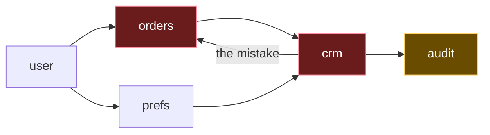
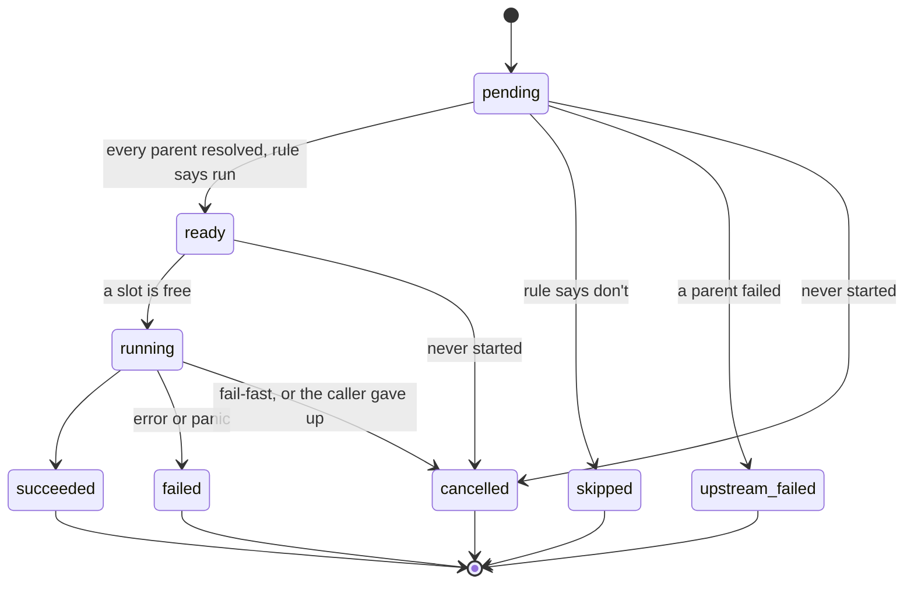

# 2. Graphs and scheduling

## The problem

A workflow definition arrives as data, written by a person in an editor or, in
[file 07](07-agents-that-build-workflows.md), by a program. Before the first call goes
out, something has to establish that it can run at all. A misspelt dependency, a duplicated
id or an accidental cycle doesn't fail loudly. It produces a run in which some steps simply
never start, and a caller waiting for them until its deadline.

Then the run itself raises questions `errgroup` was never meant to answer. Which steps may
start now? How many at once? When a step fails, should its siblings be cancelled or left to
finish? When a condition says "don't take this branch", what happens to the steps after it?
What does each step get to see, and is it the same on every run? This chapter builds the
part of the engine that answers them: a validator, and a scheduler loop that owns the run.

Assumes [file 01](01-foundations.md), and go-services files
[01](../go-services/01-how-a-go-service-runs.md) (goroutines, channels, `context`),
[05](../go-services/05-fanning-out.md) (`errgroup`) and
[09](../go-services/09-worker-pools.md) (results paired by key, panics in workers).

## 2.1 Validating the graph

Three checks, in this order, because each assumes the one before it passed:

| Check | What breaks without it |
|---|---|
| Step ids are unique | Two steps answer to `orders`. Every edge and every mapping that names `orders` is ambiguous, and whichever one the engine picks, the other is silently unreachable |
| Every edge names steps that exist | A step that depends on `ordres` waits for a parent that will never finish |
| There are no cycles | Steps on a cycle each wait for the other, so none of them starts, and neither does anything after them |

The first check is easy to defeat by choosing the wrong format, which is why file 01's
definition keeps `steps` in an array.

> ⚠️ **Don't key steps by id in a JSON object.** RFC 8259 says "An object is an unordered
> collection of zero or more name/value pairs", and that when names repeat, "the behavior of
> software that receives such an object is unpredictable. Many implementations report the
> last name/value pair only" ([RFC 8259 §4](https://www.rfc-editor.org/rfc/rfc8259#section-4)).
> Go's `encoding/json` and Node's `JSON.parse` both do exactly that. I parsed
> `{"orders":{"url":"/a"},"orders":{"url":"/b"}}` with each, and both returned a single
> `orders` with `/b`, and no error. The duplicate never reaches your validator. In an array
> of objects that each carry an `id`, the duplicate survives parsing and the first check
> catches it. An array also keeps declaration order, which §2.9 needs.

### Cycles, and steps stuck behind them

The cycle check is the interesting one, because "there's a cycle" is a poor error message.
The author needs to know which steps to look at.

Here's the running example with a mistake in it. Someone wanted `orders` to use the CRM's
response, and added a fifth step, `audit`, after `crm`:



`orders` waits for `crm`, which waits for `orders`. Neither will ever start, so `audit`,
which isn't on the cycle at all, never starts either. A useful validator reports both
kinds. The red steps are **on** the cycle, and one of the edges between them has to go. The
amber step is **behind** it, and will run once the cycle is fixed.

**Kahn's algorithm** finds both. [dsa file 10 §10.4](../interview/dsa/10-graphs.md#104-topological-sort-an-order-that-respects-dependencies)
teaches it from scratch; here's the short version. Count each step's parents: that's its
**in-degree**. Any step with none can go first. Place one, and cross it off as a parent of
each of its children. Any child whose count reaches zero can now be placed too. Repeat.
A. B. Kahn published it in 1962 ("Topological sorting of large networks", *Communications of
the ACM* 5(11), 558–562).

If the loop runs out of steps to place before it has placed them all, the leftovers are
exactly the steps that are on a cycle or behind one. Each leftover still has a parent that
was never placed, and that parent is a leftover too. To tell the two kinds apart, ask of
each leftover whether following edges from it leads back to it.

```go
// Edge says that To depends on From.
type Edge struct{ From, To string }

// CycleError lists the steps that can never start.
type CycleError struct {
	OnCycle []string // steps that can reach themselves
	Behind  []string // steps waiting on a cycle without being on one
}

func (e *CycleError) Error() string {
	msg := "on a cycle: " + strings.Join(e.OnCycle, ", ")
	if len(e.Behind) > 0 {
		msg += "; waiting behind one: " + strings.Join(e.Behind, ", ")
	}
	return msg
}

// Validate checks that ids are unique, that every edge names real steps, and
// that there is no cycle. It returns the steps in an order that respects every
// edge (Kahn's algorithm), or an error saying what to fix.
func Validate(ids []string, edges []Edge) ([]string, error) {
	index := make(map[string]int, len(ids))
	for i, id := range ids {
		if _, dup := index[id]; dup {
			return nil, fmt.Errorf("duplicate step id %q", id)
		}
		index[id] = i
	}

	children := make([][]int, len(ids))
	waiting := make([]int, len(ids)) // parents not yet placed: the in-degree
	for _, e := range edges {
		from, ok1 := index[e.From]
		to, ok2 := index[e.To]
		if !ok1 || !ok2 {
			return nil, fmt.Errorf("edge %s -> %s names a step that doesn't exist", e.From, e.To)
		}
		children[from] = append(children[from], to)
		waiting[to]++
	}

	var queue, order []int
	for i := range ids {
		if waiting[i] == 0 {
			queue = append(queue, i)
		}
	}
	for len(queue) > 0 {
		n := queue[0]
		queue = queue[1:]
		order = append(order, n)
		for _, c := range children[n] {
			waiting[c]--
			if waiting[c] == 0 {
				queue = append(queue, c)
			}
		}
	}

	if len(order) == len(ids) {
		sorted := make([]string, len(order))
		for i, n := range order {
			sorted[i] = ids[n]
		}
		return sorted, nil
	}

	// Every step not placed still waits on a parent that was never placed.
	cerr := &CycleError{}
	for i := range ids {
		if waiting[i] == 0 {
			continue // placed
		}
		if reachesItself(children, i) {
			cerr.OnCycle = append(cerr.OnCycle, ids[i])
		} else {
			cerr.Behind = append(cerr.Behind, ids[i])
		}
	}
	return nil, cerr
}

// reachesItself reports whether following edges from start leads back to it.
func reachesItself(children [][]int, start int) bool {
	seen := make([]bool, len(children))
	stack := append([]int(nil), children[start]...)
	for len(stack) > 0 {
		n := stack[len(stack)-1]
		stack = stack[:len(stack)-1]
		if n == start {
			return true
		}
		if !seen[n] {
			seen[n] = true
			stack = append(stack, children[n]...)
		}
	}
	return false
}
```

I ran it with Go 1.24.4 on six cases. The package clause, imports and the test table are
trimmed:

```
running example:                     order: [user orders prefs crm]
duplicate id:                        error: duplicate step id "orders"
misspelt edge:                       error: edge user -> ordres names a step that doesn't exist
cycle:                               error: on a cycle: orders, crm; waiting behind one: audit
self-loop:                           error: on a cycle: orders
two cycles and a step between them:  error: on a cycle: a, b, c, d; waiting behind one: x, e
```

The last case catches a tempting shortcut. Its edges are `a ⇄ b`, `b → x`, `x → c`,
`c ⇄ d` and `d → e`. Instead of `reachesItself`, you could run Kahn's algorithm a second
time, backwards over the leftovers, peeling off steps that have no leftover children. I
tried it: that peels `e` and stops, leaving `a, b, x, c, d`, so it reports `x` as on a cycle
when it's only between two. "Can I get back to myself?" gets it right.

Three properties worth keeping in your head:

- **It reports in declaration order**, because every loop walks `ids`, a slice. The map is
  only ever used for lookups. §2.9 says why that matters.
- **It's O(V + E) for a valid graph.** Classifying the leftovers is O(V × (V + E)) in the
  worst case, which is nothing for a workflow of a few hundred steps and only happens when
  there's an error to report. If you need it linear, Tarjan's strongly connected components
  algorithm (R. Tarjan, "Depth-first search and linear graph algorithms", *SIAM Journal on
  Computing* 1(2), 146–160, 1972) does it, and also groups the cycle steps into their
  separate cycles, which the message above doesn't.
- **Duplicate edges are harmless.** `user → orders` listed twice adds two to `orders`'s
  count, and placing `user` subtracts two.

<details><summary>Rust</summary>

```rust
use std::collections::{HashMap, VecDeque};
use std::fmt;

/// `to` depends on `from`.
pub struct Edge<'a> {
    pub from: &'a str,
    pub to: &'a str,
}

#[derive(Debug)]
pub enum ValidationError {
    DuplicateId(String),
    UnknownStep { from: String, to: String },
    Cycle { on_cycle: Vec<String>, behind: Vec<String> },
}

impl fmt::Display for ValidationError {
    fn fmt(&self, f: &mut fmt::Formatter) -> fmt::Result {
        match self {
            Self::DuplicateId(id) => write!(f, "duplicate step id {id:?}"),
            Self::UnknownStep { from, to } => {
                write!(f, "edge {from} -> {to} names a step that doesn't exist")
            }
            Self::Cycle { on_cycle, behind } => {
                write!(f, "on a cycle: {}", on_cycle.join(", "))?;
                if !behind.is_empty() {
                    write!(f, "; waiting behind one: {}", behind.join(", "))?;
                }
                Ok(())
            }
        }
    }
}

pub fn validate(ids: &[&str], edges: &[Edge]) -> Result<Vec<String>, ValidationError> {
    let mut index = HashMap::new();
    for (i, id) in ids.iter().enumerate() {
        if index.insert(*id, i).is_some() {
            return Err(ValidationError::DuplicateId(id.to_string()));
        }
    }

    let mut children = vec![Vec::new(); ids.len()];
    let mut waiting = vec![0usize; ids.len()]; // the in-degree
    for e in edges {
        let (Some(&from), Some(&to)) = (index.get(e.from), index.get(e.to)) else {
            return Err(ValidationError::UnknownStep { from: e.from.into(), to: e.to.into() });
        };
        children[from].push(to);
        waiting[to] += 1;
    }

    let mut queue: VecDeque<usize> = (0..ids.len()).filter(|&i| waiting[i] == 0).collect();
    let mut order = Vec::with_capacity(ids.len());
    while let Some(n) = queue.pop_front() {
        order.push(n);
        for &c in &children[n] {
            waiting[c] -= 1;
            if waiting[c] == 0 {
                queue.push_back(c);
            }
        }
    }
    if order.len() == ids.len() {
        return Ok(order.iter().map(|&n| ids[n].to_string()).collect());
    }

    let (mut on_cycle, mut behind) = (Vec::new(), Vec::new());
    for i in (0..ids.len()).filter(|&i| waiting[i] > 0) {
        if reaches_itself(&children, i) {
            on_cycle.push(ids[i].to_string());
        } else {
            behind.push(ids[i].to_string());
        }
    }
    Err(ValidationError::Cycle { on_cycle, behind })
}

fn reaches_itself(children: &[Vec<usize>], start: usize) -> bool {
    let mut seen = vec![false; children.len()];
    let mut stack = children[start].clone();
    while let Some(n) = stack.pop() {
        if n == start {
            return true;
        }
        if !seen[n] {
            seen[n] = true;
            stack.extend(&children[n]);
        }
    }
    false
}
```

Built with `rustc` 1.96, `--edition 2024`, no dependencies and no warnings. The same six
cases give the same six lines; only the valid order prints with Rust's `{:?}` quoting. The
error is an enum rather than a string, so a caller, or an editor highlighting the broken
steps, can `match` on `Cycle { on_cycle, behind }` instead of parsing text
([rust file 03 §3.4](../rust/03-errors.md#34-thiserror-for-libraries-anyhow-for-applications)).
The `let … else` line needs Rust 1.65 or later.

</details>

<details><summary>C++</summary>

```cpp
#include <deque>
#include <string>
#include <unordered_map>
#include <vector>

struct Edge {
    std::string from, to;  // `to` depends on `from`
};

struct Validation {
    std::vector<std::string> order;  // filled when valid
    std::string error;               // filled otherwise
    std::vector<std::string> on_cycle, behind;
    bool ok() const { return error.empty(); }
};

static std::string join(const std::vector<std::string>& xs) {
    std::string out;
    for (const auto& x : xs) out += (out.empty() ? "" : ", ") + x;
    return out;
}

static bool reaches_itself(const std::vector<std::vector<size_t>>& children, size_t start) {
    std::vector<bool> seen(children.size());
    std::vector<size_t> stack(children[start]);
    while (!stack.empty()) {
        size_t n = stack.back();
        stack.pop_back();
        if (n == start) return true;
        if (!seen[n]) {
            seen[n] = true;
            stack.insert(stack.end(), children[n].begin(), children[n].end());
        }
    }
    return false;
}

Validation validate(const std::vector<std::string>& ids, const std::vector<Edge>& edges) {
    Validation v;
    std::unordered_map<std::string, size_t> index;
    for (size_t i = 0; i < ids.size(); ++i) {
        if (!index.emplace(ids[i], i).second) {
            v.error = "duplicate step id \"" + ids[i] + "\"";
            return v;
        }
    }

    std::vector<std::vector<size_t>> children(ids.size());
    std::vector<size_t> waiting(ids.size());  // the in-degree
    for (const auto& e : edges) {
        auto from = index.find(e.from), to = index.find(e.to);
        if (from == index.end() || to == index.end()) {
            v.error = "edge " + e.from + " -> " + e.to + " names a step that doesn't exist";
            return v;
        }
        children[from->second].push_back(to->second);
        ++waiting[to->second];
    }

    std::deque<size_t> queue;
    for (size_t i = 0; i < ids.size(); ++i)
        if (waiting[i] == 0) queue.push_back(i);
    std::vector<size_t> order;
    while (!queue.empty()) {
        size_t n = queue.front();
        queue.pop_front();
        order.push_back(n);
        for (size_t c : children[n])
            if (--waiting[c] == 0) queue.push_back(c);
    }
    if (order.size() == ids.size()) {
        for (size_t n : order) v.order.push_back(ids[n]);
        return v;
    }

    for (size_t i = 0; i < ids.size(); ++i) {
        if (waiting[i] == 0) continue;  // placed
        (reaches_itself(children, i) ? v.on_cycle : v.behind).push_back(ids[i]);
    }
    v.error = "on a cycle: " + join(v.on_cycle);
    if (!v.behind.empty()) v.error += "; waiting behind one: " + join(v.behind);
    return v;
}
```

Built with Apple clang 17, `-std=c++20 -Wall -Wextra`, with no warnings, and the same six
lines of output (the valid order prints with commas). C++20 has no `std::expected` (it arrived in C++23), so the result is a
struct with an `ok()`, and the standard library has no string join, hence the helper.

</details>

<details><summary>JavaScript</summary>

```js
export class CycleError extends Error {
  constructor(onCycle, behind) {
    super(`on a cycle: ${onCycle.join(", ")}` +
      (behind.length ? `; waiting behind one: ${behind.join(", ")}` : ""));
    this.onCycle = onCycle;
    this.behind = behind;
  }
}

// edges are { from, to }: `to` depends on `from`.
export function validate(ids, edges) {
  const index = new Map();
  for (const [i, id] of ids.entries()) {
    if (index.has(id)) throw new Error(`duplicate step id "${id}"`);
    index.set(id, i);
  }

  const children = ids.map(() => []);
  const waiting = ids.map(() => 0); // the in-degree
  for (const { from, to } of edges) {
    if (!index.has(from) || !index.has(to)) {
      throw new Error(`edge ${from} -> ${to} names a step that doesn't exist`);
    }
    children[index.get(from)].push(index.get(to));
    waiting[index.get(to)]++;
  }

  const queue = ids.flatMap((_, i) => (waiting[i] === 0 ? [i] : []));
  for (let head = 0; head < queue.length; head++) { // queue grows as we go
    for (const c of children[queue[head]]) {
      if (--waiting[c] === 0) queue.push(c);
    }
  }
  if (queue.length === ids.length) return queue.map((n) => ids[n]);

  const onCycle = [], behind = [];
  ids.forEach((id, i) => {
    if (waiting[i] > 0) (reachesItself(children, i) ? onCycle : behind).push(id);
  });
  throw new CycleError(onCycle, behind);
}

function reachesItself(children, start) {
  const seen = new Set();
  const stack = [...children[start]];
  while (stack.length) {
    const n = stack.pop();
    if (n === start) return true;
    if (!seen.has(n)) {
      seen.add(n);
      stack.push(...children[n]);
    }
  }
  return false;
}
```

Run with Node 24, same six lines. The queue is never shortened: `head` walks along it, so
when the loop ends the queue *is* the topological order. The index is a `Map`, not a plain
object; §2.9 has the reason.

</details>

## 2.2 Why `errgroup` isn't enough

[Go-services file 05](../go-services/05-fanning-out.md#errgroup-removes-the-numbers) ends
with `errgroup` as the right tool for fanning out, and for what it does, it is: start N
independent tasks, wait for all of them, cancel the rest on the first error. File 01's
hand-written `summarise` used one. A workflow needs things it doesn't offer:

| A workflow needs | `errgroup` gives |
|---|---|
| Start a step only when its parents are done | Every task starts when you call `Go`; the ordering is your code's problem |
| A failure policy chosen per run, or per step | Fail-fast from `WithContext`, or no cancellation at all from a zero `Group` |
| Decide *not* to run a step, because a condition was false or a parent was skipped | Nothing: a function passed to `Go` runs |
| A record of every step's outcome, and why | The first error |
| A concurrency limit over the set of runnable steps, which changes as steps finish | `SetLimit`, applied in the order you happen to call `Go` |

You can get some of the way by giving every step its own goroutine that blocks on its
parents' "done" channels. That works for the happy path. But now each step's goroutine is
making decisions — should I run, was I skipped, has the run been cancelled — while reading
state that other goroutines are writing, so every decision needs a lock, and every lock is a
chance of a deadlock or a race. The concurrency limit has to be taken after the wait, in an
order nobody controls. The run record is assembled by many writers.

The alternative is the pattern [Effective Go](https://go.dev/doc/effective_go#sharing)
describes: shared values "are passed around on channels and, in fact, never actively shared
by separate threads of execution. Only one goroutine has access to the value at any given
time." Its slogan is "Do not communicate by sharing memory; instead, share memory by
communicating." For a scheduler, that means **one goroutine owns all of the run's state**,
and the goroutines making calls own nothing. Each one makes one call, sends one report and
exits. The Rust course builds the same shape in
[rust file 07 §7.2](../rust/07-concurrency-patterns.md#72-a-task-that-owns-the-state).

## 2.3 The scheduler loop

Every step moves through a small set of states, and only the owning goroutine moves it:



A step is **resolved** once it reaches any of the five final states. `skipped` and
`upstream_failed` are reached without the step ever running: they're decided the moment its
last parent resolves, which is how a skip or a failure travels down the graph (§2.6).

Here's the scheduler in four pieces; the two small functions that decide a step's fate wait
for §2.6. First the types. A step's call gets a context and a `Doc`, the part of the run's
data document it's allowed to see (file 01 §1.5), and returns a response or an error:

```go
type Status string

const (
	Pending        Status = "pending"         // waiting for its parents
	Ready          Status = "ready"           // parents resolved and its rule says run; waiting for a slot
	Running        Status = "running"         // its call is in flight
	Succeeded      Status = "succeeded"       // the call returned a response
	Failed         Status = "failed"          // the call returned an error, or panicked
	Skipped        Status = "skipped"         // a condition or its rule chose not to run it
	UpstreamFailed Status = "upstream_failed" // a step it needed failed
	Cancelled      Status = "cancelled"       // fail-fast stopped it, before or during its call
)

// Response is what a step's call returned, as the data document stores it.
type Response struct {
	Status int
	Body   map[string]any
}

// Doc is what a step's call sees: the run's input and its finished ancestors.
type Doc struct {
	Input map[string]any
	Steps map[string]Response // keyed by step id
}

// Rule decides whether a step runs once all its parents have resolved.
type Rule int

const (
	AllSuccess              Rule = iota // every parent succeeded and every edge was taken
	NoneFailedMinOneSuccess             // nothing failed, and at least one edge was taken
)

type Step struct {
	ID   string
	Rule Rule
	Call func(ctx context.Context, doc Doc) (Response, error)
}

// Edge says To depends on From. When, if set, must hold on From's response
// for the edge to count as taken.
type Edge struct {
	From, To string
	When     func(Response) bool
}

type Workflow struct {
	Steps []Step
	Edges []Edge
}

type Options struct {
	Limit    int  // most steps running at once
	FailFast bool // the first failure cancels everything else
}

// Run is the record of one execution.
type Run struct {
	Status    map[string]Status
	Responses map[string]Response
	Errors    map[string]error
}
```

`When` is a Go function here so the example stays self-contained. In a real engine it's an
expression from the definition, evaluated by the same machinery as mappings
([file 03](03-mapping-data-between-steps.md)). The rules and `decide` are §2.6's subject.

Then the loop. Read it as two halves: the inner `for` starts as many ready steps as the
limit allows, and the rest waits for one report and deals with it:

```go
type report struct {
	step int
	resp Response
	err  error
}

// Execute runs wf once. One goroutine, this one, owns every piece of run state;
// step goroutines only make their call and report back on a channel.
func Execute(ctx context.Context, wf Workflow, input map[string]any, opt Options) Run {
	ctx, cancel := context.WithCancel(ctx)
	defer cancel()
	if opt.Limit < 1 {
		opt.Limit = len(wf.Steps)
	}

	n := len(wf.Steps)
	index := make(map[string]int, n)
	for i, s := range wf.Steps {
		index[s.ID] = i
	}
	out := make([][]Edge, n) // edges leaving each step
	parents := make([][]int, n)
	waiting := make([]int, n) // parents not yet resolved
	for _, e := range wf.Edges {
		from, to := index[e.From], index[e.To]
		out[from] = append(out[from], e)
		parents[to] = append(parents[to], from)
		waiting[to]++
	}
	ancestors := allAncestors(parents)

	status := make([]Status, n)
	responses := make([]Response, n)
	errs := make([]error, n)
	outcomes := make([][]outcome, n)
	var ready []int // kept in declaration order
	for i := range n {
		status[i] = Pending
		if waiting[i] == 0 {
			status[i] = Ready
			ready = append(ready, i)
		}
	}

	// resolve records a final status and tells each child. A child whose last
	// parent this was is decided at once; a skip or upstream failure cascades.
	var resolve func(i int, st Status)
	resolve = func(i int, st Status) {
		status[i] = st
		for _, e := range out[i] {
			c := index[e.To]
			outcomes[c] = append(outcomes[c], edgeOutcome(st, e, responses[i]))
			waiting[c]--
			if waiting[c] > 0 {
				continue // still waiting for another parent
			}
			if next := decide(wf.Steps[c].Rule, outcomes[c]); next == Ready {
				status[c] = Ready
				ready = append(ready, c)
				slices.Sort(ready)
			} else {
				resolve(c, next) // a skip or an upstream failure cascades now
			}
		}
	}

	reports := make(chan report)
	running := 0
	for {
		for ctx.Err() == nil && running < opt.Limit && len(ready) > 0 {
			i := ready[0]
			ready = ready[1:]
			status[i] = Running
			running++
			go runStep(ctx, wf.Steps[i], i, docFor(i, input, wf, ancestors, status, responses), reports)
		}
		if running == 0 {
			break // nothing in flight and nothing can start
		}
		r := <-reports
		running--
		switch {
		case r.err == nil:
			responses[r.step] = r.resp
			resolve(r.step, Succeeded)
		case ctx.Err() != nil && (errors.Is(r.err, context.Canceled) || errors.Is(r.err, context.DeadlineExceeded)):
			status[r.step] = Cancelled // fail-fast, or the caller gave up
		default:
			errs[r.step] = r.err
			resolve(r.step, Failed)
			if opt.FailFast {
				cancel()
			}
		}
	}

	run := Run{Status: map[string]Status{}, Responses: map[string]Response{}, Errors: map[string]error{}}
	for i, s := range wf.Steps {
		if ctx.Err() != nil && (status[i] == Pending || status[i] == Ready) {
			status[i] = Cancelled // never started
		}
		run.Status[s.ID] = status[i]
		if status[i] == Succeeded {
			run.Responses[s.ID] = responses[i]
		}
		if errs[i] != nil {
			run.Errors[s.ID] = errs[i]
		}
	}
	return run
}
```

Then the step goroutine, which makes the call and reports exactly once, whatever happens
(§2.8 is about the `recover`):

```go
// runStep makes one step's call and reports exactly once, even if it panics.
func runStep(ctx context.Context, s Step, i int, doc Doc, reports chan<- report) {
	r := report{step: i}
	defer func() {
		if p := recover(); p != nil {
			r.err = fmt.Errorf("step %s panicked: %v\n%s", s.ID, p, debug.Stack())
		}
		reports <- r
	}()
	r.resp, r.err = s.Call(ctx, doc)
}
```

And the two helpers that decide what a step sees (§2.5):

```go
// docFor builds a step's view: the input plus every ancestor that succeeded.
func docFor(i int, input map[string]any, wf Workflow, ancestors [][]int, status []Status, responses []Response) Doc {
	d := Doc{Input: input, Steps: map[string]Response{}}
	for _, a := range ancestors[i] {
		if status[a] == Succeeded {
			d.Steps[wf.Steps[a].ID] = responses[a]
		}
	}
	return d
}

// allAncestors returns, for each step, every step it depends on directly or
// transitively.
func allAncestors(parents [][]int) [][]int {
	anc := make([][]int, len(parents))
	for i := range parents {
		seen := make([]bool, len(parents))
		stack := slices.Clone(parents[i])
		for len(stack) > 0 {
			p := stack[len(stack)-1]
			stack = stack[:len(stack)-1]
			if !seen[p] {
				seen[p] = true
				anc[i] = append(anc[i], p)
				stack = append(stack, parents[p]...)
			}
		}
	}
	return anc
}
```

The package clause and imports (`context`, `errors`, `fmt`, `runtime/debug`, `slices`) are
trimmed, and so is the test scaffolding: fake upstreams that sleep and return canned bodies,
and a trace of when each one started and finished. I ran it with Go 1.24.4, under
`go run -race`, in nine scenarios that the next sections show, plus seven `go test -race`
tests, three times over, with no race reports. `Execute` assumes a validated workflow: it
indexes edges without checking them.

Three things make the loop safe, and each is a single fact rather than two that must agree:

- **One receive for every start.** `running++` happens where a goroutine starts and
  `running--` where a report is received, and the loop can't exit while `running > 0`. So
  every goroutine's send finds a receiver, which is why the channel can be unbuffered.
  Compare go-services file 05's hand-rolled fan-out
  ([what happens when the number is wrong](../go-services/05-fanning-out.md#what-happens-when-the-number-is-wrong)),
  whose correctness depended on a buffer size matching a count kept elsewhere.
- **Only this goroutine touches run state.** `status`, `ready`, `waiting`, `outcomes` and
  `responses` are plain slices with no mutex, because nothing else can see them. A step
  goroutine gets a `Doc` built for it and a channel to send on, and nothing more.
- **The loop terminates whatever the graph is.** It stops when nothing is running and
  nothing is ready, so a cycle doesn't hang it. What a cycle does to it is the subject of
  the aside below.

> **Teacher's aside.** It's natural to see validation and scheduling as two algorithms. They
> are one. Put the scheduler next to Kahn's algorithm: `waiting` is the in-degree, `ready`
> is Kahn's queue, starting a step is placing it, and `resolve` is crossing it off as a
> parent. The only differences are that "placing" takes a network call, happens several at
> a time, and finishes in whatever order the network decides. So the scheduler's exit
> condition is Kahn's too, and a cycle shows up the same way. I ran the running example
> with the bad `crm → orders` edge and no validation:
>
> ```
> H. an unvalidated cycle (32ms)
>   status:   user=succeeded orders=pending prefs=succeeded crm=pending
> ```
>
> The loop ended cleanly with Kahn's leftover set still `pending`. Validation is the same
> algorithm run first, with instant steps, so that you find this out before `user` and
> `prefs` have made their calls rather than after.

<details><summary>Rust (tokio)</summary>

```rust
use std::collections::HashMap;
use std::future::Future;
use std::pin::Pin;
use std::sync::Arc;

use serde_json::Value;
use tokio::task::{Id, JoinError, JoinSet};

#[derive(Clone, Copy, Debug, PartialEq)]
pub enum Status { Pending, Ready, Running, Succeeded, Failed, Skipped, UpstreamFailed, Cancelled }

#[derive(Clone, Copy, PartialEq)]
pub enum Rule { AllSuccess, NoneFailedMinOneSuccess }

#[derive(Clone, Copy, PartialEq)]
enum Outcome { Taken, NotTaken, Broken }

/// What a step's call sees: the run's input and its finished ancestors' bodies.
#[derive(Clone)]
pub struct Doc {
    pub input: Value,
    pub steps: HashMap<String, Value>,
}

pub type Call =
    Arc<dyn Fn(Doc) -> Pin<Box<dyn Future<Output = Result<Value, String>> + Send>> + Send + Sync>;

pub struct Step { pub id: String, pub rule: Rule, pub call: Call }

/// `to` depends on `from`; `when`, if set, must hold on `from`'s body.
pub struct Edge { pub from: String, pub to: String, pub when: Option<fn(&Value) -> bool> }

pub struct Options { pub limit: usize, pub fail_fast: bool }

fn edge_outcome(parent: Status, e: &Edge, body: Option<&Value>) -> Outcome {
    match parent {
        Status::Succeeded if e.when.is_none_or(|w| w(body.unwrap())) => Outcome::Taken,
        Status::Succeeded | Status::Skipped => Outcome::NotTaken,
        _ => Outcome::Broken,
    }
}

fn decide(rule: Rule, ins: &[Outcome]) -> Status {
    if ins.contains(&Outcome::Broken) {
        return Status::UpstreamFailed;
    }
    match rule {
        Rule::AllSuccess if ins.contains(&Outcome::NotTaken) => Status::Skipped,
        Rule::NoneFailedMinOneSuccess if !ins.contains(&Outcome::Taken) => Status::Skipped,
        _ => Status::Ready,
    }
}

/// Everything about one run. Only `execute`'s loop touches it.
struct RunState<'a> {
    steps: &'a [Step],
    index: HashMap<&'a str, usize>,
    out: Vec<Vec<&'a Edge>>,
    waiting: Vec<usize>,
    outcomes: Vec<Vec<Outcome>>,
    status: Vec<Status>,
    bodies: Vec<Option<Value>>,
    ready: Vec<usize>, // kept in declaration order
}

impl RunState<'_> {
    fn resolve(&mut self, i: usize, st: Status) {
        self.status[i] = st;
        for k in 0..self.out[i].len() {
            let e = self.out[i][k];
            let c = self.index[e.to.as_str()];
            let o = edge_outcome(st, e, self.bodies[i].as_ref());
            self.outcomes[c].push(o);
            self.waiting[c] -= 1;
            if self.waiting[c] > 0 {
                continue; // still waiting for another parent
            }
            match decide(self.steps[c].rule, &self.outcomes[c]) {
                Status::Ready => {
                    self.status[c] = Status::Ready;
                    self.ready.push(c);
                    self.ready.sort();
                }
                next => self.resolve(c, next), // a skip or an upstream failure cascades now
            }
        }
    }
}

pub async fn execute(steps: &[Step], edges: &[Edge], input: Value, opt: Options) -> Vec<(String, Status)> {
    let n = steps.len();
    let mut s = RunState {
        steps,
        index: steps.iter().enumerate().map(|(i, st)| (st.id.as_str(), i)).collect(),
        out: vec![Vec::new(); n],
        waiting: vec![0; n],
        outcomes: vec![Vec::new(); n],
        status: vec![Status::Pending; n],
        bodies: vec![None; n],
        ready: Vec::new(),
    };
    let mut parents = vec![Vec::new(); n];
    for e in edges {
        let (from, to) = (s.index[e.from.as_str()], s.index[e.to.as_str()]);
        s.out[from].push(e);
        parents[to].push(from);
        s.waiting[to] += 1;
    }
    let ancestors = all_ancestors(&parents);
    for i in 0..n {
        if s.waiting[i] == 0 {
            s.status[i] = Status::Ready;
            s.ready.push(i);
        }
    }

    let mut running: JoinSet<Result<Value, String>> = JoinSet::new();
    let mut step_of: HashMap<Id, usize> = HashMap::new();
    let mut stopping = false;
    loop {
        while !stopping && running.len() < opt.limit && !s.ready.is_empty() {
            let i = s.ready.remove(0);
            s.status[i] = Status::Running;
            let seen = ancestors[i].iter().filter(|&&a| s.status[a] == Status::Succeeded);
            let doc = Doc {
                input: input.clone(),
                steps: seen.map(|&a| (steps[a].id.clone(), s.bodies[a].clone().unwrap())).collect(),
            };
            let handle = running.spawn((steps[i].call)(doc));
            step_of.insert(handle.id(), i);
        }
        let Some(joined) = running.join_next_with_id().await else {
            break; // nothing in flight and nothing can start
        };
        let (i, result) = match joined {
            Ok((id, result)) => (step_of[&id], result),
            Err(e) if e.is_cancelled() => {
                s.status[step_of[&e.id()]] = Status::Cancelled;
                continue;
            }
            Err(e) => (step_of[&e.id()], Err(panic_message(e))), // the task panicked
        };
        match result {
            Ok(body) => {
                s.bodies[i] = Some(body);
                s.resolve(i, Status::Succeeded);
            }
            Err(_) => {
                s.resolve(i, Status::Failed);
                if opt.fail_fast && !stopping {
                    stopping = true;
                    running.abort_all(); // each task stops at its next .await
                }
            }
        }
    }

    (0..n)
        .map(|i| {
            let st = match s.status[i] {
                Status::Pending | Status::Ready if stopping => Status::Cancelled, // never started
                st => st,
            };
            (steps[i].id.clone(), st)
        })
        .collect()
}

fn panic_message(e: JoinError) -> String {
    let p = e.into_panic();
    let msg = p.downcast_ref::<&str>().map(|m| m.to_string()).or_else(|| p.downcast_ref::<String>().cloned());
    format!("panicked: {}", msg.unwrap_or_default())
}

fn all_ancestors(parents: &[Vec<usize>]) -> Vec<Vec<usize>> {
    (0..parents.len())
        .map(|i| {
            let mut seen = vec![false; parents.len()];
            let mut stack = parents[i].clone();
            let mut anc = Vec::new();
            while let Some(p) = stack.pop() {
                if !seen[p] {
                    seen[p] = true;
                    anc.push(p);
                    stack.extend(&parents[p]);
                }
            }
            anc
        })
        .collect()
}
```

Built with rustc 1.96, tokio 1.53.3 and serde_json 1.0.154, with `cargo clippy` clean, and
run on seven of the Go version's scenarios (all but the cycle and the caller's deadline),
with the same statuses in every one. Trimmed: imports used only by the scaffolding, the fake
upstreams and the trace. To keep it shorter than the Go version it returns statuses only,
and drops errors and responses.

How it differs from the Go version, beyond syntax:

- **`JoinSet` is the channel.** `join_next_with_id` hands back finished tasks "in the order
  they finish" (completion order again, so results are recorded by step), and the task `Id`
  maps back to the step ([`JoinSet`](https://docs.rs/tokio/latest/tokio/task/struct.JoinSet.html)).
- **The state is a struct with a method**, not a closure, because a Rust closure can't call
  itself, and `resolve` has to recurse while mutating the state. Inside it, each `&Edge` is
  copied out of `self.out` before the recursive call, because iterating `self.out[i]`
  directly would hold a borrow of `self` across a call that needs `&mut self`.
- **Each step gets its own copy of its document.** Cloning a `serde_json::Value` copies the
  whole tree, so no two steps can share a body. Go shares it (§2.5).

> ⚠️ **`abort_all` doesn't ask; it stops.** An aborted task is "signalled to shut down next
> time it yields at an `.await` point" ([tokio::task](https://docs.rs/tokio/latest/tokio/task/index.html)),
> and code after that `.await` never runs. In scenario E the trace shows `orders` starting
> and never logging its end. Go's `context` is a request the step can act on, for instance
> to record that a POST may already have been sent. If a step needs that chance, pass a
> `CancellationToken` and let it return
> ([rust file 07 §7.5](../rust/07-concurrency-patterns.md#75-cancellation-versus-context)).
> Tasks from `spawn_blocking` "cannot be aborted because they are not async".

</details>

<details><summary>C++</summary>

```cpp
#include <algorithm>
#include <condition_variable>
#include <deque>
#include <functional>
#include <map>
#include <mutex>
#include <stdexcept>
#include <stop_token>
#include <string>
#include <thread>
#include <unordered_map>
#include <vector>

enum class Status { Pending, Ready, Running, Succeeded, Failed, Skipped, UpstreamFailed, Cancelled };
enum class Rule { AllSuccess, NoneFailedMinOneSuccess };
enum class Outcome { Taken, NotTaken, Broken };

using Body = std::map<std::string, std::string>;  // no JSON in the standard library
struct Doc {
    Body input;
    std::map<std::string, Body> steps;  // finished ancestors, by step id
};

struct Cancelled : std::runtime_error {
    Cancelled() : std::runtime_error("cancelled") {}
};

struct Step {
    std::string id;
    Rule rule = Rule::AllSuccess;
    std::function<Body(const Doc&, std::stop_token)> call;  // throws to fail
};

struct Edge {
    std::string from, to;                    // `to` depends on `from`
    std::function<bool(const Body&)> when;  // empty: always taken
};

// The mailbox step threads report into: the C++ stand-in for a Go channel.
struct Report {
    size_t step;
    bool ok;
    bool cancelled;
    Body body;
    std::string error;
};

class Mailbox {
    std::mutex mu_;
    std::condition_variable cv_;
    std::deque<Report> q_;

   public:
    void put(Report r) {
        {
            std::lock_guard lock(mu_);
            q_.push_back(std::move(r));
        }
        cv_.notify_one();
    }
    Report take() {
        std::unique_lock lock(mu_);
        cv_.wait(lock, [&] { return !q_.empty(); });
        Report r = std::move(q_.front());
        q_.pop_front();
        return r;
    }
};

static Outcome edge_outcome(Status parent, const Edge& e, const Body& body) {
    if (parent == Status::Succeeded) return !e.when || e.when(body) ? Outcome::Taken : Outcome::NotTaken;
    if (parent == Status::Skipped) return Outcome::NotTaken;
    return Outcome::Broken;  // Failed, UpstreamFailed
}

static Status decide(Rule rule, const std::vector<Outcome>& in) {
    auto has = [&](Outcome o) { return std::find(in.begin(), in.end(), o) != in.end(); };
    if (has(Outcome::Broken)) return Status::UpstreamFailed;
    if (rule == Rule::AllSuccess && has(Outcome::NotTaken)) return Status::Skipped;
    if (rule == Rule::NoneFailedMinOneSuccess && !has(Outcome::Taken)) return Status::Skipped;
    return Status::Ready;
}

std::vector<Status> execute(const std::vector<Step>& steps, const std::vector<Edge>& edges,
                            const Body& input, size_t limit, bool fail_fast) {
    const size_t n = steps.size();
    std::unordered_map<std::string, size_t> index;
    for (size_t i = 0; i < n; ++i) index[steps[i].id] = i;
    std::vector<std::vector<const Edge*>> out(n);
    std::vector<std::vector<size_t>> parents(n);
    std::vector<size_t> waiting(n);
    for (const auto& e : edges) {
        size_t from = index.at(e.from), to = index.at(e.to);
        out[from].push_back(&e);
        parents[to].push_back(from);
        ++waiting[to];
    }

    std::vector<Status> status(n, Status::Pending);
    std::vector<Body> bodies(n);
    std::vector<std::vector<Outcome>> outcomes(n);
    std::vector<size_t> ready;  // kept in declaration order
    for (size_t i = 0; i < n; ++i)
        if (waiting[i] == 0) {
            status[i] = Status::Ready;
            ready.push_back(i);
        }

    std::function<void(size_t, Status)> resolve = [&](size_t i, Status st) {
        status[i] = st;
        for (const Edge* e : out[i]) {
            size_t c = index.at(e->to);
            outcomes[c].push_back(edge_outcome(st, *e, bodies[i]));
            if (--waiting[c] > 0) continue;  // still waiting for another parent
            Status next = decide(steps[c].rule, outcomes[c]);
            if (next == Status::Ready) {
                status[c] = Status::Ready;
                ready.push_back(c);
                std::sort(ready.begin(), ready.end());
            } else {
                resolve(c, next);  // a skip or an upstream failure cascades now
            }
        }
    };

    // Which steps a step may see: its ancestors.
    std::function<void(size_t, std::vector<bool>&)> mark = [&](size_t i, std::vector<bool>& seen) {
        for (size_t p : parents[i])
            if (!seen[p]) {
                seen[p] = true;
                mark(p, seen);
            }
    };

    Mailbox mailbox;
    std::stop_source stop;
    std::vector<std::jthread> threads;  // joined when this function returns
    size_t running = 0;
    for (;;) {
        while (!stop.stop_requested() && running < limit && !ready.empty()) {
            size_t i = ready.front();
            ready.erase(ready.begin());
            status[i] = Status::Running;
            ++running;
            Doc doc{input, {}};
            std::vector<bool> seen(n);
            mark(i, seen);
            for (size_t a = 0; a < n; ++a)
                if (seen[a] && status[a] == Status::Succeeded) doc.steps[steps[a].id] = bodies[a];
            threads.emplace_back([&steps, &mailbox, i, doc = std::move(doc), token = stop.get_token()] {
                Report r{i, false, false, {}, {}};
                try {  // an exception escaping a std::thread calls std::terminate
                    r.body = steps[i].call(doc, token);
                    r.ok = true;
                } catch (const Cancelled&) {
                    r.cancelled = true;
                } catch (const std::exception& e) {
                    r.error = e.what();
                } catch (...) {
                    r.error = "unknown exception";
                }
                mailbox.put(std::move(r));
            });
        }
        if (running == 0) break;  // nothing in flight and nothing can start
        Report r = mailbox.take();
        --running;
        if (r.ok) {
            bodies[r.step] = std::move(r.body);
            resolve(r.step, Status::Succeeded);
        } else if (r.cancelled) {
            status[r.step] = Status::Cancelled;
        } else {
            resolve(r.step, Status::Failed);
            if (fail_fast) stop.request_stop();  // every step's token sees it
        }
    }
    for (auto& st : status)
        if (stop.stop_requested() && (st == Status::Pending || st == Status::Ready)) st = Status::Cancelled;
    return status;
}
```

Built with Apple clang 17, `-std=c++20 -Wall -Wextra`, with no warnings, and run on the same
seven scenarios as the Rust version, with the same statuses, both optimised and under
ThreadSanitizer (`-fsanitize=thread`), which reported nothing. Trimmed: the fake upstreams,
the trace, and `<chrono>` and `<cstdio>`, which only they use.

How it differs:

- **There's no channel in the standard library**, so a mutex, a condition variable and a
  deque stand in for one. `std::async` would carry each step's result or exception back in
  a `std::future`, but standard C++ has no way to wait for whichever of several futures
  finishes first: `when_any` exists only in the Concurrency TS, as
  `std::experimental::when_any` ([cppreference](https://en.cppreference.com/w/cpp/experimental/when_any)).
- **Cancellation is cooperative, as in Go.** A run-wide `std::stop_source` (C++20) hands
  each step a `std::stop_token` to check. The fake upstreams check it every millisecond; a
  real HTTP client needs its own way to be interrupted, and C++ has no HTTP client in its
  standard library at all. `std::jthread` "automatically rejoins on destruction"
  ([cppreference](https://en.cppreference.com/w/cpp/thread/jthread)), which is why
  `threads` needs no explicit join; every thread has already reported by then.
- **`Doc` is copied into each thread by value.** `std::map` has value semantics, so each
  step owns a deep copy. Go's maps don't (§2.5).

> ⚠️ **An exception that escapes a thread ends the program.** cppreference, on the
> `std::thread` constructor: "If the function throws an exception, std::terminate is called"
> ([std::thread](https://en.cppreference.com/w/cpp/thread/thread/thread)). The
> `try`/`catch (...)` in the thread body is the C++ version of Go's `recover`, and like it,
> it has to wrap the whole call.

</details>

<details><summary>JavaScript</summary>

```js
function edgeOutcome(parent, edge, body) {
  if (parent === "succeeded") return !edge.when || edge.when(body) ? "taken" : "notTaken";
  if (parent === "skipped") return "notTaken";
  return "broken"; // failed, upstream_failed
}

function decide(rule, ins) {
  if (ins.includes("broken")) return "upstream_failed";
  if (rule === "all_success" && ins.includes("notTaken")) return "skipped";
  if (rule === "none_failed_min_one_success" && !ins.includes("taken")) return "skipped";
  return "ready";
}

// steps: [{ id, rule, call(doc, signal) }]; edges: [{ from, to, when? }]
export function execute(wf, input, { limit = Infinity, failFast = false } = {}) {
  const index = new Map(wf.steps.map((s, i) => [s.id, i]));
  const out = wf.steps.map(() => []);
  const parents = wf.steps.map(() => []);
  const waiting = wf.steps.map(() => 0);
  for (const e of wf.edges) {
    const from = index.get(e.from), to = index.get(e.to);
    out[from].push(e);
    parents[to].push(from);
    waiting[to]++;
  }
  const ancestors = allAncestors(parents);
  const status = waiting.map((w) => (w === 0 ? "ready" : "pending"));
  const ready = status.flatMap((s, i) => (s === "ready" ? [i] : [])); // declaration order
  const outcomes = wf.steps.map(() => []);
  const bodies = [];
  const errors = {};
  const controller = new AbortController();
  let running = 0;

  function resolve(i, st) {
    status[i] = st;
    for (const e of out[i]) {
      const c = index.get(e.to);
      outcomes[c].push(edgeOutcome(st, e, bodies[i]));
      if (--waiting[c] > 0) continue; // still waiting for another parent
      const next = decide(wf.steps[c].rule, outcomes[c]);
      if (next === "ready") {
        status[c] = "ready";
        ready.push(c);
        ready.sort((a, b) => a - b);
      } else {
        resolve(c, next); // a skip or an upstream failure cascades now
      }
    }
  }

  return new Promise((finish) => {
    function pump() {
      while (!controller.signal.aborted && running < limit && ready.length) start(ready.shift());
      if (running === 0) finish(record()); // nothing in flight and nothing can start
    }

    function start(i) {
      status[i] = "running";
      running++;
      const seen = ancestors[i].filter((a) => status[a] === "succeeded");
      const doc = { input, steps: Object.fromEntries(seen.map((a) => [wf.steps[a].id, bodies[a]])) };
      Promise.resolve()
        .then(() => wf.steps[i].call(doc, controller.signal)) // a synchronous throw becomes a rejection
        .then(
          (body) => {
            bodies[i] = body;
            resolve(i, "succeeded");
          },
          (err) => {
            if (controller.signal.aborted && err?.name === "AbortError") {
              status[i] = "cancelled";
              return;
            }
            errors[wf.steps[i].id] = String(err?.message ?? err);
            resolve(i, "failed");
            if (failFast) controller.abort(); // every step's signal fires
          },
        )
        .finally(() => {
          running--;
          pump();
        });
    }

    function record() {
      const st = {};
      wf.steps.forEach((s, i) => {
        const never = status[i] === "pending" || status[i] === "ready";
        st[s.id] = never && controller.signal.aborted ? "cancelled" : status[i];
      });
      return { status: st, errors };
    }

    pump();
  });
}

function allAncestors(parents) {
  return parents.map((ps) => {
    const seen = new Set();
    const stack = [...ps];
    while (stack.length) {
      const p = stack.pop();
      if (!seen.has(p)) {
        seen.add(p);
        stack.push(...parents[p]);
      }
    }
    return [...seen];
  });
}
```

Run with Node 24 on the same seven scenarios, with the same statuses. Trimmed: the fake
upstreams, which use `setTimeout` from `node:timers/promises` with `{ signal }` so that an
abort rejects them, and the trace.

How it differs:

- **No channel, no lock, and still one owner.** Node runs one callback at a time, so
  `status`, `ready` and `running` can only be touched by one piece of code at once. Each
  completion is a callback that updates the state and calls `pump()` again. The cost of
  that single thread: a step or condition that computes for 200 ms stalls every other step.
- **Cancellation is an `AbortSignal`,** the JavaScript `context`. `fetch` and
  `timers/promises` accept one, and a step that doesn't pass it on can't be cancelled.
  `controller.abort()` with no argument sets the signal's reason to an `AbortError`, and the
  APIs holding the signal reject with it, which is how the scheduler tells cancellation from
  failure. (In Node 24, both a `fetch` and a `timers/promises` sleep given an aborted
  signal rejected with `AbortError`.)
- **`Promise.all` is not a scheduler.** MDN: "Rejecting the returned promise does not cancel
  the remaining operations" ([Promise.all](https://developer.mozilla.org/en-US/docs/Web/JavaScript/Reference/Global_Objects/Promise/all)).
  Fail-fast needs the `AbortController`.

> ⚠️ **Call the step inside `.then`, not before it.** `Promise.resolve().then(() =>
> call(...))` turns a synchronous `throw` into a rejection the scheduler handles. I changed
> it to `Promise.resolve(call(...))`, which calls the step first: a step that read a
> property of `undefined` threw out of `pump()`, inside a `.finally` callback, as a
> rejection nobody handled, and Node 24 exited with status 1 during the last scenario.
> Since Node 15, `--unhandled-rejections` defaults to `throw`: "raise the unhandled
> rejection as an uncaught exception"
> ([Node CLI docs](https://nodejs.org/api/cli.html#--unhandled-rejectionsmode)).

</details>

## 2.4 The ready set and a concurrency limit

The **ready set** is every step whose parents have all resolved and whose rule says run,
but which hasn't been given a slot yet. In the code it's `ready`, a slice of step indices
kept sorted, so that when there are more ready steps than free slots, the earliest-declared
goes first. With a limit of one, the run is fully sequential and fully predictable. I ran
the running example with `user`, `orders`, `prefs` and `crm` taking 10, 60, 20 and 10 ms:

```
B. limit 1 (107ms)
  status:   user=succeeded orders=succeeded prefs=succeeded crm=succeeded
  started:  user, orders, prefs, crm
  finished: user@11ms, orders@72ms, prefs@93ms, crm@106ms
```

`orders` went before `prefs` only because it's declared first. A test that ran this twenty
times saw the same start order every time.

Why have a limit at all, when the graph already says what may run in parallel? Because the
graph says what's *allowed*, not what's *wise*:

- **Upstreams have rate limits**, and a wide fan-out can trip them in one run.
- **Connections are pooled, and the pool is shared.** Go's `http.Transport` limits
  connections per host only if you set `MaxConnsPerHost`, whose documentation says "Zero
  means no limit", so a burst of steps against one host can open as many connections as
  there are steps ([go-services file 02](../go-services/02-the-http-client.md)).
- **A request-style run shares the process with other requests**, and one wide run shouldn't
  starve them.

Two things this limit doesn't do, and they catch people out.

It's **per run**. Ten concurrent runs with a limit of four can make forty calls at once to
the same upstream. A limit per upstream, or fairness between runs or between tenants, needs
a layer above the scheduler. There's no standard design for it, and this course doesn't
build one.

And a queued step's **deadline should start when it starts**, not when the run does.
[Go-services file 09](../go-services/09-worker-pools.md#one-deadline-shared-by-work-still-in-the-queue)
measured healthy calls failing because they spent their budget waiting for a slot. A
per-step timeout belongs inside the step, derived from the run's context when the call
begins, and it can never outlast the run's own deadline, because a child context can't
outlive its parent.

## 2.5 Fan-in keyed by step id

`crm` is the fan-in: it can't start until both `orders` and `prefs` have resolved, and its
mapping needs both responses. With a limit of four, and `orders` slower than `prefs`:

```
A. fan-in, limit 4 (83ms)
  status:   user=succeeded orders=succeeded prefs=succeeded crm=succeeded
  started:  user, prefs, orders, crm
  finished: user@11ms, prefs@32ms, orders@72ms, crm@83ms
  crm saw:  orders,prefs,user
```

`prefs` finished 40 ms before `orders`, and that changed nothing about what `crm` saw: three
responses, each under its step id. Nothing in the scheduler knows or cares which arrived
first. Reports arrive in completion order, as they do from any pool, and are stored by step
index, which is the cure for the bug in
[go-services file 09](../go-services/09-worker-pools.md#results-arrive-in-completion-order).

`crm` saw `user` as well, though no edge joins them, because `docFor` gives each step its
**finished ancestors**, not just its parents. That rule is what makes a step's view
independent of timing. `prefs` never sees `orders`, even on a run where `orders` happened to
finish first, so the same input and the same upstream responses give `prefs` the same
document every time.

Products choose differently here, and the differences are instructive:

| Product | How several results meet | What can go wrong |
|---|---|---|
| This chapter's engine | Each response under its step id | Nothing collides; a mapping must name the step it reads |
| KrakenD, by default | "aggregates and merges the responses from all backends automatically", one JSON object | Fields with the same name collide; KrakenD recommends its `group` option "when different backend responses can have colliding key names" ([response manipulation](https://www.krakend.io/docs/endpoints/response-manipulation/)) |
| Step Functions `Parallel` state | An array, one element per branch; "Branch results are ordered consistently — they correspond to the order of the Branches array" | Position carries meaning, and the documented `$merge` example notes that with "overlapping keys, later array elements take precedence" ([transforming data](https://docs.aws.amazon.com/step-functions/latest/dg/transforming-data.html)) |

Keying by id and ordering by declaration both avoid completion order. Merging into one
object avoids it too, but swaps it for a quieter problem: two upstreams that both return an
`id` field.

> ⚠️ **In Go and JavaScript, steps share their parents' bodies.** `docFor` copies the map of
> responses, but each `Response.Body` is a map, and a Go map value is a reference
> ([go-services file 06](../go-services/06-copies-that-share-memory.md)). So `orders` and
> `prefs` both receive `user`'s *same* body. I gave `orders` a "harmless" annotation,
> `d.Steps["user"].Body["touched"] = true`, while `prefs` read the same map:
> `go test -race` reported `WARNING: DATA RACE`. In Node the same write simply shows up in
> the sibling's document, since both hold the same object. Rust (`Value::clone` copies the
> tree) and C++ (`std::map` copies by value) give each step its own. In Go and JavaScript,
> treat the document as read-only, or deep-copy it in `docFor` if step code isn't yours.

## 2.6 Conditional edges and skip cascades

Some edges should only be followed sometimes: fetch orders only for an active user. That's a
**conditional edge**, `user → orders` with a condition on `user`'s response. When a parent
resolves, each of its outgoing edges gets one of three **outcomes**:

| Outcome | When |
|---|---|
| **taken** | The parent succeeded, and the edge has no condition or its condition held |
| **not taken** | The parent succeeded and the condition was false, or the parent was itself skipped |
| **broken** | The parent failed, or was itself upstream-failed |

Once every incoming edge of a step has an outcome, the step's **rule** turns them into a
decision. Both rules here take failure first, so a broken edge always means
`upstream_failed`:

```go
type outcome int

const (
	taken    outcome = iota // the parent succeeded and the edge's condition held
	notTaken                // the parent was skipped, or the condition was false
	broken                  // the parent failed, or a step it needed failed
)

func edgeOutcome(parent Status, e Edge, resp Response) outcome {
	switch parent {
	case Succeeded:
		if e.When == nil || e.When(resp) {
			return taken
		}
		return notTaken
	case Skipped:
		return notTaken
	default: // Failed, UpstreamFailed
		return broken
	}
}

// decide applies a step's rule once every one of its parents has resolved.
func decide(rule Rule, in []outcome) Status {
	if slices.Contains(in, broken) {
		return UpstreamFailed
	}
	switch rule {
	case AllSuccess:
		if slices.Contains(in, notTaken) {
			return Skipped
		}
	case NoneFailedMinOneSuccess:
		if !slices.Contains(in, taken) {
			return Skipped
		}
	}
	return Ready
}
```

Steps with no parents never reach `decide`; they start `ready`.

A skipped step resolves at once, and its own edges become "not taken", so under
`AllSuccess` the skip travels down the graph: a **skip cascade**. With an inactive user, and
`crm` on each rule in turn:

```
C. user inactive, crm all_success (32ms)
  status:   user=succeeded orders=skipped prefs=succeeded crm=skipped
  started:  user, prefs
D. user inactive, crm none_failed_min_one_success (42ms)
  status:   user=succeeded orders=skipped prefs=succeeded crm=succeeded
  started:  user, prefs, crm
  crm saw:  prefs,user
```

In C the cascade took `crm` with it, though `prefs` succeeded. That's `AllSuccess` working
as written, and it's rarely what an author means at a join after a branch. In D, `crm` ran
on what it had. Its document has no `orders`, so its mapping meets the "reading what you
can't see" case from file 01 §1.5: `$count(steps.orders.body.orders)` must cope with
`orders` being absent, which is file 03's problem. A separate test checks the cascade is
transitive: a false condition on `a → b` in the chain `a → b → c → d` skips `b`, `c` and
`d`.

### Airflow's trigger rules

Airflow has the same machinery under the name **trigger rules**, and its documentation is
the clearest description of the design space. It has no conditional edges: a branch task
(`@task.branch`) picks which children run, and the rest are skipped, which arrives at the
join exactly like a "not taken" edge. Its rules, from the
[Dags page](https://airflow.apache.org/docs/apache-airflow/stable/core-concepts/dags.html)
for Airflow 3.3.2, with "upstream task" meaning parent (file 01 §1.3):

| Rule | Airflow's description | In this chapter's code |
|---|---|---|
| `all_success` (default) | "All upstream tasks have succeeded" | `AllSuccess` |
| `none_failed_min_one_success` | "All upstream tasks have not `failed` or `upstream_failed`, and at least one upstream task has succeeded." | `NoneFailedMinOneSuccess` |
| `none_failed` | "all upstream tasks have succeeded or been skipped" | Not here: the previous rule without "at least one" |
| `all_done` | "All upstream tasks are done with their execution" | Not here: run whatever happened, for cleanup or audit steps |
| `all_failed` | "All upstream tasks are in a `failed` or `upstream_failed` state" | Not here: a compensation step |
| `one_success`, `one_failed` | "does not wait for all upstream tasks to be done" | Not here: these decide before every parent has resolved, which this loop never does |
| `always` | "No dependencies at all, run this task at any time" | Not here |

The page lists thirteen rules in all, including `all_skipped`, `one_done`, `none_skipped`,
`all_done_setup_success` and `all_done_min_one_success` (the last new in 3.1.0). The page
makes the cascade explicit: "Skipped tasks will cascade through trigger rules `all_success`
and `all_failed`, and cause them to skip as well", and it gives scenario C's advice in one
line: "You almost never want to use all_success or all_failed downstream of a branching
operation." Its worked example sets the join to `none_failed_min_one_success` to fix it,
which is scenario D.

What status a step gets when its rule isn't met is in Airflow's source rather than its docs.
In `trigger_rule_dep.py` ([apache/airflow](https://github.com/apache/airflow/blob/main/airflow-core/src/airflow/ti_deps/deps/trigger_rule_dep.py)),
`all_success` checks for a failed or upstream-failed parent first and sets
`UPSTREAM_FAILED`, and only otherwise sets `SKIPPED` if a parent was skipped;
`none_failed_min_one_success` gives `UPSTREAM_FAILED` for a failure and `SKIPPED` when every
parent was skipped. The code in this chapter follows the same order, and a test checks it:
a step with one skipped parent and one failed parent ends `upstream_failed`.

### Not every engine keeps the distinction

GitHub Actions makes the opposite choice. Its `needs` documentation: "If a job fails or is
skipped, all jobs that need it are skipped unless the jobs use a conditional expression that
causes the job to continue"
([workflow syntax](https://docs.github.com/en/actions/reference/workflows-and-actions/workflow-syntax)).
A job that couldn't run because something failed and a job that wasn't needed are both
"skipped".

Which is right? For an orchestration engine, the evidence favours keeping them apart. A run
in which `crm` was skipped because the user was inactive did exactly what it should, and is
a success. A run in which `crm` never happened because `prefs` failed didn't, and someone
should hear about it. If both show `crm` as "skipped", every dashboard and alert built on
step statuses has to rediscover the difference by walking the graph. GitHub's choice is
simpler to explain, and the failure is still visible on the job that failed; it's the
downstream jobs whose status stops telling you why.

> ⚠️ **Conditions run inside the scheduler.** `edgeOutcome` calls `When` on the goroutine
> that owns the run, so a slow condition stalls every step and a panicking one unwinds
> `Execute` itself. I tested the second: a condition on `prefs → crm` that did an unchecked
> type assertion panicked while `orders` was still running. `Execute` unwound, and
> `orders`'s goroutine was left blocked for ever on its send, because nothing would receive
> again (goroutines before: 2; after: 3). Evaluate conditions with the same guardrails as
> mappings (file 03), and recover around them as `runStep` does around calls.

## 2.7 Failure policy: fail fast or carry on

When `prefs` fails, should `orders`, which is still running and doesn't depend on it, be
stopped? There are two coherent answers, and `Options.FailFast` picks between them. With
`orders` taking 200 ms and `prefs` failing at about 20 ms:

```
E. prefs fails, fail-fast (31ms)
  status:   user=succeeded orders=cancelled prefs=failed crm=cancelled
  finished: user@11ms, prefs@31ms, orders@31ms
  error:    prefs: 503 Service Unavailable
F. prefs fails, carry on (211ms)
  status:   user=succeeded orders=succeeded prefs=failed crm=upstream_failed
  finished: user@11ms, prefs@31ms, orders@211ms
  error:    prefs: 503 Service Unavailable
```

| | Fail fast (E) | Carry on (F) |
|---|---|---|
| What happens to running steps | Their context is cancelled; they report `cancelled` | They finish |
| What happens to steps not yet started | `upstream_failed` if every parent had resolved and one failed; otherwise never started, and `cancelled` | Decided by their rules, so a failure cascades as `upstream_failed` and independent branches carry on |
| The run took | 31 ms | 211 ms |
| Fits | Request-style runs, where the answer is useless without every part, and time is the caller's | Job-style runs, where independent branches are worth finishing, and a person will look at the failure |
| `errgroup` equivalent | `WithContext` | Each task records its own error and returns `nil` ([go-services file 05](../go-services/05-fanning-out.md#one-failure-or-all-of-them)) |

The caller giving up looks like fail-fast from the inside: the run's context is cancelled
from outside instead of by `cancel()`. With a 100 ms deadline on the caller's context:

```
I. the caller's deadline (100ms) passes (101ms)
  status:   user=succeeded orders=cancelled prefs=succeeded crm=cancelled
```

This is the case where request-style composition and job-style engines part company most
visibly. The request-style run stops at the caller's deadline with half its work done. A
job-style run would have no such deadline, and no reason to stop.

Fail-fast stops new work and asks running work to stop. It doesn't undo anything, and it
doesn't make anything certain:

- **A cancelled call may already have had its effect.** If `crm` had been in flight when the
  run was cancelled, its POST may have reached the CRM before the cancellation reached the
  client. The run record says `cancelled`, and the CRM has a summary. That's the gap
  [file 04](04-retries-idempotency-and-durability.md) closes with idempotency keys, and
  the payment example in [go-services file 04](../go-services/04-deadlines-and-retries.md#retry-only-what-can-succeed)
  is the same problem.
- **Under fail-fast, the run record depends on timing.** Which siblings had finished before
  the failure arrived is a race. Two runs with the same input and the same upstream
  behaviour can end with different sets of `succeeded` and `cancelled` steps.
- **A step that ignores its context holds the run open.** `Execute` doesn't return until
  every started step has reported, which is what makes the unbuffered channel safe. If you'd
  rather return at the deadline whatever a step is doing, buffer the channel to
  `len(wf.Steps)` so a late report never blocks, return early, and accept that the
  goroutine outlives its run. The buffer size comes from the same slice the steps do, so it
  can't drift.

Here the policy belongs to the whole run, but engines also let a single step opt out:
Kestra's tutorial shows how to "allow specific tasks to fail without stopping the flow"
([Kestra fundamentals](https://kestra.io/docs/tutorial/fundamentals)). In this chapter's
model, the place for that is the rule on the step *after* an optional one. Neither rule here
tolerates a failed parent, since both turn a broken edge into `upstream_failed`. A third
rule like Airflow's `all_done` ("All upstream tasks are done with their execution"), which
ignores outcomes entirely, would let the run continue past the optional step.

## 2.8 Panics in step goroutines

A step's call is code you may not have written: a plug-in, a generated client, a mapping
engine. If it panics, what happens depends on where the panic is caught, and in Go the
default is the harshest one. The language specification describes what an
unrecovered panic does: deferred functions run "up to any deferred by the top-level function
in the executing goroutine. At that point, the program is terminated and the error condition
is reported" ([Go spec: handling panics](https://go.dev/ref/spec#Handling_panics)). The
program, not the goroutine. One panicking step kills every run in the process.

So `runStep` recovers, and the details matter:

- **The send is in the same deferred function as the `recover`.** If `reports <- r` came
  after the call instead, a panic would skip it, `running` would never reach zero, and the
  loop would wait for ever. It's the `wg.Done()` mistake from
  [go-services file 09](../go-services/09-worker-pools.md#a-pool-that-logs-and-returns-nil),
  in channel form.
- **The panic becomes an ordinary failure,** so the failure policy and the rules apply to it
  like any other.
- **The stack goes into the error,** via `debug.Stack()`. Recovering hides the crash from
  anything that watches for crashes, so the run record has to carry what the crash report
  would have.

```
G. orders panics, carry on (31ms)
  status:   user=succeeded orders=failed prefs=succeeded crm=upstream_failed
  error:    orders: step orders panicked: assignment to entry in nil map
```

The process carried on, `prefs` finished, and `crm` was marked as unable to run.

`recover` has limits, and I checked both. It only catches panics on its own goroutine: a step
that starts a goroutine of its own, which then panics, takes the process down despite
`runStep` (exit status 2). And some failures aren't panics at all: two goroutines writing
one map produced `fatal error: concurrent map writes`, which no `recover` catches (exit
status 2 again). Isolating code you truly don't trust needs a separate process.

### `errgroup` changed its mind about panics

If you've read that `errgroup` propagates panics, you read something that was true for
about ten weeks. In `golang.org/x/sync` v0.14.0 (7 April 2025) and v0.15.0 (28 May 2025),
`Group.Go` recovered panics and `Wait` re-raised them: "If any of the calls panics, Wait
panics with a [PanicValue]". In v0.16.0 (20 June 2025) that was taken out again. The
current source (v0.24.0) explains why, in a comment inside `Go`:

```go
		// It is tempting to propagate panics from f()
		// up to the goroutine that calls Wait, but
		// it creates more problems than it solves:
		// - it delays panics arbitrarily,
		//   making bugs harder to detect;
		// - it turns f's panic stack into a mere value,
		//   hiding it from crash-monitoring tools;
		// - it risks deadlocks that hide the panic entirely,
		//   if f's panic leaves the program in a state
		//   that prevents the Wait call from being reached.
		// See #53757, #74275, #74304, #74306.
```

I read all three versions' source from the Go module proxy; the dates are the proxy's
release times. Both positions are defensible, and the disagreement is the lesson. The Go
team's argument is about a library used everywhere: a crash should look like a crash. A
workflow engine is in a different position. Its steps are someone else's code by design,
and one of them crashing the process takes down unrelated runs. That's why this scheduler
recovers, and why it pays the price the comment names by putting the stack in the run
record.

### The same mistake in four languages

| Language | An unhandled failure in a step | What contains it |
|---|---|---|
| Go | A panic in any goroutine ends the program | `recover` in a deferred function on that goroutine, as in `runStep` |
| Rust, `std::thread` | Ends that thread: "If the spawned thread panics, join will return an Err containing the argument given to panic!" ([thread::spawn](https://doc.rust-lang.org/std/thread/fn.spawn.html)) | Nothing extra; inspect the `Err` from `join` |
| Rust, tokio task | Ends that task: "if the spawned task panics, awaiting its JoinHandle will return a JoinError" ([tokio::task](https://docs.rs/tokio/latest/tokio/task/index.html)) | `JoinError::is_panic`, as in the Rust scheduler |
| C++, `std::thread` | "If the function throws an exception, std::terminate is called" | `try`/`catch (...)` around the whole call, as in the C++ scheduler |
| JavaScript (Node) | A throw inside an async function becomes a rejected promise; an unhandled rejection ends the process by default since Node 15 | A rejection handler on every step's promise, and calling the step inside `.then` |

> ⚠️ **Rust contains panics only while panics unwind.** With `panic = "abort"` in a Cargo
> profile, the meaning is "Terminate the process upon panic"
> ([Cargo profiles](https://doc.rust-lang.org/cargo/reference/profiles.html#panic)), and
> neither `join` nor `JoinError` gets a chance. It's one line in `Cargo.toml`, possibly
> only in the release profile, so tests in debug builds won't show it. Check before you rely
> on a panicking step being contained.

## 2.9 Deterministic ordering

"Deterministic" means: the same definition, the same input and the same upstream responses
give the same result. Some of what this scheduler does is deterministic, and some can't be.

| Deterministic | Not deterministic |
|---|---|
| The order steps are *launched* in, given the ready set's ordering | The order step code actually *begins* running, with a limit above one |
| What each step sees: its finished ancestors, by id | The order steps finish in |
| Final statuses, as long as nothing is cancelled | Which steps had finished when a fail-fast or a deadline arrived (§2.7) |
| The whole run, with a limit of one | Timings |

The first row is worth a measurement. I ran scenario A twice. The scheduler launched
`orders` before `prefs` both times, since `orders` is declared first. The fakes logged
their starts as `user, orders, prefs, crm` the first time and `user, prefs, orders, crm` the
second: the Go runtime chose which new goroutine ran first. Only a limit of one pins that
down (§2.4).

### n8n makes the order part of the contract

n8n documents its execution order. For workflows created since n8n 1.0, it "executes each
branch in turn, completing one branch before starting another", ordering branches by their
position on the canvas, top to bottom, and leftmost first when two are at the same height.
Workflows created before 1.0 run "the first node of each branch, then the second node of
each branch, and so on", and the setting can be changed per workflow
([execution order](https://docs.n8n.io/flow-logic/execution-order/)).

Two consequences follow. Moving a node on the canvas changes the order its branch runs in.
And as documented, branches run one after another, so the running example in n8n would
fetch `orders` and `prefs` in sequence, not together. The page describes order only; it
says nothing about running branches concurrently.

Why would an engine pin the order down like this? One reason is visible in n8n's expression
methods ([output of other nodes](https://docs.n8n.io/code/builtin/output-other-nodes/)):
alongside `.first()` and `.all()`, `$()` offers `.isExecuted`, which tells a mapping whether
a node has run. My reading is that a mapping there can refer to a node that may or may not
have run, and when that's allowed, a fixed order is what keeps runs repeatable. This course
takes the other route: restrict each step to its ancestors, which have always finished, and
the order between unrelated branches stops mattering.

### Map iteration order is a trap in every language

The scheduler and the validator keep steps in a slice and use maps only for lookups. That's
deliberate, because iterating a built-in map gives a different order in each language, and
in some, a different order on each run:

| Language | Built-in map iteration order |
|---|---|
| Go | "not specified and is not guaranteed to be the same from one iteration to the next" ([spec: for statements](https://go.dev/ref/spec#For_statements)). Six runs of a program printing a four-key map gave four different orders |
| Rust | `HashMap::iter` visits "all key-value pairs in arbitrary order"; the default hasher is chosen "to provide resistance against HashDoS attacks" ([HashMap](https://doc.rust-lang.org/std/collections/struct.HashMap.html)). `BTreeMap` is sorted by key |
| C++ | `std::unordered_map`: "the elements are not sorted in any particular order, but organized into buckets" ([cppreference](https://en.cppreference.com/w/cpp/container/unordered_map)). `std::map` is sorted by key: deterministic, but alphabetical, not declaration order |
| JavaScript | `Map` keeps insertion order. A plain object doesn't, quite: "all non-negative integer keys … will be traversed first in ascending order by value, then other string keys in ascending chronological order of property creation" ([MDN: for...in](https://developer.mozilla.org/en-US/docs/Web/JavaScript/Reference/Statements/for...in)) |

> ⚠️ **A step id that looks like a number reorders a JavaScript object.** I inserted the ids
> `user`, `10`, `orders`, `2`, `prefs` into a plain object and a `Map`. `Object.keys` gave
> `2,10,user,orders,prefs`; the `Map` gave them back as inserted. `JSON.parse` behaves the
> same way, since it builds plain objects. In Rust, `serde_json`'s `Map` is
> "always kept in a sorted state" unless you enable its `preserve_order` feature
> ([serde_json::Map](https://docs.rs/serde_json/latest/serde_json/struct.Map.html)). So a
> definition that keys steps by id in an object has no declaration order to preserve, in
> any language. Keep steps in an array (§2.1), and iterate the array.

## 2.10 What this scheduler doesn't do

Each gap is real, and most are other chapters' subjects:

- **Survive a crash.** All run state lives in one goroutine's memory. If the process dies,
  the run is gone, and nobody knows which calls happened. That's
  [file 04](04-retries-idempotency-and-durability.md), and it's what moves a design from
  the request-style end of file 01's spectrum towards the job-style end.
- **Retry.** A `503` from `prefs` fails the step outright. When to retry, how often, and
  which calls are safe to repeat are also file 04's.
- **Time out one step.** That belongs inside the step, derived from the run's context when
  the call starts (§2.4), with the retry budget fitting inside it
  ([go-services file 04](../go-services/04-deadlines-and-retries.md#add-up-the-worst-case)).
- **Fan out over data.** "Call the orders API once for each item in a list" makes the
  graph's shape depend on a response. Step Functions has a `Map` state whose `Items` can be
  an expression that "must evaluate to an array or object", and Kestra has a `Loop` task
  with its own `concurrencyLimit`. Once the graph grows at run time, validation can only
  check the template, and the concurrency limit has to cover steps that didn't exist when
  the run began.
- **Limit across runs.** The limit is per run (§2.4). Per-upstream limits and fairness
  between runs or tenants need a layer above, and there's no agreed design for it.
- **Undo.** Fail-fast stops work but reverses nothing (§2.7). Compensating for steps that
  did happen is the saga pattern's subject. Engines give you somewhere to put the
  compensation, such as Kestra's `errors` and `finally` hooks or a Step Functions `Catch`
  field, but deciding what "undo" means for each step is still the author's job.

## Check yourself

1. In the cycle example of §2.1, `audit` is reported even though no edge into it is wrong.
   Why does Kahn's algorithm leave it unplaced, and what does the scheduler do with the same
   graph if validation is skipped?
2. Someone "optimises" `Execute` so that, under fail-fast, it returns as soon as it calls
   `cancel()`, without waiting for running steps to report. With the channel still
   unbuffered, what happens to `orders`'s goroutine in scenario E? What two changes would
   make returning early safe?
3. With a limit of four, list what can differ between two runs of the running example given
   the same input and identical upstream behaviour, first when nothing fails and then when
   `prefs` fails under fail-fast. Which of those differences could change a step's
   *request*, and why can't the rest?
4. `user → orders` has a condition, `active`, and the user is inactive. Give every step's
   final status with `crm` on `all_success`, then on `none_failed_min_one_success`. Then
   make the user active and `prefs` fail, with the carry-on policy: what does `crm` get
   under each rule, and why is that status better than "skipped" for whoever is on call?
5. A step's code starts a goroutine of its own to fetch some data, and that goroutine
   panics. Walk through what `runStep`'s `recover` does about it, and what happens to every
   other run in the process. What's the nearest equivalent in a tokio task and in Node, and
   does either survive it?
6. A colleague proposes dropping `Validate`, since the scheduler already terminates on a
   cycle and leaves the stuck steps `pending` (scenario H). Give two concrete things that go
   wrong in production without it, one involving the caller and one involving upstream side
   effects.

(Answers in [09-exercises.md](09-exercises.md).)
