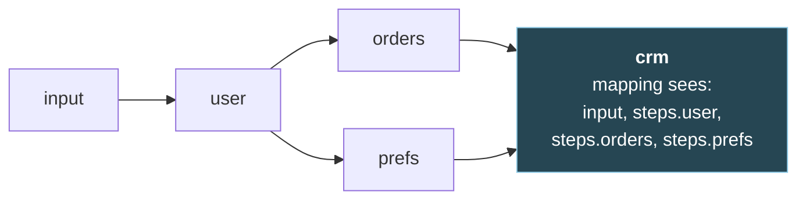
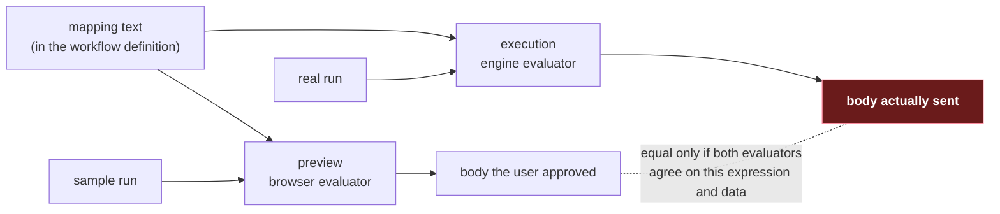

# 3. Mapping data between steps

> Assumes [file 01](01-foundations.md) for the vocabulary and the data document, and
> [file 02](02-graphs-and-scheduling.md) for how a run moves through the graph. The Go
> examples assume [go-services](../go-services/README.md):
> [file 02](../go-services/02-the-http-client.md) on the HTTP client and
> [file 04](../go-services/04-deadlines-and-retries.md) on deadlines and retries.

## The problem

The `crm` step has to post a summary built from three other responses: the user's name and
email from `user`, a count and a total of paid orders from `orders`, and a marketing flag
from `prefs`. None of those upstreams knows the CRM's request format, and the CRM knows
nothing about them. Something has to reshape three response bodies into one request body,
once per run, for every workflow anyone builds.

If that glue is code, every new workflow is a code change, a review and a deploy, and nobody
can see what a step will send until it runs. If it's a text template, it can't count or sum,
and a quote in someone's name breaks the JSON. Most engines settle on a third option: a small
**expression language** that reads the run's data and builds the request. This chapter is
about that language (JSONata here), how to run it safely when someone else wrote the
expression, and the surprising number of ways the same expression can mean different things.

## 3.1 Why an expression, not a code step

There are three places the glue can live:

| | Code step | Text template | Expression language |
|---|---|---|---|
| Example | A function per workflow, or a "run this script" step | `{"name": "{{user.name}}"}` with string substitution | `{"name": steps.user.body.name}` |
| Can count, sum, filter, build arrays | Yes | No: it only splices text | Yes |
| Output is valid JSON by construction | If the code is right | No: a `"` in the data breaks it | Yes |
| Stored as | Code, deployed | Data, in the workflow definition | Data, in the workflow definition |
| Previewable in an editor | Only by running arbitrary code there | Yes | Yes, if the evaluator runs there (§3.5) |
| Sandboxable | Hard: it's a general-purpose runtime | Trivially | Yes, with limits (§3.6–3.8) |

The expression language wins on the three properties an engine cares about. It's
**declarative**: a mapping says what the body should contain, not how to assemble it, so it
lives in the workflow definition as data and changes without a deploy. It's **previewable**:
the editor can evaluate it against a sample run and show the exact body before anything is
sent. And it's **sandboxable**: the language has no file system, no network and no clock
beyond what the evaluator chooses to expose, so the engine can bound what it does.

The cost is real. Users must learn a new language whose rules differ from the ones they know.
It never raises an error for a missing field, a list of one item stops being a list, and the
same expression can give different answers in different implementations. And it is still
code. JSONata's reference implementation says so plainly: "JSONata is a Turing-complete
expression language, and as such, it is possible to write unbounded, or infinite loops"
([jsonata-js: Configuring Guardrails](https://docs.jsonata.org/guardrails)). Sections 3.6 to
3.8 are the price of that sentence.

### Which language

Several languages fill this slot, and they sit at different points between "can only select"
and "can compute anything":

| Language | Builds new JSON? | Can loop? | Regular expressions | Source |
|---|---|---|---|---|
| JSON Pointer | No: names exactly one value | No | None | [RFC 6901](https://www.rfc-editor.org/rfc/rfc6901.html); see [file 06](06-describing-apis.md) |
| JSONPath | No: "selecting and extracting" | No | I-Regexp, in `match()` and `search()` | [RFC 9535](https://www.rfc-editor.org/rfc/rfc9535.html) |
| JMESPath | Yes: a "multi-select hash" builds an object | The specification has a fixed set of built-in functions and no way to define new ones | None in the specification | [Specification](https://jmespath.org/specification.html) |
| CEL | Yes: lists and maps | No: "CEL programs cannot loop forever" | RE2 syntax | [cel-spec](https://github.com/google/cel-spec/blob/master/doc/langdef.md) |
| jq | Yes | Yes: "any jq function can be recursive" | Oniguruma, "Perl NG" flavour | [jq 1.8 manual](https://jqlang.org/manual/v1.8/) |
| JSONata | Yes: object and array constructors | Yes: Turing-complete | JavaScript `RegExp` in the reference implementation | [docs.jsonata.org](https://docs.jsonata.org) |

The two ends of that table make the trade-off visible. CEL was designed to be safe to embed:
its README says it "evaluates in linear time, is mutation free, and not Turing-complete"
([cel-spec README](https://github.com/google/cel-spec)). Even there the sources disagree with
themselves. The language definition admits that its macros "are the only avenue for
exponential behavior", which implementations curtail by "allowing applications to set limits"
([langdef, Performance Limits](https://github.com/google/cel-spec/blob/master/doc/langdef.md)).
Terminating is not the same as cheap. JSONata sits at the other end: it's a full functional
language with lambdas and recursion, which is why it can express almost any reshaping, and
why it needs guardrails.

Real engines spread across this range. As file 01 §1.6 shows, Kestra uses Pebble templates,
Windmill evaluates raw JavaScript, and AWS Step Functions offers JSONata alongside its
default, JSONPath. n8n's expressions are, in its own docs' words, "JavaScript-like code"
([n8n docs](https://docs.n8n.io/code/expressions/)). This course uses JSONata for two
reasons. It only transforms JSON: its function library has no I/O, so whatever an expression
can reach beyond its input is whatever the host chose to bind, which is not true of a
JavaScript expression. And it's JSON-shaped: "JSONata is a superset of JSON", so a valid JSON
document is a valid expression
([Building result structures](https://docs.jsonata.org/construction)). You can paste the CRM's
example request body into the editor and replace its values with expressions one at a time.

## 3.2 The run's data document

A mapping is evaluated against one JSON document: the run's input plus the response of every
finished ancestor, keyed by step id. For `crm`, once `orders` and `prefs` are done, it's the
document from file 01 §1.5 with a few more fields, so the mapping has something to filter and
sum:

```json
{
  "input": { "userId": "u-42" },
  "steps": {
    "user": {
      "status": 200,
      "headers": { "content-type": "application/json" },
      "body": {
        "id": "u-42",
        "name": { "given": "Ada", "family": "Lovelace" },
        "email": "ada@example.com"
      }
    },
    "orders": {
      "status": 200,
      "headers": { "content-type": "application/json" },
      "body": {
        "orders": [
          { "id": "o-1", "status": "paid", "total": 10.1 },
          { "id": "o-2", "status": "refunded", "total": 99 },
          { "id": "o-3", "status": "paid", "total": 20.2 }
        ]
      }
    },
    "prefs": {
      "status": 200,
      "headers": { "content-type": "application/json" },
      "body": {
        "marketing": { "email": true, "sms": false }
      }
    }
  }
}
```



File 01 §1.5 gives the three rules: responses are keyed by step id, a step sees only its
finished ancestors, and reading what you can't see isn't an error by default. That last rule
was left for this chapter. It should be an error, but at save time, not at run time.

A mapping's references can be found without running it. gnata exposes them directly:
`Expression.ReferencedPaths()` "returns the input fields the expression reads". For the
`crm` mapping in §3.3 it returned ten paths, all under `steps.user`, `steps.orders` and
`steps.prefs`, and `complete: true`. So an engine can list every `steps.<id>` a mapping
touches when the workflow is saved, and reject any id that isn't an ancestor of the step,
with an error that names both. That turns rule 3's silent `undefined` into a validation
error, alongside the other graph checks in file 02.

Two limits on that check, both from gnata's documentation. `complete` is false whenever the
expression "may also read input it doesn't name", for example through `*`, `$keys($)` or
`$eval`; a mapping containing `$eval(steps.user.body.code)` came back `complete: false`. Treat
that as "can't verify" and reject or flag it. And "This is a static analysis, not a security
boundary": it catches an honest author's mistake, not a hostile author's trick (§3.8 is about
those).

Two more properties of the document matter later:

- **Status and headers are data too.** A mapping can read `steps.orders.status`. But an error
  body is still a body, and §3.3 shows a `404` turning into a plausible, wrong CRM record. The
  safer default is that the engine fails or skips a step on a non-2xx response before any
  downstream mapping sees it (file 02 for skips, file 04 for retries), so that mappings deal
  only with successful responses.
- **A mapping should be a pure function of the document.** JSONata has `$now()`, `$millis()`
  and `$random()`. jsonata-js captures the timestamp once per evaluation, "the $now() and
  $millis() functions will return this value - whenever it is called" (`src/jsonata.js`,
  v2.2.2, lines 2169–2171), so the value is stable within one evaluation and different every
  time a retry evaluates the mapping again. A body that changes between attempts defeats
  deduplication by body, which is file 04's problem. If a request needs a timestamp or an id,
  put it in the data document once, when the run or step starts, and have the mapping read it.

## 3.3 JSONata through the running example

JSONata borrows its model from XPath. A path is a location in the document: "In common with
XPath, this will select all possible values in the document that match the specified location
path" ([Simple Queries](https://docs.jsonata.org/simple)).

Everything below is evaluated against the document above. I ran each line through all four
implementations in §3.4, and they agreed on every row, with one caveat about the second row:
jsonata-cpp's `evaluate` returns an `nlohmann::json`, which has no "undefined", so a
top-level "nothing" comes back as `null`.

| Expression | Result | What it shows |
|---|---|---|
| `steps.user.body.email` | `"ada@example.com"` | A path is field names joined by `.` |
| `steps.user.body.phone` | nothing | A missing field gives no result and no error |
| `steps.orders.body.orders.total` | `[10.1, 99, 20.2]` | A path through an array visits every item |
| `steps.orders.body.orders[status = "paid"].id` | `["o-1", "o-3"]` | `[...]` with a condition is a **predicate**: it filters |
| `steps.orders.body.orders[-1].id` | `"o-3"` | `[...]` with a number is an index; negative counts from the end |
| `$count(steps.orders.body.orders[status = "paid"])` | `2` | Functions start with `$` |
| `$sum(steps.orders.body.orders[status = "paid"].total)` | `30.299999999999997` | Numbers are IEEE 754 doubles |
| `steps.user.body.name.given & " " & steps.user.body.name.family` | `"Ada Lovelace"` | `&` joins strings |
| `steps.*.status` | `[200, 200, 200]` | `*` matches every field |
| `steps.prefs.body.locale ?? "en-GB"` | `"en-GB"` | `??` falls back only when the left side is missing |

Three rules from the documentation explain most of what surprises people:

- **Missing data is silence.** "If during the navigation of the location path, a field is not
  found, then the expression returns nothing (represented by Javascript _undefined_). No errors
  are thrown as a result of non-existing data in the input document"
  ([Simple Queries](https://docs.jsonata.org/simple)). JSON's `null` is different: it's a value,
  and the same page's example shows a field holding `null` evaluating to `null`.
- **A sequence of one is just the value.** "Any value (which is not itself an array) and an
  array containing just that value are deemed to be equivalent"
  ([Predicate Queries](https://docs.jsonata.org/predicate)). Two paid orders give
  `["o-1", "o-3"]`; one gives `"o-1"`, a string.
- **`??` and `?:` are different fallbacks.** `??` "returns the left-hand side if it is defined
  (not `undefined`)", so `null ?? 1` is `null`. `?:` falls back whenever the left side is
  falsy, including `0`, `false` and `""` ([Other Operators](https://docs.jsonata.org/other-operators)).
  Both arrived in jsonata-js 2.1.0 ([changelog](https://github.com/jsonata-js/jsonata/blob/master/CHANGELOG.md)).

### A first attempt

The CRM wants a customer id, a name, an email, the paid order ids, how many there are, their
total, the marketing flag and a one-line summary. Blocks `( ...; ... )` and variables (`$x :=`)
keep it readable:

```jsonata
(
  $user := steps.user.body;
  $paid := steps.orders.body.orders[status = "paid"];
  {
    "customerId": $user.id,
    "name": $user.name.given & " " & $user.name.family,
    "email": $user.email,
    "paidOrderIds": $paid.id,
    "paidOrderCount": $count($paid),
    "lifetimeValue": $sum($paid.total),
    "emailOptIn": steps.prefs.body.marketing.email,
    "summary": $count($paid) & " paid orders worth " & $sum($paid.total)
  }
)
```

Against the sample it gives exactly what you'd hope. Against other perfectly normal runs it
doesn't. All four implementations gave these same results:

| Run | What the CRM receives |
|---|---|
| Two paid orders (the sample) | `"paidOrderIds": ["o-1", "o-3"]`, `"lifetimeValue": 30.299999999999997`, `"summary": "2 paid orders worth 30.3"` |
| One paid order | `"paidOrderIds": "o-1"`: a string where the CRM expects an array |
| No paid orders | No `paidOrderIds` key, no `lifetimeValue` key, and `"summary": "0 paid orders worth "` |
| `orders` returned `404` with `{"error": "not found"}` | The same as no paid orders: a plausible record that says this customer has never paid |
| `prefs` was skipped | No `emailOptIn` key at all |

> ⚠️ **An object constructor drops every key whose value is nothing.** A missing field doesn't
> become `null`; the key disappears from the request body. Whether the upstream then rejects
> the request, applies its own default or keeps the old value is up to the upstream, and none
> of the three is visible in your preview. `$count` of nothing is `0`, but `$sum` of nothing is
> nothing.

The number in `summary` deserves a look too. `lifetimeValue` is `30.299999999999997`, the
nearest double to 10.1 + 20.2, while the same sum inside `summary` prints as `30.3`. That's
not a bug: `&` converts with `$string`'s rules, and jsonata-js rounds non-integers to 15
significant digits when it does (`Number(val.toPrecision(15))`, `src/functions.js` line 134 at
v2.2.2). All four implementations in this chapter do the same.

gnata can do the arithmetic in decimal instead. `WithDecimalPrecision(n)` "opts in to decimal
floating point", and with `WithDecimalPrecision(34)` the same sum came out as `30.3`, as did
`0.1 + 0.2`. jsonata-js has no such option, so turning it on in the engine is a deliberate
difference between preview and run (§3.5).

### The mapping the rest of the chapter uses

```jsonata
(
  $user := steps.user.body;
  $assert($exists($user.id), "user step returned no id");
  $paid := steps.orders.body.orders[status = "paid"];
  $ltv := $sum($paid.total) ?? 0;
  {
    "customerId": $user.id,
    "name": $user.name.given & " " & $user.name.family,
    "email": $user.email,
    "paidOrderIds": [$paid.id],
    "paidOrderCount": $count($paid),
    "lifetimeValue": $ltv,
    "emailOptIn": steps.prefs.body.marketing.email = true,
    "locale": steps.prefs.body.locale ?? "en-GB",
    "summary": $count($paid) & " paid orders worth " & $ltv
  }
)
```

Each change answers a row of the table, and `locale` is new, with a default for when `prefs`
has none:

- **`[$paid.id]`** is an array constructor, so the result is always an array: `[]`, `["o-1"]`
  or `["o-1", "o-3"]`. The documented alternative, a trailing `[]` as in `$paid.id[]`, fixes
  the one-item case but still drops the key when nothing matches (in three of the four
  implementations; §3.5).
- **`?? 0`** turns "no paid orders" into `0` instead of a missing key.
- **`= true`** makes a missing preference read as `false`. For a consent flag, "not opted in"
  is the safe reading of "unknown". For other fields the right default differs, and sometimes
  the right answer is to fail.
- **`$assert`** fails the step when there's no customer id, with error `D3141` and the message
  you wrote, rather than creating a CRM record nobody can join back to. From the
  documentation of `$assert(condition, message)`: "If the condition is false, an exception is
  thrown with the message as the message of the exception"
  ([Object functions](https://docs.jsonata.org/object-functions)).

None of these fixes the `404` row. That one is the engine's job: don't run a downstream mapping
over an error response (§3.2).

## 3.4 One mapping, four languages

An engine stores the mapping as text in the workflow definition, compiles it once when the
workflow is saved, and evaluates it on every run. Each program below does exactly that, reading
the mapping and the data document from files, with every guardrail its library offers switched
on (§3.6 explains them). Each is shown in full, as run, and formatted with `gofmt`,
`rustfmt` and Prettier's defaults.

```go
// Evaluates the crm step's request-body mapping over a run's data document,
// with all three guardrails on. Usage: go run ./crm crm.jsonata run.json
package main

import (
	"context"
	"encoding/json"
	"fmt"
	"log"
	"os"
	"time"

	"github.com/recolabs/gnata"
)

func main() {
	mapping, err := os.ReadFile(os.Args[1])
	if err != nil {
		log.Fatal(err)
	}
	runDoc, err := os.ReadFile(os.Args[2])
	if err != nil {
		log.Fatal(err)
	}

	// Compile once, when the workflow is saved; evaluate on every run.
	expr, err := gnata.Compile(string(mapping),
		gnata.WithTimeout(50*time.Millisecond), // D1012 past this
		gnata.WithStack(50),                    // D1011 past this recursion depth
		gnata.WithSequence(10_000),             // D2015 past this many items
	)
	if err != nil {
		log.Fatalf("compile: %v", err)
	}

	// The step's own deadline still applies on top of the guardrail.
	ctx, cancel := context.WithTimeout(context.Background(), time.Second)
	defer cancel()

	body, err := expr.EvalBytes(ctx, runDoc)
	if err != nil {
		log.Fatalf("evaluate: %v", err)
	}
	out, err := json.MarshalIndent(body, "", "  ")
	if err != nil {
		log.Fatal(err)
	}
	fmt.Println(string(out))
}
```

The context is the one [go-services file 04](../go-services/04-deadlines-and-retries.md#a-deadline-belongs-to-the-request-not-to-the-call)
is about. In an engine it comes from the step, so cancelling a run cancels its mappings too;
the guardrail timeout is a second, tighter bound that holds even when a helper passes
`context.Background()`, the mistake in
[go-services file 02](../go-services/02-the-http-client.md#where-the-timeout-lives). `EvalBytes` takes the raw JSON, which matters for large integers (the
trap after these listings).

<details><summary>JavaScript</summary>

```js
// Evaluates the crm step's request-body mapping over a run's data document,
// with all three guardrails on. Usage: node crm.mjs crm.jsonata run.json
import { readFile } from "node:fs/promises";
import jsonata from "jsonata";

const mapping = await readFile(process.argv[2], "utf8");
const runDoc = JSON.parse(await readFile(process.argv[3], "utf8"));

// Compile once, when the workflow is saved; evaluate on every run.
const expr = jsonata(mapping, {
  timeout: 50, // milliseconds; D1012 past this
  stack: 50, // D1011 past this eval-apply depth
  sequence: 10_000, // D2015 past this many items
});

const body = await expr.evaluate(runDoc);
console.log(JSON.stringify(body, null, 2));
```

`package.json` has `"type": "module"` and the exact dependency `"jsonata": "2.2.2"`. The
options object is the guardrail API added in 2.2.0
([PR #795](https://github.com/jsonata-js/jsonata/pull/795)), and older versions ignore it
silently: 2.1.1 ran `$count([1..100])` under `sequence: 10` and returned `100`, where 2.2.2
raised `D2015`. Pin the version.

</details>

<details><summary>Rust</summary>

```rust
// Evaluates the crm step's request-body mapping over a run's data document,
// with all three guardrails on. Usage: cargo run -- crm.jsonata run.json
use jsonata_core::Expression;
use jsonata_core::evaluator::EvaluatorOptions;
use jsonata_core::value::JValue;
use std::{env, fs};

fn main() -> Result<(), Box<dyn std::error::Error>> {
    let args: Vec<String> = env::args().collect();
    let mapping = fs::read_to_string(&args[1])?;
    let run_doc = JValue::from_json_str(&fs::read_to_string(&args[2])?)?;

    // Compile once, when the workflow is saved; evaluate on every run.
    let options = EvaluatorOptions {
        timeout_ms: Some(50),              // D1012 past this
        max_stack_depth: Some(50),         // D1011 past this depth
        max_sequence_length: Some(10_000), // D2015 past this many items
    };
    let expr = Expression::compile_with_options(&mapping, options)?;

    let body = expr.evaluate(&run_doc)?;
    println!("{}", body.to_json_string_pretty()?);
    Ok(())
}
```

`Cargo.toml` depends on `jsonata-core = "=2.2.11"`, the Rust implementation I'd choose today:
it releases every few weeks, has real use (43,260 downloads on crates.io, 30,817 of them in
the last 90 days) and claims the whole portable test suite. The older `jsonata-rs` is
incomplete and has no regular expressions (the table below). Three newer crates were too new
or too little used to judge: `async_jsonata_rust` (122 downloads), `seuil` (both releases on
2026-04-05) and `jlens-core` (first published 2026-10-10).

</details>

<details><summary>C++</summary>

```cmake
cmake_minimum_required(VERSION 3.22)
project(crm LANGUAGES CXX)
set(CMAKE_CXX_STANDARD 20)
set(CMAKE_CXX_STANDARD_REQUIRED ON)

include(FetchContent)
FetchContent_Declare(
  jsonata
  URL https://github.com/rayokota/jsonata-cpp/archive/refs/tags/v0.2.0.zip
  URL_HASH SHA256=a1cc83d101a00a358ea9c6707403643ee0b552f1960ca8027a2415ad57574e41
)
FetchContent_MakeAvailable(jsonata)

add_executable(crm crm.cpp)
target_link_libraries(crm jsonata::jsonata)
```

```cpp
// Evaluates the crm step's request-body mapping over a run's data document,
// with the two guardrails jsonata-cpp has. Usage: ./crm crm.jsonata run.json
#include <fstream>
#include <iostream>
#include <sstream>

#include <jsonata/JException.h>
#include <jsonata/Jsonata.h>
#include <nlohmann/json.hpp>

static std::string readFile(const char* path) {
    std::ifstream in(path);
    std::stringstream ss;
    ss << in.rdbuf();
    return ss.str();
}

int main(int argc, char** argv) {
    const std::string mapping = readFile(argv[1]);
    const auto runDoc = nlohmann::ordered_json::parse(readFile(argv[2]));

    try {
        // Compile once, when the workflow is saved; evaluate on every run.
        jsonata::Jsonata expr(mapping, jsonata::defaultRegexEngine(),
                              /*timeout ms, D1012*/ 50,
                              /*stack depth, D1011*/ 50);
        // No sequence-length guardrail exists in this library.
        const auto body = expr.evaluate(runDoc);
        std::cout << body.dump(2) << "\n";
    } catch (const jsonata::JException& e) {
        std::cerr << "jsonata error " << e.getError() << ": " << e.what() << "\n";
        return 1;
    } catch (const std::exception& e) {  // e.g. std::regex_error from the default engine
        std::cerr << "error: " << e.what() << "\n";
        return 1;
    }
}
```

The library fetches nlohmann/json itself if it isn't installed. I trimmed two lines from the
`CMakeLists.txt` I ran: a second executable target, for the test harness behind §3.5's table.

</details>

All four printed the same body, byte for byte:

```json
{
  "customerId": "u-42",
  "name": "Ada Lovelace",
  "email": "ada@example.com",
  "paidOrderIds": [
    "o-1",
    "o-3"
  ],
  "paidOrderCount": 2,
  "lifetimeValue": 30.299999999999997,
  "emailOptIn": true,
  "locale": "en-GB",
  "summary": "2 paid orders worth 30.3"
}
```

Toolchains: Go 1.24.4 with `GOTOOLCHAIN=auto` (gnata v0.6.2's `go.mod` says `go 1.25.6`, so
`go get` printed `go: upgraded go 1.24.4 => 1.25.6` and switched toolchain, exactly
[go-services file 08](../go-services/08-when-a-dependency-moves-your-toolchain.md#the-go-line-is-a-minimum)'s
mechanism); Node 24.14.1; rustc 1.96.0; Apple clang 17 with CMake 4.3.

They didn't agree on everything. With no paid orders, jsonata-core 2.2.11 left out
`lifetimeValue` and printed `"0 paid orders worth "`, where the other three gave `0`. The cause
is narrow: `($p := x; $sum($p.total) ?? 0)` is `0` in jsonata-js and undefined in jsonata-core,
although `$sum(x.total) ?? 0` is `0` in both. I found it by running this chapter's mapping, which
is §3.5's point.

### Implementations and how mature they are

Checked on 2026-10-19 against each project's registry entry and repository.

| Implementation | Language | Latest release | Conformance claim | Guardrails | Regex engine |
|---|---|---|---|---|---|
| [jsonata-js](https://github.com/jsonata-js/jsonata) | JavaScript | 2.2.2, 2026-07-16 | It is the reference: its suite defines conformance | `stack`, `timeout` and `sequence` since 2.2.0 (2026-05-14); a pluggable `RegexEngine`, already present in 2.1.1 | JavaScript `RegExp` |
| [gnata](https://github.com/recolabs/gnata) | Go | v0.6.2, 2026-10-18; repository created 2026-03-10 | README: 0 failures, 0 skips on the 2.2.2 suite, giving 1,778 cases in one place and 1,704 in another | `WithStack`, `WithTimeout`, `WithSequence`, all opt-in | Go `regexp` (RE2) |
| [jsonata-core](https://github.com/txjmb/jsonata-core) | Rust | 2.2.11, 2026-10-02; repository created 2026-01-19 | README: 1686/1686 | `timeout_ms`, `max_stack_depth`, `max_sequence_length` (not on array literals, by its own comment) | Rust `regex` crate |
| [jsonata-rs](https://github.com/Stedi/jsonata-rs) | Rust | 0.3.4, 2025-02-03 | README: "An (incomplete) implementation", "Alpha version"; missing regular expressions, the parent operator, partial application and "many built-in functions" | Not checked | None yet |
| [jsonata-cpp](https://github.com/rayokota/jsonata-cpp) | C++17 | v0.2.0, 2026-07-05; repository created 2025-08-14 | README: "supports 100% of the language features" | `timeout` and `stack` constructor arguments, pluggable `IRegex`; no sequence limit | `std::regex`, ECMAScript grammar |

There are also ports for Java, .NET, Python and older Go ones; the official docs keep a list
([Implementations of JSONata](https://docs.jsonata.org/overview)). Read that list with care.
It describes jsonata-rs as an "actively-developed fork", while jsonata-rs's own README calls it
incomplete alpha software, its last release was in February 2025, and its eight most recent
commits, back to June 2025, are CI, dependency and documentation changes. The list doesn't
mention jsonata-core at all. The repository is the better evidence.

I counted the portable test suite at jsonata-js v2.2.2: 1,686 cases in 1,291 files across 102
groups. jsonata-core's 1686/1686 is that suite. gnata's two figures don't match it or each
other, and its README doesn't break them down; its `testdata` folder adds a `function-match`
group that the upstream suite doesn't have.

> ⚠️ **Large integers survive in two implementations out of four, and in one only if you
> decode carefully.** `{"orderId": id}` over `{"id": 9007199254740993}` (2<sup>53</sup> + 1)
> gave `9007199254740992` in jsonata-js and jsonata-core: a different order. jsonata-cpp kept
> it, because nlohmann/json parses integers as integers. gnata kept it through `EvalBytes`,
> which reads numbers as `json.Number`, and lost it when the JSON was first decoded with
> `json.Unmarshal` into `any`, which gives `float64` (the decoder
> [go-services file 06](../go-services/06-copies-that-share-memory.md#json-documents-are-the-common-case)
> meets too). Any arithmetic rounds it in all four: `id + 0` gave `9007199254740992`, and
> `id = 9007199254740992` was `true`. The standards say what to do.
> [RFC 8259 §6](https://www.rfc-editor.org/rfc/rfc8259.html#section-6) promises agreement only
> for integers in [-(2<sup>53</sup>)+1, 2<sup>53</sup>-1], and I-JSON says "it is RECOMMENDED
> to encode them in JSON string values", naming 64-bit integers as its example
> ([RFC 7493 §2.2](https://www.rfc-editor.org/rfc/rfc7493.html#section-2.2)). Treat ids as
> strings at the API boundary.

> ⚠️ **In C++, not every failure is a `JException`.** With the default regex engine, a
> pathological pattern made libc++'s `std::regex` throw `std::regex_error` ("The complexity of
> an attempted match against a regular expression exceeded a pre-set level"), which a
> `catch (const jsonata::JException&)` doesn't catch. Catch `std::exception` as well, as the
> listing above does, or the uncaught exception terminates the process. With the second
> `catch`, a mapping containing that pattern exited with an error message and status 1.

## 3.5 Preview and execution must use the same evaluator

An editor that shows "this is the body `crm` will send" is the main reason to use an
expression language at all. The preview runs an evaluator somewhere. If the browser runs
jsonata-js and the engine runs gnata, the preview is a statement about a different program
from the one that will run.



Here's what I observed running the same expressions through all four implementations
(gnata v0.6.2, jsonata-js 2.2.2 on Node 24.14.1, jsonata-core 2.2.11, jsonata-cpp v0.2.0 with
libc++). Each row is one expression over one input.

| Expression (input) | gnata | jsonata-js | jsonata-core | jsonata-cpp |
|---|---|---|---|---|
| `$match("100 GBP, 200 EUR", /\d+(?= GBP)/).match` | error `D3137`: unsupported `(?=` | `"100"` | error: regex parse error | `"100"` |
| `$replace("ref: 4411", /(?<=ref: )\d+/, "****")` | error `D3137` | `"ref: ****"` | error: regex parse error | error `S0301`, "Empty regular expressions are not allowed" |
| `$substring(email, $match(email, /@/).index + 1)` (`"josé@example.com"`) | `"example.com"` | `"example.com"` | `"xample.com"` | `"xample.com"` |
| `$match("😀ab", /a/).index` | `1` | `2` | `4` | `4` |
| `$match("a1 b2 c3", /[a-z]\d/)` | three matches | three matches | the first match only | three matches |
| `{"orderId": id}` (`{"id": 9007199254740993}`) | `9007199254740993` | `9007199254740992` | `9007199254740992` | `9007199254740993` |
| `orders{$string(year): total}` (2026 first, then 2025) | `{"2026":5,"2025":7}` | `{"2025":7,"2026":5}` | `{"2025":7,"2026":5}` | `{"2026":5,"2025":7}` |
| `g.t[true]` (`{"g":[{"o":1},{"t":"ext1"},{"t":"ext2"}]}`) | `["ext1","ext2"]` | `[null,"ext1","ext2"]` | `["ext1","ext2"]` | `["ext1","ext2"]` |
| `[1..3].([1..3])` | nine numbers, flat | nine numbers, flat | three nested arrays | nine numbers, flat |
| `{"ids": orders[status="paid"].id[]}` (no paid orders) | `{}` | `{}` | `{}` | `{"ids":[]}` |
| `$sum([])` | `0` | `0` | `0` | nothing |
| `$formatNumber(1.015, "0.00")` | `"1.02"` | `"1.02"` | `"1.02"` | `"1.01"` |

They agreed on everything in §3.3, on `0.1 + 0.2` (`0.30000000000000004`), on `$string(0.1 +
0.2)` (`"0.3"`), and on how a missing field drops a key. The disagreements cluster in three
places. For each, gnata's README documents its own side as deliberate, in a numbered table of
[known behavioural differences from jsonata-js](https://github.com/recolabs/gnata#known-behavioral-differences-from-jsonata-js)
that's worth reading in full before choosing it:

- **Regex dialect.** The reference hands the pattern to JavaScript: its parser ends with
  `return new RegExp(pattern, flags)` (`src/parser.js` line 116 at v2.2.2). gnata uses Go's
  `regexp`, which is RE2, and lists what it rejects: lookahead, lookbehind, backreferences,
  atomic groups and possessive quantifiers. The Rust `regex` crate, under jsonata-core, "lacks
  several features that are not known how to implement efficiently. This includes, but is not
  limited to, look-around and backreferences" (its crate documentation, 1.13.1). jsonata-cpp's
  `std::regex` accepted lookahead and backreferences and rejected lookbehind, with a misleading
  message. Four engines, three dialects.
- **Text positions.** gnata's row 13: "gnata counts code points, like `$length` and
  `$substring`; jsonata-js counts UTF-16 units." jsonata-core and jsonata-cpp gave a third
  answer, UTF-8 bytes, which is why their email domain lost its first letter: the index counts
  bytes and `$substring` counts characters. `$length("😀ab")` was `3` in all four, so code that
  never mixes the two is safe.
- **Number and object models.** gnata's row 1 and row 36 cover large integers and keeping
  `1.50` as written, and row 23 key order: "JavaScript objects list integer-like keys first, in
  numeric order." Row 2 is the `g.t[true]` case: jsonata-js keeps an undefined placeholder that
  serialises as `null`, because "gnata's sequences cannot hold undefined."

The rest of the table is jsonata-core and jsonata-cpp disagreeing with the reference, which
is what a bug in a port is. One of them, jsonata-core's single `$match` result, is its
[issue #194](https://github.com/txjmb/jsonata-core/issues/194), fixed in the repository on
2026-10-18 and not yet in a release on 2026-10-19. I didn't check whether the others have been
reported. Documentation can be wrong in the other direction too: gnata's README says plain
float64 gives `"1.01"` for `$formatNumber(1.015, "0.00")`, but its float64 mode gave `"1.02"`,
as the reference does, and only jsonata-cpp gave `"1.01"`.

> **Teacher's aside.** People talk about "JSONata" as if it named one language. In practice it
> names a reference implementation and a family of ports that agree on the portable test suite
> and disagree just outside it. jsonata-core passes all 1,686 portable cases and still returned
> only the first `$match` result, because jsonata-js tests multi-match `$match` in
> `test/implementation-tests.js`, which is JavaScript and doesn't travel. The portable suite
> contains only two `$match` expressions. "Passes the test suite" is evidence about what the
> suite covers. For a workflow engine the only conformance that matters is between the two
> evaluators your users' expressions actually meet.

What to do about it:

1. **Run the same evaluator in both places.** Either preview through the engine (an endpoint
   that evaluates the mapping server-side, with the same library and guardrails as a run), or
   ship the engine's evaluator to the browser. gnata builds to WebAssembly; its README gives
   about 5.4 MB raw and "~1.2–1.4 MB" served with brotli or gzip. Pin one version for both.
2. **Preview against recorded responses, not hand-written samples.** The bugs in §3.3 appear
   with one paid order, with none, and with a skipped step. A hand-written sample tends to have
   two of everything.
3. **Evaluate at save time, not just compile.** In gnata and jsonata-core the lookahead pattern
   compiled without complaint and failed only when evaluated (`D3137` in gnata). Validation
   that only parses the expression would have accepted it.
4. **If two evaluators are unavoidable, keep a parity corpus.** A file of expressions and
   inputs, run through both in CI, with a reviewed list of known differences. Treat a new
   difference as a release blocker for whichever side changed.

What isn't solved: nothing specifies the regex dialect, the number model or the units of a
string position across JSONata implementations. The reference's behaviour is JavaScript's, and
each port chooses how close to get. gnata's choice is documented and argued; for the others
you find out by testing.

## 3.6 Guardrails: time, depth and size

Once users write mappings, the engine evaluates code it hasn't seen, on every run. Three shapes
of runaway expression come straight from the jsonata-js guardrails page: recursion that grows
the stack (its example is the Ackermann function), recursion that doesn't grow the stack and
loops for ever (`($inf := function(){ $inf() }; $inf())`), and an expression that builds a huge
sequence (`[1..10000].([1..10000])`, "a sequence of 100 million numbers").

| | jsonata-js 2.2 | gnata | jsonata-core | jsonata-cpp | Error |
|---|---|---|---|---|---|
| Depth | `stack`: "the number of times round the eval-apply cycle" | `WithStack(n)`: "the maximum lambda recursion depth" | `max_stack_depth` | `stack` argument | `D1011` |
| Time | `timeout`, in ms | `WithTimeout(d)`, plus the `ctx` | `timeout_ms` | `timeout` argument, in ms | `D1012` |
| Sequence length | `sequence` | `WithSequence(n)` | `max_sequence_length` | none | `D2015` |
| Regex engine | `RegexEngine` option | always RE2 | always Rust `regex` | `IRegex` argument | — |
| With nothing set | no limits | 100 nested calls (`U1001`), 10,000,000-item caps | a recursion ceiling of 302 (`U1001`) | no limits | |

The jsonata-js options are passed to `jsonata(expr, options)`. Its source checks `stack` and
`timeout` on entry to every evaluation step (`environment.base.guardrails()`, `src/jsonata.js`
line 53 at v2.2.2), and `sequence` whenever a sequence grows. Its guardrails page "does not
provide recommended values or defaults"; gnata's README says "Use guardrails when evaluating
expressions from an untrusted source."

### The same number is a different limit

The guardrails share names and error codes, and their units differ. I ran
`($f := function($n){ $n = 0 ? 0 : 1 + $f($n - 1) }; $f(N))` with a stack limit of 50 in each:

| | Deepest `N` that ran | Non-recursive `crm` mapping |
|---|---|---|
| gnata | 49 | ran with a limit of 10 |
| jsonata-js | 15 | needed a limit of at least 19 |
| jsonata-core | 15 | ran with a limit of 10 |
| jsonata-cpp | 15 | ran with a limit of 10 |

gnata counts calls. The others count evaluation depth, about three levels per call of this
function, and jsonata-js counts nesting even where nothing recurses. So `stack: 50` in a
jsonata-js preview and `WithStack(50)` in a gnata engine disagree by more than three to one,
and a deeply nested mapping can fail preview while running fine, or the reverse. Choose limits
per implementation by running your own corpus of real mappings, not by copying a number.

### Defaults

With no guardrails set, the same function behaved like this:

| `N` | gnata | jsonata-js | jsonata-core | jsonata-cpp |
|---|---|---|---|---|
| 90 | 90 | 90 | 90 | 90 |
| 150 | `U1001`, "exceeded stack depth 100" | 150 | `U1001`, "maximum recursion depth (302) exceeded" | 150 |
| 1,000 | `U1001` | 1,000 | `U1001` | 1,000 |
| 2,000 | `U1001` | 2,000 | `U1001` | process killed by a segmentation fault (exit status 139) |

So gnata and jsonata-core are safe by default and stricter than the reference: a mapping that
recurses 150 deep previews fine in jsonata-js and fails at run time in gnata. jsonata-cpp
without guardrails lets an expression crash the host process; with `stack` set it raised
`D1011` cleanly. jsonata-js never overflowed: `N` = 20,000 returned in 127 ms. As far as I can
tell that's because its evaluator is built from `async` functions (`async function evaluate`,
`src/jsonata.js` line 49 at v2.2.2), so each step resumes from the microtask queue on a fresh
stack and the cost moves to the heap.

### Time and size

A timeout of 100 ms stopped the infinite tail recursion at 100–102 ms in all four, once a stack
limit was also set. With only the timeout, gnata's built-in depth limit stopped it first, with
`U1001` after 85–95 ms.

Size is where guardrails stop being enough. `$count([1..10000].([1..10000]))`, with a sequence
limit of 1,000,000 and a timeout of 5 s; peak memory is the maximum resident set size from
macOS's `/usr/bin/time -l`:

| | Result | Time | Peak memory |
|---|---|---|---|
| jsonata-js | `D2015` | 0.27 s | 1.1 GB |
| gnata | `D2015` | 3.3 s | 5.5 GB |
| jsonata-core | returned `10000`: its `[1..3].([1..3])` builds nested arrays (§3.5), so nothing grows past the limit | 1.4–2.0 s | not measured |
| jsonata-cpp (no sequence limit) | `D1012` | 11.5 s against a 5 s timeout | 6.5 GB |

With the timeout at 1 s instead, gnata stopped at 1.0 s with a 2.0 GB peak, jsonata-core at
1.06 s with 4.6 GB, and jsonata-cpp at 11.7 s with 5.9 GB. The guardrail that fired was always
the right one; it just fired after gigabytes had been allocated. gnata's documentation says why
a timeout can overrun: "A single builtin or custom function call is not interrupted, so
evaluation can exceed the timeout by at most the duration of the call in progress." jsonata-cpp
overran its timeout more than tenfold.

> ⚠️ **In Node, a guarded evaluation still stops the whole process.** `evaluate` returns a
> promise, which suggests it yields. It doesn't: an infinite loop with `timeout: 500` ran 501 ms,
> and a 10 ms `setInterval` started beforehand fired zero times during it. Every request on that
> server waited half a second. Evaluate untrusted expressions in a worker thread or a separate
> process.

What isn't solved: no implementation bounds memory. Guardrails bound time, depth and sequence
length, and an expression can allocate gigabytes within all three. The defence is outside the
evaluator: cap the size of the data document, and evaluate in a process with a hard memory
limit (a container or cgroup limit, or a worker you can kill), so the thing the kernel kills is
the evaluator and not the engine.

## 3.7 ReDoS, and why RE2 removes it

A regular expression engine that **backtracks** tries one way of matching, and on failure goes
back and tries another. For most patterns that's fast. For some, the number of ways grows
exponentially with the input. OWASP's example is `^(a+)+$`: "For the input `aaaaX` there are 16
possible paths", "for `aaaaaaaaaaaaaaaaX` there are 65536 possible paths, and the number is
double for each additional `a`"
([OWASP: ReDoS](https://community.owasp.org/attacks/Regular_expression_Denial_of_Service_-_ReDoS)).
A **regular expression denial of service** (ReDoS) is an input, or a pattern, chosen to land
there. V8, which runs jsonata-js in Node and Chrome, says of its default engine: "Irregexp is a
backtracking engine" whose "runtime can blow up exponentially in the size of the input string"
([V8 blog, 2021](https://v8.dev/blog/non-backtracking-regexp)).

I measured `$match(s, /^(a+)+$/)` with `s` as *n* letters `a` followed by `!`, with
`timeout: 100`:

| *n* | jsonata-js | gnata | jsonata-core |
|---|---|---|---|
| 20 | 25 ms | 2 ms | 5 ms |
| 22 | 98 ms | 0 ms | 0 ms |
| 24 | 340 ms | 0 ms | 0 ms |
| 26 | 1,362 ms | 0 ms | 0 ms |
| 28 | 5,171 ms | 0 ms | 0 ms |

Roughly four times slower for every two characters: the time doubles with each `a`, as
OWASP's path count predicts. And the 100 ms timeout never fired: jsonata-js
returned "no match" after 5.2 seconds, with no error at all. Its guardrails page explains why:
"Since the regex processing is not implemented in the core JSONata (eval-apply) evaluator, the
`timeout` guardrail cannot protect against this." The check runs between evaluation steps, and
the match is one step. With nothing left to evaluate afterwards, it was never checked again.

**RE2** takes the other approach. Its README: "RE2 was designed and implemented with an explicit
goal of being able to handle regular expressions from untrusted users without risk. One of its
primary guarantees is that the match time is linear in the length of the input string"
([google/re2](https://github.com/google/re2)). Go's `regexp` implements its syntax and makes the
same promise: "guaranteed to run in time linear in the size of the input"
([pkg.go.dev/regexp](https://pkg.go.dev/regexp)). The price is the constructs that have no known
non-backtracking implementation: "As a matter of principle, RE2 does not support constructs for
which only backtracking solutions are known to exist. Thus, backreferences and look-around
assertions are not supported." That's the price gnata pays in §3.5's first rows, and why it
argues the choice: "RE2 makes ReDoS structurally impossible."

Linear isn't free. The Rust `regex` crate states the bound precisely: "all regex searches in
this crate have worst case `O(m * n)` time complexity, where `m` is proportional to the size of
the regex and `n` is proportional to the size of the string being searched." When users supply
both the pattern and the data, both factors are theirs. RE2-style engines remove the
exponential case, which is what an attacker needs; limits on pattern length and input size are
still yours to set.

The other implementations:

- **jsonata-cpp** uses `std::regex`. With libc++ it stopped the pattern above at every *n* I
  tried, from 16 to 26, by throwing `std::regex_error` from the library's own complexity limit.
  That fails fast, but outside JSONata's error codes (the trap in §3.4), and a different standard
  library may behave differently. The README recommends swapping in RE2 through `IRegex`,
  "since the `timeout` guardrail can't interrupt a regex match in progress".
- **jsonata-js** takes any constructor as `RegexEngine`: it calls `new RegexEngine(regex)` and
  then uses the instance's `lastIndex` and `exec` (`src/jsonata.js` lines 1145–1149 at v2.2.2).
  With the `re2` npm package (Node bindings to RE2) plugged in as
  `jsonata(expr, { RegexEngine: RE2 })`, the *n* = 28 case took 1 ms and lookahead was rejected
  with "invalid perl operator: (?=", as in gnata. Positions still counted UTF-16 units (`2` for
  the emoji row), so this aligns the dialect, not every behaviour.

> ⚠️ **Plugging in a native engine adds its own bugs, and npm may hand you an old one.** On Node
> 24.14.1, `npm install re2` installed 1.24.1, not the current 1.27.0. Every release from
> 1.25.0 on declares `"node": "^22.22.2 || ^24.15.0 || >=26.0.0"`, so 1.24.1 (`>=22`) was the
> newest that accepted that Node. It's affected by
> [GHSA-ff84-5f28-78qj](https://github.com/advisories/GHSA-ff84-5f28-78qj), an out-of-bounds
> read "via attacker-influenced `lastIndex`" that crashes the process, fixed in 1.25.2, and
> jsonata-js sets `re.lastIndex` before every match (`src/jsonata.js` line 1148). Pin the
> version, upgrade Node if the fix needs it, and check what `npm ls` actually installed.

Keeping users' patterns out isn't enough on its own. jsonata-js's own `$toMillis` validated
dates with an internal regex that could be driven into "superlinear backtracking" by crafted
input, a denial of service fixed in 2.2.0
([CVE-2026-52746](https://github.com/advisories/GHSA-86vw-mfpg-wwv9), CVSS 7.5). No user wrote
that pattern. The engine underneath every built-in is attack surface too.

## 3.8 Expressions are untrusted code

In a multi-tenant engine, the people who write mappings are users, and some users are
attackers. That's not hypothetical.

**CVE-2025-68613** is a remote code execution in n8n, a workflow automation platform: "expressions
supplied by authenticated users during workflow configuration may be evaluated in an execution
context that is not sufficiently isolated from the underlying runtime. An authenticated attacker
could abuse this behavior to execute arbitrary code with the privileges of the n8n process"
([OSV](https://osv.dev/vulnerability/CVE-2025-68613),
[GHSA-v98v-ff95-f3cp](https://github.com/n8n-io/n8n/security/advisories/GHSA-v98v-ff95-f3cp)).
It scores 9.9 under CVSS 3.1 (`AV:N/AC:L/PR:L/UI:N/S:C/C:H/I:H/A:H`), affects versions from
0.211.0 until the fixes in 1.120.4, 1.121.1 and 1.122.0, and CISA added it to its Known
Exploited Vulnerabilities catalogue on 2026-03-11. n8n's expressions are "small pieces of
JavaScript-like code" inside `{{ ... }}` ([n8n docs](https://docs.n8n.io/code/expressions/)), not
JSONata. Two details carry over to any engine. `PR:L` means the attacker needed only an ordinary
account: being allowed to write a workflow was enough. And the advisory's workaround is to
"limit workflow creation and editing permissions to fully trusted users only", which is giving up
on the multi-tenant product.

JSONata's reference implementation has had the same class of bug. Its advisories describe
crafted expressions reaching JavaScript's object prototype, and from there running arbitrary code
in the host:

| Advisory | What it says | Fixed in |
|---|---|---|
| [CVE-2024-27307](https://github.com/advisories/GHSA-fqg8-vfv7-8fj8), CVSS 3.1 9.8 | The transform operator could "override properties on the `Object` constructor and prototype" | 2.0.4 (1.8.7) |
| [CVE-2026-77413](https://github.com/advisories/GHSA-8gq3-vp5j-2grp), CVSS 4.0 9.3 | "possible to execute arbitrary code with crafted expressions", via a missing `hasOwnProperty` check in `lookup` | 2.2.0 (1.8.8) |
| [CVE-2026-77414](https://github.com/advisories/GHSA-2943-5xfg-gq5f), 9.3 | The same, via a bypassable check in `environment.lookup` | 2.2.1 (1.8.8) |
| [CVE-2026-77415](https://github.com/advisories/GHSA-66mm-25pp-rfff), 9.3 | The same, by chaining an overridden `$clone`, destructured built-ins and `proc.arguments.forEach` | 2.2.1 (1.8.8) |

The changelog's 2.2.1 line "Prevent object prototype pollution (PR #799)" is the fix the last
two advisories cite. Every 2.x release before 2.2.1 (19 May 2026) is affected by at least one
of them, as is every 1.x release before 1.8.8. The example published with CVE-2026-77413 fails
with `T1006` ("Attempted to invoke a non-function") in all four implementations at the versions
used in this chapter.

The lesson is about where the boundary is. An evaluator running inside a JavaScript runtime is
protected only by its own discipline about which properties an expression may reach, and every
gap in that discipline leads to the host, because JavaScript objects inherit machinery that can
turn a string into running code. That's my reading of the advisories, not something they state
in those words; PR #799 points to MDN's page on
[prototype pollution](https://developer.mozilla.org/en-US/docs/Web/Security/Attacks/Prototype_pollution)
for the general class. A Go or Rust evaluator holds data in plain maps and has no prototype chain to
climb and no way to compile a string into host code, so this particular family of bug has
nowhere to start. C++ trades it for the possibility of memory-safety bugs, and every
implementation keeps the denial-of-service problems of §3.6 and §3.7.

What follows for an engine:

1. **Data never becomes expression source.** Don't build an expression by pasting user input or
   upstream data into its text; that's injection, like SQL injection. Pass values as data: in the
   input document, or as bindings (`evaluate(input, bindings)` in jsonata-js, `EvalWithVars` in
   gnata). Be wary of `$eval`, which "parses and evaluates the string `expr`"
   ([String functions](https://docs.jsonata.org/string-functions)): it turns data into code by
   design.
2. **Bind no host function you wouldn't publish as an API.** A custom function such as an HTTP
   fetch or a secrets lookup is callable by every expression. Anything that makes a request from a
   mapping also inherits file 05's problem.
3. **Pin and patch the evaluator** like any dependency that parses hostile input. For jsonata-js
   that means at least 2.2.1.
4. **Turn the guardrails on, every time** (§3.6).
5. **Isolate evaluation.** A worker or separate process with a memory limit, no credentials in
   its environment and no network access means a gap in the sandbox reaches nothing worth having.

What isn't solved: an in-process sandbox is one bug away from the host, and the CVE history above
is what "one bug away" looks like in practice. Process isolation is the defence in depth, and it
costs latency on every evaluation. File 07 returns to this when the author of the mapping is an
AI agent.

## Check yourself

1. `prefs` failed and was skipped, but `crm` still runs. What does the final mapping put in
   `emailOptIn`, and what does the first attempt put there? For each, say whether the CRM can tell
   "opted out" from "unknown".
2. A mapping has `"tags": steps.user.body.segments[active = true].name`. Preview against a sample
   user with two active segments looks right. In production the CRM rejects some requests with
   "tags must be an array" and silently accepts others that have no `tags` at all. Explain both
   symptoms, then give two fixes that send different things when no segment is active.
3. Your editor previews with jsonata-js in the browser and your engine runs gnata. Using §3.5,
   write one mapping that previews correctly and fails at run time, and one that previews and runs
   but sends a different body. Which of the two worries you more, and why?
4. You set `stack: 50` in the browser and `WithStack(50)` in the engine. A user's recursive mapping
   goes 30 calls deep. Predict what preview and run each do, explain the mechanism, and describe
   how you would pick limits that agree.
5. A tenant writes `$match(steps.user.body.bio, /^(\w+\s?)*$/)`. Under jsonata-js with
   `timeout: 100`, what happens when a bio is a long run of words ending in `!`? What changes under
   gnata? Then say what each guardrail in §3.6 actually protects, and what still needs a process
   boundary.
6. `crm`'s request times out and the engine retries it (file 04). The mapping includes
   `"syncedAt": $now()`, and the CRM deduplicates requests by a hash of the body. What happens to
   the customer's record, and how would you change the data document and the mapping so a retry
   sends the same bytes?

(Answers in [09-exercises.md](09-exercises.md).)
