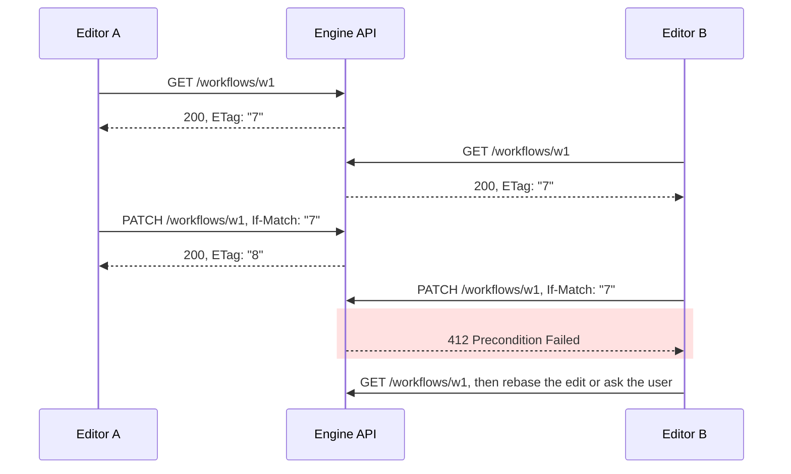

# 6. Describing APIs

Assumes [file 01](01-foundations.md) for the vocabulary and the workflow definition format, and
[go-services files 02 and 03](../go-services/02-the-http-client.md) for Go's HTTP client and
server. It doesn't need Part 1.

## 6.1 The problem

An orchestration engine is at least two codebases that talk over HTTP: the Go backend that
stores and runs workflows, and the TypeScript editor where people build them. Each has its own
idea of what a workflow looks like, written down twice, by hand, in two languages.

The two ideas drift, and nothing complains. The backend renames a field. The editor keeps
sending the old name. Go's JSON decoder ignores fields it doesn't recognise, so the edit is
dropped without an error, and the user finds out a week later that their change never took. The
same thing happens to error responses: each endpoint invents its own error body, and the editor
can't say *which* field was wrong. It happens to edits: the editor sends the whole workflow
back, and overwrites a change a colleague saved a minute earlier.

So the two codebases need four agreements, and each has a standard:

| Agreement | Without it | Standard | Section |
|---|---|---|---|
| The shape of every request and response | Types drift; mistakes surface at run time | OpenAPI 3.1, whose schemas are JSON Schema 2020-12, with code generated on both sides | §6.2–6.4 |
| How an error says what's wrong, and where | The editor can't highlight the offending field | Problem details (RFC 9457) with JSON Pointers (RFC 6901) | §6.5–6.6 |
| How to change part of a document | Sending the whole document, and clobbering other edits | JSON Patch (RFC 6902) | §6.7 |
| What happens when two people edit at once | The last write silently wins | `ETag`, `If-Match` and `412` (RFC 9110) | §6.8 |

## 6.2 OpenAPI 3.1, and why JSON Schema matters

An **OpenAPI description** is a JSON or YAML document that lists an API's paths and, for each
operation on them, its parameters, its request body, and its possible responses by status code
and media type, with a schema for every body. It's the one place both codebases can read the
contract from.

The schemas are the part that changed most between versions. OpenAPI 3.0.3 describes its Schema
Object as "an extended subset of the JSON Schema Specification Wright Draft 00", and says "null
is not supported as a type (see nullable for an alternative solution)"
([3.0.3](https://spec.openapis.org/oas/v3.0.3.html)). OpenAPI 3.1.0, published on 15 February
2021, made it "a superset of the JSON Schema Specification Draft 2020-12"
([3.1.0](https://spec.openapis.org/oas/v3.1.0.html)). The OpenAPI Initiative's
[migration guide](https://www.openapis.org/blog/2021/02/16/migrating-from-openapi-3-0-to-3-1-0)
puts the consequence in one line: "OpenAPI is entirely compatible with JSON Schema because it is
now a JSON Schema dialect."

That matters for practical reasons. A schema in the API description is a JSON Schema, so any
JSON Schema validator can check a request body against it, and the same schema can serve things
that aren't APIs, such as the editor's form validation. And three 3.0 habits became wrong:

| 3.0 | 3.1 | From the migration guide |
|---|---|---|
| `nullable: true` | `type: [string, "null"]` | "it was decided to remove nullable entirely instead of deprecate it" |
| `exclusiveMinimum: true` beside `minimum` | `exclusiveMinimum: 0`, a number | "These two keywords used to take a boolean value… In OpenAPI v3.1 they are distinct values" |
| `example:` in a schema | `examples:`, a list | "no longer necessary now as JSON Schema has `examples`" |

The first row is where two codebases can quietly disagree. JSON Schema 2020-12 says "Unknown
keywords SHOULD be treated as annotations"
([core §4.3.1](https://json-schema.org/draft/2020-12/json-schema-core)), so in a 3.1 document
`nullable: true` is a comment, not a rule. I gave both generators used below a 3.1 schema with
one property written each way:

```yaml
old: { type: string, nullable: true }
new: { type: [string, "null"] }
```

| Generator | `old` | `new` |
|---|---|---|
| oapi-codegen v2.8.0 (Go) | `Old string` | `New *string` |
| openapi-typescript 7.13.0 | `old: string \| null` | `new: string \| null` |

oapi-codegen read the document strictly and ignored `nullable`. openapi-typescript honoured it.
So the editor may send `null` for `old`, and the Go server can't represent it: "unmarshaling a
JSON null into any other Go type has no effect on the value and produces no error"
(`encoding/json`, `go doc json.Unmarshal`), which leaves `""`. Write nullability as a type array
in a 3.1 document and both sides agree.

The specification has moved on again since. Versions 3.1.2 and 3.2.0 were both published on 19
September 2025, and 3.2.1, the latest, on 10 September 2026
([spec.openapis.org](https://spec.openapis.org/oas/)). 3.2 keeps JSON Schema 2020-12 as its
default dialect: "By default, this object is a superset of the JSON Schema Specification Draft
2020-12" ([3.2.1](https://spec.openapis.org/oas/v3.2.1.html)). Tools lag by years. oapi-codegen
added what its v2.8.0 release notes call "initial OpenAPI 3.1 support" on 17 July 2026, five
years after 3.1. This chapter's description says `openapi: 3.1.0`. Both generators also accepted
it with that line changed to `3.2.0`, and openapi-typescript's output was byte-for-byte the same,
but that only shows they parse a 3.2 document that uses nothing new. Neither project's README or
changelog mentions 3.2, and I didn't test any 3.2 feature.

## 6.3 Spec-first or code-first

There are two ways to keep a description and a server in step, and they differ in which one is
the source of truth.

| | Spec-first | Code-first |
|---|---|---|
| Source of truth | The OpenAPI file | The Go handlers and their types |
| Go side | A generated interface you implement, for example [oapi-codegen](https://github.com/oapi-codegen/oapi-codegen) | Handlers with typed inputs and outputs; the framework emits the description, for example [Huma](https://github.com/danielgtaylor/huma) |
| TypeScript side | Generated from the file | Generated from the emitted description |
| Where the contract is reviewed | In the description's diff | In the Go diff; the description changes as a side effect |
| Typical failure | The YAML is verbose, so people stop keeping it tidy | A refactor renames a field and silently changes the public contract |

Huma is a fair example of code-first in Go. It calls itself a "micro framework for building HTTP
REST/RPC APIs in Go backed by OpenAPI 3 and JSON Schema", and v2.39.1 (29 July 2026) generates
an OpenAPI 3.1.0 description from your registered operations. It also serves a copy downgraded
to 3.0.3, which its source says "mostly exists to provide an alternative spec for tools which are
not yet 3.1 compatible" (`openapi.go`). Its errors are RFC 9457 problem details "by default (but
can be changed)", which comes up again in §6.5.

The choice is less important than it looks, because both end the same way: a description file
in the repository, generated code on the TypeScript side at least, and a check in CI that the
generated code matches the file (§6.4). Spec-first makes the contract the thing people review.
Code-first makes it impossible for the server and the description to disagree, and easy to
change the contract without noticing.

## 6.4 What codegen produces: one endpoint, both sides

The endpoint is the one an editor uses to save a change: `PATCH /workflows/{id}`, with a JSON
Patch body (§6.7) and an `If-Match` header (§6.8). It answers `200` with the patched workflow and
its new `ETag`; `409` when the patch doesn't apply, for example because a `test` operation
failed; `412` when someone else saved first; and `422` when the result would be an invalid
workflow. The three failures are problem details (§6.5). The workflow is file 01's format: a
`steps` array, each step with an `id`, optional `dependsOn`, and a `request` whose `url` and
`body` are JSONata expressions.

### The description

```yaml
openapi: 3.1.0
info:
  title: Workflow API
  version: 1.0.0
paths:
  /workflows/{id}:
    patch:
      operationId: patchWorkflow
      summary: Apply a JSON Patch to a stored workflow
      parameters:
        - name: id
          in: path
          required: true
          schema: { type: string }
        - name: If-Match
          in: header
          required: true
          description: The ETag of the version this patch was written against.
          schema: { type: string }
      requestBody:
        required: true
        content:
          application/json-patch+json:
            schema: { $ref: "#/components/schemas/JsonPatch" }
      responses:
        "200":
          description: The workflow after the patch.
          headers:
            ETag:
              required: true
              schema: { type: string }
          content:
            application/json:
              schema: { $ref: "#/components/schemas/Workflow" }
        "409":
          description: The patch doesn't apply to the current workflow, for example a test operation failed.
          content:
            application/problem+json:
              schema: { $ref: "#/components/schemas/Problem" }
        "412":
          description: The workflow has changed since the If-Match version.
          content:
            application/problem+json:
              schema: { $ref: "#/components/schemas/Problem" }
        "422":
          description: >-
            The patch would make the workflow invalid. Each pointer in errors
            is relative to the patched workflow, not to the patch.
          content:
            application/problem+json:
              schema: { $ref: "#/components/schemas/Problem" }
components:
  schemas:
    Workflow:
      type: object
      required: [steps]
      properties:
        steps:
          type: array
          items: { $ref: "#/components/schemas/Step" }
    Step:
      type: object
      required: [id, request]
      properties:
        id: { type: string }
        dependsOn:
          type: array
          items: { type: string }
        request: { $ref: "#/components/schemas/Request" }
    Request:
      type: object
      required: [method, url]
      properties:
        method: { type: string, enum: [GET, POST, PUT, PATCH, DELETE] }
        url: { type: string, description: A JSONata expression that evaluates to the URL. }
        body:
          type: [string, "null"]
          description: A JSONata expression for the request body, or null for none.
    JsonPatch:
      type: array
      items: { $ref: "#/components/schemas/PatchOperation" }
    PatchOperation:
      type: object
      required: [op, path]
      properties:
        op: { type: string, enum: [add, remove, replace, move, copy, test] }
        path: { type: string }
        from: { type: string }
        value: {}
    Problem:
      type: object
      properties:
        type: { type: string, format: uri-reference, default: about:blank }
        title: { type: string }
        status: { type: integer }
        detail: { type: string }
        errors:
          type: array
          items:
            type: object
            required: [pointer, detail]
            properties:
              pointer:
                type: string
                description: A JSON Pointer (RFC 6901, plain form) into the patched workflow.
              detail: { type: string }
```

### The Go side

oapi-codegen is pinned as a tool dependency of the server's module, using Go 1.24's `tool`
directive ("Go modules can now track executable dependencies using tool directives in go.mod",
[Go 1.24 release notes](https://go.dev/doc/go1.24)):

```sh
go get -tool github.com/oapi-codegen/oapi-codegen/v2/cmd/oapi-codegen@v2.8.0
go tool oapi-codegen -config oapi-codegen.yaml ../openapi.yaml
```

with this `oapi-codegen.yaml`:

```yaml
package: api
generate:
  models: true
  std-http-server: true
  strict-server: true
output: api/api.gen.go
```

The first command is [go-services file 08](../go-services/08-when-a-dependency-moves-your-toolchain.md)
happening in front of you. v2.8.0's release notes say "Go 1.25 is now required", so `go get`
raised the module's `go` line from `1.24.4`, which `go mod init` had written, to `1.25.0`, and
with `GOTOOLCHAIN=auto` the next `go version` in that directory reported a downloaded go1.25.0,
not the installed 1.24.4.

`std-http-server` generates routing for the standard library's `ServeMux`; the README lists
eight other routers, from Chi to Iris. `strict-server` adds the interface worth having: one
method per operation, which receives a typed request and returns a typed response. Here's what
it generated, trimmed to the declarations that matter. I've left out the enum constants and their
`Valid` methods, the type aliases, the "defines model for" doc comments, the methods that write
each response, the parameter-binding wrapper and the routing:

```go
type PatchOperation struct {
	From  *string          `json:"from,omitempty"`
	Op    PatchOperationOp `json:"op"`
	Path  string           `json:"path"`
	Value interface{}      `json:"value,omitempty"`
}

type Problem struct {
	Detail *string `json:"detail,omitempty"`
	Errors *[]struct {
		Detail string `json:"detail"`

		// Pointer A JSON Pointer (RFC 6901, plain form) into the patched workflow.
		Pointer string `json:"pointer"`
	} `json:"errors,omitempty"`
	Status *int    `json:"status,omitempty"`
	Title  *string `json:"title,omitempty"`
	Type   *string `json:"type,omitempty"`
}

type Request struct {
	// Body A JSONata expression for the request body, or null for none.
	Body   *string       `json:"body,omitempty"`
	Method RequestMethod `json:"method"`

	// Url A JSONata expression that evaluates to the URL.
	Url string `json:"url"`
}

type Step struct {
	DependsOn *[]string `json:"dependsOn,omitempty"`
	Id        string    `json:"id"`
	Request   Request   `json:"request"`
}

type Workflow struct {
	Steps []Step `json:"steps"`
}

type PatchWorkflowParams struct {
	// IfMatch The ETag of the version this patch was written against.
	IfMatch string `json:"If-Match"`
}

type PatchWorkflowRequestObject struct {
	Id     string `json:"id"`
	Params PatchWorkflowParams
	Body   *PatchWorkflowApplicationJSONPatchPlusJSONRequestBody
}

type PatchWorkflow200ResponseHeaders struct {
	ETag string
}

type PatchWorkflow200JSONResponse struct {
	Body    Workflow
	Headers PatchWorkflow200ResponseHeaders
}

type PatchWorkflow409ApplicationProblemPlusJSONResponse Problem
type PatchWorkflow412ApplicationProblemPlusJSONResponse Problem
type PatchWorkflow422ApplicationProblemPlusJSONResponse Problem

type StrictServerInterface interface {
	// PatchWorkflow Apply a JSON Patch to a stored workflow
	// (PATCH /workflows/{id})
	PatchWorkflow(ctx context.Context, request PatchWorkflowRequestObject) (PatchWorkflowResponseObject, error)
}
```

Each declared response is its own type, and only those types satisfy
`PatchWorkflowResponseObject`, so the handler can't return a status the description doesn't
list, and a `200` can't be returned without its `ETag`. The handler I wrote against it, trimmed
of its `validate` function (which checks methods, duplicate ids and dependencies, and returns
the `422` body) and of `main`:

```go
type store struct {
	mu       sync.Mutex
	version  int
	workflow api.Workflow
}

func etag(v int) string { return strconv.Quote(strconv.Itoa(v)) } // "8", quotes included

// matches is If-Match's strong comparison: weak tags (W/"…") never match.
func matches(ifMatch, current string) bool {
	for _, t := range strings.Split(ifMatch, ",") {
		if t = strings.TrimSpace(t); t == "*" || t == current {
			return true
		}
	}
	return false
}

func problem(title, detail string, status int) api.Problem {
	return api.Problem{Type: str("about:blank"), Title: str(title), Detail: str(detail), Status: &status}
}

func (s *store) PatchWorkflow(ctx context.Context, req api.PatchWorkflowRequestObject) (api.PatchWorkflowResponseObject, error) {
	s.mu.Lock()
	defer s.mu.Unlock()
	if !matches(req.Params.IfMatch, etag(s.version)) {
		return api.PatchWorkflow412ApplicationProblemPlusJSONResponse(problem("Precondition Failed",
			"the workflow is now at "+etag(s.version), http.StatusPreconditionFailed)), nil
	}
	ops, _ := json.Marshal(req.Body) // the generated decoder has already consumed the raw body
	patch, err := jsonpatch.DecodePatch(ops)
	if err != nil {
		return nil, err
	}
	doc, _ := json.Marshal(s.workflow)
	patched, err := patch.Apply(doc)
	if err != nil {
		return api.PatchWorkflow409ApplicationProblemPlusJSONResponse(problem("Conflict",
			err.Error(), http.StatusConflict)), nil
	}
	var next api.Workflow
	if err := json.Unmarshal(patched, &next); err != nil {
		return api.PatchWorkflow422ApplicationProblemPlusJSONResponse(problem("Unprocessable Content",
			err.Error(), http.StatusUnprocessableEntity)), nil
	}
	if p := validate(next); p.Errors != nil {
		return api.PatchWorkflow422ApplicationProblemPlusJSONResponse(p), nil
	}
	s.version++
	s.workflow = next
	return api.PatchWorkflow200JSONResponse{
		Body:    next,
		Headers: api.PatchWorkflow200ResponseHeaders{ETag: etag(s.version)},
	}, nil
}
```

`jsonpatch` is [evanphx/json-patch](https://github.com/evanphx/json-patch) v5.9.11, and `str`
returns a pointer to its argument. The server starts with file 01's four-step workflow at
version 7.

### The TypeScript side

The editor pins its generator, client and compiler in `package.json`: openapi-typescript 7.13.0,
openapi-fetch 0.17.0 and TypeScript 5.9.3. openapi-typescript declares a peer dependency on
TypeScript `^5.x`, though TypeScript 6 and 7 have both been released, so the newest compiler
isn't automatically the right one. Generation is one command:

```sh
npx openapi-typescript ../openapi.yaml -o src/api.d.ts
```

It produces types only, no runtime code. Trimmed to the parts that matter: I've cut the `paths`
wrapper, the `Workflow` and `JsonPatch` schemas, the `never` placeholders for unused kinds of
parameter, the catch-all `headers` of the error responses, and the `409` and `422` responses, which
have the same shape as `412`:

```ts
export interface components {
    schemas: {
        Step: {
            id: string;
            dependsOn?: string[];
            request: components["schemas"]["Request"];
        };
        Request: {
            /** @enum {string} */
            method: "GET" | "POST" | "PUT" | "PATCH" | "DELETE";
            /** @description A JSONata expression that evaluates to the URL. */
            url: string;
            /** @description A JSONata expression for the request body, or null for none. */
            body?: string | null;
        };
        PatchOperation: {
            /** @enum {string} */
            op: "add" | "remove" | "replace" | "move" | "copy" | "test";
            path: string;
            from?: string;
            value?: unknown;
        };
        Problem: {
            /**
             * Format: uri-reference
             * @default about:blank
             */
            type: string;
            title?: string;
            status?: number;
            detail?: string;
            errors?: {
                /** @description A JSON Pointer (RFC 6901, plain form) into the patched workflow. */
                pointer: string;
                detail: string;
            }[];
        };
    };
}
export interface operations {
    patchWorkflow: {
        parameters: {
            header: {
                /** @description The ETag of the version this patch was written against. */
                "If-Match": string;
            };
            path: {
                id: string;
            };
        };
        requestBody: {
            content: {
                "application/json-patch+json": components["schemas"]["JsonPatch"];
            };
        };
        responses: {
            200: {
                headers: {
                    ETag: string;
                    [name: string]: unknown;
                };
                content: {
                    "application/json": components["schemas"]["Workflow"];
                };
            };
            412: {
                content: {
                    "application/problem+json": components["schemas"]["Problem"];
                };
            };
        };
    };
}
```

[openapi-fetch](https://openapi-ts.dev/openapi-fetch/) turns those types into a typed `fetch`.
"All methods return an object with **data**, **error**, and **response**", where `error` is the
"`5xx`, `4xx`, or `default` response if not OK". It returns errors rather than throwing them,
which the run below confirms. The editor's client, as I ran it with Node 24.14.1 (which runs a
`.ts` file directly by stripping the types) after `tsc --noEmit` passed:

```ts
// The editor's side: typed calls to PATCH /workflows/{id}.
import createClient from "openapi-fetch";
import type { components, paths } from "./api.d.ts";

type Patch = components["schemas"]["JsonPatch"];

const api = createClient<paths>({ baseUrl: "http://127.0.0.1:8099" });

async function save(etag: string, patch: Patch) {
  const { data, error, response } = await api.PATCH("/workflows/{id}", {
    params: { path: { id: "w1" }, header: { "If-Match": etag } },
    body: patch,
    headers: { "Content-Type": "application/json-patch+json" },
  });
  if (error) {
    // error is typed as Problem: the union of the 409, 412 and 422 bodies.
    const where = error.errors?.map((e) => `${e.pointer}: ${e.detail}`) ?? [];
    console.log(response.status, error.title, where);
    return null;
  }
  console.log(response.status, "ETag", response.headers.get("ETag"), data.steps.length, "steps");
  return response.headers.get("ETag");
}

// Another editor saved first: the server is at "7", this edit was made against "6".
await save('"6"', [{ op: "replace", path: "/steps/3/request/url", value: "'https://crm.example.com/v2/summaries'" }]);

// The same edit against the current version, guarded by a test on the step's identity.
const etag = await save('"7"', [
  { op: "test", path: "/steps/3/id", value: "crm" },
  { op: "replace", path: "/steps/3/request/url", value: "'https://crm.example.com/v2/summaries'" },
]);

// An edit that would leave the workflow invalid.
await save(etag ?? "", [
  { op: "replace", path: "/steps/2/request/method", value: "FETCH" },
  { op: "add", path: "/steps/3/dependsOn/-", value: "billing" },
]);
```

The `value` of each URL edit is a JSONata string literal, quotes and all, because in file 01's
format `url` is an expression. Against the Go server:

```
412 Precondition Failed []
200 ETag "8" 4 steps
422 Unprocessable Content [
  '/steps/2/request/method: must be one of GET, POST, PUT, PATCH, DELETE, not "FETCH"',
  '/steps/3/dependsOn/2: no step called "billing"'
]
```

And three mistakes the generated types caught before anything ran. A file with a call that
leaves out `If-Match`, a patch with `op: "rename"`, and a read of `request.timeout` gave `tsc`:

```
src/wrong.ts(8,3): error TS2741: Property 'header' is missing in type '{ path: { id: string; }; }' but required in type '{ query?: undefined; header: { "If-Match": string; }; path: { id: string; }; cookie?: undefined; }'.
src/wrong.ts(9,12): error TS2322: Type '"rename"' is not assignable to type '"replace" | "add" | "remove" | "copy" | "move" | "test"'.
src/wrong.ts(15,37): error TS2339: Property 'timeout' does not exist on type '{ method: "GET" | "POST" | "PUT" | "PATCH" | "DELETE"; url: string; body?: string | null | undefined; }'.
```

### What the generated server doesn't check

The generated code checks that required parameters are there, decodes the body into the
generated types, and calls the handler. That's all. oapi-codegen's README is candid about it: the
generated code "has some validation for some incoming data, such as checking for required
headers", and beside its strict-server example, "This doesn't include validation of incoming
requests", which it leaves to a separate middleware. I sent the server six requests, the first
five breaking the description and the last one valid, first as generated, then with
oapi-codegen's [nethttp-middleware](https://github.com/oapi-codegen/nethttp-middleware) v1.2.0 in
front, which validates against the description using kin-openapi v0.142.0:

| Request | Generated server only | With the validating middleware |
|---|---|---|
| Keys `"OP"` and `"PATH"`, plus an unknown `"colour"` | `200`: applied. Go matched the keys case-insensitively and dropped `colour` | `400`: `property "op" is missing` |
| `"op": "frobnicate"` | Reached the handler; the patch library refused it, and my handler's error became a `500` | `400`: `value is not one of the allowed values` |
| An `add` with no `path` | `200`, and the workflow was replaced by `{"steps":[]}` | `400`: `property "path" is missing` |
| `Content-Type: text/plain` | `200` | `400`: `header Content-Type has unexpected value "text/plain"` |
| `Content-Type: application/json` | `200` | `400`, the same |
| `"value": null` in an `add` | `500`: the generated type lost the `null` (below) | `400`: `Value is not nullable`, wrongly |

The third row is the one to remember. The description says `path` is required. Go's decoder,
following `encoding/json`'s documented behaviour, "preferring an exact match but also accepting
a case-insensitive match" and ignoring "object keys which don't have a corresponding struct
field", left `Path` as `""`. In JSON Patch the empty pointer is the whole document, so the
operation replaced the entire workflow, and the server answered `200`.

The last row is wrong in both columns. JSON Patch allows any JSON value as `value`, including
`null`, and the description says so with the empty schema `{}`. JSON Schema 2020-12 treats that
as equivalent to the schema `true`, which "Always passes validation, as if the empty schema {}"
(core §4.3.2). Ajv 8.20.0, in its 2020-12 mode, accepted the same patch. kin-openapi rejected it, with v0.151.0 (the latest)
as well as v0.142.0. When I called its schema validation directly in 2020-12 mode, a single
operation passed and the array of operations failed, so the array's items seem to be checked
with OpenAPI 3.0's null rule.

> **Teacher's aside.** Generated code feels like a contract enforced on both sides. It's two
> promises, both made at compile time, both about *your own code*: the Go handler can only
> return declared responses, and the editor can only build requests that type-check. Neither
> says anything about the bytes that arrive. The generated server checked that required headers
> were present and that the body decoded into the Go types, and nothing else; Go's decoder is
> more forgiving than the schema, so a request the description forbids became a request that
> wiped a workflow. The description is only enforced where something validates against it at
> run time, and those validators trail the specification too. Put the validating middleware in,
> test it with requests the description forbids, and don't assume the validator and the
> generators read the description the same way.

### Where the two sides read one description differently

Three disagreements turned up in this one-endpoint example, each from a single line of the
description:

| Line | Go (oapi-codegen v2.8.0) | TypeScript (openapi-typescript 7.13.0, openapi-fetch 0.17.0) |
|---|---|---|
| `value: {}` | `Value interface{}` with `omitempty`. A `null` decodes to `nil`, and `nil` is omitted when the handler re-encodes the patch, so `"value": null` vanished and the patch library reported "missing value" | `value?: unknown`; `null` is fine |
| `type: …, default: about:blank` | `Type *string`: optional | `type: string`: required, because `--default-non-nullable` is on unless you set it to `false`. A server that omits `type`, as RFC 9457 allows, sends a body the editor's types say can't exist |
| `application/json-patch+json` request body | The generated server reads any `Content-Type` | Without the explicit `headers` in the client above, openapi-fetch sent `Content-Type: application/json`, and `tsc` didn't object. The validating middleware refuses that |

For the first, the handler should read the raw patch rather than re-encode the generated
struct, or the description can give `value` a Go type that keeps `null`, such as
`json.RawMessage` through oapi-codegen's `x-go-type` extension; I haven't run that variant. For
the second, decide whether `type` is always sent, and say so with `required`.

### The drift check

Generated code only helps if it's regenerated whenever the description changes. The check that
makes sure of it is short: regenerate everything in CI, then fail if anything changed.

```sh
(cd server && go tool oapi-codegen -config oapi-codegen.yaml ../openapi.yaml)
(cd editor && npx openapi-typescript ../openapi.yaml -o src/api.d.ts)
git diff --exit-code -- server/api editor/src/api.d.ts
```

`git diff --exit-code` "exits with 1 if there were differences and 0 means no differences"
(`git help diff`). oapi-codegen's README recommends this arrangement: commit the generated code,
because "It means it's easier to view the impact of a change", and "have your CI/CD pipeline
validate that generated files are all up-to-date". My scratch copy wasn't a git repository, so I
checked the behaviour with `git diff --no-index --exit-code` between a saved copy of the
generated files and a fresh generation. After adding one optional property to `Step`, it printed
the new `name?: string;` line in `api.d.ts` and exited with 1; after restoring the description,
it exited with 0. openapi-typescript can also check on its own: with `--check` it printed
"Generated types are not up-to-date!" and exited with 1.

> ⚠️ **`git diff` doesn't see new files.** It shows "the changes you made relative to the index"
> (`git help diff`), and a file that's never been added isn't in the index. If a description
> change makes a generator write a *new* file and nobody commits it, the diff is clean and CI
> passes. Check with `git status --porcelain -- <generated paths>`, which lists untracked files
> as `??`, and fail if it prints anything.

Two more conditions make the check trustworthy. The generator versions must be pinned and the
same everywhere, or CI regenerates different code and fails for no reason; that's what the
`tool` directive and `package.json` above are for. And with Go's `tool` directive the tool's
dependencies share the module graph with the server's: adding nethttp-middleware upgraded one of
oapi-codegen's own dependencies (`go-openapi/jsonpointer` v0.23.1 to v1.0.0). The generated
code came out identical, which I checked, but a dependency bump can now change generated output,
and the drift check is how you'd find out.

## 6.5 Errors as problem details (RFC 9457)

An error response has two audiences. Generic HTTP software (clients, caches, proxies) reads the
status code. The editor needs more: what went wrong, and where. RFC 9457, *Problem Details for
HTTP APIs* ([RFC 9457](https://www.rfc-editor.org/rfc/rfc9457.html), July 2023, which obsoletes
RFC 7807), defines one JSON shape for the second audience, with the media type
`application/problem+json`, so each API doesn't invent its own.

| Member | Meaning |
|---|---|
| `type` | A URI reference identifying the problem type, and consumers' "primary identifier" for it. If absent, "its value is assumed to be 'about:blank'", meaning nothing beyond the status code |
| `status` | The HTTP status code, "only advisory". The server "MUST use the same status code in the actual HTTP response" |
| `title` | A short summary of the problem type, which "SHOULD NOT change from occurrence to occurrence" |
| `detail` | A human-readable explanation of this occurrence. "Consumers SHOULD NOT parse the 'detail' member for information" |
| `instance` | A URI reference identifying this occurrence |
| Anything else | An extension defined by the problem type. "Clients consuming problem details MUST ignore any such extensions that they don't recognize" |

The RFC's second example is the one an editor wants, a validation failure:

```json
{
 "type": "https://example.net/validation-error",
 "title": "Your request is not valid.",
 "errors": [
             {
               "detail": "must be a positive integer",
               "pointer": "#/age"
             },
             {
               "detail": "must be 'green', 'red' or 'blue'",
               "pointer": "#/profile/color"
             }
          ]
}
```

Three details in it are easy to miss.

First, `errors` isn't part of the standard. The RFC says "The fictional problem type here
defines the 'errors' extension", with each entry's `pointer` locating "the problem within the
request's content using a JSON Pointer". It's an example of an extension, not a member every
problem has. Your API has to define it, and the place to define it is the OpenAPI description,
so both generators see it, as §6.4's `Problem` schema does.

Second, `"#/age"` is a JSON Pointer in its URI-fragment form, with a leading `#` and
percent-encoding. RFC 6901 defines both forms, the plain string in §5 and the fragment in §6.
This course uses the plain form in `pointer` fields, `/steps/2/id`, because a JSON Patch `path`
is the plain form and a pointer from an error can then go straight into a patch
([file 07](07-agents-that-build-workflows.md) relies on that). §6.6's `FromFragment` converts an
API's fragment-form pointers when you consume them.

Third, an error response that's generated for you may not be a problem detail at all. The
generated server's defaults answered a malformed body with `400`, `text/plain`, "can't decode
JSON body: unexpected EOF", and the validating middleware's errors were `text/plain` too. Each
layer takes its own error handler: `StdHTTPServerOptions.ErrorHandlerFunc` in the generated
routing for parameter errors, `StrictHTTPServerOptions.RequestErrorHandlerFunc` in the strict
server for body errors, and `Options.ErrorHandler` in the middleware. Set all three to write
`application/problem+json`, or the editor gets problem details from your handlers and plain text
from everything in front of them.

Conventions differ here, and neither is standard. Huma's default error detail uses a `location`
field instead of `pointer`, documented in its `error.go` as "a path-like string indicating where
the error occurred. It typically begins with `path`, `query`, `header`, or `body`. Example:
`body.items[3].tags` or `path.thing-id`". That can point at things a JSON Pointer can't: a
header, a query parameter, a path segment. RFC 9457's example only covers the body. Pick one
convention, write it into the description, and generate it into both sides.

> ⚠️ **Say what the pointer is relative to.** For a `PUT` of a whole workflow, "the request's
> content" and "the workflow" are the same document, so `/steps/2/request/url` is unambiguous.
> For a JSON Patch request (§6.7) the request's content is the *patch*, an array of operations,
> and a pointer into it reads like `/0/value`. kin-openapi's messages in §6.4 do exactly that:
> `Error at "/0/op"`. An editor would rather be told `/steps/2/request/url`, in the workflow the
> patch produced. Either is defensible. What isn't is leaving it unsaid, because the client will
> resolve the pointer against the wrong document and highlight nothing. §6.4's description says
> it in the `422` response.

## 6.6 JSON Pointer (RFC 6901)

Errors, patches and references all need to name one place inside a JSON document: this field,
the third element of that array. **JSON Pointer**
([RFC 6901](https://www.rfc-editor.org/rfc/rfc6901.html), 2013) is the standard way to write
that down. A pointer is a string of zero or more reference tokens, each starting with `/`. The
empty string means the whole document. Each token selects a member of an object by name, or an
element of an array by index.

Two characters need escaping inside a token, because they mean something: `~` is written `~0`,
and `/` is written `~1`. Decoding has an order, and the RFC spells out why: "first transforming
any occurrence of the sequence '~1' to '/', and then transforming any occurrence of the sequence
'~0' to '~'. By performing the substitutions in this order, an implementation avoids the error
of turning '~01' first into '~1' and then into '/', which would be incorrect."

Array indices are digits with no leading zeros, so `01` is invalid, and `-` names "the
(nonexistent) member after the last array element", which is an error when reading and means
"append" in JSON Patch. A pointer that doesn't resolve is an error, and the RFC leaves its
handling to the application.

Here's a resolver for a document decoded into Go's `any`. Instead of two replacements in the
RFC's order, it decodes each token in one left-to-right pass, which decodes every escape exactly
once, so the order question can't arise, and it rejects a `~` followed by anything but `0` or
`1`, which the RFC's grammar forbids.

```go
package pointer

import (
	"errors"
	"fmt"
	"net/url"
	"strconv"
	"strings"
)

// Resolve returns the value that ptr (RFC 6901) refers to in doc, where doc
// came from decoding JSON into an `any`: map[string]any, []any, string,
// float64, bool or nil.
func Resolve(doc any, ptr string) (any, error) {
	if ptr == "" {
		return doc, nil // the whole document
	}
	if ptr[0] != '/' {
		return nil, errors.New(`pointer must be empty or start with "/"`)
	}
	cur := doc
	for _, raw := range strings.Split(ptr[1:], "/") {
		tok, err := unescape(raw)
		if err != nil {
			return nil, err
		}
		switch v := cur.(type) {
		case map[string]any:
			next, ok := v[tok]
			if !ok {
				return nil, fmt.Errorf("no member %q", tok)
			}
			cur = next
		case []any:
			i, err := index(tok, len(v))
			if err != nil {
				return nil, err
			}
			cur = v[i]
		default:
			return nil, fmt.Errorf("can't step into a scalar with %q", tok)
		}
	}
	return cur, nil
}

// unescape turns ~0 into ~ and ~1 into / in one left-to-right pass, so each
// escape is decoded exactly once, and rejects any other use of ~.
func unescape(tok string) (string, error) {
	var b strings.Builder
	for i := 0; i < len(tok); i++ {
		c := tok[i]
		if c == '~' {
			if i+1 == len(tok) || (tok[i+1] != '0' && tok[i+1] != '1') {
				return "", fmt.Errorf("invalid escape in %q", tok)
			}
			c = "~/"[tok[i+1]-'0']
			i++
		}
		b.WriteByte(c)
	}
	return b.String(), nil
}

// index reads an array index: digits with no leading zero. "-" means the
// element after the last, which never exists when you're reading.
func index(tok string, n int) (int, error) {
	if tok == "-" {
		return 0, errors.New(`"-" is past the end of the array`)
	}
	if tok == "" || strings.Trim(tok, "0123456789") != "" || (len(tok) > 1 && tok[0] == '0') {
		return 0, fmt.Errorf("%q is not an array index", tok)
	}
	i, err := strconv.Atoi(tok)
	if err != nil || i >= n {
		return 0, fmt.Errorf("index %s is out of range (length %d)", tok, n)
	}
	return i, nil
}

// FromFragment turns the URI fragment form (RFC 6901 §6), such as the
// "#/age" in an RFC 9457 errors entry, into a plain pointer.
func FromFragment(frag string) (string, error) {
	if !strings.HasPrefix(frag, "#") {
		return "", errors.New(`fragment must start with "#"`)
	}
	return url.PathUnescape(frag[1:])
}
```

That's `pointer.go` as I ran it with Go 1.24.4. Working byte by byte is safe in UTF-8, because
`~` and `/` are ASCII and never occur inside a multi-byte character. The driver I've left out
decodes RFC 6901's §5 example document, resolves the twelve pointers the RFC lists, then eleven
that must fail, then the decoding-order case on a second document,
`{"a~1b": "decoded once", "a/b": "decoded twice"}`:

```
RFC 6901 §5:
""             object with 10 members
"/foo"         ["bar","baz"]
"/foo/0"       "bar"
"/"            0
"/a~1b"        1
"/c%d"         2
"/e^f"         3
"/g|h"         4
"/i\\j"        5
"/k\"l"        6
"/ "           7
"/m~0n"        8
errors:
"foo"          error: pointer must be empty or start with "/"
"/foo/2"       error: index 2 is out of range (length 2)
"/foo/01"      error: "01" is not an array index
"/foo/-"       error: "-" is past the end of the array
"/foo/bar"     error: "bar" is not an array index
"/foo/length"  error: "length" is not an array index
"/foo/0/x"     error: can't step into a scalar with "x"
"/nope"        error: no member "nope"
"/constructor" error: no member "constructor"
"/m~2n"        error: invalid escape in "m~2n"
"/m~"          error: invalid escape in "m~"
decoding order, on {"a~1b": "decoded once", "a/b": "decoded twice"}:
"/a~01b"       "decoded once"
```

The pointers are printed as JSON strings, the way the RFC lists them, so `"/i\\j"` is the
four-character pointer `/i\j`. Note `"/"`: one empty token, which selects the member whose name
is the empty string, and gets 0. The same driver also ran the twelve URI-fragment forms from the
RFC's §6 (`#/c%25d`, `#/%20` and the rest) through `FromFragment`, and all twelve gave the same
values as their §5 equivalents.

Neither Go's standard library nor JavaScript's has a resolver. The nearest thing in Go is the
experimental `encoding/json/jsontext` (Go 1.25, with `GOEXPERIMENT=jsonv2`): its `Pointer` type
and `Decoder.StackPointer` method report where a decoder has got to, as a pointer such as
`/steps/1/id`, which is what you'd want for locating a decode error, but they don't look one up
in a decoded value.

The Rust, C++ and JavaScript versions print an identical table. Each driver is left out, as
before.

<details><summary>Rust</summary>

Uses `serde_json = "1.0.154"` for the document. Run with rustc 1.96.

```rust
use serde_json::Value;

/// Resolves an RFC 6901 JSON Pointer against a parsed document.
pub fn resolve<'a>(doc: &'a Value, ptr: &str) -> Result<&'a Value, String> {
    if ptr.is_empty() {
        return Ok(doc); // the whole document
    }
    let Some(rest) = ptr.strip_prefix('/') else {
        return Err(r#"pointer must be empty or start with "/""#.to_string());
    };
    let mut cur = doc;
    for raw in rest.split('/') {
        let tok = unescape(raw)?;
        cur = match cur {
            Value::Object(m) => m.get(&tok).ok_or_else(|| format!("no member {tok:?}"))?,
            Value::Array(a) => &a[index(&tok, a.len())?],
            _ => return Err(format!("can't step into a scalar with {tok:?}")),
        };
    }
    Ok(cur)
}

/// Turns ~0 into ~ and ~1 into / in one left-to-right pass, so each escape
/// is decoded exactly once, and rejects any other use of ~.
fn unescape(tok: &str) -> Result<String, String> {
    let mut out = String::with_capacity(tok.len());
    let mut chars = tok.chars();
    while let Some(c) = chars.next() {
        if c != '~' {
            out.push(c);
            continue;
        }
        match chars.next() {
            Some('0') => out.push('~'),
            Some('1') => out.push('/'),
            _ => return Err(format!("invalid escape in {tok:?}")),
        }
    }
    Ok(out)
}

/// Reads an array index: digits with no leading zero. "-" means the element
/// after the last, which never exists when you're reading.
fn index(tok: &str, len: usize) -> Result<usize, String> {
    if tok == "-" {
        return Err(r#""-" is past the end of the array"#.to_string());
    }
    let digits = !tok.is_empty() && tok.bytes().all(|b| b.is_ascii_digit());
    if !digits || (tok.len() > 1 && tok.starts_with('0')) {
        return Err(format!("{tok:?} is not an array index"));
    }
    match tok.parse::<usize>() {
        Ok(i) if i < len => Ok(i),
        _ => Err(format!("index {tok} is out of range (length {len})")),
    }
}
```

serde_json has a resolver of its own, `Value::pointer`, and the driver compares every answer
with it. They agreed on all 24 cases, but that hides a difference. `Value::pointer` (in
`src/value/mod.rs` of 1.0.154) decodes with `.replace("~1", "/").replace("~0", "~")`, the RFC's
order, and rejects leading zeros, but it doesn't reject an invalid escape: given
`{"m~2n": "found"}`, `doc.pointer("/m~2n")` returned the value, where the RFC's grammar makes
`/m~2n` a syntax error. It also returns `Option`, so it can't say why a pointer failed.

</details>

<details><summary>C++</summary>

C++20 with Apple clang 17, using [nlohmann/json](https://github.com/nlohmann/json) 3.12.0, a
single header I downloaded from the project's release page, for the document. The pointer logic
is hand-written on top of its value tree.

```cpp
#pragma once
#include <cstddef>
#include <stdexcept>
#include <string>
#include "json.hpp" // nlohmann/json 3.12.0, single header

namespace pointer {
using json = nlohmann::json;

struct Error : std::runtime_error {
    using std::runtime_error::runtime_error;
};

inline std::string in_quotes(const std::string& s) { return '"' + s + '"'; }

// Turns ~0 into ~ and ~1 into / in one left-to-right pass, so each escape is
// decoded exactly once, and rejects any other use of ~.
inline std::string unescape(const std::string& tok) {
    std::string out;
    for (std::size_t i = 0; i < tok.size(); ++i) {
        char c = tok[i];
        if (c == '~') {
            if (i + 1 == tok.size() || (tok[i + 1] != '0' && tok[i + 1] != '1'))
                throw Error("invalid escape in " + in_quotes(tok));
            c = tok[++i] == '0' ? '~' : '/';
        }
        out += c;
    }
    return out;
}

// Reads an array index: digits with no leading zero. "-" means the element
// after the last, which never exists when you're reading.
inline std::size_t index(const std::string& tok, std::size_t n) {
    if (tok == "-") throw Error(R"("-" is past the end of the array)");
    bool digits = !tok.empty() && tok.find_first_not_of("0123456789") == std::string::npos;
    if (!digits || (tok.size() > 1 && tok[0] == '0'))
        throw Error(in_quotes(tok) + " is not an array index");
    std::size_t i = tok.size() <= 18 ? std::stoull(tok) : n; // 19+ digits: too big anyway
    if (i >= n) throw Error("index " + tok + " is out of range (length " + std::to_string(n) + ")");
    return i;
}

// Resolves an RFC 6901 JSON Pointer against a parsed document.
inline const json& resolve(const json& doc, const std::string& ptr) {
    if (ptr.empty()) return doc; // the whole document
    if (ptr[0] != '/') throw Error(R"(pointer must be empty or start with "/")");
    const json* cur = &doc;
    std::size_t start = 1;
    for (;;) {
        std::size_t slash = ptr.find('/', start);
        std::string tok = unescape(ptr.substr(start, slash - start));
        if (cur->is_object()) {
            auto it = cur->find(tok); // not (*cur)[tok]: on a non-const json, [] inserts null
            if (it == cur->end()) throw Error("no member " + in_quotes(tok));
            cur = &*it;
        } else if (cur->is_array()) {
            cur = &(*cur)[index(tok, cur->size())];
        } else {
            throw Error("can't step into a scalar with " + in_quotes(tok));
        }
        if (slash == std::string::npos) return *cur;
        start = slash + 1;
    }
}
} // namespace pointer
```

nlohmann/json also has a resolver built in, `doc.at(json::json_pointer(p))`, which throws on
failure. The driver compares against it: it agreed on all 24 cases, including rejecting `/m~2n`.

The helper is called `in_quotes` because my first name for it, `quoted`, collided with
`std::quoted` through argument-dependent lookup, since its argument is a `std::string`, and the
build failed.

</details>

<details><summary>JavaScript</summary>

An ES module, run with Node 24, on the value `JSON.parse` returns.

```js
// Resolves an RFC 6901 JSON Pointer against a value from JSON.parse.
export function resolve(doc, ptr) {
  if (ptr === "") return doc; // the whole document
  if (!ptr.startsWith("/")) throw new Error('pointer must be empty or start with "/"');
  let cur = doc;
  for (const raw of ptr.slice(1).split("/")) {
    const tok = unescape(raw);
    if (Array.isArray(cur)) {
      cur = cur[index(tok, cur.length)];
    } else if (cur !== null && typeof cur === "object") {
      // Object.hasOwn, not `tok in cur` or cur[tok] alone: those find
      // inherited names such as "constructor" and "__proto__".
      if (!Object.hasOwn(cur, tok)) throw new Error(`no member ${JSON.stringify(tok)}`);
      cur = cur[tok];
    } else {
      throw new Error(`can't step into a scalar with ${JSON.stringify(tok)}`);
    }
  }
  return cur;
}

// Turns ~0 into ~ and ~1 into / in one left-to-right pass, so each escape
// is decoded exactly once, and rejects any other use of ~.
function unescape(tok) {
  let out = "";
  for (let i = 0; i < tok.length; i++) {
    let c = tok[i];
    if (c === "~") {
      const next = tok[i + 1];
      if (next !== "0" && next !== "1") throw new Error(`invalid escape in ${JSON.stringify(tok)}`);
      c = next === "0" ? "~" : "/";
      i++;
    }
    out += c;
  }
  return out;
}

// Reads an array index: digits with no leading zero. "-" means the element
// after the last, which never exists when you're reading.
function index(tok, n) {
  if (tok === "-") throw new Error('"-" is past the end of the array');
  if (!/^(0|[1-9][0-9]*)$/.test(tok)) throw new Error(`${JSON.stringify(tok)} is not an array index`);
  const i = Number(tok);
  if (i >= n) throw new Error(`index ${tok} is out of range (length ${n})`);
  return i;
}
```

</details>

> ⚠️ **Decode `~1` before `~0`, or not by replacement at all.** The Go driver also tried the
> tempting order, replacing `~0` first. On the second document it turned `a~01b` into `a/b` and
> returned `"decoded twice"`: not an error but a different value that exists, which is the worse
> outcome, because nothing tells you it happened.

> ⚠️ **In JavaScript, `cur[tok]` finds names the document doesn't have.** A resolver that just
> indexes, on `{"foo": ["bar", "baz"]}`, returned the `Object` constructor function for
> `/constructor`, `Object.prototype` for `/__proto__`, a function for `/toString`, and 2 for
> `/foo/length`. Check `Object.hasOwn` for objects and match the digits for arrays, as above.
> (`JSON.parse('{"__proto__": 1}')` does create an own property, so a real member called
> `__proto__` still resolves.)

> ⚠️ **In C++, `operator[]` on a non-const `nlohmann::json` inserts.** Looking up `probe["b"]`
> in `{"a": 1}` returned null and left the document as `{"a":1,"b":null}`. A resolver that uses
> `[]` to look things up adds a member for every pointer that misses. Use `find`, as above, or
> `at`, which throws.

> ⚠️ **A decoded document can't tell you about duplicate names.** RFC 6901 says that if a
> member name "is not unique in an object, the member that is referenced is undefined, and
> evaluation fails". RFC 8259 only says names "SHOULD be unique", and that when they aren't,
> "Many implementations report the last name/value pair only"
> ([§4](https://www.rfc-editor.org/rfc/rfc8259.html#section-4)). Given `{"a": 1, "a": 2}`, all
> four decoders here kept the last one without a word: Go's `encoding/json` gave `map[a:2]`,
> `JSON.parse` `{ a: 2 }`, serde_json `{"a": 2}`, nlohmann/json `{"a":2}`. By the time a resolver
> sees the tree, the duplicate is gone. Go 1.25's experimental `encoding/json/v2`
> (`GOEXPERIMENT=jsonv2`) is the exception: it returned
> `jsontext: duplicate object member name "a"`.

## 6.7 JSON Patch (RFC 6902) for partial edits

Saving a workflow by sending all of it with `PUT` has two costs. The body is the whole workflow
every time, and worse, the save overwrites everything, including parts someone else changed
since you loaded it. What the editor actually knows is what the user *did*: changed one step's
URL, appended a step. **JSON Patch** ([RFC 6902](https://www.rfc-editor.org/rfc/rfc6902.html),
2013) sends exactly that, as "a sequence of operations to apply to a target JSON document", with
the media type `application/json-patch+json`, for the HTTP `PATCH` method
([RFC 5789](https://www.rfc-editor.org/rfc/rfc5789.html)). On file 01's workflow:

```json
[
  { "op": "test",    "path": "/steps/3/id",          "value": "crm" },
  { "op": "replace", "path": "/steps/3/request/url", "value": "'https://crm.example.com/v2/summaries'" },
  { "op": "add",     "path": "/steps/-",             "value": {
      "id": "notify",
      "dependsOn": ["crm"],
      "request": { "method": "POST", "url": "'https://api.example.com/notifications'" } } }
]
```

Each `path` is a JSON Pointer. The six operations are `add`, `remove`, `replace`, `move`, `copy`
and `test`, and `-` as the last token of an `add` appends to an array. "Operations are applied
sequentially in the order they appear in the array", and the whole patch succeeds or fails
together: if any operation fails, "application of the entire patch document SHALL NOT be deemed
successful" (§5), and RFC 5789 makes it a server requirement: "The server MUST apply the entire
set of changes atomically." That makes `test` useful. The first operation above says "only if
step 3 is still `crm`", and if it isn't, nothing is applied. In §6.4's run, a patch whose `test`
expected `prefs` at index 1, where `orders` was, came back `409` with "testing value
/steps/1/id failed".

There's a simpler alternative, **JSON Merge Patch**
([RFC 7396](https://www.rfc-editor.org/rfc/rfc7396.html)), where the body looks like the
document and `null` means "remove":

| | JSON Patch (RFC 6902) | JSON Merge Patch (RFC 7396) |
|---|---|---|
| Body | A list of operations | A partial copy of the document |
| Set a value to `null` | Yes | No: `null` means remove the member |
| Change one element of an array | Yes, by index | No: "it is not possible to patch part of a target that is not an object, such as to replace just some of the values in an array" |
| Conditional changes | `test` | None |
| Readable at a glance | Less | More |

A workflow is mostly an array of steps, so JSON Patch is the better fit, and its weakness is
exactly that array.

> ⚠️ **Array indices move.** An editor loaded the workflow and wants to delete `prefs`, at
> index 2. Meanwhile a colleague inserted a step at index 0. `{"op": "remove", "path":
> "/steps/2"}` now deletes `orders`. RFC 5789 anticipates this: some patch formats "need to
> operate from a known base-point or else they will corrupt the resource", and "Clients using
> this kind of patch application SHOULD use a conditional request". There are two defences, and
> they combine well: `If-Match` on the request (§6.8), which refuses the patch if anything at
> all changed, and a `test` on the identity of the element you mean (`{"op": "test", "path":
> "/steps/2/id", "value": "prefs"}`), which refuses it only if *that* element moved.

RFC 5789 §2.2 suggests the status codes: `400` for a malformed patch, `415` for an unsupported
patch format (with an `Accept-Patch` header listing the supported ones), `422` when the patch is
valid but would leave the resource invalid, `409` for a conflict with the resource's state, and
`412` when a precondition such as `If-Match` failed.

You don't need to write a JSON Patch engine. These were current when I looked; I checked release
dates, not conformance:

| Language | Library | Latest release |
|---|---|---|
| Go | [evanphx/json-patch](https://github.com/evanphx/json-patch) v5 | v5.9.11, 28 January 2025 |
| Rust | [json-patch](https://crates.io/crates/json-patch) | 4.2.0, 30 April 2026 |
| JavaScript | [rfc6902](https://www.npmjs.com/package/rfc6902) | 5.3.0, 23 July 2026 |
| JavaScript | [fast-json-patch](https://www.npmjs.com/package/fast-json-patch) | 3.1.1, 17 June 2022, and nothing since |
| C++ | [nlohmann/json](https://github.com/nlohmann/json), `patch()` and `diff()` | 3.12.0, 11 April 2025 |

## 6.8 Optimistic concurrency: `ETag`, `If-Match` and `412`

Two people open the same workflow. Both edit it. Both save. Without anything else, the second
save wins and the first person's change disappears, silently. RFC 6585 names it: "the 'lost
update' problem, where a client GETs a resource's state, modifies it, and PUTs it back to the
server, when meanwhile a third party has modified the state on the server, leading to a
conflict" ([§3](https://www.rfc-editor.org/rfc/rfc6585.html#section-3)).

The fix needs no locks. The server labels each version of the workflow with an **entity tag**,
sent in the `ETag` response header, "an opaque validator for differentiating between multiple
representations of the same resource" (RFC 9110
[§8.8.3](https://www.rfc-editor.org/rfc/rfc9110.html#section-8.8.3)). The client sends the tag
it based its edit on in `If-Match`, and the server applies the change only if that's still the
current tag. If-Match "is most often used with state-changing methods (e.g., POST, PUT, DELETE)
to prevent accidental overwrites when multiple user agents might be acting in parallel on the
same resource (i.e., to prevent the 'lost update' problem)"
([§13.1.1](https://www.rfc-editor.org/rfc/rfc9110.html#section-13.1.1)). When the tag doesn't
match, the server "MUST NOT perform the requested method" and can answer
`412 Precondition Failed`, which "allows the client to place preconditions on the current
resource state … and, thus, prevent the request method from being applied if the target
resource is in an unexpected state"
([§15.5.13](https://www.rfc-editor.org/rfc/rfc9110.html#section-15.5.13)).



On the server, a version number is enough. Store it with the workflow, send it as the tag, and
make the write conditional, for example
`UPDATE workflows SET doc = $1, version = version + 1 WHERE id = $2 AND version = $3`. No row
updated means the precondition failed. §6.4's handler does the in-memory version of that. To
make sure old clients can't skip the check, the server can refuse unconditional writes with
`428 Precondition Required`: "The origin server requires the request to be conditional"
([RFC 6585 §3](https://www.rfc-editor.org/rfc/rfc6585.html#section-3)). §6.4's description gets
the same effect by marking `If-Match` required: the generated server answered a request without
it with `400`, "Header parameter If-Match is required, but not found".

> ⚠️ **Weak tags never match `If-Match`.** "An origin server MUST use the strong comparison
> function when comparing entity tags for If-Match", and under strong comparison `W/"1"` doesn't
> match `W/"1"`, because "two entity tags are equivalent if both are not weak and their
> opaque-tags match character-by-character" (§8.8.3.2). Weak tags are a common default. Express
> 5.3.0 sent `ETag: W/"c-OBNsOdwSoDem6YtS3onMxl01Akw"` for a plain `res.json()`, and a strong
> tag only after `app.set("etag", "strong")`. Even strong, that tag is a hash of the response
> body, made for caches; for writes, use a version the server can compare before it applies the
> change. §6.4's server refused `If-Match: W/"8"` with `412`, as the RFC requires.

There's an interaction with [file 04](04-retries-idempotency-and-durability.md) worth knowing
about. A `PATCH` with `If-Match: "7"` succeeds, but the response is lost, so the client retries
with the same header. The tag is now `"8"`, so the retry gets `412`, for a change that was
applied. RFC 9110 sees this coming: when "the request is a state-changing operation that appears
to have already been applied to the selected representation, the origin server MAY respond with
a 2xx (Successful) status code (i.e., the change requested by the user agent has already
succeeded, but the user agent might not be aware of it, perhaps because the prior response was
lost…)". It also warns against doing so for resources used "as a semaphore (e.g., a nonatomic
increment)", where "an origin server is better off being stringent in sending 412 for every
failed precondition on an unsafe method". An idempotency key on the `PATCH` resolves it cleanly:
the retry gets the stored `200`.

What this doesn't solve is the merge. `412` tells editor B that it lost the race; it doesn't
combine the two edits. Re-fetching and re-applying B's patch works when the edits don't touch
the same steps, and the `test` operations from §6.7 are how B finds out when they do. Beyond
that it's a person's decision, or a different design altogether: real-time co-editing with
operational transforms or CRDTs, which is outside this course.

## Check yourself

1. The backend team renames a JSON field in a Go struct, code-first. The editor, generated
   from last week's description, keeps sending the old name. What does the Go server do with
   that field, and which check would have caught the change before it shipped?
2. What does `/a~01b` resolve to in `{"a~1b": 1, "a/b": 2}`? What does an implementation that
   decodes `~0` first return, and why is that worse than an error?
3. An editor sends `[{"op": "remove", "path": "/steps/1"}]` with no `If-Match`, a second
   after another editor inserted a step at index 0. Which step is removed? Give two fixes, one
   using HTTP and one using JSON Patch itself.
4. The server answers a JSON Patch request with `422` and an `errors` entry whose pointer is
   `/steps/2/request/url`. The editor resolves it against the patch it sent and highlights
   nothing. What went wrong, and what should the description have said?
5. CI regenerates both sides and runs `git diff --exit-code`. A developer changes the
   description so that a generator writes an extra file, commits only the description, and CI
   passes. How can that be, and how do you fix the check?
6. An editor's `PATCH` with `If-Match: "7"` times out, and the client retries with the same
   header and gets `412`. The first attempt had succeeded. Explain what happened, what RFC 9110
   allows the server to do instead, and when the server shouldn't.

(Answers in [09-exercises.md](09-exercises.md).)
