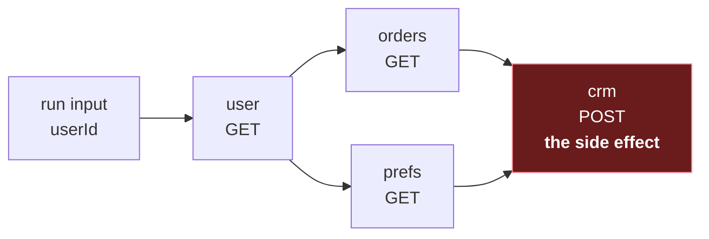
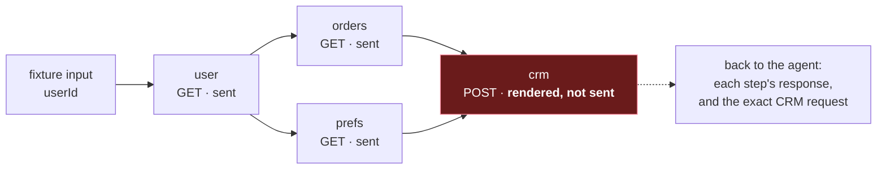

# 7. Agents that build workflows

## The problem

Plenty of people can describe the automation they want and can't build it. "Fetch the user,
then their orders and their preferences, then post a summary to the CRM" is a clear request.
Turning it into a workflow definition means knowing which endpoints exist, which response
field holds the id the next call needs, which steps can run at the same time, and what the
CRM expects in its body. That's where most people stop.

A language model can draft that wiring in seconds, and every product in §7.2 now ships an
assistant that does. The trouble is what a draft is: a program that, once published, runs
unattended with real credentials, and whose last step writes to a system of record. A wrong
mapping in a GET fetches the wrong data. A wrong mapping in the `crm` POST writes the wrong
data, on every run, until someone notices.

This chapter is about the machinery around the agent: what it may touch, how it finds out a
draft is wrong, who decides a draft is right, and what nobody has solved yet. Two words carry
it. A **draft** is a workflow version being edited; the **published** version is the one that
runs for real. Throughout, the agent writes drafts and a person publishes.

Assumes [file 01](01-foundations.md). It leans on [file 02](02-graphs-and-scheduling.md)
for validation, [03](03-mapping-data-between-steps.md) for mappings,
[05](05-calling-urls-you-dont-control.md) for URLs, and [06](06-describing-apis.md) for API
descriptions and error bodies.

## 7.1 Four ways a draft can be wrong

The agent's target is the definition in [file 01 §1.2](01-foundations.md#12-the-chain-as-data):
four steps, with `crm` waiting for both `orders` and `prefs`.



Three of the four steps only read. The fourth changes another system, and it's why the rest of
this chapter exists: a draft made only of GETs can be wrong, but it can't do much harm.

A draft can be wrong at four levels, and each level needs a different checker:

| Level | In the running example | What can catch it |
|---|---|---|
| **Shape** | `"dependsOn": "user"` where the format wants a list | A schema check: free, instant, mechanical |
| **References** | `crm` depends on `prefs`, and no step is called `prefs` | A validator that knows the format's rules (§7.5) |
| **Behaviour** | `orders` sends the user's email where the upstream wants the id, and gets an empty list back rather than an error | Making the calls and looking at what comes back (§7.7) |
| **Intent** | The summary goes to the production CRM when the person meant the sandbox, or leaves out the field they cared about | Only the person |

Each checker catches what the one above it can't. The first two are cheap and deterministic,
so the agent can call them as often as it likes. The third needs real calls and brings risks
of its own. The fourth is why every product below leaves publishing to a person.

## 7.2 What the products do

The builders below have converged on the same three-part pattern:

1. **Generate against a live catalogue.** The model works from the platform's own list of what
   exists (nodes, apps, plugins, scripts) with each one's parameters, not from what it
   remembers about them.
2. **Check deterministically.** Validate the result before anyone relies on it.
3. **Have a person make it live.** The agent produces a draft; a human publishes it.

Here's what each vendor's documentation said when I read it on 19 October 2026. These
products change monthly, so treat the table as a snapshot.

| Product | What the AI does | What it works from | Credentials | How it goes live |
|---|---|---|---|---|
| [n8n AI Workflow Builder](https://docs.n8n.io/build/ways-of-building-workflows/ai-workflow-builder) | Creates, refines and debugs workflows, "including node selection, placement, and configuration" | "Node definitions, parameters, and connections and the current workflow definition", plus any mock execution data you've loaded | Not sent to the model: "Details of any credentials you use", nor "Past executions of the workflow" | "All edits remain in draft until you publish" ([save and publish](https://docs.n8n.io/build/understand-workflows/save-and-publish-workflows/)) |
| [Zapier Copilot](https://zapier.com/blog/zapier-copilot-guide) | Builds Zaps from a description, adds steps and configures field mappings; for a missing action it builds one, "including finding the right API endpoints and generating code" | Zapier's apps and actions; it picks an account you've already connected | Not stated | You accept its steps (or let it build without asking), test, then "click Publish" |
| [Make's Maia](https://help.make.com/maia-by-make-system-card) | Creates, modifies and debugs scenarios | The current scenario, your account's permissions, Make-specific knowledge, and "the scenario history and logs" | "Maia never has access to your connections or keys" | "Maia is unable to take high-impact actions, such as running, activating, or deactivating scenarios" |
| [Kestra AI Copilot](https://kestra.io/docs/ai-tools/ai-copilot) | Generates and refines flow YAML | It "searches available plugins, validates the generated YAML"; it also reads namespace metadata, secrets included | It reads secrets so that prompts "can reuse your configured credentials and variables"; the page doesn't say whether secret values reach the model | It "asks for confirmation before applying it"; you apply or review the diff, and each accepted change is saved as a revision |
| [Windmill AI flow chat](https://www.windmill.dev/docs/core_concepts/ai_generation) | Creates and modifies flows from a chat panel in the editor | Scripts from your workspace and the Windmill Hub, or new ones it writes | Not stated | Drafts sit "in parallel to a deployed version … without affecting its behavior" ([draft and deploy](https://www.windmill.dev/docs/core_concepts/draft_and_deploy)); reviewing an AI session opens a Compare & Deploy page |
| [Retool](https://docs.retool.com/4.0/workflows/guides/generate-with-ai) | Generates "a fully functional workflow", overwriting the current one | A database resource you select, and its table schemas | You connect resources yourself; nothing stated about what the model sees | "AI-generated workflows are not published automatically" |

Reading down the columns:

- **No product lets the agent make it live.** Retool, Make and Zapier say so directly. n8n and
  Windmill keep drafts apart from what runs, which is this course's draft/published split, and
  Kestra gates every change.
- **Where anyone says, credentials stay out of the model.** n8n and Make state it. Kestra's
  page points the other way: the Copilot reads secrets in order to reuse them, and the page
  doesn't say what reaches the model. The rest are silent.
- **Grounding is the platform's own catalogue.** The model fills in forms someone designed.
  That works because the catalogue is curated and finite, and it's exactly what's missing for
  HTTP steps (§7.3).
- **Nobody claims the output is correct.** Make's system card says the opposite in so many
  words: "Maia may produce scenarios that include bugs or logical errors".
- **They disagree about data.** n8n keeps past executions away from the model; Make lists the
  scenario's history and logs among Maia's inputs. Real data grounds the model better and
  exposes more, a trade §7.9 returns to.

## 7.3 Why HTTP steps are the hard case

A catalogue node such as "send a Slack message" comes with a definition: every field, its
type, which are required, and which credential it needs. The builder's job is to fill in a
form. A generic HTTP step is a blank form (method, URL, headers, body), and its real contract
lives somewhere else: in the upstream's API description if it has one
([file 06](06-describing-apis.md)), or in prose documentation if the builder can see it.

The one public data point I found is a
[third-party review of n8n's builder](https://growwstacks.com/blog/n8n-ai-workflow-builder-review/),
dated 28 October 2025. Among its limitations: "Can't configure custom HTTP nodes", and "The
builder couldn't connect to third-party APIs through HTTP nodes." Treat it as one data point.
The reviewer is unnamed, it's an automation agency's blog, it describes two test workflows,
and the product has changed since. What makes it plausible is the structural reason above, and
that reasoning is mine, not the reviewer's.

The blank form has three consequences:

- **Grounding has to come from API descriptions.** For HTTP steps, the catalogue is whatever
  OpenAPI documents you hold for your upstreams. An upstream without one leaves the agent
  guessing.
- **Validation can't check what it doesn't know.** A check that required parameters are
  present passes an HTTP step whose URL is present and wrong. Only an API description, or an
  actual call, can say the path doesn't exist.
- **It's the riskiest kind of step.** OWASP's guidance on excessive agency says to avoid
  "open-ended tools where possible (e.g., run a shell command, fetch a URL, etc.)"
  ([LLM03:2026](https://genai.owasp.org/resource/owasp-genai-llm-top-10-2026/)). A generic HTTP
  step is a workflow engine's fetch-a-URL tool, and it's where
  [file 05](05-calling-urls-you-dont-control.md)'s SSRF problems live.

## 7.4 The harness: what the agent can touch

### What MCP is

An agent needs tools, and a workflow engine wants to offer its tools to whichever agent its
users run: one in an IDE, a chat app, a command line. Without a shared protocol, that's one
integration per pairing. The **Model Context Protocol (MCP)** is the shared protocol: an open
standard for connecting LLM applications to tools and data, which "takes some inspiration from
the Language Server Protocol", the standard that did the same job for editors and programming
languages ([specification](https://modelcontextprotocol.io/specification/2026-07-28)).

| Term | Meaning, from the specification |
|---|---|
| **Host** | The LLM application, which starts connections |
| **Client** | A connector inside the host |
| **Server** | A service offering capabilities, chiefly **tools** ("functions for the AI model to execute"), resources and prompts |
| Wire format | JSON-RPC 2.0 messages |

The current revision, [2026-07-28](https://modelcontextprotocol.io/specification/2026-07-28/changelog),
made MCP stateless. There's no initialisation handshake any more: every request carries its
protocol version and the client's capabilities, and a server that needs state across calls
should mint an explicit handle and take it back as an ordinary tool argument. A workflow
builder fits that naturally, because the draft's id is the handle. The specification's guidance
on handles is worth keeping: "a handle is a name, not a capability. The server should validate
the caller's authorization against the handle on every call"
([tools](https://modelcontextprotocol.io/specification/2026-07-28/server/tools)).

The official Go SDK is [`github.com/modelcontextprotocol/go-sdk`](https://github.com/modelcontextprotocol/go-sdk),
at v1.8.0 (4 September 2026); its README lists 2026-07-28 as the latest specification it
supports, from v1.7.0 onwards. It needs Go 1.25. With Go 1.24.4 and the default
`GOTOOLCHAIN=auto`, adding it to §7.5's example printed
`requires go >= 1.25.0; switching to go1.26.9` and raised the module's `go` line to 1.25.0, and
every later build ran on a downloaded Go 1.25.0.
[go-services file 08](../go-services/08-when-a-dependency-moves-your-toolchain.md) explains
the mechanism.

### Curated tools, not one per endpoint

An engine with an OpenAPI description of its own API can generate one MCP tool per endpoint
with a line of configuration; [FastMCP](https://gofastmcp.com/integrations/openapi) does it by
default. It's the obvious move, and the guidance from people who build these tools is against
it. Anthropic's
["Writing effective tools for agents — with agents"](https://www.anthropic.com/engineering/writing-tools-for-agents)
warns against "tools that merely wrap existing software functionality or API endpoints", and
argues for tools shaped like the agent's task: a `search_contacts` rather than a
`list_contacts`, or a `schedule_event` that finds a free slot and books it. FastMCP's own
documentation says "LLMs achieve significantly better performance with well-designed and
curated MCP servers than with auto-converted OpenAPI servers".

Both are practitioners' guidance rather than measurements: the
[post FastMCP links to](https://www.jlowin.dev/blog/stop-converting-rest-apis-to-mcp) argues
from context cost and round trips and contains no numbers. The argument stands on its own,
though. A model's context is small and its attention expensive, and forty endpoint-shaped
tools spend both on decisions the server could make.

One shape a curated tool set for building workflows could take:

| Tool | What it does | Why this shape |
|---|---|---|
| `find_operations` | Searches the API descriptions you've imported and returns a few matching operations, with their required fields and response fields | The catalogue is the grounding. Search, because nobody can hold four hundred endpoints in context |
| `create_draft` | Starts a draft and returns its id | The specification's handle pattern, authorised on every call |
| `edit_draft` | Applies a JSON Patch to the draft, guarded by `If-Match` | Small, targeted edits (§7.6); a concurrent human edit makes the agent's patch fail instead of silently losing one of the two ([file 06 §6.8](06-describing-apis.md#68-optimistic-concurrency-etag-if-match-and-412)) |
| `validate_draft` | Returns every problem, each with a pointer into the draft | The feedback loop (§7.5) |
| `dry_run_draft` | Sends the draft's safe steps and renders the rest | Ground truth for mappings (§7.7) |
| *(no publish tool)* | | Publishing is the person's job (§7.9) |

The last row matters most. The cheapest control on an agent is the tool you didn't give it.

## 7.5 Errors the agent can act on

### Two kinds of error

When a tool call fails, who gets to see the failure decides whether the agent can fix it. The
MCP specification separates two kinds
([tools: error handling](https://modelcontextprotocol.io/specification/2026-07-28/server/tools)):

| | **Protocol error** | **Tool execution error** |
|---|---|---|
| For | Unknown tool, malformed request, server error | API failures, input validation errors, business logic errors |
| On the wire | A JSON-RPC `error` | An ordinary result with `isError: true` |
| Shown to the model? | Clients "MAY" pass it on, "though these are less likely to result in successful recovery" | Clients "SHOULD" pass it on, "to enable self-correction" |

The specification says tool execution errors "contain actionable feedback that language models
can use to self-correct and retry with adjusted parameters". A draft that fails validation is a
tool execution error. Report it as a protocol error and the model may never see it.

### Errors that say where

A tool error is text, so what should the text say? "Invalid draft" sends the agent back to
regenerate everything, guessing. What it needs is what's wrong and exactly where, for every
problem at once.

The `Validate` in [file 02 §2.1](02-graphs-and-scheduling.md#21-validating-the-graph) makes
the right checks and stops at the first failure, returning it as a sentence:
`duplicate step id "orders"`. That's a fine message for a person at a terminal. An agent needs
two changes to it. Collect every problem instead of returning the first. And work on the
document the agent sent rather than on ids and edges extracted from it, because a list of ids
has already forgotten that the duplicate was the third step.

For the shape of each error, HTTP APIs have an answer. [RFC 9457](https://www.rfc-editor.org/rfc/rfc9457)
problem details, which [file 06](06-describing-apis.md) covers, include a validation example
whose problem type "defines the 'errors' extension, an array that describes the details of each
validation error". Each entry has a `detail` and a `pointer` that locates the problem "within
the request's content using a JSON Pointer" ([RFC 6901](https://www.rfc-editor.org/rfc/rfc6901)).
`errors` isn't a standard member, it's the RFC's example extension, and copying its shape lets
the same body come back from the engine's HTTP API and from the agent's tool.

The draft format and the validator, in `draft.go`:

```go
package main

import (
	"fmt"
	"maps"
	"slices"
	"strings"
)

// Draft is file 01's definition format, as the agent proposes it. Steps
// is a list, not an object keyed by id, so a repeated id survives parsing.
type Draft struct {
	Steps []Step `json:"steps"`
}

type Step struct {
	ID        string   `json:"id" jsonschema:"unique name that other steps use to depend on this one"`
	DependsOn []string `json:"dependsOn,omitempty" jsonschema:"ids of the steps that must finish before this one starts"`
	Request   Request  `json:"request"`
}

type Request struct {
	Method string `json:"method" jsonschema:"HTTP method"`
	URL    string `json:"url" jsonschema:"JSONata expression that evaluates to the URL"`
	Body   string `json:"body,omitempty" jsonschema:"JSONata expression that evaluates to the body"`
}

// FieldError is one entry in the "errors" extension from RFC 9457's
// validation example: what is wrong, and where.
type FieldError struct {
	Detail  string `json:"detail"`
	Pointer string `json:"pointer"`
}

// Validate makes the first two checks of file 02 §2.1 (unique ids, and
// dependencies that name real steps) on the document itself, and returns
// every problem it finds, not just the first.
func Validate(d Draft) []FieldError {
	var errs []FieldError
	first := map[string]int{} // step id -> index where it first appears
	for i, s := range d.Steps {
		prev, seen := first[s.ID]
		switch {
		case s.ID == "":
			errs = append(errs, FieldError{"step id is required", ptr("steps", i, "id")})
		case seen:
			errs = append(errs, FieldError{
				fmt.Sprintf("duplicate step id %q; first used at %s", s.ID, ptr("steps", prev, "id")),
				ptr("steps", i, "id")})
		default:
			first[s.ID] = i
		}
	}
	known := strings.Join(slices.Sorted(maps.Keys(first)), ", ")
	for i, s := range d.Steps {
		for j, dep := range s.DependsOn {
			if _, ok := first[dep]; !ok {
				errs = append(errs, FieldError{
					fmt.Sprintf("unknown step %q; known steps: %s", dep, known),
					ptr("steps", i, "dependsOn", j)})
			}
		}
	}
	return errs
}

// ptr builds a JSON Pointer (RFC 6901). Every token here is a field name
// or an array index, so none needs RFC 6901's ~0 and ~1 escaping.
func ptr(tokens ...any) string {
	var b strings.Builder
	for _, t := range tokens {
		fmt.Fprintf(&b, "/%v", t)
	}
	return b.String()
}
```

The MCP tool around it, in `tool.go`, using the SDK's typed `AddTool`:

```go
package main

import (
	"context"
	"encoding/json"
	"fmt"

	"github.com/modelcontextprotocol/go-sdk/mcp"
)

// Problem is an RFC 9457 problem details object carrying the "errors"
// extension from the RFC's own validation example.
type Problem struct {
	Type   string       `json:"type"`
	Title  string       `json:"title"`
	Errors []FieldError `json:"errors"`
}

func validateDraft(ctx context.Context, req *mcp.CallToolRequest, d Draft) (*mcp.CallToolResult, any, error) {
	errs := Validate(d)
	if len(errs) == 0 {
		return &mcp.CallToolResult{Content: []mcp.Content{
			&mcp.TextContent{Text: fmt.Sprintf("draft is valid: %d steps", len(d.Steps))},
		}}, nil, nil
	}
	body, err := json.MarshalIndent(Problem{
		Type:   "https://example.com/problems/invalid-draft",
		Title:  "The draft workflow is not valid.",
		Errors: errs,
	}, "", "  ")
	if err != nil {
		return nil, nil, err
	}
	// A tool execution error, not a protocol error: the client shows it to
	// the model, which can repair the draft and call again.
	return &mcp.CallToolResult{
		IsError: true,
		Content: []mcp.Content{&mcp.TextContent{Text: string(body)}},
	}, nil, nil
}

func newServer() *mcp.Server {
	s := mcp.NewServer(&mcp.Implementation{Name: "workflow-drafts", Version: "v0.1.0"}, nil)
	mcp.AddTool(s, &mcp.Tool{
		Name: "validate_draft",
		Description: "Check a draft workflow's step ids and dependsOn lists. Changes nothing. " +
			"Returns every problem found, each with a JSON Pointer into the draft.",
	}, validateDraft)
	return s
}
```

Both files are exactly as I ran them. The test harness is trimmed: an in-memory MCP client
(the SDK's `NewInMemoryTransports`) that calls the tool with three drafts and prints the
results. To stay self-contained, this tool takes the draft itself, not a draft id, and leaves
out §2.1's cycle check, which would slot in as a third pass with one error per stuck step.

Two things about the SDK matter here. `AddTool` derives the tool's input schema from the Go
types: fields without `omitempty` become `required`, the `jsonschema` tags become the
descriptions the model reads, and slices come out as `"type": ["null", "array"]`. And the
registration function decides which kind of error you produce. The SDK's documentation says an
error returned from a typed handler "is treated as a tool error, rather than a protocol error",
whereas if a handler registered with the lower-level `Server.AddTool` returns an error, "it is
treated as a protocol error" ([`mcp/tool.go`](https://github.com/modelcontextprotocol/go-sdk/blob/v1.8.0/mcp/tool.go)).
Pick the wrong one and the model stops seeing your errors.

The draft the agent sent is file 01's definition with one mistake: the agent made `prefs` by
copying `orders`, changed the URL and forgot the id.

| Index | `id` | `dependsOn` | `request` |
|---|---|---|---|
| 0 | `user` | | `GET` …`/users/{userId}` |
| 1 | `orders` | `user` | `GET` …`/orders?user=…` |
| 2 | `orders`, meant to be `prefs` | `user` | `GET` …`/users/…/preferences` |
| 3 | `crm` | `orders`, `prefs` | `POST` `https://crm.example.com/summaries` |

<details><summary>The draft in full</summary>

```json
{
  "steps": [
    {
      "id": "user",
      "request": {
        "method": "GET",
        "url": "'https://api.example.com/users/' & $encodeUrlComponent(input.userId)"
      }
    },
    {
      "id": "orders",
      "dependsOn": ["user"],
      "request": {
        "method": "GET",
        "url": "'https://api.example.com/orders?user=' & $encodeUrlComponent(steps.user.body.id)"
      }
    },
    {
      "id": "orders",
      "dependsOn": ["user"],
      "request": {
        "method": "GET",
        "url": "'https://api.example.com/users/' & $encodeUrlComponent(steps.user.body.id) & '/preferences'"
      }
    },
    {
      "id": "crm",
      "dependsOn": ["orders", "prefs"],
      "request": {
        "method": "POST",
        "url": "'https://crm.example.com/summaries'",
        "body": "{ 'customerId': steps.user.body.id, 'orderCount': $count(steps.orders.body.orders), 'channel': steps.prefs.body.channel }"
      }
    }
  ]
}
```

</details>

The harness sent that draft, then the fixed one (index 2 renamed `prefs`), then one with the
wrong shape (`"dependsOn": "nothing"`). The output, minus a dump of the input schema:

```
== broken: isError=true
{
  "type": "https://example.com/problems/invalid-draft",
  "title": "The draft workflow is not valid.",
  "errors": [
    {
      "detail": "duplicate step id \"orders\"; first used at /steps/1/id",
      "pointer": "/steps/2/id"
    },
    {
      "detail": "unknown step \"prefs\"; known steps: crm, orders, user",
      "pointer": "/steps/3/dependsOn/1"
    }
  ]
}

== fixed: isError=false
draft is valid: 4 steps

== wrong-shape: isError=true
validating "arguments": validating root: validating /properties/steps: validating /properties/steps/items: validating /properties/steps/items/properties/dependsOn: type: nothing has type "string", want one of "null, array"
```

What to notice:

- **Every error, not just the first.** One round trip fixes both, and the second error confirms
  the fix for the first: `prefs` is the name `crm` is waiting for.
- **The pointers point into the draft.** Compare the SDK's own schema error, which says where in
  the *schema* the rule lives (`/properties/steps/items/properties/dependsOn`) and never which
  step broke it. I moved the bad value to the third of three steps and the message didn't
  change, apart from quoting the value. With four steps the agent can guess; with forty it
  can't.
- **The details say what would be valid.** "known steps: crm, orders, user" turns a guess into a
  lookup, which is what Anthropic's guidance asks of error responses: "specific and actionable
  improvements, rather than opaque error codes or tracebacks".
- **A pointer is a patch path.** [RFC 6902](https://www.rfc-editor.org/rfc/rfc6902) defines a
  JSON Patch operation's `path` as "a JSON-Pointer value", so the repair is
  `{"op": "replace", "path": "/steps/2/id", "value": "prefs"}`, best sent behind
  `{"op": "test", "path": "/steps/2/id", "value": "orders"}` so it can't land on a step that has
  moved ([file 06 §6.7](06-describing-apis.md#67-json-patch-rfc-6902-for-partial-edits)). I
  applied both forms to the broken draft with evanphx/json-patch v5.9.11 and got the fixed draft
  back each time; with the wrong value in the `test`, the whole patch was refused.
- **The validator doesn't read mappings.** The `crm` body also mentions `steps.prefs.body.channel`.
  A check that finds each mapping's references without running it
  ([file 03 §3.2](03-mapping-data-between-steps.md#32-the-runs-data-document)) would flag that
  too.
- **It has to be the publish validator.** If the tool's checks are laxer than the ones guarding
  publishing, "valid" tells the agent nothing. One function, called from both places.
- **The schema let the broken draft through.** It's well-formed: every field the right type,
  nothing missing. §7.6 is about why no schema could have stopped it.

One choice remains: the pointer's form. RFC 9457's example writes `"#/age"`, the URI-fragment
representation from RFC 6901 §6. [File 06 §6.5](06-describing-apis.md#65-errors-as-problem-details-rfc-9457)
shows that example, then uses the plain form in this course's own `pointer` fields, with
`FromFragment` to convert an API's fragment-form pointers when you consume them. A tool whose
reader is a model has a particular reason to pick the plain form: the model will paste the pointer straight into a
patch's `path`, and whether the `#` is noticed then depends on the library. evanphx/json-patch
v5.9.11 applied `#/steps/2/id` anyway, because it ignores whatever comes before the first `/`.
fast-json-patch 3.1.1 applied it with validation off and refused it with validation on:
`` Operation `path` property must start with "/" ``. Whichever you pick, say so in the tool's
description, where the model will read it. And for errors from `edit_draft`, point into the
draft the patch produced, not into the patch itself, which is file 06's other warning.

The validator's shape (a map of ids, two loops, a list of errors) is the same in Rust, C++ and
JavaScript, so I haven't repeated it. What does differ between them is the JSON parser
underneath, which decides whether the first check can work at all.

### When the format hides the mistake

[File 02 §2.1](02-graphs-and-scheduling.md#21-validating-the-graph) keeps `steps` in an
array because a key repeated in a JSON object vanishes at parse time, and measured that in Go
and Node. For an agent the failure is worse than a missed check, because the validator's next
message sends it the wrong way. Key the broken draft by id
and the first `orders` disappears. The validator sees three steps and reports
`unknown step "prefs"` on `crm`, which is true and misleading. The agent's cheapest fix is to
delete `prefs` from `dependsOn`. That validates, and the published workflow never fetches
orders, while its step called `orders` fetches preferences.

I extended §2.1's measurement to every language in this course, with a stripped-down draft keyed
by id, and a struct whose one field appears twice:

```json
{"steps": {
  "user":   {"url": "https://api.example.com/users/u-42"},
  "orders": {"url": "https://api.example.com/orders?user=u-42"},
  "orders": {"url": "https://api.example.com/users/u-42/preferences"},
  "crm":    {"url": "https://crm.example.com/summaries"}
}}
```

| Parser, as run | The keyed draft | `{"url": "A", "url": "B"}` into a struct |
|---|---|---|
| Go `encoding/json`, Go 1.24.4 | 3 steps, no error; `orders` is now the preferences call | `B`, no error |
| Go `encoding/json/v2`, Go 1.25.0 with `GOEXPERIMENT=jsonv2` | Error: `duplicate object member name "orders" within "/steps"` | Error: `duplicate object member name "url"` |
| Rust `serde_json` 1.0.154, into a `HashMap` | 3 steps, no error; the last `orders` wins | (into a derived struct) Error: `` duplicate field `url` `` |
| C++ nlohmann/json 3.12.0 | 3 steps, no error; the last `orders` wins | `B` |
| JavaScript `JSON.parse`, Node 24.14.1 | 3 steps, no error; the last `orders` wins | `B` |

Rust's row shows the mechanism. serde's derived code for a struct checks that each field arrives
once, while deserialising into a `HashMap` just inserts, so the second key replaces the first.
Go's v2 package documents the same decision made the other way: "By default, v1 allows for the
presence of duplicate names, while v2 rejects duplicate names"
([`encoding/json/v2`](https://github.com/golang/go/blob/go1.25.0/src/encoding/json/v2/doc.go)),
but it's [experimental in Go 1.25](https://go.dev/doc/go1.25), behind `GOEXPERIMENT=jsonv2`.
§2.1's lesson, sharpened for tool inputs: choose a representation in which every mistake the
agent can make survives parsing, so the validator can point at it.

Each probe is the `probe` function, and the types it uses, from a small program whose imports
and `main` (which reads the keyed draft from a file) are trimmed. The v2 row is the same Go
program importing `encoding/json/v2`.

```go
type Step struct {
	URL string `json:"url"`
}

func probe(keyed []byte) {
	var d struct {
		Steps map[string]Step `json:"steps"`
	}
	err := json.Unmarshal(keyed, &d)
	fmt.Println(len(d.Steps), d.Steps["orders"].URL, err)

	var s Step
	err = json.Unmarshal([]byte(`{"url": "A", "url": "B"}`), &s)
	fmt.Println(s.URL, err)
}
```

```
3 https://api.example.com/users/u-42/preferences <nil>
B <nil>
```

<details><summary>Rust</summary>

```rust
#[derive(Deserialize)]
struct Step {
    url: String,
}

#[derive(Deserialize)]
struct Draft {
    steps: HashMap<String, Step>,
}

fn probe(keyed: &str) {
    match serde_json::from_str::<Draft>(keyed) {
        Ok(d) => println!("{} {}", d.steps.len(), d.steps["orders"].url),
        Err(e) => println!("error: {e}"),
    }

    match serde_json::from_str::<Step>(r#"{"url": "A", "url": "B"}"#) {
        Ok(s) => println!("{}", s.url),
        Err(e) => println!("error: {e}"),
    }
}
```

```
3 https://api.example.com/users/u-42/preferences
error: duplicate field `url` at line 1 column 18
```

</details>

<details><summary>C++</summary>

```cpp
void probe(const std::string& keyed) {
    auto d = nlohmann::json::parse(keyed);
    std::cout << d["steps"].size() << " " << d["steps"]["orders"]["url"].get<std::string>() << "\n";

    auto s = nlohmann::json::parse(R"({"url": "A", "url": "B"})");
    std::cout << s["url"].get<std::string>() << "\n";
}
```

```
3 https://api.example.com/users/u-42/preferences
B
```

</details>

<details><summary>JavaScript</summary>

```js
function probe(keyed) {
  const d = JSON.parse(keyed);
  console.log(Object.keys(d.steps).length, d.steps.orders.url);

  console.log(JSON.parse('{"url": "A", "url": "B"}').url);
}
```

```
3 https://api.example.com/users/u-42/preferences
B
```

</details>

## 7.6 Why not generate the whole definition at once

If shape errors are the problem, why not constrain the output? Claude's
[structured outputs](https://platform.claude.com/docs/en/build-with-claude/structured-outputs)
use constrained decoding so a response matches a JSON Schema. Ask for the whole workflow in one
schema-constrained response and the loop looks unnecessary. Three things get in the way, in
rising order of importance.

**The schema features you'd need aren't supported.** Claude's structured outputs don't support
"recursive schemas", numeric constraints, string-length constraints, or array constraints
"beyond `minItems` of 0 or 1". A request may hold at most 24 optional parameters and 16
parameters with union types across all its strict schemas, and a type array such as
`["string", "null"]` counts as a union. A definition format that nests, where a branch holds a
list of steps and any of those can be a branch, is recursive. A flat list of steps with
`dependsOn` edges isn't, which is one more argument for flat.

**A schema can't express the rules that matter.** JSON Schema describes the shape of one value.
The 2020-12 validation vocabulary has no keyword asserting that a value equals another value
elsewhere in the document, so "every entry in `dependsOn` names a step" can't be written down.
And `uniqueItems` compares whole array items
([JSON Schema validation, §6.4.3](https://json-schema.org/draft/2020-12/json-schema-validation)),
so two steps that share an id but differ in URL pass it. The broken draft in §7.5 was
schema-valid: the SDK's schema check passed it on to the validator.

**Valid syntax isn't correct meaning.** OWASP's 2026 entry on prompt injection makes the general
point about output schemas: structural validation "catches format violations, not semantic
manipulation: a schema-valid response can still carry a malicious SQL query or an
exfiltration-formatted email body" ([LLM01:2026](https://genai.owasp.org/resource/owasp-genai-llm-top-10-2026/)).
Even the format guarantee has exceptions: the documentation says structured outputs "guarantee
schema compliance in most cases", and lists refusals and running out of tokens as cases where
they don't.

And one shot has no feedback. The model writes the `orders` mapping without ever having seen an
orders response. The loop (draft, validate, dry-run, patch) gives it that. Constrained decoding
still has a place inside the loop, on each small edit: a JSON Patch or a single step has a
small, non-recursive schema, which is exactly what the feature handles well.

## 7.7 Dry-run: the agent's ground truth

A validator can tell the agent that `prefs` doesn't exist. It can't tell it that the orders API
names its query parameter `customerId` rather than `user`, or that the user's `id` comes back
as a string with a prefix. Only calls can. But running the draft for real runs `crm`.

There's prior art for the way out. Kubernetes has a server-side dry-run in which "every stage
runs as normal, except for the final storage stage where side effects are prevented", and if a
request would trigger an admission controller that has side effects, "the request will be
failed rather than risk an unwanted side effect"
([API concepts: dry-run](https://kubernetes.io/docs/reference/using-api/api-concepts/#dry-run)).
The workflow version:

- **Safe steps are sent.** A step whose method is safe in the sense of
  [RFC 9110 §9.2.1](https://www.rfc-editor.org/rfc/rfc9110#section-9.2.1) (GET, HEAD, OPTIONS,
  TRACE, for which "the client does not request, and does not expect, any state change") is
  sent, ideally to a sandbox.
- **Unsafe steps are rendered, not sent.** The engine evaluates the step's mapping and returns
  the exact request it would have sent: method, URL, headers with secrets masked, and body.
- **The same engine.** The dry-run uses the real scheduler and the real expression evaluator. A
  separate preview evaluator is a second implementation that can disagree with the first, which
  is the parity problem of
  [file 03 §3.5](03-mapping-data-between-steps.md#35-preview-and-execution-must-use-the-same-evaluator).
- **It returns the run's data document** ([file 01 §1.3](01-foundations.md#13-vocabulary))
  after each step, plus the rendered requests, so the agent checks its mappings against real
  responses rather than its memory of the API.



n8n's builder has an "Execute and refine" button, and its model is sent "any mock execution data
that is loaded when using the builder", but not past executions.

> ⚠️ **"Safe" is a promise about the request, not a guarantee about the server.** RFC 9110 says
> its definition "does not prevent an implementation from including behavior that is
> potentially harmful, that is not entirely read-only, or that causes side effects while
> invoking a safe method". A GET that marks notifications as read, or starts an export, runs for
> real in your dry-run. Let a step declare side effects whatever its method, don't send what
> nobody has vouched for, and do what Kubernetes does with a webhook that hasn't declared itself
> free of side effects: fail the dry-run rather than guess.

The dry-run has a second cost, which belongs in §7.9. Against production upstreams it puts real
customers' data, written by people you don't know, into the agent's context.

## 7.8 Specs: writing down what to build

The person's request leaves most decisions open. What goes in the summary? Which CRM object does
it create? Every run, or once a day? What if the orders call fails? The agent will guess, and
its guesses become published behaviour. **Spec-driven development** answers that by writing a
spec first and generating from it; in Birgitta Böckeler's summary, the spec is written "before
writing code with AI" and "becomes the source of truth for the human and the AI"
([Understanding Spec-Driven-Development](https://martinfowler.com/articles/exploring-gen-ai/sdd-3-tools.html),
15 October 2025).

Two tools show how to keep a spec from turning into a questionnaire.

GitHub's [Spec Kit](https://github.com/github/spec-kit) caps the open questions. Its specify
template says to "Focus on WHAT users need and WHY" and to "Avoid HOW to implement". An unknown
is marked `[NEEDS CLARIFICATION: specific question]`, with a "Maximum 3 [NEEDS CLARIFICATION]
markers total", prioritised "scope > security/privacy > user experience > technical details";
everything else gets "informed guesses", recorded in an Assumptions section
([specify template](https://github.com/github/spec-kit/blob/main/templates/commands/specify.md)).
The clarify step allows a "Maximum of 5 total questions across the whole session", asked one at
a time with the recommended option first
([clarify template](https://github.com/github/spec-kit/blob/main/templates/commands/clarify.md)).
The caps exist for the same reason approvals get rubber-stamped (§7.9): attention is the scarce
resource, and the twentieth question gets the same reflexive answer as the twentieth approval.
The price is that assumptions replace questions, so somebody has to read the assumptions.

[Kiro](https://kiro.dev/docs/specs/feature-specs/) writes requirements in **EARS** (Easy
Approach to Requirements Syntax), "WHEN [condition/event] THE SYSTEM SHALL [expected
behavior]", so that "each requirement can be directly translated into test cases". For a
workflow builder that's the property that matters, because here the test cases are checks the
engine can run:

| Requirement | The check it becomes |
|---|---|
| WHEN a run starts THE SYSTEM SHALL fetch the user named by the run's input | The graph has a step `user` with no dependencies |
| WHEN the user has been fetched THE SYSTEM SHALL fetch their orders and their preferences concurrently | `orders` and `prefs` both list `user` in `dependsOn`, and neither lists the other |
| WHEN both have been fetched THE SYSTEM SHALL post one summary to the CRM | `crm` lists both, and a dry-run renders exactly one CRM request |
| WHEN the orders or preferences call fails THE SYSTEM SHALL end the run without calling the CRM | A dry-run with a failing orders fixture renders no CRM request |

The second row earns its place. A benchmark of workflow generation found "distinct gaps between
the sequence planning capabilities and graph planning capabilities of LLM agents, with even
GPT-4 exhibiting a gap of around 15%", with graph planning the harder of the two
([WorFBench, ICLR 2025](https://arxiv.org/abs/2410.07869)). A model that chains `prefs` after
`orders` produces a valid, slower workflow that no reference check will flag. The word
"concurrently" is what turns that into a failure.

Böckeler's critique is the counterweight, and it's fair to the tools. She separates
**spec-first** (a spec written for the task at hand), **spec-anchored** (the spec kept and
maintained afterwards) and **spec-as-source** (only the spec is edited, and "the human never
touches the code"), and she credits the first: "the general principle of spec-first is
definitely valuable in many situations". Her objections:

- **One workflow for every size.** When she used Kiro on a small bug, "it quickly became clear
  that the workflow was like using a sledgehammer to crack a nut": the requirements document
  "turned this small bug into 4 'user stories' with a total of 16 acceptance criteria".
- **Review cost.** "To be honest, I'd rather review code than all these markdown files."
- **A false sense of control.** "I frequently saw the agent ultimately not follow all the
  instructions", and bigger context windows don't mean "that AI will properly pick up on
  everything that's in there".
- **History.** Spec-as-source recalls model-driven development, which "never took off for
  business applications", and she wonders whether it "might end up with the downsides of both
  MDD and LLMs".
- **The term itself** "isn't very well defined yet, and it's already semantically diffused".

My reading for workflows, labelled as mine. A four-step workflow is the nut, so the full
ceremony is the sledgehammer: a handful of EARS lines and at most a few questions are the right
size. Her review point lands differently here, because the artefact being generated isn't a
pile of code. A graph with mappings is small enough to review directly, and with a dry-run
beside it, it's a better thing to review than a prose spec. Her false-sense-of-control point is
the one to keep. A spec doesn't make an agent follow it; only checks do, which is why the table
above turns each line into one.

## 7.9 Safety

### What the agent reads that someone else wrote

**Prompt injection** is text a model treats as instructions when it was meant as data. OWASP
ranks it first in both its 2025 list ([LLM01:2025](https://genai.owasp.org/llmrisk/llm01-prompt-injection/))
and its 2026 edition, published in August
([LLM01:2026](https://genai.owasp.org/resource/owasp-genai-llm-top-10-2026/)). The 2026 edition
renumbered other entries (Excessive Agency was LLM06:2025 and is LLM03:2026), so cite entries
with their year. The 2026 entry's diagnosis is blunt: models make "no architectural distinction
between 'instructions' and 'data'", so "no reliable prevention mechanism exists today", and
defence "is therefore architectural rather than interceptive".

A builder agent reads a lot that it didn't write:

| Source | Written by | Why it's a channel |
|---|---|---|
| The spec | The person, but often pasted from a ticket or an email | OWASP counts "a legitimate user pasting content that happens to contain conflicting instructions" as direct injection |
| API descriptions | The upstream's authors, or anyone, if fetched from the web | `description` fields are prose the model reads as documentation |
| Dry-run responses | Whoever wrote the data: a customer's name, an order note | OWASP lists "third-party API responses" among semi-trusted surfaces |
| Upstream error bodies | The upstream, often echoing the input | The agent reads them exactly when it's trying to fix something |

### The Rule of Two

If injection can't be prevented, limit what an injected agent could do. Meta's
["Agents Rule of Two"](https://ai.meta.com/blog/practical-ai-agent-security/) (31 October 2025)
says that until robustness research "allows us to reliably detect and refuse prompt injection",
"agents must satisfy no more than two of the following three properties within a session":

- **[A]** "An agent can process untrustworthy inputs"
- **[B]** "An agent can have access to sensitive systems or private data"
- **[C]** "An agent can change state or communicate externally"

If a task needs all three, the agent "should not be permitted to operate autonomously and at a
minimum requires supervision", such as human-in-the-loop approval. Meta adds that following the
rule isn't sufficient on its own, and that designs which satisfy it "can still be prone to
failure", for instance through "a user blindly confirming a warning interstitial".

Simon Willison, who had earlier named the "lethal trifecta" of private data, untrusted content
and external communication ([June 2025](https://simonwillison.net/2025/Jun/16/the-lethal-trifecta/)),
welcomed the rule and objected to one part of it
([November 2025](https://simonwillison.net/2025/Nov/2/new-prompt-injection-papers/)). Meta's
diagram marked untrusted input plus the ability to change state as "safe", "but that's not
right. Even without access to private systems or sensitive data that pairing can still produce
harmful results." Meta changed the label to "lower risk". Willison still calls the rule "the
best practical advice for building secure LLM-powered agent systems today in the absence of
prompt injection defenses we can rely on". The same post covers why that absence is real: a
paper in which adaptive attacks bypassed twelve published defences, with success above 90%
against most of them, though most had reported near-zero attack success
([Nasr et al., 2025](https://arxiv.org/abs/2510.09023)).

Applied to a builder's sessions:

| Session | [A] untrusted input | [B] sensitive systems or data | [C] change state or communicate | Reading |
|---|---|---|---|---|
| Drafting from the spec and the catalogue | Yes: API descriptions | No, if the catalogue holds no secrets | It writes drafts, which don't run | One property, and a weak second |
| Dry-run against production | Yes: responses | Yes: real customers' data | Only if a step is less safe than its method claims | Two, for as long as the dry-run's rules hold |
| Agent with a publish tool | Yes | The workflow holds the connections | Yes: every run posts to the CRM | All three, so not autonomously |

Willison's objection bites on the dry-run. A dry-run that sent unsafe requests whenever the agent
asked would hold A and C, and an injected API description could aim it at a delete endpoint with
no private data involved. "Unsafe steps are rendered, not sent" has to be enforced by the engine,
not requested in the prompt.

> **Teacher's aside.** The Rule of Two counts what the agent can do within its session. For a
> workflow builder that's not the only thing to count. The agent's output is a program, and once
> published it holds all three properties on every run: it reads upstream responses (A), it runs
> with the user's connections (B), and it posts to the CRM (C). An agent with no credentials and
> no way to send anything can still cause any harm a workflow can, by writing it down and having
> a person publish it. So for a builder, Meta's "requires supervision" lands in one place: the
> publish click. That's why rubber-stamped approval, below, isn't a footnote. It's the control
> the whole design leans on.

### Scoped permissions

OWASP traces excessive agency to "excessive functionality", "excessive permissions" and
"excessive autonomy" ([LLM03:2026](https://genai.owasp.org/resource/owasp-genai-llm-top-10-2026/)),
and its injection entry adds: "Hold credentials and state-change capability in application code,
not the model". For a builder:

- **The agent's identity** can create, edit, validate and dry-run drafts in one workspace. It
  can't publish, edit published workflows, or read secret values.
- **Credentials go by reference.** A draft names a connection, say `crm-sandbox`, and the engine
  resolves it at run time, so the model never sees the token. That's what n8n and Make describe.
- **The dry-run calls only what it's allowed to.** It uses the engine's own HTTP client, so
  [file 05](05-calling-urls-you-dont-control.md)'s refusal of non-public addresses at
  connection time applies, and a per-workflow allow-list on top of it
  ([file 05 §5.8](05-calling-urls-you-dont-control.md#58-allow-lists-vs-block-lists)) stops an
  injected description sending it anywhere new.
- **Authorisation lives in code and runs on every call.** In OWASP's words: "Implement
  authorization in logic rather than relying on an LLM to decide if an action is allowed or
  not". MCP's rule that a handle is a name, not a capability, is the same principle.

### A runtime with no model in it

Notice what the published workflow doesn't contain: a model. The engine that runs it is a
scheduler, an HTTP client and an expression evaluator. At run time, upstream responses are data
moving through mappings, and nothing in the loop follows instructions, so there's nothing for an
injected instruction to steer.

That's a known design pattern. In
["Design Patterns for Securing LLM Agents against Prompt Injections"](https://arxiv.org/abs/2506.08837)
(Beurer-Kellner et al., 2025), **plan-then-execute** has the agent "formulate a plan to be
executed (i.e., a fixed list of actions to take)" and then carry it out: "While these tool calls
might interact with and return untrusted 3rd party data, this data cannot inject instructions
that make the agent deviate from its plan." Their **code-then-execute** pattern generalises it
"by replacing the agent's planning by an explicit program", and an explicit program is what a
workflow definition is. CaMeL ([Debenedetti et al., 2025](https://arxiv.org/abs/2503.18813)) is
the worked framework for that pattern, and its cost shows: on the AgentDojo benchmark it solved
77% of tasks "with provable security", against 84% for an undefended system.

The paper is precise about what the pattern doesn't do, and all three limits apply here:

- **Data still flows into actions.** "This pattern does not prevent all prompt injections, but
  acts as a form of 'control flow integrity' protection." In their example, an injection in
  calendar data "could, however, arbitrarily alter the body of the email". Here, a hostile order
  note lands in the CRM summary. The engine is unharmed; whether the CRM displays it safely is
  the CRM's problem, as it would be with a hand-built integration.
- **The plan itself can be poisoned.** "This pattern does not prevent prompt injections
  contained in the user prompt", and for a builder the prompt is everything the agent read while
  drafting. A model-free runtime doesn't remove injection. It moves it to design time.
- **A model inside the workflow brings it back.** If someone wants an LLM step to write the CRM
  summary, the runtime has a model in it again, reading orders data.

### Approvals that get rubber-stamped

"A person publishes" only works if the person reads. Meta names the failure ("a user blindly
confirming a warning interstitial"), and OWASP's 2026 mitigation reads like a specification for
doing better: "Require explicit human confirmation before any privileged, irreversible, or
externally visible action, surfacing the exact rendered action rather than a summary to the
reviewer", noting that "approval fatigue degrades reviewer judgment at volume"
([LLM01:2026](https://genai.owasp.org/resource/owasp-genai-llm-top-10-2026/)). For a builder:

- **Show the definition's diff, not the agent's account of it.** Kestra's diff view and
  Windmill's Compare & Deploy page do this. A summary the agent wrote is one more thing the
  agent wrote.
- **Show the rendered side effect.** The dry-run's CRM request, with field values from a sandbox
  run, is "the exact rendered action".
- **Show what's new.** New hosts, new unsafe steps and new connections since the last published
  version deserve a highlight; a changed timeout doesn't.
- **Spend attention in proportion.** OWASP's graduated enforcement lets "low-consequence or
  easily reversible actions" auto-approve and routes "high-consequence or irreversible ones" to a
  human ([LLM03:2026](https://genai.owasp.org/resource/owasp-genai-llm-top-10-2026/)). A workflow
  that only reads has nothing to reverse; one that posts to a CRM does.

What I couldn't find is a measurement of how often reviewers catch a planted mistake in a
generated workflow. Everyone agrees approval fatigue is real, and nobody I found has put a
number on it.

### The plan contains code

A workflow definition isn't inert data. Its mappings are expressions the engine evaluates, so
whoever writes a draft writes code that runs inside the engine.
[File 03 §3.8](03-mapping-data-between-steps.md#38-expressions-are-untrusted-code) tells that
story through CVE-2025-68613, in which n8n could evaluate "expressions supplied by authenticated
users during workflow configuration" in a context not isolated enough from its runtime, letting
an attacker "execute arbitrary code with the privileges of the n8n process", and draws the
engine's lessons from it.

One detail to add: the scorers disagree about its severity. GitHub, as the CVE numbering
authority, rated it 9.9 with the scope changed, which is the score file 03 quotes; NVD rated
it 8.8 with the scope unchanged ([NVD](https://nvd.nist.gov/vuln/detail/CVE-2025-68613)). Every
other metric in the two CVSS 3.1 vectors is identical, so they differ only on whether exploiting
it crosses a security boundary, not on what it lets an attacker do.

File 03 points out that the attacker needed only an ordinary account: "being allowed to write
a workflow was enough". An agent with `edit_draft` is allowed to write a workflow, and its text
came from whatever it read. Three things follow:

- **The evaluator's sandbox is a security boundary**, not a convenience, and §3.8's list (data
  never becomes expression source, no host functions you wouldn't publish, isolated evaluation)
  applies with the agent as the author.
- **The sandbox has to hold before approval.** A dry-run evaluates the draft's mappings, so the
  agent's expressions run before any person has looked at them.
- **The validator should parse every expression** and check what it references, as n8n's own
  evaluation suite does with `expressions_reference_existing_nodes` (§7.10).

## 7.10 Evals: knowing the builder works

A builder that handles the demo prompt can fail on the next one, and the same prompt can work on
Monday and fail on Tuesday. Anthropic's
["Demystifying evals for AI agents"](https://www.anthropic.com/engineering/demystifying-evals-for-ai-agents)
(January 2026) puts it plainly: "Because model outputs vary between runs, we run multiple trials
to produce more consistent results." Three ideas do most of the work.

**Deterministic checks first.** The post recommends "choosing deterministic graders where
possible, LLM graders where necessary". n8n's
[evaluation suite](https://github.com/n8n-io/n8n/blob/master/packages/%40n8n/ai-workflow-builder.ee/evaluations/README.md)
for its builder is public, and it's the clearest picture I found of what that means for
workflows: "17 deterministic checks (fast, no LLM) plus 5 LLM-judge checks". The deterministic
ones include `all_nodes_connected`, `no_unreachable_nodes`, `has_trigger`,
`no_hardcoded_credentials`, `expressions_reference_existing_nodes`, `valid_required_parameters`
and `valid_options_values`; the judged ones include `fulfills_user_request` and
`valid_data_flow`. The validator the agent calls is your first grader: free, fast, and the same
answer every time.

**Grade the outcome, not the path.** "There is a common instinct to check that agents followed
very specific steps like a sequence of tool calls in the right order. We've found this approach
too rigid and results in overly brittle tests", so "it's often better to grade what the agent
produced, not the path it took." For a builder, the outcome is the draft and its dry-run against
fixtures. Are `orders` and `prefs` both after `user` and not after each other? Does the rendered
CRM request carry the right fields? Not whether the agent called `find_operations` before
`create_draft`. Two correct drafts can call a step `prefs` or `preferences`, so compare the
graphs and the rendered requests, not the text. And keep the post's caveat: "You won't know if
your graders are working well unless you read the transcripts and grades from many trials."

**pass@k and pass^k measure different promises.** **pass@k** is "the likelihood that an agent
gets at least one correct solution in k attempts"; **pass^k** is "the probability that all k
trials succeed". At a 75% per-trial success rate, three trials all pass "(0.75)³ ≈ 42%" of the
time. The post's guidance: "pass@k for tools where one success matters, pass^k for agents where
consistency is essential". A builder needs both, for different properties. Usefulness is pass@k,
because the person can regenerate, and one good draft in three tries is a decent product. Safety
properties are pass^k with a large k: "never hardcodes a credential" has to hold every time.
Computed, not measured: at 90% per trial, ten in a row all succeed with probability
0.9¹⁰ ≈ 35%. That's the argument for taking safety properties out of the model's hands and
enforcing them in the validator, where they hold for any k.

## 7.11 What isn't solved

- **Prompt injection.** Every defence in this chapter limits what a successful injection can do.
  None stops one, and OWASP's 2026 entry says no reliable prevention mechanism exists.
- **Design-time injection.** A model-free runtime moves the attack into the drafting session,
  where the only check after the validator is a person's review.
- **Review quality.** I found no measurement of how often reviewers catch planted mistakes in
  generated workflows. Approval fatigue is acknowledged everywhere I looked and quantified
  nowhere.
- **Meaning.** Validators check references and dry-runs check behaviour on the inputs you tried.
  Neither checks intent. Whether the summary says what the person meant is still a human
  judgement.
- **HTTP steps without API descriptions.** Grounding is only as good as the descriptions you
  hold, and the public evidence on how well products handle generic HTTP steps is one review.
- **Benchmarks.** Academic work such as WorFBench scores planning graphs, not executable HTTP
  workflows, and n8n's suite is specific to n8n. I know of no shared benchmark for builders like
  those in §7.2, so every team builds its own evals.
- **Specs.** Böckeler's observations are a practitioner's trials, not a study, and I don't know
  of a controlled one.
- **Dry-run fidelity.** Sandboxes drift from production, fixtures go stale, and safe methods
  aren't always safe.

## Check yourself

1. Place each mistake at the first layer that can catch it (schema, validator, dry-run, or only
   the person), and say why the layer before it can't: (a) `"dependsOn": "user"`; (b) `crm`
   depends on `prefs`, and no step has that id; (c) `orders` sends the user's email where the
   upstream wants the id; (d) the summary goes to the production CRM rather than the sandbox.
2. `validate_draft` reports both `{"steps": null}` and `{"steps": []}` as "draft is valid: 0
   steps". Trace why each gets through, and decide where the fix belongs: the Go types, the
   generated schema, `Validate`, or more than one of them.
3. Suppose the step format stored request headers as an object, and an agent wrote
   `{"headers": {"X-Tenant": "t-123", "X-Tenant": "t-456"}}`. What does Go's default decoder
   hand the engine, what can `Validate` report about it, and what are your options for making
   the mistake reportable?
4. The dry-run sends GET steps for real and renders everything else. Give two ways a dry-run of
   the running example could still change something in the world, and one way it could put
   something harmful into the agent's context. For each, what does the engine (not the prompt)
   do about it?
5. Apply the Rule of Two to (a) a drafting session with only the catalogue, (b) a dry-run against
   production upstreams, and (c) the published workflow's runs. Which properties does each hold,
   where does Willison's objection bite, and why does (c) put the weight on the publish click?
6. A product owner wants the CRM summary written by an LLM step inside the workflow. What
   happens to the "model-free runtime" argument? Say precisely what a hostile order note can now
   achieve that it couldn't before, what it still can't, and which of the paper's patterns
   describes the new design.

(Answers in [09-exercises.md](09-exercises.md).)
