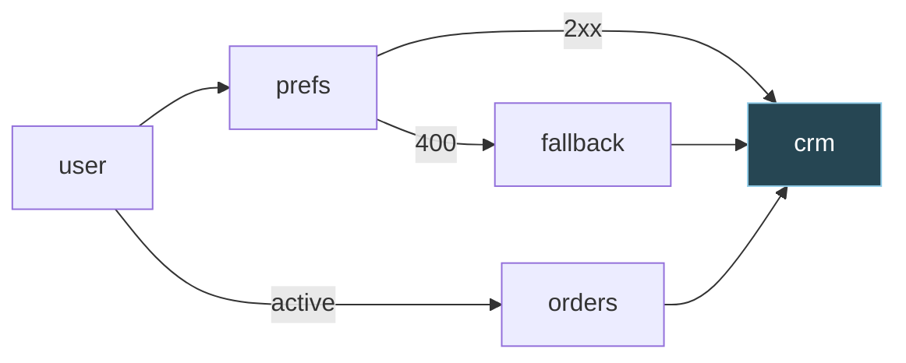

# 9. Joins: a step with more than one way in

Assumes [file 01](01-foundations.md) for the vocabulary and the data document, and
[file 02](02-graphs-and-scheduling.md) for the scheduler, above all
[§2.6](02-graphs-and-scheduling.md#26-conditional-edges-and-skip-cascades): the three
outcomes an edge can have, the two rules, and skip cascades. §9.4 and §9.6 also lean on
[file 03 §3.3](03-mapping-data-between-steps.md#33-jsonata-through-the-running-example):
reading a path that isn't there gives nothing, not an error.

## The problem

File 02 §2.6 ended with `crm` running on whatever it had. Push the running example one step
further. The preferences API answers `400` for a user who has never saved any, so a new
step, `fallback`, fetches the default preferences on that answer. `crm` now needs `orders`,
and the preferences from whichever of `prefs` and `fallback` answered. `orders` still runs
only for an active user, as in 02 §2.6.



`crm` is a **join**: a step with more than one edge in. File 02's scheduler decides a join
once every edge into it has an outcome, using the join's rule. Here's what three rules make
of four ordinary runs. I ran them through 02's `decide`, extended in §9.3 so that each edge
can be marked required. "all" is 02's `AllSuccess`, "none" is its
`NoneFailedMinOneSuccess`, and "orders" requires only the edge from `orders`:

```
which of crm's edges are required:   all              none             orders
active user, prefs answers 2xx       skipped          ready            ready
active user, prefs answers 400       skipped          ready            ready
inactive user, prefs answers 2xx     skipped          ready            skipped
prefs answers 400, fallback fails    upstream_failed  upstream_failed  upstream_failed
```

The first column is worse than 02's scenario C, where `all_success` skipped `crm` on one
branch. Here it skips it on every run: `prefs`'s `2xx` edge and `fallback`'s edge are
alternatives, so on every run one of them isn't taken. The second column runs `crm` for an
inactive user too, with no `orders` in its document, and file 01's mapping counts orders that
were never fetched. jsonata 2.2.2 gave
`{"customerId":"u-42","orderCount":0,"channel":"email"}`: a plausible record, and wrong. Only
the third column does what the author meant, and it needs two things file 02 doesn't have:

- a way to say that `orders` must have come and the others may have (§9.3);
- a way for whoever writes `crm`'s mapping to know, before anything runs, that `prefs` may
  have answered `400` and `fallback` may be missing (§9.4).

Before either, it helps to know that the field has names for these joins (§9.1), and that
the reason they're famous for being hard doesn't apply to this scheduler (§9.2).

## 9.1 The kinds of join, named three ways

Three bodies of work name joins, and an engine author meets all three. BPMN is the notation
most process tools draw. The Workflow Patterns are a catalogue of named behaviours, numbered
WCP-1 onwards, against which engines and standards are rated. Airflow's trigger rules are
the ones file 02 used. They divide the space the same way:

| Kind | Fires when | BPMN 2.0.2 | Workflow Patterns | Airflow |
|---|---|---|---|---|
| **AND-join** | every edge was taken | parallel gateway | WCP-3 Synchronization | `all_success` |
| **XOR merge** | an edge is taken, each time one is | exclusive gateway | WCP-5 Simple Merge | no rule of its own |
| **OR-join**, or synchronising merge | every edge that will be taken has been | inclusive gateway | WCP-7, WCP-37, WCP-38 | `none_failed_min_one_success` |
| **First-come**, or discriminator | the first edge is taken; later ones are ignored | complex gateway, counting to one | WCP-9 Structured Discriminator | `one_success` |
| **General condition** | a condition over which edges were taken holds | complex gateway's `activationCondition` | none; WCP-30, *n* of *m*, is the nearest | none |

In each source's own words. BPMN is quoted from the OMG's
[formal 2.0.2 document](https://www.omg.org/spec/BPMN/2.0.2/PDF), the patterns from each
pattern's page on [workflowpatterns.com](http://www.workflowpatterns.com/patterns/control/),
and Airflow from the [Dags page](https://airflow.apache.org/docs/apache-airflow/stable/core-concepts/dags.html)
for 3.3.2, as in file 02:

| Construct | Definition |
|---|---|
| Parallel gateway | "The Parallel Gateway is activated if there is at least one token on each incoming Sequence Flow" (§13.4.1, Table 13.1) |
| [WCP-3](http://www.workflowpatterns.com/patterns/control/basic/wcp3.php) Synchronization | "The convergence of two or more branches into a single subsequent branch such that the thread of control is passed to the subsequent branch when all input branches have been enabled" |
| `all_success` | "All upstream tasks have succeeded" |
| Exclusive gateway, merging | "A converging Exclusive Gateway is used to merge alternative paths. Each incoming Sequence Flow token is routed to the outgoing Sequence Flow without synchronization" (§10.6.2) |
| [WCP-5](http://www.workflowpatterns.com/patterns/control/basic/wcp5.php) Simple Merge | "… such that each enablement of an incoming branch results in the thread of control being passed to the subsequent branch" |
| Inclusive gateway, merging | "A converging Inclusive Gateway is used to merge a combination of alternative and parallel paths. A control flow token arriving at an Inclusive Gateway MAY be synchronized with some other tokens that arrive later at this Gateway" (§10.6.3) |
| [WCP-7](http://www.workflowpatterns.com/patterns/control/advanced_branching/wcp7.php) Structured Synchronizing Merge | Branches "which diverged earlier in the process at a uniquely identifiable point", merged "when each active incoming branch has been enabled" |
| [WCP-37](http://www.workflowpatterns.com/patterns/control/new/wcp37.php) Local Synchronizing Merge | The same, but "Determination of how many branches require synchronization is made on the basis on information locally available to the merge construct" |
| [WCP-38](http://www.workflowpatterns.com/patterns/control/new/wcp38.php) General Synchronizing Merge | "… when either (1) each active incoming branch has been enabled or (2) it is not possible that any branch that has not yet been enabled will be enabled at any future time" |
| `none_failed_min_one_success` | "All upstream tasks have not failed or upstream_failed, and at least one upstream task has succeeded." |
| Complex gateway | "An Expression activationCondition is used to describe the precise behavior. For example, this Expression could specify that tokens on three out of five incoming Sequence Flows are needed to activate the Gateway" (§10.6.5). Its execution semantics list WCP-9 and WCP-30 among the patterns it supports (Table 13.5) |
| [WCP-9](http://www.workflowpatterns.com/patterns/control/advanced_branching/wcp9.php) Structured Discriminator | "… when the first incoming branch has been enabled. Subsequent enablements of incoming branches do not result in the thread of control being passed on" |
| `one_success` | "At least one upstream task has succeeded (does not wait for all upstream tasks to be done)" |

Four things the tables say that no single source does.

**In this scheduler, two rows are one.** A token engine's XOR merge passes each token straight
on, "without synchronization", so if both of its incoming branches run, the step after it
runs twice. BPMN's table of execution semantics lists Multi-Merge (WCP-8) among the patterns
its exclusive gateway supports (Table 13.2). File 02's scheduler decides a step once, when
the last edge into it resolves, so it has nothing to run twice. A XOR merge there is an
OR-join in which only one edge happened to be taken, which is why Airflow needs no rule of its
own for it: after a branch, `none_failed_min_one_success` does both jobs.

**First-come is the odd one out.** It's the only join that decides before every edge has an
outcome, which 02's loop never does (02 §2.6 set `one_success` aside for that reason). It's
also the only one whose document depends on timing: which parents `crm` finds finished would
depend on which finished first, which is what file 01 §1.5's second rule exists to prevent.
And it has to say what happens to the late arrivals. WCP-9's page describes a blocking and a
cancelling variant for that.

**Airflow counts; it doesn't name.** Every one of its thirteen rules speaks of a task's parents
as a group: "All upstream tasks…", "At least one upstream task…". The nearest it comes to
naming one is `all_done_setup_success`, which singles out setup tasks. None says that this
parent must have succeeded and that one may not have, which is what the problem's third
column needs. That's the last row of the first table: a general condition.

**WCP-37 has two names.** BPMN's table lists "Acyclic Synchronizing Merge (WCP-37)" (Table
13.3), and so does the prose of the patterns' own index page, while the pattern's page calls
it the Local Synchronizing Merge. Search for both.

## 9.2 Why the OR-join is hard in general and easy here

The OR-join's rule sounds simple: fire once every edge that will be taken has been. The
difficulty is in "will be". BPMN 2.0.2 spells out what it takes for an inclusive gateway
(§13.4.3, Table 13.3):

> The Inclusive Gateway is activated if
> - At least one incoming Sequence Flow has at least one token and
> - For every directed path formed by sequence flow that
>   - starts with a Sequence Flow f of the diagram that has a token,
>   - ends with an incoming Sequence Flow of the inclusive gateway that has no token, and
>   - does not visit the Inclusive Gateway.
> - There is also a directed path formed by Sequence Flow that
>   - starts with f,
>   - ends with an incoming Sequence Flow of the inclusive gateway that has a token, and
>   - does not visit the Inclusive Gateway.

Read it slowly. The gateway looks along every path from every token in the whole diagram. A
token that could still reach one of its empty edges holds it back, unless that token could
also reach an edge that already holds one. That's a question about the whole graph and
about the future. Van der Aalst, Desel and Kindler put it plainly, about the OR-join of
another notation, event-driven process chains (EPCs): "we need to know whether there will
be a process folder arriving at one of the other arcs at some time in the future. This
information is not local to the OR-join, but may depend on all other parts of the EPC"
(["On the semantics of EPCs: A vicious circle"](http://www.workflowpatterns.com/documentation/documents/EPK02.pdf),
EPK 2002). It's hard in three ways.

**It costs.** WCP-38's page: "Determination of this fact requires a (computationally
expensive) evaluation of possible future states for the current process instance." Wynn,
Edmond, van der Aalst and ter Hofstede open their paper on the OR-join with both difficulties:
"Depending on context assumptions this behaviour may be relatively easy to deal with, though
in general its semantics is complicated, both from a definition point of view (in terms of
formally capturing a desired intuitive semantics) and from a computational point of view (how
does one determine whether an OR-join is enabled?)"
(["Achieving a General, Formal and Decidable Approach to the OR-Join in Workflow Using Reset Nets"](http://www.workflowpatterns.com/documentation/documents/resetnets.pdf),
ICATPN 2005, LNCS 3536).

**With cycles, nobody agrees what it means.** The 2002 paper's second example is "another EPC
with two OR-joins in a feedback loop, which is a vicious circle". Ask whether the joins should
fire. If neither does, nothing will ever arrive on their other edges, so each should. If both
do, something will arrive, so each should wait. "Both alternatives result in a contradiction to
the informal semantics of EPCs. This shows that there is no formal semantics that precisely
captures the informal semantics of EPCs." WCP-38's page calls this the "vicious circle
paradox" and describes how YAWL avoids it: when deciding one OR-join, "any preceding OR-joins
are all considered to function either as XOR-joins or AND-joins".

**Engines implement it differently.** Camunda 8.10's converging inclusive gateway completes
when "All incoming sequence flows have been taken at least once" or "No path exists from any
active flow node to the inclusive gateway (excluding incoming paths to the inclusive gateway
that have already been taken)" ([Camunda 8 docs](https://docs.camunda.io/docs/components/modeler/bpmn/inclusive-gateways/)).
Camunda 7.24's documentation has a section of "Camunda-specific behavior", including a case
where its join fires once and "According to the BPMN 2.0 specification, since both tokens
pass the same sequence flow (true), the inclusive gateway should trigger twice"
([Camunda 7 docs](https://docs.camunda.org/manual/7.24/reference/bpmn20/gateways/inclusive-gateway/)).
Two engines from one vendor, two rules, one of them documented as departing from the standard.

### Easy here

File 02's scheduler never asks whether an edge *will be* taken. It waits until the edge has an
outcome, and every edge gets one. A parent that succeeds makes each of its edges taken or not
taken; a parent that's skipped or fails makes them not taken or broken at once, and a skip
cascades down every path below it (02 §2.6). In a DAG every step is eventually decided, so
every edge into the join eventually has an outcome, and when the last one arrives the join
knows exactly which edges were taken. No look-ahead, no paths: it counts.

That mechanism has a name. [WS-BPEL 2.0](https://docs.oasis-open.org/wsbpel/2.0/OS/wsbpel-v2.0-OS.html),
the OASIS standard of 2007, gives every link "a tri-state flag … true, false, or unset", and an
activity with incoming links "MUST NOT start until the status of all its incoming links has
been determined" (§11.6.2). When an activity doesn't run because its join condition is false,
"its outgoing links MUST be assigned a false status … This has the effect of propagating false
link status transitively along entire paths formed by successive links until a join condition
is reached that evaluates to true. This approach is called Dead-Path Elimination (DPE)"
(§11.6.3). That's 02's skip cascade: a skipped step's edges become not taken, all the way down.

**Dead-path elimination** costs one restriction, and it's the one that makes it finish. BPEL
forbids cycles among links: a link "MUST NOT create a control cycle … This implies that such
directed graphs are always acyclic" ([SA00072], §11.6.1), and repetition lives in `<while>`,
`<repeatUntil>` and `<forEach>`, whose boundaries a link "MUST NOT cross" ([SA00070]). The 2002
paper found the same design in IBM's MQSeries Workflow, which "only allows for the iteration of
entire subprocesses, i. e., cycles are not allowed in the workflow graph", and noted that this
"is sufficient for implementing the synchronizing merge using a local rule". In the patterns'
terms, 02's `none_failed_min_one_success` is a Local Synchronizing Merge, and WCP-37's page
credits WebSphere MQ with one for this very reason: "dead path elimination where 'true' and
'false' tokens are passed down branches that are and are not enabled respectively".

> **Teacher's aside.** The OR-join has a reputation as the hard join, and people go looking for
> the difficulty in the join. It isn't there. It's in what the engine knows. A token engine
> learns nothing from a branch that wasn't taken: no token comes, and silence looks the same as
> slowness, so the join has to search the diagram for anything that might still arrive. Give
> every edge an outcome, "not taken" included, and silence becomes a message. Then the OR-join
> is the easiest join there is: wait until every edge has an outcome, then look. What you pay
> is a graph without cycles, because dead-path elimination only finishes when every path does.

## 9.3 Join conditions and required edges

The problem's third column needs a condition over named edges: `orders`'s edge was taken, and
at least one edge was. Airflow's rules can't say it (§9.1). WS-BPEL can. Every activity that
is the target of a link has a **join condition**, which "MUST be constructed using only
Boolean operators and the activity's incoming links' status values" ([SA00073], §11.6.2) and is
evaluated once every incoming link has a status. The standard's own example settles a trade
with `$buyToSettle and $sellToSettle` (§11.6.4). Without one, the condition is "the
disjunction (i.e. a logical OR operation) of the link status of all incoming links" (§11.6.1),
which is 02's `NoneFailedMinOneSuccess`, give or take how failures are treated (the trap below).
BPMN's complex gateway goes further: its condition "refers to data and to the activationCount
of incoming gates" (§13.4.5, which calls it the `activationExpression`).

A Boolean language over edges is more than most authors need, and much harder to analyse
(§9.7 says why). One special case covers the common need: mark some edges **required**. Once
every edge into a step has an outcome:

1. any edge broken: `upstream_failed`, as in file 02;
2. any required edge not taken: `skipped`;
3. no edge taken: `skipped`;
4. otherwise, ready.

As a BPEL join condition, that's the conjunction of the required edges, or, when none is
required, BPEL's default disjunction. File 02's two rules are its two ends: every edge required
is `AllSuccess`, and none required is `NoneFailedMinOneSuccess`.

```go
// arrival is one edge into a step, once its parent has resolved.
type arrival struct {
	outcome  outcome
	required bool
}

// decide applies a step's rule once every edge into it has resolved.
func decide(in []arrival) Status {
	if slices.ContainsFunc(in, func(a arrival) bool { return a.outcome == broken }) {
		return UpstreamFailed // failure first, as in file 02
	}
	someTaken := false
	for _, a := range in {
		if a.required && a.outcome != taken {
			return Skipped // the gate: a required edge wasn't taken
		}
		someTaken = someTaken || a.outcome == taken
	}
	if !someTaken {
		return Skipped // nothing came
	}
	return Ready
}
```

`outcome`, `Status` and their values are 02 §2.6's. `Edge` gains a `Required` field and `Step`
loses its `Rule`. In 02's `Execute`, `outcomes` becomes a `[][]arrival`, and `resolve` appends
`arrival{edgeOutcome(st, e, responses[i]), e.Required}` and calls `decide(outcomes[c])`. I made
exactly those changes to 02's scheduler, with Go 1.24.4, and ran the problem's four runs under
`go run -race`, with `prefs`'s edges conditioned on its status. It gave the third column, and
`crm`'s document held `orders`, `prefs` and `user` after a `2xx`, with `fallback` as well after
a `400`. The problem's table is this `decide` under the three choices of required edges; the
loop that prints it is trimmed.

### A gate and a promise

A required edge does two jobs. It's a **gate**: the scheduler won't run `crm` unless the edge
from `orders` was taken. And it's a **promise**: `crm`'s mapping may read `steps.orders`
without checking whether it's there. The promise is only as good as the gate. An editor that
shows `orders` as certain because the author ticked "required", in front of a scheduler that
ignores the flag, has made the promise without the gate. The first inactive user is the
problem's second column: `crm` runs, `$count(steps.orders.body.orders)` counts nothing, and the
CRM stores a customer with no orders. Nothing fails, so nothing alerts. A gate without the
promise is merely wasteful: the runs are right, but an author who isn't told writes checks for
absences that can't happen.

So the flag lives in one place, the definition, and the scheduler and the editor both read it
there. It's [file 03 §3.5](03-mapping-data-between-steps.md#35-preview-and-execution-must-use-the-same-evaluator)'s
lesson again. When the editor and the engine each evaluate a mapping, they must share an
evaluator; when they each decide what a join may find missing, they must share a rule.

> ⚠️ **Two outcomes aren't enough.** A BPEL link is true or false, and a failure becomes a
> false. The standard's own commentary on dead-path elimination: if an invocation inside a
> scope with a fault handler faults, "the status of the outgoing link from the invocation would
> be false, and the (implicit) `<joinCondition>` at the target of the link would be false, but
> the resulting bpel:joinFailure would be implicitly suppressed and the target activity would
> be silently skipped within the sequence instead of causing the expected fault" (§11.6.3).
> That's why `suppressJoinFailure`, the attribute that turns dead-path elimination on, defaults
> to `no`: "This avoids suppressing a well-defined fault by a default setting." With it off, a
> false join condition throws `joinFailure` instead of skipping. File 02 keeps broken as a third
> outcome and checks it before any rule, so a failure is never mistaken for a branch not
> taken, and there's nothing to suppress. (The standard trips on the attribute itself: its table
> of standard faults, Appendix A, says `joinFailure` is thrown when `suppressJoinFailure` is
> `yes`, the reverse of §11.6.2, §11.6.3 and the examples.)

## 9.4 What may be missing: a may and must analysis

The rule decides at run time. Whoever writes `crm`'s mapping needs the same knowledge before
the first run: which earlier steps are certain to be in the document whenever `crm` runs, which
may be missing, and which may have answered more than one way. Guessing wrong fails silently,
as file 03 §3.3 showed: a path into a missing step gives nothing, and an object constructor
drops the key.

Compilers answer the same question about local variables. Java's rule is the clearest
statement of it ([JLS SE 21, chapter 16, "Definite Assignment"](https://docs.oracle.com/javase/specs/jls/se21/html/jls-16.html)):

> For every access of a local variable declared by a statement x, or blank final field x, x must
> be definitely assigned before the access, or a compile-time error occurs.

with the idea behind it that "an assignment to the local variable … must occur on every possible
execution path to the access". Translate: a step is a variable, running is assigning it, and a
mapping's read of `steps.prefs` is an access. "Definitely assigned before the access" becomes
"certain to have run whenever `crm` runs". The shapes of control flow carry over too. After
`x = 1; y = 2;` both are assigned, as after a join's required edges, all of which were taken.
After `if (c) x = 1; else y = 2;` neither is, as after a join whose edges are all optional,
where any one of them may be the one that was taken.

A question about every path is a **must** analysis; one about some path is a **may** analysis.
This one does both with one structure. For each step it keeps, for every earlier step, the set
of ways that step may have ended in the runs in which this one runs: answered `2xx`, answered
`400`, or didn't run. Whatever isn't in the set can't have happened. A step is certain to
have run when "didn't run" isn't in its set, and certain of its answer when one answer is left.
These sets are the analysis's **facts**, and it works them out for each step in an order that
respects every edge, as 02 §2.1's Kahn order does:

| Situation | What holds in the runs in which the step runs |
|---|---|
| No edges in | It always runs; nothing is known about anything else |
| An edge from `p` on answer `a` was taken | `p` answered `a`, and whatever held for `p` to run |
| Some edges are required | All of them were taken: keep only what every one allows |
| No edge is required | At least one was taken: keep what any one allows |
| An earlier step's own edges were certainly taken | It ran: drop "didn't run" from its set |
| An edge has a condition on the response (02's `When`) | Never evaluated: the edge may or may not be taken, whatever the answer |

The last rule needs a word. Before a run there's no response to test `body.active` against,
so the analysis can't know whether a conditional edge is taken even when it knows the answer.
§9.7 comes back to it. Failures need no rule: any failed ancestor makes the join
`upstream_failed`, so in the runs in which it runs, every ancestor answered or was skipped.

```go
// Works out, before any run, how each earlier step may have ended in the runs
// in which a given step runs: with one of its answers, or not run at all.
package main

import (
	"fmt"
	"slices"
	"strings"
)

// Step is one call. Outputs are the answers it routes, such as "2xx" and
// "400"; any other answer fails the step.
type Step struct {
	ID      string
	Outputs []string
}

// Edge leaves one of From's outputs for To. When, if set, is a condition on
// the response, which the analysis never evaluates. To doesn't run unless
// every Required edge into it was taken.
type Edge struct {
	From, Output, To, When string
	Required               bool
}

// Endings is a set of ways a step may have ended: bit 0 says it didn't run,
// bit i+1 that it answered Outputs[i].
type Endings uint64

const missing Endings = 1

// Facts holds, for every step, how it may have ended in the runs in which one
// particular step runs. Nil means that step never runs.
type Facts []Endings

// narrow keeps only the endings both f and t allow, and returns the first
// step left with none, or -1.
func narrow(f, t Facts) int {
	for x := range f {
		if f[x] &= t[x]; f[x] == 0 {
			return x
		}
	}
	return -1
}

// Analyse returns every step's facts and ancestors, and warnings. Steps must
// be in an order that respects every edge (file 02 §2.1).
func Analyse(steps []Step, edges []Edge) (facts []Facts, ancestors [][]bool, warnings []string) {
	n := len(steps)
	index := map[string]int{}
	unknown := make(Facts, n) // nothing known: missing, or any answer
	for i, s := range steps {
		index[s.ID] = i
		unknown[i] = 1<<(len(s.Outputs)+1) - 1
	}
	answer := func(e Edge) Endings { return 2 << slices.Index(steps[index[e.From]].Outputs, e.Output) }
	// taken is what holds in a run in which e is taken: its step gave e's
	// answer, and whatever held for that step to run. Nil if it never runs.
	taken := func(e Edge) Facts {
		t := slices.Clone(facts[index[e.From]])
		if t != nil {
			t[index[e.From]] = answer(e)
		}
		return t
	}
	into := make([][]Edge, n)
	// ran says whether f shows that step x ran: every required edge into it,
	// and at least one edge, was certainly taken.
	ran := func(x int, f Facts) bool {
		some, all := len(into[x]) == 0, true
		for _, e := range into[x] {
			sure := e.When == "" && f[index[e.From]] == answer(e)
			some = some || sure
			all = all && (sure || !e.Required)
		}
		return some && all
	}

	facts, ancestors = make([]Facts, n), make([][]bool, n)
	for i, s := range steps {
		ancestors[i] = make([]bool, n)
		for _, e := range edges {
			if e.To == s.ID {
				into[i] = append(into[i], e)
				ancestors[i][index[e.From]] = true
				for x, a := range ancestors[index[e.From]] {
					ancestors[i][x] = ancestors[i][x] || a
				}
			}
		}

		var f Facts
		switch {
		case len(into[i]) == 0: // a first step always runs
			f = slices.Clone(unknown)
		case !slices.ContainsFunc(into[i], func(e Edge) bool { return e.Required }):
			// At least one edge was taken: what any one of them says may hold.
			for _, e := range into[i] {
				if t := taken(e); t != nil && f == nil {
					f = t
				} else if t != nil {
					for x := range f {
						f[x] |= t[x]
					}
				}
			}
			if f == nil {
				warnings = append(warnings, s.ID+" never runs: none of its edges can be taken")
			}
		default:
			// Every required edge was taken: what each of them says holds.
			f = slices.Clone(unknown)
			for _, e := range into[i] {
				if !e.Required {
					continue
				}
				if t := taken(e); t == nil {
					f, warnings = nil, append(warnings, s.ID+" never runs: "+e.From+" never runs")
					break
				} else if x := narrow(f, t); x >= 0 {
					f = nil
					warnings = append(warnings, s.ID+" never runs: its required edges disagree about "+steps[x].ID)
					break
				}
			}
		}
		if f == nil {
			continue
		}
		// An earlier step whose own edges were certainly taken ran.
		for x := range i {
			if ancestors[i][x] && ran(x, f) {
				f[x] &^= missing
			}
		}
		// An optional edge that disagrees with the rest is never taken when
		// this step runs, so without a condition its step can't have given
		// that answer.
		for _, e := range into[i] {
			if t := taken(e); !e.Required && (t == nil || narrow(slices.Clone(f), t) >= 0) {
				warnings = append(warnings, fmt.Sprintf("edge %s -> %s (on %s) is never taken when %s runs",
					e.From, s.ID, e.Output, s.ID))
				if e.When == "" {
					f[index[e.From]] &^= answer(e)
				}
			}
		}
		f[i] = unknown[i] &^ missing // it ran, so it answered
		facts[i] = f
	}
	return facts, ancestors, warnings
}

// show prints how each of join's ancestors may have ended when join runs.
func show(title string, steps []Step, edges []Edge, join string) {
	fmt.Println(title)
	facts, ancestors, warnings := Analyse(steps, edges)
	j := slices.IndexFunc(steps, func(s Step) bool { return s.ID == join })
	for k, s := range steps {
		if facts[j] == nil || !ancestors[j][k] {
			continue
		}
		var ways []string
		for b, o := range s.Outputs {
			if facts[j][k]&(2<<b) != 0 {
				ways = append(ways, o)
			}
		}
		if facts[j][k]&missing != 0 {
			ways = append(ways, "missing")
		}
		fmt.Printf("  %-9s %s\n", s.ID, strings.Join(ways, ", "))
	}
	for _, w := range warnings {
		fmt.Println("  " + w)
	}
}

func main() {
	step := func(id string, outputs ...string) Step { return Step{id, outputs} }
	edge := func(from, output, to string) Edge { return Edge{From: from, Output: output, To: to} }
	needs := func(from, output, to string) Edge { return Edge{From: from, Output: output, To: to, Required: true} }

	steps := []Step{step("user", "2xx"), step("orders", "2xx"), step("prefs", "2xx", "400"),
		step("fallback", "2xx"), step("crm", "2xx")}
	active := Edge{From: "user", Output: "2xx", To: "orders", When: "body.active"}
	branch := []Edge{active, edge("user", "2xx", "prefs"), edge("prefs", "400", "fallback")}
	into := func(more ...Edge) []Edge { return slices.Concat(branch, more) }

	show("A. crm needs orders; prefs and fallback are optional", steps, into(
		needs("orders", "2xx", "crm"), edge("prefs", "2xx", "crm"), edge("fallback", "2xx", "crm")), "crm")
	show("B. notify runs on either answer from prefs; crm needs orders",
		[]Step{step("user", "2xx"), step("orders", "2xx"), step("prefs", "2xx", "400"),
			step("notify", "2xx"), step("crm", "2xx")},
		[]Edge{active, edge("user", "2xx", "prefs"), edge("prefs", "2xx", "notify"),
			edge("prefs", "400", "notify"), needs("orders", "2xx", "crm"), edge("notify", "2xx", "crm")}, "crm")
	show("C. crm needs orders, prefs and fallback", steps, into(
		needs("orders", "2xx", "crm"), needs("prefs", "2xx", "crm"), needs("fallback", "2xx", "crm")), "crm")
	show("D. crm needs orders and prefs; fallback is optional", steps, into(
		needs("orders", "2xx", "crm"), needs("prefs", "2xx", "crm"), edge("fallback", "2xx", "crm")), "crm")
}
```

A set is a bit mask, so intersecting and uniting are `&` and `|`, and a fact for each pair of
steps costs one machine word. I ran it with Go 1.24.4; `gofmt` and `go vet` were clean. Graphs
C and D are §9.5's. A and B printed:

```
A. crm needs orders; prefs and fallback are optional
  user      2xx
  orders    2xx
  prefs     2xx, 400
  fallback  2xx, missing
B. notify runs on either answer from prefs; crm needs orders
  user      2xx
  orders    2xx
  prefs     2xx, 400
  notify    2xx, missing
```

Read A as the author of `crm`'s mapping would. `user` and `orders` are certain, each with one
answer: the required edge from `orders` was taken, so `orders` answered `2xx`, and for `orders`
to run, `user` did. `prefs` is certain too, but with two possible answers, so the mapping must
look at `steps.prefs.status` before trusting the body (§9.6 does). `fallback` may be missing.
That's everything the author needs, worked out without running anything.

How `prefs` became certain is worth following, because the first four rules don't get there.
`prefs` isn't behind a required edge into `crm`. Its own edge into `crm` is optional, and so
is `fallback`'s, so neither is known to have been taken. The fifth rule is a second pass over
`crm`'s ancestors, in order; without it, the program printed `prefs  2xx, 400, missing`. The
pass looks at `prefs`'s own edges. It has one, from `user` on `2xx`, with no condition, and
`user` certainly answered `2xx`, so `prefs` certainly ran.

### Conservative: sound, but not complete

B can't be right. `notify` has an edge from each of `prefs`'s answers, and `prefs` certainly
answered one or the other, so `notify` certainly ran. The program says it may be missing. To
see otherwise it would have to split into cases: if `prefs` answered `2xx`, the first edge was
taken; if `400`, the second. Its second pass only looks for a single edge that's certainly
taken, and neither of `notify`'s is.

That's what **conservative** means here: the analysis can be wrong in one direction only. It
may call a step that always runs "may be missing", as in B. It never calls a step certain that
some run lacks. In the usual terms it's **sound**, since everything it claims is true, but not
**complete**, since not everything true is claimed. Java makes the same trade, on purpose.
Its rules ignore values: "the values of expressions are not taken into account in the flow
analysis". About one rejected program it says "in principle it can be known at compile time
that the assignment to k will always be executed", and it rejects this one too:

```java
void flow(boolean flag) {
    int k;
    if (flag)
        k = 3;
    if (!flag)
        k = 4;
    System.out.println(k);  /* k is not "definitely assigned"
                               before this statement */
}
```

`k` is assigned on every run, and javac 26.0.2 rejects the program anyway, with
`error: variable k might not have been initialized`: a may-fact, in the compiler's own words.
`notify` is the same program, written as a workflow.

I checked the claim of soundness rather than trust it. A brute-force program enumerates every
combination of answers and every truth value of every condition, applies §9.3's rule, and
records, for each step, how each of its ancestors actually ended in the runs in which it ran.
Over 20,000 random workflows of two to seven steps, about half of them with conditions, that's
91,268 pairs of a step and one of its ancestors. The analysis never claimed anything a run
contradicted. It said "missing" where no run lacked the step in 465 of the pairs, 0.5%, and
without the second pass in 25,130 of them, 27.5%. Those percentages describe my random
generator, not anyone's real workflows; the zero is the number that matters. The Rust, C++ and
JavaScript versions below produced the same facts and warnings as the Go one, byte for byte, on
3,000 other random workflows.

<details><summary>Rust</summary>

```rust
// Works out, before any run, how each earlier step may have ended in the runs
// in which a given step runs: with one of its answers, or not run at all.

/// One call. `outputs` are the answers it routes, such as "2xx" and "400";
/// any other answer fails the step.
pub struct Step {
    pub id: &'static str,
    pub outputs: Vec<&'static str>,
}

/// Leaves one of `from`'s outputs for `to`. `when` is a condition on the
/// response, which the analysis never evaluates. `to` doesn't run unless
/// every required edge into it was taken.
#[derive(Clone, Default)]
pub struct Edge {
    pub from: &'static str,
    pub output: &'static str,
    pub to: &'static str,
    pub when: Option<&'static str>,
    pub required: bool,
}

/// A set of ways a step may have ended: bit 0 says it didn't run, bit i+1
/// that it answered `outputs[i]`.
pub type Endings = u64;
pub const MISSING: Endings = 1;

/// For every step, how it may have ended in the runs in which one particular
/// step runs. `None` means that step never runs.
pub type Facts = Option<Vec<Endings>>;

/// Keeps only the endings both `f` and `t` allow, and returns the first step
/// left with none.
fn narrow(f: &mut [Endings], t: &[Endings]) -> Option<usize> {
    for x in 0..f.len() {
        f[x] &= t[x];
        if f[x] == 0 {
            return Some(x);
        }
    }
    None
}

pub struct Analysis {
    pub facts: Vec<Facts>,
    pub ancestors: Vec<Vec<bool>>,
    pub warnings: Vec<String>,
}

/// Steps must be in an order that respects every edge (file 02 §2.1).
pub fn analyse(steps: &[Step], edges: &[Edge]) -> Analysis {
    let n = steps.len();
    let index = |id: &str| steps.iter().position(|s| s.id == id).unwrap();
    let unknown: Vec<Endings> = steps
        .iter()
        .map(|s| (1 << (s.outputs.len() + 1)) - 1)
        .collect();
    let answer = |e: &Edge| -> Endings {
        2 << steps[index(e.from)]
            .outputs
            .iter()
            .position(|o| *o == e.output)
            .unwrap()
    };
    // What holds in a run in which `e` is taken: its step gave e's answer, and
    // whatever held for that step to run. None if it never runs.
    let taken = |facts: &[Facts], e: &Edge| -> Option<Vec<Endings>> {
        let from = index(e.from);
        facts[from].clone().map(|mut t| {
            t[from] = answer(e);
            t
        })
    };
    let into: Vec<Vec<&Edge>> = steps
        .iter()
        .map(|s| edges.iter().filter(|e| e.to == s.id).collect())
        .collect();
    // Whether `f` shows that step `x` ran: every required edge into it, and
    // at least one edge, was certainly taken.
    let ran = |x: usize, f: &[Endings]| -> bool {
        let (mut some, mut all) = (into[x].is_empty(), true);
        for e in &into[x] {
            let sure = e.when.is_none() && f[index(e.from)] == answer(e);
            some |= sure;
            all &= sure || !e.required;
        }
        some && all
    };

    let mut a = Analysis {
        facts: Vec::new(),
        ancestors: vec![vec![false; n]; n],
        warnings: Vec::new(),
    };
    for i in 0..n {
        let id = steps[i].id;
        for e in &into[i] {
            let p = index(e.from);
            let inherited = a.ancestors[p].clone();
            a.ancestors[i][p] = true;
            for x in 0..n {
                a.ancestors[i][x] |= inherited[x];
            }
        }

        let mut f: Facts = if into[i].is_empty() {
            Some(unknown.clone()) // a first step always runs
        } else if !into[i].iter().any(|e| e.required) {
            // At least one edge was taken: what any one of them says may hold.
            let mut f: Facts = None;
            for e in &into[i] {
                if let Some(t) = taken(&a.facts, e) {
                    f = Some(match f {
                        None => t,
                        Some(mut g) => {
                            for x in 0..n {
                                g[x] |= t[x];
                            }
                            g
                        }
                    });
                }
            }
            if f.is_none() {
                a.warnings
                    .push(format!("{id} never runs: none of its edges can be taken"));
            }
            f
        } else {
            // Every required edge was taken: what each of them says holds.
            let mut g = unknown.clone();
            let mut runs = true;
            for e in into[i].iter().filter(|e| e.required) {
                match taken(&a.facts, e) {
                    None => {
                        a.warnings
                            .push(format!("{id} never runs: {} never runs", e.from));
                        runs = false;
                    }
                    Some(t) => {
                        if let Some(x) = narrow(&mut g, &t) {
                            a.warnings.push(format!(
                                "{id} never runs: its required edges disagree about {}",
                                steps[x].id
                            ));
                            runs = false;
                        }
                    }
                }
                if !runs {
                    break;
                }
            }
            runs.then_some(g)
        };

        if let Some(g) = f.as_mut() {
            // An earlier step whose own edges were certainly taken ran.
            for x in 0..i {
                if a.ancestors[i][x] && ran(x, g) {
                    g[x] &= !MISSING;
                }
            }
            // An optional edge that disagrees with the rest is never taken when
            // this step runs, so without a condition its step can't have given
            // that answer.
            for e in &into[i] {
                let shut = match taken(&a.facts, e) {
                    None => true,
                    Some(t) => narrow(&mut g.clone(), &t).is_some(),
                };
                if !e.required && shut {
                    a.warnings.push(format!(
                        "edge {} -> {id} (on {}) is never taken when {id} runs",
                        e.from, e.output
                    ));
                    if e.when.is_none() {
                        g[index(e.from)] &= !answer(e);
                    }
                }
            }
            g[i] = unknown[i] & !MISSING; // it ran, so it answered
        }
        a.facts.push(f);
    }
    a
}
```

Built with `rustc` 1.96, `--edition 2024`, no dependencies and no warnings, and formatted with
`rustfmt`; `show`, the constructors and `main` are as in Go and trimmed. The four graphs print
the same lines. `taken` takes the facts as an argument instead of capturing them, because the
loop pushes onto `a.facts` while the closures are alive; capturing would borrow it for their
whole lifetime.

</details>

<details><summary>C++</summary>

```cpp
// Works out, before any run, how each earlier step may have ended in the runs
// in which a given step runs: with one of its answers, or not run at all.
#include <algorithm>
#include <cstdint>
#include <cstdio>
#include <optional>
#include <string>
#include <vector>

// One call. `outputs` are the answers it routes, such as "2xx" and "400"; any
// other answer fails the step.
struct Step {
    std::string id;
    std::vector<std::string> outputs;
};

// Leaves one of `from`'s outputs for `to`. `when` is a condition on the
// response, which the analysis never evaluates. `to` doesn't run unless every
// required edge into it was taken.
struct Edge {
    std::string from, output, to, when;
    bool required = false;
};

// A set of ways a step may have ended: bit 0 says it didn't run, bit i+1 that
// it answered outputs[i].
using Endings = std::uint64_t;
constexpr Endings missing = 1;

// For every step, how it may have ended in the runs in which one particular
// step runs. nullopt means that step never runs.
using Facts = std::optional<std::vector<Endings>>;

// Keeps only the endings both f and t allow, and returns the first step left
// with none, or -1.
static int narrow(std::vector<Endings>& f, const std::vector<Endings>& t) {
    for (size_t x = 0; x < f.size(); ++x)
        if ((f[x] &= t[x]) == 0) return static_cast<int>(x);
    return -1;
}

struct Analysis {
    std::vector<Facts> facts;
    std::vector<std::vector<bool>> ancestors;
    std::vector<std::string> warnings;
};

// Steps must be in an order that respects every edge (file 02 §2.1).
Analysis analyse(const std::vector<Step>& steps, const std::vector<Edge>& edges) {
    const size_t n = steps.size();
    auto index = [&](const std::string& id) {
        return static_cast<size_t>(std::find_if(steps.begin(), steps.end(),
                                                [&](const Step& s) { return s.id == id; }) -
                                   steps.begin());
    };
    std::vector<Endings> unknown(n);  // nothing known: missing, or any answer
    for (size_t i = 0; i < n; ++i) unknown[i] = (Endings{1} << (steps[i].outputs.size() + 1)) - 1;
    auto answer = [&](const Edge& e) -> Endings {
        const auto& outs = steps[index(e.from)].outputs;
        return Endings{2} << (std::find(outs.begin(), outs.end(), e.output) - outs.begin());
    };
    Analysis a{{}, std::vector<std::vector<bool>>(n, std::vector<bool>(n)), {}};
    // What holds in a run in which e is taken: its step gave e's answer, and
    // whatever held for that step to run. nullopt if it never runs.
    auto taken = [&](const Edge& e) -> Facts {
        Facts t = a.facts[index(e.from)];
        if (t) (*t)[index(e.from)] = answer(e);
        return t;
    };
    std::vector<std::vector<Edge>> into(n);
    for (const auto& e : edges) into[index(e.to)].push_back(e);
    // Whether f shows that step x ran: every required edge into it, and at
    // least one edge, was certainly taken.
    auto ran = [&](size_t x, const std::vector<Endings>& f) {
        bool some = into[x].empty(), all = true;
        for (const auto& e : into[x]) {
            bool sure = e.when.empty() && f[index(e.from)] == answer(e);
            some = some || sure;
            all = all && (sure || !e.required);
        }
        return some && all;
    };

    for (size_t i = 0; i < n; ++i) {
        const std::string& id = steps[i].id;
        for (const auto& e : into[i]) {
            size_t p = index(e.from);
            a.ancestors[i][p] = true;
            for (size_t x = 0; x < n; ++x)
                if (a.ancestors[p][x]) a.ancestors[i][x] = true;
        }

        Facts f;
        bool anyRequired = std::any_of(into[i].begin(), into[i].end(),
                                       [](const Edge& e) { return e.required; });
        if (into[i].empty()) {
            f = unknown;  // a first step always runs
        } else if (!anyRequired) {
            // At least one edge was taken: what any one of them says may hold.
            for (const auto& e : into[i]) {
                Facts t = taken(e);
                if (t && !f) f = t;
                else if (t)
                    for (size_t x = 0; x < n; ++x) (*f)[x] |= (*t)[x];
            }
            if (!f) a.warnings.push_back(id + " never runs: none of its edges can be taken");
        } else {
            // Every required edge was taken: what each of them says holds.
            f = unknown;
            for (const auto& e : into[i]) {
                if (!e.required) continue;
                Facts t = taken(e);
                if (!t) {
                    a.warnings.push_back(id + " never runs: " + e.from + " never runs");
                    f.reset();
                    break;
                }
                if (int x = narrow(*f, *t); x >= 0) {
                    a.warnings.push_back(id + " never runs: its required edges disagree about " +
                                         steps[x].id);
                    f.reset();
                    break;
                }
            }
        }

        if (f) {
            // An earlier step whose own edges were certainly taken ran.
            for (size_t x = 0; x < i; ++x)
                if (a.ancestors[i][x] && ran(x, *f)) (*f)[x] &= ~missing;
            // An optional edge that disagrees with the rest is never taken when
            // this step runs, so without a condition its step can't have given
            // that answer.
            for (const auto& e : into[i]) {
                Facts t = taken(e);
                std::vector<Endings> scratch = *f;
                if (!e.required && (!t || narrow(scratch, *t) >= 0)) {
                    a.warnings.push_back("edge " + e.from + " -> " + id + " (on " + e.output +
                                         ") is never taken when " + id + " runs");
                    if (e.when.empty()) (*f)[index(e.from)] &= ~answer(e);
                }
            }
            (*f)[i] = unknown[i] & ~missing;  // it ran, so it answered
        }
        a.facts.push_back(f);
    }
    return a;
}
```

Built with Apple clang 17, `-std=c++20 -Wall -Wextra`, with no warnings; `show` and `main` are
trimmed, and print the same lines. `std::optional` stands for Go's nil slice. Copying a
`Facts` copies the vector, so `taken` can hand back a modified copy without touching the step
it came from, which in Go needs the explicit `slices.Clone`.

</details>

<details><summary>JavaScript</summary>

```js
// Works out, before any run, how each earlier step may have ended in the runs
// in which a given step runs: with one of its answers, or not run at all.

// A step is { id, outputs }: the answers it routes, such as "2xx" and "400".
// An edge is { from, output, to, when, required }: it leaves one of from's
// outputs for to; when is a condition on the response, never evaluated here.
// A set of endings is a number: bit 0 says the step didn't run, bit i+1 that
// it answered outputs[i]. Facts are one such set per step, or null for a step
// that never runs.
const MISSING = 1;

// Keeps only the endings both f and t allow, and returns the first step left
// with none, or -1.
function narrow(f, t) {
  for (let x = 0; x < f.length; x++) {
    if ((f[x] &= t[x]) === 0) return x;
  }
  return -1;
}

// Steps must be in an order that respects every edge (file 02 §2.1).
export function analyse(steps, edges) {
  const n = steps.length;
  const index = new Map(steps.map((s, i) => [s.id, i]));
  const unknown = steps.map((s) => (1 << (s.outputs.length + 1)) - 1);
  const answer = (e) => 2 << steps[index.get(e.from)].outputs.indexOf(e.output);
  const facts = [];
  const ancestors = steps.map(() => new Array(n).fill(false));
  const warnings = [];
  // What holds in a run in which e is taken: its step gave e's answer, and
  // whatever held for that step to run. Null if it never runs.
  const taken = (e) => {
    const from = facts[index.get(e.from)];
    if (from === null) return null;
    const t = [...from];
    t[index.get(e.from)] = answer(e);
    return t;
  };
  const into = steps.map((s) => edges.filter((e) => e.to === s.id));
  // Whether f shows that step x ran: every required edge into it, and at
  // least one edge, was certainly taken.
  const ran = (x, f) => {
    let some = into[x].length === 0;
    let all = true;
    for (const e of into[x]) {
      const sure = !e.when && f[index.get(e.from)] === answer(e);
      some ||= sure;
      all &&= sure || !e.required;
    }
    return some && all;
  };

  steps.forEach(({ id }, i) => {
    for (const e of into[i]) {
      const p = index.get(e.from);
      ancestors[i][p] = true;
      ancestors[p].forEach((a, x) => (ancestors[i][x] ||= a));
    }

    let f = null;
    if (into[i].length === 0) {
      f = [...unknown]; // a first step always runs
    } else if (!into[i].some((e) => e.required)) {
      // At least one edge was taken: what any one of them says may hold.
      for (const t of into[i].map(taken)) {
        if (t && !f) f = t;
        else if (t) f = f.map((v, x) => v | t[x]);
      }
      if (!f) warnings.push(`${id} never runs: none of its edges can be taken`);
    } else {
      // Every required edge was taken: what each of them says holds.
      f = [...unknown];
      for (const e of into[i].filter((e) => e.required)) {
        const t = taken(e);
        const x = t ? narrow(f, t) : -1;
        if (t && x < 0) continue;
        warnings.push(
          t
            ? `${id} never runs: its required edges disagree about ${steps[x].id}`
            : `${id} never runs: ${e.from} never runs`,
        );
        f = null;
        break;
      }
    }

    if (f) {
      // An earlier step whose own edges were certainly taken ran.
      for (let x = 0; x < i; x++) {
        if (ancestors[i][x] && ran(x, f)) f[x] &= ~MISSING;
      }
      // An optional edge that disagrees with the rest is never taken when
      // this step runs, so without a condition its step can't have given
      // that answer.
      for (const e of into[i]) {
        const t = taken(e);
        if (!e.required && (!t || narrow([...f], t) >= 0)) {
          warnings.push(
            `edge ${e.from} -> ${id} (on ${e.output}) is never taken when ${id} runs`,
          );
          if (!e.when) f[index.get(e.from)] &= ~answer(e);
        }
      }
      f[i] = unknown[i] & ~MISSING; // it ran, so it answered
    }
    facts.push(f);
  });
  return { facts, ancestors, warnings };
}
```

Run with Node 24.14.1 and formatted with Prettier 3.6.2's defaults; `show` and the four
graphs are trimmed and print the same lines. JavaScript's bitwise operators work on 32-bit
integers, so here a step can have at most 30 answers before its set overflows (I tried 30 and
31); the other three use 64-bit sets.

</details>

## 9.5 Contradictions: joins that can't run, edges that can't be taken

The same run printed this for graphs C and D:

```
C. crm needs orders, prefs and fallback
  crm never runs: its required edges disagree about prefs
D. crm needs orders and prefs; fallback is optional
  user      2xx
  orders    2xx
  prefs     2xx
  fallback  missing
  edge fallback -> crm (on 2xx) is never taken when crm runs
```

C is the problem's first column, found before any run. Each required edge brings what had to
hold for it to be taken. `prefs`'s edge says `prefs` answered `2xx`. `fallback`'s says
`fallback` ran, which needed `prefs` to answer `400`. Intersect the two and `prefs` has no
answer left, so no run can take both edges, and `crm` can never run.

D is the quieter mistake. Its author made `prefs` required, perhaps to promise the mapping real
preferences, and left `fallback` optional. Now `fallback`'s edge disagrees with a required
one: whenever `crm` runs, `prefs` answered `2xx`, so `fallback` didn't run. The edge is dead.
`fallback` still runs on every `400`, and its answer goes nowhere, because on those runs `crm`
is skipped.

Both come from tracking, per edge, what each earlier step must have answered for the edge to be
taken, and intersecting. Both are what compilers call **unreachable code**. Java makes it an
error: "It is a compile-time error if a statement cannot be executed because it is unreachable"
([JLS §14.22](https://docs.oracle.com/javase/specs/jls/se21/html/jls-14.html#jls-14.22)). Go
compiles it and leaves it to vet, whose
[`unreachable` pass](https://pkg.go.dev/golang.org/x/tools/go/analysis/passes/unreachable)
"finds statements that execution can never reach because they are preceded by a return
statement, a call to panic, an infinite loop, or similar constructs". With Go 1.24.4,
`go build` accepted a `fmt.Println` after a `return`, and `go vet` printed
`./main.go:7:2: unreachable code`. The same split suits an editor. A join that can never run is
always a mistake in the definition, so refuse to publish it, as Java refuses to compile. A
dead optional edge wastes a call and breaks nothing, so warn, as vet does.

This check is conservative too, in the same direction as Java's: §14.22 accepts
`while (n > 7) k = 2;` after `int n = 5;`, "even though the value of n is known at compile
time and in principle it can be known at compile time that the assignment to k can never be
executed", and javac 26.0.2 compiled it without a word. On the random workflows of §9.4, the
analysis found 1,595 of the 1,603 steps that can never run, and 6,341 of the 6,392 optional
edges never taken when their step runs. It flagged nothing that could happen.

### Why not be exact?

Because being exact is as hard as Boolean satisfiability. Take any formula in conjunctive
normal form. Give each variable a step with two answers, `true` and `false`, behind a common
first step. Give each clause a step with an optional edge from each of its literals: from `x`
on `true` for the literal x, on `false` for not-x. Make a join require every clause step. A
clause step runs exactly when one of its literals holds, so the join can run exactly when some
assignment satisfies every clause. I built that workflow for 2,000 random formulas and ran the
brute force over each: the join could run for exactly the 1,385 satisfiable ones. The analysis
caught 434 of the 615 that can't be satisfied.

Stephen Cook showed in 1971 that "any recognition problem solved by a polynomial time-bounded
nondeterministic Turing machine can be 'reduced' to the problem of determining whether a given
propositional formula is a tautology"
(["The complexity of theorem-proving procedures"](https://www.cs.toronto.edu/~sacook/homepage/1971.pdf),
STOC '71, 151–158), and a formula is a tautology exactly when its negation can't be satisfied.
Whether problems like these have a fast exact method is the P versus NP question, which the
[Clay Mathematics Institute](https://www.claymath.org/millennium/p-vs-np/) lists as unsolved.
So unless P = NP, a fast analysis of joins is an approximation, and the useful ones err in the
safe direction.

## 9.6 Previewing a join

A preview evaluates a mapping over a sample run (file 03 §3.5), and a run takes one way in. A
sample in which `prefs` answered `2xx` previews `crm` without `fallback`, and says nothing about
runs in which `fallback` answered. So preview a join once per way in: for each edge into it, a
sample in which that edge was taken. Fix the steps behind the required edges first, from the
same sample in every preview, so the previews differ only where the runs do. For `crm` that's
two previews, through `prefs` and through `fallback`. An edge §9.5 proved dead needs none, only
its warning.

Here are file 01's mapping, and one that reads `prefs`'s status first, over those two documents
in jsonata 2.2.2:

```
file 01's mapping
  through prefs (2xx)  {"customerId":"u-42","orderCount":2,"channel":"email"}
  through fallback     {"customerId":"u-42","orderCount":2}
checking prefs's status
  through prefs (2xx)  {"customerId":"u-42","orderCount":2,"channel":"email"}
  through fallback     {"customerId":"u-42","orderCount":2,"channel":"post"}
```

The second line is §9.4's `prefs  2xx, 400` in the flesh. `prefs` is in the document, with a
`400` and an error body, and `steps.prefs.body.channel` finds nothing there, so the key goes.
Certain to be present isn't the same as certain to have answered the way you hoped. The
mapping that copes:

```jsonata
{
  "customerId": steps.user.body.id,
  "orderCount": $count(steps.orders.body.orders),
  "channel": steps.prefs.status < 300 ? steps.prefs.body.channel : steps.fallback.body.channel
}
```

Once per way in is *k* previews for *k* edges, not 2<sup>*k*</sup> for every combination, and
it can miss a mapping that breaks only when two optional edges both came. Nor can the analysis
list the combinations that really happen, because it keeps one set per step, not combinations:
it says `prefs` may have answered `400` and that `fallback` may be missing, not that the two
never happen together. Recorded runs, as file 03 §3.5 advises for previews generally, are the
only source of combinations that do occur.

## 9.7 What this doesn't settle

**Conditions on responses.** The analysis treats every condition as "may". That's sound, but
two edges conditioned on `body.active` and `not body.active` look unrelated to it, so a step
fed by both is "may be missing", the JLS's `if (flag)` and `if (!flag)` again. §9.4's 0.5%
can't show how often that happens, because its brute force treated conditions as unrelated
too. An editor could recognise simple complementary pairs. In general a condition is an
expression in a Turing-complete language (file 03 §3.1), and a condition can run any
computation before it answers, so no analysis can tell in general whether one will ever be
true.

**Loops.** Everything here leans on the graph being acyclic. Dead-path elimination finishes
because every path does, and the analysis visits each step once, in order. With cycles, the
OR-join needs its look-ahead back, and the vicious circle of §9.2 comes with it: for two
OR-joins that feed each other, no rule agrees with what an OR-join is meant to mean. The
engines that kept a local OR-join, MQSeries Workflow and BPEL among them, forbade cycles in the
graph and put loops around whole blocks of it instead. YAWL took the other road, a state-space
analysis with the cost WCP-38 warns of, which is what the Wynn et al. paper's reset nets are
for.

**Failures that take an edge.** File 02's rules turn any failure into `upstream_failed`, which
is what lets the analysis ignore failures. An engine that lets a failure take an edge of its
own, to an error handler, has one more answer per step, "failed", and the same analysis works
with it added to each step's outputs.

**Other kinds of join.** A first-come join decides before every edge has an outcome, so its
document depends on timing, and no static analysis says which parents it will find. A general
join condition needs the analysis to handle an `or` inside it: rewrite the condition as an `or`
of `and`s, intersect within each and unite across them. That rewriting can blow up:
`(a or b) and (c or d) and …` with *n* pairs has 2<sup>*n*</sup> terms. Required edges are the
shape of condition that keeps the analysis cheap: a few set operations per edge.

**The honest state of the field.** For the general OR-join there is no agreed meaning. BPMN
defines one in terms of paths, two engines from one vendor implement two, and the 2002 paper
shows that with cycles no formal rule matches the informal one. What engines do agree on is the
restriction that makes the question go away: a DAG in which every edge is resolved. The
analysis in §9.4 is borrowed from compilers. I found nothing like it in BPMN 2.0.2 or WS-BPEL
2.0. BPEL handles a read of missing data at run time instead: reading a variable before it's
initialised "MUST result in the standard bpel:uninitializedVariable fault" (§8.1).

## Check yourself

1. An inactive user, and `prefs` answers `400`. Give the outcome of each of `crm`'s three edges,
   then `crm`'s status under each column of the problem's table. Under the "none" column, what
   does file 01's mapping send to the CRM, and what does §9.6's mapping send?
2. In a BPMN model, a parallel gateway splits into two branches that both always run, and an
   exclusive gateway merges them before a task `T`. How many times does `T` run, and why? Why
   can't that happen at a join in file 02's scheduler, and what does it tell you about the XOR
   merge and the OR-join there?
3. To start `crm` sooner, someone changes the scheduler so that a join with no required edges
   runs as soon as one of its edges is taken, instead of waiting for all of them. For the same
   input and the same upstream responses, what can now differ in `crm`'s document, and which of
   file 01 §1.5's rules does that break? What must the scheduler do when a second edge is taken
   later, and which pattern does each choice give you?
4. An author marks all three of `crm`'s edges required, reasoning that "one of `prefs` and
   `fallback` always comes". What does the analysis report, and what does the scheduler do on
   each run? Write the join condition the author meant, BPEL-style, and say whether required
   edges can express it. Is graph A's rule equivalent to it in this workflow, and does the
   analysis know?
5. Walk through why the second pass can't show that `notify` ran in graph B. What would an exact
   method have to do instead, what does that cost as workflows grow, and what's a cheaper rule
   that would catch `notify` without being exact?
6. Suppose the engine allowed cycles. Take two OR-joins, `j1` and `j2`, each with an edge from
   `start` and an edge from the other. What does file 02's scheduler, with dead-path
   elimination, do with this graph? Apply BPMN's rule from §9.2 with a token on each of
   `start`'s edges: does `j1` fire? Why does the 2002 paper say no rule can be right here, and
   what did BPEL and MQSeries Workflow do about it?

(Answers in [12-exercises.md](12-exercises.md).)
