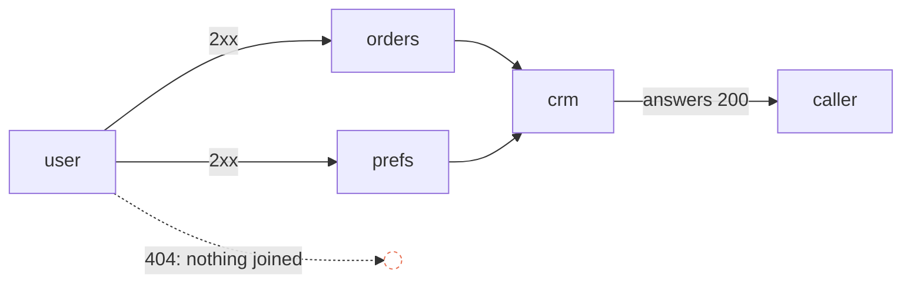

# 10. Every way ends in an answer

Assumes [file 01](01-foundations.md) for the vocabulary and request-style workflows,
[file 08 §8.8](08-recording-a-run-and-following-it-live.md#88-answering-a-waiting-caller-whose-fault-was-it)
for what a waiting caller gets when a run fails, and
[file 09 §9.4 and §9.5](09-joins-a-step-with-more-than-one-way-in.md#94-what-may-be-missing-a-may-and-must-analysis)
for the analysis that tracks what each earlier step must have answered for an edge to be
taken. §10.5 leans on [file 06 §6.5](06-describing-apis.md#65-errors-as-problem-details-rfc-9457),
problem details.

This chapter has no code of its own. Everything it computes, 09 §9.4's analysis already
computes; what's new is what to ask of it, and when.

## The problem

Take file 09's running example as a request-style workflow: a caller waits, and the
workflow answers with the record `crm` created. Its author now handles unknown users.
`user` lists a `404` response, so a run can go on from that answer instead of failing. They
mean to join it to a `404` answer for the caller, and forget.

A caller asks for user `u-404`. `user` answers `404`, which is a response the step lists,
so the run doesn't fail: it goes on from that block. Nothing leaves it. `orders` and
`prefs` needed `user`'s `2xx`, so they're skipped, and so is `crm`. Every edge got an
outcome, every step either ran or was skipped, and the run is over without an answer. The
engine has to say something to the caller who's still waiting, and all it knows is that
no answer was reached: by 08 §8.8's table, the workflow's own fault, a `500`.

Nothing failed. The definition has a road that ends nowhere, and the run walked down it.
The author could have been told the moment they saved, since nothing in that road depends
on data. Three questions follow:

- when an engine should check a definition, and how firmly (§10.1);
- how it starts checking something new without breaking workflows that are already
  published (§10.2);
- how it finds the road that ends nowhere (§10.3), and the failures nobody decided about
  (§10.4);

and one about the answer itself: what the caller gets for the errors the author did mean to
pass on (§10.5).

## 10.1 Three moments to check: editing, publishing, running

A definition meets an engine's checks at three moments, and each can afford a different
answer.

- **While it's edited**, it's half built by definition: a step was just added and isn't
  joined yet. A check here is advice. Blocking a save would stop the author keeping work
  in progress.
- **When it's published**, it's about to answer real callers. This is the gate: whatever is
  always a mistake should stop it here, with a list of what to fix.
- **When it runs**, the caller is waiting. Anything found now is found too late to fix, and
  the engine can only answer as well as it can.

AWS Step Functions draws the same line between advice and refusal. Its
[`ValidateStateMachineDefinition`](https://docs.aws.amazon.com/step-functions/latest/apireference/API_ValidateStateMachineDefinition.html)
returns diagnostics of two severities: "Since **warnings** do not prevent deploying your
workflow definition, the **result** value could be `OK` even when warning diagnostics are
present in the response", while "Any diagnostic results with `ERROR` level severity will
prevent you from deploying the state machine." File 09 §9.5 drew it the same way from the
compiler side: a join that can never run is refused, as Java refuses unreachable code, and a
dead optional edge only warned about, as `go vet` does.

The test for which side a check falls on: could anyone want this? A join that can never run
helps nobody. A step whose result nobody reads might be an audit call, on purpose. §10.3's
road that ends nowhere is the first kind when a caller is waiting, with one caveat in §10.6.

## 10.2 Tightening a check without breaking what's published

Engines gain checks over time. Say version N of an engine adds §10.3's check. Revisions
published under version N−1 never met it, and some have a road that ends nowhere. If the new
check runs where a run starts, beside the rules every run needs, then on the day N ships each
of those workflows stops answering at all, for callers who never touched them. The check was
meant to catch a mistake before it reached a caller, and it would put a new one in front of
every caller of an old revision.

Kubernetes met this with the schemas of custom resources, where a stricter schema would make
objects already stored invalid. Its answer is
[validation ratcheting](https://kubernetes.io/docs/tasks/extend-kubernetes/custom-resources/custom-resource-definitions/#validation-ratcheting),
stable since v1.33 and first available in v1.28: "The API server is willing to accept updates
to resources that are not valid after the update, provided that each part of the resource
that failed to validate was not changed by the update operation. In other words, any invalid
part of the resource that remains invalid must have already been wrong. You cannot use this
mechanism to update a valid resource so that it becomes invalid."

A workflow engine has a coarser version of the same idea for free, because a published
revision never changes: keep the checks a run makes to what a run needs to execute, and put
new rules at publishing, which only new revisions pass through. Old revisions keep
answering as they did. The next revision anyone publishes meets the new rule. A finer ratchet,
letting a revision through when each of its loose ends was already in the revision before
it, is possible, and not needed while publishing is the only way in.

The cost is a split that has to be kept honest: two lists of rules, "can this run" and "may
this be published", and every new rule placed in one of them on purpose.

## 10.3 Finding a road that ends nowhere

File 09 §9.4 gives every edge a **route**: what each earlier step must have answered for the
edge to be taken. `orders`'s edge from `user` needs `user` to have answered `2xx`; `crm`'s
edge from `orders` needs that too, through `orders`. §9.5 used routes to find contradictions:
two required edges whose routes disagree about one step can never both be taken.

Give the answers routes too. An answer joined to a step's output needs the step to have
answered that way, so its route is that output added to the step's own route: the answer
from `crm` needs `crm` to have run, which needs `user`'s `2xx`.

Now take each output of each step, a **block**: an HTTP step's `2xx` and each status it
lists, a transform's value. A run that takes a block can still answer only if some answer's
route doesn't contradict the block's. `user`'s `404` block has the route
`{user: 404}`. The only answer's route includes `{user: 2xx}`. They disagree about `user`, so
no run that takes the `404` can reach that answer, or any: the block is a **loose end**.

Not every block with nothing joined is one. Add an `audit` step after `user`'s `2xx` that
records the lookup, with nothing after it. Its block's route is `{user: 2xx, audit: 2xx}`,
and the answer's route, `{user: 2xx, …}`, doesn't disagree: one run can take both, and that
run answers. `audit` is a side branch of a road that does end in an answer, and the check
leaves it alone, which is the point of asking about routes rather than about edges.

Where to report it matters as much as finding it. Had `user`'s `404` led to a `fallback`
step, and `fallback` to nothing, every block on that branch would fail the test: `user`'s
`404` and `fallback`'s `2xx` alike. Reporting each would bury the one fix under messages.
Only a **road end**, a block no edge leaves, is reported. A block with edges onward is judged
where they lead. A block an answer is joined to answers through it, and passes.

The check is conservative in 09 §9.4's sense: **sound, not complete**. Routes ignore the data
a condition reads, so every condition is "may". A road that only a condition can cut, an edge
taken when `body.active` with the only answer behind an edge taken when `not body.active`, is
a loose end that routes can't see: the check claims nothing about it. Everything it does
claim is true, and it misses some. The ones it misses reach run time, which is why the engine
still needs a last-resort answer (§10.5).

## 10.4 Failures: a choice, not a default

The other way a run can end without the answer its author meant is a step failing: its
upstream times out, or its expression fails. Engines answer that with a default.
[Step Functions](https://docs.aws.amazon.com/step-functions/latest/dg/concepts-error-handling.html):
"When a state reports an error, Step Functions defaults to failing the **entire** state
machine execution", and catchers, which send an error on to another state, "are available
for **Task**, **Parallel** and **Map** states, but not for top-level state machine execution
failures". In [n8n](https://docs.n8n.io/flow-logic/error-handling/), "With an error workflow,
you can control how n8n responds to a workflow execution failure. … It runs if an execution
fails."

A default is a decision nobody made. Failing the run is often right: the caller gets an error
in the shape of §10.5. But the author never chose it, and a reader of the definition can't
tell "this step may fail the run" from "nobody thought about this step failing".

An engine can make it a choice instead. Each step's failures either go on, down an edge from
the step's catch block, or fail the run on purpose, a flag on the step. A step with neither is
a problem at publishing, like a loose end. A step with both is a contradiction: the edge would
never be taken. It costs the author a click per step. It buys a definition that says, for
every step, what happens when it fails.

## 10.5 One shape for every error

A caller can get an error four ways from a workflow like this one:

1. the run gives no answer: 08 §8.8's problem details, `502`, `504` or `500` by cause;
2. an answer joined straight to an error block, a status of `400` or more the step lists,
   which by default would send whatever the upstream sent;
3. an answer joined straight to a step's catch block, passing its failure on;
4. an answer whose body the author wrote: a transform's, or a catch block's own.

The first is the engine's shape; the second is the upstream's, in the upstream's words. So one
workflow's `404` and its `502` can look nothing alike, and the `404` can say more than it
should. [RFC 9457 §4](https://www.rfc-editor.org/rfc/rfc9457.html#section-4) is blunt that
"Problem details are not a debugging tool for the underlying implementation". Its security
considerations, [§5](https://www.rfc-editor.org/rfc/rfc9457.html#section-5), say the
information in a new problem type "must be carefully vetted", and encourage whoever links to
an occurrence "to avoid making implementation details such as a stack dump available through
the HTTP interface". An upstream's error body is the upstream's implementation detail:
`{"error": "user u-404 not in shard eu-3"}` tells the caller how the system is built.
[OWASP API8:2023](https://api-security.owasp.org/editions/2023/en/0xa8-security-misconfiguration)
lists "Error messages include stack traces, or expose other sensitive information" among the
signs of a misconfigured API.

The fix is to pass errors through one body. The workflow has an **error body**, written once:
an expression over the run, with the error at hand as `{code, detail, node}` and, when the
step got an answer, the upstream's `status`, `headers` and `body`. Unwritten, it's problem
details (06 §6.5). It answers 1, 2 and 3. The author picks which of the upstream's words reach
the caller, if any, in one place. The fourth answers as written, because a body the author wrote
is already a decision.

Why `400` is the line: [RFC 9110 §15](https://www.rfc-editor.org/rfc/rfc9110.html#section-15)
calls the `4xx` and `5xx` classes client and server errors. A listed `3xx` is a redirection, not
an error, so it answers with what the step got, as `2xx` does.

## 10.6 What this doesn't settle

**Roads only data can cut.** §10.3 is sound, not complete. Recognising complementary
conditions, `active` and `not active`, would catch the common case; in general a condition is
an expression in a Turing-complete language
([file 03 §3.1](03-mapping-data-between-steps.md#31-why-an-expression-not-a-code-step)), so the
gap can't close.

**Workflows that don't answer.** Everything here assumes a waiting caller, file 01's
request-style composition. A job-style workflow, or one that answers at once and works on, has
no answer for every road to reach, and §10.3 doesn't apply to it. An engine offering both has
to know which kind it's checking.

**Error, or warning?** Refusing to publish a loose end assumes nobody wants one. Someone might:
they might rely on the last-resort answer for a branch they consider impossible. Step Functions
would make it a warning and publish. Refusing is the stricter choice, and the cost is a click,
joining the branch to an answer. Which is right is a product decision, not a technical one.

**Ratcheting inside a revision.** §10.2's publish-time gate ratchets whole revisions. Kubernetes
ratchets per field, so an edit elsewhere in an old object still goes through. An engine whose
drafts are edited in place could want the finer version, and none of the engines here document
one.

## Check yourself

1. For each, say whether §10.3 reports a loose end, and where. (a) The problem's workflow.
   (b) The same, with `user`'s `404` joined to a `404` answer, and an `audit` step after
   `user`'s `2xx` with nothing after it. (c) `user`'s `404` leads to a `fallback` step that looks
   the user up elsewhere, and `fallback` leads nowhere. (d) `prefs` has two edges out, one taken
   `when: body.channel = "email"` to `crm`, and one taken `when: body.channel != "email"` to a
   step `letter` that leads nowhere.
2. An engine ships a new check in the validator every run calls before it starts. What happens
   to a revision published last month that fails it? Give two ways to ship the check without
   that happening, and say what each costs.
3. Why is a step with both an edge from its catch block and "fail the run" set a contradiction,
   and not just redundant? What would a run do with it?
4. `user`'s upstream answers `404` with `{"error": "user u-404 not in shard eu-3"}`, and `user`'s
   `404` block is joined straight to the workflow's `404` answer. What does the caller get with
   no error body written, and with the error body `{ 'error': error.code }`? What would passing
   the upstream's body straight through have told them, and which two sources warn against it?

(Answers in [12-exercises.md](12-exercises.md).)
