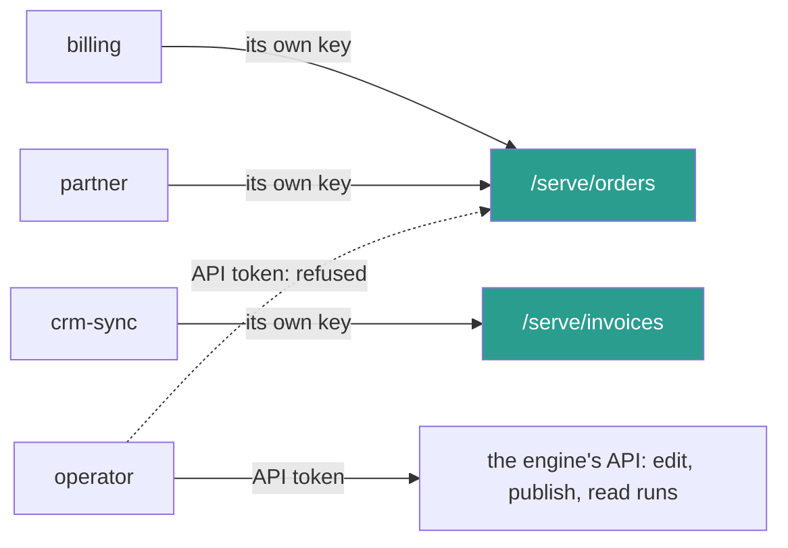

# 11. Keys for the callers of a served workflow

Assumes [file 01](01-foundations.md) for the vocabulary and request-style workflows. It picks up
the last point of [file 05 §5.12](05-calling-urls-you-dont-control.md#512-when-the-url-is-you-loops),
a credential on the served URL. [http file 09](../http/09-keeping-a-browser-signed-in.md) covers
credentials from the browser's side, where a person signs in; this chapter is about programs
calling a workflow, with nobody signing in at all. §11.6 uses
[file 06 §6.5](06-describing-apis.md#65-errors-as-problem-details-rfc-9457)'s problem details.

## The problem

An engine that serves each workflow at a URL has to decide who may call it. The first answer is
the credential already lying around: the API token that runs the engine. It works, and it fails
three ways.

- **Every caller holds a key to everything.** The token that starts a run of `orders` also edits and
  publishes every workflow, and reads every run. A partner who needs one workflow
  holds them all.
- **A leak is everyone's problem.** If one caller leaks the token, the token has to change, and
  so does the configuration of every other caller, at the same moment, whether they leaked
  anything or not.
- **No run can say who called it.** Every run came with the same token, so the record says "the
  token" and nothing more.

The fix is a key for each caller of each workflow. Most of this chapter is the detail that makes
it hold: what a key is made of (§11.2), what the server keeps of it (§11.3, §11.4), how it's
checked (§11.5, §11.6), and how it stops working (§11.7 to §11.9). §11.10 is a bug in a dialog,
worth knowing before you build one.

## 11.1 One key per caller, per workflow



Each key opens one workflow's URL and nothing else, and each is named for the caller that holds
it. What that changes:

| | One API token for everything | A key per caller, per workflow |
|---|---|---|
| What a leaked credential opens | everything the engine does | runs of one workflow |
| Who changes configuration after a leak | every caller, at once | the one caller |
| Turning one caller off | impossible without turning off all of them | revoke its key |
| What a run can say about who called | nothing | the key it came with, so the caller's name |

That's least privilege applied to callers, and it's what Stripe recommends for its own API.
Stripe's [API keys](https://docs.stripe.com/keys) page describes its all-powerful secret key
as one "that has unrestricted permissions on all Stripe APIs. Because you can't limit their
permissions, we don't recommend using secret keys for new use cases", and its restricted keys
as the alternative: "Limit the damage to your business that a fraudulent actor could cause if
they obtained your key. Create as many RAKs as you want and assign them to different parts of
your application."

The name matters more than it looks. It's the only thing in the record that says who called, so
a workflow's active keys each have a different one, and a key keeps its name when it's rotated:
the new key takes over the old one's name, because it's the same caller.

One more rule closes the circle: **the engine's API token is refused at the served URL.** If it
worked there, someone would use it there, because it's quicker than making a key, and the token
would end up in a partner's configuration. Refused, it never has to leave the person who runs
the engine.

## 11.2 What a key is made of

A key has three parts: random bits, an encoding that survives being pasted, and a prefix.

**Random bits, from a CSPRNG.** A key is a secret only if nobody can predict it, so its bits come
from a cryptographically secure pseudo-random number generator (**CSPRNG**), the operating
system's. Never a timestamp, a counter or a general-purpose generator: Go's `math/rand` says of
itself that "This package's outputs might be easily predictable regardless of how it's seeded"
([docs](https://pkg.go.dev/math/rand)). How many bits? OAuth's core specification sets the bar
for the tokens it issues ([RFC 6749 §10.10](https://www.rfc-editor.org/rfc/rfc6749.html#section-10.10)):
"The probability of an attacker guessing generated tokens (and other credentials not intended for
handling by end-users) MUST be less than or equal to 2^(-128) and SHOULD be less than or equal to
2^(-160)." 32 bytes, 256 bits, clear both by a wide margin.

**base64url, without padding.** Raw bytes can't be pasted, so they're encoded.
[RFC 4648 §5](https://www.rfc-editor.org/rfc/rfc4648.html#section-5) defines a base 64 alphabet
with `-` and `_` in place of `+` and `/`, "URL and Filename safe", called **base64url**. Its
padding, `=`, "is typically percent-encoded when used in an URI [9], but if the data length is
known implicitly, this can be avoided by skipping the padding". A key's length is fixed, so the
padding goes, and 32 bytes become 43 characters. Every one of them is allowed by RFC 6750's
grammar for a bearer credential, `b64token = 1*( ALPHA / DIGIT / "-" / "." / "_" / "~" / "+" /
"/" ) *"="` ([§2.1](https://www.rfc-editor.org/rfc/rfc6750.html#section-2.1)), so the key goes
into `Authorization: Bearer` as it is.

**A prefix.** Conduit's keys start `cnd_`. GitHub's post on its token formats,
[Behind GitHub's new authentication token formats](https://github.blog/engineering/platform-security/behind-githubs-new-authentication-token-formats/)
(2021), gives the reason. Its old tokens were "hex-encoded 40 character strings that are
indistinguishable from other encoded data like SHA hashes", which made leaked ones hard to find.
"As we see across the industry from companies like Slack and Stripe, token prefixes are a clear
way to make tokens identifiable", so each token type got a prefix, `ghp` for personal access
tokens among them, and a separator: "An underscore is not a Base64 character which helps ensure
that our tokens cannot be accidentally duplicated by randomly generated strings like SHAs." A
**key prefix** makes a key recognisable wherever it's pasted: in a log line, a chat message, a
commit. A secret scanner can match it, and so can a person who's wondering what they're looking at.

GitHub went one step further, and Conduit didn't: "A checksum virtually eliminates false
positives for secret scanning offline. We can check the token input matches the checksum and
eliminate fake tokens without having to hit our database." Theirs is "A 32 bit checksum in the
last 6 digits of each token", a CRC32 encoded in base 62. It's a checksum, not a signature:
anyone can compute it, so it proves a string is well formed, never who made it.

Here is minting, and what the server keeps (§11.3), as I ran it with Go 1.24.4:

```go
package main

import (
	"crypto/rand"
	"crypto/sha256"
	"encoding/base64"
	"fmt"
)

// prefix marks a key as this engine's wherever it's pasted.
const prefix = "cnd_"

// Stored is all the server keeps of a key.
type Stored struct {
	Shown string   // its first 8 characters, to tell keys apart in a list
	Hash  [32]byte // its SHA-256, to find it by
}

// fromBytes turns 32 random bytes into a key, and what's stored of it.
func fromBytes(b []byte) (string, Stored) {
	key := prefix + base64.RawURLEncoding.EncodeToString(b) // 43 characters, no padding
	return key, Stored{Shown: key[:8], Hash: sha256.Sum256([]byte(key))}
}

// Mint makes a new key from 256 bits of the operating system's CSPRNG.
func Mint() (string, Stored) {
	b := make([]byte, 32)
	rand.Read(b) // since Go 1.24 it never returns an error
	return fromBytes(b)
}

func show(key string, s Stored) {
	fmt.Printf("key    %s (%d characters)\nshown  %s\nsha256 %x\n\n", key, len(key), s.Shown, s.Hash)
}

func main() {
	fixed := make([]byte, 32)
	for i := range fixed {
		fixed[i] = byte(i) // 0, 1, …, 31: the same input in every language
	}
	show(fromBytes(fixed))
	show(Mint())
}
```

```
key    cnd_AAECAwQFBgcICQoLDA0ODxAREhMUFRYXGBkaGxwdHh8 (47 characters)
shown  cnd_AAEC
sha256 c7c178a90dac08e601ebea791cf649bfc10fd3437bf8b05af6aa85031f5b834b

key    cnd_IM8HookYgYXGOc4EAEZocoWudqV7KMty8E2mSXdNMaU (47 characters)
shown  cnd_IM8H
sha256 8bb573af4d10f570133b9de6acada8fe2952a05fd81601f99b6bfc4166f42804
```

The first key is from the bytes 0 to 31, so every language below prints the same three lines for
it; `shasum -a 256` gave the same hash for that key. The second is random and differs on every
run. The comment on `rand.Read` comes from the [Go 1.24 release notes](https://go.dev/doc/go1.24):
"The Read function is now guaranteed not to fail. It will always return nil as the error result.
If Read were to encounter an error while reading from Reader, the program will irrecoverably
crash." The other three languages make no such promise, so their versions check.

<details><summary>Rust</summary>

Uses `getrandom = "=0.4.3"` for the operating system's CSPRNG, `sha2 = "=0.11.0"` and
`base64 = "=0.23.1"`: Rust's standard library has neither a CSPRNG nor SHA-256. Built with
rustc 1.96 and `--edition 2024`, clean under clippy and rustfmt. It prints the same first three
lines.

```rust
use base64::{Engine as _, engine::general_purpose::URL_SAFE_NO_PAD};
use sha2::{Digest, Sha256};

/// Marks a key as this engine's wherever it's pasted.
const PREFIX: &str = "cnd_";

/// All the server keeps of a key.
struct Stored {
    shown: String,  // its first 8 characters, to tell keys apart in a list
    hash: [u8; 32], // its SHA-256, to find it by
}

/// Turns 32 random bytes into a key, and what's stored of it.
fn from_bytes(b: &[u8; 32]) -> (String, Stored) {
    let key = format!("{PREFIX}{}", URL_SAFE_NO_PAD.encode(b)); // 43 characters, no padding
    let hash: [u8; 32] = Sha256::digest(key.as_bytes()).into();
    let shown = key[..8].to_string();
    (key, Stored { shown, hash })
}

/// Makes a new key from 256 bits of the operating system's CSPRNG.
fn mint() -> Result<(String, Stored), getrandom::Error> {
    let mut b = [0u8; 32];
    getrandom::fill(&mut b)?; // unlike Go's, this can fail, so say so
    Ok(from_bytes(&b))
}

fn show((key, s): (String, Stored)) {
    let hex: String = s.hash.iter().map(|b| format!("{b:02x}")).collect();
    println!(
        "key    {key} ({} characters)\nshown  {}\nsha256 {hex}\n",
        key.len(),
        s.shown
    );
}

fn main() -> Result<(), getrandom::Error> {
    let fixed: [u8; 32] = std::array::from_fn(|i| i as u8); // 0, 1, …, 31
    show(from_bytes(&fixed));
    show(mint()?);
    Ok(())
}
```

</details>

<details><summary>C++</summary>

C++20 with OpenSSL 3.6.3 for the CSPRNG and SHA-256, built with Apple clang 17 and
`-std=c++20 -Wall -Wextra -Wpedantic`, no warnings, linked with `-lcrypto`. The standard
library's `std::random_device` "may be implemented in terms of an implementation-defined
pseudo-random number engine if a non-deterministic source (e.g. a hardware device) is not
available to the implementation"
([cppreference](https://en.cppreference.com/w/cpp/numeric/random/random_device)), so it promises
no CSPRNG, and OpenSSL it is. Its
[`RAND_bytes`](https://docs.openssl.org/3.6/man3/RAND_bytes/) page explains the choice of
`RAND_priv_bytes`: it "has the same semantics as RAND_bytes(). It is intended to be used for
generating values that should remain private", and it warns that the generator can fail, so "it
is important to always check the error return value". OpenSSL's base 64 encoder pads and uses
`+` and `/`, so the encoder is written out. It prints the same first three lines, and its
encoder matched Node's `base64url` on every length from 0 to 40 bytes.

```cpp
#include <array>
#include <cstdio>
#include <optional>
#include <string>
#include <utility>

#include <openssl/evp.h>
#include <openssl/rand.h>

// Marks a key as this engine's wherever it's pasted.
const std::string prefix = "cnd_";

// All the server keeps of a key.
struct Stored {
    std::string shown;                  // its first 8 characters, to tell keys apart in a list
    std::array<unsigned char, 32> hash; // its SHA-256, to find it by
};

// base64url without padding (RFC 4648 §5): 32 bytes become 43 characters.
std::string base64url(const unsigned char* b, size_t n) {
    static const char abc[] = "ABCDEFGHIJKLMNOPQRSTUVWXYZabcdefghijklmnopqrstuvwxyz0123456789-_";
    std::string out;
    for (size_t i = 0; i < n; i += 3) {
        unsigned v = b[i] << 16 | (i + 1 < n ? b[i + 1] << 8 : 0) | (i + 2 < n ? b[i + 2] : 0);
        size_t chars = i + 2 < n ? 4 : i + 1 < n ? 3 : 2; // the last group may be short
        for (size_t c = 0; c < chars; c++) out += abc[(v >> (18 - 6 * c)) & 63];
    }
    return out;
}

// Turns 32 random bytes into a key, and what's stored of it.
std::pair<std::string, Stored> from_bytes(const std::array<unsigned char, 32>& b) {
    std::string key = prefix + base64url(b.data(), b.size());
    Stored s{key.substr(0, 8), {}};
    EVP_Digest(key.data(), key.size(), s.hash.data(), nullptr, EVP_sha256(), nullptr);
    return {key, s};
}

// Makes a new key from 256 bits of OpenSSL's CSPRNG, which the operating system seeds.
// RAND_priv_bytes draws on a separate instance kept for values that stay private.
std::optional<std::pair<std::string, Stored>> mint() {
    std::array<unsigned char, 32> b;
    if (RAND_priv_bytes(b.data(), b.size()) != 1) return std::nullopt; // it can fail: say so
    return from_bytes(b);
}

void show(const std::pair<std::string, Stored>& m) {
    const auto& [key, s] = m;
    std::printf("key    %s (%zu characters)\nshown  %s\nsha256 ", key.c_str(), key.size(), s.shown.c_str());
    for (unsigned char c : s.hash) std::printf("%02x", c);
    std::printf("\n\n");
}

int main() {
    std::array<unsigned char, 32> fixed;
    for (size_t i = 0; i < fixed.size(); i++) fixed[i] = i; // 0, 1, …, 31
    show(from_bytes(fixed));
    auto m = mint();
    if (!m) return 1;
    show(*m);
}
```

</details>

<details><summary>JavaScript</summary>

An ES module, run with Node 24.14.1, no packages, formatted with Prettier 3.6.2. It prints the
same first three lines.

```js
import { createHash, randomBytes } from "node:crypto";

// Marks a key as this engine's wherever it's pasted.
const prefix = "cnd_";

// Turns 32 random bytes into a key, and all the server keeps of it.
function fromBytes(b) {
  const key = prefix + b.toString("base64url"); // 43 characters, no padding
  return {
    key,
    stored: {
      shown: key.slice(0, 8), // its first 8 characters, to tell keys apart in a list
      hash: createHash("sha256").update(key).digest(), // its SHA-256, to find it by
    },
  };
}

// Makes a new key from 256 bits of the operating system's CSPRNG.
// randomBytes throws if it can't get them.
function mint() {
  return fromBytes(randomBytes(32));
}

function show({ key, stored }) {
  console.log(
    `key    ${key} (${key.length} characters)\nshown  ${stored.shown}\nsha256 ${stored.hash.toString("hex")}\n`,
  );
}

show(fromBytes(Buffer.from(Array.from({ length: 32 }, (_, i) => i)))); // 0, 1, …, 31
show(mint());
```

</details>

**The alphabet has a cost.** GitHub's random part is letters and digits only, 62 symbols (its post
works out the entropy of 30 of them as 178 bits), and the post gives a reason beyond scanning: "One other neat thing about _ is it will reliably select the
whole token when you double click on it. Other characters we considered are sometimes included in
application word separators and thus will stop highlighting at that character. Try out double
clicking this-random-text versus this_random_text!" base64url puts `-` in the random part. I
minted 100,000 keys with the code above and counted:

```go
package main

import (
	"crypto/rand"
	"encoding/base64"
	"fmt"
	"strings"
)

// How many keys hold a '-', and which characters can end one?
func main() {
	n, dash, last := 100_000, 0, map[byte]bool{}
	for range n {
		b := make([]byte, 32)
		rand.Read(b)
		key := "cnd_" + base64.RawURLEncoding.EncodeToString(b)
		if strings.Contains(key, "-") {
			dash++
		}
		last[key[len(key)-1]] = true
	}
	fmt.Printf("%d of %d keys hold a '-'; %d different last characters\n", dash, n, len(last))
}
```

```
48461 of 100000 keys hold a '-'; 16 different last characters
```

The count moves by a few hundred from run to run (a second run gave 48,388), and the arithmetic
agrees with it. 32 bytes are 256 bits, and 43 characters of 6 bits hold 258, so the last
character carries 4 bits and two zeros: it's one of 16, never `-`. The other 42 each avoid `-` with
probability 63/64, so 1 − (63/64)^42 ≈ 48.4% of keys hold one: roughly half of all keys hold a
character that, by GitHub's account, can stop a double-click selection. A Copy button and
select-on-focus cover the engine's own UI; a key in a terminal or an editor is at the mercy of its
word boundaries. Base 62 would avoid it at no cost in length,
since 43 characters of base 62 hold 43 × log₂ 62 ≈ 256.03 bits. Its cost is code. Base 62
isn't an RFC 4648 encoding, so most standard libraries don't have it (Go's `math/big` can write a
number in base 62 with `Int.Text`, one of the few), and a hand-written one either draws each
character from the CSPRNG on its own, throwing away bytes of 248 and above so that every one of
the 62 symbols is equally likely, or converts the 32 bytes as one big number. Which matters more,
a standard encoding in every library or a key that selects whole, is a judgement call. Conduit
took the first, then moved to the second once these dashes were counted: its keys are now the 32
bytes as one number in base 62, `new(big.Int).SetBytes(b).Text(62)`, padded with zeros to 43
characters. Keys made before still work, since the server only ever hashes what it's sent.

## 11.3 Shown once, kept as a hash

The server keeps two things of a key: its SHA-256, and its first 8 characters. It never keeps the
key. The key exists in clear in exactly two places: the response that made it, and wherever the
caller put it after that.

That's the rule on Stripe's page too. Making a key ends with "Save the key value. You can't
retrieve it later", and "When you create a secret key in live mode, Stripe displays it one time
before you save it. Copy the key before you save it because you can't reveal it later." A lost key
isn't recovered; it's replaced: "If you lose a key, rotate or delete it and create another."

The reason is what the table is worth to someone who copies it. A table of keys is the most
valuable thing in the database, since every row is a working credential: a backup, a SQL
injection or a logged query hands over every caller at once. A table of hashes serves nothing,
because the server hashes whatever it's sent, and nobody can send a key they don't have. §11.4 is
why that holds for a fast hash.

The first 8 characters are there because people have to tell keys apart. A list that says
"billing, `cnd_AAEC…`, active" lets an operator match the row to the key a caller says they hold.
Those 8 are the prefix and 4 random characters, 24 of the key's 256 bits, which leaves 232
unknown: still far past RFC 6749's bound, and Check yourself 1 works out how much more could
safely be shown.

## 11.4 Why a fast hash is enough

Everything written about storing passwords says not to use a hash like SHA-256, and it's right.
OWASP's [Password Storage Cheat Sheet](https://cheatsheetseries.owasp.org/cheatsheets/Password_Storage_Cheat_Sheet.html)
puts it in its first paragraphs: "Fast hashing algorithms such as SHA-256 are not suitable for
password storage because they allow attackers to perform large numbers of guesses quickly. Using
slow, memory-hard algorithms makes brute-force attacks significantly more difficult, expensive,
and time-consuming." The reason is in that sentence: guesses. A slow hash defends against an
attacker who has the table and tries candidates against it, and it works only if the candidates
are few enough that making each one dearer matters.

For passwords they are. The sheet lists where an attacker's candidates come from: "Lists of
passwords obtained from other compromised sites", "Brute force (trying every possible candidate)"
and "Dictionaries or wordlists of common passwords". People choose passwords, so a list of what
people choose finds many of them, and a work factor "makes calculating the hash more
computationally expensive, which in turn reduces the speed and/or increases the cost for which an
attacker can attempt to crack the password hash."

A key from a CSPRNG has no list to start from. Every one of its 2^256 values is equally likely,
so the attacker's best strategy is to try values at random. Put numbers on it, with an assumed
rate, not a measurement, far beyond any hardware: someone holds a table of a million keys' hashes
and computes 10^18 SHA-256 hashes a second. Each guess matches some key with probability
10^6 / 2^256, so they need about 2^256 / 10^6 ≈ 1.2 × 10^71 guesses on average: about
3.7 × 10^45 years. A work factor of a million would multiply that by a million. It changes nothing
about the answer, and it costs the server a slow hash on every request.

| | A password | A key of 256 random bits |
|---|---|---|
| Who chose it | a person | a CSPRNG |
| Where an attacker with the table starts | lists of likely passwords | nowhere: all 2^256 values are equally likely |
| What a slow hash buys | each guess from a short list costs more | nothing that matters |
| What a salt buys | no precomputed tables, no two users sharing a hash | nothing: keys don't repeat, and nobody can precompute 2^256 hashes |
| What the server does per request | finds the row, then runs a slow hash | one SHA-256 and an index lookup |

NIST draws the same line for random secrets, in its rules for look-up secrets, the random codes a
verifier issues, such as recovery codes
([SP 800-63B-4 §3.1.2.2](https://pages.nist.gov/800-63-4/sp800-63b.html#lookupver)): "All look-up
secrets SHALL be stored in a hashed form using an approved hashing function", and only "Look-up
secrets that are shorter than the minimum security strength specified in the latest revision of
[SP800-131A] (i.e., 112 bits as of the date of this publication) SHALL be stored in a salted and
hashed form using a suitable password hashing scheme". At 256 bits a key is far past that line.

A fast hash also keeps the lookup simple. An unsalted hash is the same every time, so it can be a
unique index: hash what arrives, find the row. A salted, slow hash can't be looked up, so the key
would have to carry an id to find its row before the slow check could run. And the work factor
becomes a weapon: OWASP warns that if it's too high, "the performance of the application may be
degraded, which could be used by an attacker to carry out a denial of service attack by exhausting
the server's CPU with a large number of login attempts." On a served workflow every request is a
login.

**What's unsettled.** No source says this about API keys in so many words. OWASP's sheet
"advises you on the proper methods for storing passwords for authentication" and doesn't mention
keys either way; NIST's rule is for look-up secrets, and applying it here is an analogy, though a
close one: what decides the hash is who chose the secret and how many bits it has. One step
further is a keyed hash, OWASP's **pepper**, which "prevents an attacker from being able to crack
any of the hashes if they only have access to the database". With 256 random bits there's nothing
to crack, so a pepper adds a second secret to keep for no gain against guessing, and a pepper
can't be changed cheaply: OWASP notes that "Peppers cannot be changed without knowledge of a
user's password", and the server never knows a key after it has shown it, so a leaked pepper
would mean issuing every caller a new key.

> **Teacher's aside.** People reach for bcrypt because "it's the secure one". But a slow hash
> doesn't make a secret harder to guess; it makes each guess dearer, which helps only when
> guesses are few. A key's strength is decided once, when it's minted, by how many bits come from
> the CSPRNG. Spend the bits there, and all the hash has to be is one-way: OWASP's "hashing is a
> one-way function", so the table gives back nothing.

## 11.5 Finding a key, and what timing tells

The check is one lookup: hash what was sent, and find a key with that hash, belonging to the
workflow the URL names, not revoked and not past its expiry. Every reason to refuse ends in the
same "not found". Before that, anything without the prefix is refused without asking the database
at all, which is also how the engine's own API token is turned away: it isn't a key. That refusal
is quicker than a lookup, and it can afford to be: it tells the sender only whether what they sent
starts with `cnd_`, which they know already.

The server never compares the secret itself with anything, and that matters. An ordinary
comparison, `==` on two strings, stops as soon as it finds a difference, so a guess whose first
bytes are right takes a little longer to refuse. Someone who can time enough requests can find the
first byte from 256 candidates, then the second, and walk to the secret a byte at a time, instead
of searching the whole space. It's why Go's [`subtle.ConstantTimeCompare`](https://pkg.go.dev/crypto/subtle#ConstantTimeCompare)
exists: "The time taken is a function of the length of the slices and is independent of the
contents. If the lengths of x and y do not match it returns 0 immediately."

With hash-then-lookup, the comparisons the database makes are between the hash of the guess and
the stored hashes. The attacker chooses the guess, not its hash. A guess one byte closer to a real
key has a hash no closer to that key's hash, so there's no gradient to walk. The most timing could
leak is how many leading bytes of some stored hash a guess's hash matched: information about
hashes, which §11.4 showed are as useless as the stolen table.

The engine's API token is the other case: a single secret, held in memory, checked against each
request that carries it. There, a direct comparison would be the early-exit kind, so Conduit
hashes both sides and compares the two digests with `ConstantTimeCompare`. The hashing isn't
there for storage. It makes both sides 32 bytes, so that the early return on different lengths
can't tell anyone how long the token is.

## 11.6 One answer for every refused key

Picture someone with a key that worked last month, or a list of guessed workflow names. If a
revoked key gets "this key was revoked", an expired one "this key expired", and a name with no
workflow behind it a 404, every answer teaches them something: that the old key was real, which
workflows exist, which keys to try next. Learning what exists from how a system's answers differ
is **enumeration**. MITRE catalogues the cause as
[CWE-204, Observable Response Discrepancy](https://cwe.mitre.org/data/definitions/204.html): "The
product provides different responses to incoming requests in a way that reveals internal state
information to an unauthorized actor outside of the intended control sphere."

OWASP's [Authentication Cheat Sheet](https://cheatsheetseries.owasp.org/cheatsheets/Authentication_Cheat_Sheet.html)
gives the rule for sign-in: "An application should respond (both HTTP and HTML) in a generic
manner", "with a generic error message regardless of whether: The user ID or password was
incorrect. The account does not exist. The account is locked or disabled." It's explicit that the
status code counts as part of the answer: "Even though a generic error page is shown to a user,
the HTTP response code may differ which can leak information about whether the account is valid
or not."

For a served workflow, the refusals are these, and each gets the same 401:

- a key of another workflow;
- a revoked key, or an expired one;
- a URL that names no workflow at all;
- the engine's API token.

The status comes from [RFC 6750](https://www.rfc-editor.org/rfc/rfc6750.html), which defines how
bearer tokens are sent and refused. §3: "If the protected resource request does not include
authentication credentials or does not contain an access token that enables access to the
protected resource, the resource server MUST include the HTTP "WWW-Authenticate" response header
field". Its error code for a bad token already folds the cases together: `invalid_token`, "The
access token provided is expired, revoked, malformed, or invalid for other reasons. The resource
SHOULD respond with the HTTP 401 (Unauthorized) status code."

Two more sentences, in §3 and §3.1, split the answer in a way that leaks nothing. When the request "included
an access token and failed authentication, the resource server SHOULD include the "error"
attribute", and when it "lacks any authentication information", the server "SHOULD NOT include an
error code or other error information". That distinguishes a request that sent a key from one that
sent none, which the caller knows already. Conduit first sent the same challenge in both cases,
without the `error` attribute: a departure from a SHOULD that cost nothing to fix, and it now sends
it. Here's the check, run with Go 1.24.4 against `httptest`:

```go
package main

import (
	"bytes"
	"crypto/rand"
	"crypto/sha256"
	"encoding/base64"
	"fmt"
	"net/http"
	"net/http/httptest"
	"net/http/httputil"
	"strings"
	"time"
)

// record is what the server keeps of a key: whose it is, and its state.
type record struct {
	Workflow             string
	ExpiresAt, RevokedAt *time.Time
}

func (k record) works(t time.Time) bool {
	return (k.RevokedAt == nil || t.Before(*k.RevokedAt)) && (k.ExpiresAt == nil || t.Before(*k.ExpiresAt))
}

type server struct {
	keys map[[32]byte]record // by SHA-256: the table holds no key
	now  func() time.Time
}

// letIn hashes what it's sent and looks the hash up. Every reason to refuse
// ends in the same false.
func (s *server) letIn(slug, header string) bool {
	scheme, key, _ := strings.Cut(header, " ")
	if !strings.EqualFold(scheme, "Bearer") || !strings.HasPrefix(key, "cnd_") {
		return false // no key at all, or the engine's own API token
	}
	k, ok := s.keys[sha256.Sum256([]byte(key))]
	return ok && k.Workflow == slug && k.works(s.now())
}

func (s *server) ServeHTTP(w http.ResponseWriter, r *http.Request) {
	slug := strings.TrimPrefix(r.URL.Path, "/serve/")
	header := r.Header.Get("Authorization")
	if !s.letIn(slug, header) {
		challenge := `Bearer realm="serve"`
		if header != "" { // it sent a credential, so say it failed (RFC 6750 §3)
			challenge += `, error="invalid_token"`
		}
		w.Header().Set("WWW-Authenticate", challenge)
		w.Header().Set("Content-Type", "application/problem+json")
		w.WriteHeader(http.StatusUnauthorized)
		fmt.Fprint(w, `{"status":401,"title":"Unauthorized","detail":"Send a key of this workflow that works, as Authorization: Bearer <key>."}`)
		return
	}
	fmt.Fprintf(w, "a run of %s starts\n", slug)
}

func mint() string {
	b := make([]byte, 32)
	rand.Read(b)
	return "cnd_" + base64.RawURLEncoding.EncodeToString(b)
}

func main() {
	now := time.Date(2026, 11, 5, 12, 0, 0, 0, time.UTC)
	before := now.Add(-time.Hour)
	s := &server{keys: map[[32]byte]record{}, now: func() time.Time { return now }}
	add := func(r record) string {
		key := mint()
		s.keys[sha256.Sum256([]byte(key))] = r
		return key
	}
	active := add(record{Workflow: "orders"})
	revoked := add(record{Workflow: "orders", RevokedAt: &before})
	expired := add(record{Workflow: "orders", ExpiresAt: &before})
	other := add(record{Workflow: "invoices"})

	var first []byte
	for _, c := range []struct{ what, path, auth string }{
		{"an active key of orders", "/serve/orders", "Bearer " + active},
		{"a key of invoices", "/serve/orders", "Bearer " + other},
		{"a revoked key", "/serve/orders", "Bearer " + revoked},
		{"an expired key", "/serve/orders", "Bearer " + expired},
		{"a workflow that isn't there", "/serve/nothing", "Bearer " + active},
		{"the engine's API token", "/serve/orders", "Bearer some-api-token"},
		{"no Authorization at all", "/serve/orders", ""},
	} {
		req := httptest.NewRequest(http.MethodPost, c.path, nil)
		if c.auth != "" {
			req.Header.Set("Authorization", c.auth)
		}
		rec := httptest.NewRecorder()
		s.ServeHTTP(rec, req)
		dump, _ := httputil.DumpResponse(rec.Result(), true)
		verdict := strings.TrimSpace(rec.Body.String())
		switch {
		case rec.Code != http.StatusUnauthorized:
		case c.auth == "":
			verdict = rec.Header().Get("WWW-Authenticate")
		case first == nil:
			first = dump
			fallthrough
		default:
			verdict = fmt.Sprintf("the same bytes as the first: %v", bytes.Equal(dump, first))
		}
		fmt.Printf("%-28s %d  %s\n", c.what, rec.Code, verdict)
	}
	fmt.Printf("\nThe first, in full:\n%s\n", first)
}
```

```
an active key of orders      200  a run of orders starts
a key of invoices            401  the same bytes as the first: true
a revoked key                401  the same bytes as the first: true
an expired key               401  the same bytes as the first: true
a workflow that isn't there  401  the same bytes as the first: true
the engine's API token       401  the same bytes as the first: true
no Authorization at all      401  Bearer realm="serve"

The first, in full:
HTTP/1.1 401 Unauthorized
Connection: close
Content-Type: application/problem+json
Www-Authenticate: Bearer realm="serve", error="invalid_token"

{"status":401,"title":"Unauthorized","detail":"Send a key of this workflow that works, as Authorization: Bearer <key>."}
```

Notice what `letIn` doesn't ask: whether the workflow exists. A key belongs to one workflow, so
"a key of this workflow" is false alike for a workflow that has other keys and for one that isn't
there, and the check never forms the question whose answer would differ.

**Where the sources pull apart.** RFC 6750 has a third code, `insufficient_scope`: "The request
requires higher privileges than provided by the access token. The resource server SHOULD respond
with the HTTP 403 (Forbidden) status code". A key of another workflow could be read that way,
and a 403 would confirm that the key is real. Stripe, on the same page as its key advice, answers
expired keys apart: "If a request doesn't include a valid key, Stripe returns an invalid request
error. If a request includes an expired key, Stripe returns an authentication error."

| Design | A caller who forgot to switch keys learns | Someone holding a leaked old key learns |
|---|---|---|
| One 401 for every refused key | this key doesn't work here | the same, and nothing more |
| Expired keys answered apart, as Stripe does | the key expired: rotate | that the key was once real |
| A 403 for a key of another workflow, by `insufficient_scope` | the key is for something else | that the key is real, and works somewhere |

Stripe's choice isn't careless; it's OWASP's own caveat taken the other way: "The problem with
returning a generic error message for the user is a User Experience (UX) matter." With a single
401, a caller who wants to know why has to ask whoever runs the engine, who sees each key's state in
the list (§11.8), behind the engine's own sign-in. The detail exists; it just isn't handed to
anyone who sends a request.

## 11.7 Rotating with an overlap

Rotating means giving a caller a new key and ending the old one. The question is when the old one
ends, and the answer comes from the caller's side. A caller can't change its configuration
atomically. It might run several servers, roll a deploy across them over twenty minutes, or read
the key from a secret store that caches it. If the old key stops the moment the new one exists,
every request between that moment and the end of the caller's deploy fails.

So a rotation gives the old key an expiry, chosen then, and both keys work until it passes. That's
the **grace period**, or rotation overlap. Stripe's: "When you rotate a key in the Dashboard, both
the old and new keys work for up to 7 days. This lets you migrate gradually without downtime." Its
dialog offers a time or **Now**: "If you choose **Now**, the old key is deleted." Conduit offers
now, an hour, a day or 7 days.

```
                 10:00 rotate, 1 h overlap                 11:00
old key   ━━━━━━━━━━━━━┳━━━━━━━━━━━━━━━━━━━━━━━━━━━━━━━━━━━┫ expired: refused
new key                ┣━━━━━━━━━━━━━━━━━━━━━━━━━━━━━━━━━━━━━━━━━━━━━━━━━━━━━━━━
caller    sends old ───┴── deploy rolls: some servers old, some new ──┴── all new
```

Which expiry to pick depends on why you're rotating:

| Why | Old key's expiry | Because |
|---|---|---|
| It leaked, or may have | now | every minute of overlap is a minute the leaked key works for whoever has it; the caller's failed requests until it deploys are the price |
| Routine: a schedule, or someone who saw it left | longer than the caller's slowest deploy: an hour to 7 days | nobody else holds the key, so the overlap costs nothing |

Stripe's own list of when to rotate has both kinds: "If a secret or restricted API key is
compromised, and you need to revoke it to block any potentially malicious API requests that might
use the key", "If a team member with access to the key leaves your organization or changes roles",
and "If your policy requires rotating keys at certain intervals." It also says how to know the
overlap was long enough: "Before the old key expires, check its request logs, and expire it only
after its request volume has been at zero for a few hours or days." §11.9 is where that number
comes from.

Only an active key is rotated. Rotating a key that's already expiring would make a third key while
two still work, and leave nobody sure which the caller moved to. One working successor per key
keeps each caller's keys a line, not a tree.

A key's state at a time is a function of two timestamps, set by rotating and by revoking, and needs
no library. As I ran it with Go 1.24.4:

```go
package main

import (
	"errors"
	"fmt"
	"time"
)

// Key is a caller key as the server keeps it. Nothing is ever deleted:
// rotating sets ExpiresAt, revoking sets RevokedAt.
type Key struct {
	Name      string
	ExpiresAt *time.Time // set when it's rotated: it works until then
	RevokedAt *time.Time // set when it's revoked: it works no more
}

type State string

const (
	Active   State = "active"   // works, and is the one to rotate
	Expiring State = "expiring" // rotated, and works until its expiry
	Expired  State = "expired"  // rotated, and past its expiry
	Revoked  State = "revoked"  // stopped by hand
)

// StateAt is k's state at t. Revoking beats an expiry still to come.
func (k Key) StateAt(t time.Time) State {
	switch {
	case k.RevokedAt != nil && !t.Before(*k.RevokedAt):
		return Revoked
	case k.ExpiresAt == nil:
		return Active
	case t.Before(*k.ExpiresAt):
		return Expiring
	default:
		return Expired
	}
}

// Works says whether a request with k at t is let in.
func (k Key) Works(t time.Time) bool {
	s := k.StateAt(t)
	return s == Active || s == Expiring
}

var ErrNotActive = errors.New("only an active key is rotated")

// Rotate gives k's caller a new key, and k an expiry grace from now.
// A grace of 0 stops k at once.
func Rotate(k *Key, now time.Time, grace time.Duration) (Key, error) {
	if k.StateAt(now) != Active {
		return Key{}, ErrNotActive
	}
	until := now.Add(grace)
	k.ExpiresAt = &until
	return Key{Name: k.Name}, nil
}

// Revoke stops k at once. A key already stopped stays as it is.
func Revoke(k *Key, now time.Time) {
	if k.Works(now) {
		k.RevokedAt = &now
	}
}

func main() {
	day := time.Date(2026, 11, 5, 0, 0, 0, 0, time.UTC)
	at := func(h, m int) time.Time { return day.Add(time.Duration(h*60+m) * time.Minute) }
	keys := []*Key{{Name: "billing"}} // k1, made at 09:00

	row := func(t time.Time) {
		fmt.Print(t.Format("15:04"))
		for _, k := range keys {
			fmt.Printf("  %-8s %-5v", k.StateAt(t), k.Works(t))
		}
		fmt.Println()
	}
	fmt.Println("       k1              k2              k3")
	row(at(9, 0))
	k2, _ := Rotate(keys[0], at(10, 0), time.Hour) // routine: an hour of overlap
	keys = append(keys, &k2)
	row(at(10, 30))
	_, err := Rotate(keys[0], at(10, 30), time.Hour)
	fmt.Println("       rotate k1 again:", err)
	row(at(11, 0))
	k3, _ := Rotate(keys[1], at(12, 0), 0) // k2 leaked: it stops now
	keys = append(keys, &k3)
	row(at(12, 0))
	Revoke(keys[2], at(13, 0)) // its caller is gone
	row(at(13, 0))
}
```

```
       k1              k2              k3
09:00  active   true
10:30  expiring true   active   true
       rotate k1 again: only an active key is rotated
11:00  expired  false  active   true
12:00  expired  false  expired  false  active   true
13:00  expired  false  expired  false  revoked  false
```

Read it as one caller's day. The routine rotation at 10:00 leaves both keys working until 11:00.
The leak at 12:00 is a rotation with no overlap, so `k2` is expired the instant `k3` exists. At
13:00 the caller is gone and its key revoked. Each state is computed when it's asked for, from the
two timestamps, which is how a database query can do it too: no job has to run at 11:00 to expire
anything. The other three languages print the same table.

<details><summary>Rust</summary>

Standard library only, built with rustc 1.96 and `--edition 2024`, clean under clippy and
rustfmt.

```rust
use std::fmt;
use std::time::{Duration, SystemTime, UNIX_EPOCH};

/// A caller key as the server keeps it. Nothing is ever deleted:
/// rotating sets `expires_at`, revoking sets `revoked_at`.
#[derive(Default)]
struct Key {
    name: String,
    expires_at: Option<SystemTime>, // set when it's rotated: it works until then
    revoked_at: Option<SystemTime>, // set when it's revoked: it works no more
}

#[derive(PartialEq, Debug)]
enum State {
    Active,   // works, and is the one to rotate
    Expiring, // rotated, and works until its expiry
    Expired,  // rotated, and past its expiry
    Revoked,  // stopped by hand
}

impl fmt::Display for State {
    fn fmt(&self, f: &mut fmt::Formatter) -> fmt::Result {
        f.pad(&format!("{self:?}").to_lowercase()) // pad, so {:<8} lines up
    }
}

impl Key {
    /// The key's state at `t`. Revoking beats an expiry still to come.
    fn state_at(&self, t: SystemTime) -> State {
        match (self.revoked_at, self.expires_at) {
            (Some(r), _) if t >= r => State::Revoked,
            (_, None) => State::Active,
            (_, Some(e)) if t < e => State::Expiring,
            _ => State::Expired,
        }
    }

    /// Whether a request with the key at `t` is let in.
    fn works(&self, t: SystemTime) -> bool {
        matches!(self.state_at(t), State::Active | State::Expiring)
    }
}

/// Gives `k`'s caller a new key, and `k` an expiry `grace` from now.
/// A grace of zero stops `k` at once.
fn rotate(k: &mut Key, now: SystemTime, grace: Duration) -> Result<Key, &'static str> {
    if k.state_at(now) != State::Active {
        return Err("only an active key is rotated");
    }
    k.expires_at = Some(now + grace);
    Ok(Key {
        name: k.name.clone(),
        ..Key::default()
    })
}

/// Stops `k` at once. A key already stopped stays as it is.
fn revoke(k: &mut Key, now: SystemTime) {
    if k.works(now) {
        k.revoked_at = Some(now);
    }
}

fn main() {
    let day = UNIX_EPOCH + Duration::from_secs(1_793_836_800); // 2026-11-05 00:00 UTC
    let at = |h: u64, m: u64| day + Duration::from_secs((h * 60 + m) * 60);
    let row = |keys: &[Key], t: SystemTime| {
        let mins = t.duration_since(day).unwrap().as_secs() / 60;
        print!("{:02}:{:02}", mins / 60, mins % 60);
        for k in keys {
            print!("  {:<8} {:<5}", k.state_at(t), k.works(t));
        }
        println!();
    };

    // k1, made at 09:00
    let mut keys = vec![Key {
        name: "billing".into(),
        ..Key::default()
    }];
    println!("       k1              k2              k3");
    row(&keys, at(9, 0));
    let k2 = rotate(&mut keys[0], at(10, 0), Duration::from_secs(3600)).unwrap(); // routine
    keys.push(k2);
    row(&keys, at(10, 30));
    let again = rotate(&mut keys[0], at(10, 30), Duration::from_secs(3600));
    println!("       rotate k1 again: {}", again.err().unwrap());
    row(&keys, at(11, 0));
    let k3 = rotate(&mut keys[1], at(12, 0), Duration::ZERO).unwrap(); // k2 leaked
    keys.push(k3);
    row(&keys, at(12, 0));
    revoke(&mut keys[2], at(13, 0)); // its caller is gone
    row(&keys, at(13, 0));
}
```

`Display` calls `f.pad` rather than `write!`, because only `pad` honours the `{:<8}` width; a
plain `write!` would print the state unpadded and break the columns.

</details>

<details><summary>C++</summary>

C++20 and the standard library only, built with Apple clang 17 and
`-std=c++20 -Wall -Wextra -Wpedantic`, no warnings. `sys_days{2026y / November / 5}` is C++20's
calendar.

```cpp
#include <chrono>
#include <cstdio>
#include <optional>
#include <string>
#include <vector>

using namespace std::chrono;
using Time = sys_seconds;

// A caller key as the server keeps it. Nothing is ever deleted:
// rotating sets expires_at, revoking sets revoked_at.
struct Key {
    std::string name;
    std::optional<Time> expires_at; // set when it's rotated: it works until then
    std::optional<Time> revoked_at; // set when it's revoked: it works no more
};

enum class State { active, expiring, expired, revoked };
const char* names[] = {"active", "expiring", "expired", "revoked"};

// The key's state at t. Revoking beats an expiry still to come.
State state_at(const Key& k, Time t) {
    if (k.revoked_at && t >= *k.revoked_at) return State::revoked;
    if (!k.expires_at) return State::active;
    return t < *k.expires_at ? State::expiring : State::expired;
}

// Whether a request with the key at t is let in.
bool works(const Key& k, Time t) {
    State s = state_at(k, t);
    return s == State::active || s == State::expiring;
}

// Gives k's caller a new key, and k an expiry grace from now; a grace of
// zero stops k at once. Only an active key is rotated.
std::optional<Key> rotate(Key& k, Time now, seconds grace) {
    if (state_at(k, now) != State::active) return std::nullopt;
    k.expires_at = now + grace;
    return Key{k.name, {}, {}};
}

// Stops k at once. A key already stopped stays as it is.
void revoke(Key& k, Time now) {
    if (works(k, now)) k.revoked_at = now;
}

int main() {
    const Time day = sys_days{2026y / November / 5};
    auto at = [&](int h, int m) { return day + hours{h} + minutes{m}; };
    std::vector<Key> keys{{"billing", {}, {}}}; // k1, made at 09:00
    auto row = [&](Time t) {
        auto m = duration_cast<minutes>(t - day).count();
        std::printf("%02lld:%02lld", (long long)m / 60, (long long)m % 60);
        for (const Key& k : keys)
            std::printf("  %-8s %-5s", names[int(state_at(k, t))], works(k, t) ? "true" : "false");
        std::printf("\n");
    };

    std::printf("       k1              k2              k3\n");
    row(at(9, 0));
    keys.push_back(*rotate(keys[0], at(10, 0), hours{1})); // routine: an hour of overlap
    row(at(10, 30));
    if (!rotate(keys[0], at(10, 30), hours{1}))
        std::printf("       rotate k1 again: only an active key is rotated\n");
    row(at(11, 0));
    keys.push_back(*rotate(keys[1], at(12, 0), seconds{0})); // k2 leaked: it stops now
    row(at(12, 0));
    revoke(keys[2], at(13, 0)); // its caller is gone
    row(at(13, 0));
}
```

</details>

<details><summary>JavaScript</summary>

An ES module, run with Node 24.14.1, no packages, formatted with Prettier 3.6.2. `Date`s compare
with `<` and `>=` by their numeric value.

```js
// A caller key as the server keeps it. Nothing is ever deleted: rotating
// sets expiresAt, revoking sets revokedAt. Times are Dates.
const key = (name) => ({ name, expiresAt: null, revokedAt: null });

// The key's state at t. Revoking beats an expiry still to come.
function stateAt(k, t) {
  if (k.revokedAt && t >= k.revokedAt) return "revoked";
  if (!k.expiresAt) return "active"; // works, and is the one to rotate
  return t < k.expiresAt ? "expiring" : "expired";
}

// Whether a request with the key at t is let in.
const works = (k, t) => ["active", "expiring"].includes(stateAt(k, t));

// Gives k's caller a new key, and k an expiry graceMs from now; a grace of
// 0 stops k at once.
function rotate(k, now, graceMs) {
  if (stateAt(k, now) !== "active")
    throw new Error("only an active key is rotated");
  k.expiresAt = new Date(now.getTime() + graceMs);
  return key(k.name);
}

// Stops k at once. A key already stopped stays as it is.
function revoke(k, now) {
  if (works(k, now)) k.revokedAt = now;
}

const at = (h, m) => new Date(Date.UTC(2026, 10, 5, h, m)); // months count from 0
const hour = 60 * 60 * 1000;
const keys = [key("billing")]; // k1, made at 09:00
function row(t) {
  const hhmm = t.toISOString().slice(11, 16);
  const cells = keys.map(
    (k) => `  ${stateAt(k, t).padEnd(8)} ${String(works(k, t)).padEnd(5)}`,
  );
  console.log(hhmm + cells.join(""));
}

console.log("       k1              k2              k3");
row(at(9, 0));
keys.push(rotate(keys[0], at(10, 0), hour)); // routine: an hour of overlap
row(at(10, 30));
try {
  rotate(keys[0], at(10, 30), hour);
} catch (err) {
  console.log("       rotate k1 again:", err.message);
}
row(at(11, 0));
keys.push(rotate(keys[1], at(12, 0), 0)); // k2 leaked: it stops now
row(at(12, 0));
revoke(keys[2], at(13, 0)); // its caller is gone
row(at(13, 0));
```

</details>

## 11.8 Revoke, never delete

Stopping a key by hand is **revocation**: the key stops working at once, and its record stays.
Expiry stops it at a time chosen in advance. Neither deletes anything.

| State | How a key gets there | Works | Can be rotated | Listed |
|---|---|---|---|---|
| active | made, or made by a rotation | yes | yes | with the working keys |
| expiring | rotated, its expiry still ahead | yes | no | with the working keys, and when it stops |
| expired | rotated, its expiry passed | no | no | with the stopped keys |
| revoked | revoked by hand | no | no | with the stopped keys |

Revoking an expiring key stops it early. Revoking one already stopped changes nothing, so an
expired key stays expired and its record keeps saying it stopped on schedule.

Two things need the record. The first is audit: who could call this workflow last March, and when
did they stop? A deleted key answers neither. The second is the runs. Each run of a served workflow
records the key it came with, and in Conduit that's a database foreign key from the run to the key,
on two columns, the key and the workflow, so the reference also pins a run's key to the run's own
workflow. The database itself refuses a run of `orders` that claims a key of `invoices`, which a bug
in the serving path could otherwise write. A deleted key would leave those runs pointing at
nothing, or force the reference to be dropped, and then no run could say who called it, which was
the third problem this chapter started with.

Stripe's **Now** deletes the old key. That's simpler, and it's the choice an engine that records
callers in its runs can't make.

## 11.9 A key's last use is its latest run

Before revoking a key, or letting an overlap end, you want to know whether anyone still sends it:
Stripe's advice to expire a key "only after its request volume has been at zero for a few hours or
days". The obvious way is a `last_used_at` column, written on every request. That puts a write on
the path of every call, and every call with the same key updates the same row.

An engine that records its runs has the answer already. A served run records the key it came with,
so a key's last use is its latest run's start: the most recent `started_at` among its runs, which
an index on the run's key and start time finds without a scan. Nothing extra is written.

Two consequences, both fine once you know them. A refused request isn't a use, because it made no
run, which is right: a key that was refused wasn't used. And the answer lives only as long as the
runs do: if run records are pruned after 30 days, a key last used 40 days ago looks never used.

## 11.10 A dialog that shows a key once

A key shown once has to be shown somewhere, usually a dialog with a Copy button, and that dialog
has a trap that cost Conduit a real bug.

The Rotate dialog first lived inside its key's row in the list. Rotating changed the list: the old
key was now expiring and no longer offered Rotate, and the new key had a row of its own. When the
list was fetched again after the rotation, React rendered the old key's row without the button the
dialog belonged to, the dialog unmounted, and the new key, which exists nowhere else, went with
it, before anyone could copy it.

> ⚠️ **A dialog that shows a secret once must live above the list it acts on.** Anything that owns
> the dialog can be re-rendered away by the data the dialog just changed. The fix is to lift it:
> the panel keeps "the key being rotated" in its own state and renders the dialog itself, keyed by
> the key's id, so the list can be fetched again, reordered or emptied while the dialog stays.

The second half of the trap is forgetting the key. The dialog must drop it once it has closed,
however it closed: Escape, a click outside, the close button, or Done. Base UI's
[dialog](https://base-ui.com/react/components/dialog) has two callbacks for this. `onOpenChange` is
"Event handler called when the dialog is opened or closed", and `onOpenChangeComplete` is "Event
handler called after any animations complete when the dialog is opened or closed". The docs don't
say which one hears what, and the difference matters. In `@base-ui/react` 1.9.0, `onOpenChange` is
called from the dialog store's `setOpen`, which the dialog's own parts call when they close it, but
a controlled `open` prop is copied into the store by `useControlledProp`, without calling it. So a
Done button that closes the dialog by setting `open` itself never reaches `onOpenChange`, and a key
meant to be forgotten there survives in state, ready to show again the next time the dialog opens.
`onOpenChangeComplete(false)` runs when the dialog has finished closing, whichever way it closed, and
that's where the key is forgotten.

## 11.11 What this doesn't settle

**A key is a bearer token.** RFC 6750 §1.2 defines one as "A security token with the property that
any party in possession of the token (a "bearer") can use the token in any way that any other party
in possession of it can. Using a bearer token does not require a bearer to prove possession of
cryptographic key material (proof-of-possession)." Whoever copies a key is the caller. Binding a
credential to its holder needs something else, such as client certificates
([RFC 8705](https://www.rfc-editor.org/rfc/rfc8705.html), OAuth 2.0 Mutual-TLS Client
Authentication and Certificate-Bound Access Tokens) or a proof sent with each request
([RFC 9449](https://www.rfc-editor.org/rfc/rfc9449.html), DPoP). Neither is here.

**One workflow is still a lot.** A key opens every run of its workflow, with any input, as often as
the caller likes. Narrower keys, limited to some inputs or a rate, are a next step this design
doesn't take; the per-workflow share of run slots in
[05 §5.12](05-calling-urls-you-dont-control.md#512-when-the-url-is-you-loops) is per workflow, not
per key, so one noisy caller can still use up its workflow's share for the others.

**Keys nobody rotates.** A key here works until someone rotates or revokes it. Stripe limits keys
that sit unused for some actions: "An API key might have its access limited if it hasn't been used
to create transfers, payouts, or update payout destinations for over 180 days." An engine could
expire idle keys from §11.9's last use. Whether it should is a product decision, since an idle key
may belong to a caller that runs once a quarter.

**Where the key travels.** The serving request carries the key in its `Authorization` header, so
anything that records requests has to leave that header out, as
[08 §8.3](08-recording-a-run-and-following-it-live.md#83-what-to-keep-and-what-to-leave-out)'s
redaction by name does. A key pasted into a workflow's own input, or echoed back by an upstream, is
08's harder problem, and §8.9's masking can't help with it: masking replaces values the engine
holds, and the engine never holds a caller key, only its hash.

## Check yourself

1. The key list shows each key's first 8 characters. How many bits of the key does that reveal,
   and why is it safe? Using RFC 6749 §10.10's bounds, how many characters of a `cnd_` key could
   a list show before it broke the MUST, and before it broke the SHOULD?
2. A reviewer asks for keys to be stored with bcrypt "to be safe". What does that buy, and what
   does it cost, mechanically: what has to change in the lookup, and what does every request now
   pay? Under what change to how keys are made would the reviewer be right?
3. A caller runs four servers that read their key from configuration at start-up, and its deploys
   roll over 30 minutes. (a) You rotate on schedule: which expiry do you pick, and what happens to
   its requests during the deploy? (b) The key turned up in a public repository: which expiry now,
   and what happens to its requests? (c) In (a), how do you know it's safe to let the overlap end,
   and where does that number come from?
4. Someone holds a key that worked last month and wants to know whether it was revoked, expired,
   or is a key of some other workflow. What does each tell them: (a) one 401 for every refused key;
   (b) Stripe's separate answer for an expired key; (c) a 403 for a key of another workflow, as
   `insufficient_scope` suggests? Then: does adding `error="invalid_token"` to every refusal of a
   request that sent a key tell them anything more?
5. Runs refer to keys with a foreign key on two columns, the key and the workflow, rather than on
   the key alone. What does the second column prevent? If keys could be deleted, what would each
   choice of `ON DELETE` do to the runs, and which of the chapter's three problems would come back?
6. (a) The Rotate dialog lives in its key's row. Explain, step by step, why the new key vanished
   as soon as the list came back, and why the fix is to move the dialog rather than to refetch
   the list later. (b) The New key dialog is always mounted, and forgets the key it showed in
   `onOpenChange` when that reports a close. A user copies the key, clicks Done, which sets `open`
   to false, and then opens New key for another caller. What do they see, why, and where should
   the key be forgotten instead?

(Answers in [14-exercises.md](14-exercises.md).)
