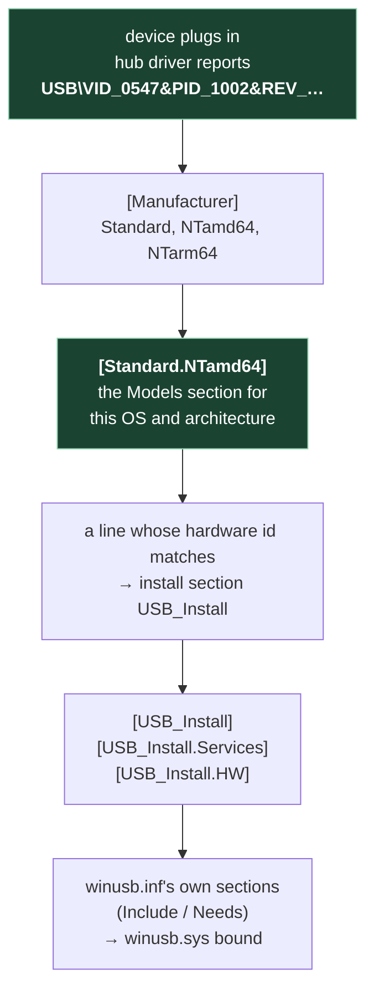
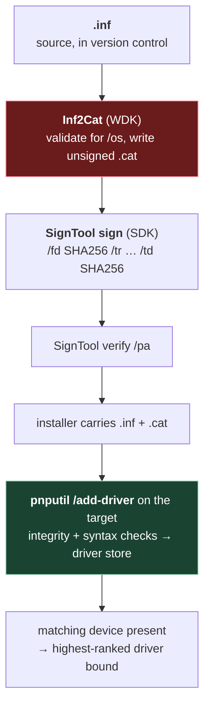

# 8. Inside a driver package

## The problem

Chapter 7 ends with a decision: if the bootloader will not ask for WinUSB itself, you ship a
**driver package**. That sounds like shipping a text file. It isn't. A package is a text file
plus a binary file that has to be generated from it, by a tool that lives in a kit most build
machines don't have, signed by a second tool, and regenerated every time a single byte of the
text file changes. And none of that matters until the moment Windows decides whether to
install it.

This chapter takes a driver package apart file by file, then walks it from source to a bound
device. If you have built and signed one before, skim the headings and go to §8.7.

## 8.1 What is in the folder

A driver package is a directory. For a package that binds WinUSB, it holds exactly two files:

```
WinUSBInstallation\
├── WinUSBInstallation.inf    you write it          text     the rules
└── WinUSBInstallation.cat    generated, then signed binary   the signature
```

A package for a real kernel driver adds a third, the `.sys` binary, and possibly more (chapter
7 §what the signing policy actually governs explains why a WinUSB package has none).

| File | Who makes it | Format | Changes when |
|---|---|---|---|
| `.inf` | you, by hand | INI-style text | you change what binds, or to what |
| `.cat` | Inf2Cat generates it; SignTool signs it | binary, PKCS #7 | any file it covers changes, **including the INF** |
| `.sys` | the compiler | PE executable | the driver code changes |

The table already holds the key point of this chapter. The `.cat` is an **output**. You never
edit it, and you can't reuse last release's copy.

## 8.2 The INF, section by section

Here is Microsoft's own example of an INF that installs WinUSB, from *WinUSB (Winusb.sys)
Installation for Developers*. Most WinUSB INFs you'll meet are variations of it.

```ini
[Version]
Signature   = "$Windows NT$"
Class       = USBDevice
ClassGUID   = {88BAE032-5A81-49f0-BC3D-A4FF138216D6}
Provider    = %ManufacturerName%
CatalogFile = WinUSBInstallation.cat
DriverVer   = 09/04/2012,13.54.20.543
PnpLockdown = 1

[Manufacturer]
%ManufacturerName% = Standard,NTamd64,NTarm64

[Standard.NTamd64]
%DeviceName% =USB_Install, USB\VID_0547&PID_1002

[Standard.NTarm64]
%DeviceName% =USB_Install, USB\VID_0547&PID_1002

[USB_Install]
Include = winusb.inf
Needs   = WINUSB.NT

[USB_Install.Services]
Include =winusb.inf
Needs   = WINUSB.NT.Services

[USB_Install.HW]
AddReg=Dev_AddReg

[Dev_AddReg]
HKR,,DeviceInterfaceGUIDs,0x10000,"{9f543223-cede-4fa3-b376-a25ce9a30e74}"

[Strings]
ManufacturerName="Contoso"
ClassName="Universal Serial Bus devices"
DeviceName="Fx2 Learning Kit Device"
REG_MULTI_SZ = 0x00010000
```

An INF is not read top to bottom. It is a chain of named sections, each pointing at the next,
and Windows follows the chain from the device that has just been plugged in:



### `[Version]` — what kind of INF this is

Every INF has one, and by convention it comes first (*INF Version Section*).

| Entry | What it does |
|---|---|
| `Signature` | Must be `$Windows NT$` or `$Chicago$`. Microsoft: "Generally, Windows does not differentiate among these signature values. One of them must be specified, but it does not matter which one." A relic, but a required one |
| `Class` / `ClassGUID` | The device setup class. `USBDevice` and its GUID are the system-defined class for generic USB devices; required for anything installed through Plug and Play |
| `Provider` | Who wrote the INF. Shown to users. Required for Plug and Play |
| `CatalogFile` | **The link to the signature.** Names the `.cat`. "Windows assumes that the catalog file is in the same location as the INF file" |
| `DriverVer` | `mm/dd/yyyy,w.x.y.z`. Required since Windows 2000. "When the operating system searches for drivers, it selects a driver that has a more recent DriverVer date over a driver that has an earlier date" — and the version is used alongside rank and date (*INF DriverVer Directive*) |
| `PnpLockdown` | `1` stops applications modifying the installed files directly. Microsoft says a package "should set PnpLockDown to 1" |

⚠️ **No `CatalogFile`, no signature.** Microsoft: "If an INF Version section does not include
at least one CatalogFile or CatalogFile.nt*xxx* entry, the driver is treated as unsigned." The
INF doesn't fail. It just becomes unsigned, which on most machines means it won't install.

### `[Manufacturer]` and the Models sections — which devices, on which Windows

`%ManufacturerName% = Standard,NTamd64,NTarm64` says: the devices are listed in a section
called `Standard`, and there is a separate copy of that list for each platform. The suffixes
are **TargetOSVersion decorations**. Their grammar (*INF Manufacturer Section*), from Windows
10 1607 on:

```
NT[Architecture][.[OSMajorVersion][.[OSMinorVersion][.[ProductType][.[SuiteMask][.[BuildNumber]]]]]
```

| Decoration | Means |
|---|---|
| `NTamd64` | any x64 Windows, XP onwards |
| `NTarm64` | any Arm64 Windows |
| `NTamd64.10.0` | x64, Windows 10 or later. Windows 11 is also major version 10, minor 0, per the same page |
| `NTamd64.10.0...14393` | x64, Windows 10 build 14393 (1607) or later. The empty fields are product type and suite mask |

Each decoration names a real section: `Standard` + `NTamd64` → `[Standard.NTamd64]`. When it
has several to pick from, Windows uses "the section with the highest version numbers that are
not higher than the operating system version on which the installation is taking place".

⚠️ **The decorations and the section names must agree exactly.** "If your INF contains
Manufacturer section entries with decorations, it must also include INF Models sections with
names that match." Get one wrong and that platform has no Models section, so no device on it
matches. Since Windows Server 2003 SP1, non-x86 platforms *must* be decorated.

### A Models line — the hardware id

```ini
%DeviceName% =USB_Install, USB\VID_0547&PID_1002
```

Three fields: the name Device Manager shows, the install section to run, and the **hardware
id** to match. For USB, the hub driver builds these ids from the device descriptor (*Standard
USB Identifiers*):

| Id | Built from | Use |
|---|---|---|
| `USB\VID_v(4)&PID_d(4)&REV_r(4)` | `idVendor`, `idProduct`, `bcdDevice` | the most specific match |
| `USB\VID_v(4)&PID_d(4)` | the same, without revision | what an INF usually names |
| `USB\VID_v(4)&PID_d(4)&MI_z(2)` | plus `bInterfaceNumber` | one interface of a composite device |
| `USB\CLASS_c(2)&SUBCLASS_s(2)&PROT_p(2)`, shorter forms | the class codes | **compatible** ids: the fallback matches |

This line is where chapter 7's rule *match narrowly* is applied or broken. The id is
`VID&PID`, not `VID` alone, and for a device whose normal and bootloader modes differ only in
product id, that one field is the difference between binding the bootloader and taking the
device's normal function away.

### The install section — what to do once matched

`[USB_Install]` is what Microsoft calls a *DDInstall* section, and the suffixed sections
belonging to it run alongside it: `.Services` sets up the driver service, `.HW` writes
hardware registry keys. For WinUSB, all three mostly borrow from the in-box INF:

- `Include = winusb.inf` / `Needs = WINUSB.NT` means "run the named section of Microsoft's own
  `winusb.inf`". Microsoft: "You shouldn't modify these directives." This is the line that
  makes a WinUSB package contain no code. It points at a driver that is already there.
- `[USB_Install.HW]` → `AddReg` writes `DeviceInterfaceGUIDs`. "When Winusb.sys is loaded as
  the device's function driver, it reads the registry value DeviceInterfaceGUIDs key and uses
  the specified GUID to represent the device interface." That GUID is how user-mode code finds
  the device afterwards. Generate your own; don't copy the example's.

### `[Strings]` — the `%tokens%`

Every `%Name%` elsewhere in the file is replaced from here. It exists for localisation, and
it's why `Provider` and the device name look like variables.

## 8.3 The catalog: a signed list of hashes

Windows needs to know that a set of files is exactly what a publisher shipped. An executable
can carry an Authenticode signature inside itself, because the PE format has a place for one.
An INF has no such place: it's a text file, and any signature pasted into it would change the
bytes it is meant to protect. A package can also contain any number of files.

The answer is a separate file listing one hash per file, with a signature over that list.
Microsoft (*Catalog Files and Digital Signatures*):

> A digitally signed catalog file (*.cat*) can be used as a digital signature for an arbitrary
> collection of files. A catalog file contains a collection of cryptographic hashes, or
> *thumbprints*. Each thumbprint corresponds to a file that is included in the collection.

If you've seen a release with a `SHA256SUMS` file and a `SHA256SUMS.sig` beside it, you have
seen the idea. The signature covers the list, and the list covers the files. A catalog is that
pattern in one binary file, in a format Windows checks itself. It is a **detached signature**
(chapter 6) for a whole directory.

```
 WinUSBInstallation.cat
 ┌───────────────────────────────────────────────────────┐
 │ members — one per covered file                        │
 │    the INF                       → its hash           │
 │    every file the INF references → its hash           │   ← Inf2Cat writes this
 ├───────────────────────────────────────────────────────┤
 │ signature over the member list                        │   ← SignTool adds this
 │    └ timestamp countersignature                       │   ← SignTool /tr adds this
 │ signer's certificate chain                            │
 └───────────────────────────────────────────────────────┘
```

On the format, the sources say this much. MakeCat's default encoding type is
`PKCS_7_ASN_ENCODING | X509_ASN_ENCODING`, and "the result of any SignTool operation is always
a PKCS #7 format SignedData" (*Time Stamping Authenticode Signatures*). Signing doesn't produce
a new file: "When digitally signing a catalog file, SignTool saves the digital signature within
the catalog file. The components of the driver package are not changed by SignTool." So an
unsigned catalog and a signed one have the same name and the same member list. The signed one
also carries a signature.

### What breaks it

> PnP device installation considers the digital signature of a driver package to be invalid
> if any file in the driver package is altered after the driver package was signed. Such files
> include the INF file, the catalog file, and all files that are copied by INF CopyFiles
> directives. For example, even a single-byte change to correct a misspelling invalidates the
> digital signature.

Bumping `DriverVer`, fixing a string or adding a hardware id all change the INF's hash, which
no longer matches the one in the catalog. The package then has to be catalogued and signed
again.

> **Teacher's aside.** The usual mistake is to think of the `.cat` as a file that sits beside
> the INF, like a licence file. It's a build product of the INF, the way an object file is a
> build product of a source file. Commit the INF. Generate the catalog in the build, every
> build. A catalog in version control is either a copy of the build output, which is
> redundant, or stale, which will fail on install.

### Embedded and catalog signatures

Windows has two places a signature can live, and a kernel driver can need both:

| | Embedded signature | Catalog signature |
|---|---|---|
| Where | inside the file (PE: `.exe`, `.dll`, `.sys`) | in a separate `.cat` |
| Covers | that one file | every file listed in the catalog |
| Works for text files | no | yes, which is why INFs use it |
| Verified by | reading the file alone | looking the file's hash up in a catalog that is itself verified |

Microsoft's test-signing guide adds that a package containing a *boot-start* driver needs its
binary signed **as well**: "you additionally have to embed a digital signature within the
driver binary". The catalog is what Plug and Play checks when the package is installed. A
boot-start binary has to carry a signature of its own too.

Windows' own drivers use the same mechanism, which explains a detail of their INFs: "System-
supplied INF files never have CatalogFile= entries because the operating system validates the
signature for such an INF against all system-supplied *xxx*.cat files."

## 8.4 Generating the catalog: Inf2Cat

> Inf2Cat (Inf2Cat.exe) is a command-line tool that determines whether a driver package's INF
> file can be digitally signed for a specified list of Windows versions. If so, Inf2Cat
> generates the unsigned catalog files that apply to the specified Windows versions.
>
> — Microsoft Learn, *Inf2Cat*

So it has two jobs, and the first matters as much as the second. It is a **validator**: it
"checks driver package's INF files for structural errors and verifies that a driver package
can be signed". It is also a **generator**: it writes the catalog the INF's `CatalogFile`
names.

```bat
Inf2Cat /driver:C:\MyDriver /os:10_VB_X64,10_CO_X64
```

| Switch | Meaning |
|---|---|
| `/driver:<dir>` | the package directory. "If the specified directory contains INF files for multiple driver packages, Inf2Cat will create catalog files for each driver package" |
| `/os:<list>` | which Windows versions to check the INF against, and which versions the generated catalog applies to |
| `/nocat` | validate only; write no catalog. A cheap lint step |
| `/uselocaltime` | for the error `DriverVer set to a date in the future`. Timestamp checks use UTC by default |

A sample of `/os` identifiers from the same page (the full table lists every release):

| Identifier | Windows version |
|---|---|
| `10_X64` | Windows 10 x64 |
| `Server10_X64` | Windows Server 2016 |
| `10_VB_X64` | Windows 10 2004 – 22H2 x64 |
| `10_CO_X64` | Windows 11 21H2 x64 |
| `10_GE_X64` | Windows 11 24H2 x64 |
| `Server2025_X64` | Windows Server 2025 |

Three rules from Microsoft's pages, each with a practical consequence:

1. **The catalog covers the files the INF references.** "Inf2Cat automatically includes all
   the files in the driver package that are referenced within the package's INF file." (*Creating
   a Catalog File for Test-Signing a Driver Package*)
2. **Every referenced file must be present.** "A driver package can be signed only if all of
   the files that are referenced in an INF file are present and the source files are in the
   correct location."
3. **No catalog without a matching `CatalogFile`.** Inf2Cat "generates a catalog file only if
   the catalog file is specified in the driver package's INF file and the catalog file applies
   to one or more of the specified Windows versions".

Together they give the working rule: **give each package its own directory, holding that
package and nothing else.** A shared directory with a second INF in it gets a second catalog
you didn't ask for. A missing referenced file fails the run. And Microsoft says plainly that
"two unrelated driver packages can't share a single catalog file".

Inf2Cat also has an awkward requirement: "To use Inf2Cat, you must be a member of the
Administrators group on the system." On a build agent running as a restricted service account,
that is a failure waiting to happen.

### What is not settled here

Microsoft documents what Inf2Cat puts *in*: the files the INF references. It doesn't say what
happens to a stray file in the directory that the INF never mentions, and I found no primary
source that settles it. Some build scripts are written on the assumption that Inf2Cat hashes
the whole directory. The documentation describes the narrower behaviour. The working rule
above is safe either way, so it's the one to follow. Just don't repeat either reading as fact
without testing it.

### MakeCat, the other way to make one

MakeCat (Windows SDK) builds a catalog from a hand-written **catalog definition file**
(`.cdf`). Microsoft's own example, trimmed (*Using MakeCat to Create a Catalog File*):

```ini
[CatalogHeader]
Name=tstamd64.cat
PublicVersion=0x0000001
EncodingType=0x00010001
CATATTR1=0x10010001:OSAttr:2:6.0
[CatalogFiles]
<hash>File1=amd64\toaster.pdb
<hash>File2=amd64\toaster.sys
```

Two things in it are worth noticing. You list the files yourself, so nothing checks them
against an INF. And `OSAttr` is a catalog-wide attribute naming the Windows version the catalog
is for, which is the job Inf2Cat's `/os` does for you.

Microsoft is blunt about when to use it: "You must use the MakeCat tool only to create catalog
files for files that are not installed by using an INF file. If the files are installed by
using an INF file, use the Inf2Cat tool to create the catalog file." Its output is also
unsigned: "If it is to be signed prior to transmittal, it is signed by using SignTool."

### Which kit has which tool

This is where build machines get caught out, so it gets its own table:

| Tool | Ships in | Source |
|---|---|---|
| **Inf2Cat** | the **Windows Driver Kit (WDK)** | "The Inf2Cat tool is installed with the Windows Driver Kit (WDK)" (*Inf2Cat*) |
| **SignTool** | the **Windows SDK** | "installed in the \Bin folder of the Microsoft Windows Software Development Kit (SDK)" (*Time Stamping Authenticode Signatures*) |
| **MakeCat** | the Windows SDK | *MakeCat* |
| **PnPUtil** | Windows itself, `%windir%\system32`, since Vista | *PnPUtil Command Syntax* |

The sources don't fully agree. The driver-docs *SignTool* page still describes it as living in
the WDK's `bin\i386` and `bin\amd64`, a layout from older kits. The Win32 page says SDK. On a
current machine you'll find it under the SDK's directories, so a WDK install isn't what
provides it.

⚠️ **Both kits install into the same tree.** Microsoft gives Inf2Cat's location as
`%WindowsSdkDir%\bin\<version>\x86`, the same `Windows Kits\10\bin\<version>\` tree where the
SDK puts SignTool. A machine with only the SDK installed has a folder that looks complete,
with SignTool and MakeCat in it, and no Inf2Cat. The build gets through compilation and
signing setup, then fails at the catalog step, late in a release. Two further details make it
worse:

- **The version directories need not match.** On one observed build machine, the WDK's
  directory was `10.0.28000.0` beside an SDK at `10.0.26100.0`. A tool finder that builds a
  path from the SDK's version misses it. Search the `bin` tree for the file instead.
- **"Is the toolchain installed?" has to name the WDK separately.** A requirements list that
  says "Windows SDK" is incomplete for anything that builds a driver package, even one with no
  driver code in it.

## 8.5 Signing it: SignTool

Microsoft's test-signing example:

```bat
Signtool sign /v /fd sha256 /s PrivateCertStore /n Contoso.com(Test) /t http://timestamp.digicert.com tstamd64.cat
```

And the form the Authenticode page recommends today, using an RFC 3161 timestamp:

```bat
signtool sign /fd SHA256 /tr https://timestamp.example.com /td SHA256 /a MyApp.exe
```

The file can be the catalog as well as an executable. For the **sign**, **timestamp** and
**verify** commands, "a file can be a catalog file for a driver package or a driver file".

| Switch | Meaning |
|---|---|
| `/fd SHA256` | file digest algorithm. **The default is SHA-1**, which Microsoft calls "deprecated and distrusted by modern Windows versions for code signing", so always pass it |
| `/f cert.pfx /p <password>` | the signing certificate from a PFX file, the usual form on a build agent |
| `/s <store> /n <subject>` | or pick it from a certificate store by subject name |
| `/tr <url>` + `/td SHA256` | RFC 3161 timestamp server, and the digest to ask it for |
| `/t <url>` | the legacy Authenticode timestamp protocol; can't be combined with `/tr` |

### Why the timestamp is not optional

A certificate expires. A signature without a timestamp can't prove it was made while the
certificate was still valid, so Windows assumes the worst:

> Always time-stamp your Authenticode signatures. Without a time stamp, the signature becomes
> invalid when the signing certificate expires, and Windows will treat the binary as unsigned.
>
> — Microsoft Learn, *Time Stamping Authenticode Signatures*

The mechanism is a **countersignature**. SignTool sends the signature (not the files) to a
timestamp authority, which signs "the original signature" together with the current time, and
that second signature is attached to the first as a PKCS #9 unauthenticated attribute. Because
it's unauthenticated, it can be added after the original signing: `signtool timestamp`
exists for exactly that. The same page covers revocation as well as expiry: the countersignature
"allows for signatures to be verified even after the signing certificate has expired or been
revoked. The time stamp allows the verifier to reliably know the time that the signature was
affixed and thereby trust the signature if it was valid at that time."

> **Teacher's aside.** A timestamp doesn't make a signature any stronger. It records *when*
> the signature was made, so that "was the certificate valid at the time?" still has an answer
> after the certificate has expired. Leave it out and every package you sign has an expiry date
> nobody wrote down: the day the certificate expires. It also passes every test until that day.

### Verifying

The documented forms:

```bat
:: is the catalog's signature acceptable for Plug and Play installation?
SignTool verify /pa CatalogFileName.cat

:: is this file's hash in this catalog, and does the signature meet the kernel-mode policy too?
SignTool verify /kp /c CatalogFileName.cat AbcDriverPackage.inf
```

`/pa` checks against "the PnP device installation signing requirements". `/kp` adds the
kernel-mode code signing policy, which, per chapter 7, is about kernel binaries. Pick the
policy that matches the question you're asking.

⚠️ **A verify runs against the verifying machine's trust stores.** A build agent that has the
signing certificate in its own trusted stores will pass a check that a customer's clean machine
would fail. That's the same lesson as any signature in a pipeline: verify the way the end
user's machine will, or know that you haven't.

## 8.6 Installing it: staging, the driver store, and binding

Installing a package is two separate events, and keeping them apart clears up most "it
installed but nothing happened" reports.

> The process of copying a driver package to the Driver Store is called *staging*. A driver
> package must be *staged* to the Driver Store before the package can be used to install any
> devices. As a result, driver staging and device installation are separate operations.
>
> — Microsoft Learn, *Driver Store*

**Staging** is where the catalog is checked. For the package to be trusted, the INF "must have
a CatalogFile directive", "the catalog file must contain hashes for the INF file and any files
referenced in the INF file", and "the catalog file must be signed with a trusted digital
signature". Then Windows checks that "the INF file of the driver package is syntactically
correct, and all files referenced by the INF files are present". On success the package goes
into the store, and its catalog goes to `%SystemRoot%\System32\CatRoot`.

**Installing on a device** happens afterwards, when a device whose hardware id matches a Models
line is present. It may never happen. Chapter 7's bootloader-only package sits staged and
unused until the device enters its bootloader.

The tool for both is PnPUtil, which ships with Windows:

```bat
:: stage the package, and install it on any matching device present now
pnputil /add-driver WinUSBInstallation.inf /install

:: list third-party packages in the store
pnputil /enum-drivers

:: remove one: by its published name, not by your file name
pnputil /delete-driver oem12.inf /uninstall
```

⚠️ **The store renames your INF.** `/delete-driver` takes `<oem#.inf>`, the *published name*
the store gave the package, not the name you shipped. Removing your own package therefore
starts with `/enum-drivers` to find out which `oem` number it was given. That's the practical
side of chapter 7's *clean up your own history*.

⚠️ **Success is not binding.** "If the driver is not the highest ranked driver on the system,
PnPUtil will not force it onto the device." A package can stage cleanly, report success, and
leave the device on the driver it had. Check what actually bound with
`pnputil /enum-devices /drivers` (Windows 10 2004 onwards).

### Where trust comes from at staging

Chapter 7 covered the outcome. A package signed with a certificate the machine does not
otherwise trust stages silently only if that certificate is in the machine's **Trusted
Publishers** store; otherwise it raises the publisher dialog. Two details from Microsoft's page
on that store matter:

- **It trusts end-entity certificates, one by one.** "Only *end-entity* certificates can be
  trusted. For example, if an Authenticode certificate from a CA was used to test-sign a driver
  package, adding that certificate to the Trusted Publishers certificate store does not
  configure all certificates that this CA issued as trusted."
- **Microsoft scopes the practice to your own machines.** Putting your certificate in that
  store to get silent installs "is only suggested for your internal systems. This practice
  should never be followed for any driver package that is distributed outside your
  organization."

That second point is where the documentation and practice part company. Chapter 7 describes
shipping installers that add their own self-signed certificate to the customer's stores and
get a silent install, and mechanically it works. Microsoft's guidance is that it shouldn't be
done for anything distributed. The route Microsoft intends for a distributed package is the
Dev Center signature from chapter 7. A vendor taking the cheap route is making a deliberate
call against the platform owner's guidance, and that call should be written down by whoever
makes it.

## 8.7 The whole pipeline



The red node is the step a build machine is most likely to be missing a tool for. The green
one is where the catalog is actually checked: on the target machine, at staging.

What each change forces:

| You change | You must re-run |
|---|---|
| any byte of the INF, including a string | Inf2Cat, then SignTool. Bump `DriverVer` too: Microsoft recommends updating its date and version "whenever anything in the driver package is changed", and the date is what ranks your new package above the old one |
| the set of Windows versions you support | Inf2Cat with the new `/os`, then SignTool |
| the signing certificate (renewal) | SignTool. Packages already shipped stay valid **only if they were timestamped** |
| nothing in the package, but a new build | nothing needs it, but regenerating anyway is how you stop a stale catalog shipping |

## Check yourself

1. An INF is a text file. Why can't Windows check a signature inside it the way it does for a
   `.sys`, and what does the catalog do instead? Say exactly what the signature in a catalog
   covers.
2. You fix a typo in an INF's `[Strings]` section and ship it with the previous release's
   `.cat`, which was properly signed. What happens when a customer installs it, and at which
   moment?
3. A build machine has `signtool.exe` and `makecat.exe` under
   `Windows Kits\10\bin\<version>\`, and the release fails with "Inf2Cat.exe not found". How
   can a folder that looks complete be missing it, and what would you change about how build
   machines are provisioned and checked?
4. The pipeline runs `signtool verify /pa` on every catalog and it always passes. A customer
   reports the publisher dialog on install. Give the most likely explanation, and say what the
   pipeline's check was actually proving.
5. Two years after a release, the signing certificate expires. Packages from one build script
   still install silently; packages from an older script now behave as unsigned. Nothing about
   the packages changed. Explain the mechanism.
6. `pnputil /add-driver x.inf /install` reports success, but the device is still on its old
   driver. Give two different documented reasons this can happen, one about ranking and one
   about the INF itself.
