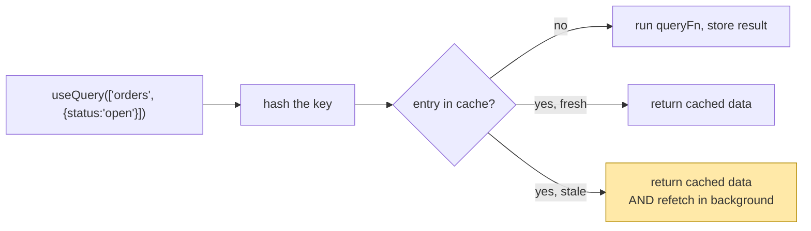

# 2. Server state is a cache

Assumes file 01 — especially §1.3 (state lives at a position in the tree) and §1.4 (client vs
server state).

## 2.1 The problem

Four symptoms that look unrelated:

- Changing a filter doesn't change the results, so someone adds `window.location.reload()` —
  and later a `useEffect` that calls `refetch()` whenever the filter changes.
- After saving an edit, the detail screen shows the old values until a hard refresh.
- An admin opens a guarded page and is bounced to "Access denied" for a split second, or for
  good.
- Every time a filter changes, the charts blank out and redraw.

All four are the same mistake: treating fetched data as a value you own, when it's a **cached
copy** of a value the server owns. Once you see it as a cache, each symptom maps to a cache
rule you already know from HTTP or from a memoised function — a key that's missing an input,
an invalidation that names the wrong entry, a lookup that never runs, and a cache that throws
away the old entry before the new one arrives.

This chapter uses TanStack Query (v5) because its docs state the rules precisely. SWR, RTK
Query and Apollo make different API choices over the same model.

## 2.2 The model: a map from key to entry

Under the hood a query library is a map. The key is the `queryKey` array you pass; the entry
holds the data, when it was fetched, and whether anyone is currently showing it.



Three facts from the docs pin the model down:

| Fact | Source |
|---|---|
| Keys are "hashed deterministically": object property order doesn't matter, but array item order does | [Query Keys](https://tanstack.com/query/latest/docs/framework/react/guides/query-keys) |
| Cached data is **stale by default** (`staleTime` defaults to 0) and stale queries refetch in the background when a new instance mounts, the window is refocused, or the network reconnects | [Important Defaults](https://tanstack.com/query/latest/docs/framework/react/guides/important-defaults) |
| Inactive entries are garbage-collected after 5 minutes (`gcTime`); failed queries retry 3 times with exponential backoff before you see the error | Important Defaults |

The HTTP analogy is close: the query key plays the role of the URL plus the `Vary` headers, and
`staleTime` plays the role of `max-age`. If you've read
[http/08-caching-and-revalidation.md](../http/08-caching-and-revalidation.md), you already know
the failure modes; they're the same ones, one layer up.

## 2.3 Every input belongs in the key

The first symptom. The query was written as:

```tsx
const { data } = useQuery({
  queryKey: ['orders'],
  queryFn: () => fetchOrders({ status, page }),   // reads status and page...
});                                               // ...but the key doesn't mention them
```

When `status` changes, the component re-renders, `useQuery` hashes `['orders']`, finds the
entry it already has, and returns it. The new `status` never reaches the server. The reload and
the effect-plus-`refetch()` are both ways of forcing a fetch the cache had no reason to make.

The docs put the rule in one line: keys "should include any variables you use in your query
function that change", and "query keys act as dependencies for your query functions"
([Query Keys](https://tanstack.com/query/latest/docs/framework/react/guides/query-keys)).
Put `status` and `page` in the key, and changing either one is simply a different entry: cached
if you've seen it, fetched if you haven't, no effect needed.

This isn't a React rule; it's the rule for any memoised function. A cache keyed on fewer inputs
than the function reads returns a right answer to the wrong question:

```go
type OrderCache struct{ m map[string][]Order }

// Wrong: the key ignores both inputs, so every call after the first gets the first answer.
func (c *OrderCache) GetBad(status string, page int) []Order {
	if v, ok := c.m["orders"]; ok {
		return v
	}
	v := fetchOrders(status, page)
	c.m["orders"] = v
	return v
}

// Right: every input the fetch reads is part of the key.
func (c *OrderCache) Get(status string, page int) []Order {
	k := fmt.Sprintf("orders|%s|%d", status, page)
	if v, ok := c.m[k]; ok {
		return v
	}
	v := fetchOrders(status, page)
	c.m[k] = v
	return v
}
```

<details><summary>Rust</summary>

```rust
use std::collections::HashMap;

struct OrderCache { m: HashMap<(String, u32), Vec<Order>> }

impl OrderCache {
    // The tuple key carries every input the fetch reads.
    fn get(&mut self, status: &str, page: u32) -> &Vec<Order> {
        self.m
            .entry((status.to_string(), page))
            .or_insert_with(|| fetch_orders(status, page))
    }
}
```

</details>

<details><summary>C++</summary>

```cpp
#include <map>
#include <string>
#include <utility>
#include <vector>

struct OrderCache {
    std::map<std::pair<std::string, int>, std::vector<Order>> m;

    const std::vector<Order>& get(const std::string& status, int page) {
        auto key = std::make_pair(status, page);
        auto it = m.find(key);
        if (it == m.end()) it = m.emplace(key, fetchOrders(status, page)).first;
        return it->second;
    }
};
```

</details>

<details><summary>JavaScript</summary>

```js
const cache = new Map();

function getOrders(status, page) {
  const key = JSON.stringify(['orders', status, page]);
  if (!cache.has(key)) cache.set(key, fetchOrders(status, page));
  return cache.get(key);
}
```

</details>

> ⚠️ The ESLint plugin `@tanstack/eslint-plugin-query` has an `exhaustive-deps` rule for exactly
> this: "Query keys should contain the serializable values that identify the data returned by
> your queryFn" ([exhaustive-deps](https://tanstack.com/query/latest/docs/eslint/exhaustive-deps)).
> It checks what the `queryFn` references; function call targets themselves are exempt. My
> reading, which the docs don't discuss: a value that a helper reads from a global store inside
> its own body never appears in the `queryFn`, so no lint rule can catch it. Pass inputs as
> arguments.

## 2.4 Invalidation has to follow renames

The second symptom. A mutation saves an edit, then tells the cache what it made stale:

```tsx
onSuccess: () => queryClient.invalidateQueries({ queryKey: ['resource', id] }),
```

`invalidateQueries` marks every matching entry stale (overriding `staleTime`) and refetches the
ones currently on screen. Matching is by **prefix**: `['todos']` matches `['todos', 1]` and
`['todos', { page: 2 }]`; pass `exact: true` to match only the exact key
([Query Invalidation](https://tanstack.com/query/latest/docs/framework/react/guides/query-invalidation)).

Now someone splits the detail query in two for speed — the small fields under
`['resource-details', id]`, the large binary fields under `['resource-images', id]` — and doesn't
touch the mutation. `['resource', id]` is not a prefix of `['resource-details', id]`; the
strings differ in the first element. The invalidation matches nothing, which is not an error,
so the save "works" and the screen stays stale.

The fix is structural: build every key in one place and import it everywhere.

```ts
// queryKeys.ts — no React imports, so the HTTP layer can use it too (§2.8)
export const resourceKeys = {
  all:     ['resource'] as const,
  details: (id: string) => ['resource', id, 'details'] as const,
  images:  (id: string) => ['resource', id, 'images'] as const,
};

// after a save: invalidates details AND images, because both start with ['resource', id]
queryClient.invalidateQueries({ queryKey: ['resource', id] });
```

Now a rename is a compile error at every call site, and nesting the keys under a shared prefix
means one invalidation can still reach both halves of a split query.

## 2.5 A disabled query ignores invalidation

The split above has a second trap. The image query was made lazy — fetched only when the user
opens that section — with `enabled: false` and a manual `refetch()`. After a save, the details
refresh but the images don't, even with the right key.

That's documented behaviour. A query with `enabled: false` won't fetch on mount or in the
background, and it will "ignore query client `invalidateQueries` and `refetchQueries` calls";
only the `refetch` function returned by `useQuery` fetches it
([Disabling/Pausing Queries](https://tanstack.com/query/latest/docs/framework/react/guides/disabling-queries)).
So after the mutation you call that query's `refetch()` yourself — or, better, replace the
manual flag with a condition (`enabled: sectionOpen`), so that once the section is open the
query is enabled and invalidation reaches it normally.

| Way to hold a query back | Responds to invalidation? | `refetch()` |
|---|---|---|
| `enabled: false` (constant) | No | Fetches |
| `enabled: someCondition` | Only while the condition is true | Fetches |
| `queryFn: skipToken` | No | Throws a "Missing queryFn" error, per the docs |

## 2.6 Dependent queries, and "not yet" versus "no"

The third symptom. A permission guard looks like this:

```tsx
const { user } = useAuth();                       // null for one render while the token is decoded
const { data: perms } = useQuery({
  queryKey: ['permissions', user?.id],
  queryFn: fetchMyPermissions,
  enabled: !!user,                                // a dependent query: waits for user
});
if (!perms?.includes('orders:read')) return <AccessDenied />;
```

On the first render `user` is null, so the permissions query is disabled and `perms` is
undefined, and `undefined?.includes(...)` is falsy. The guard renders "denied". If the guard
redirects instead of rendering, the user is gone before their identity has even been read.

The guard collapsed three states into two. A dependent query passes through `status: 'pending'`
with `fetchStatus: 'idle'` while it waits, then `'pending'`/`'fetching'`, then `'success'`
([Dependent Queries](https://tanstack.com/query/latest/docs/framework/react/guides/dependent-queries)).
None of the waiting states mean "no".

```tsx
type Gate = 'loading' | 'allowed' | 'denied';

function gate(authResolved: boolean, perms: string[] | undefined, need: string): Gate {
  if (!authResolved || perms === undefined) return 'loading';   // not yet
  return perms.includes(need) ? 'allowed' : 'denied';           // now we know
}
```

Two refinements the same guard needed:

- **Only fetch what the caller can fetch.** If an endpoint only exists for one kind of account,
  put that in `enabled` (`enabled: authResolved && user.kind === 'member'`), and decide the other
  kinds without it. Otherwise it fires, fails, and retries three times (§2.2) for every user who
  can never succeed.
- **Use `isLoading`, not `isPending`, for spinners.** `isPending` stays true for a disabled
  query that has no data even though nothing is happening; `isLoading` is true only while the
  first fetch is in flight
  ([Disabling/Pausing Queries](https://tanstack.com/query/latest/docs/framework/react/guides/disabling-queries)).
  For the guard, though, "pending" is exactly what you want to treat as "not yet".

The docs add a cost: "Dependent queries by definition constitutes a form of request waterfall,
which hurts performance." If the second request only needs something the server could work out
itself, an endpoint that takes the first request's input directly flattens the chain.

> **Teacher's aside.** The bug isn't in the query; it's in the boolean. `if (!allowed)` treats
> `undefined` as `false`, and in an authorisation check that means "unknown" becomes "no". Any
> time a yes/no answer depends on data that arrives later, write the third state down as a
> type. You'll find the same collapse in file 05, where `||` turns "absent" into "empty".

## 2.7 Keep the old screen while the new one loads

The fourth symptom. With the filter in the key (§2.3), changing it creates a new, empty entry.
For that entry there's no data, so the component renders its loading state, and the charts
vanish and reappear.

Someone "fixed" this with a `staleTime` of a few seconds. That only reduces how often it
happens, and it delays fresh data for everyone. The tool for the job is **placeholder data**:

```tsx
useQuery({
  queryKey: ['stats', filters],
  queryFn: () => fetchStats(filters),
  placeholderData: (previousData) => previousData,   // show the last key's data meanwhile
});
```

Placeholder data is shown in place of the missing entry but "is not persisted to the cache", and
the result carries `isPlaceholderData: true` so you can dim the old numbers
([Placeholder Query Data](https://tanstack.com/query/latest/docs/framework/react/guides/placeholder-query-data)).
Dimming matters: without it, the user reads last filter's totals as this filter's.

## 2.8 The server stays the source of truth

Client-side permission checks are a convenience — they hide buttons that would fail. The OWASP
Authorization Cheat Sheet is unambiguous that they're not the control: "Developers must never
rely on client-side access control checks"
([OWASP Authorization Cheat Sheet](https://cheatsheetseries.owasp.org/cheatsheets/Authorization_Cheat_Sheet.html)).
That has a consequence for the cache: the client's copy of your permissions can be wrong in
either direction, and the server will tell you when it is.

| Situation | What the cache believes | Fix |
|---|---|---|
| A grant was revoked elsewhere | Still allowed, until the entry goes stale and refetches | On any 403 from the API, invalidate the permissions query |
| A grant was added elsewhere | Still denied | On guarded pages, `staleTime: 0` and `refetchOnMount: 'always'` |

`refetchOnMount: 'always'` refetches every time the page mounts, even if the data is fresh
(except under `staleTime: 'static'`)
([useQuery reference](https://tanstack.com/query/latest/docs/framework/react/reference/useQuery)).

The 403 hook usually lives in an HTTP interceptor, which wants to import the permissions query
key — and the permissions hook already imports the HTTP client. That's an import cycle. Keeping
keys in a React-free module (§2.4) breaks it: both sides import the keys, neither imports the
other.

## Check yourself

1. A list query's key is `['orders', page]`, but its `queryFn` also reads `sortBy` from a store.
   What does the user see when they change the sort, and why does adding `useEffect(() => refetch(), [sortBy])` make it look fixed while leaving the cache wrong?
2. You rename `['invoice', id]` to `['invoice-summary', id]` and leave
   `invalidateQueries({ queryKey: ['invoice'] })` in the save handler. What happens on save, and
   why does nothing report an error?
3. A query is `enabled: false` and fetched with `refetch()` when a panel opens. After a mutation
   you invalidate its key. Does it refetch? What are two ways to make the save refresh it?
4. A guard renders `<AccessDenied/>` when `!perms?.includes(need)`. Trace the first two renders
   for an admin whose identity is decoded asynchronously, and rewrite the condition so the first
   render is correct.
5. Why is `placeholderData: (prev) => prev` safer than `staleTime: 5000` for stopping a chart from
   blanking on filter change? Name what each one changes about the cache and what the user can
   be misled by in each case.
6. A user's permission is revoked in another tab. List every point at which this tab can find
   out, given the defaults in §2.2 and the fixes in §2.8, and say which one you'd rely on.
