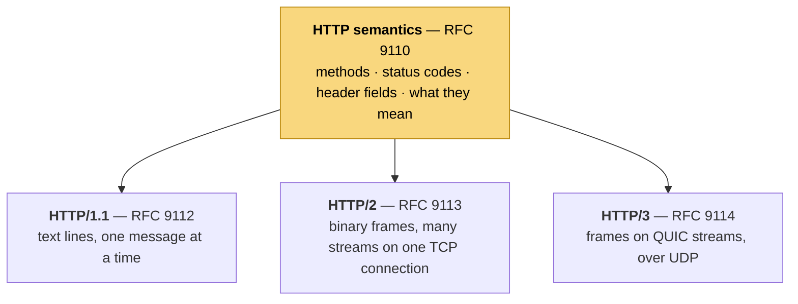

# 1. Foundations: what HTTP is, and what it rides on

> **Read this first.** Every other file in the course assumes it. Files 02, 03 and 04 use
> phrases like "a TCP handshake, a TLS handshake and its own congestion window"; this is
> where those phrases get explained.

**Who can skip it:** if you can read the `curl -v` output in "Seeing a whole exchange" below
line by line, say what a round trip is and how many a fresh HTTPS connection costs, and
explain why "origin server" and "origin" aren't the same thing, skip to file 02.

## The problem

Two programs that have never met need to exchange documents. They were written by different
people, in different languages, years apart, and there may be several other programs between
them passing the messages along. For that to work, they need to agree on:

- **how to ask** — what's being requested, and what kind of request it is;
- **how to answer** — whether it worked, and what the answer contains;
- **how to describe** — what format the content is in, how long it is, whether it can be cached;
- **how to get the bytes there** — reliably, privately, to the right machine.

HTTP answers the first three. The last one it hands to the layers underneath it. Knowing
which questions belong to HTTP and which belong to those layers is most of what makes the
rest of this course make sense.

## A request and a response

RFC 9110 defines HTTP as "a family of stateless, application-level, request/response
protocols". The request/response part is the easiest to see. A client sends one message, the
server sends one back. In HTTP/1.1, both are plain text you can read:

```
GET /docs/intro HTTP/1.1          ← request line: method, target, version
Host: example.com                 ← header fields: name: value
Accept: text/html
User-Agent: curl/8.7.1
                                  ← blank line: headers are over
                                  ← body (none, for a GET)
```

```
HTTP/1.1 200 OK                   ← status line: version, status code, reason
Content-Type: text/html; charset=utf-8
Content-Length: 1270
Cache-Control: max-age=3600
                                  ← blank line
<!doctype html><html>…            ← body: exactly 1270 bytes
```

| Part | In the request | In the response |
|---|---|---|
| **First line** | **Method** (what kind of request), **target** (which resource), version | Version, **status code** (what happened), reason phrase |
| **Header fields** | Metadata about the request: who's asking, what formats they accept, credentials | Metadata about the answer: format, length, caching rules |
| **Body** | Optional: the data being sent, for example a form or JSON | Optional: the content itself |

Everything else in HTTP is detail on one of those three rows. File 02's first point, that an
HTTP/1.1 body has "no envelope", is about the last row: the body is just the next 1270 bytes,
and only the `Content-Length` header tells the receiver where it stops.

## Methods: what kind of request

The method tells the server what you want done. RFC 9110 sorts them by two properties, and
those properties matter more than the names because they decide what's safe to do
automatically.

> Request methods are considered "safe" if their defined semantics are essentially
> read-only; i.e., the client does not request, and does not expect, any state change on the
> origin server as a result of applying a safe method to a target resource. (RFC 9110 §9.2.1)

> A request method is considered "idempotent" if the intended effect on the server of
> multiple identical requests with that method is the same as the effect for a single such
> request. (RFC 9110 §9.2.2)

| Method | Used for | Safe | Idempotent |
|---|---|---|---|
| `GET` | Fetch a resource | ✅ | ✅ |
| `HEAD` | `GET` without the body: just the headers | ✅ | ✅ |
| `OPTIONS` | Ask what's allowed; also the CORS preflight ([file 06](06-origins-and-cors.md)) | ✅ | ✅ |
| `PUT` | Replace a resource with this one | ❌ | ✅ |
| `DELETE` | Remove a resource | ❌ | ✅ |
| `POST` | "Process this": create, submit, trigger | ❌ | ❌ |
| `PATCH` | Apply a partial change ([RFC 5789](https://www.rfc-editor.org/rfc/rfc5789.html): "neither safe nor idempotent") | ❌ | ❌ |

Why the two columns matter: a connection can die after the request was sent but before the
response arrived, and the client can't tell whether the server acted. If the method is
idempotent, sending it again is harmless. If it's a `POST`, the retry might charge the card
twice. That one distinction comes up three times later in this course. It's why
`REFUSED_STREAM` is safe to retry and `CANCEL` isn't (file 02). It's why a proxy may replay
some requests and not others. And it's why only certain requests may go in QUIC's 0-RTT
data (file 04).

> ⚠️ "Safe" and "idempotent" describe what the method *promises*, not what your handler
> *does*. A `GET /logout` that deletes a session breaks the promise, and anything that
> assumed `GET` was safe — a link prefetcher, a crawler, a retrying proxy — will log your
> users out.

## Status codes: what happened

The first digit carries most of the meaning. RFC 9110 §15 defines the five classes:

| Class | RFC 9110's definition | You'll meet |
|---|---|---|
| **1xx** | "the request was received, continuing process" | `101 Switching Protocols` (file 03's `Upgrade`) |
| **2xx** | "the request was successfully received, understood, and accepted" | `200 OK`, `201 Created`, `204 No Content` |
| **3xx** | "further action needs to be taken in order to complete the request" | `301`/`308` moved for good, `302`/`307` moved for now, `304 Not Modified` (your cached copy is still good) |
| **4xx** | "the request contains bad syntax or cannot be fulfilled" — the *client's* problem | `400` malformed, `401` who are you?, `403` I know who you are and no, `404` no such thing, `409` conflict, `425 Too Early` (file 04), `429` slow down |
| **5xx** | "the server failed to fulfill an apparently valid request" | `500` the server broke, `502`/`504` a *proxy* couldn't get a good answer from the server behind it, `503` overloaded or down for maintenance |

> ⚠️ `401` and `403` are the pair people swap. `401 Unauthorized` is badly named: it means
> **unauthenticated** — no credentials, or bad ones; try again with some. `403 Forbidden` means
> the server knows who you are and the answer is still no. Retrying a `403` with the same
> credentials will never help.

A status code is the *application's* verdict on the request. It travels inside the HTTP
message, so it says nothing about whether the message arrived intact. That gap is the whole
of file 02's failure: a `200` built and logged by the server, then thrown away by the
framing layer below it.

## Header fields: metadata

Headers are `name: value` pairs that describe the message. Names are case-insensitive. A
handful do most of the work:

| Header | Direction | Says |
|---|---|---|
| `Host` | request | Which site you want. One IP address can serve thousands of sites, so the server needs telling. HTTP/1.1 makes it mandatory: "A client MUST send a Host header field … in all HTTP/1.1 request messages" ([RFC 9112 §3.2](https://www.rfc-editor.org/rfc/rfc9112.html#section-3.2)) |
| `Content-Type` | both | What format the body is in: `text/html`, `application/json` |
| `Content-Length` | both | How many bytes the body is. In HTTP/1.1, this is how the receiver finds the end |
| `Accept` | request | Which formats the client can handle |
| `Cache-Control` | both | Whether and for how long the response may be reused |
| `Authorization` | request | Credentials, for example a bearer token |
| `Set-Cookie` / `Cookie` | response / request | The server hands the client a value, and the client sends it back on later requests (next section) |
| `Location` | response | Where to go instead, on a 3xx |

HTTP/2 and HTTP/3 move the request line into special **pseudo-header** fields that start with
a colon — `:method`, `:path`, `:scheme`, `:authority` — and `:authority` takes over from
`Host` ([RFC 9113 §8.3.1](https://www.rfc-editor.org/rfc/rfc9113.html#section-8.3.1)). Same
information, different packaging. That's the theme of the section after next.

## Stateless, and how state comes back anyway

RFC 9110 §3.3 defines HTTP as stateless, "meaning that each request message's semantics can
be understood in isolation, and that the relationship between connections and messages on
them has no impact on the interpretation of those messages."

That's a deliberate design choice, and it pays for a lot. Any request can go to any server
behind a load balancer. A proxy can mix requests from different users onto one connection.
A dropped connection loses nothing the next request needs.

But "log in, then see my account" needs memory. The workaround is to make the *client* carry
the state. The server sends `Set-Cookie: session=abc123`, and the browser attaches
`Cookie: session=abc123` to every later request to that site. Each request is still
self-contained; it just carries its own context. Cookies are defined in
[RFC 6265](https://www.rfc-editor.org/rfc/rfc6265.html). The fact that a browser attaches them
*automatically*, even to requests a different site's page triggered, is the root of the
attack in [file 06](06-origins-and-cors.md).

## One meaning, three wire formats

This is the idea that ties the course together.

> This revision of HTTP separates the definition of semantics (this document) and caching
> from the current HTTP/1.1 messaging syntax to allow each major protocol version to progress
> independently while referring to the same core semantics. (RFC 9110 §1.2)



A `GET` for `/docs/intro` that returns `200` with an HTML body means exactly the same thing
in all three. What changes is how those facts are written onto the wire: text lines in
HTTP/1.1, frames with stream ids in HTTP/2, frames on QUIC streams in HTTP/3.

> **Teacher's aside.** People talk about HTTP/2 as "a new version of HTTP" and expect
> something to have changed in their application. Nothing did. Your handler still gets a
> method, a path, headers and a body, and still returns a status, headers and a body. The
> version is **how the message is written**, not **what it says**. That's why one server can
> speak all three at once, why a proxy can take HTTP/2 from the browser and send HTTP/1.1 to
> your server, and why the bugs in files 02 and 04 are so confusing: they live in a layer
> your application code never sees.

## What HTTP rides on

HTTP says what the messages mean. Getting the bytes from one machine to the other is someone
else's job, split across layers. An analogy that holds up well: HTTP is the **letter**, TLS
is the **sealed, tamper-evident envelope** with a verified address, TCP is the **courier
service** that guarantees every page arrives in order, and IP is the **road network** that
moves individual vans with no promises at all.

```
   HTTP/1.1 and HTTP/2                    HTTP/3
 ┌──────────────────────┐          ┌──────────────────────┐
 │ HTTP                 │ meaning  │ HTTP/3               │
 ├──────────────────────┤          ├──────────────────────┤
 │ TLS                  │ privacy, │ QUIC                 │ ← TLS 1.3 built in,
 ├──────────────────────┤ identity │  (streams, reliable, │   plus streams
 │ TCP                  │ reliable,│   encrypted)         │
 │                      │ in order ├──────────────────────┤
 │                      │          │ UDP                  │ ← just "send this packet"
 ├──────────────────────┤          ├──────────────────────┤
 │ IP                   │ best-effort packet delivery     │
 └──────────────────────┘          └──────────────────────┘
```

| Layer | Its job | What it knows nothing about |
|---|---|---|
| **IP** | Move a packet towards an address. Packets can be lost, duplicated or reordered | Connections, order, content |
| **TCP** | Turn lossy packets into one reliable, ordered **byte stream** between two programs, by numbering bytes, acknowledging them and resending losses | Where one HTTP message ends and the next begins, or that two responses are separate. File 04's head-of-line blocking comes from exactly this |
| **TLS** | Encrypt the byte stream, detect tampering, and prove which server you're talking to ([file 05](05-certificates-and-trust.md)) | What the bytes mean |
| **HTTP** | Methods, status codes, headers, bodies | How the bytes physically get there |
| **UDP** | Send one packet to a port, nothing more. QUIC builds TCP's and TLS's guarantees back on top of it, in a way it can change ([file 04](04-quic.md)) | Everything above |

For TCP in more depth (sequence numbers, retransmission, flow and congestion control), see
the networks chapter of the interview course,
[cs-fundamentals file 09](../interview/cs-fundamentals/09-networks-layers-and-tcp.md). You
don't need it for this course beyond what's here.

## Connections, round trips and handshakes

A **round trip** is a message going from client to server and a reply coming back. Its
duration, the **round-trip time (RTT)**, is set mostly by distance and the speed of light in
fibre, so it can't be engineered away. It ranges from under a millisecond on a local network
to hundreds across continents. Protocol design at this layer is largely about **counting
round trips**, because a round trip is the one cost bandwidth can't buy down.

Before the first HTTP request can go out on a fresh HTTPS connection, two handshakes have to
finish:

```
 client                                     server
   │──── TCP SYN ───────────────────────────►│   ┐
   │◄─── SYN-ACK ────────────────────────────│   ┘ 1 RTT: TCP handshake
   │──── ACK + TLS ClientHello ─────────────►│   ┐
   │◄─── ServerHello … certificate, Finished │   ┘ 1 RTT: TLS 1.3 handshake
   │──── Finished + GET /docs/intro ────────►│   ┐
   │◄─── 200 OK … ───────────────────────────│   ┘ 1 RTT: the request itself
```

So the first response arrives about **three round trips** after you start, not counting the
DNS lookup before any of it. TLS 1.2 needed two round trips for its handshake rather than
one, which made four. At 100 ms per round trip, a figure picked for easy arithmetic, that's
300 ms of waiting before a single byte of the page, and none of it is bandwidth.

Two consequences shape every later chapter:

- **Reuse connections.** A connection you already have costs one round trip per request
  rather than three. HTTP/1.1 keeps connections open by default — "HTTP/1.1 defaults to the
  use of 'persistent connections'" ([RFC 9112 §9.3](https://www.rfc-editor.org/rfc/rfc9112.html#section-9.3))
  — but it can still carry only one response at a time on each, which is the problem
  [file 02](02-versions-and-framing.md) opens with.
- **New connections start slowly.** TCP doesn't know how much the network between you can
  carry, so a new connection sends a little, waits for acknowledgements, and ramps up. This
  is **congestion control**, and the amount it's currently willing to have in flight is the
  **congestion window**. Six parallel connections means six handshakes and six windows each
  starting small, which is why "open more connections" was HTTP/1.1's expensive workaround.

QUIC (file 04) attacks the handshake count by doing the transport and TLS handshakes
together, so one round trip instead of two. A returning client can even send its request in
the first flight (0-RTT).

## TLS in one page

TLS turns the TCP byte stream into one that's **confidential** (nobody on the path can read
it), **integrity-protected** (nobody can change it undetected) and **authenticated** (you
know which server you reached). The first two come from keys the two sides agree during the
handshake. The third comes from the server's certificate, and that's the whole of file 05.

The handshake begins with the client's **ClientHello**, and two things in it matter to this
course:

| Field in the ClientHello | What it's for | Where it matters |
|---|---|---|
| **SNI** (Server Name Indication) | The hostname the client wants, so a server hosting many sites on one IP picks the right certificate. TLS itself "does not provide a mechanism for a client to tell a server the name of the server it is contacting" ([RFC 6066 §3](https://www.rfc-editor.org/rfc/rfc6066.html#section-3)) | File 05: the certificate must match this name |
| **ALPN** (Application-Layer Protocol Negotiation) | The list of protocols the client can speak after the handshake: `h2`, `http/1.1` | File 03: this is where the HTTP version is chosen |

The server replies with a **ServerHello**, its certificate and proof it holds the matching
private key. After that, everything is encrypted.

## Who else is on the path

A request rarely goes straight from a browser to the program that answers it. RFC 9110
names the pieces:

> The term "origin server" refers to a program that can originate authoritative responses
> for a given target resource. (RFC 9110 §3.6)

Everything between the client and the origin server is an **intermediary** (§3.7):

| Intermediary | Who puts it there | What it does |
|---|---|---|
| **Forward proxy** | The client side: a company network, say | Makes requests on the client's behalf |
| **Reverse proxy / load balancer** | The server side | Takes requests for a site and spreads them over origin servers; often **terminates TLS**, so the browser's TLS session (and its ALPN choice) ends there, not at your server — file 03 |
| **CDN** | The server side, at global scale | A reverse proxy with caches near users |
| **Tunnel** | Either | Relays bytes blindly, for example after `CONNECT` |

This is why `502 Bad Gateway` and `504 Gateway Timeout` exist: they're how an intermediary
says "I'm fine, the server behind me isn't". It's also why protocol changes are hard. Every
box on the path has to understand, or at least not break, whatever you send. File 03's failed
`Upgrade` and file 04's "ossification" are both this.

> ⚠️ **"Origin" means two different things in this course.** An **origin server** (above) is
> the program behind the proxies that actually produces the response. A web **origin** is a
> scheme + host + port triple like `https://app.example.com:443` that browsers use as a
> security boundary ([file 06](06-origins-and-cors.md), [file 07](07-loopback-and-local-network.md)).
> Same word, unrelated ideas. When a sentence says "origin", check which one it means.

## Seeing a whole exchange

`curl -v` prints every layer. Here's a real run against `example.com`, trimmed, captured on
8 October 2026 with curl 8.7.1. The addresses, certificate dates and issuer will be
different when you try it:

```
* Host example.com:443 was resolved.                       ← DNS: name → addresses
* IPv4: 172.66.147.243, 104.20.23.154
* Connected to example.com (2606:4700:10::ac42:93f3) port 443   ← TCP handshake done
* ALPN: curl offers http/1.1                               ← ClientHello's ALPN list
* (304) (OUT), TLS handshake, Client hello (1):            ← TLS 1.3 begins
* (304) (IN), TLS handshake, Server hello (2):
* (304) (IN), TLS handshake, Certificate (11):             ← file 05 starts here
* (304) (IN), TLS handshake, CERT verify (15):
* (304) (IN), TLS handshake, Finished (20):
* (304) (OUT), TLS handshake, Finished (20):
* SSL connection using TLSv1.3 / AEAD-CHACHA20-POLY1305-SHA256
* ALPN: server accepted http/1.1                           ← file 03: the server chose
*  subjectAltName: host "example.com" matched cert's "example.com"
*  SSL certificate verify ok.
> GET / HTTP/1.1                                           ← '>' = request line and headers
> Host: example.com
> User-Agent: curl/8.7.1
> Accept: */*
>
< HTTP/1.1 200 OK                                          ← '<' = status line and headers
< Content-Type: text/html; charset=utf-8
< Transfer-Encoding: chunked                               ← no Content-Length; chunks mark the end
< Connection: keep-alive                                   ← connection stays open for reuse
```

The prefixes are the key: `*` is curl narrating what the layers below HTTP are doing, `>` is
what it sent, `<` is what came back. I forced HTTP/1.1 here with `--http1.1` so the request
is readable as text. Drop the flag and curl offers `h2` too, the server picks it, and the `>`
lines show pseudo-headers like `:method: GET` instead. Same request, different wire format.

In a browser, the **Network** tab of the developer tools shows the same thing per request.
Right-click the column headers and enable **Protocol** to see `http/1.1`, `h2` or `h3` for
each one.

## The versions, in one table

| Version | Specified in | What it changed | In this course |
|---|---|---|---|
| HTTP/0.9 | [W3C note, "as defined in 1991"](https://www.w3.org/Protocols/HTTP/AsImplemented.html) | One method, `GET`; no headers, no status codes | — |
| HTTP/1.0 | RFC 1945, May 1996 | Headers, status codes, methods beyond `GET` | — |
| HTTP/1.1 | RFC 2068 (1997) → RFC 2616 (1999) → RFC 7230–7235 (2014) → **RFC 9110 + 9112 (June 2022)** | Persistent connections by default, mandatory `Host`, chunked encoding | This chapter; file 02 |
| HTTP/2 | RFC 7540 (May 2015) → **RFC 9113 (June 2022)** | Binary frames and streams: many requests at once on one TCP connection | Files 02, 03 |
| HTTP/3 | **RFC 9114 (June 2022)** | HTTP's streams carried on QUIC over UDP | File 04 |

The 2022 rewrite is the one that split semantics (RFC 9110) from each version's wire format,
which is why the three versions now share one definition of what a `GET` or a `404` means.

## Check yourself

1. A `PUT` request times out with no response. Is it safe for the client to send it again?
   Would your answer change for a `POST`? What property of the method decides it?
2. Your service sits behind a load balancer and returns `502` to some users. Using the
   intermediaries table, who generated the `502`, and what does it tell you about your own
   server?
3. A fresh HTTPS connection over TCP with TLS 1.3 to a server 150 ms away (round trip). How
   long before the first byte of the response, ignoring DNS? How much of that would a reused
   connection save, and why can't more bandwidth save it?
4. The same `GET /docs/intro` is sent once over HTTP/1.1 and once over HTTP/2. Name two
   things that are identical and two that differ, and say which RFC owns each.
5. Why does HTTP/1.1 make `Host` mandatory? What would break on a server hosting 500 sites on
   one IP address if clients omitted it, and which TLS field solves the same problem one
   layer down?
6. A colleague says "we're behind a CDN, so our origin is the CDN". Explain the two meanings
   of "origin" and which one they've mixed up. Then explain why a browser's security checks
   (file 06) never see your origin server's address at all.

(Answers in [`08-exercises.md`](08-exercises.md).)
