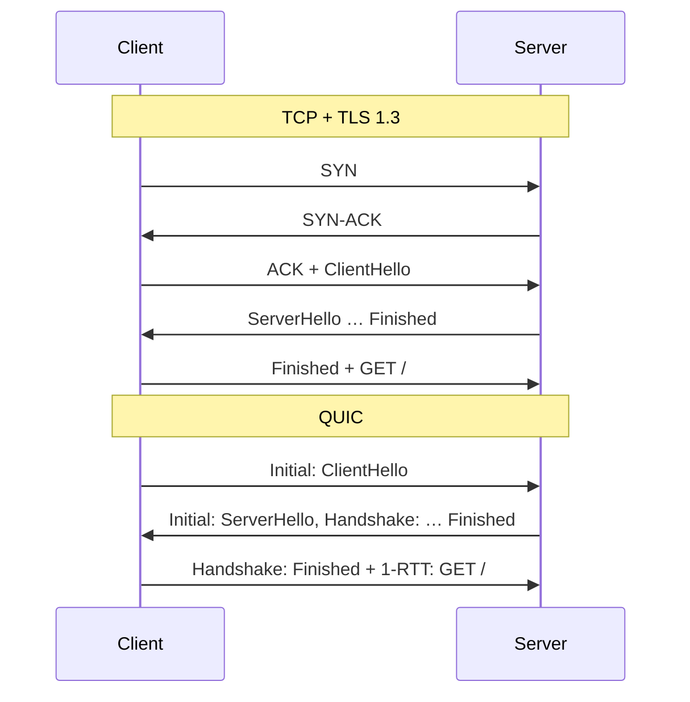
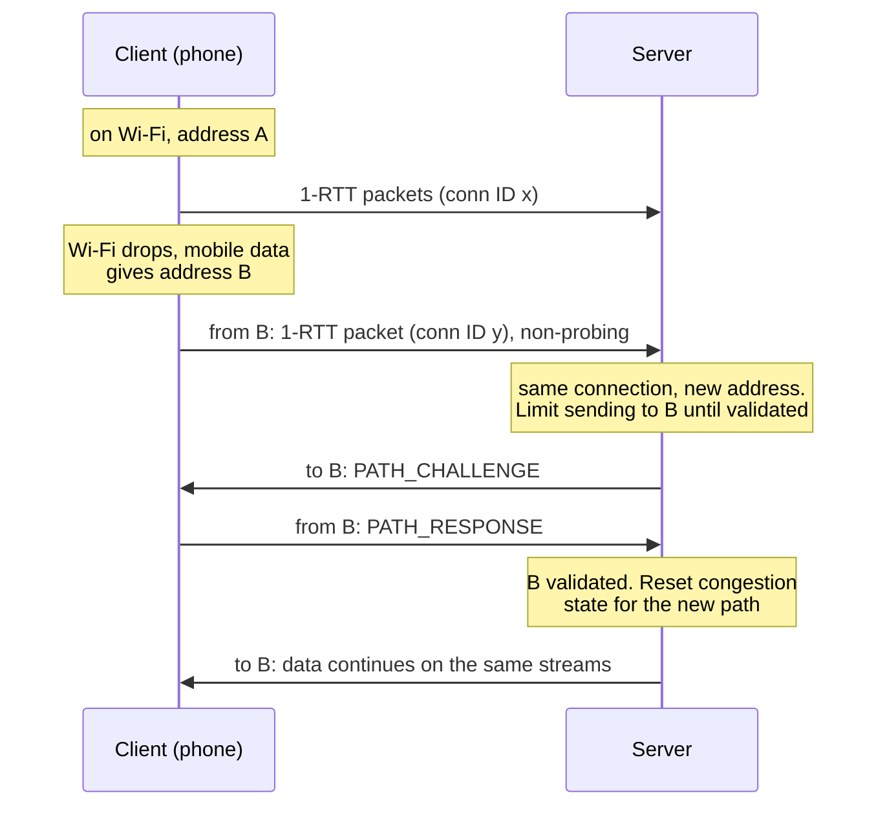

# 4. QUIC: a transport built on UDP

## The problem

HTTP/2 fixed HTTP's own queueing problem by giving responses stream ids, and
then ran into a queue it couldn't touch: the one inside TCP. A single lost
packet stalls every stream on the connection, because TCP delivers bytes
strictly in order and has no idea the bytes belong to separate responses. RFC
9113 §1 says so in its own introduction:

> Note, however, that TCP head-of-line blocking is not addressed by this
> protocol.

That's the best-known of four limits that come with TCP, and none of them can be
fixed by changing TCP:

| Limit | What it costs | Why you can't just fix TCP |
|---|---|---|
| **Head-of-line blocking** | One lost packet stalls every HTTP/2 stream on the connection | In-order delivery of one byte stream is what TCP *is* |
| **Handshake round trips** | TCP's handshake, then TLS's: two round trips before the first request | The two handshakes belong to different layers, run by different code |
| **Ossification** | New TCP features don't survive the network | Middleboxes inspect and drop TCP they don't recognise; TCP lives in OS kernels that update slowly |
| **Connection = 4-tuple** | Change network (Wi-Fi to mobile) and every connection dies | A TCP connection *is* its two IP addresses and two ports |

**QUIC** is the IETF's answer: a new transport that does what TCP and TLS did
together, plus streams, carried inside UDP. It's specified across four RFCs
from May 2021: RFC 8999 (what every QUIC version keeps the same), RFC 9000 (the
transport), RFC 9001 (how TLS secures it) and RFC 9002 (loss detection and
congestion control). HTTP/3 (RFC 9114) is one protocol that runs on it, not the
only one.

This chapter assumes TCP basics: the three-way handshake, sequence numbers and
ACKs, and the difference between flow control and congestion control. If those
are shaky, the [cs-fundamentals networks chapter](../interview/cs-fundamentals/09-networks-layers-and-tcp.md)
covers them, and its [§9.8](../interview/cs-fundamentals/09-networks-layers-and-tcp.md#98-head-of-line-blocking-and-why-quic-exists)
is a one-paragraph preview of this whole chapter.

## The four limits, one at a time

### Head-of-line blocking

Picture three HTTP/2 responses interleaved on one TCP connection, and one
packet lost:

```
 TCP segments on the wire:   [A1][B1][C1][A2][B2][C2]
                                       ✗ lost

 What has arrived:           [A1][B1]    [A2][B2][C2]

 What TCP hands to HTTP/2:   [A1][B1]  ...waiting for C1...
                                       A2, B2, C2 sit in the kernel's buffer
```

A2 and B2 arrived. Nothing about them depends on C1. TCP holds them anyway,
because its contract is "bytes in order", and it doesn't know where one stream
ends and the next begins. RFC 9114 §1.1 puts the HTTP/2 consequence plainly:

> because the parallel nature of HTTP/2's multiplexing is not visible to TCP's
> loss recovery mechanisms, a lost or reordered packet causes all active
> transactions to experience a stall regardless of whether that transaction was
> directly impacted by the lost packet.

So HTTP/2 removed one head-of-line block, HTTP/1.1's "one response at a time",
and was left with another underneath it. The only way out is a transport that
knows about streams.

### Handshake round trips

Over TCP, a client can't send its first request until two handshakes have
finished, one after the other: TCP's (one round trip) and then TLS 1.3's
(another). The [cs-fundamentals round-trip table](../interview/cs-fundamentals/10-what-happens-when-you-type-a-url.md#106-counting-round-trips)
counts it out. That's three round trips before the first byte of the response
with DNS cached, against two for HTTP/3.

TLS 1.3 can resume a session and send data in its first flight, but over TCP
that first flight still waits for TCP's handshake. TCP Fast Open (RFC 7413)
tried to put data in the SYN, which brings us to the third limit.

### Ossification

A protocol **ossifies** when the network learns its current shape so well that
any other shape gets dropped. Firewalls, NATs and load balancers along the path
read TCP headers, and many of them treat anything unfamiliar as an attack or an
error.

TCP Fast Open is the standard cautionary tale. RFC 7413 §7.1 cites studies that
"found that 6% of the probed paths on the Internet drop SYN packets with data or
with unknown TCP options." RFC 9170, the IAB's document on keeping protocols
extensible, draws the conclusion in its Appendix A.5:

> Though very few network paths were intolerant of the extension in absolute
> terms, TCP Fast Open could not be deployed as a result.

There's a second, slower kind of ossification: TCP is implemented in operating
system kernels, so a change ships when operating systems update, and on some
devices that's never.

### A connection is its addresses

RFC 9293 §4 (TCP's glossary) defines a connection as "a logical communication
path identified by a pair of sockets", and a socket as "the concatenation of an
Internet Address with a TCP port". Two addresses and two ports: the
**4-tuple**. Change any one and you have a different connection, as far as
everyone is concerned.

That was fine when computers didn't move. A phone that walks out of Wi-Fi range
and onto mobile data gets a new IP address, and every TCP connection it had is
gone. Each one needs a new TCP handshake, a new TLS handshake, and the
application has to retry whatever was in flight.

## Why UDP

Building a new transport directly on IP sounds cleaner, and it would never
deploy, for the reason the previous section gave: middleboxes drop what they
don't recognise. UDP is the one other transport they already pass, and its
header is eight bytes of almost nothing (ports, length, checksum). QUIC uses it
as a thin envelope that gets through the network, and puts everything that
matters inside it.

RFC 9308 §2 (the QUIC applicability statement) gives both reasons in one
sentence:

> QUIC uses UDP as a substrate. This enables userspace implementation and
> permits traversal of network middleboxes (including NAT) without requiring
> updates to existing network infrastructure.

"Userspace implementation" is the cure for kernel ossification: a QUIC stack is
a library linked into the application, so it ships when the application ships.

Then QUIC protects itself against the other kind of ossification by hiding
from the network. RFC 9000 §1: "QUIC authenticates the entirety of each packet
and encrypts as much of each packet as is practical." Even the packet number
is encrypted (RFC 9001 §5.4). That isn't only about privacy. A middlebox can't
come to depend on a field it can't read, and can't rewrite a field without
breaking authentication. RFC 9170 §4.3 lists exactly this as a technique,
noting that "encryption is used by the QUIC protocol [QUIC] to limit the
information that is available to middleboxes and integrity protection prevents
modification."

The layering ends up different from TCP's:

```
   Over TCP                         Over QUIC

 ┌──────────────────┐            ┌──────────────────────────────────┐
 │ HTTP/2           │ streams    │ HTTP/3                           │
 ├──────────────────┤            ├──────────────────────────────────┤
 │ TLS              │ crypto     │ QUIC: streams, reliability,      │
 ├──────────────────┤            │ flow and congestion control,     │
 │ TCP              │ reliable   │ TLS 1.3 handshake inside it      │
 │                  │ byte stream│                                  │
 ├──────────────────┤            ├──────────────────────────────────┤
 │ IP               │            │ UDP  (8-byte envelope)           │
 └──────────────────┘            ├──────────────────────────────────┤
                                 │ IP                               │
                                 └──────────────────────────────────┘
```

> ⚠️ **QUIC on UDP is not "unreliable".** QUIC uses UDP for its packets, not for
> its guarantees. It does its own acknowledgement and retransmission, and its
> streams are reliable and ordered, exactly as TCP's byte stream is. The
> unreliable option is a separate extension, covered below, that you have to
> negotiate.

UDP has a price. Some networks block it outright. RFC 9308 §2 cites
measurement studies, from 2016, finding that between 3% and 5% of networks
block all UDP traffic. Those figures are about a decade old and I haven't found
a newer one in the RFCs. Whatever the current number is, it isn't zero, so
anything built on QUIC needs a fallback. For HTTP, RFC 9114 §3.1 says clients
"SHOULD attempt to use TCP-based versions of HTTP" when QUIC can't connect.

## TLS 1.3, built into the handshake

Over TCP, TLS is a separate layer: it sends records over the TCP byte stream,
and TCP doesn't know or care what they contain. QUIC dissolves that boundary.
RFC 9001 §3:

> instead of carrying TLS records over QUIC (as with TCP), TLS handshake and
> alert messages are carried directly over the QUIC transport, which takes over
> the responsibilities of the TLS record layer

TLS still does the cryptographic negotiation (key exchange, the certificate,
`CertificateVerify`, everything in [file 05](05-certificates-and-trust.md)),
and hands QUIC the keys. QUIC carries the handshake messages in its own `CRYPTO`
frames and encrypts packets itself. The transport's own settings, such as flow
control limits, ride inside the TLS handshake as an extension, which RFC 9001
§8.2 notes "provides integrity protection for these values".

Because there is only one handshake, there is only one round trip:



RFC 9000 §7 states the design goal as "a combined cryptographic and transport
handshake to minimize connection establishment latency", and RFC 9001 §1 that
"most new connections can be established and secured within a single round
trip". The server can even send data back in its first flight (RFC 9000 §7.1
calls it "0.5-RTT data"), before it has heard the client finish.

Three consequences worth knowing:

| Rule | Source | Consequence |
|---|---|---|
| TLS 1.3 or newer only | RFC 9001 §4.2: "Clients MUST NOT offer TLS versions older than 1.3" | There is no QUIC with TLS 1.2 |
| No unencrypted QUIC | RFC 9000 §7: the handshake must provide authenticated key exchange where "a server is always authenticated" | There's no cleartext mode, unlike HTTP/1.1 and (in principle) HTTP/2 |
| ALPN is mandatory | RFC 9000 §7: "Endpoints MUST explicitly negotiate an application protocol"; RFC 9001 §8.1: endpoints "MUST use ALPN" unless another mechanism is agreed | A QUIC connection always knows what it's carrying |

The ALPN row connects straight to [file 03](03-alpn-and-negotiation.md#alpn-negotiate-inside-the-handshake-youre-already-paying-for).
The mechanism is identical (client offers a list, server picks one) and HTTP/3
is the identifier `h3` (RFC 9114 §3.1). What changes is the failure mode. Over
TCP, a TLS connection with no ALPN at all just carries HTTP/1.1. Over QUIC
there's no such default: RFC 9001 §8.1 says that if no application protocol is
negotiated, endpoints "MUST immediately close a connection". QUIC is a
general-purpose transport, so it can't guess.

> ⚠️ **The first packets are encrypted but not secret.** QUIC's Initial packets,
> which carry the ClientHello and ServerHello, are protected with keys derived
> from a constant salt published in RFC 9001 §5.2 and a connection ID sent in the
> clear. Anyone on the path can derive the same keys and decrypt them. RFC 9001
> §7 says it directly: "Initial packets are not protected with a secret key, so
> they are subject to potential tampering by an attacker." So the ClientHello,
> including the server name and the ALPN list, is readable by an observer just
> as it is over TCP. The protection is against ossification, not observation;
> RFC 9369 §1 makes the same point when explaining why QUIC version 2 changed
> that salt.

## Streams

A **QUIC stream** is what the HTTP/2 chapter called a stream, moved down into
the transport. RFC 9000 §2: "Streams in QUIC provide a lightweight, ordered
byte-stream abstraction to an application."

Streams come in four kinds, determined by who opens them and whether data
flows both ways. The kind is encoded in the bottom two bits of the stream ID
(RFC 9000 §2.1, Table 1):

| Low bits | Initiated by | Direction | Stream IDs |
|---|---|---|---|
| `0x0` | Client | Bidirectional | 0, 4, 8, … |
| `0x1` | Server | Bidirectional | 1, 5, 9, … |
| `0x2` | Client | Unidirectional | 2, 6, 10, … |
| `0x3` | Server | Unidirectional | 3, 7, 11, … |

On a **unidirectional** stream only the side that opened it may send. That
sounds like a curiosity until you need a one-way channel. HTTP/3 uses one in
each direction for connection-wide settings, for example.

### Ordered within, independent across

Two rules, and the whole design hangs on them.

Within a stream, delivery is in order. RFC 9000 §2.2: "Endpoints MUST be able
to deliver stream data to an application as an ordered byte stream." Each
`STREAM` frame carries the stream ID and a byte offset, so the receiver can put
bytes in place however they arrived.

Across streams, there is no ordering at all. RFC 9000 §2: "QUIC does not
provide any means of ensuring ordering between bytes on different streams."

Put those together and you get what TCP couldn't offer. RFC 9000 §13:

> When a packet loss occurs, only streams with data in that packet are blocked
> waiting for a retransmission to be received, while other streams can continue
> making progress.

Rerun the earlier picture over QUIC:

```
 QUIC packets on the wire:   [A1][B1][C1][A2][B2][C2]
                                       ✗ lost

 Stream A delivers:          A1, A2        ✓ no wait
 Stream B delivers:          B1, B2        ✓ no wait
 Stream C delivers:          ...waiting for C1's retransmission...
```

> **Teacher's aside.** QUIC doesn't abolish head-of-line blocking. It confines
> it to a single stream, which is a different promise. Three places it survives:
>
> - **Inside a stream.** A stream is still ordered, so a loss stalls the rest of
>   that stream. That's the point: if you put data on one stream you said it
>   needs ordering.
> - **Inside a packet.** RFC 9000 §13 warns that "when data from multiple streams
>   is included in a single QUIC packet, loss of that packet blocks all those
>   streams". Implementations decide how to pack streams into packets.
> - **Anywhere the application recreates it.** HTTP/2's header compression,
>   HPACK, depends on headers arriving in order across the whole connection.
>   RFC 9114 §2 says HPACK "relies on in-order transmission of compressed field
>   sections (a guarantee not provided by QUIC)", so HTTP/3 replaced it with
>   QPACK (RFC 9204), which is designed to limit how much one stream can wait on
>   another. Any protocol you build on QUIC that shares state between streams
>   inherits this problem.
>
> The design rule, from RFC 9308 §4: "A single stream provides ordering"; "Multiple
> streams provide concurrency." Choosing a stream layout is choosing where your
> head-of-line blocking goes.

Streams have the same two endings as HTTP/2, now at the transport (RFC 9000
§2.4):

| Ending | QUIC | HTTP/2 equivalent from [file 02](02-versions-and-framing.md#two-ways-a-stream-ends-and-they-are-not-equivalent) |
|---|---|---|
| Clean | `STREAM` frame with the FIN bit set | `END_STREAM` flag |
| Abrupt, by the sender | `RESET_STREAM` frame (type `0x04`) | `RST_STREAM` |
| Abrupt, asked for by the receiver | `STOP_SENDING` frame | No direct equivalent; the receiver sends `RST_STREAM` |

> ⚠️ **A stream is a byte stream, not a message channel.** RFC 9000 §2.2:
> "STREAM frame boundaries are not expected to be preserved when data is
> transmitted, retransmitted after packet loss, or delivered to the
> application." Exactly as with TCP, two writes can arrive as one read. If your
> protocol has messages, it needs length prefixes or delimiters on each stream.
> The common shortcut is one message per stream, using FIN as the delimiter.

## Connection IDs and migration

QUIC can't identify a connection by its 4-tuple, or it would inherit TCP's
fragility. Instead each packet carries a **connection ID**. RFC 9000 §5.1:

> The primary function of a connection ID is to ensure that changes in
> addressing at lower protocol layers (UDP, IP) do not cause packets for a QUIC
> connection to be delivered to the wrong endpoint.

Two details that surprise people:

- **Each side chooses the IDs the other side uses.** RFC 9000 §5.1: "each
  endpoint selects the connection IDs that its peer uses." The server picks the
  ID the client puts on packets to the server, so the server can encode whatever
  it needs to route them, such as which machine behind a load balancer holds the
  state.
- **There are several per connection.** Each side hands the other a supply of
  IDs (`NEW_CONNECTION_ID` frames), and a client that changes network switches
  to a fresh one. Otherwise an observer could follow one ID across networks and
  link your home Wi-Fi to your mobile address (RFC 9000 §9.5).

**Connection migration** is what this buys. A client whose address changes
just keeps sending from the new address with a new connection ID. The server
recognises the connection, and then checks the new address is real before
trusting it:



The rules come from RFC 9000 §9 and §8:

| Rule | Why |
|---|---|
| Only the client migrates, and only after the handshake is confirmed (§9) | Keeps the design simple; a server that wants a new address can offer a preferred one (§9.6) |
| Path validation with `PATH_CHALLENGE`/`PATH_RESPONSE` (§8.2) | Proves the new address actually belongs to the peer |
| Until then, send at most three times what you received from that address (§8) | Otherwise a spoofed source address turns the server into a traffic amplifier aimed at a victim |
| Reset the congestion controller and RTT estimate on a new path (§9.4) | A mobile link is not the Wi-Fi link; the old sending rate could flood it. Port-only changes, usually NAT rebinding, may keep the old state |

Migration also covers the unintentional case. A home router's NAT can quietly
give a long-lived flow a new external port. Under TCP that silently kills the
connection; under QUIC, RFC 9000 §1 says connections "continue after changes in
network topology or address mappings, such as might be caused by NAT
rebinding."

> ⚠️ **Your load balancer can undo all of this.** If something in front of the
> servers routes UDP by 4-tuple, a migrated client's packets go to a different
> server, which has never heard of the connection. RFC 9308 §3.2: "Some QUIC
> connections might not be robust to NAT rebinding because the routing
> infrastructure (in particular, load balancers) uses the address/port 4-tuple to
> direct traffic." Migration only works end to end if routing uses the
> connection ID, which is why RFC 9000 §5.1 discusses load balancers agreeing on
> a connection ID encoding with the servers.

UDP brings one more operational wrinkle here. NATs forget idle UDP flows much
sooner than TCP ones. RFC 9308 §3.2 cites a 2010 study suggesting a NAT binding
can expire "after just thirty seconds of inactivity". A long-idle QUIC
connection needs keep-alives or has to accept reconnecting, and that's a choice
the application protocol has to make.

## 0-RTT, and the replay problem

A client that has talked to a server before can skip waiting altogether. On the
first connection, the server hands the client a TLS session ticket. Next time,
the client sends its ClientHello with the ticket and, in the same flight,
application data encrypted with keys derived from that earlier session: zero
round trips before the request leaves. RFC 9001 §4.6 describes it, and notes
that TLS 1.3 "sets a limit of seven days on the time between the original
connection and any attempt to use 0-RTT".

The cost is in TLS 1.3 itself. RFC 8446 §2.3 opens its description of early
data with "IMPORTANT NOTE: The security properties for 0-RTT data are weaker
than those for other kinds of TLS data", and lists two weaknesses:

1. "This data is not forward secret": it's encrypted under keys from the old
   session.
2. "There are no guarantees of non-replay between connections."

The second is the one that bites. Normal 1-RTT data is protected against replay
because its keys depend on the server's fresh random value. 0-RTT data is sent
before the client has seen anything from the server, so it can't depend on
anything fresh. An attacker who records a 0-RTT flight can send it again, to
the same server or another one sharing the ticket keys, and it decrypts
perfectly.

QUIC's own machinery is safe under replay: RFC 9001 §9.2 says "Processing of
QUIC frames is idempotent and cannot result in invalid connection states if
frames are replayed". What isn't safe is whatever the application does with the
data. So the responsibility sits one layer up:

> Ultimately, the responsibility for managing the risks of replay attacks with
> 0-RTT lies with an application protocol. An application protocol that uses
> QUIC MUST describe how the protocol uses 0-RTT and the measures that are
> employed to protect against replay attack.
>
> — RFC 9001 §9.2

The same section adds: "Disabling 0-RTT entirely is the most effective defense
against replay attack."

For HTTP, the rules are in RFC 8470, "Using Early Data in HTTP":

| Who | Rule | Source |
|---|---|---|
| Client | May send safe methods (`GET`, `HEAD`, …) in early data; "MUST NOT send unsafe methods (or methods whose safety is not known)" | RFC 8470 §4 |
| Server | Reject early data entirely, delay processing until the handshake completes, or refuse individual requests | RFC 8470 §3 |
| Server | The refusal is `425 Too Early`: "the server is unwilling to risk processing a request that might be replayed" | RFC 8470 §5.2 |
| Client | On a `425`, retry, but "any retries MUST NOT be sent in early data" | RFC 8470 §5.2 |

This is the retry question from [file 02](02-versions-and-framing.md) in a new
place. There, the question was whether a request *might already have been
processed* before a failure. Here, it's whether a request *might be processed
twice* without anyone failing. Either way the answer depends on whether the
request has side effects, and a `POST /payments` is the request that loses
money.

## Flow control and congestion control

These are two different problems (the [cs-fundamentals chapter, §9.7](../interview/cs-fundamentals/09-networks-layers-and-tcp.md#97-flow-control-vs-congestion-control)
separates them for TCP): flow control protects the receiver's memory, and
congestion control protects the network. QUIC does both, and the interesting
part is *at which level* it does each.

### Flow control: per stream and per connection

With streams, one window isn't enough. A receiver that only limited the
connection could have its whole buffer eaten by a single fast stream while the
others starve. RFC 9000 §4.1 therefore has two levels:

> - Stream flow control, which prevents a single stream from consuming the
>   entire receive buffer for a connection by limiting the amount of data that
>   can be sent on each stream.
> - Connection flow control, which prevents senders from exceeding a receiver's
>   buffer capacity for the connection by limiting the total bytes of stream
>   data sent in STREAM frames on all streams.

It's credit-based. The receiver announces initial limits during the handshake
and raises them as the application reads, with `MAX_STREAM_DATA` for one stream
and `MAX_DATA` for the connection. A sender that hits a limit says so with a
`*_BLOCKED` frame. Separately, a receiver caps how many streams the peer may
open at all (`MAX_STREAMS`, RFC 9000 §4.6), so streams aren't a free way to
consume memory either.

HTTP/2 had to build the same two-level scheme itself, above TCP, using
`WINDOW_UPDATE` frames (RFC 9113 §5.2), so a connection effectively ran TCP's
window *and* HTTP/2's. In QUIC there's one layer doing it, which is why HTTP/3
has no flow-control frames of its own.

### Congestion control: per connection, never per stream

The network doesn't care how many streams you have; they all share the same
path. So congestion control applies to the connection as a whole. RFC 9114 §1.2
summarises the split: QUIC provides "reliability at the stream level and
congestion control across the entire connection".

This is also a correction of an old HTTP habit. RFC 9114 §1.1 notes that
HTTP/1.1's workaround of opening several TCP connections "has a negative impact
on congestion control and network efficiency, since TCP does not share
congestion control across multiple connections." Six connections are six
congestion controllers, each claiming a fair share.

RFC 9002 §7 specifies "a sender-side congestion controller for QUIC similar to
TCP NewReno", and immediately adds that "a sender can unilaterally choose a
different algorithm to use, such as CUBIC". The shape is the familiar one:
slow start, back off on loss. A few differences from TCP are worth knowing
(RFC 9002 §4):

| Difference | Why it matters |
|---|---|
| Packet numbers never repeat; a retransmission goes in a new packet with a new number (§4.2) | TCP retransmits the same sequence numbers, so when an ACK arrives it can be ambiguous which copy it's for. QUIC's ACKs never are, so RTT estimates are cleaner |
| Delivery order comes from stream offsets, not packet numbers (§4.2) | Separates "when was this sent" from "where does this byte go", which TCP's single sequence number conflates |
| ACKs report the receiver's delay in sending them (§4.6) | Better RTT estimates |
| Initial window is ten times the maximum datagram size, capped at the larger of 14,720 bytes or two datagrams (§7.2) | Same reasoning as TCP's initial window, adjusted for UDP's smaller header |

The practical difference is where the algorithm lives. A TCP congestion
controller is chosen by the operating system's kernel; a QUIC one ships inside
the application's QUIC library, so an application can change it without
waiting for anyone's OS update. That is the "userspace implementation" from
earlier, seen from the operator's side.

## Datagrams: when you don't want reliability

Everything so far has been reliable. Some data is worse than useless if it
arrives late.

Live audio and video are the classic case. A frame of a video call is due on
screen about now. If its packet is lost, retransmitting it takes at least
another round trip, and by the time it arrives the next frame has already been
shown. On a stream it does damage too: the stream holds every later frame until
the old one arrives. The better behaviour is to drop the late frame and keep
going. Before QUIC, such applications used raw UDP, often with DTLS for
security, and a separate TLS connection for anything that did need reliability.

RFC 9221, "An Unreliable Datagram Extension to QUIC", adds a `DATAGRAM` frame
for this. Its introduction:

> Some applications, particularly those that need to transmit real-time data,
> prefer to transmit data unreliably. … Extending QUIC to support transmitting
> unreliable application data provides another option for secure datagrams with
> the added benefit of sharing the cryptographic and authentication context used
> for reliable streams.

How a datagram compares with a stream:

| | Stream (RFC 9000) | DATAGRAM frame (RFC 9221) |
|---|---|---|
| Retransmitted on loss | Yes | No (§5.2) |
| Ordered | Yes, within the stream | No |
| Has an ID QUIC knows about | Stream ID | None; "not associated with any stream ID at the QUIC layer" (§5.1). The application adds its own if it needs one |
| Flow controlled | Yes, per stream and per connection | No (§5.3); a receiver that can't keep up may drop them |
| Congestion controlled | Yes | **Yes** (§5.4): the sender must delay or drop it if the window is full |
| Size | Unlimited; split across packets | Must fit in one packet, "DATAGRAM frames cannot be fragmented" (§5) |
| Encrypted | Yes | Yes, same keys (§6) |
| Available by default | Yes | No; both sides must advertise `max_datagram_frame_size` (§3) |

Two rows deserve attention. Datagrams are still **congestion controlled**,
which is the point: an application can't use them to escape fair sharing, and
RFC 9221 §2 lists "a single congestion control for both reliable and unreliable
data" as a benefit over raw UDP. And they're still **acknowledged**, but only so
congestion control works. RFC 9221 §5.2 is explicit that an ACK "only indicates
that the transport-layer handling on the receiver processed the frame and does
not guarantee that the application on the receiver successfully processed the
data."

RFC 9221 §2 names the uses: "audio/video streaming applications, gaming
applications, and other real-time network applications", and tunnelling IP
packets for a VPN, where the inner protocols do their own reliability and a
second layer of retransmission would fight them.

### Choosing between them

| Your data | Use | Why |
|---|---|---|
| Must arrive complete and in order: requests, files, control messages | A stream | That's what streams are |
| Independent units that can arrive in any order: separate requests, separate files | One stream each | Concurrency without head-of-line blocking between them |
| Real-time, stale within a frame or two: live audio, video frames, game state updates | Datagrams | Retransmitting late data wastes capacity and helps nobody |
| Packets from another protocol that has its own reliability: a VPN tunnel | Datagrams | Two reliability layers stacked interfere with each other |
| Units that should usually arrive but can be abandoned if late | One stream each, reset when stale | RFC 9308 §4: "resetting the stream to expire an unacknowledged message can be used to emulate partial reliability" |

**Is media always datagrams?** It's the textbook answer, and it's less settled
than it sounds; the last row of that table is a real competitor. The IETF's
Media over QUIC Transport work (draft-ietf-moq-transport, at version 22 as of
October 2026 and still an Internet-Draft, not an RFC) supports both. It groups
dependent media objects into "subgroups", each sent on its own stream so they
arrive in order and can be cancelled together when they go stale, and it keeps
datagrams as an alternative: its §2.1 says a publisher "MAY use both Subgroups
and Datagrams". The trade-off is size. A datagram must fit in one packet, so a
large video frame (a keyframe can easily need many packets) doesn't fit, while a
stream carries any size and still lets you give up on it. Small, independent,
frequent updates such as audio frames or game positions are the clearest
datagram case. For video the draft leaves the choice to the publisher, and so
does this chapter.

HTTP/3 can carry datagrams too, via RFC 9297 (HTTP Datagrams), which tags each
one with the request stream it belongs to. That's how protocols that tunnel
traffic over HTTP/3 get unreliable delivery.

## HTTP/3, briefly

HTTP/3 is HTTP's semantics (methods, status codes, headers) mapped onto QUIC.
Most of what HTTP/2 had to build itself, QUIC now provides. RFC 9114 §1.2:
"Some HTTP/2 features are subsumed by QUIC, while other features are
implemented atop QUIC."

| HTTP/2 over TCP | HTTP/3 over QUIC | Source |
|---|---|---|
| ALPN `h2` | ALPN `h3` | RFC 9114 §3.1 |
| Stream IDs in every HTTP/2 frame | No stream IDs in HTTP/3 frames; each request is its own QUIC stream | RFC 9114 §2, §6.1 |
| Requests on odd stream IDs 1, 3, 5, … | Requests on client-initiated bidirectional streams 0, 4, 8, … | RFC 9114 §6.1 |
| Connection-wide frames on stream 0 | Connection-wide frames on a unidirectional control stream | RFC 9114 §6.2.1 |
| `END_STREAM` | QUIC FIN | RFC 9000 §2.4 |
| `RST_STREAM(REFUSED_STREAM)` | Stream reset with `H3_REQUEST_REJECTED` (`0x010b`) | RFC 9114 §4.1.1, §8.1 |
| `RST_STREAM(CANCEL)` | Stream reset with `H3_REQUEST_CANCELLED` (`0x010c`) | RFC 9114 §8.1 |
| `WINDOW_UPDATE` flow control | QUIC's `MAX_DATA` / `MAX_STREAM_DATA` | RFC 9000 §4 |
| HPACK header compression | QPACK | RFC 9114 §2, RFC 9204 |

The failure from [file 02](02-versions-and-framing.md#the-failure-this-produces)
(a complete `200` followed by a reset) can happen in HTTP/3 the same way. The
reset just comes from QUIC, with an HTTP/3 error code inside it.

Two practical points about getting an HTTP/3 connection at all:

- **Discovery.** A browser can't know a server speaks QUIC until something tells
  it. The usual route is an `Alt-Svc` response header over an earlier TCP
  connection, such as `Alt-Svc: h3=":443"` (RFC 9114 §3.1.1 gives the format).
  So a site's first visit is commonly HTTP/2, and HTTP/3 comes after.
- **`https` only.** RFC 9114 §3.1.2: "Because HTTP/3 does not use TCP, HTTP/3
  cannot be used for direct access to the authoritative server for a resource
  identified by an 'http' URI." Combined with QUIC having no cleartext mode,
  HTTP/3 is always encrypted.

## Check yourself

1. A page loads 30 images over HTTP/2 on a lossy mobile link, then over HTTP/3.
   One packet carrying part of image 7 is lost. Describe, mechanically, what
   each receiver does with the data for images 8 and 9 that arrived after it.
   Then describe a circumstance in which HTTP/3 would stall image 8 as well.
2. QUIC has both per-stream and per-connection flow control, but congestion
   control only per connection. Why would per-stream congestion control be a
   mistake, and what earlier HTTP practice made the same mistake?
3. A phone moves from Wi-Fi to mobile data halfway through a large download.
   Walk through what happens to the download over TCP+TLS and over QUIC. Then
   the server operator puts a load balancer in front that hashes UDP packets by
   source address and port. What breaks, and what would the load balancer need
   to route on instead?
4. A client sends `POST /transfer` in 0-RTT data. Describe the attack, say which
   document makes it the application's problem rather than QUIC's, and list
   what the server can do about it. How does this differ from the question of
   whether it's safe to retry after `REFUSED_STREAM`?
5. QUIC encrypts its packet numbers and most of its header, which makes life
   harder for network operators trying to debug or measure traffic. Make the
   case that this was necessary for QUIC to keep working, using what happened
   to TCP Fast Open. Then explain why encrypting the Initial packets doesn't
   hide the server name from an observer.
6. You're designing a video-call protocol on QUIC. Assign each of these to a
   stream or to datagrams, and justify each: the call's signalling (join, leave,
   mute), audio frames, video keyframes, video delta frames, and a chat message.
   For the video, argue both sides.
