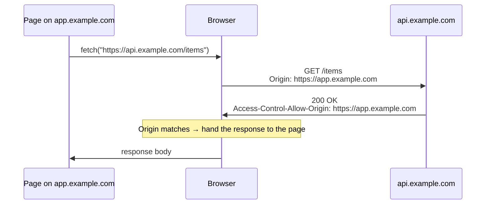
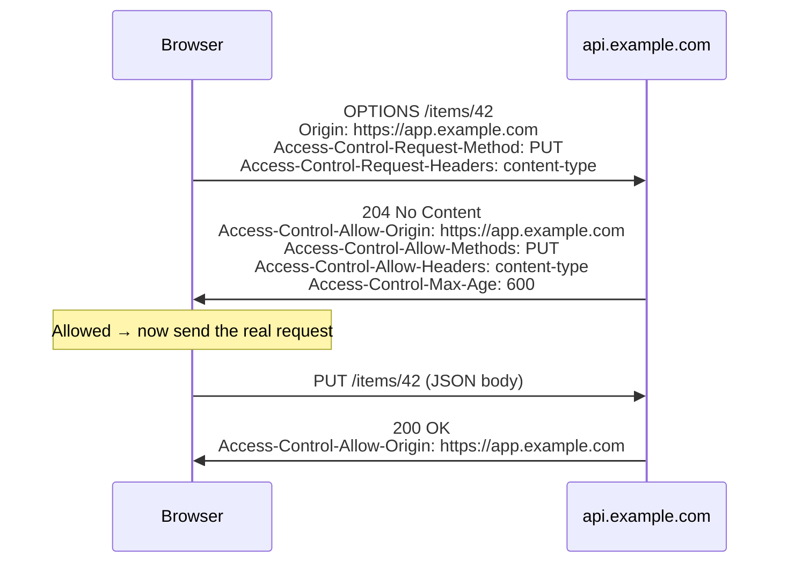

# 6. Origins, the same-origin policy and CORS

Assumes [file 01](01-foundations.md). Read it **before [file 07](07-loopback-and-local-network.md)**,
which uses "origin", "CORS preflight" and CSRF without stopping to explain them.

## The problem

Your browser is logged in to your bank. It holds a session cookie for `bank.example`, and
it attaches that cookie automatically to every request to `bank.example`, because that's what
cookies are for ([file 01](01-foundations.md), "Stateless, and how state comes back anyway").

Now you open a different tab on `games.example`. That page runs JavaScript, and nothing
stops JavaScript from making HTTP requests. If it could run

```js
const r = await fetch("https://bank.example/api/balance");
console.log(await r.text());   // your balance, sent with your cookie
```

and read the answer, every site you visited could read every other site you're logged in
to. The browser would be a confused deputy: acting with your credentials on behalf of
whichever page asked.

Browsers stop this with one rule and one exception mechanism. The rule is the **same-origin
policy**. The exception is **CORS**. Both depend on knowing what an "origin" is.

## What an origin is

> Two URIs are part of the same origin (i.e., represent the same principal) if they have the
> same scheme, host, and port. ([RFC 6454 §3.2](https://www.rfc-editor.org/rfc/rfc6454.html#section-3.2))

An **origin** is that triple: `(scheme, host, port)`. Path, query and fragment don't count.
Compare against `https://app.example.com`:

| URL | Same origin? | Why |
|---|---|---|
| `https://app.example.com/settings?tab=2` | ✅ | Path and query don't count |
| `https://app.example.com:443/` | ✅ | 443 is the default port for `https`, so it's the same port |
| `http://app.example.com/` | ❌ | Scheme differs |
| `https://app.example.com:8443/` | ❌ | Port differs |
| `https://api.example.com/` | ❌ | Host differs. A subdomain is a different origin |
| `https://example.com/` | ❌ | Host differs. A parent domain is too |

Written down, an origin has no trailing slash and no path: `https://app.example.com`. That
exact spelling matters when a server has to echo it back, as you'll see.

> ⚠️ **An origin isn't a site.** Browsers also use a looser boundary, the **site**: the scheme
> plus the registrable domain. `https://app.example.com` and `https://api.example.com` are
> **different origins** but the **same site** ([HTML Standard, "Sites"](https://html.spec.whatwg.org/multipage/browsers.html#sites)).
> The same-origin policy and CORS work on origins. Cookies' `SameSite` attribute, below,
> works on sites. Mixing the two up is how people end up thinking `SameSite` protects them from
> a sibling subdomain. It doesn't.

## The same-origin policy: reading, not sending

Here's the part almost everyone gets wrong at first. The same-origin policy does **not** stop
a page from *sending* requests to another origin. It stops the page from *reading the
responses*.

| A page on `games.example` can… | Cross-origin? | Allowed by default |
|---|---|---|
| Show an image from `bank.example` with `` | sends a `GET`, with cookies unless `SameSite` (below) withholds them | ✅ shown, but the script can't read its pixels |
| Run a script from a CDN with `<script src>` | sends a `GET` | ✅ runs, and that's how CDNs work |
| Submit a form to `bank.example/transfer` | sends a `POST`, with cookies unless `SameSite` withholds them | ✅ sent, and the page navigates away |
| `fetch()` from `bank.example` and read the body | sends the request | ❌ **reading the response is blocked**, unless the server allows it with CORS |
| Read the DOM of a `bank.example` page in an iframe | — | ❌ blocked |

That design comes from history. Images, scripts and form posts across sites were all common
before anyone thought about scripts reading responses, and breaking them would have broken
the web. So the policy blocks the one new capability, reading, and leaves sending alone.

> **Teacher's aside.** The same-origin policy protects **confidentiality, not integrity**.
> It stops `games.example` from *learning* your balance. It does nothing to stop
> `games.example` from *submitting a transfer*, because submitting a form across origins was
> always allowed and still is. The attack that exploits this has a name, cross-site request
> forgery, and the defences against it aren't the same-origin policy at all. Once you see that
> "can't read" and "can't send" are different guarantees, CSRF, CORS and file 07's
> Local Network Access all make sense.

## CSRF, and how cookies got a say

**Cross-site request forgery (CSRF)**: a page on one site makes your browser send a
state-changing request to another site, and your cookie rides along. The attacker never sees
the response and doesn't need to. The transfer happened.

```html
<!-- on games.example -->
<form action="https://bank.example/transfer" method="POST">
  <input type="hidden" name="to" value="attacker">
  <input type="hidden" name="amount" value="10000">
</form>
<script>document.forms[0].submit()</script>
```

There are two standard defences. They work best together:

| Defence | How it works | Limit |
|---|---|---|
| **CSRF token** | The bank's own pages embed a secret, per-session value in each form; the server rejects requests without it. `games.example` can't read the bank's pages, so it can't learn the token | Every state-changing endpoint has to check it |
| **`SameSite` cookie attribute** | The cookie says when the browser may attach it to a request triggered by *another site* | Works per **site**, not per origin; and browsers disagree on the default (below) |

`SameSite` has three values:

| Value | Cookie sent on cross-site requests? |
|---|---|
| `Strict` | Never. Even following a link from another site to yours arrives without the cookie |
| `Lax` | Only on top-level navigations, like following a link. Not on cross-site form `POST`s, `fetch`es or embedded images |
| `None` | Always, as before `SameSite` existed. Must be paired with `Secure` |

What happens when a cookie doesn't set `SameSite` at all is where the browsers diverge.
Chromium-based browsers treat it as `Lax` (Chrome since version 80, Edge since 86). Firefox
has the behaviour only behind a flag, and Safari doesn't treat it as `Lax`. That's per the
browser-support table on [web.dev's SameSite explainer](https://web.dev/articles/samesite-cookies-explained),
whose prose dates from 2019 while the table itself is kept current. So "browsers default to
Lax now" is true for most users and false for some. Set `SameSite` explicitly and you don't
depend on which browser the user has.

## CORS: the server opts in to being read

Sometimes you *want* another origin to read your responses. Your front end lives on
`https://app.example.com` and your API on `https://api.example.com`, two origins as far as
the browser is concerned. **Cross-Origin Resource Sharing (CORS)** is how the API tells the
browser "that origin may read my responses". It's defined in the WHATWG
[Fetch Standard](https://fetch.spec.whatwg.org/#http-cors-protocol), not in an RFC.

For a plain request, it's one header in each direction:



1. The browser adds an `Origin` header saying which origin's page made the request.
2. The server decides, and if it's willing, answers with `Access-Control-Allow-Origin`
   naming that origin, or `*` for anyone.
3. The **browser** compares the two. If they match, the page gets the response. If they
   don't, the page gets a network error and the console says "CORS".

> ⚠️ **The request already happened.** In a plain cross-origin request, the server received
> it, ran the handler and produced a response before the browser decided the page couldn't
> see it. CORS hides the *response*. It doesn't stop the *request*. If your `POST` handler
> changes data, a missing CORS header won't protect you. That's CSRF's territory, above.

## Preflight: asking before sending

A request is sent straight away, as above, only if it's the kind a plain HTML form could
already have sent before CORS existed. The Fetch Standard lists exactly what qualifies:

| Part | Allowed without a preflight |
|---|---|
| Method | `GET`, `HEAD`, `POST` |
| Headers the script sets | `Accept`, `Accept-Language`, `Content-Language`, `Content-Type`, `Range` (each value at most 128 bytes) |
| `Content-Type` values | `application/x-www-form-urlencoded`, `multipart/form-data`, `text/plain` |

Anything else gets a **preflight**: `PUT`, `DELETE` or `PATCH`; a custom header like
`Authorization` or `X-Request-Id`; or a JSON body with `Content-Type: application/json`. In the
Fetch Standard's words: "For requests that are more involved than what is possible with
HTML's form element, a CORS-preflight request is performed, to ensure request's current URL
supports the CORS protocol."



Why the extra round trip exists: servers written before CORS assumed that a browser could
never send them a cross-origin `PUT`, or a JSON body, because a form couldn't. Some of them
relied on that for security. The preflight asks permission *before* sending anything a form
couldn't have sent, so those servers stay as safe as they were. For a request that needs a
preflight, unlike the plain one above, a server that doesn't answer the preflight correctly
never receives the real request at all.

The browser can cache a preflight answer for `Access-Control-Max-Age` seconds. Browsers cap
it: Firefox at 24 hours and Chromium at 2 hours, and the default when the header is absent is
5 seconds ([MDN](https://developer.mozilla.org/en-US/docs/Web/HTTP/Reference/Headers/Access-Control-Max-Age)).
A low cap means a chatty single-page app pays the extra round trip often. That's a real cost
on the round-trip arithmetic from file 01.

## Credentials: where the strict rules are

By default, `fetch()` across origins sends no cookies. To include them, the page has to ask
(`credentials: "include"`), *and* the server has to opt in again. The Fetch Standard gives a
table of legal and illegal combinations, for a request from `https://rabbit.invalid`:

| Request's credentials mode | `Access-Control-Allow-Origin` | `Access-Control-Allow-Credentials` | Page can read it? |
|---|---|---|---|
| omit | `*` | omitted | ✅ |
| omit | `https://rabbit.invalid/` | omitted | ❌ "A serialized origin has no trailing slash" |
| omit | `https://rabbit.invalid` | omitted | ✅ |
| include | `*` | `true` | ❌ "If credentials mode is "include", then `Access-Control-Allow-Origin` cannot be `*`" |
| include | `https://rabbit.invalid` | `true` | ✅ |
| include | `https://rabbit.invalid` | `True` | ❌ "`true` is (byte) case-sensitive" |

Three of those rows are a day lost each: a trailing slash, a wildcard with cookies, and a
capital T. The wildcard rule exists because "any site may read responses made with this
user's cookies" would bring back exactly the attack from "The problem".

Because a server allowing several origins has to echo the request's `Origin` back rather than
send one fixed value, the response varies by request header. The Fetch Standard says to say
so with `Vary: Origin`. Otherwise a cache can store the response made for one origin and serve
it to another, or serve a non-CORS copy with no `Access-Control-Allow-Origin` at all.

## What CORS is not

| Belief | Reality |
|---|---|
| "CORS protects my API" | CORS protects **users' browsers** from pages reading data with the user's credentials. `curl`, a server, or a script outside a browser ignores it entirely |
| "A CORS error means the server rejected me" | The server may have answered fine, or it may have crashed: a `500` from a framework that only adds CORS headers on success shows up in the console as a CORS error. Check the actual status in the Network tab first |
| "Adding `Access-Control-Allow-Origin: *` is harmless" | For public, cookie-free data, yes. Reflecting any `Origin` *with* `Allow-Credentials: true` lets every site read logged-in users' data |
| "The preflight is the security check" | It's a compatibility check for pre-CORS servers. Your authorisation still happens in your handler |

## How this connects to file 07

[File 07](07-loopback-and-local-network.md) is the same story aimed at one hard case: a page
on a public origin talking to a program on `127.0.0.1`. Mixed content and secure contexts
decide whether the request may be made at all. A local program is a different origin, so
it's this chapter's CORS rules that decide whether the page can read the reply. And Private
Network Access was an attempt to add a *preflight* in front of requests into a private
network, for precisely the reason preflights exist: devices on a home network were built
assuming no website could reach them.

## Check yourself

1. Which of these are the same origin as `https://shop.example.com`?
   `https://shop.example.com:443/cart`, `http://shop.example.com/`,
   `https://cdn.shop.example.com/`, `https://shop.example.com:8080/`. For each "no", name
   which part of the triple differs.
2. A page on `evil.example` submits a hidden form that `POST`s to
   `bank.example/transfer`. The bank sends no CORS headers. Does the transfer happen? Explain
   using the difference between reading and sending.
3. Your front end on `https://app.example.com` calls `fetch()` with a JSON body and an
   `Authorization` header. The browser sends an `OPTIONS` request your server returns `404`
   for. What does the user see, and did your `POST` handler ever run? Contrast with a plain
   `GET` that fails CORS.
4. You set `Access-Control-Allow-Origin: *` and `Access-Control-Allow-Credentials: true`, and
   the front end uses `credentials: "include"`. Why does the browser refuse, and what would go
   wrong if it didn't?
5. `api.example.com` and `app.example.com` share a `SameSite=Strict` session cookie scoped to
   `example.com`. Does `SameSite` stop a malicious page hosted on `blog.example.com` from
   making a credentialed request to the API? Why, or why not?
6. Your API returns `Access-Control-Allow-Origin` by echoing the request's `Origin` when it's
   in an allow-list. It works in testing, then in production users of the second front end
   intermittently get CORS errors. A CDN sits in front of the API. What's missing, and what's
   the CDN doing?

(Answers in [`08-exercises.md`](08-exercises.md).)
