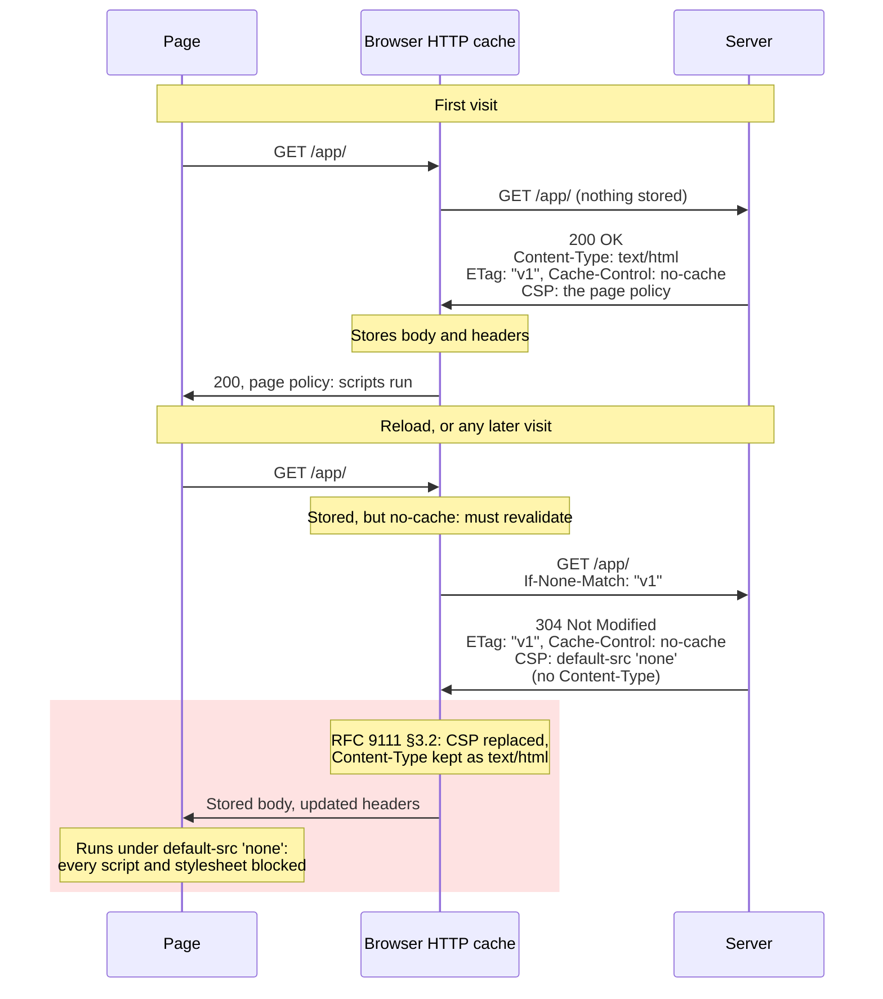

# 8. Caching, revalidation and what a 304 rewrites

Assumes [file 01](01-foundations.md): requests, responses, header fields and status
classes. The failure this chapter is built around involves a `Content-Security-Policy`
header, which [file 07](07-loopback-and-local-network.md) introduces; what you need of it is
explained here.

## The problem

A single-page app loads perfectly the first time. Reload it and the page is blank: no error
page, no `404`, just an empty root element and a console full of Content Security Policy
violations for the app's own scripts and stylesheets. Clear the browser's cache and it works
again, once. The server's log shows a `200` for the first load and a `304` for every load
after it, and nothing on the server changed in between.

What changed was the browser's stored copy of the page, and the server changed it, by
answering "nothing has changed". To see how, you need three ideas: when a cache may reuse a
response without asking, how it asks, and what it does with the answer. The first two are the
familiar part of HTTP caching. The third is where this bug lives, and it's the part almost
nobody reads.

## Why caches exist

The cheapest request is the one you never send. [File 01](01-foundations.md) counted round
trips, and a round trip is the one cost bandwidth can't buy down. A browser that kept
yesterday's copy of a stylesheet can skip the round trip entirely. If it isn't sure its copy
is still current, the next best thing is a request whose answer is a few hundred bytes saying
"yours is fine", instead of the whole file again.

RFC 9111, HTTP Caching, is built on exactly those two cases:

> A cache considers a stored response "fresh", as defined in Section 4.2, if it can be reused
> without "validation" (checking with the origin server to see if the cached response remains
> valid for this request). ([RFC 9111 §1](https://www.rfc-editor.org/rfc/rfc9111.html#section-1))

So a cache asks two questions of anything it has stored, in order. Is it still **fresh**, so
it can be reused without asking? If not, can it be **validated**, by asking the server
whether it's still good? The browser keeps a **private cache**, "dedicated to a single user";
a CDN or proxy runs a **shared cache**, one "that stores responses for reuse by more than one
user" (§1). This chapter is about the browser's. Most of it applies to both.

## Freshness: reuse without asking

A server says how long a response stays fresh with the `max-age` directive of
`Cache-Control`:

> The max-age response directive indicates that the response is to be considered stale after
> its age is greater than the specified number of seconds.
> ([RFC 9111 §5.2.2.1](https://www.rfc-editor.org/rfc/rfc9111.html#section-5.2.2.1))

A response's **age** is "the time that has passed since it was generated by, or successfully
validated with, the origin server", and the whole test is one line of the RFC,
`response_is_fresh = (freshness_lifetime > current_age)`
([§4.2](https://www.rfc-editor.org/rfc/rfc9111.html#section-4.2)). While a copy is fresh, the
browser uses it and the server never hears about it.

These are the cases this chapter uses. Two of them, `no-cache` and `no-store`, sound as if
they both switch caching off, and they do different things:

| `Cache-Control` | May the cache store it? | May it reuse it without asking? | Where it's defined |
|---|---|---|---|
| `max-age=600` | Yes | For 600 seconds. After that it must validate | RFC 9111 §5.2.2.1 |
| `no-cache` | Yes | Never. The response "MUST NOT be used to satisfy any other request without forwarding it for validation and receiving a successful response" | RFC 9111 §5.2.2.4 |
| `no-store` | No. The cache "MUST NOT store any part of either the immediate request or the response" | — | RFC 9111 §5.2.2.5 |
| `max-age=31536000, immutable` | Yes | For a year, and a reload shouldn't ask either | [RFC 8246 §2](https://www.rfc-editor.org/rfc/rfc8246.html#section-2) |
| None at all, but there's a `Last-Modified` | Yes | For a lifetime the cache guesses (below) | RFC 9111 §4.2.2 |

So `no-cache` doesn't mean "don't cache". It means "keep it, but ask me before every use",
which is exactly right for an HTML page whose URL never changes and whose content changes on
every deploy. `no-store` is the one that means "don't keep it".

**`immutable`** is for the opposite kind of file. A build tool that puts a hash of each file's
content into its name, such as `app.3f9c2b.js`, guarantees that the content at a URL never
changes: a new build produces a new URL. A file like that can be cached for a year, and RFC
8246 adds that "Clients SHOULD NOT issue a conditional request during the response's
freshness lifetime (e.g., upon a reload) unless explicitly overridden by the user (e.g., a
force reload)". Its own example is `Cache-Control: max-age=31536000, immutable` (§2.2).
Support isn't uniform. Firefox's cache passes the directive into its decision whether to
revalidate ([`nsHttpChannel.cpp`](https://github.com/mozilla-firefox/firefox/blob/3cefc2e7ff220c10ed2ec641ba304c1ea0d281fe/netwerk/protocol/http/nsHttpChannel.cpp#L5510-L5526)).
Chromium's parses it, but the source I read uses it only behind a feature flag that's off by
default
([`kCacheControlImmutable`](https://github.com/chromium/chromium/blob/bedd93b84d0db43c09c420d54f187c31ac676ffb/net/base/features.cc#L172)),
next to a TODO to let it override the flag that forces validation
([`http_response_headers.cc:1273`](https://github.com/chromium/chromium/blob/2b5d649769f63662fd563c9e41d9e5a2c65acd0a/net/http/http_response_headers.cc#L1273)),
so don't count on it saving requests there.

A response with no explicit lifetime isn't "not cached" either. If it has a `Last-Modified`
date, the cache may guess one, which RFC 9111 calls a **heuristic expiration time**:

> If the response has a Last-Modified header field (Section 8.8.2 of [HTTP]), caches are
> encouraged to use a heuristic expiration value that is no more than some fraction of the
> interval since that time. A typical setting of this fraction might be 10%.
> ([RFC 9111 §4.2.2](https://www.rfc-editor.org/rfc/rfc9111.html#section-4.2.2))

Chromium does exactly that: for a `200` with no explicit lifetime, the freshness lifetime is a
tenth of the time between `Last-Modified` and the response's `Date`
([`http_response_headers.cc:1350`](https://github.com/chromium/chromium/blob/2b5d649769f63662fd563c9e41d9e5a2c65acd0a/net/http/http_response_headers.cc#L1350)).
A page last edited thirty days ago is reused for three days without the browser asking. The
RFC's advice to a server that doesn't want this is to say so: origin servers "are encouraged to
send explicit directives (e.g., Cache-Control: no-cache) if they wish to prevent caching"
(§4.2.2).

## Validation: asking cheaply

When a stored copy isn't fresh, or carries `no-cache`, the cache has to ask the server whether
it's still good, without paying for the body if it is. That needs something to compare. RFC
9110 calls it a **validator**
([§8.8](https://www.rfc-editor.org/rfc/rfc9110.html#section-8.8)), and there are two:

| The response carries | What it is | The cache sends it back as | The server answers "unchanged" when |
|---|---|---|---|
| `ETag: "xyzzy"` | An opaque tag the server chooses, which changes when the content does ([§8.8.3](https://www.rfc-editor.org/rfc/rfc9110.html#section-8.8.3)) | `If-None-Match: "xyzzy"` | "one of the listed tags matches the entity tag of the selected representation" ([§13.1.2](https://www.rfc-editor.org/rfc/rfc9110.html#section-13.1.2)) |
| `Last-Modified: <date>` | When the server believes the content last changed ([§8.8.2](https://www.rfc-editor.org/rfc/rfc9110.html#section-8.8.2)) | `If-Modified-Since: <date>` | the content's last modification date "is earlier or equal to the date provided in the field value" ([§13.1.3](https://www.rfc-editor.org/rfc/rfc9110.html#section-13.1.3)) |

If a request carries both, the tag wins: "A recipient MUST ignore If-Modified-Since if the
request contains an If-None-Match header field" (§13.1.3). A tag is often the more reliable
of the two, and §8.8.3 names the cases where a date falls short, among them "where the
one-second resolution of HTTP-date values is not sufficient, or where modification dates are
not consistently maintained". A tag written `W/"xyzzy"` is **weak**: the server may keep it
across changes it considers equivalent. That's fine here, because cache validation uses the
weak comparison (§13.1.2).

When the tag matches, a server "MUST respond with either a) the 304 (Not Modified) status code
if the request method is GET or HEAD or b) the 412 (Precondition Failed) status code for all
other request methods" (§13.1.2). The whole exchange looks like this (the tag is made up):

```
GET /app/ HTTP/1.1
Host: example.com
If-None-Match: "v1"

HTTP/1.1 304 Not Modified
ETag: "v1"
Cache-Control: no-cache
```

One round trip, no body, and the browser uses the copy it had. That's the usual story. The
next two sections are about what it leaves out.

## What a 304 must carry

RFC 9110 [§15.4.5](https://www.rfc-editor.org/rfc/rfc9110.html#section-15.4.5) defines
`304 Not Modified`, and three passages do the work. What it means:

> ...the server is therefore redirecting the client to make use of that stored representation
> as if it were the content of a 200 (OK) response.

What it must carry:

> The server generating a 304 response MUST generate any of the following header fields that
> would have been sent in a 200 (OK) response to the same request:
>
> * Content-Location, Date, ETag, and Vary
> * Cache-Control and Expires (see [CACHING])

And what it should leave out:

> Since the goal of a 304 response is to minimize information transfer when the recipient
> already has one or more cached representations, a sender SHOULD NOT generate representation
> metadata other than the above listed fields unless said metadata exists for the purpose of
> guiding cache updates (e.g., Last-Modified might be useful if the response does not have an
> ETag field).

`Content-Type` is representation metadata (RFC 9110 defines it in §8.3, inside the section
titled "Representation Data and Metadata"), so a correct server leaves it off a 304. Hold on
to that. The 304 in this chapter's incident had no `Content-Type`, and that wasn't the bug.
That was the server doing what the RFC asks.

Notice what §15.4.5 doesn't settle. It names the fields a 304 must carry, and asks that
representation metadata be left off. A header such as `Content-Security-Policy` falls between
the two: it isn't on the list, and nothing in RFC 9110 says whether it counts as
representation metadata. Whether a server sends it on a 304 is the server's choice, and the
next section is why that choice matters.

## What a cache does with a 304

A 304 doesn't just say "keep it". RFC 9111
[§4.3.3](https://www.rfc-editor.org/rfc/rfc9111.html#section-4.3.3) says a 304 "indicates that
the stored response can be updated and reused". Updated comes first. §4.3.4, "Freshening
Stored Responses upon Validation", says how:

> For each stored response identified, the cache MUST update its header fields with the header
> fields provided in the 304 (Not Modified) response, as per Section 3.2.
> ([RFC 9111 §4.3.4](https://www.rfc-editor.org/rfc/rfc9111.html#section-4.3.4))

and §3.2, "Updating Stored Header Fields", says what updating means:

> When doing so, the cache MUST add each header field in the provided response to the stored
> response, replacing field values that are already present, with the following exceptions:
> ([RFC 9111 §3.2](https://www.rfc-editor.org/rfc/rfc9111.html#section-3.2))

There are four exceptions:

| §3.2's exception | What it covers |
|---|---|
| "Header fields excepted from storage in Section 3.1" | `Connection` and the fields it names, other fields that must be removed before forwarding, fields named in a `no-cache` or `private` directive's argument, and proxy-specific fields such as `Proxy-Authenticate` |
| "Header fields that the cache's stored response depends upon" | The RFC's own examples: a browser that decoded the content coding on arrival can't take a different `Content-Encoding`, and one that stores "a post-parse HTML tree" can't take a different `Content-Type` |
| "Header fields that are automatically processed and removed by the recipient" | Its example is `Content-Range` |
| "The Content-Length header field" | — |

The second exception is narrow on purpose: caches "MAY omit these header fields from updating
stored responses on an exceptional basis but SHOULD limit such omission to those fields
necessary to assure integrity of the stored response". And §3.2 closes off one tempting
shortcut: "Note that the Content-* prefix is not a signal that a header field is omitted from
update". `Content-Security-Policy` gets no protection from its name.

Everything else on the 304 replaces what was stored. The Fetch Standard, which specifies how
browsers fetch, does the same. In its HTTP-network-or-cache fetch, when a revalidation gets a 304,
the steps are to "Update storedResponse's header list using forwardResponse's header list, as
per the "Freshening Stored Responses upon Validation" chapter of HTTP Caching", with the note
"This updates the stored response in cache as well", and then to hand the stored response to
whoever asked ([Fetch §4.6](https://fetch.spec.whatwg.org/#http-network-or-cache-fetch)).

Each engine's source has a list of the fields it refuses to take from a 304. All three are
deny-lists: anything not on the list is copied over the stored value.

| Field on the 304 | Chromium | Firefox | WebKit |
|---|---|---|---|
| `Content-Type`, `Content-Encoding`, `Content-Length`, `Content-Range`, `Content-Location` | Not taken | Not taken | Not taken |
| `ETag` | Not taken | Not taken | Not taken |
| Hop-by-hop fields: `Connection`, `Keep-Alive`, `Transfer-Encoding`, `Upgrade`… | Not taken | Not taken | Not taken |
| `Last-Modified` | Taken | Taken | Not taken |
| `X-Frame-Options`, `X-XSS-Protection`, anything starting `X-Content-` | Not taken | Taken | Not taken |
| `Cache-Control`, `Expires`, `Date`, `Vary` | Taken | Taken | Taken |
| `Content-Security-Policy` | Taken | Taken | Taken, by name |
| Anything else, such as `Referrer-Policy` | Taken | Taken | Taken |

The lists are Chromium's `kNonUpdatedHeaders`
([`net/http/http_response_headers.cc:89–109`](https://github.com/chromium/chromium/blob/2b5d649769f63662fd563c9e41d9e5a2c65acd0a/net/http/http_response_headers.cc#L89-L109)),
Firefox's `nsHttpResponseHead::UpdateHeaders`
([`nsHttpResponseHead.cpp:830–876`](https://github.com/mozilla-firefox/firefox/blob/e5b6db0c400c71559261e4ab18f0fbdb48d69ef0/netwerk/protocol/http/nsHttpResponseHead.cpp#L830-L876))
and WebKit's `headersToIgnoreAfterRevalidation`
([`CacheValidation.cpp:47–94`](https://github.com/WebKit/WebKit/blob/e427188d73fb165e49a4aade8c172b47ea6fbe02/Source/WebCore/platform/network/CacheValidation.cpp#L47-L94)).
WebKit's check opens with a special case, before it even looks at the list:
`if (header.startsWithIgnoringASCIICase("content-security-"_s)) return true;`, where `true`
means "take the 304's value". All three
agree with the RFC's example and keep the stored `Content-Type`. None of them protects the
stored policy.

> **Teacher's aside.** The usual mental model of a 304 is a yes/no answer: "still good". The
> RFC's model is a partial response: "still good, and here are the current headers". The body
> is reused and the headers are merged. So every field your server puts on a 304 is a write
> to every cache holding that page.
>
> Put the last two sections side by side and there's an asymmetry that's easy to miss.
> `Content-Type` is a field the server is told to leave off a 304 and that every engine
> refuses to take from one, so the stored copy goes on saying `text/html`. Anything the server
> *derives* from `Content-Type` is computed, on the 304, from nothing. And that derived field
> has no protection at all: it lands in the cache next to a `Content-Type` that says the
> opposite of what the server assumed.

## The incident, step by step

The server chose a Content Security Policy for each response from the response's
`Content-Type`. HTML pages got a policy that let them load their own scripts and styles.
Everything else got `default-src 'none'`. That second policy is sensible on its face: CSP's
`default-src` "serves as a fallback for the other fetch directives", and the CSP specification
suggests building a policy by beginning "with a default-src of 'none'" and allowing only what
each page needs ([CSP3 §6.1.3](https://w3c.github.io/webappsec-csp/#directive-default-src)).
On a page, though, it blocks every script and stylesheet, because a source list holding only
`'none'` "does not match any URL".

In nginx, the configuration looked like this:

```nginx
# The bug: the policy is chosen by the Content-Type being sent.
map $sent_http_content_type $csp {
    ~^text/html   "default-src 'self'; script-src 'self'";
    default       "default-src 'none'";
}

add_header Content-Security-Policy $csp;
```

Pages went out with `Cache-Control: no-cache` and an `ETag`.



Step by step:

1. **First visit.** Nothing is stored. The `200` has `Content-Type: text/html`, the map picks
   the page policy, the browser stores the body and every header, and the page runs.
2. **Every later visit.** `no-cache` means the stored copy can't be used until it's
   validated, so the browser sends `If-None-Match`. The page hasn't changed, so the server
   answers `304`.
3. **The server builds the 304.** When nginx turns a response into a 304 it clears the
   content type, as §15.4.5 asks
   ([`ngx_http_not_modified_filter_module.c:94–96`](https://github.com/nginx/nginx/blob/9984f3053f7c7f027aae9188111c4571962ff90c/src/http/modules/ngx_http_not_modified_filter_module.c#L94-L96)).
   `add_header` applies to 304s: its documentation lists 304 among the status codes it adds
   fields to ([nginx docs](https://nginx.org/en/docs/http/ngx_http_headers_module.html#add_header)).
   So the map sees an empty `$sent_http_content_type`, falls through to `default`, and the 304
   goes out carrying `default-src 'none'`.
4. **The browser merges.** Per §3.2 and the table above: the policy is replaced, and
   `Content-Type` stays `text/html`.
5. **The page runs under the merged headers.** HTML builds a document's policies by "parsing a
   response's Content Security Policies" from the response it's handed
   ([HTML Standard](https://html.spec.whatwg.org/multipage/browsers.html#creating-a-policy-container-from-a-fetch-response)),
   and the response it's handed is the stored one. Every script and stylesheet is blocked and
   the root element stays empty.

The stored response, before and after:

| | Stored after the `200` | Carried by the `304` | Stored after the merge |
|---|---|---|---|
| `Content-Type` | `text/html` | — | `text/html` |
| `ETag` | `"v1"` | `"v1"` | `"v1"` |
| `Cache-Control` | `no-cache` | `no-cache` | `no-cache` |
| `Content-Security-Policy` | `default-src 'self'; script-src 'self'` | `default-src 'none'` | **`default-src 'none'`** |
| Body | The HTML | None | The HTML |

`curl` shows the 304 directly. `-D -` prints the response headers, `-o /dev/null` throws the
body away, and the `If-None-Match` value is the tag from an earlier `200`. Trimmed to the
fields that matter, with the tag as a placeholder, it showed:

```
$ curl -s -D - -o /dev/null -H 'If-None-Match: "<etag>"' https://example.com/app/
HTTP/1.1 304 Not Modified
ETag: "<etag>"
Cache-Control: no-cache
Content-Security-Policy: default-src 'none'
```

No `Content-Type` line, correctly. The blank page was observed in Chromium 156 and Firefox
157, driven by Playwright 1.64.1 on macOS 26.1. WebKit wasn't part of that test. Its source,
above, says it would take the policy from the 304 too, but that's reading code, not an
observation.

## The fix, and the rule it generalises to

The smallest fix is to say nothing about the policy on a 304, so the stored copy keeps the
policy its `200` delivered:

```nginx
# The fix: no policy at all on a 304.
map "$status:$sent_http_content_type" $csp {
    ~^304:               "";
    ~^[0-9]+:text/html   "default-src 'self'; script-src 'self'";
    default              "default-src 'none'";
}

add_header Content-Security-Policy $csp;
```

Two nginx details make it work. `map` tries regular expressions in the order they appear, so
the `304` line wins
([map docs](https://nginx.org/en/docs/http/ngx_http_map_module.html#map)). And an empty value
makes `add_header` send nothing, because the module adds the field only when the value is
non-empty (`if (value->len)` in
[`ngx_http_headers_filter_module.c:573`](https://github.com/nginx/nginx/blob/f04e2b7f6e96a0587f091229272a5f060dbf32c0/src/http/modules/ngx_http_headers_filter_module.c#L573)).
With the fix in place, `curl` showed the 304 with no policy at all and the `200` still
carrying the page policy, and in Firefox, reloads that got a 304 rendered normally.

> ⚠️ **A header your server computes per response gets computed for the 304 as well, and the
> 304's value replaces the stored one.** Anything derived from `Content-Type`, from the
> status, or from the body (which a 304 doesn't have) has to come out the same on the 304, or
> be left off it. Any layer that adds headers after the 304 decision is made, whether a
> proxy's header rules or a framework's middleware, sees the 304, not the `200` it stands for.

Leaving a field off is the safe default, but it isn't available for every field:

| Field on the 304 | What to do | Why |
|---|---|---|
| `ETag`, `Cache-Control`, `Expires`, `Vary`, `Date`, `Content-Location` | Send it, with the value the `200` would have had. If you compute it per response, compute it from something the 304 still has, such as the URL | RFC 9110 §15.4.5 makes these a MUST |
| `Content-Type` and other representation metadata | Leave it off | RFC 9110 §15.4.5 says SHOULD NOT, and the engines wouldn't take it anyway |
| Policy fields you compute: `Content-Security-Policy`, `Referrer-Policy` and the like | Leave it off, or make sure it comes out identical | RFC 9111 §3.2 copies whatever you send |

Leaving the policy off has a cost worth knowing. A deploy that changes the policy but not the
page's bytes won't reach browsers that already hold the page: their revalidations get 304s
that don't mention the policy, so they keep the old one. The new policy arrives when the page
itself changes, because a new `ETag` means a `200`, and a full response replaces the stored
one wholesale ([§4.3.3](https://www.rfc-editor.org/rfc/rfc9111.html#section-4.3.3)). Most
deploys change the HTML anyway, since the hashed asset names in it change. Change only the
policy, though, and returning visitors get it when the page next changes, not before.

The other fix sends the page's policy on the 304 as well, so each revalidation writes the
current policy over the stored one:

```nginx
# The other fix: a 304 gets the page's policy.
map "$status:$sent_http_content_type" $csp {
    ~^(304:|[0-9]+:text/html)   "default-src 'self'; script-src 'self'";
    default                     "default-src 'none'";
}

add_header Content-Security-Policy $csp;
```

A changed policy then reaches returning visitors on their next visit, with no change to the
page. The cost is an assumption the first fix doesn't make: that a 304 from this server is
always for a page. It held here, because the API answered no conditional requests and the
hashed assets stayed fresh for a year, and a policy on a stray asset's 304 would have done
nothing, since a policy only acts on a page or a worker. Where it doesn't hold, choose the
policy from something the 304 still has, such as the URL, as the table asks for the fields a
304 must carry.

What each fix does for a browser that already holds a poisoned copy is question 6 below. Work
it out before you deploy either.

## When a proxy changes the body: tags for writes

The same tags guard writes, and there they're held to a stricter standard. A client that
read a document tagged `"42"`, changed it and sends it back with `If-Match: "42"` is asking
"apply this only if the document is still the one I read", so that two editors can't
silently overwrite each other. For that, near enough isn't enough:

> An origin server MUST use the strong comparison function when comparing entity tags for
> If-Match (Section 8.8.3.2), since the client intends this precondition to prevent the
> method from being applied if there have been any changes to the representation data.
> ([RFC 9110 §13.1.1](https://www.rfc-editor.org/rfc/rfc9110.html#section-13.1.1))

The two comparisons differ only in what they do with a weak tag, and RFC 9110 gives the
whole difference as a table
([§8.8.3.2](https://www.rfc-editor.org/rfc/rfc9110.html#section-8.8.3.2)):

| Tag 1 | Tag 2 | Strong comparison | Weak comparison |
|---|---|---|---|
| `W/"1"` | `W/"1"` | no match | match |
| `W/"1"` | `W/"2"` | no match | no match |
| `W/"1"` | `"1"` | no match | match |
| `"1"` | `"1"` | match | match |

A weak tag never matches strongly, not even itself. That's the design: a strong tag promises
the exact bytes, and §8.8.1 says strong validators are "usable for all conditional requests,
including cache validation, partial content ranges, and 'lost update' avoidance", while weak
ones are only for when "the client does not require exact equality with previously obtained
representation data".

Now put a proxy that compresses between the client and the server. Gzip changes the bytes,
so the tag the server chose for the uncompressed document no longer describes what the
client receives. §8.8.1 is explicit that it can't stay strong: "if the origin server sends
the same validator for a representation with a gzip content coding applied as it does for a
representation with no content coding, then that validator is weak". A compressing proxy has
to do something about it, and the common ones do different things:

| Proxy | What it does to a strong tag when it compresses | Source |
|---|---|---|
| nginx, since 1.7.3 | Makes it weak: `"42"` becomes `W/"42"` | [CHANGES](https://nginx.org/en/CHANGES), 1.7.3: "weak entity tags are now preserved on response modifications, and strong ones are changed to weak" |
| Apache httpd's mod_deflate | By default appends the compression method to the tag, so the compressed copy gets a distinct one. `DeflateAlterETag` can instead leave the tag alone or remove it | [`DeflateAlterETag`](https://httpd.apache.org/docs/2.4/mod/mod_deflate.html#deflatealteretag): `AddSuffix` "has been the default since 2.4.0" |

Both are right for caches, and both break writes. Here's nginx 1.30.6 compressing JSON
(`gzip on`, `gzip_types application/json`), in front of a small server that answers `GET /doc` with `ETag: "42"` and accepts a `PUT`
only when `If-Match` equals the current tag:

```
GET /doc                               ETag: "42"
GET /doc   Accept-Encoding: gzip       ETag: W/"42"    Content-Encoding: gzip
PUT /doc   If-Match: W/"42"            412 Precondition Failed
PUT /doc   If-Match: "42"              204 No Content
```

A browser that reads the document through the proxy gets `W/"42"`, and every save it makes
gets `412`. Reading again doesn't help, since it gets `W/"42"` again. I didn't run Apache,
but by the same reasoning its default fails too: a suffixed tag is no tag the server minted,
so a strong comparison can't match it.

> ⚠️ **A test with curl can pass while every browser fails.** curl asks for a compressed
> response only when given `--compressed`
> ([manual](https://curl.se/docs/manpage.html#--compressed)), so a scripted test reads the
> strong tag and its saves succeed. A browser always asks: `Accept-Encoding` is one of the
> headers the Fetch Standard has the browser set "in the network & cache layer", a forbidden
> request-header that a page's scripts can't remove
> ([Fetch](https://fetch.spec.whatwg.org/#http-network-or-cache-fetch)).

The fixes, and what each costs:

| Fix | Cost |
|---|---|
| Don't compress the answers that carry a tag for writes. In nginx, `gzip off` in a location of their own | Those answers travel uncompressed. A document an editor loads and saves is usually small |
| Compress at the server instead, and give each coding its own strong tag, as RFC 9110's example does, `"123-a"` for plain and `"123-b"` for gzip ([§8.8.3.3](https://www.rfc-editor.org/rfc/rfc9110.html#section-8.8.3.3)). nginx leaves a response that already has a `Content-Encoding` alone ([`ngx_http_gzip_filter_module.c:233`](https://github.com/nginx/nginx/blob/c370ac8a51152cc67f803b553579bfc16299efc3/src/http/modules/ngx_http_gzip_filter_module.c#L233-L234)) | The server's `If-Match` check has to accept every tag it minted for the current version |
| Compare weakly on the server, so `W/"42"` matches `"42"` | Not allowed: it's §13.1.1's MUST. It's unsafe too, since a weak tag may stand for several versions the server considers equivalent |
| Carry the version somewhere of your own, such as a field in the body | Works through any proxy, but leaves HTTP's mechanism, so generic clients and tools don't understand it |

With the first fix, a `location` for `/doc` with `gzip off`, the same reads through the same
proxy came back `"43"` (the successful save above made it 43) and uncompressed, and a save
with that tag got `204`.

It's the same shape as this chapter's incident. A layer between the server and the client
rewrote what the server said, correctly by its own rules. The server's assumption, that the
client sees the tag it chose, held in every test that didn't go through that layer the way a
browser does.

## Check yourself

1. A colleague reads `Cache-Control: no-cache` on your HTML and says "so the browser doesn't
   cache it, and the `ETag` is wasted bytes". What does the browser actually keep, what does
   each later visit cost, and what would each visit cost if you removed the `ETag` and there
   were no `Last-Modified` either?
2. A server sends `Last-Modified` but no `Cache-Control` or `Expires` on a page last edited
   50 days ago. You publish a correction. Why do some readers go on seeing the old text, for
   roughly how long in Chromium, and which single header would have prevented it?
3. Your build emits `app.3f9c2b.js` with `Cache-Control: max-age=31536000, immutable`, and the
   `index.html` that references it with `no-cache`. Walk through a returning visitor's
   requests after you deploy a new build. Then say what breaks, mechanically, if someone
   "optimises" by giving `index.html` the same header as the script.
4. In this chapter's incident, suppose the page had been sent with `Cache-Control: max-age=600`
   instead of `no-cache`. When would a user first see the blank page, and why would the bug
   look intermittent to someone trying to reproduce it?
5. A different server chooses `Cache-Control` by `Content-Type`, the way the incident chose
   its policy: `text/html` gets `no-cache`, everything else gets
   `max-age=31536000, immutable`. Pages carry an `ETag`. Nothing looks broken. What has
   happened to every returning visitor's copy of the HTML, and when does anyone find out?
6. You deploy the smallest fix, the one that leaves the policy off 304s. A user who hit the
   blank page yesterday comes back today, and the HTML hasn't changed since. What do they see,
   and why? Name two things that would recover them, and one thing that won't.

(Answers in [`10-exercises.md`](10-exercises.md).)
