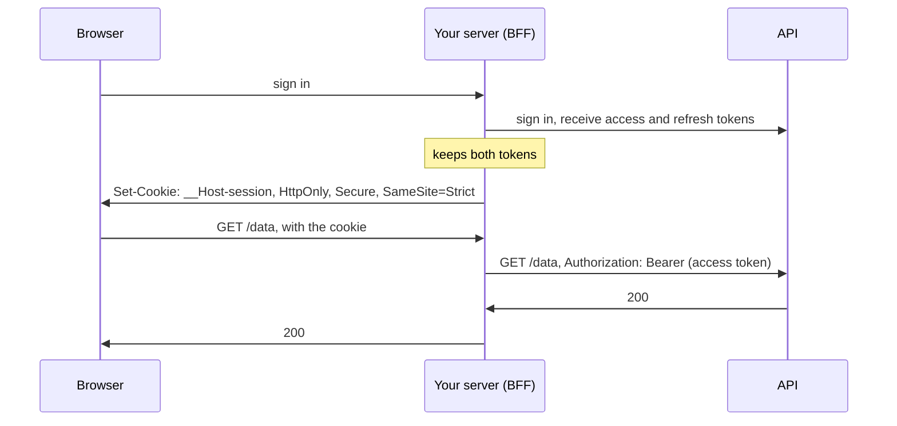

# 9. Keeping a browser signed in: cookies, tokens and where they live

Assumes [file 06](06-origins-and-cors.md): origins and sites, CSRF, `SameSite` and
`Sec-Fetch-Site`. If you develop on `http://localhost`, read
[file 07](07-loopback-and-local-network.md)'s section on `Secure` cookies as well.

## The problem

HTTP doesn't remember you. Each request stands on its own
([RFC 9110 §3.3](https://www.rfc-editor.org/rfc/rfc9110.html#section-3.3)), so a dashboard
that checked your password once has to be told on every later request that it's still you.
After you sign in, the browser keeps a **credential** and presents it with each request.

Two decisions about that credential set how much damage one bug can do. Where does the
browser keep it? And how does the session it stands for come to an end? Most arguments about
this get framed as "cookies or JWTs", which mixes those two questions up with a third that
matters less. Untangling them is most of this chapter.

## Format and place are separate questions

A credential has a **format**: what its bytes are, and what the server does with them.

| Format | What the server does with it | Example |
|---|---|---|
| An opaque session ID | looks it up in its own session store | `9f2c4e…`, 128 random bits or more |
| A signed token | checks the signature, then trusts what's inside, with no lookup | `1800000000.k3JxQ…`, an expiry and an HMAC of it; or a JWT |

A **JWT** (JSON Web Token) is one standard signed-token format, "a compact claims
representation format intended for space constrained environments such as HTTP
Authorization headers and URI query parameters"
([RFC 7519 §1](https://www.rfc-editor.org/rfc/rfc7519.html#section-1)). Its `exp` claim names
the time "on or after which the JWT MUST NOT be accepted for processing" (§4.1.4). Nothing in
RFC 7519 says where a browser should keep one.

A credential also has a **place**: where the browser keeps it between requests, which decides
how it travels.

| Place | How it's sent | Can the page's own scripts read it? |
|---|---|---|
| A cookie marked `HttpOnly` | the browser attaches it to matching requests by itself | No |
| `localStorage` or `sessionStorage` | script reads it and adds a header, usually `Authorization: Bearer …` | Yes |
| A JavaScript variable | script adds a header | Yes, while the page is open |

Any format can go in any place. A JWT in an `HttpOnly` cookie is ordinary, and so is an
opaque ID in one. The security properties come almost entirely from the place; the one thing
the format decides is how the session can end.

> **Teacher's aside.** "Cookies or tokens" is the wrong axis. Ask three questions instead.
> Can the page's own scripts read the credential? That decides what an injected script can
> steal. Does the browser send it by itself? That decides whether CSRF applies. Can the server
> end it before it expires? That decides what signing out means. The place answers the first
> two, and the format the third.

## What an attacker gets from each place

The attack that turns on the place is **cross-site scripting (XSS)**: someone else's script
running in your page, through an injection bug or a compromised dependency. It runs as your
page, so it reaches everything your page can reach.

OWASP's
[HTML5 Security Cheat Sheet](https://cheatsheetseries.owasp.org/cheatsheets/HTML5_Security_Cheat_Sheet.html)
is blunt about web storage: "Do not store session identifiers in local storage as the data is
always accessible by JavaScript. Cookies can mitigate this risk using the `httpOnly` flag."
And: "A single Cross Site Scripting can be used to steal all the data in these objects". It
does prefer `sessionStorage` to `localStorage` "if persistent storage is not needed". That
keeps a token to one tab and drops it when the tab closes, but injected script reads one as
easily as the other.

| | `HttpOnly` cookie | Web storage | JavaScript variable |
|---|---|---|---|
| Injected script can copy the credential and use it from elsewhere | No | Yes | Yes |
| Injected script can make requests as the user while the page is open | Yes | Yes | Yes |
| Another site can make the browser send it (CSRF) | Yes, so defend against it | No | No |
| Survives a reload | Yes | Yes (`sessionStorage`: in that tab only) | No |

Two rows deserve a second look. The second says `HttpOnly` doesn't make XSS harmless: script
inside the page can still act as the user. What `HttpOnly` takes away is *exfiltration*. The
attacker can't carry the credential off and go on using it from their own machine once the
tab is closed. The third row is the price: a credential the browser sends by itself is one
another site can make it send. That's CSRF, and file 06's defences apply: `SameSite`, plus a
CSRF token or a `Sec-Fetch-Site` check.

## The session cookie, attribute by attribute

OWASP's
[Session Management Cheat Sheet](https://cheatsheetseries.owasp.org/cheatsheets/Session_Management_Cheat_Sheet.html)
sets the bar for a session cookie:

| Attribute | What it does | The source's words |
|---|---|---|
| `HttpOnly` | hides the cookie from page script | "This session ID protection is mandatory to prevent session ID stealing through XSS attacks." |
| `Secure` | the cookie travels only over a secure connection | "It ensures that an attacker cannot simply capture the session ID from web browser traffic." |
| `SameSite=Strict` | never sent on a request another site starts | "Session cookies must explicitly set `SameSite=Strict` (preferred) or `SameSite=Lax`." |
| A `__Host-` name | the browser refuses the cookie unless it "will have been set with a Secure attribute, a Path attribute with a value of /, and no Domain attribute" (rfc6265bis §4.1.3.2), so a sibling subdomain can't plant one | — |
| `Max-Age` | the browser drops the cookie after this many seconds | — |

All of it together:

```
Set-Cookie: __Host-session=1800000000.k3JxQ…; Path=/; Max-Age=43200; HttpOnly; Secure; SameSite=Strict
```

`SameSite=Strict` has a reputation for breaking links from other sites, because following one
arrives without the cookie (file 06). That hurts a server-rendered page, which needs the
cookie to render. A single-page app usually doesn't notice: its HTML is public, and the calls
it makes afterwards start from its own pages, so they carry the cookie.

## How a session ends

A session should end in three ways: when the user signs out, when it has been idle too long,
and when it's simply too old. OWASP asks for all three:

- Signing out: "the web application must invalidate the session at least on server side."
- Idle: "Common idle timeouts ranges are 2-5 minutes for high-value applications and 15-30
  minutes for low risk applications."
- Too old: "All sessions should implement an absolute timeout, regardless of session
  activity."

This is where the format matters:

| | An opaque ID and a session store | A signed token, nothing stored |
|---|---|---|
| Signing out ends it everywhere | Yes: delete the row | No: the browser drops its copy, but any other copy works until it expires |
| Idle timeout | Yes: record when it was last used | Only by issuing a new token on each use |
| Absolute timeout | Yes | Yes: the expiry is inside the token |
| End every session at once | Delete every row | Change the signing key |
| Cost per request | A lookup | A signature check |

The first row is the one that surprises people. Sign out of an app whose session is a signed
token, replay the old value from a terminal, and it still works until its expiry. Every way
round that, whether a deny-list of revoked tokens or a "valid only after" time per user, is
state on the server again. Revocation costs a lookup, whatever the token looks like.

A lookup can fail, and how the server answers then matters. If the session store can't be
reached, the request's credentials weren't found wanting; the server couldn't check them. RFC
9110 defines `401` as a request that "lacks valid authentication credentials"
([§15.5.2](https://www.rfc-editor.org/rfc/rfc9110.html#section-15.5.2)), which isn't known
here, and `500` as "an unexpected condition that prevented it from fulfilling the request"
([§15.6.1](https://www.rfc-editor.org/rfc/rfc9110.html#section-15.6.1)), which is. A `401`
would also send every signed-in user to a sign-in page whose own write to the store fails
the same way, so answer with a `5xx` and let the page say the server is having trouble.

Caches open the same gap more quietly. A gateway that checks each token with its issuer and
caches the answer for 60 seconds goes on accepting a revoked token for up to 60 seconds.

### How long, and what an idle timeout does to unsaved work

OWASP's ranges above are one answer to "how long". NIST's guidance on authentication, SP
800-63B-4, gives limits for each of its assurance levels, from AAL1, the lowest, to AAL3, the
highest
([§2.1.3, §2.2.3, §2.3.3](https://pages.nist.gov/800-63-4/sp800-63b.html)):

| Level | Overall timeout | Inactivity timeout |
|---|---|---|
| AAL1 | "SHOULD be no more than 30 days" | "MAY be applied but is not required" |
| AAL2 | "SHOULD be no more than 24 hours" | "SHOULD be no more than 1 hour" |
| AAL3 | "SHALL be no more than 12 hours" | "SHOULD be no more than 15 minutes" |

Both count activity the same way. OWASP measures the idle period "since the last HTTP request
received by the web application for a given session ID", and NIST says "Session activity SHALL
reset the inactivity timeout". So the server's idea of "still there" is "a request with the
cookie arrived", which has two consequences.

The first is about what refreshes a session. A page that polls something every ten seconds,
such as a health check, keeps an abandoned tab signed in for ever if those requests count as
use. Let only the requests that need the session refresh it. The second is OWASP's own caveat:
an idle timeout doesn't slow down someone who has stolen a session, "as they can generate
activity on the session periodically to keep the session active". It ends abandoned sessions.
The absolute timeout is what bounds a stolen one.

An idle timeout also ends sessions under people who are still there, reading or typing. The
next request gets a `401`, and if the page's answer to a `401` is to go to the sign-in page,
whatever was typed and not yet saved goes with it. OWASP's reason for adding client-side code
to the server's timeout is exactly this: it "helps to avoid loss of work in web pages that
require extensive input data due to server-side silently expired sessions". NIST's usability
advice says the same from the other side: "Prompt users to perform some activity just before
(e.g., two minutes before) an inactivity timeout would otherwise occur."

| What the page does on a `401` | What survives | What it costs |
|---|---|---|
| Goes to the sign-in page | Nothing typed since the last save | Nothing: it's the default |
| Warns before the timeout, with a button that sends a request | The page, if someone is there to press it | The page has to know the timeout, and a stolen session gets the same button |
| Signs in again over the page: a dialog where the unsaved state lives, then the failed requests again | The page and everything on it | A second way to sign in, kept as strict as the first |

None of the three weakens the timeout. The server ended the session either way, and the new
sign-in starts a new session with its own limits. Only the page's state survives.

## Tokens in single-page apps

A common single-page-app design works like this. Signing in returns an **access token**,
often a short-lived JWT, and a **refresh token** that lives much longer. The app keeps both in
web storage and sends the access token as `Authorization: Bearer`. On a `401`, it trades the
refresh token for a new pair. It's simple to build, and it has no CSRF exposure, because a
browser never adds that header by itself.

Its weak point is the refresh token. Injected script can read it from web storage and send it
home, and the attacker can then mint access tokens from their own machine for as long as the
refresh token lives. A short-lived access token limits nothing when the refresh token leaves
with it.

There are two common ways to harden it:

1. **Access token in memory, refresh token in an `HttpOnly` cookie** scoped to the refresh
   endpoint (`Path=/auth/refresh`). Injected script can still use the current access token
   while the page is open, but it can't take anything long-lived away.
2. **The server keeps every token.** The browser holds only a session cookie, and a component
   on your own server, a **backend for frontend** (BFF), keeps the tokens and adds them to the
   calls it makes on the browser's behalf.



[RFC 10017](https://www.rfc-editor.org/rfc/rfc10017.html), OAuth 2.0 for Browser-Based
Applications, is the IETF's Best Current Practice on this. Its patterns "are presented in
decreasing order of security" (§6), with the BFF first, because with it "there are no tokens
available to extract from the browser" (§6.1). It requires that "The BFF MUST enable the
`HttpOnly` flag for its cookies" (§6.1.3.2), and says "This architecture is strongly
recommended for business applications" (§6.1.4.3).

An older RFC looks as if it says the opposite.
[RFC 6750](https://www.rfc-editor.org/rfc/rfc6750.html), which defines bearer tokens, says in
§5.3: "Implementations MUST NOT store bearer tokens within cookies that can be sent in the
clear". Read the condition. It's about cookies without `Secure`, which a 2012 network could
carry as plain text, and a `Secure` cookie isn't one. The rule beside it still stands: "Bearer
tokens SHOULD NOT be passed in page URLs".

> ⚠️ **A token in a log is a working credential.** A proxy or framework that logs request
> headers writes every `Authorization` value into its logs, and anyone who can read the logs
> can act as those users until the tokens expire. OWASP's
> [Logging Cheat Sheet](https://cheatsheetseries.owasp.org/cheatsheets/Logging_Cheat_Sheet.html)
> lists "Session identification values" and "Access tokens" among the data to exclude. Check
> what your reverse proxy logs.

## Choosing, for a dashboard

| You have | A sound choice |
|---|---|
| A browser app served from the same site as its API | an `HttpOnly`, `Secure`, `SameSite=Strict` cookie, a CSRF defence from file 06, and a session store if signing out has to mean something |
| A browser app that calls APIs on other domains, or signs in through an OAuth provider | a BFF; failing that, the access token in memory and the refresh token in an `HttpOnly` cookie |
| Scripts, services and command-line tools | a bearer token in `Authorization`, never in a URL, never in a log |

## Check yourself

1. A team says "we use JWTs, so we're stateless and secure". Split the claim into its format
   half and its place half. What does each half tell you about an injected script, and about
   signing out?
2. An app keeps its access JWT and its refresh token in `sessionStorage`. An attacker's script
   runs for two seconds in one tab, and then the user closes the tab. What can the attacker do
   afterwards, and for how long? Answer again for an access token kept in memory, with the
   refresh token in an `HttpOnly` cookie scoped to `/auth/refresh`.
3. Your dashboard at `http://127.0.0.1:8080` signs in with an
   `HttpOnly; Secure; SameSite=Strict` cookie. A development tool you also run, at
   `http://127.0.0.1:3000`, is compromised and submits a hidden form that `POST`s to your API.
   Does the browser attach the cookie? What should stop the write, and what does the server
   look at to stop it?
4. A user signs out, but a copy of their stateless session cookie leaked an hour earlier. What
   can the holder do, and until when? Name two ways to end it, and what each costs.
5. A gateway checks bearer tokens by calling their issuer, and caches each answer for 60
   seconds. Security asks: "if we revoke a token, when does it stop working?" Answer, and say
   what you would change if the answer has to be "at once".
6. RFC 6750 says bearer tokens "MUST NOT" be stored "within cookies that can be sent in the
   clear", while RFC 10017 ranks a browser that holds only a cookie as the most secure pattern.
   Do they disagree? What is each rule protecting against?

(Answers in [`10-exercises.md`](10-exercises.md).)
