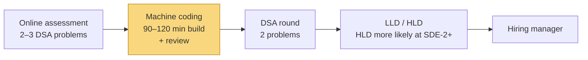
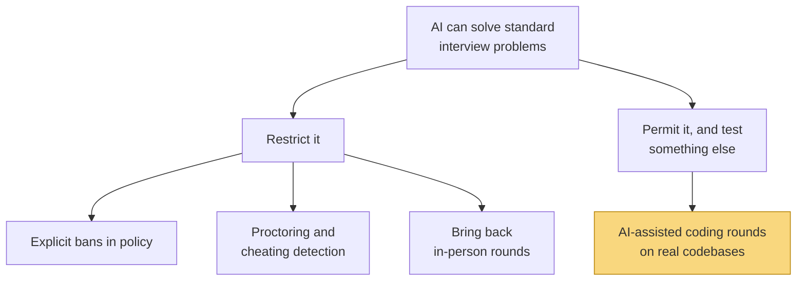

# 1. How the interview loop works

You can study algorithms for six months and still be blindsided by an interview, because you
prepared for one round and the company runs five. This chapter is the map: which rounds
exist, what each one is actually measuring, how Indian companies differ, and what AI has —
and hasn't — changed since 2024.

**Who can skip it:** nobody, really. It's short, and every other course in this folder
assumes it. If you've interviewed recently at the kind of company you're targeting, skim
§1.3 and read §1.6 carefully — that's the part that's moving.

> **How much to trust this chapter.** Companies rarely publish their loops. Where one has —
> Amazon, Atlassian, Meta, Microsoft, Canva — I cite the page. Almost everything about
> Indian product companies comes from candidate write-ups (LeetCode Discuss, Substack,
> GeeksforGeeks). Those are consistent with each other, but they're anecdotes, and I label
> them as such. Everything here was checked in October 2026; §1.6 in particular will date.

---

## 1.1 Why a loop and not one test

Suppose a company wants to know whether you can do the job. The job involves writing
correct code under constraints, designing things other people will extend, reasoning about
systems you didn't build, and working with humans. No single hour measures all of that, and
any single hour is noisy — you might get a problem you happen to have seen, or have a bad
morning.

So companies do what any measurement does with a noisy instrument: **take several readings
of different things and combine them.** Each round is one reading. The set of rounds is the
**loop**, and a hiring decision is made from all of them together, usually in a meeting
called a **debrief** or by a **hiring committee**.

That framing explains a lot of behaviour that otherwise seems arbitrary:

| Observation | Why, given "several noisy readings" |
|---|---|
| One bad round doesn't always sink you | It's one reading of several |
| Interviewers care how you got there, not just whether you finished | The *process* is the signal; the answer is one bit |
| Rounds deliberately don't overlap | Two readings of the same thing waste an hour |
| A strong DSA round can't rescue a weak design round at senior levels | They're measuring different things; one can't stand in for the other |

> **Teacher's aside.** People treat each round as a test with a pass mark. It's closer to
> a conversation where the interviewer is filling in a rubric — problem decomposition,
> communication, correctness, testing, trade-offs. Silent and correct often scores worse
> than spoken-aloud and nearly correct, because the interviewer had nothing to write down.
> Amazon's prep page says it directly: they want to see how you think, and coding means
> real code, "no pseudocode" ([amazon.jobs SDE II prep][amzn-sde2]).

---

## 1.2 The rounds

These are the round types you'll meet. No company runs all of them, and names vary.

| Round | What it measures | Typical shape | Prepared by |
|---|---|---|---|
| **Online assessment (OA)** | Can you solve standard problems, alone, under time pressure. A filter, not a judgement | 2–3 problems in 60–120 min on HackerRank, HackerEarth or CodeSignal; sometimes MCQs or work-style surveys | [`dsa/`](dsa/README.md) |
| **DSA / coding** | Problem decomposition, choosing a data structure, complexity reasoning, clean working code, testing | 45–60 min, 1–2 problems, live with an interviewer | [`dsa/`](dsa/README.md) |
| **CS fundamentals** | Do you understand the machine and the network under your code | Questions on OS, DBMS, networks, OOP — sometimes its own round, often folded into another | [`cs-fundamentals/`](cs-fundamentals/README.md) |
| **Machine coding** | Can you build a small, *working*, extensible program fast | 90–120 min to build, then a review where you extend it. See §1.4 | [`system-design/`](system-design/README.md) (LLD chapter) |
| **Low-level design (LLD)** | Class and interface design, responsibilities, patterns | Design a parking lot, a cache, a snake game — on a whiteboard or in code | [`system-design/`](system-design/README.md) |
| **High-level design (HLD)** | Designing a distributed system and defending the trade-offs | 45–60 min, open-ended: "design a notification system" | [`system-design/`](system-design/README.md) |
| **Hiring manager** | Depth on your past work, ownership, judgement | Project deep-dive plus behavioural questions | §1.7 |
| **Behavioural / values** | How you work with people and handle conflict, failure, ambiguity | Structured questions, often scored against company principles | §1.7 |
| **Bar raiser** (Amazon's name; others have equivalents) | An outside check that the hire raises the team's average | Any of the above, run by someone outside the hiring team | §1.7 |

---

## 1.3 Three kinds of company

Indian tech hiring splits into three broad worlds. They hire for different things, so they
run different loops.

| | Service companies | Indian product companies | Big tech in India |
|---|---|---|---|
| Examples | TCS, Infosys, Wipro, HCLTech | Flipkart, Swiggy, PhonePe, Razorpay, Meesho, CRED | Google, Amazon, Microsoft, Atlassian, Uber |
| Entry route | National tests and hackathons for freshers — TCS NQT, Infosys HackWithInfy, Wipro Elite NTH | Referral or application → OA | Referral or application → OA or recruiter screen |
| Distinctive round | Aptitude and verbal sections alongside coding | **Machine coding** | Bar raiser / hiring committee / values round |
| What gets weighted | Breadth, fundamentals, trainability | Shipping working code; LLD; DSA | DSA and system design, rubric-scored |
| Evidence quality | TCS and Infosys publish the test's existence; detail is from prep sites | **No company publishes its loop** — all candidate reports | Several publish official prep pages |

**Service companies.** The fresher route is a mass test. TCS's NQT has a Foundation section
(aptitude, verbal, reasoning) and an Advanced section that includes coding; the Advanced
section decides which offer band you're considered for ([TCS NQT page][tcs-nqt]). Infosys
runs HackWithInfy, a coding contest whose top finishers get interviews ([Infosys
HackWithInfy][hwi]). Interviews afterwards are reported as one technical round (OOP, DBMS,
OS, your projects) and one HR round — but I found no official description of them. Exact
timings and salary bands change every year; check the current page, not a prep site.

**Indian product companies.** Here's the reported shape for 1–4 years of experience. It's
consistent across many write-ups but not published by any company:

Examples from candidate reports: a Flipkart SDE-2 loop in 2026 with a 75-minute HackerEarth
OA, a proctored machine-coding round with about 60 candidates on one call, and a 45-minute
evaluation that asked for a concurrency extension ([LeetCode Discuss, Feb 2026][lc-flipkart]);
a PhonePe SDE-2 loop with a take-home machine-coding round on CodeSignal and an HLD round on
a Quora-like system ([roundz, Aug 2025][roundz-phonepe]); a six-round Swiggy SDE-3 loop
including LLD and a notification-system HLD ([roundz, Jul 2025][roundz-swiggy]).

**Big tech.** These publish more. Amazon's SDE II page describes an OA (two coding questions,
system-design scenarios and a work-style survey) and then a loop of four 55-minute
interviews covering coding, data structures and algorithms, problem solving and system design, with
behavioural questions tied to its Leadership Principles ([amazon.jobs][amzn-sde2]).
Atlassian lists two coding parts (data structures and code design), a 60-minute system design
interview, a manager interview and a values interview, followed by a hiring committee
([Atlassian][atlassian]). Meta lists coding, design and behavioural rounds, with 45-minute
coding interviews ([Meta careers][meta-prep]).

---

## 1.4 The machine coding round

This round is the most India-specific thing in this chapter, and the least documented, so
it gets its own section.

The problem it solves: a DSA round shows you can write a 30-line function. It doesn't show
you can build a program with several moving parts that someone else can extend next week.
Big tech probes that with LLD on a whiteboard. Many Indian product companies instead make
you **build it, running, in about 90 minutes** — a task scheduler, a food-ordering backend,
a to-do app with analytics — then spend 30–45 minutes asking you to extend it. The
extension is where it's decided: "now make it thread-safe", "now add a second pricing rule".

Reported patterns, all from candidate write-ups:

- **Working beats pretty.** A 2026 Flipkart report says they "prioritize correct running
  code over neat code with OOP" ([LeetCode Discuss][lc-flipkart]). Code that doesn't run
  is very hard to recover from.
- **But structure is what makes the extension cheap.** If adding a rule means editing five
  `if` chains, you'll run out of time in the review. Interfaces and separation of
  responsibilities are how you buy speed later — that's the LLD skill.
- **Concurrency follow-ups are common.** Several reports, including Flipkart and Uber in
  Bangalore, mention it.
- **No database, no framework, usually.** In-memory storage, a driver `main` or tests.

> ⚠️ Nobody knows who coined "machine coding" or which company started it. I looked and
> couldn't find an origin. Treat any confident history you read as invented.

---

## 1.5 How the loop changes with experience

All from candidate reports, but the pattern is consistent:

| Level | Typical loop | What's weighted most |
|---|---|---|
| **Fresher** | OA → DSA → CS fundamentals → HR | DSA and fundamentals; projects stand in for experience |
| **1–4 years (SDE-1 / SDE-2)** | OA → machine coding or LLD → DSA → hiring manager; HLD increasingly at SDE-2 | DSA plus building and designing real code |
| **Senior (SDE-3+)** | The above plus HLD as a core round, and a heavier manager or bar-raiser round | Design, judgement, and depth on past work |

The shift is from "can you solve problems" toward "can you be trusted with a system". DSA
never disappears, but it stops being what separates candidates.

---

## 1.6 What AI has changed

Since 2023, a candidate can paste a problem into a chatbot and read back a solution. That
broke the assumption that a remote coding round measures the candidate. Companies have
responded in two opposite directions, and both are real.

### Direction 1: restrict it

| Who | What | Source |
|---|---|---|
| Amazon (early 2025) | Told candidates not to use GenAI unless explicitly permitted, on pain of disqualification | Reported by Business Insider, via [ITPro, Mar 2025][itpro-amzn] |
| Microsoft | "candidates should demonstrate their own skills without outside assistance unless explicitly permitted" | [Microsoft hiring tips][msft] |
| Anthropic | No AI in live interviews unless told otherwise | [Anthropic candidate guidance, Jul 2025][anthropic] |
| Google | Employees asked "Can we get onsite job interviews back?" at a February 2025 town hall; Pichai answered "it's worth thinking about some fraction of the interviews being in person" ([CNBC, from audio, Mar 2025][cnbc-google]). By August 2025 he was widely reported as saying Google would add "at least one round" in person — I couldn't find where he said that, and some outlets misattribute the February quote to a podcast | [HCAMag, Aug 2025][hcamag] |
| Cisco, McKinsey | Added in-person steps, partly over fake candidates | [Computerworld, Aug 2025][computerworld] |

The cheating that prompted this is real. The best-known case is **Interview Coder**, a tool
that overlaid AI solutions invisibly during screen-shared interviews; its author recorded
himself using it in an Amazon interview, left Columbia over it, and raised seed money for a
successor called Cluely ([TechCrunch, Apr 2025][tc-cluely]).

How common cheating is in India, nobody can tell you reliably. One vendor that runs AI
interviews flagged 38.5% of about 19,000 interviews in late 2025 ([Fabric, Jan
2026][fabric]); another vendor is reported as saying "nearly one in three". Both sell
detection products, "flagged" is not "caught", and their methods aren't comparable. Treat
these as "a lot, and rising", not as numbers.

### Direction 2: permit it, and test something else

| Who | What | Scope |
|---|---|---|
| **Canva** | Candidates are *expected* to use AI tools. An AI-assisted coding round replaced the CS fundamentals screen, using ambiguous, realistic product tasks | Policy for backend, ML and frontend roles ([Canva, Jun 2025][canva]) |
| **Meta** | A coding round with an AI assistant, working on a multi-file project: fix bugs, implement, optimise. Replaces one of two coding rounds | Confirmed as a pilot in July 2025 ([404 Media][404]); details from prep companies ([HelloInterview][hi-meta]). Which levels get it is disputed between sources |
| **Google** | Candidates may use Gemini in a code-comprehension round — read, debug and improve existing code — rated partly on "AI fluency" | Pilot, select US teams, H2 2026, reported from an internal document ([Entrepreneur, May 2026][entrepreneur]). **Nothing reported for India** |
| **Amazon** | Says it "reimagined" SDE assessments so candidates work with an AI assistant on a real coding platform | [Amazon, Jan 2026][amzn-ai]. Amazon gives no scope; Indian candidates in 2026 report both the new format and the old two-DSA-problem OA |
| **Shopify** | Encourages AI; interviewers watch whether you catch its mistakes | [Pragmatic Engineer, Jul 2025][pragmatic] |

Read the scope column before the "what" column. Every one of these **replaces a round; none
replaces the loop.**

### Where India stands

As of October 2026, **I found no Indian product company — Flipkart, Swiggy, PhonePe,
Razorpay, CRED, Zerodha — that has publicly announced an AI-permitted interview round.**
The closest is a Meesho HR leader quoted in the Economic Times as "redesigning interviews
around real-world problem-solving" — which I could only read second-hand. Where Indian
candidates meet AI-assisted rounds, it's mostly at big tech, especially Amazon's newer OA.

So the honest summary for India today: the traditional loop is intact, proctoring is
tighter, and AI-assisted rounds are something you *might* meet at a multinational.

### What an AI-assisted round is actually testing

The companies that describe their AI rounds converge on the same four things — Canva,
Google's internal note as reported, and Meta's:

1. **Decomposing the problem** before touching the tool.
2. **Directing the tool** — a precise request beats "solve this".
3. **Verifying what it gives you** — reading generated code critically, testing it, catching
   the subtle bug.
4. **Integrating it** into code that a reviewer would accept.

> **Teacher's aside.** The common conclusion — "AI writes code now, so fundamentals matter
> less" — has the evidence backwards. Look at item 3. You can only catch an O(n²) loop
> hiding in generated code, or a race in a "thread-safe" cache, if you'd have recognised it
> in your own code. AI-assisted rounds move the difficulty from *producing* code to
> *judging* it, and judging needs the same knowledge, held more firmly. That's why the
> courses in this folder teach the model rather than the answers.

### What hasn't changed

- Official prep pages at Amazon, Atlassian, Meta and Microsoft still list data structures,
  algorithms and system design.
- Indian candidate reports from 2026 — Google and Amazon in Bangalore, Flipkart — are still
  dominated by DSA problems, machine coding and design.
- A vendor survey of 400 engineering leaders across the US, India and China found 62% of
  organisations still don't allow AI in interviews ([Karat, Jan 2026][karat]). It doesn't
  break India out separately, and Karat sells interviewing services.

---

## 1.7 The human rounds

Technical candidates under-prepare these, then lose offers on them.

The method almost everyone recommends is **STAR**: **S**ituation, **T**ask, **A**ction,
**R**esult. It exists because the default way people tell a work story — lots of context, a
vague "we", no outcome — gives the interviewer nothing to score. STAR forces the parts a
rubric needs: what *you* did, and what happened. Amazon recommends it by name on its prep
page ([amazon.jobs][amzn-sde2]). DDI, a consultancy, says it invented the method; that's
their claim about themselves ([DDI][ddi]).

| Company | Framework | What to prepare |
|---|---|---|
| Amazon | 16 **Leadership Principles** ([Amazon][amzn-lp]); behavioural questions map to them, and a **Bar Raiser** from outside the team sits on the loop ([How Amazon hires][amzn-hires]) | Two stories per principle, from real work |
| Google | "Googleyness & Leadership", using structured rubric-based interviews ([re:Work][rework]) | Collaboration, ambiguity, leadership without authority |
| Atlassian | A values interview against its published values ([Atlassian][atlassian]) | Read the values; map stories to them |
| Indian product companies | Usually inside the hiring-manager round; no published framework | Ownership, conflict, a deep-dive on your best project |

> ⚠️ "We" is the commonest way to fail a behavioural round. The interviewer is scoring
> *you*. Say "I" for what you did and "the team" for what others did, and be ready to
> answer "what would have happened without you?"

---

## 1.8 Reading evidence about interviews

You'll read a great deal of interview advice. Most of it is a candidate's single
experience, a prep company selling a course, or a tool vendor selling detection. The
sources rank roughly like this:

| Source | Weight | Watch for |
|---|---|---|
| A company's own careers or engineering page | Strongest — but describes the intended loop, not every loop | Out-of-date pages; "may include" language |
| Credible journalism quoting documents or executives | Strong | Second-hand reports of paywalled originals |
| Vendor surveys and data (Karat, HackerRank, CoderPad) | Real data, commercial motive | Percentages that happen to justify the product |
| Many independent candidate reports agreeing | Useful pattern | Survivorship; recency; one company's teams differ |
| One candidate report, or a prep site's "top 50 questions" | Weak | Prep sites copy each other; many are AI-generated |

That's why every course here labels its "Asked in interviews" lists as anecdotal: they come
from the bottom two rows.

---

## Check yourself

1. A friend aced the DSA round, was average in design, and got rejected for a senior role.
   Using the "several noisy readings" model, explain why that's not unfair.
2. In a machine-coding round, you've got 20 minutes left and a working but tangled program.
   Do you refactor or add tests? What does the review that follows tell you?
3. A company announces candidates may use AI in one coding round. What will the problems in
   that round probably look like, and why would a LeetCode-style problem be a poor choice
   for it?
4. Someone tells you "Google now allows AI in interviews". What three questions do you ask
   before believing it applies to your Bangalore interview next month?
5. A prep site says "70% of Flipkart interviews ask about LRU cache". What's wrong with that
   sentence as evidence, even if LRU cache really is common?
6. Make the strongest argument you can that AI-assisted rounds make CS fundamentals *more*
   important, then the strongest argument that they make them less. Which does the evidence
   in §1.6 support?

(Answers in [`02-exercises.md`](02-exercises.md).)

[amzn-sde2]: https://www.amazon.jobs/content/en/how-we-hire/sde-ii-interview-prep
[amzn-lp]: https://www.aboutamazon.com/about-us/leadership-principles
[amzn-hires]: https://www.aboutamazon.com/news/workplace/how-amazon-hires
[amzn-ai]: https://www.aboutamazon.com/news/workplace/artificial-intelligence-resume-jobs-hiring-amazon
[tcs-nqt]: https://www.tcs.com/careers/india/tcs-all-india-nqt-hiring
[hwi]: https://www.infosys.com/careers/hackwithinfy/2022.html
[atlassian]: https://www.atlassian.com/company/careers/resources/interviewing/engineering
[meta-prep]: https://www.metacareers.com/swe-prep-onsite/
[msft]: https://careers.microsoft.com/v2/global/en/hiring-tips.html
[anthropic]: https://www.anthropic.com/candidate-ai-guidance
[canva]: https://www.canva.dev/blog/engineering/yes-you-can-use-ai-in-our-interviews/
[404]: https://www.404media.co/meta-is-going-to-let-job-candidates-use-ai-during-coding-tests/
[hi-meta]: https://www.hellointerview.com/blog/meta-ai-enabled-coding
[entrepreneur]: https://www.entrepreneur.com/business-news/google-is-testing-a-new-rule-transform-job-interviews
[pragmatic]: https://newsletter.pragmaticengineer.com/p/how-ai-is-changing-software-engineering
[itpro-amzn]: https://www.itpro.com/business/careers-and-training/amazon-bans-ai-tools-during-job-interviews
[cnbc-google]: https://www.cnbc.com/2025/03/09/google-ai-interview-coder-cheat.html
[hcamag]: https://www.hcamag.com/us/specialization/hr-technology/google-opts-for-in-person-interviews-amid-surge-in-ai-aided-candidates/545926
[computerworld]: https://www.computerworld.com/article/4044734/to-counter-ai-cheating-companies-bring-back-in-person-job-interviews.html
[tc-cluely]: https://techcrunch.com/2025/04/21/columbia-student-suspended-over-interview-cheating-tool-raises-5-3m-to-cheat-on-everything/
[fabric]: https://www.fabrichq.ai/blogs/state-of-ai-interview-cheating-in-2026-insights-from-19-368-interviews
[karat]: https://karat.com/engineering-interview-trends-2026/
[ddi]: https://www.ddi.com/solutions/behavioral-interviewing/star-method
[rework]: https://rework.withgoogle.com/intl/en/guides/a-guide-to-structured-interviewing-for-better-hiring-practices
[lc-flipkart]: https://leetcode.com/discuss/post/7591327/
[roundz-phonepe]: https://roundz.substack.com/p/interview-experience-174-phonepe-sde2
[roundz-swiggy]: https://roundz.substack.com/p/interview-experience-123-swiggy-sde3-l8
