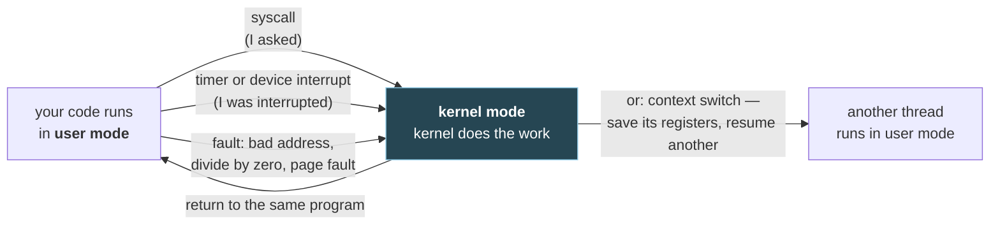

# 1. What happens when a program runs

## The problem

Interviewers ask about operating systems, databases and networks as if they were three
separate subjects. They aren't. They're three views of one event: a program you wrote
runs on a machine, asks the operating system for things, keeps data somewhere and talks
to other machines. Learn them as separate syllabi and you collect definitions that don't
connect. Then a question like "what happens when your Go service handles a request?"
crosses three of them, and the definitions don't help.

This chapter follows one program from source code to exit, end to end. Every term the
later chapters use appears here first, in context, with a pointer to the chapter that
goes deeper.

**Who can skip it:** if you can explain what a system call is and why it's expensive,
what a virtual address is, what a process owns that a thread doesn't, and what a socket
is, skim the vocabulary table in §1.10 and move on.

## 1.1 The one idea underneath everything

Here's the model to keep in your head for the whole course:

> **Your program never touches the hardware directly. It runs inside a box that the
> operating system built for it. Whenever it needs something outside the box, such as a
> file, more memory, the network or another CPU, it has to ask the kernel.**

An analogy that holds up well: a bank customer and the counter staff. The customer
(your program) can do arithmetic on their own paper all day without bothering anyone.
To move real money (disk, network, memory, devices) they fill in a slip and hand it over
the counter. The clerk (the kernel) checks they're allowed, does it, and hands back a
result. The counter exists so that one customer can't reach into another's account.

Most of what the operating-systems chapters teach is how that box is built and how
the counter works:

| The box gives each program… | Built from | Chapter |
|---|---|---|
| The illusion of its own CPU | Time-slicing and context switches | [02](02-processes-and-threads.md), [03](03-cpu-scheduling.md) |
| The illusion of its own private memory | Virtual memory and page tables | [05](05-memory.md) |
| Safe access to shared things (files, sockets) | System calls, and locks for anything shared | [04](04-synchronisation-and-deadlock.md) |

## 1.2 From source to an executable

You write `main.go`. `go build` turns it into an **executable**: a file of machine
instructions for one CPU architecture, plus metadata saying where the code and the
initial data are and where to start. On Linux the format is **ELF**. On macOS it's
Mach-O. C++ and Rust compile the same way. JavaScript doesn't: Node or a browser reads
your source at run time and compiles it on the fly (just-in-time compilation), so the
executable is the runtime itself (`node`), not your code.

An executable on disk is a **program**: a passive thing, like a recipe. Nothing is
happening yet.

## 1.3 From executable to process

You type `./server`. Your shell asks the kernel to start it. On Unix-like systems that's
traditionally two system calls: `fork` (make a copy of the shell) and then `execve` in
the copy (replace the copy's program with `./server`). [File 02 §2.3](02-processes-and-threads.md#23-how-a-process-is-born-fork-exec-wait)
covers why it's split in two.

The kernel now creates a **process**: a program in execution. The difference matters.
One program can be running as fifty processes at once, each with its own state. A
process owns:

- an **address space**: the range of memory addresses it can use, laid out like this
- one or more **threads**, each with its own registers and stack
- open **file descriptors**: small integers naming its open files, sockets and pipes
- an identity (a PID, a user) and limits

```
   high addresses
  ┌──────────────────────┐
  │        stack         │  function calls, local variables; grows down
  │          ↓           │
  │                      │
  │          ↑           │
  │         heap         │  memory asked for at run time; grows up
  ├──────────────────────┤
  │   data / bss         │  global variables
  ├──────────────────────┤
  │   text (code)        │  the machine instructions, read-only
  └──────────────────────┘
   low addresses
```

That picture is the classic textbook layout and it's close enough for interviews. A real
Go process has several stacks (one per goroutine, themselves allocated on the heap) and
shared libraries mapped in between. [File 05 §5.8](05-memory.md#58-stack-vs-heap) is
where stack and heap are properly separated.

## 1.4 Running: user mode, and why it's fast

Now the CPU starts executing your instructions. It runs them **directly**, at full
speed, with no interpreter in between. This surprises people who imagine the OS
"running" the program step by step. It doesn't. The OS sets things up, points the CPU at
your first instruction, and gets out of the way.

What stops your program doing something dangerous while it runs unsupervised? The CPU
has (at least) two privilege levels:

| Mode | Who runs in it | What it can do |
|---|---|---|
| **User mode** | Your program | Ordinary instructions on its own memory. Privileged instructions (talk to a disk controller, change page tables, disable interrupts) cause a fault |
| **Kernel mode** | The operating system kernel | Everything |

OSTEP calls this arrangement **limited direct execution**
([OSTEP, "Mechanism: Limited Direct Execution"](https://pages.cs.wisc.edu/~remzi/OSTEP/cpu-mechanisms.pdf)):
direct because your code runs on the real CPU, limited because the hardware stops it
from doing anything that needs privilege.

That leaves two questions: how does the program ask for something it isn't allowed to
do itself, and how does the OS get the CPU back if the program never asks?

## 1.5 System calls: asking the kernel

The program asks with a **system call** (syscall). It puts a number identifying the
request (`read`, `write`, `openat`, `mmap`…) and the arguments in registers, then runs a
special trap instruction. The CPU switches to kernel mode and jumps to a fixed entry
point the kernel registered at boot. The kernel checks the request, does the work, puts
the result in a register and returns to user mode.

Here's every system call `cat` makes to print a six-byte file, traced with `strace` in a
Debian container (arm64). The startup calls (loading shared libraries, mapping memory)
are cut, and this is the end of the trace:

```
openat(AT_FDCWD, "/w/hello.txt", O_RDONLY) = 3        ← kernel hands back fd 3
newfstatat(3, "", {st_mode=S_IFREG|0644, st_size=6, ...}, AT_EMPTY_PATH) = 0
fadvise64(3, 0, 0, POSIX_FADV_SEQUENTIAL) = 0
mmap(NULL, 139264, PROT_READ|PROT_WRITE, MAP_PRIVATE|MAP_ANONYMOUS, -1, 0) = 0xffff84c7e000
read(3, "hello\n", 131072)              = 6           ← 6 bytes into our buffer
write(1, "hello\n", 6)                  = 6           ← fd 1 is standard output
read(3, "", 131072)                     = 0           ← 0 means end of file
munmap(0xffff84c7e000, 139264)          = 0
close(3)                                = 0
exit_group(0)                           = ?
```

`strace -c` counted **43 system calls** in total for that run, most of them startup.
Notice what's absent: `cat` never touched the disk. It asked the kernel to, through a
file descriptor. Every file, socket and pipe in a Unix program is reached that way.

System calls aren't free. Each one crosses the user/kernel boundary, which costs far
more than a function call: registers saved, privilege switched, and on many CPUs some
caches and predictors disturbed. I'm not giving a figure because it varies a lot by
CPU, kernel version and mitigations. The consequence matters more than the number:
**programs batch work to make fewer system calls.** Buffered I/O, Go's `bufio`, reading
128 KiB at a time as `cat` does above, and database drivers sending many rows per round
trip are all doing the same thing.

## 1.6 Getting the CPU back: interrupts and the scheduler

If your program loops forever and never makes a system call, how does anything else
run? The kernel programs a **timer interrupt** before handing over the CPU. When it
fires, the hardware stops your program mid-instruction-stream, switches to kernel mode
and runs the kernel's handler. The kernel can then decide to let your program continue,
or save its registers and resume a different one. That's a **context switch**, and the
part of the kernel that decides who runs next is the **scheduler**.

Interrupts also come from devices: "the network card has a packet", "the disk finished
that read". That's how a program that was waiting on I/O gets woken up.



There are exactly three ways into the kernel, and that diagram has all three: you asked
(syscall), something external happened (interrupt), or you did something the hardware
won't allow without help (fault). [File 02](02-processes-and-threads.md) covers context
switches and [file 03](03-cpu-scheduling.md) covers how the scheduler chooses.

## 1.7 Memory: every address is a lie, usefully

When your program reads address `0x4000`, it isn't reading byte `0x4000` of RAM. It's
reading a **virtual address**. The CPU's memory management unit translates it, on every
access, to a **physical address** using a table the kernel maintains for that process
(the **page table**). Memory is managed in fixed-size chunks called **pages**, typically
4 KiB.

That one level of indirection buys a lot:

- **Isolation.** Two processes can both use address `0x4000` and get different physical
  memory. Neither can even name the other's memory.
- **Laziness.** The kernel can promise memory and only find physical pages when you
  first touch them. Touching a page that isn't mapped yet causes a **page fault**, which
  is a trip into the kernel, and the kernel quietly fills it in.
- **Overcommitment.** Pages nobody's using can be written to disk and the RAM reused.

[File 05](05-memory.md) is the whole story, including why a lookup on every memory
access isn't ruinously slow (the TLB).

## 1.8 The network: a socket is a file descriptor

Your server calls `net.Listen("tcp", ":8080")`. Underneath, that's the `socket`, `bind`
and `listen` system calls, and the kernel returns another file descriptor. When a client
connects, `accept` returns a new descriptor for that connection, and from then on the
program reads and writes it much like a file.

The kernel does the actual networking. It runs the TCP state machine, retransmits lost
packets, reassembles the byte stream, and decides how fast to send. Your `write` copies
bytes into a kernel buffer and usually returns before anything has reached the other
machine. [File 09](09-networks-layers-and-tcp.md) covers what TCP does with those bytes,
and [file 10](10-what-happens-when-you-type-a-url.md) follows one HTTPS request from
browser to server.

And when the server stores data, it usually talks over a socket to a database, which is
itself just another process doing all of the above, with the extra job of keeping data
correct under concurrent access and crashes. That's [files 06–08](06-relational-model-and-normalisation.md).

## 1.9 Exit

When `main` returns, the Go runtime calls the `exit_group` system call (you can see it at
the end of the `cat` trace). The kernel closes every file descriptor the process still
had, frees its memory and marks it finished. The process doesn't vanish entirely until
its parent collects its exit status with `wait`. Until then it's a **zombie**, which is
[file 02 §2.3](02-processes-and-threads.md#23-how-a-process-is-born-fork-exec-wait).

> **Teacher's aside.** People picture the operating system as a program running
> *alongside* theirs, constantly supervising. It's closer to the opposite. Most of the
> time the kernel isn't running at all. Your code is, on the bare CPU. The kernel runs
> only when something traps into it: a system call, an interrupt or a fault. Hold onto
> that and much of the course becomes obvious. Why are system calls the expensive part
> of I/O? They're the only time you cross into the kernel. Why does a tight loop not
> freeze the machine? The timer interrupt forces a crossing. Why does one bad pointer
> kill your process and not the machine? The fault traps into a kernel that decides
> what happens to you.

## 1.10 The vocabulary, in one table

Every later chapter assumes these.

| Term | Meaning | Deeper in |
|---|---|---|
| **Program** | An executable file on disk. Passive | §1.2 |
| **Process** | A program in execution: an address space, threads, open descriptors | [02](02-processes-and-threads.md) |
| **Thread** | One stream of execution inside a process: registers, a stack, a program counter. Threads in a process share its memory | [02](02-processes-and-threads.md) |
| **Kernel** | The privileged core of the OS. Runs in kernel mode | §1.4 |
| **User mode / kernel mode** | CPU privilege levels. Your code runs in the first | §1.4 |
| **System call** | A deliberate, controlled entry into the kernel to request a service | §1.5 |
| **Interrupt** | A hardware signal (timer, device) that forces the CPU into the kernel | §1.6 |
| **Context switch** | Saving one thread's CPU state and restoring another's | [02 §2.5](02-processes-and-threads.md#25-context-switches) |
| **Scheduler** | The kernel code that picks which thread runs next | [03](03-cpu-scheduling.md) |
| **File descriptor** | A small integer naming an open file, socket or pipe, per process | §1.5 |
| **Virtual address** | The address a program uses; translated to a physical one by the hardware | [05](05-memory.md) |
| **Page / page table** | The fixed-size unit of memory (typically 4 KiB), and the per-process map from virtual to physical pages | [05](05-memory.md) |
| **Page fault** | A trap taken when a virtual page isn't currently mapped | [05 §5.5](05-memory.md#55-page-faults-and-demand-paging) |
| **Socket** | A file descriptor for a network endpoint | [09](09-networks-layers-and-tcp.md) |
| **Race condition** | A bug where the result depends on the timing of concurrent operations | [04](04-synchronisation-and-deadlock.md) |
| **Transaction** | A group of database operations that succeed or fail as one | [07](07-transactions-and-isolation.md) |

## Asked in interviews

- "What's the difference between a program and a process?" → §1.3
- "What is a system call? Give examples." → §1.5
- "What's the difference between user mode and kernel mode, and why have both?" → §1.4
- "What happens when you run `./a.out`?" → §1.3–§1.9 in order
- "What's an interrupt? How is it different from a system call?" → §1.6
- "Why are system calls expensive, and how do programs avoid making too many?" → §1.5

## Check yourself

1. In one sentence each, what's the difference between a program and a process, and
   between a process and a thread?
2. Your program runs `x = x * 2` a billion times in a loop. How many times does the
   kernel run during that loop, roughly, and what makes it run at all?
3. A program reads a 1 GiB file one byte at a time with an unbuffered `read` call per
   byte, and another reads it in 128 KiB chunks. Both do the same arithmetic on the
   bytes. Why is the first much slower, in terms of this chapter's model?
4. Two processes both print the address of a global variable and get the same number.
   One changes the variable. Does the other see the change? Why not?
5. Name the three ways control passes from your program into the kernel, and give one
   concrete event for each that might happen while a Go HTTP server handles a request.
6. A colleague says "the OS schedules my program, so the OS is always running." Explain
   precisely what's wrong with that, and what *is* always true.

(Answers in [13-exercises.md](13-exercises.md).)
