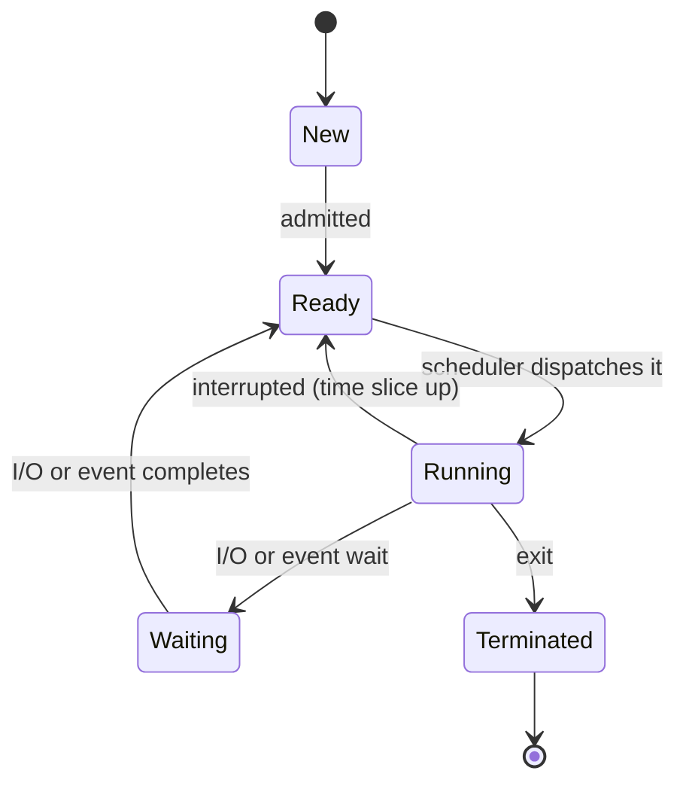
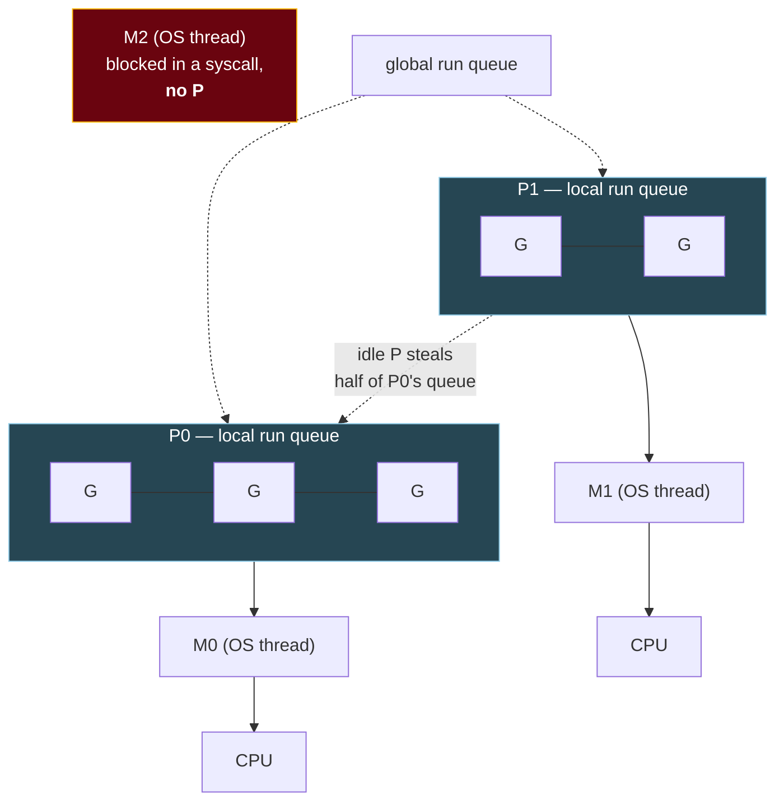

# 2. Processes and threads

## The problem

A server has to handle many requests at once, and a machine has several CPUs. You need
some unit of "a thing that runs" that you can have many of, that the OS can pause and
resume, and that either shares memory with its siblings (fast, dangerous) or doesn't
(safe, slower to coordinate). Processes and threads are the two answers, and goroutines,
async tasks and the JavaScript event loop are variations built on top. Mix them up and
you'll pick the wrong concurrency model, or misread why a service with 10,000
goroutines is fine while one with 10,000 OS threads is in trouble.

Assumes [file 01](01-what-happens-when-a-program-runs.md): user and kernel mode, system
calls, address spaces.

## 2.1 A process is a box; a thread is a worker inside it

Keep the analogy from file 01 and extend it. A **process** is a workshop: it has walls
(its own address space), its own tools on the bench (open file descriptors) and its own
paperwork (PID, user, limits). A **thread** is a worker in that workshop. Each worker
has their own hands and their own notepad: registers, a program counter saying which
instruction is next, and a stack for function calls. All the workers in one workshop
share the bench.

| | Process | Thread |
|---|---|---|
| Address space | Its own. Other processes can't see it | Shared with every thread in the process |
| Owns | Memory mappings, file descriptors, PID, credentials | Registers, program counter, stack, thread-local storage |
| Creation cost | Higher: a new address space to set up | Lower: only a stack and kernel bookkeeping |
| Communication | Needs the kernel: pipes, sockets, shared memory (§2.7) | Just read and write the same variables (and synchronise, [file 04](04-synchronisation-and-deadlock.md)) |
| One crashes | Others unaffected | A segfault or unhandled fatal error usually takes the whole process down |
| Example | PostgreSQL: "it starts ("forks") a new process for each connection" ([docs §1.2](https://www.postgresql.org/docs/current/tutorial-arch.html)) | A Go server: one process, many threads, many more goroutines |

The PostgreSQL row explains something you may have met in production. Because every
connection is a whole process, connections are expensive, and so Postgres deployments
put a connection pooler in front. It's the process model showing through.

## 2.2 The life of a process

The kernel tracks each process in a structure the textbooks call the **process control
block (PCB)**: its state, saved registers, memory map, open files, scheduling
information. In Linux it's `struct task_struct`.

The textbook state diagram ([Silberschatz, Galvin & Gagne, *Operating System Concepts*,
10th ed., 2018](https://www.os-book.com/OS10/index.html)) has five states:



The edge worth staring at is **Waiting → Ready, not Waiting → Running.** When your disk
read finishes, you don't run immediately. You become *eligible* to run, and wait for the
scheduler to pick you. That's why a burst of I/O completions on a busy machine can still
see latency: everyone woke up, and they queue for CPUs.

What `ps` shows on Linux maps onto this loosely: `R` (running *or* runnable, which
merges Running and Ready), `S` (sleeping, interruptible), `D` (uninterruptible sleep,
usually stuck on I/O), `T` (stopped) and `Z` (zombie, §2.3).

## 2.3 How a process is born: fork, exec, wait

Unix creates processes in two steps, which looks odd until you see why.

- **`fork()`** makes a near-exact copy of the calling process. Both copies return from
  the same `fork` call. The parent gets the child's PID, the child gets 0.
- **`exec()`** (the `execve` system call and its wrappers) replaces the current
  process's program with a new one, keeping the same PID and open file descriptors.
- **`wait()`** lets a parent block until a child exits and collect its exit status.

```
shell (pid 100)
   │ fork()
   ├────────────────► child (pid 101): a copy of the shell
   │                    │ set up redirections: close fd 1, open out.txt
   │                    │ execve("./server")   ← same pid, new program
   │                    ▼
   │ wait(101)        server runs, writes to fd 1 = out.txt
   │  ...               │
   │◄───────────────────┘ exit(0)
   ▼ status = 0
```

The split exists so the child can adjust its own environment *between* the two calls,
using ordinary code: redirect output, change directory, drop privileges, close files.
That's how `./server > out.txt` works. Copying a whole address space just to throw it
away sounds wasteful, and it would be, except that `fork` uses **copy-on-write**: parent
and child share the physical pages, marked read-only, and a page is copied only when one
of them writes to it ([file 05 §5.5](05-memory.md#55-page-faults-and-demand-paging)).

Two states trip people up in interviews:

| State | What happened | Who fixes it |
|---|---|---|
| **Zombie** | The child exited but its parent hasn't called `wait` yet. Its memory is freed; only its PID and exit status remain in the process table | The parent, by calling `wait` |
| **Orphan** | The parent exited first while the child is still running | The kernel re-parents it to PID 1 (or a designated "subreaper"), which waits for it |

> ⚠️ **PID 1 in a container is your program.** Orphans get re-parented to PID 1, and
> reaping them is PID 1's job. If your container's PID 1 is your Go binary and it starts
> child processes that start their own, nobody may ever `wait` for the grandchildren,
> and zombies accumulate. Docker's `--init` flag exists for exactly this: it runs a tiny
> init that "forwards signals and reaps processes"
> ([docker run reference](https://docs.docker.com/reference/cli/docker/container/run/)).

## 2.4 Threads, and who manages them

A thread can be managed by the kernel, by a library or runtime inside your process, or
by both. That choice is the **threading model**, and the three classic options differ in
one question: how many kernel threads carry your program's threads?

| Model | Mapping | Blocking system call | Uses many CPUs? | Examples |
|---|---|---|---|---|
| **1:1** | Each language thread is one kernel thread | Blocks only that thread | Yes | Linux pthreads, Rust `std::thread`, C++ `std::thread` in practice, Java platform threads |
| **N:1** ("green threads") | Many user threads on one kernel thread | Blocks *all* of them | No | Early JVMs' "green threads"; Rust's pre-1.0 runtime offered them |
| **M:N** | Many user threads multiplexed onto fewer kernel threads by a runtime | The runtime moves other work to another kernel thread | Yes | Go goroutines; async runtimes like Tokio, in a different form (§2.6) |

N:1 is the cautionary tale. It's cheap, but one blocking `read` stalls every user thread
because the kernel only sees one thread to block. M:N keeps the cheapness and fixes that,
at the cost of a much more complicated runtime. Rust tried a runtime of this kind and
removed it: [RFC 230](https://rust-lang.github.io/rfcs/0230-remove-runtime.html)
(2014) proposed "to remove the *runtime system* that is currently part of the standard
library, which currently allows the standard library to support both native and green
threading", and today the Rust book says the standard library "uses a *1:1* model of
thread implementation" ([ch16-01](https://doc.rust-lang.org/book/ch16-01-threads.html)).

> **Teacher's aside.** On Linux, the kernel barely distinguishes processes from threads.
> Both are tasks, created by the same `clone` system call, and the difference is a set
> of flags saying what the new task shares with its creator. Share the address space
> (`CLONE_VM`), file table and signal handlers, and join the creator's thread group
> (`CLONE_THREAD`: "the child is placed in the same thread group as the calling process",
> [clone(2)](https://man7.org/linux/man-pages/man2/clone.2.html)), and you've made a
> thread. Share nothing and you've made a process. So "process vs thread" isn't two
> kinds of object. It's a dial for how much is shared, and the textbook answer is the two
> ends of the dial.

## 2.5 Context switches

When the scheduler takes the CPU from one thread and gives it to another, the kernel
performs a **context switch**:

1. Enter the kernel (timer interrupt, or the thread blocked in a system call).
2. Save the outgoing thread's registers, program counter and stack pointer into its
   kernel structure.
3. Pick the next thread ([file 03](03-cpu-scheduling.md)).
4. If the next thread belongs to a **different process**, switch the address space:
   point the MMU at the other process's page tables.
5. Restore the incoming thread's registers and return to user mode, where it carries on
   as if nothing happened.

Step 4 is why a switch between processes generally costs more than a switch between
threads of the same process. The direct work is small, but the new process's memory
translations aren't cached. The TLB ([file 05 §5.4](05-memory.md#54-the-tlb-making-translation-fast))
either has to be flushed or, on CPUs that tag entries with an address-space ID, simply
holds nothing useful for the newcomer yet. Data caches are cold too. Much of the real
cost of a context switch is this indirect warming-up afterwards, and that's why I'm not
quoting a microsecond figure: it depends heavily on the workload.

| Switch | Registers saved/restored | Address space changes | Typical relative cost |
|---|---|---|---|
| Goroutine → goroutine (Go runtime) | A few, in user space | No | Cheapest: no kernel entry |
| Thread → thread, same process | Full set, via the kernel | No | Middle |
| Process → process | Full set, via the kernel | Yes | Most expensive, mostly through cold TLB and caches |

## 2.6 How four languages do it

The owner of this course writes Go, Rust, C++ and JavaScript, and they make four
different choices here. All four examples below do the same thing: start four units of
work, each computing `i * i`, and wait for all of them. Each was compiled and run.

```go
// Go 1.22+: goroutines (M:N), joined with a WaitGroup
results := make([]int, 4)
var wg sync.WaitGroup
for i := range 4 {
	wg.Add(1)
	go func() { // a goroutine, not an OS thread
		defer wg.Done()
		results[i] = i * i // each goroutine writes only its own slot
	}()
}
wg.Wait() // join: block until all four have finished
fmt.Println(results) // [0 1 4 9]
```

<details><summary>Rust</summary>

```rust
use std::thread;

fn main() {
    let handles: Vec<_> = (0..4)
        .map(|i| thread::spawn(move || i * i)) // one OS thread each
        .collect();
    let results: Vec<i32> = handles.into_iter().map(|h| h.join().unwrap()).collect();
    println!("{results:?}"); // [0, 1, 4, 9]
}
```

</details>

<details><summary>C++</summary>

```cpp
#include <cstdio>
#include <thread>
#include <vector>

int main() {
    std::vector<int> results(4);
    std::vector<std::thread> threads;
    for (int i = 0; i < 4; ++i)
        threads.emplace_back([&results, i] { results[i] = i * i; });  // one OS thread each
    for (auto& t : threads) t.join();  // destroying a joinable std::thread calls std::terminate
    for (int r : results) std::printf("%d ", r);
}
```

</details>

<details><summary>JavaScript (Node)</summary>

```js
import { Worker } from "node:worker_threads";

// Each Worker is a separate JS engine instance on its own thread, with its own event loop.
const square = (i) =>
  new Promise((resolve, reject) => {
    const w = new Worker(
      "const { parentPort, workerData } = require('node:worker_threads');" +
        "parentPort.postMessage(workerData * workerData);",
      { eval: true, workerData: i },
    );
    w.once("message", resolve); // results come back as messages, not shared variables
    w.once("error", reject);
  });

console.log(await Promise.all([0, 1, 2, 3].map(square))); // [ 0, 1, 4, 9 ]
```

</details>

What's actually happening underneath each:

| Language | Unit you create | Model | What's true underneath |
|---|---|---|---|
| **Go** | Goroutine (`go f()`) | M:N | The runtime schedules goroutines onto OS threads. See below |
| **Rust** | `std::thread::spawn` | 1:1 | "a collection of native OS threads, each with their own stack" ([std::thread](https://doc.rust-lang.org/std/thread/index.html)). For many concurrent I/O tasks you use `async` instead, and std ships no executor: "Most languages that support async bundle a runtime, but Rust does not" ([book ch17](https://doc.rust-lang.org/book/ch17-01-futures-and-syntax.html)). Tokio's multi-threaded runtime "executes futures on a *thread pool*, using a work-stealing strategy" ([docs](https://docs.rs/tokio/latest/tokio/runtime/index.html)), which is M:N in effect |
| **C++** | `std::thread` (C++11), `std::jthread` (C++20) | 1:1 in practice | The standard describes threads abstractly and doesn't mandate OS threads, but libc++ implements `std::thread` with `pthread_create`. C++20 coroutines are "stackless" ([cppreference](https://en.cppreference.com/w/cpp/language/coroutines)) and need a library to schedule them |
| **JavaScript** | Nothing, by default. Async functions and callbacks | One thread per event loop | Each agent "has an associated event loop" ([HTML spec](https://html.spec.whatwg.org/multipage/webappapis.html#event-loops)). Node hands some blocking work to libuv's thread pool, whose "default size is 4" and which runs "all file system operations, as well as getaddrinfo and getnameinfo requests" ([libuv docs](https://docs.libuv.org/en/v1.x/threadpool.html)). Real parallel JavaScript needs `worker_threads` or Web Workers, each a separate engine instance that talks by messages |

### Go's scheduler: G, M and P

The Go runtime's own source names the three pieces
([`runtime/proc.go`](https://github.com/golang/go/blob/master/src/runtime/proc.go)):

> G - goroutine.
> M - worker thread, or machine.
> P - processor, a resource that is required to execute Go code. M must have an
> associated P to execute Go code, however it can be blocked or in a syscall w/o an
> associated P.



The number of Ps is `GOMAXPROCS`, so that's how many goroutines run Go code *at the
same moment*. An idle P doesn't sit waiting: it takes work from a busy one (the comment
on `runqsteal` in the same file: "Steal half of elements from local runnable queue of
p2"). The red box is the clever part. When a goroutine makes a blocking system
call, its M is stuck in the kernel, so the runtime detaches the P and hands it to
another M, and the other goroutines keep running. Network I/O doesn't even get that far:
the runtime registers the socket with the OS's readiness mechanism and parks the
goroutine without blocking any thread (`runtime/netpoll.go`: "A particular
implementation (epoll/kqueue/port/AIX/Windows)", one per OS). Since Go 1.14, "goroutines are now
asynchronously preemptible" ([release notes](https://go.dev/doc/go1.14)), so a tight loop
can't hog a P indefinitely.

Measured on my machine (Go 1.24.4, macOS arm64, 12 CPUs): starting 100,000 goroutines
that each sleep for a second gave `runtime.NumGoroutine() = 100001` and only **14 OS
threads created** (`pprof.Lookup("threadcreate")`). A sleeping goroutine holds a small
stack, not a thread. The runtime's minimum stack is 2 KiB (`stackMin = 2048` in
[`runtime/stack.go`](https://github.com/golang/go/blob/master/src/runtime/stack.go)), and
since Go 1.19 the starting size is based on "the historic average stack usage of
goroutines" ([release notes](https://go.dev/doc/go1.19)), so it isn't a fixed number. An
OS thread's stack is a much larger reservation: for glibc pthreads the default comes
from `RLIMIT_STACK` when that limit is set, and falls back to "2 MB on most
architectures" when it's unlimited ([pthread_create(3)](https://man7.org/linux/man-pages/man3/pthread_create.3.html)).

Goroutines are cheap, not free. A goroutine blocked forever is a leak, which the
[go-services course, file 01 "Goroutines and the scheduler"](../../go-services/01-how-a-go-service-runs.md#goroutines-and-the-scheduler)
covers, along with how `GOMAXPROCS` interacts with container CPU limits.

## 2.7 Talking between processes

Threads communicate by sharing memory. Processes can't, by default, so the kernel
provides **inter-process communication (IPC)** mechanisms:

| Mechanism | Shape | Typical use |
|---|---|---|
| **Pipe** | One-way byte stream between related processes | `ls \| grep x`: the shell connects one's stdout to the other's stdin |
| **Named pipe (FIFO)** | A pipe with a filesystem name, so unrelated processes can open it | Simple local hand-offs |
| **Unix domain socket** | Two-way stream or datagrams, addressed by a file path | Local services: Docker's daemon socket, a database on the same host |
| **TCP/UDP socket** | The same API, across machines | Everything networked |
| **Shared memory** | Both processes map the same physical pages | Highest throughput. You must synchronise yourself |
| **Message queue** | Kernel-held queue of discrete messages | Less common in modern services |
| **Signal** | A small numbered notification (`SIGTERM`, `SIGKILL`) | "Please stop" from Kubernetes, `Ctrl-C` |

Shared memory is the fastest because after setup the kernel isn't involved. It's also the
only one that brings back every concurrency problem of threads, which is
[file 04](04-synchronisation-and-deadlock.md).

## Asked in interviews

- "Process vs thread?" → §2.1, and the Linux nuance in §2.4's aside
- "What happens in a context switch? Why is a process switch costlier than a thread switch?" → §2.5
- "Explain process states." → §2.2
- "What are fork and exec? What's a zombie? An orphan?" → §2.3
- "User-level vs kernel-level threads; what's M:N?" → §2.4
- "How do goroutines differ from threads?" → §2.6
- "Is Node.js single-threaded?" → §2.6, the JavaScript row
- "List IPC mechanisms. Which is fastest?" → §2.7

## Check yourself

1. A thread in a process dereferences a null pointer and the process is killed. Why did
   the other threads die too, when in a multi-process design they wouldn't have?
2. A process finishes its disk read. Using the state diagram, describe what happens next
   and why it may not run for a while.
3. Why does Unix split process creation into `fork` and `exec`? What would `./server >
   out.txt` look like to implement with a single "spawn this program" call?
4. Under an N:1 threading model, a program has 100 user threads and one calls a blocking
   `read` on a slow disk. What happens to the other 99, and how does Go's scheduler avoid
   the same fate?
5. A Go service runs 50,000 goroutines on an 8-CPU machine with `GOMAXPROCS=8`. How many
   goroutines are executing Go code at any instant, and roughly how many OS threads would
   you expect? What would make the thread count climb well above 8?
6. A Node service does heavy JSON transformation of large payloads on every request and
   latency climbs for *all* requests under load, including trivial ones. Explain why, in
   terms of the event loop, and say what you'd change.

(Answers in [13-exercises.md](13-exercises.md).)
