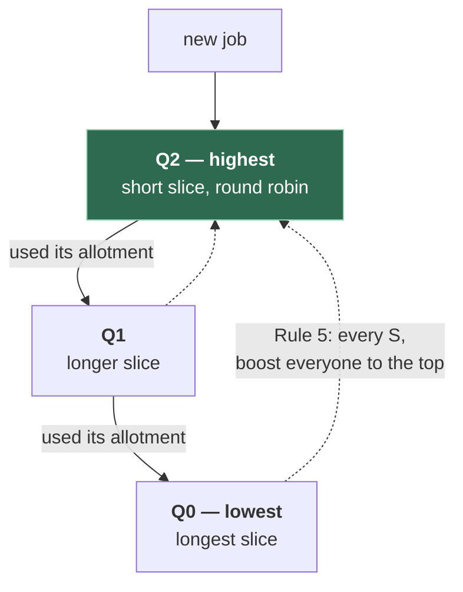

# 3. CPU scheduling

## The problem

There are almost always more runnable threads than CPUs. Every few milliseconds the
kernel has to answer one question: who runs next? The answer decides whether your
interactive shell feels instant while a compile runs in the background, whether a
latency-sensitive request waits behind a batch job, and whether anything starves
forever. No single answer is best for every goal, and seeing *why* is most of what this
topic teaches.

Assumes [file 02](02-processes-and-threads.md): process states (Ready, Running,
Waiting) and context switches.

## 3.1 What "good" means: the metrics

You can't compare schedulers without saying what you're optimising. The textbooks use
these, and they pull against each other:

| Metric | Definition | Who cares |
|---|---|---|
| **Turnaround time** | Completion time − arrival time | Batch jobs: "when is my job done?" |
| **Waiting time** | Total time spent in the Ready queue (turnaround − CPU time used) | The classic exam metric |
| **Response time** | Time from arrival to *first* run | Interactive work: "did it react?" |
| **Throughput** | Jobs completed per unit time | Servers, batch systems |
| **CPU utilisation** | Fraction of time the CPU is busy | Whoever's paying for the hardware |
| **Fairness** | Do comparable jobs get comparable CPU? Does anyone starve? | Everyone, eventually |

Workloads differ too. A **CPU-bound** job (compression, a compile) wants long stretches
of CPU. An **I/O-bound** job (a shell, a web handler waiting on the database) runs for a
moment, then blocks. A good scheduler gets the I/O-bound jobs on and off the CPU quickly,
because each short burst unlocks a long wait elsewhere.

## 3.2 First-come, first-served, and the convoy

The supermarket queue. Whoever arrives first is served first, to completion.
**FCFS** is simple and fair in the everyday sense, and it can be terrible.

One worked example runs through the rest of the chapter. Three jobs arrive at time 0, in
this order, with these CPU bursts (I computed every figure below with a small program
rather than by hand):

| Job | Burst (ms) |
|---|---|
| P1 | 24 |
| P2 | 3 |
| P3 | 3 |

```
FCFS:  |──────────── P1 ────────────|─ P2 ─|─ P3 ─|
       0                            24     27     30

waits: P1 = 0, P2 = 24, P3 = 27        average = 17 ms
```

Two short jobs waited behind one long one. That's the **convoy effect**: like being
stuck behind someone with a full trolley when you're holding a pint of milk. FCFS is
also **non-preemptive**: once a job has the CPU it keeps it until it finishes or blocks.

## 3.3 Shortest job first, and why it can't be built

The supermarket's answer is the express lane. Run the shortest job first:

```
SJF:   |─ P2 ─|─ P3 ─|──────────── P1 ────────────|
       0      3      6                            30

waits: P2 = 0, P3 = 3, P1 = 6          average = 3 ms
```

Same jobs, same total work, average wait down from 17 ms to 3 ms. **SJF is provably
optimal for average waiting time** when all jobs are known up front. The argument is an
exchange: if a longer job ever runs immediately before a shorter one, swapping them
reduces the shorter one's wait by more than it increases the longer one's, so any
schedule that isn't shortest-first can be improved.

Its preemptive version, **shortest remaining time first** (SRTF; OSTEP calls it STCF,
shortest time-to-completion first), switches to a newly arrived job if it's shorter than
what's left of the current one.

The catch is in the name: the scheduler would have to know each job's next CPU burst
*before* it runs. It doesn't. Textbooks (Silberschatz et al., the CPU-scheduling chapter) show predicting it from
past bursts with an exponential average, `τₙ₊₁ = α·tₙ + (1 − α)·τₙ`, where `tₙ` is the
burst that just happened and `τₙ` the previous guess. So SJF is less an algorithm than a
target: the best you could do with perfect knowledge, which real schedulers try to
approximate.

## 3.4 Round robin: taking turns

Give each job a fixed **time quantum** (a time slice), then preempt it and move it to
the back of the queue. The timer interrupt from [file 01 §1.6](01-what-happens-when-a-program-runs.md#16-getting-the-cpu-back-interrupts-and-the-scheduler)
is what makes preemption possible.

With a quantum of 4 ms:

```
RR q=4: |P1 |P2|P3|P1 |P1 |P1 |P1 |P1 |
        0   4  7  10  14  18  22  26  30

waits: P1 = 6, P2 = 4, P3 = 7          average ≈ 5.67 ms
first run: P1 = 0, P2 = 4, P3 = 7
```

Average wait is worse than SJF, but nobody waited more than 7 ms to get the CPU *at
all*, and RR needed no knowledge of the future. That's the trade: RR is good for
**response time** and bad for **turnaround** when jobs are similar in length.

The quantum is the whole design:

| Quantum | Effect |
|---|---|
| Very large (30 ms here) | Every job finishes inside its first slice, so RR **degenerates into FCFS**: average wait back to 17 ms |
| Very small | Great responsiveness, but the context-switch overhead from [file 02 §2.5](02-processes-and-threads.md#25-context-switches) eats a growing share of the CPU |
| Sensible | Long relative to a context switch, short enough that interactive jobs feel instant |

## 3.5 Priority, and the starvation it causes

Give each job a priority and always run the highest. It's how you'd express "the
payment handler matters more than the report generator". It has one famous failure:
**starvation**. A low-priority job can wait forever if higher-priority work keeps
arriving. The standard fix is **aging**: raise a job's priority the longer it waits.

SJF is really a priority scheduler where priority is "short predicted burst", which is
why it can starve long jobs too.

Priorities also interact badly with locks. A high-priority thread waiting for a lock
held by a low-priority one can be stalled indefinitely by medium-priority work. That's
**priority inversion**, and its most famous case (Mars Pathfinder, 1997) is in
[file 04 §4.8](04-synchronisation-and-deadlock.md#48-starvation-livelock-and-priority-inversion).

## 3.6 Multi-level feedback queue: learning from behaviour

MLFQ is the textbook design that gets around SJF's need for foresight. Its idea: you
can't know a job's future, but you can watch its past. Jobs that use their whole time
slice are probably CPU-bound, so lower their priority. Jobs that give up the CPU early
are probably interactive, so keep them high. The idea goes back to the 1960s
time-sharing system CTSS (Corbató et al., 1962).

OSTEP states the refined rules exactly
([OSTEP v1.10, ch. 8 §8.6](https://pages.cs.wisc.edu/~remzi/OSTEP/cpu-sched-mlfq.pdf)):

> - **Rule 1:** If Priority(A) > Priority(B), A runs (B doesn't).
> - **Rule 2:** If Priority(A) = Priority(B), A & B run in round-robin fashion using the
>   time slice (quantum length) of the given queue.
> - **Rule 3:** When a job enters the system, it is placed at the highest priority (the
>   topmost queue).
> - **Rule 4:** Once a job uses up its time allotment at a given level (regardless of how
>   many times it has given up the CPU), its priority is reduced (i.e., it moves down one
>   queue).
> - **Rule 5:** After some time period *S*, move all the jobs in the system to the topmost
>   queue.



Each rule patches a hole in the one before, and that's the most useful way to remember
them:

| Rule | Hole it closes |
|---|---|
| 3: start at the top | We don't know a new job's nature, so assume it's short and interactive. If it is, it finishes fast, which approximates SJF |
| 4: demote on total allotment used | An early version demoted only jobs that used a *whole slice*. A program could game it by yielding just before the slice ended and stay at top priority forever. Counting the total time used at a level, however it's split, closes that |
| 5: periodic boost | Without it, a stream of interactive jobs starves CPU-bound ones forever, and a job that turns interactive later is stuck at the bottom |

OSTEP notes that BSD Unix derivatives, Solaris and Windows NT and its successors "use a
form of MLFQ as their base scheduler".

## 3.7 The algorithms side by side

| Algorithm | Preemptive? | Needs to know burst lengths? | Strength | Failure mode |
|---|---|---|---|---|
| **FCFS** | No | No | Simple, no starvation | Convoy effect: short jobs stuck behind long |
| **SJF** | No | Yes | Optimal average wait | Not implementable exactly; starves long jobs |
| **SRTF / STCF** | Yes | Yes | Optimal average turnaround with arrivals | Same, plus more switching |
| **Round robin** | Yes | No | Good response time, no starvation | Poor turnaround; quantum choice is critical |
| **Priority** | Either | No | Expresses importance | Starvation (fix: aging); priority inversion |
| **MLFQ** | Yes | No, it learns | Approximates SJF for interactive jobs | Many tuning knobs; can be gamed without Rule 4 |

## 3.8 What Linux actually runs

None of the above, exactly. Linux has **scheduling classes**, tried in a fixed order, and
each has its own policy. From [sched(7)](https://man7.org/linux/man-pages/man7/sched.7.html):

| Class | Policies | For |
|---|---|---|
| Deadline | `SCHED_DEADLINE` | Tasks with explicit runtime/period/deadline guarantees |
| Real-time | `SCHED_FIFO`, `SCHED_RR` | Fixed priorities. FIFO runs until it blocks; RR adds a time slice among equals |
| Fair (normal) | `SCHED_OTHER` (called `SCHED_NORMAL` in the kernel source), `SCHED_BATCH`, `SCHED_IDLE` | Everything you normally run |

Your services live in the fair class. Their relative weight is the **nice** value, and
"On modern Linux, the range is -20 (high priority) to +19 (low priority)".

The fair class's algorithm has changed twice:

| Kernel | Fair scheduler | Core idea |
|---|---|---|
| 2.6.0 (2003) | The "O(1)" scheduler | Priority arrays, constant-time pick |
| 2.6.23 (2007) | **CFS**, Completely Fair Scheduler | "CFS basically models an 'ideal, precise multi-tasking CPU' on real hardware." Each task accumulates *virtual runtime*, and "CFS maintains a time-ordered rbtree, where all runnable tasks are sorted by the p->se.vruntime key" ([kernel docs](https://docs.kernel.org/scheduler/sched-design-CFS.html)). Run whoever has had least |
| 6.6 (2023) | **EEVDF**, Earliest Eligible Virtual Deadline First | Tracks each task's *lag* (CPU it was owed minus what it got), "picks tasks with lag greater or equal to zero and calculates a virtual deadline (VD) for each, selecting the task with the earliest VD" ([kernel docs](https://docs.kernel.org/scheduler/sched-eevdf.html)) |

[Kernelnewbies on 6.6](https://kernelnewbies.org/Linux_6.6): "The previous algorithm,
called CFS, was merged in Linux 2.6.23. In this release, it is replaced by code that uses
a new algorithm, called EEVDF". The algorithm comes from a 1995 paper by Stoica and
Abdel-Wahab. And since 6.12, **sched_ext** lets you load a whole scheduling policy
written in BPF ([Kernelnewbies 6.12](https://kernelnewbies.org/Linux_6.12)).

Notice that both CFS and EEVDF are a kind of weighted round robin with memory: no task
gets far ahead of its fair share, and a task that slept, as I/O-bound tasks do, hasn't
used its share, so it gets picked promptly when it wakes. That's MLFQ's goal reached by a
different route.

> ⚠️ **Sources lag the kernel.** As of this writing,
> [sched(7)](https://man7.org/linux/man-pages/man7/sched.7.html) still says "Since Linux
> 2.6.23, the default scheduler is CFS", and the kernel's own EEVDF page says the
> transition began "in version 6.6 (as a new option in 2024)", although 6.6 was released
> in 2023 and EEVDF replaced CFS's pick logic there rather than arriving as an option.
> Many interview-prep sites still teach "Linux uses CFS" too. For anything after 6.6,
> say EEVDF and mention that it took over from CFS. And if an interviewer says CFS,
> that's fine: it was right for sixteen years.

> **Teacher's aside.** The textbook algorithms are not menu options a real OS chooses
> between. They're a vocabulary for the trade-offs: response time against turnaround,
> knowledge against guessing, fairness against priority. Every real scheduler is an
> attempt to get SJF's results without SJF's impossible requirement. MLFQ guesses from
> recent behaviour; CFS and EEVDF stop anyone running far ahead of their fair share,
> which favours short sleepers automatically. If you can explain FCFS's convoy, SJF's
> optimality and its impossibility, and RR's quantum trade-off, you can reason about any
> scheduler you meet, including Go's ([file 02 §2.6](02-processes-and-threads.md#26-how-four-languages-do-it)),
> which sits on top of the kernel's.

### Where this bites a backend engineer: CPU limits

In a container with a CPU limit, the kernel enforces the limit with what its docs still
call [CFS Bandwidth Control](https://docs.kernel.org/scheduler/sched-bwc.html): "Within
each given 'period' (microseconds), a task group is allocated up to 'quota' microseconds
of CPU time". Once it's used up, further requests "will result in those threads being
throttled", and "Throttled threads will not be able to run again until the next period
when the quota is replenished." The default period is 100 ms. A service with
more busy threads than its limit can burn its whole quota early in a period and then sit
throttled for the rest, which shows up as latency spikes with low average CPU. That's
one reason a Go runtime that sizes `GOMAXPROCS` to the CPU limit helps
([go-services file 01](../../go-services/01-how-a-go-service-runs.md#goroutines-and-the-scheduler)).

## Asked in interviews

- "Compare FCFS, SJF, RR and priority scheduling." → §3.7
- "Compute average waiting time for these processes under SJF and RR." → §3.2–§3.4
- "Why is SJF optimal, and why isn't it used?" → §3.3
- "What's the convoy effect?" → §3.2
- "What's starvation and how does aging fix it?" → §3.5
- "Explain MLFQ." → §3.6
- "Preemptive vs non-preemptive scheduling?" → §3.2, §3.4, and the table in §3.7
- "What scheduler does Linux use?" → §3.8

## Check yourself

1. Jobs A (8 ms), B (4 ms) and C (1 ms) arrive at time 0 in that order. Compute the
   average waiting time under FCFS and under SJF. Then explain in one sentence why the
   difference is so large.
2. Using the chapter's P1/P2/P3 example, explain why RR with a 30 ms quantum gives the
   same average wait as FCFS. What's the general condition for RR to behave exactly like
   FCFS?
3. An interviewer says "SJF is optimal, so why doesn't Linux use it?" Give the real
   answer, and name two mechanisms real schedulers use to approximate it.
4. Under MLFQ without Rule 4's accounting, describe concretely how a CPU-hungry program
   could keep top priority. What exactly does the rewritten Rule 4 count?
5. A low-priority batch job on a busy system hasn't run for an hour under a pure priority
   scheduler. Name the problem and the fix. Then explain why CFS-style fair scheduling
   doesn't have this problem in the first place.
6. A Go service in a container with a 2-CPU limit runs on a 32-CPU node with an old Go
   version that sets `GOMAXPROCS=32`. Average CPU use looks fine but p99 latency has
   regular spikes. Using §3.8, explain the mechanism.

(Answers in [13-exercises.md](13-exercises.md).)
