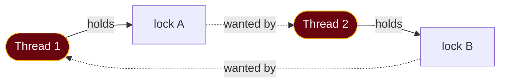

# 4. Synchronisation and deadlock

## The problem

Threads share memory, which is what makes them fast and what makes them wrong. Two
threads incrementing the same counter a million times between them don't reliably reach
a million. A cache shared by request handlers loses entries. Two transfers between the
same accounts, made in opposite directions, can freeze each other forever. The tools
that fix these (locks, semaphores, condition variables) each create a new way to fail,
and the interview questions here are mostly about those trade-offs.

Assumes [file 02](02-processes-and-threads.md): threads share an address space, and the
scheduler can preempt a thread at any instruction.

## 4.1 A race, watched happening

This Go program starts 1,000 goroutines and each adds 1 to a shared counter 1,000 times:

```go
var counter int
var wg sync.WaitGroup
for i := 0; i < 1000; i++ {
	wg.Add(1)
	go func() {
		defer wg.Done()
		for j := 0; j < 1000; j++ {
			counter++ // read, add, write: three steps, not one
		}
	}()
}
wg.Wait()
fmt.Println("expected 1000000, got", counter)
```

Two runs on my machine printed **325355** and **350536**. Two-thirds of the increments
vanished.

`counter++` looks like one operation and isn't. It's a load from memory into a register,
an add, and a store back. If two threads interleave those steps, one update is lost:

```
         Thread A                 Thread B             counter in memory
         load counter → 41                                     41
                                  load counter → 41             41
         add 1 → 42                                             41
                                  add 1 → 42                    41
         store 42                                               42
                                  store 42                      42   ← two increments, +1
```

This is a **race condition**: the result depends on the timing of operations that
nobody controls. The stretch of code that touches shared state and must not interleave
is a **critical section**. The standard requirements for any solution (Silberschatz et
al.) are **mutual exclusion** (at most one thread inside at a time), **progress** (if
nobody's inside, someone who wants in eventually gets in) and **bounded waiting** (no
thread is overtaken forever).

Go's race detector finds this one immediately: `go run -race` prints
`WARNING: DATA RACE` with both goroutines' stack traces. A **data race** specifically
means two unsynchronised accesses to the same memory, at least one a write. Race
conditions are broader: §4.3 shows a JavaScript program with no data race that still
loses updates.

## 4.2 The hardware gives you one atomic step

You can't build mutual exclusion out of ordinary loads and stores efficiently, so CPUs
provide instructions that read and modify memory as one indivisible step:

| Instruction | What it does atomically |
|---|---|
| **Test-and-set** | Set a flag to 1 and return its old value |
| **Compare-and-swap (CAS)** | "If the value is still `old`, make it `new`, and tell me whether that happened" |
| **Fetch-and-add** | Add to a value and return the old one |

For a lone counter, that's enough: `atomic.AddInt64(&counter, 1)` in Go (or
`atomic.Int64`), `AtomicUsize::fetch_add` in Rust, `std::atomic<int>` in C++. Every lock
below is ultimately built on one of these instructions.

## 4.3 Locks (mutexes)

A **mutex** (mutual exclusion lock) has two operations: lock (acquire) and unlock
(release). At most one thread holds it. Anyone else calling lock waits.

The four languages differ here in a way that's genuinely instructive, because they
differ in *when* a forgotten lock gets caught:

```go
// Go: the lock sits beside the data; nothing ties them together except discipline
var (
	mu      sync.Mutex
	counter int
)
// in each goroutine:
mu.Lock()
counter++
mu.Unlock()
// prints: got 1000000
```

<details><summary>Rust</summary>

The racy version above **doesn't compile** in Rust. Sharing `counter` mutably across
threads fails with errors including `E0597` ("`counter` does not live long enough") and
`E0502` (borrowed as immutable while borrowed as mutable). The fixed version puts the
data *inside* the lock, so it can't be touched without holding it:

```rust
use std::sync::{Arc, Mutex};
use std::thread;

fn main() {
    let counter = Arc::new(Mutex::new(0)); // the lock owns the data
    let handles: Vec<_> = (0..1000)
        .map(|_| {
            let counter = Arc::clone(&counter);
            thread::spawn(move || {
                for _ in 0..1000 {
                    *counter.lock().unwrap() += 1; // unlocked when the guard drops
                }
            })
        })
        .collect();
    for h in handles {
        h.join().unwrap();
    }
    println!("got {}", *counter.lock().unwrap()); // got 1000000
}
```

</details>

<details><summary>C++</summary>

```cpp
#include <iostream>
#include <mutex>
#include <thread>
#include <vector>

int main() {
    int counter = 0;
    std::mutex mu;
    std::vector<std::thread> threads;
    for (int i = 0; i < 1000; ++i)
        threads.emplace_back([&] {
            for (int j = 0; j < 1000; ++j) {
                std::lock_guard<std::mutex> lock(mu); // unlocks at end of scope (RAII)
                ++counter;
            }
        });
    for (auto& t : threads) t.join();
    std::cout << "got " << counter << "\n"; // got 1000000
}
```

Without the `lock_guard` it printed 995811 and 999353 on two runs, and compiling with
`-fsanitize=thread` reported `WARNING: ThreadSanitizer: data race`.

</details>

<details><summary>JavaScript</summary>

One thread, so no data races between plain JavaScript statements: a function runs to
completion before anything else runs. But an `await` is a point where *other code runs*,
and a read-modify-write split across one is a race all the same:

```js
let balance = 100;
const sleep = (ms) => new Promise((r) => setTimeout(r, ms));

async function deposit(amount) {
  const current = balance;      // read
  await sleep(10);              // e.g. a database call: other code runs here
  balance = current + amount;   // write back a stale value
}

await Promise.all([deposit(10), deposit(20)]);
console.log("expected 130, got", balance); // expected 130, got 120
```

The fix is to not hold a value across the `await`, or to serialise the two operations
(an async mutex, a queue), or to push the update to a place that does it atomically,
such as `UPDATE ... SET balance = balance + $1` in the database
([file 07 §7.6](07-transactions-and-isolation.md#76-fixing-the-lost-update-four-ways)).

</details>

| | What happens if you forget the lock | Who catches it |
|---|---|---|
| **Go** | Lost updates; the memory model lets an implementation "report the race and halt execution" ([go.dev/ref/mem](https://go.dev/ref/mem)) | The race detector, at run time, if a test exercises the path |
| **Rust** | Doesn't compile. "Safe Rust guarantees an absence of data races" ([Rustonomicon](https://doc.rust-lang.org/nomicon/races.html)) | The compiler, via ownership and the `Send`/`Sync` traits |
| **C++** | "If a data race occurs, the behavior of the program is undefined" ([cppreference](https://en.cppreference.com/w/cpp/language/multithread)) | ThreadSanitizer at run time, if you run it |
| **JavaScript** | No data races on one thread, but logical races across `await` | Nothing. Code review and design |

### Spinning or sleeping

A thread that can't get a lock can either loop, retrying (a **spinlock**), or ask the
kernel to put it to sleep until the lock is free (a **sleeping lock**, or blocking
mutex).

| | Spinlock | Sleeping lock |
|---|---|---|
| While waiting | Burns CPU in a loop | Sleeps; costs a context switch to sleep and to wake |
| Good when | Critical sections are tiny and the holder is running on another CPU | Critical sections may be long, or the holder may itself block |
| Terrible when | The holder was preempted: you spin for its entire time slice. On one CPU, it's pure waste | Critical sections are a few instructions: the switch costs more than the wait |

Many real mutexes are hybrids: spin briefly, then sleep. Go's `sync.Mutex` does this:
its slow path spins a few times when the runtime judges it worthwhile (`runtime_canSpin`)
before parking the goroutine.

## 4.4 Semaphores

A mutex answers "one at a time". Sometimes you need "at most *n* at a time": at most 10
database connections, at most 3 concurrent calls to a rate-limited API. Edsger Dijkstra
introduced the tool for this in the 1960s
([EWD123, "Cooperating sequential processes"](https://www.cs.utexas.edu/~EWD/transcriptions/EWD01xx/EWD123.html)):
"special purpose integers, which we shall call 'semaphores'".

A **semaphore** is a counter with two atomic operations:

| Dijkstra's name | Also called | What it does |
|---|---|---|
| **P** | wait, down, acquire | If the counter is above zero, decrement it and carry on. Otherwise sleep until it is |
| **V** | signal, up, release | Increment the counter and wake one sleeper, if any |

The car-park analogy works: the sign at the entrance shows the free spaces. You enter
only if it's above zero, and the count goes down. You leave, and it goes up. A
**counting semaphore** starts at *n*. A **binary semaphore** starts at 1 and only ever
holds 0 or 1.

All four examples below limit ten workers to three at a time, and each measured a peak
concurrency of exactly 3:

```go
// Go has no semaphore type in the standard library. A buffered channel is one:
// "A buffered channel can be used like a semaphore" (Effective Go).
sem := make(chan struct{}, 3) // capacity = number of permits
for i := 0; i < 10; i++ {
	go func() {
		sem <- struct{}{}        // P: blocks while 3 are already in
		defer func() { <-sem }() // V
		useConnection()
	}()
}
// golang.org/x/sync/semaphore offers a weighted semaphore if you need more.
```

<details><summary>Rust</summary>

Rust's `std::sync` has no semaphore (Tokio has `tokio::sync::Semaphore` for async code),
which makes a good exercise: a semaphore is just a counter, a mutex and a condition
variable (§4.6).

```rust
use std::sync::{Condvar, Mutex};

struct Semaphore {
    free: Mutex<usize>,
    cv: Condvar,
}

impl Semaphore {
    fn new(n: usize) -> Self {
        Self { free: Mutex::new(n), cv: Condvar::new() }
    }
    fn acquire(&self) {
        let mut free = self.free.lock().unwrap();
        while *free == 0 {
            free = self.cv.wait(free).unwrap(); // releases the lock while asleep
        }
        *free -= 1;
    }
    fn release(&self) {
        *self.free.lock().unwrap() += 1;
        self.cv.notify_one();
    }
}
```

</details>

<details><summary>C++</summary>

```cpp
#include <semaphore>  // C++20

std::counting_semaphore<3> slots(3);

void worker() {
    slots.acquire();   // P
    use_connection();
    slots.release();   // V
}
// std::binary_semaphore is an alias for std::counting_semaphore<1>.
```

</details>

<details><summary>JavaScript</summary>

No threads, but ten concurrent `fetch` calls still compete for a rate limit, so the same
shape appears with promises:

```js
class Semaphore {
  #free; #waiting = [];
  constructor(n) { this.#free = n; }
  async acquire() {
    if (this.#free > 0) { this.#free--; return; }
    await new Promise((resolve) => this.#waiting.push(resolve));
  }
  release() {
    const next = this.#waiting.shift();
    if (next) next();          // hand the slot straight to a waiter
    else this.#free++;
  }
}

const sem = new Semaphore(3);
async function call() {
  await sem.acquire();
  try { await fetch(url); } finally { sem.release(); }
}
```

</details>

## 4.5 Mutex vs binary semaphore: the sources disagree

The classic interview question is "what's the difference between a mutex and a binary
semaphore?" Both let one thread in at a time. The textbook answer is **ownership**: a
mutex is owned by the thread that locked it, and only that thread may unlock it, while
any thread can signal a semaphore. Here's what the actual sources say:

| Source | Position |
|---|---|
| [Linux kernel mutex design](https://docs.kernel.org/locking/mutex-design.html) | Strict ownership: "Only one task can hold the mutex at a time." "Only the owner can unlock the mutex." "Recursive locking/unlocking is not permitted." And: "Mutexes are sleeping locks which behave similarly to binary semaphores" |
| [OSTEP, "Semaphores"](https://pages.cs.wisc.edu/~remzi/OSTEP/threads-sema.pdf) | Treats a semaphore initialised to 1 *as* a lock, in a section titled "Binary Semaphores (Locks)" |
| [Go `sync.Mutex`](https://pkg.go.dev/sync#Mutex) | **No ownership.** "A locked Mutex is not associated with a particular goroutine. It is allowed for one goroutine to lock a Mutex and then arrange for another goroutine to unlock it." |
| [C++20](https://en.cppreference.com/w/cpp/thread/counting_semaphore) | `std::binary_semaphore` is just `counting_semaphore<1>`. `std::mutex` (C++11) requires that the unlocking thread owns it |

So "a mutex has an owner" is true of the kernel's mutex, POSIX error-checking mutexes and
C++'s `std::mutex`, and false of Go's. What survives across all of them is a difference
of **intent**:

- A **mutex** is for *mutual exclusion*: lock and unlock happen in the same piece of code,
  around a critical section.
- A **semaphore** is for *counting and signalling*: one thread may wait and a different
  one post. "Thread A tells thread B the data is ready" is a natural semaphore use and a
  misuse of a mutex.

Ownership, where it exists, buys real things: the system can detect unlocking a lock you
don't hold, and it can implement **priority inheritance** (§4.8), which needs to know
whose priority to raise.

> **Teacher's aside.** Interview prep material often presents the ownership rule as a
> universal definition. Give it as the conventional answer, then add the nuance: the
> distinction is about purpose, and whether ownership is *enforced* depends on the
> implementation. Go's mutex is the counter-example. An interviewer who hears you
> separate "what it's for" from "what this implementation enforces" learns more about
> you than one who hears the definition recited.

## 4.6 Waiting for a condition: condition variables and monitors

Locks protect state. They don't help a thread *wait* for state to change: "wait until
the queue isn't empty". Checking in a loop with the lock held blocks everyone else;
checking in a loop without it is a race. A **condition variable** solves it with two
operations:

- **wait(lock)**: atomically release the lock and go to sleep. When woken, re-acquire the
  lock before returning.
- **signal / broadcast**: wake one / all waiters.

The rule everyone gets wrong is to **always wait in a `while` loop, never an `if`**.
POSIX allows "spurious wakeups" and says "It is thus recommended that a condition wait
be enclosed in the equivalent of a 'while loop'"
([pthread_cond_wait](https://pubs.opengroup.org/onlinepubs/9799919799/functions/pthread_cond_wait.html)).
Go's `sync.Cond` is more careful about wakeups but gives the same advice for a deeper
reason: "Unlike in other systems, Wait cannot return unless awoken by Broadcast or
Signal", yet "the caller typically cannot assume that the condition is true when Wait
returns. Instead, the caller should Wait in a loop"
([sync.Cond](https://pkg.go.dev/sync#Cond)). Between being woken and re-acquiring the
lock, another thread may have taken the item. OSTEP calls this **Mesa semantics**: a
signal is a hint that the state *may* have changed, not a guarantee that it has.

A **monitor** packages the lock, the condition variables and the data they protect into
one construct where every method holds the lock automatically (Hoare, "Monitors: an
operating system structuring concept", CACM, 1974). Java's `synchronized` methods with
`wait`/`notify` are the familiar example.

### Go's answer: the channel is the monitor

The **producer–consumer** (bounded buffer) problem is the canonical condition-variable
exercise: producers block when the buffer is full, consumers when it's empty. In C or
Java that's a mutex plus two condition variables. In Go it's a buffered channel, because
the channel already contains all three:

```go
jobs := make(chan int, 2) // a bounded buffer of size 2
done := make(chan struct{})

go func() { // consumer
	for j := range jobs { // blocks while the buffer is empty
		fmt.Println("consumed", j)
	}
	close(done)
}()

for i := 1; i <= 5; i++ { // producer
	jobs <- i // blocks while the buffer is full
}
close(jobs) // no more items: the consumer's range loop ends
<-done
```

The `sync.Cond` docs say the same: "For many simple use cases, users will be better off
using channels than a Cond (Broadcast corresponds to closing a channel, and Signal
corresponds to sending on a channel)."

## 4.7 The classic problems

Three problems recur in textbooks and interviews. Each stands for a family of real bugs:

| Problem | Setup | What it teaches | Real-world form |
|---|---|---|---|
| **Producer–consumer** | Bounded buffer between producers and consumers | Waiting on conditions (§4.6) | Job queues, Go channels, Kafka consumers |
| **Readers–writers** | Many readers may share; a writer needs exclusive access | Read/write locks, and who gets starved: favour readers and writers starve, favour writers and readers wait | `sync.RWMutex`, Rust's `RwLock`, database shared vs exclusive locks |
| **Dining philosophers** | Five philosophers, five forks, each needs both neighbours' forks | Deadlock from circular waiting, and fixing it by ordering (§4.10) | Any code taking two locks |

## 4.8 Starvation, livelock and priority inversion

Deadlock isn't the only way for threads to stop making progress:

| Failure | What's happening | Example |
|---|---|---|
| **Starvation** | Some thread never gets the resource, though others progress | A writer under a reader-preferring RW lock; a low-priority job under pure priority scheduling ([file 03 §3.5](03-cpu-scheduling.md#35-priority-and-the-starvation-it-causes)) |
| **Livelock** | Threads keep changing state in response to each other, so nobody blocks and nobody progresses | Two people stepping aside in a corridor in the same direction, repeatedly. Two retry loops with identical fixed backoff |
| **Priority inversion** | A high-priority thread waits on a lock held by a low-priority one, which can't run because medium-priority threads keep preempting it | Mars Pathfinder, below |

The **Mars Pathfinder** lander, in 1997, kept resetting itself on Mars. JPL's Glenn
Reeves wrote up the cause
([account](https://www.cs.unc.edu/~anderson/teach/comp790/papers/mars_pathfinder_long_version.html)):
a high-priority task was blocked on a mutual-exclusion semaphore held by a low-priority
task, which medium-priority tasks kept preempting. A watchdog saw the high-priority task
miss its deadline and reset the system. The fix was to "change the creation flags for
the semaphore so as to enable priority inheritance", uploaded to the spacecraft as a
small patch. **Priority inheritance** means the lock holder temporarily runs at the
priority of the highest thread waiting for it, so medium-priority work can't get in the
way. It's possible only because the lock knows its owner (§4.5).

## 4.9 Deadlock

Two threads each hold one lock and wait for the other's. Neither can proceed, and
nothing will ever change that. This Go program does exactly that, with sleeps to force
the interleaving:

```go
var a, b sync.Mutex
done := make(chan bool)
go func() {
	a.Lock()
	time.Sleep(100 * time.Millisecond) // let main take b
	b.Lock()                           // waits for main
	done <- true
}()
b.Lock()
time.Sleep(100 * time.Millisecond) // let the goroutine take a
a.Lock()                           // waits for the goroutine
<-done
```

```
fatal error: all goroutines are asleep - deadlock!
goroutine 1 [sync.Mutex.Lock]:
goroutine 33 [sync.Mutex.Lock]:
```

> ⚠️ **Go's deadlock detector almost never fires in a real service.** It reports only
> when *every* goroutine is blocked. In an HTTP server there's always a goroutine waiting
> on the network, so two handlers deadlocked on each other's locks just hang quietly,
> holding their connections, until something times out. A goroutine dump
> (`/debug/pprof/goroutine?debug=2`) showing many goroutines stuck in `sync.Mutex.Lock`
> is what it looks like in production.

Coffman, Elphick and Shoshani ("System Deadlocks", *ACM Computing Surveys*, 1971) gave the
four conditions that must *all* hold for a deadlock. Their wording, with the name most
textbooks now use:

| # | Coffman's name | Usual textbook name | Meaning |
|---|---|---|---|
| 1 | Mutual exclusion | Mutual exclusion | A resource can be held by only one task |
| 2 | "Wait for" | **Hold and wait** | A task holds resources while waiting for more |
| 3 | No preemption | No preemption | Resources can't be taken away; only the holder releases them |
| 4 | Circular wait | Circular wait | A cycle of tasks, each waiting for the next one's resource |

They're **necessary**, not sufficient: all four can hold without a deadlock having
happened yet. That's what makes them useful. Break any one and deadlock becomes
impossible.



That's a **resource-allocation graph**. With one instance of each resource, a cycle
means deadlock.

## 4.10 Four ways to handle deadlock

| Strategy | Idea | In practice |
|---|---|---|
| **Prevention** | Design so one Coffman condition can never hold | The common one in application code |
| **Avoidance** | Know each task's maximum needs in advance; grant a request only if the system stays *safe* | The banker's algorithm. Rare outside textbooks and some embedded systems |
| **Detection and recovery** | Let deadlocks happen, find cycles, kill a victim | Databases do this |
| **Ignore it** | Assume it's rare; reboot if it happens | Called the ostrich algorithm. What general-purpose OSes do for user-level locks |

### Prevention: break a condition

| Condition | How to break it | Cost |
|---|---|---|
| Mutual exclusion | Use sharable resources: read-only data, lock-free structures | Rarely possible for things that really are being written |
| Hold and wait | Acquire every lock you'll need at once, up front | Hard to know in advance; locks held longer than needed |
| No preemption | If you can't get the next lock, release what you hold and retry (`TryLock`, lock timeouts) | Can livelock without randomised backoff |
| **Circular wait** | **Impose a global order and always acquire locks in that order** | Discipline across a codebase. The standard fix |

Lock ordering is the one to know. For a transfer between two accounts, lock the lower
account ID first, whichever direction the money moves. Then two opposite transfers can't
each hold one lock and want the other: both go for the lower ID first, and one simply
waits. Dining philosophers is solved the same way: number the forks, always pick up the
lower-numbered one first.

### Avoidance: the banker's algorithm

Dijkstra described it in the same EWD123 manuscript, with a banker lending florins to
customers who've declared their maximum credit. The OS version: each process declares its
maximum need for each resource type. A request is granted only if, after granting it,
there's still some order in which every process could get its maximum and finish. That's
a **safe state**.

A worked example, with numbers of my own (checked by a program). Three resource types
A, B, C, and 1 of each currently free:

| Process | Allocated (A B C) | Max (A B C) | Need = Max − Allocated |
|---|---|---|---|
| P0 | 1 1 0 | 4 2 2 | 3 1 2 |
| P1 | 1 0 1 | 2 1 1 | 1 1 0 |
| P2 | 1 1 1 | 3 3 1 | 2 2 0 |
| P3 | 0 1 1 | 1 2 2 | 1 1 1 |

The safety check: find a process whose Need fits in what's free, pretend it finishes and
returns everything it holds, repeat.

```
free = (1,1,1)
P1 needs (1,1,0) ≤ (1,1,1) ✓ → finishes, returns (1,0,1) → free = (2,1,2)
P3 needs (1,1,1) ≤ (2,1,2) ✓ → finishes, returns (0,1,1) → free = (2,2,3)
P2 needs (2,2,0) ≤ (2,2,3) ✓ → finishes, returns (1,1,1) → free = (3,3,4)
P0 needs (3,1,2) ≤ (3,3,4) ✓ → finishes                  → safe: P1, P3, P2, P0
```

Now two requests, each for one unit of A:

- **P1 asks for (1,0,0).** Pretend to grant it: free becomes (0,1,1) and P1's need becomes
  (0,1,0). P1 can still finish, then P3, P2, P0. Safe, so **grant**.
- **P0 asks for (1,0,0).** Pretend to grant it: free becomes (0,1,1). No process's need
  fits: P1 needs one A, P3 needs one A, P2 needs two, P0 needs two. Unsafe, so **make P0
  wait**, even though the unit is free right now.

An unsafe state isn't a deadlock yet. It's a state from which the system can no longer
*guarantee* avoiding one. The algorithm is rarely used because it needs every process's
maximum in advance and a fixed set of processes, which real systems don't have.

### Detection and recovery: what databases do

Databases can't impose a lock order, because your queries decide which rows get locked
in which order. So they let deadlocks happen, look for cycles in the waits-for graph,
and abort one transaction. Reproduced on PostgreSQL 17 with two sessions updating rows 1
and 2 of the same table in opposite orders:

```
ERROR:  deadlock detected
DETAIL:  Process 269 waits for ShareLock on transaction 775; blocked by process 276.
Process 276 waits for ShareLock on transaction 774; blocked by process 269.
HINT:  See server log for query details.
```

One transaction was rolled back; the other carried on. The application's job is to retry
the victim, and to update rows in a consistent order (say, by primary key) so it rarely
has to. Transactions are [file 07](07-transactions-and-isolation.md).

## Asked in interviews

- "What's a race condition? Give an example." → §4.1
- "What's a critical section, and what must a solution guarantee?" → §4.1
- "Mutex vs semaphore? Mutex vs binary semaphore?" → §4.4, §4.5
- "Spinlock vs mutex: when would you use each?" → §4.3
- "What's a condition variable? Why the while loop?" → §4.6
- "What are the four conditions for deadlock? How do you prevent it?" → §4.9, §4.10
- "Explain the banker's algorithm / is this state safe?" → §4.10
- "What's priority inversion?" → §4.8
- "Deadlock vs livelock vs starvation?" → §4.8, §4.9

## Check yourself

1. Explain, at the level of loads and stores, why `counter++` from two threads can lose an
   update. Then explain why making `counter` an atomic integer fixes this case but
   wouldn't fix "check the balance, then withdraw if there's enough".
2. Two goroutines both need locks A and B. One takes A then B, the other B then A. Which
   Coffman condition does a global lock order break, and why does it make deadlock
   impossible rather than merely unlikely?
3. A colleague writes `if queue.empty() { cond.Wait() }; item := queue.pop()`. Describe a
   concrete interleaving with two consumers and one producer where `pop` runs on an empty
   queue, and explain why this can happen in Go even though Go's `Wait` has no spurious
   wakeups.
4. Using the banker's table in §4.10, should P3's request for (0,0,1) be granted? Work it
   through.
5. Your Go HTTP service stops responding on a few endpoints but the process is alive and
   other endpoints work. The runtime hasn't reported a deadlock. What do you suspect,
   what evidence would confirm it, and why didn't the runtime detect it?
6. Mars Pathfinder's fix was priority inheritance. Explain why priority inheritance needs
   the lock to have an owner, and therefore why it's harder to build on Go's
   `sync.Mutex` or on a plain semaphore.

(Answers in [13-exercises.md](13-exercises.md).)
