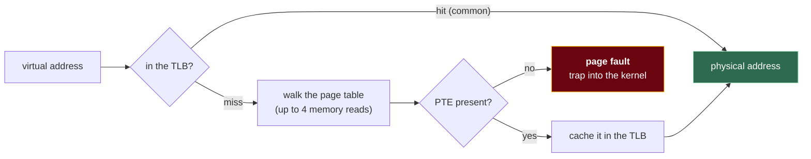

# 5. Memory

## The problem

Several programs share one bank of RAM. Without help, each would have to know which
physical addresses the others were using, any of them could overwrite the others (or the
kernel), and a program compiled to run at address 0x1000 couldn't run if something else
was already there. Virtual memory fixes all of that with one level of indirection. It
also brings the performance cliffs interviewers like to ask about: TLB misses, page
faults, thrashing. And at the language level there's a second question, stack or heap,
which decides who frees memory and when.

Assumes [file 01 §1.7](01-what-happens-when-a-program-runs.md#17-memory-every-address-is-a-lie-usefully):
programs use virtual addresses, translated by hardware using a per-process page table.

## 5.1 The idea: a private notebook with a lookup table

Picture each program with its own notebook, its pages numbered from 0. It writes
wherever it likes in its notebook. Behind the scenes, a librarian keeps a table per
notebook saying "notebook page 3 is actually stored on shelf 8". Two programs can both
use their page 3, and they land on different shelves. A program can't name another's
shelf at all, because it only ever speaks in notebook pages. And if a notebook page
hasn't been used yet, it doesn't need a shelf.

That's virtual memory. The notebook is the **virtual address space**, the shelves are
**physical memory**, and the librarian's table is the **page table**, read on every
memory access by the CPU's **memory management unit (MMU)**.

| Goal | How virtual memory delivers it |
|---|---|
| **Isolation** | Each process has its own page table; there's no virtual address that names another process's memory |
| **Relocation** | Every program can be linked as if it owned the address space; the page table puts it wherever there's room |
| **Efficiency** | Pages are given physical memory only when touched, and unused pages can go to disk |
| **Sharing, deliberately** | Two page tables can point at the same physical page: shared libraries, `fork`'s copy-on-write, shared memory |

## 5.2 Paging: chopping memory into fixed-size pieces

Memory is divided into fixed-size blocks. A block of virtual memory is a **page**. A
block of physical memory is a **frame**. They're the same size, typically **4 KiB**
(4,096 bytes = 2¹² bytes) on x86-64 and most ARM systems, though larger pages exist
(§5.4).

A virtual address splits into two parts: which page, and where in the page. With 4 KiB
pages, the low 12 bits are the **offset** and the rest is the **virtual page number
(VPN)**. Translation replaces the VPN with a **physical frame number (PFN)** and keeps
the offset unchanged.

A worked translation, with a made-up page table:

```
virtual address  0x3A7F  =  0011 1010 0111 1111
                             └┬─┘ └─────┬──────┘
                       VPN = 0x3    offset = 0xA7F   (low 12 bits)

page table:  VPN 0x3 → PFN 0x8, present, writable

physical address = (0x8 << 12) | 0xA7F = 0x8A7F
```

Each **page table entry (PTE)** holds the frame number and some bits the hardware and
kernel rely on:

| Bit | Meaning | Used for |
|---|---|---|
| **Present / valid** | This page is in physical memory now | Clear → page fault (§5.5) |
| **Writable** | Writes allowed | Read-only code; copy-on-write |
| **User / supervisor** | User mode may access it | Keeping your program out of kernel memory |
| **Accessed** | Set by hardware on any access | Page replacement (§5.6) |
| **Dirty** | Set by hardware on write | Knowing whether a page must be written back before eviction |

Paging avoids **external fragmentation**, where free memory exists but in pieces too
small to use, because any free frame fits any page. The price is **internal
fragmentation**: a 5 KiB allocation of whole pages uses two pages and wastes 3 KiB of the
second. The older alternative, **segmentation** (variable-sized regions for code, heap,
stack), had the opposite problem; OSTEP covers both
([Segmentation](https://pages.cs.wisc.edu/~remzi/OSTEP/vm-segmentation.pdf),
[Paging](https://pages.cs.wisc.edu/~remzi/OSTEP/vm-paging.pdf)).

## 5.3 Why page tables have levels

A flat table with one entry per virtual page is hopeless at 64-bit sizes. Do the sum for
x86-64's original 48-bit virtual addresses: 4 KiB pages leave 36 bits of VPN, so 2³⁶
entries, at 8 bytes each, is 2³⁹ bytes. **512 GiB of page table per process**, almost
all describing memory the process never uses.

So the table is a tree. x86-64 splits the 36 VPN bits into four 9-bit indices, each
choosing one of 512 entries in a 4 KiB table at its level:

```
 47        39 38        30 29        21 20        12 11            0
┌────────────┬────────────┬────────────┬────────────┬───────────────┐
│ L4 index   │ L3 index   │ L2 index   │ L1 index   │   offset      │
│  (9 bits)  │  (9 bits)  │  (9 bits)  │  (9 bits)  │  (12 bits)    │
└─────┬──────┴─────┬──────┴─────┬──────┴─────┬──────┴───────────────┘
      ▼            ▼            ▼            ▼
   L4 table ──► L3 table ──► L2 table ──► L1 table ──► frame + offset
```

A region the process never touched needs no lower-level tables at all, so a small
process has a small tree. The kernel docs give the limits: "Original x86-64 was limited
by 4-level paging to 256 TiB of virtual address space", and 5-level paging "bumps the
limits to 128 PiB of virtual address space"
([5-level paging](https://docs.kernel.org/arch/x86/x86_64/5level-paging.html)), using
57-bit addresses.

The cost of the tree is obvious from the picture: one memory access by your program
could mean four extra memory reads just to find out where to go.

## 5.4 The TLB: making translation fast

The CPU avoids that cost with the **translation lookaside buffer (TLB)**: a small, very
fast cache of recent VPN → PFN translations inside the CPU. On a **TLB hit**, translation
is nearly free. On a **TLB miss**, the hardware (on x86 and ARM) walks the page table,
then caches the result.

It works because programs have **locality**. They touch the same pages repeatedly
(temporal) and nearby addresses in a row (spatial), so a few dozen to a few thousand
entries cover most accesses. Walking an array touches each page 1,024 times for 4-byte
integers, so one miss per 4 KiB of array. Following pointers through a linked list
scattered across the heap can miss on nearly every node.



Two consequences show up in real systems:

- **Context switches cost TLB contents.** A new process has different translations, so
  the TLB is flushed or, on CPUs that tag entries with an address-space ID, just holds
  nothing useful for it yet ([file 02 §2.5](02-processes-and-threads.md#25-context-switches)).
- **Huge pages raise TLB reach.** One TLB entry covers one page. With 2 MiB pages instead
  of 4 KiB, each entry covers 512 times as much memory. Databases and JVMs with large
  heaps use huge pages for this reason.

## 5.5 Page faults and demand paging

When the MMU finds a PTE that isn't present, or an access the PTE forbids, it raises a
**page fault**: a trap into the kernel. "Fault" sounds like an error, and usually it
isn't. The kernel decides which kind it is:

| Kind | What happened | What the kernel does | Cost |
|---|---|---|---|
| **Minor (soft)** | The page is valid but not mapped yet: first touch of fresh memory, or the page is already in RAM (e.g. in the page cache) | Find or zero a frame, fill in the PTE, resume | Microseconds |
| **Major (hard)** | The page's contents are on disk (swapped out, or a memory-mapped file not yet read) | Start disk I/O, block the thread, resume when it arrives | Disk latency: orders of magnitude more |
| **Invalid** | The address isn't part of the process at all, or the access is forbidden (writing read-only code) | Send `SIGSEGV`: the familiar **segmentation fault** | The process usually dies |

**Demand paging** is building on minor faults deliberately: memory is promised at
allocation and supplied at first touch. That's why `top` shows a large virtual size
(`VIRT`/`VSZ`) for most processes and a much smaller resident size (`RES`/`RSS`): most of
the promised memory has never been touched.

**Copy-on-write** uses write-protection faults. After `fork`
([file 02 §2.3](02-processes-and-threads.md#23-how-a-process-is-born-fork-exec-wait)),
parent and child share every physical page, all marked read-only. The first write to a
page faults, the kernel copies just that page for the writer, makes it writable, and
resumes. A `fork` followed by `exec` copies almost nothing.

## 5.6 Page replacement: what to evict

When physical memory is full and a page has to come in, another must go out (written to
swap first if it's dirty). Which one? The algorithms are judged by how many faults they
cause on a **reference string**: the sequence of pages a program touches.

Using the reference string from Silberschatz et al., with 3 frames (all counts computed
by a small simulator):

`7 0 1 2 0 3 0 4 2 3 0 3 2 1 2 0 1 7 0 1`

| Algorithm | Evicts | Faults | Practical? |
|---|---|---|---|
| **FIFO** | The page that arrived earliest | 15 | Easy, but evicts heavily-used pages just because they're old |
| **LRU** (least recently used) | The page unused for the longest time | 12 | Good, but exact LRU means updating an ordering on *every memory access* |
| **OPT / MIN** (optimal) | The page whose next use is furthest in the future | 9 | Impossible: needs the future. Used as a yardstick (Belady, 1966) |

OPT plays the same role as SJF in scheduling ([file 03 §3.3](03-cpu-scheduling.md#33-shortest-job-first-and-why-it-cant-be-built)):
provably best, needs the future, and real systems approximate it by assuming the recent
past predicts the near future, which is what LRU does.

### Belady's anomaly

You'd expect more frames to mean fewer faults. For FIFO, not always. The string Belady,
Nelson and Shedler used to show it ("An anomaly in space-time characteristics of certain
programs running in a paging machine", CACM, 1969) is:

`1 2 3 4 1 2 5 1 2 3 4 5`

FIFO traces (`*` = fault, frames in arrival order):

```
3 frames: *1  *12  *123  *234  *341  *412  *125   125   125  *253  *534   534   →  9 faults
4 frames: *1  *12  *123  *1234 1234  1234  *2345 *3451 *4512 *5123 *1234 *2345  → 10 faults
```

One more frame, one *more* fault. With 4 frames, FIFO keeps pages 1 and 2 around just
long enough that they're evicted right before they're needed again.

LRU and OPT can't do this. On the same string, LRU gives 10 faults with 3 frames and 8
with 4. They're **stack algorithms**: the set of pages held with *n* frames is always a
subset of the set held with *n + 1*. Adding a frame can only add pages you'd have kept,
never change which ones you evict. FIFO's contents depend on arrival order, which isn't
a subset relation.

### What real systems do: approximate LRU cheaply

Exact LRU is too expensive, so systems use the hardware's **accessed bit**. The **clock**
algorithm (second chance) arranges frames in a circle with a hand. To evict, look at the
page under the hand: accessed bit set? Clear it and move on (second chance). Clear?
Evict it. Recently used pages survive a pass; idle ones don't.

Linux uses lists rather than a single clock. Its classic design, from the comment at the
top of [`mm/workingset.c`](https://github.com/torvalds/linux/blob/master/mm/workingset.c):
"two clock lists are maintained for file pages: the inactive and the active list.
Freshly faulted pages start out at the head of the inactive list and page reclaim scans
pages from the tail. Pages that are accessed multiple times on the inactive list are
promoted to the active list". Since 6.1 there's an optional alternative, the
[multi-gen LRU](https://docs.kernel.org/admin-guide/mm/multigen_lru.html), which "optimizes
page reclaim and improves performance under memory pressure".

## 5.7 Thrashing and the working set

Give a system more active processes than its memory can hold and something pathological
happens. Every process faults constantly, each fault evicts a page another process is
about to need, the CPU sits idle waiting for the disk, and an old-style scheduler, seeing
low CPU use, admits *more* processes. That's **thrashing**: nearly all time spent moving
pages, almost none doing work.

Denning's **working set** model ("The working set model for program behavior", CACM,
1968) is the standard way to think about it. A process's working set is the pages it
used in a recent window of time. If the sum of every process's working set exceeds
physical memory, you'll thrash, and the fix is to run fewer things at once (or add
memory), not to schedule them more cleverly.

> **Teacher's aside.** People think of RAM as where a program's memory *is*. It's more
> accurate to think of RAM as a cache for the virtual address space, with disk behind
> it. Then the familiar effects all read as cache behaviour: a TLB miss is a cache miss
> for translations, a major page fault is a cache miss for data, the working set is the
> cache's hot set, and thrashing is a cache too small for its hot set, missing on almost
> every access. In containers there's a twist: with a memory limit and no swap, the
> "cache" can't spill to disk, so going over the limit doesn't slow you down
> gradually. The process gets killed.

## 5.8 Stack vs heap

Inside one process there are two places a program's data lives, and they differ in who
frees it.

The **stack** is a region per thread that grows and shrinks with function calls. Calling
a function pushes a **frame** holding its locals and return address. Returning pops it.
Allocation is moving a pointer, so it's essentially free, and freeing is automatic and
immediate. The catch: a stack frame's data dies when the function returns, and stacks
are limited in size.

The **heap** is memory allocated explicitly at run time, which lives until something
frees it. That something is you (C, C++), the compiler's ownership rules (Rust), or a
garbage collector (Go, JavaScript, Java).

| | Stack | Heap |
|---|---|---|
| Allocation | Move the stack pointer: very cheap | Find a free block: an allocator call, possibly a lock or system call |
| Freed | Automatically, when the function returns | Manually, by ownership rules, or by a GC |
| Lifetime | Tied to the function call | As long as anything needs it |
| Size | Limited per thread | Bounded by the address space and RAM |
| Access pattern | Hot, contiguous, cache-friendly | Can be scattered |
| Typical failure | Stack overflow (deep or infinite recursion) | Leaks, use-after-free, double free, fragmentation, GC pauses |

The four languages split cleanly on who decides where a value goes:

| Language | Who decides stack or heap | What happens if you return a pointer to a local |
|---|---|---|
| **Go** | The **compiler**, by escape analysis | It just works: the compiler moves the value to the heap |
| **Rust** | **You**: values live on the stack; `Box`, `Vec`, `String` put data on the heap | **Compile error** `E0515`: "cannot return reference to local variable" |
| **C++** | **You**: locals on the stack; `new` / `std::make_unique` for the heap | **Compiles**, with only a warning (`-Wreturn-stack-address` in clang); using it is undefined behaviour |
| **JavaScript** | The **engine**; you don't choose | Not expressible: there are no pointers to locals, and the GC keeps alive whatever is reachable |

You can watch Go's compiler decide. With `go build -gcflags=-m`:

```go
type point struct{ x, y int }

func onStack() int {
	p := point{1, 2} // never outlives the call
	return p.x + p.y
}

func onHeap() *point {
	p := point{1, 2} // address returned: must outlive the call
	return &p
}
```

```
./main.go:11:2: moved to heap: p
```

Only `onHeap`'s `p` is reported. Go makes the dangling pointer impossible by moving the
value, and you pay with a heap allocation and garbage collection.

<details><summary>Rust</summary>

```rust
struct Point { x: i32, y: i32 }

fn bad() -> &'static Point {
    let p = Point { x: 1, y: 2 };
    &p // error[E0515]: cannot return reference to local variable `p`
}

fn good() -> Box<Point> {
    Box::new(Point { x: 1, y: 2 }) // explicitly on the heap; ownership moves to the caller
}
// When the Box's owner goes out of scope, the heap memory is freed. No GC, no manual free.
```

</details>

<details><summary>C++</summary>

```cpp
#include <memory>

struct Point { int x, y; };

Point* bad() {
    Point p{1, 2};
    return &p;   // warning: address of stack memory associated with local variable 'p' returned
}                // the program still compiles; dereferencing the result is undefined behaviour

std::unique_ptr<Point> good() {
    return std::make_unique<Point>(1, 2);  // heap; freed when the unique_ptr is destroyed
}
```

</details>

<details><summary>JavaScript</summary>

```js
function makePoint() {
  const p = { x: 1, y: 2 };
  return p; // fine: objects are garbage-collected, kept alive while reachable
}
// Stack limits still exist: unbounded recursion throws
// "RangeError: Maximum call stack size exceeded" (Node 24).
```

</details>

Stack sizes differ a lot. An OS thread gets a fixed reservation (megabytes, set by
`ulimit -s` or the thread library). A goroutine starts small and the runtime grows its
stack by copying it into a bigger one when needed, up to a limit: "The initial setting is
1 GB on 64-bit systems" (`runtime/debug.SetMaxStack` docs). So infinite recursion in Go
takes a while to crash, and uses a lot of memory first.

## Asked in interviews

- "What is virtual memory and why do we need it?" → §5.1
- "Explain paging. Translate this address." → §5.2
- "Why multi-level page tables?" → §5.3
- "What's a TLB? What happens on a TLB miss?" → §5.4
- "What's a page fault? Is it always an error?" → §5.5
- "Compare FIFO, LRU and optimal page replacement. Count faults for this string." → §5.6
- "What's Belady's anomaly?" → §5.6
- "What's thrashing and how do you fix it?" → §5.7
- "Stack vs heap?" → §5.8
- "Internal vs external fragmentation?" → §5.2

## Check yourself

1. With 4 KiB pages, translate virtual address `0x5123` given that VPN 5 maps to frame
   `0x2C`. Then say what happens if VPN 5's present bit is clear.
2. Why can't a 64-bit system use a single flat page table? Do the size calculation for
   48-bit addresses, and explain how a multi-level table avoids paying it.
3. Two programs do the same arithmetic on the same 1 GiB of integers. One walks an array
   in order; the other follows a linked list whose nodes are scattered across the heap.
   Explain the difference in speed in terms of the TLB and caches, not just "arrays are
   faster".
4. Count page faults for FIFO and LRU with 3 frames on `1 2 3 1 4 1 2 5`. Show your
   working.
5. Explain why Belady's anomaly can happen with FIFO but never with LRU. Your answer
   should use the idea of the set of pages in memory with *n* versus *n + 1* frames.
6. A Go function returns `&localStruct` and an equivalent C++ function returns
   `&localStruct`. One is correct and one is undefined behaviour. Explain which and why,
   and what the correct one costs at run time.

(Answers in [13-exercises.md](13-exercises.md).)
