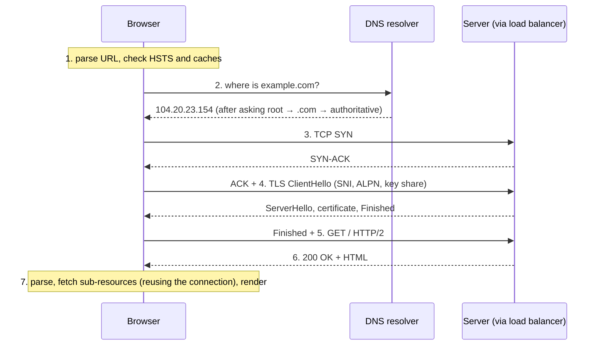
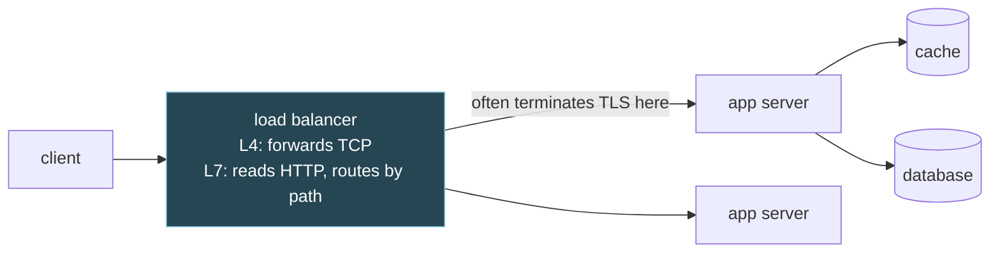

# 10. What happens when you type a URL

## The problem

"What happens when you type `https://example.com` into a browser and press Enter?" is
the most famous systems interview question there is, because it has no bottom. A good
answer touches DNS, TCP, TLS, HTTP, load balancers, servers and rendering, and the
interviewer stops you wherever they want to dig. The trap is answering it as a list of
acronyms. The better answer is a story with a clear spine: *find the server, open a
reliable channel, make it private and authenticated, ask for the page, get it back*. Each
step solves one problem, and you can go as deep on any of them as you're asked.

This chapter is that spine. It assumes [file 09](09-networks-layers-and-tcp.md) for TCP,
and it links to the [http course](../../http/README.md) for the depth on TLS certificates
and HTTP versions rather than repeating it.

## 10.1 The whole journey



Each numbered step is a section below.

## 10.2 Before the network: parsing and caches

The browser parses the URL into a **scheme** (`https`), a **host** (`example.com`), an
optional **port** (443 by default for `https`), a **path** (`/`) and a query. If you typed
something that isn't a URL, it becomes a search.

Then it checks whether it needs the network at all:

| Check | Effect |
|---|---|
| **HSTS** list | If the site has told the browser (or is on the browser's preload list) that it's HTTPS-only, an `http://` URL is upgraded to `https://` before anything is sent ([RFC 6797](https://www.rfc-editor.org/rfc/rfc6797.html)) |
| **HTTP cache** | A fresh cached copy of the page may be used with no request at all, or revalidated with a conditional request |
| **Open connection** | If there's already a connection to this host, steps 2–4 are skipped entirely |

That last row is the important one for real performance, and §10.6 comes back to it.

## 10.3 DNS: finding the server

The browser needs an IP address for `example.com`. DNS is a distributed, hierarchical,
heavily cached database for exactly that ([RFC 1034](https://www.rfc-editor.org/rfc/rfc1034.html)
and [RFC 1035](https://www.rfc-editor.org/rfc/rfc1035.html), both 1987).

The analogy is a library's catalogue system. You don't search every shelf. You go to
the catalogue (the root), which sends you to the right section (`.com`), whose index
sends you to the right shelf (`example.com`'s own name servers), which has the answer.

**Caches first.** The browser has a DNS cache, then the operating system, then the
**recursive resolver** (your ISP's, your company's, or a public one). Each cached answer
lives for its **TTL**, set by the domain's owner.

**On a full miss**, the recursive resolver walks the hierarchy. Here's a real walk, from
`dig +trace example.com` on 2026-10-08 (the addresses and providers will differ when you
run it):

```
. (root)       13 root servers: a.root-servers.net … m.root-servers.net
                  "ask the .com servers"     →  com. NS a.gtld-servers.net … (referral)
com.           e.gtld-servers.net
                  "ask example.com's servers" → example.com. NS hera.ns.cloudflare.com,
                                                             elliott.ns.cloudflare.com
example.com.   elliott.ns.cloudflare.com (authoritative)
                  "here's the answer"         →  example.com. 300 IN A 104.20.23.154
                                                 example.com. 300 IN A 172.66.147.243
```

The root and `.com` servers don't know the answer; they **refer** you one level down. Only
the last server, the **authoritative** one, knows it. Note the TTLs: the delegation to
Cloudflare's name servers is cached for 172,800 seconds (two days), the address itself for
only 300 seconds.

RFC 1034 names the two ways of asking ([§2.2](https://www.rfc-editor.org/rfc/rfc1034.html#section-2.2)):
"'recursive', in which the first server pursues the query for the client at another
server, and 'iterative', in which the server refers the client to another server and lets
the client pursue the query." In practice your machine asks the resolver *recursively*
("just get me the answer"), and the resolver asks the hierarchy *iteratively* (following
referrals), as in the trace above.

On "13 root servers": there are 13 root server *names*, `a` to `m`, "operated by 12
independent organisations" ([root-servers.org](https://root-servers.org/)), but each name
is served by many machines worldwide sharing one address through anycast. The live count
was over two thousand instances when I checked.

| Record | Holds |
|---|---|
| **A** / **AAAA** | IPv4 / IPv6 address |
| **CNAME** | "This name is an alias for that name" |
| **NS** | Which servers are authoritative for a zone |
| **MX** | Mail servers for a domain |
| **TXT** | Arbitrary text: domain verification, email policy (SPF, DMARC) |

**Transport.** DNS traditionally uses UDP port 53, one datagram each way. RFC 1035 limited
UDP answers to 512 bytes: "Longer messages are truncated and the TC bit is set in the
header" (§4.2.1), telling the client to retry over TCP. Later extensions allow larger UDP
answers, and RFC 7766 made TCP mandatory: "All general-purpose DNS implementations MUST
support both UDP and TCP transport." Plain DNS is unencrypted; DNS over TLS
([RFC 7858](https://www.rfc-editor.org/rfc/rfc7858.html)) and over HTTPS
([RFC 8484](https://www.rfc-editor.org/rfc/rfc8484.html)) hide queries from the network.

## 10.4 TCP: a reliable channel

With an address, the browser opens a TCP connection to port 443: SYN, SYN-ACK, ACK, one
round trip ([file 09 §9.5](09-networks-layers-and-tcp.md#95-opening-and-closing-a-tcp-connection)).
If the name had both IPv4 and IPv6 addresses, the browser typically tries both in
parallel and uses whichever connects first ("Happy Eyeballs",
[RFC 8305](https://www.rfc-editor.org/rfc/rfc8305.html)).

## 10.5 TLS: private, and with the right server

TCP gives a reliable byte stream that anyone on the path can read and alter. TLS adds two
things: **confidentiality** (nobody else can read it) and **authentication** (you're
talking to `example.com`, not an impostor). TLS 1.3 ([RFC 8446](https://www.rfc-editor.org/rfc/rfc8446.html))
does both in one round trip:

```
Client                                              Server
ClientHello
  + supported versions and ciphers
  + key_share          (client's half of a key exchange)
  + server_name (SNI)  "I want example.com"
  + ALPN               "I speak h2, http/1.1"
                         ───────────────────►
                                              ServerHello + key_share
                                              ── from here, encrypted ──
                                              EncryptedExtensions (chosen ALPN)
                                              Certificate         (chain for example.com)
                                              CertificateVerify   (signature: proves it holds the key)
                                              Finished
                         ◄───────────────────
Finished
GET / …                  ───────────────────►     (the request rides with Finished)
```

After one flight each way, both sides have derived the same keys from the exchanged key
shares, and the client has the server's certificate. Three fields deserve a sentence each:

- **SNI** (Server Name Indication) exists because one IP address often hosts many sites,
  and "TLS does not provide a mechanism for a client to tell a server the name of the
  server it is contacting" ([RFC 6066 §3](https://www.rfc-editor.org/rfc/rfc6066.html#section-3)).
  The server needs the name to pick the right certificate. It's sent in the ClientHello,
  before encryption starts, so by default an observer can see which site you're visiting
  even though they can't see the page.
- **ALPN** is how the HTTP version gets chosen inside this handshake rather than with an
  extra round trip. The [http course, file 02](../../http/02-alpn-and-negotiation.md#alpn-negotiate-inside-the-handshake-youre-already-paying-for)
  covers it, including why plain HTTP behaves differently.
- **The certificate** is checked three ways: does the server hold its private key (the
  `CertificateVerify` signature), does the name match the one you asked for, and does a
  chain of signatures lead to a root you already trust. The
  [http course, file 04](../../http/04-certificates-and-trust.md#the-three-questions-and-the-three-errors)
  is the depth on this, with the error message each check produces.

A returning client can resume a previous session, and TLS 1.3 even allows sending data in
the very first flight (**0-RTT**), with caveats the RFC spells out
([§2.3](https://www.rfc-editor.org/rfc/rfc8446.html#section-2.3)): "This data is not
forward secret" and "There are no guarantees of non-replay between connections." So
0-RTT is only safe for requests that are harmless to repeat.

> ⚠️ **"The connection is encrypted" doesn't mean "the server is who it claims".**
> Encryption alone gives you a private channel to *whoever answered*. Authentication is the
> certificate check. That's why "skip certificate verification" (`InsecureSkipVerify` in
> Go, `-k` in curl) isn't a harmless workaround: it keeps the encryption and throws away
> the part that tells you who's on the other end.

## 10.6 Counting round trips

Latency to a far-away server is dominated by round trips, not bandwidth. In the `dig`
trace above, the `.com` server took 207 ms to answer one query, and a
round trip of a couple of hundred milliseconds to another continent is ordinary. So it's
worth counting how many happen before the first byte of the page arrives.

| Setup | DNS (cold) | TCP | TLS | HTTP request → response | Round trips before first byte |
|---|---|---|---|---|---|
| Everything cold, TLS 1.2 | 1+ | 1 | 2 | 1 | 5+ |
| Everything cold, TLS 1.3 | 1+ | 1 | 1 | 1 | 4+ |
| DNS cached, TLS 1.3 | 0 | 1 | 1 | 1 | **3** |
| HTTP/3 over QUIC, DNS cached | 0 | (combined with TLS) | 1 | 1 | 2 |
| Existing connection reused | 0 | 0 | 0 | 1 | **1** |

(DNS is "1+" because a full miss can take several round trips from the resolver, although
the browser sees only its one exchange with the resolver.)

The last row is the lesson. A reused connection skips three round trips. That's why HTTP
keep-alive, connection pools, and HTTP/2's one-connection-per-host design matter so much,
and why a Go service that creates a new HTTP `Transport` per request is slow
([go-services course, file 02](../../go-services/02-the-http-client.md)).

## 10.7 HTTP: asking for the page

Over the encrypted channel, the browser sends a request: a **method**, a **target**, and
**headers**:

```
GET / HTTP/1.1
Host: example.com
Accept: text/html
```

(Under HTTP/2 the same semantics travel as binary frames, but the meaning is identical.)
HTTP's meaning is defined separately from its wire formats, in RFC 9110, "HTTP Semantics"
([RFC 9110](https://www.rfc-editor.org/rfc/rfc9110.html)). Two definitions from it get
asked constantly:

- **Safe** methods don't change server state: "the GET, HEAD, OPTIONS, and TRACE methods
  are defined to be safe" ([§9.2.1](https://www.rfc-editor.org/rfc/rfc9110.html#section-9.2.1)).
- **Idempotent** methods have the same effect whether sent once or many times: "PUT,
  DELETE, and safe request methods are idempotent" ([§9.2.2](https://www.rfc-editor.org/rfc/rfc9110.html#section-9.2.2)).
  POST isn't, which is why retrying a POST after a timeout risks charging a card twice, and
  why payment APIs ask for idempotency keys.

The response carries a **status code**, headers and a body:

| Class | Meaning | Examples |
|---|---|---|
| 1xx | Informational | 101 Switching Protocols |
| 2xx | Success | 200 OK, 201 Created, 204 No Content |
| 3xx | Redirection | 301 Moved Permanently, 304 Not Modified |
| 4xx | Client error | 400, 401 Unauthorized, 403 Forbidden, 404, 429 Too Many Requests |
| 5xx | Server error | 500, 502 Bad Gateway, 503 Service Unavailable, 504 Gateway Timeout |

| Version | Transport | What changed | Depth |
|---|---|---|---|
| HTTP/1.1 | TCP | Text; one response at a time per connection | [http file 01](../../http/01-versions-and-framing.md#http11-is-a-byte-stream-with-no-envelope) |
| HTTP/2 | TCP | Binary frames; many streams multiplexed on one connection | [http file 01](../../http/01-versions-and-framing.md#http2-wraps-everything-in-frames) |
| HTTP/3 | QUIC over UDP | Streams in the transport, so no TCP head-of-line blocking | [file 09 §9.8](09-networks-layers-and-tcp.md#98-head-of-line-blocking-and-why-quic-exists) |

## 10.8 On the server side

The interviewer may now turn the question around: what happens when the request
arrives? A typical path for a web service:



- A **load balancer** spreads connections across servers. An **L4** balancer forwards TCP
  connections without reading them; an **L7** balancer understands HTTP and can route by
  host or path, which means it must terminate TLS (or be given the keys).
- The **app server** (your Go service) accepts the connection, parses the request, and a
  handler runs: in Go, on its own goroutine ([file 02 §2.6](02-processes-and-threads.md#26-how-four-languages-do-it)).
- The handler reads from a cache or a database ([file 07](07-transactions-and-isolation.md)),
  builds the response and writes it back down the same connection.

## 10.9 Back in the browser

The browser parses the HTML into a DOM, discovers the stylesheets, scripts and images it
references, and fetches them, ideally over the connection it already has. It applies CSS,
runs JavaScript on its single main thread's event loop, lays the page out and paints it.
Rendering is a course of its own; for this question, naming the steps is usually enough.

> **Teacher's aside.** The answer interviewers hear most often is the cold path: DNS from
> the root, a fresh TCP handshake, a full TLS handshake. That's the right structure, but
> it's rarely what happens. On a second visit nearly every step is skipped: DNS from a
> cache, the connection already open, TLS resumed or never needed, the page revalidated or
> served from cache. Say that, and you've shown you know where real-world latency goes.
> Most web performance work is about making the warm path the common one.

## Asked in interviews

- "What happens when you type a URL and press Enter?" → §10.1, then each section
- "How does DNS resolution work? Recursive vs iterative?" → §10.3
- "Does DNS use TCP or UDP?" → §10.3, "Transport"
- "Explain the TLS handshake." → §10.5
- "What's SNI and why is it needed?" → §10.5
- "How many round trips before the first byte? How do you reduce them?" → §10.6
- "Which HTTP methods are idempotent? Why does it matter?" → §10.7
- "L4 vs L7 load balancer?" → §10.8

## Check yourself

1. A user's browser has never visited `shop.example.in` and the resolver's cache is empty.
   Which servers are asked, in what order, and which of them actually knows the answer?
2. Why does TLS need SNI, and why is it sent before encryption starts? What can a network
   observer learn from it?
3. Count the round trips before the first byte of HTML for a cold visit over TLS 1.3 with
   a cached DNS answer, and again for the same visit with an existing HTTP/2 connection.
   What does this tell you about where to spend optimisation effort?
4. A payment client retries a `POST /charges` after a timeout and the customer is charged
   twice. Using RFC 9110's definitions, explain why, and describe a design that makes the
   retry safe.
5. An engineer disables certificate verification to fix an "unknown authority" error and
   points out the connection is still encrypted. What has been lost, concretely? Describe
   the attack that now works.
6. Your service sits behind an L7 load balancer that terminates TLS. Name two things the
   balancer can do that an L4 balancer can't, and one thing your service can no longer see
   directly.

(Answers in [13-exercises.md](13-exercises.md).)
