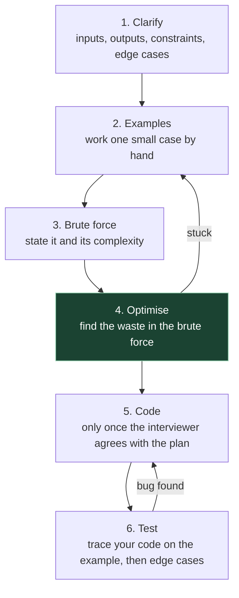

# 1. Foundations

Every later chapter in this course says things like "this is O(n log n)", "that's amortised
O(1)", "with n ≤ 10^5 you can't afford quadratic". If those phrases are fuzzy, every chapter
is fuzzy. This one makes them exact, then teaches the method you'll use to work every
problem out loud.

**Who can skip it:** if you can explain what amortised O(1) means for `append` without
saying "usually fast", turn a constraint like n ≤ 2·10^5 into a target complexity, and already
talk through problems in a fixed order, skim §1.6 (the method) and §1.7 (the language tables)
and move on.

## 1.1 What an algorithm interview is actually testing

Most people prepare as if the interview checks whether you know the answer to a particular
problem. Then they meet a problem they haven't seen, freeze, and conclude they didn't grind
enough. The problem with that preparation is the assumption under it.

A 45-minute coding round can't measure what you've memorised, because the interviewer
doesn't know what you've seen. What it *can* measure is what you do when you don't know yet.
Interviewers' scoring sheets differ from company to company and are rarely published in
full, but the dimensions that show up whenever one is described are roughly these:

| What they watch | What it looks like when it goes well |
|---|---|
| **Problem solving** | You find structure in the problem, reach a working idea, then improve it |
| **Communication** | The interviewer can follow your reasoning without asking "what are you doing?" |
| **Coding** | Correct, readable code in a language you clearly know |
| **Verification** | You test your own code by hand and find your own bugs before they do |

The last row is the one people skip, and since AI coding tools arrived it's the one that has
been gaining weight (§1.2).

> **Teacher's aside.** "Pattern" in this course doesn't mean "a problem I've seen before".
> It means *a reusable reason why something can be done faster*. Sliding window works because
> a window's answer can be updated in O(1) when one element enters and one leaves. Binary
> search on the answer works because feasibility is monotone. If you learn the reason, you can
> recognise the pattern in a problem you've never seen. If you learn the problem, you can
> recognise only that problem. That's why every chapter here leads with the reason.

## 1.2 Why this still matters when AI can write the code

A fair question for 2026. An AI assistant will produce a correct two-pointer solution to a
textbook problem in seconds, so what is left to test?

What the evidence shows, honestly, is mixed:

- **Some companies have changed the format.** Canva announced in June 2025 that it was
  replacing its "Computer Science Fundamentals" screen with an AI-assisted round on open-ended
  problems, and expects candidates to use AI tools in it. The same post says it is *still
  assessing computer science fundamentals*, only inside more realistic problems
  ([Canva engineering blog](https://www.canva.dev/blog/engineering/yes-you-can-use-ai-in-our-interviews/)).
- **Others have added an AI round rather than replacing the classic one.** Interview-prep
  writers report that Meta began rolling out an AI-enabled coding round in late 2025 while
  keeping one conventional algorithm round in the onsite
  ([Hello Interview](https://www.hellointerview.com/blog/meta-ai-enabled-coding)). That's a
  secondary source, not Meta's own documentation, so treat the detail as provisional.
- **AI doesn't make engineers uniformly faster.** In METR's randomised study of 16
  experienced open-source developers working on their own repositories in early 2025, tasks
  where AI was allowed took 19% *longer*, although the developers believed it had sped them
  up ([METR, July 2025](https://metr.org/blog/2025-07-10-early-2025-ai-experienced-os-dev-study/)).
  METR is explicit that this is one population and one point in time, so don't overquote it.
  What it does show is that "the AI writes it, so skill doesn't matter" isn't an established fact.

The durable argument doesn't depend on any of that. An assistant will hand you code that is
quadratic where linear was available, or that uses a list where a heap was needed, and it
will look fine on the three examples you try. Telling those apart *is* the skill this course
teaches, and you need it most when reviewing code you didn't write. Interview formats will
keep changing (the shape of today's loop is in [`interview/01`](../01-how-the-loop-works.md));
the ability to see that an approach won't scale won't stop being useful.

## 1.3 Big-O, properly

### The problem it solves

"How fast is this code?" has no single answer. It depends on the machine, the language, the
compiler, what else is running, and the input. Timing it tells you about one machine and one
input. You want a statement about the *algorithm* that survives all of those changes.

The trick is to stop asking "how many seconds" and ask instead: **as the input grows, how
does the work grow?** Double the input. Does the work double? Quadruple? Barely change? That
growth rate is a property of the algorithm, not the machine, and that's what Big-O describes.

An analogy. You're handing out exam papers in a hall of n students:

- Walk past each desk once, putting a paper down: the work grows in step with n. **O(n)**.
- For each student, walk to every other student to compare answers: n × n. **O(n²)**.
- Look up one student by roll number in a sorted register, halving the pages each time: you
  need about log₂ n looks. **O(log n)**.

Whether you walk fast or slow changes the constant, not the shape. Big-O keeps the shape and
throws the constant away.

### The definitions

The notation comes from mathematics; Knuth's 1976 note *Big Omicron and Big Omega and Big
Theta* fixed how computer scientists use the three symbols, and CLRS chapter 3 is the
standard textbook treatment.

| Symbol | Says | Informally |
|---|---|---|
| **O(g(n))** | f(n) ≤ c·g(n) for all n beyond some n₀ | grows *no faster than* g: an upper bound |
| **Ω(g(n))** | f(n) ≥ c·g(n) for all n beyond some n₀ | grows *at least as fast as* g: a lower bound |
| **Θ(g(n))** | both of the above | grows *exactly like* g, up to constants |

In interviews people say "O" when they mean "Θ": "this is O(n)" usually means "this is
exactly linear". Everyone does it and nobody will mark you down. Know the difference anyway,
because it matters the moment someone says "comparison sorting is Ω(n log n)". That's a
lower bound on *every possible* comparison sort, which is a much stronger statement than
an upper bound on one algorithm.

### The classes you'll meet

| Class | Example | Doubling n does this to the work |
|---|---|---|
| O(1) | array index, hash lookup (expected) | nothing |
| O(log n) | binary search, heap push | adds one step |
| O(n) | one pass over an array | doubles it |
| O(n log n) | sorting, n heap operations | slightly more than doubles it |
| O(n²) | all pairs | ×4 |
| O(n³) | all triples, naive matrix multiply | ×8 |
| O(2ⁿ) | all subsets | squares it |
| O(n!) | all orderings | is hopeless past n ≈ 12 |

### What Big-O hides

Big-O is a deliberately lossy summary. Know what it throws away, because interviewers like
asking about it:

| What's hidden | Why it can matter |
|---|---|
| **Constant factors** | An O(n) algorithm doing 50 hash operations per element can lose to an O(n log n) sort on realistic n |
| **Lower-order terms** | O(n² + 1000n) is "O(n²)", but at n = 100 the 1000n term dominates |
| **Which case** | Quicksort is O(n²) worst case and O(n log n) on average. "O(…)" alone doesn't say which case you mean, so say it |
| **Memory layout** | Walking an array is far faster than walking a linked list of the same length, because the array is contiguous and the CPU cache loves it. Both are O(n) |
| **Small n** | Below a few dozen elements, simple quadratic code often wins. Standard library sorts switch to insertion sort for short runs for exactly this reason |

One case deserves its own sentence: **"hash lookup is O(1)" is an *expected* bound, not a worst
case.** If many keys collide, a lookup degrades towards O(n). Say "expected O(1)" when it matters;
[file 03 §3.1](03-hashing.md#31-how-a-hash-table-works-just-enough) has the detail.

## 1.4 Amortised cost and space

### Amortised: the cost that averages out

The problem: Go's `append`, Rust's `Vec::push`, C++'s `vector::push_back` and JavaScript's
`Array.prototype.push` are each usually instant, and occasionally have to allocate a bigger
block and copy everything across. Saying "O(n) worst case" is true and misleading. Saying
"O(1)" is what everyone says, and is not true of every call. You need a third word.

**Amortised** cost is the total cost of a sequence of operations divided by the number of
operations, *in the worst case over sequences*. It isn't an average over random inputs, and
there's no luck involved: it's a guarantee about any run of n operations.

Trace a dynamic array that doubles its capacity when full, starting at capacity 1, for 9
appends:

```
append #   len before   cap before   grows?   elements copied   cap after
   1           0            1          no            0              1
   2           1            1          yes           1              2
   3           2            2          yes           2              4
   4           3            4          no            0              4
   5           4            4          yes           4              8
   6           5            8          no            0              8
   7           6            8          no            0              8
   8           7            8          no            0              8
   9           8            8          yes           8             16
                                              total: 15 copies for 9 appends
```

The copies are 1 + 2 + 4 + 8 + … up to the largest power of two below n, which sums to
less than 2n. So n appends cost at most n writes plus fewer than 2n copies: O(n) in total,
**O(1) amortised per append**. That's the aggregate method from CLRS chapter 16 (chapter 17
in older editions).

The growth factor doesn't have to be 2. Any constant factor above 1 gives a geometric
series and the same O(1) result, with a different constant. Go, for example, doubles small
slices and grows large ones by about 1.25× (`nextslicecap` in
[`src/runtime/slice.go:289-304`](https://github.com/golang/go/blob/go1.24.4/src/runtime/slice.go#L289-L304)
at Go 1.24.4, then rounded up to an allocator size class). Growing by a *constant amount*,
say 100 slots each time, is what breaks the result: that's O(n²) total, O(n) amortised.

> **Rule of thumb for interviews:** say "amortised O(1)" for append/push and for hash-map
> insert. If asked "but what's the worst single call?", it's O(n), and saying so unprompted
> is a good sign.

### Space complexity

Space complexity counts memory the same way time complexity counts steps. Two
conventions cause confusion:

- **Auxiliary space** is the extra memory beyond the input. "Reverse an array in place is O(1)
  space" means auxiliary. Most interview answers mean auxiliary. Say so if it's unclear.
- **The call stack counts.** A recursive DFS on a tree of height h uses O(h) stack frames
  even though you never allocated anything explicitly. On a degenerate tree that's a
  straight line, h = n.

That second point is more than bookkeeping, because stacks are small and their limits differ
by language:

| Language | Default recursion headroom | Source |
|---|---|---|
| Go | Goroutine stacks grow on demand up to 1 GB on 64-bit systems, so deep recursion rarely fails | [`runtime/debug.SetMaxStack`](https://pkg.go.dev/runtime/debug#SetMaxStack) |
| Rust | Spawned threads default to 2 MiB "on all Tier-1 platforms"; the main thread's stack is set by the OS, not by Rust | [`std::thread`](https://doc.rust-lang.org/std/thread/index.html) |
| C++ | Whatever the OS gives the thread; on Linux and macOS commonly 8 MB for the main thread (check `ulimit -s`) | OS-dependent |
| JavaScript (Node) | Fixed by V8's stack size. A trivial recursive function managed about 10,400 frames on Node 24 on my machine before `RangeError`; real frames are bigger, so expect fewer | Measured; not a documented number |

None of the four does guaranteed tail-call elimination, so "it's tail-recursive" won't save
you. If recursion depth can reach n and n can be 10^5, either convert to an explicit stack
or say out loud why the depth is bounded (a balanced tree has depth O(log n)).

## 1.5 From constraints to a target complexity

The problem: you've read the question, you have a brute force, and you need to know whether
it's good enough or whether you should keep thinking. The constraints at the bottom of the
problem usually answer that before you write anything.

The reasoning goes like this. Laaksonen's *Competitive Programmer's Handbook* (§2.3,
"Estimating efficiency") starts from "the fact that a modern computer can perform some hundreds
of millions of operations in a second"; people usually round that to 10^8 simple operations per
second. It varies by a factor of several with the language, the operation and the machine, so
treat it as an order of magnitude. With a time limit around one or two seconds, work out which
growth rate keeps you near or under 10^8 for the largest n allowed.

The handbook gives a table for a one-second limit. Here it is with the reasoning added:

| If n is at most… | You can probably afford… | Because… | Typical shape |
|---|---|---|---|
| 10 | O(n!) | 10! ≈ 3.6·10^6 | try every ordering |
| 20 | O(2ⁿ) | 2^20 ≈ 10^6 | try every subset, bitmask DP |
| 500 | O(n³) | 1.25·10^8 | triple loop, interval DP |
| 5,000 | O(n²) | 2.5·10^7 | all pairs, 2-D DP |
| 10^5 – 10^6 | O(n log n) or O(n) | 10^6 · 20 = 2·10^7 | sort, heap, binary search, one pass |
| larger, e.g. 10^9 or 10^18 | O(log n) or O(1) | you can't even read that many items | binary search on the answer, maths |

Read it in both directions. **n ≤ 10^5 means quadratic is out** (10^10 operations), so stop
polishing the O(n²) idea and look for a sort, a hash map, a heap or a window. **n ≤ 20 is a
hint, not a restriction**: the setter is telling you exponential is fine, which usually means
"try all subsets".

> ⚠️ **This is a rule of thumb, not a law.** Interview problems often don't state
> constraints, so ask (§1.6, step 1). Judges sometimes give different languages different time
> limits; HackerRank's execution-environment page lists different limits per language. A
> constant factor of 50 can turn an "allowed" O(n log n) into a timeout. Use the table to rule
> things *out* quickly, not to promise an exact runtime.

## 1.6 Working a problem out loud

You'll meet unfamiliar problems. What you need is a procedure that keeps you moving and keeps
the interviewer informed while you think. This order is widely taught, and each step exists
to stop a specific failure:



| Step | What you do | What it prevents |
|---|---|---|
| **1. Clarify** | Ask about input size, value ranges (negatives? duplicates?), empty input, whether the input may be modified, what to return if there's no answer | Solving a different problem from the one asked. This is the most common way to fail a round you could have passed |
| **2. Examples** | Make one small example *yourself* (5–8 elements) and solve it by hand. Include something awkward: a duplicate, a negative | Coding before you understand the problem. Your hand-solution often *is* the algorithm |
| **3. Brute force** | Say the obvious solution and its complexity in one or two sentences. Don't code it unless asked | Silence. It also gives you a correct reference to optimise against, and a fallback if you run out of time |
| **4. Optimise** | Ask: what work does the brute force repeat? What does it recompute that it could remember? What does sorting buy? Check against the constraint table | Polishing an approach that can't pass |
| **5. Code** | Write clean code with names that mean something. Narrate in sentences ("now I shrink the window until it's valid"), not keystrokes | Code the interviewer can't follow |
| **6. Test** | Trace the code (not your idea of it) on your example, line by line, tracking variables. Then try empty, one element, all equal, the extremes | Shipping the off-by-one that your mental model hid |

**Step 4 is where the patterns live.** The questions that find the waste are the same
questions this course is organised around:

| If the brute force… | Ask whether… | Chapter |
|---|---|---|
| re-scans a range it just scanned | a window or prefix sum can update in O(1) | [02](02-arrays-and-strings.md) |
| searches for a partner element | a hash map can remember what you've seen | [03](03-hashing.md) |
| looks back for "the nearest bigger thing" | a monotonic stack can keep the candidates | [05](05-stacks-and-queues.md) |
| tries every candidate answer | feasibility is monotone, so binary search works | [06](06-binary-search.md) |
| re-sorts to get the current best | a heap can keep it in order | [09](09-heaps.md) |
| recomputes the same subproblem | memoising it makes it DP | [12](12-dynamic-programming.md) |

Step 6 is the one people skip when the code "looks right". The bugs that survive are exactly
the ones your mental model doesn't contain, so re-reading the code with the same model won't find
them; tracing it with real values will. Interviewers notice the difference between a candidate who
finds their own bug and one who waits to be told.

## 1.7 Languages: what this course uses, and what you should

Code in this course is in **Go** first, with the core template of each chapter also given in
**Rust**, **C++17** and **JavaScript** in collapsible blocks. Every one of those templates has
been compiled and run against test cases (Go 1.24, Rust 1.96, Apple clang 17 with
`-std=c++17`, Node 24). The patterns are language-independent. What changes between
languages is which container you reach for and which defaults bite.

**In the interview itself, use one language you're fluent in.** Writing four languages is a
way to *learn*, because each one makes a different assumption visible: Rust makes you think
about who owns a linked-list node, JavaScript makes you build your own heap. In the room,
hesitating over syntax costs you time and the interviewer's confidence. For a Go engineer the
obvious choice is Go.

### The container cheat sheet

| Need | Go | Rust | C++ | JavaScript |
|---|---|---|---|---|
| Dynamic array | `[]T` with `append` | `Vec<T>` | `std::vector<T>` | `Array` |
| Stack | `[]T`: append / `s[:len(s)-1]` | `Vec<T>`: `push` / `pop` | `std::vector` or `std::stack` | `Array`: `push` / `pop` |
| Queue / deque | slice: pop the front with `q = q[1:]` or a head index; `container/list` also exists, at one allocation per element | `VecDeque<T>` | `std::deque<T>` | **none**: use an array with a head index |
| Hash map | `map[K]V` | `HashMap<K, V>` | `std::unordered_map<K, V>` | `Map` |
| Hash set | `map[K]struct{}` or `map[K]bool` | `HashSet<T>` | `std::unordered_set<T>` | `Set` |
| Ordered map (sorted keys) | **none** in the standard library | `BTreeMap<K, V>` | `std::map<K, V>` (balanced tree) | **none** |
| Heap / priority queue | `container/heap` over your own type | `BinaryHeap<T>` | `std::priority_queue<T>` | **none**: write one ([file 09](09-heaps.md)) |
| Sort | `slices.Sort`, `slices.SortFunc` | `sort`, `sort_unstable` | `std::sort` | `Array.prototype.sort` with a comparator |
| Binary search | `slices.BinarySearch`, `sort.Search` | `binary_search`, `partition_point` | `std::lower_bound` | **none** |

Go's `min`, `max` and `clear` built-ins and the `slices`, `maps` and `cmp` packages arrived
in [Go 1.21](https://go.dev/doc/go1.21). Code in this course uses them, so on a platform
running an older Go you'd write those helpers yourself.

### The defaults that bite

These are the differences that actually cost people interview minutes. Each was checked
against the language's own documentation.

| Trap | Go | Rust | C++ | JavaScript |
|---|---|---|---|---|
| **Heap order** | Whatever your `Less` says; `<` gives a min-heap | `BinaryHeap` is a **max-heap**; wrap in `Reverse` for min | `priority_queue` is a **max-heap**; `std::greater` for min | no heap |
| **Integer overflow** | Wraps silently; the spec says overflow "does not cause a run-time panic" | **Panics in debug builds, wraps in release** | Signed overflow is **undefined behaviour** | Numbers are doubles; integers are exact only up to 2^53 − 1 (`Number.MAX_SAFE_INTEGER`); use `BigInt` beyond |
| **`int` width** | 32 or 64 bits, implementation-specific (64 on every judge you'll meet) | `i32`, `i64`, `usize` are explicit | `int` is 32 bits on mainstream platforms; use `long long` | n/a |
| **Sort stability** | `sort.Slice` and `slices.SortFunc` are **not** stable; `slices.SortStableFunc` is | `sort` is stable; `sort_unstable` isn't | `std::sort` is **not** stable; `std::stable_sort` is | stable since ES2019, but the default compares as **strings**: `[10, 9, 1].sort()` gives `[1, 10, 9]` |
| **Map iteration order** | Unspecified and deliberately varies between runs | Arbitrary | Arbitrary for `unordered_map`; sorted for `map` | Insertion order for `Map` |

Sources: [Go spec](https://go.dev/ref/spec) (integer overflow, map iteration),
[`sort`](https://pkg.go.dev/sort) and [`slices`](https://pkg.go.dev/slices) package docs,
[Rust Reference on overflow](https://doc.rust-lang.org/reference/expressions/operator-expr.html),
[`BinaryHeap`](https://doc.rust-lang.org/std/collections/struct.BinaryHeap.html),
[`slice::sort`](https://doc.rust-lang.org/std/primitive.slice.html), cppreference on
[`priority_queue`](https://en.cppreference.com/w/cpp/container/priority_queue),
[`std::sort`](https://en.cppreference.com/w/cpp/algorithm/sort) and
[arithmetic operators](https://en.cppreference.com/w/cpp/language/operator_arithmetic), MDN on
[`Array.prototype.sort`](https://developer.mozilla.org/en-US/docs/Web/JavaScript/Reference/Global_Objects/Array/sort)
and [`Number.MAX_SAFE_INTEGER`](https://developer.mozilla.org/en-US/docs/Web/JavaScript/Reference/Global_Objects/Number/MAX_SAFE_INTEGER).

> ⚠️ **Popping from the front of an array is a trap in JavaScript.** `Array.prototype.shift()`
> can move every remaining element. On Node 24 on my machine, draining an array with `shift()`
> took 0.3 ms for 10^4 elements, 619 ms for 10^5 and 9.9 s for 4·10^5: fast while small (V8 has
> optimisations for that case), quadratic once the array is large. Keep a head index instead
> (`while (head < q.length) { const x = q[head++]; … }`). Go's `q = q[1:]` is O(1), but the
> consumed prefix stays allocated until a later `append` reallocates the slice; harmless in one
> BFS, worth knowing for a long-lived queue.

### Is Rust available where you'll be tested?

If you're tempted to interview in Rust, check the platform first. What I could find in October 2026:

| Platform | Rust? | What its own page says |
|---|---|---|
| **HackerRank** | Yes | The execution-environment page lists Rust **1.59.0** (released 2022) with a small set of crates. Go is listed at 1.26.4, C++ up to C++23, Node 20 |
| **HackerEarth** | Yes | The supported-languages page lists Rust **1.68.0**, Go **1.16.6**, C++17 (g++ 10.3), Node 18 |
| **LeetCode** | Yes | Rust is a selectable language. LeetCode's own environment page refused automated access, so I couldn't confirm the version there |
| **CodeSignal** | Not verified | Its "what languages can I use" support page refused automated access. It also notes that the hiring company can restrict the language list |

Sources: [HackerRank execution environment](https://hackerrank-knowledge-base.help.usepylon.com/articles/6693750503),
[HackerEarth supported languages](https://help.hackerearth.com/hc/en-us/articles/360002371373-supported-browsers-and-languages).

Two practical consequences. First, an old Rust toolchain lacks newer conveniences
(`Option::is_some_and` arrived in 1.70, for instance), so Rust written against today's
compiler may not build. Second, **HackerEarth's Go 1.16 predates generics (1.18) and the
`slices` package and `min`/`max` built-ins (1.21)**, so much of the Go in this course would
need rewriting there. Versions change; check the page on the day.

---

## Check yourself

1. A colleague says "my function is O(n), so it's faster than your O(n log n) one". Give two
   concrete reasons that might be false on real inputs.
2. You're told a hash map gives O(1) lookup. State precisely what kind of bound that is, and
   describe an input that makes it much worse.
3. A dynamic array grows by adding 1,000 slots whenever it's full, rather than by multiplying.
   What is the total cost of n appends, and the amortised cost of one? Show the sum.
4. The constraints say n ≤ 2·10^5 and values up to 10^9. Your idea is O(n²) with a tiny constant.
   What do you do next, and is there anything about the *values* you should worry about in Go?
5. You write a recursive DFS for a tree problem in JavaScript, and it passes every example.
   The hidden tests include a tree that is a single path of 10^5 nodes. What happens, why, and
   what are your two options?
6. In a mock interview you understood the problem, went straight to the optimal idea and
   coded it in 15 minutes, then the interviewer found a bug. You were marked down more than
   you expected. Using §1.6, explain which signals you didn't give them.

(Answers in [`15-exercises.md`](15-exercises.md).)
