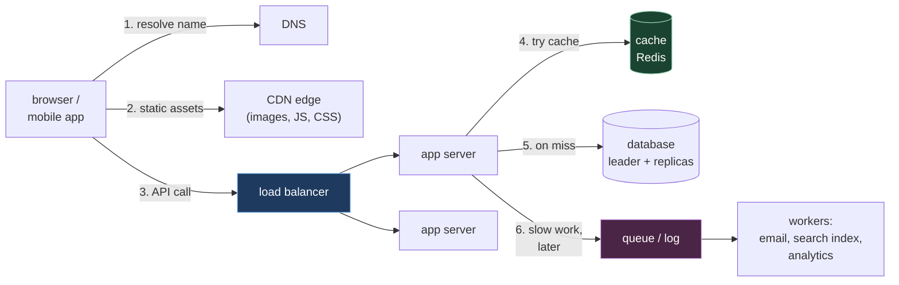
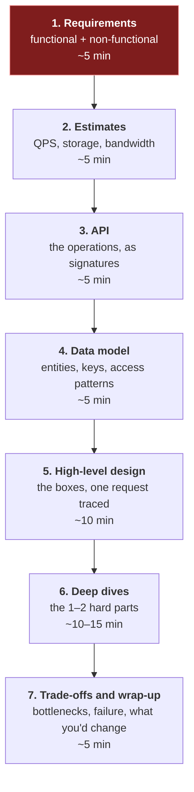

# 1. Foundations: what the round is, the words, and a method

## The problem

"Design WhatsApp" in 45 minutes is an impossible question if you take it literally, and
most people who freeze in this round are trying to. Nobody can design WhatsApp in 45
minutes. The interviewer knows that. They're watching *how* you narrow an impossible
question into a tractable one, which choices you make, and whether you can say what each
choice costs. Without a shared vocabulary and a method for that narrowing, you end up
drawing boxes at random and hoping some of them are the right ones.

This chapter is the vocabulary, one request traced through a typical system end to end,
and the method every later chapter (and every worked design in [file 10](10-worked-designs.md))
follows. Every later chapter assumes it.

**Who can skip it:** if you can explain p99 latency, the difference between an SLO and an
SLA, what "three nines" allows per month, and you already have a step-by-step approach you
use in this round, skim §1.3 and move on.

## 1.1 What the round is testing

Think of it less like an exam and more like the first design meeting with a new senior
colleague. They bring a vague problem. You ask questions to make it concrete, propose
something simple, and improve it as they push. At the end, the question isn't "did they get
the right answer", because there isn't one. It's closer to "would I want this person in
the room when we design the real thing?"

What that breaks down into, roughly:

| Signal | What it looks like in the room |
|---|---|
| Scoping | You ask what's in and out before drawing; you write requirements down |
| Quantitative sense | You estimate load and storage, and let the numbers change the design |
| Breadth | You know the standard building blocks: load balancers, caches, queues, replicas, shards |
| Depth | When pushed on one component, you can go two levels down |
| Trade-offs | Every choice comes with what it costs and what you'd pick instead under different requirements |
| Communication | The interviewer can follow your diagram and your reasoning without asking twice |

Atlassian's [interview guidance](https://www.atlassian.com/company/careers/resources/interviewing/engineering)
describes its system design round as "a technical interview—but that doesn't mean the goal
is code." That's broadly true everywhere. How the round fits into the rest of the loop is
covered in [`interview/01`](../01-how-the-loop-works.md).

> **Teacher's aside.** "There's no single right answer" is true and widely misread as
> "anything goes". There are plenty of *wrong* answers: a design that ignores a requirement
> you agreed five minutes earlier, a cache in front of data that must never be stale, a
> sharded cluster for 50 requests a second. The space of good answers is wide; the space of
> answers that contradict their own requirements is wider. Most rejections come from the
> second, not from picking Cassandra over Postgres.

## 1.2 The vocabulary

Each of these terms comes back in every chapter. Where a standard source defines it, the
definition is quoted.

### Latency and throughput

A motorway analogy. **Latency** is how long one car takes to get from A to B. **Throughput**
is how many cars pass per hour. Adding lanes raises throughput and does nothing for any one
car's journey time. Raising the speed limit does the reverse. They're different things, and
fixing one rarely fixes the other.

For a service: latency is the time for one request (milliseconds); throughput is requests
per second, usually written **QPS** (queries per second) or RPS.

They're tied together by **Little's Law** (John Little, *Operations Research*, 1961):
`L = λW`. The average number of requests in flight (L) equals the arrival rate (λ) times the
average time each spends in the system (W). At 2,000 QPS and 50 ms per request, about
`2,000 × 0.05 = 100` requests are in progress at any moment. That's how you size thread
pools, connection pools and worker counts, and it's why a dependency that slows from 50 ms
to 500 ms needs ten times the concurrency to sustain the same throughput.

### Percentiles, not averages

The Google SRE book, [chapter 4](https://sre.google/sre-book/service-level-objectives/):
"We generally prefer to work with percentiles rather than the mean (arithmetic average) of a
set of values. Doing so makes it possible to consider the long tail of data points, which
often have significantly different (and more interesting) characteristics than the
average."

**p99 latency** is the value 99% of requests come in under. If p50 is 20 ms and p99 is
900 ms, the typical request is fast and one in a hundred is terrible. An average of, say,
40 ms hides that completely.

The tail matters more than intuition says, because requests fan out. Dean and Barroso,
[*The Tail at Scale*](https://www.barroso.org/publications/TheTailAtScale.pdf) (CACM 2013),
take a server whose p99 is one second: "If a user request must collect responses from 100
such servers in parallel, then 63% of user requests will take more than one second."
(`1 − 0.99¹⁰⁰ ≈ 0.63`.) A one-in-a-hundred problem on each server becomes the common case
for the user.

### Availability, and the nines

**Availability** is the fraction of time (or of requests) the service works. It's quoted in
"nines":

| Availability | Downtime per year | Per 30-day month |
|---|---|---|
| 99% ("two nines") | 3.65 days | 7.2 hours |
| 99.9% | 8.76 hours | 43.2 minutes |
| 99.99% | 52.6 minutes | 4.3 minutes |
| 99.999% | 5.3 minutes | 26 seconds |

(Computed from 365 and 30 days. Nothing to cite; check the arithmetic yourself.)

Two pieces of arithmetic come up constantly:

- **Components in series multiply.** A request that needs three services, each 99.9%
  available, succeeds about `0.999³ ≈ 99.7%` of the time. Every dependency you add lowers
  the ceiling.
- **Redundant copies in parallel help**: two replicas each 99% available, either one
  sufficient, give `1 − 0.01² = 99.99%`, *if they fail independently*. They usually don't
  entirely: same deploy, same region, same bug. Treat that number as an upper bound.

### SLI, SLO, SLA, and the error budget

From the same SRE book chapter:

| Term | Definition (quoted) | Example |
|---|---|---|
| **SLI** | "a carefully defined quantitative measure of some aspect of the level of service that is provided" | Fraction of requests answered successfully in under 300 ms |
| **SLO** | "a target value or range of values for a service level that is measured by an SLI" | 99.9% of requests, over 30 days |
| **SLA** | "an explicit or implicit contract with your users that includes consequences of meeting (or missing) the SLOs they contain" | Below 99.5%, customers get a credit |

The SLA is a business promise with money attached; the SLO is the stricter internal target
that keeps you clear of it. The gap between the SLO and 100% is the **error budget**:
[chapter 3](https://sre.google/sre-book/embracing-risk/) calls it "a clear, objective metric
that determines how unreliable the service is allowed to be". It also says "100% is probably
never the right reliability target". Spend the budget on shipping; when it runs out, slow
down.

### The rest, briefly

| Term | Meaning | Where it's taught |
|---|---|---|
| **Scalability** | Handling more load by adding resources, ideally in proportion | [File 03](03-scaling-a-service.md) |
| **Durability** | Once acknowledged, data isn't lost | [File 05 §5.3](05-data-storage.md#53-replication-three-shapes) |
| **Consistency** | Several meanings; usually "do readers see the latest write?" | [File 06](06-consistency-and-cap.md) |
| **Idempotent** | Doing it twice has the same effect as doing it once | [File 07](07-asynchronous-work.md), [file 09 §9.4](09-api-design.md#94-idempotency-and-idempotency-keys) |
| **Stateless** | A server keeps nothing between requests that another server would need | [File 03 §3.2](03-scaling-a-service.md#32-statelessness-the-precondition) |
| **Back-pressure** | A slow consumer pushing back on a fast producer instead of drowning | [File 07](07-asynchronous-work.md) |

## 1.3 One request, end to end

Here's what happens when someone opens a product page on a typical web system. Almost every
design you'll do is a variation on this picture.

| Step | What happens | Why it's there | Chapter |
|---|---|---|---|
| 1 | DNS turns the hostname into an IP address (often the load balancer's, or the nearest edge's) | Names are stable; addresses aren't | — |
| 2 | Static files come from a CDN edge near the user | They're identical for everyone, and distance is latency | [04](04-caching.md) |
| 3 | The load balancer picks one of many identical app servers | One server can't take all the traffic or survive failing | [03](03-scaling-a-service.md) |
| 4 | The app checks a cache | Most reads are for the same few things | [04](04-caching.md) |
| 5 | On a miss, it reads the database (writes always go there) | The database is the source of truth | [05](05-data-storage.md) |
| 6 | Work the user needn't wait for goes on a queue | Keeps the request fast; absorbs spikes | [07](07-asynchronous-work.md) |

Around all of it: rate limits, timeouts, retries and circuit breakers ([file 08](08-reliability-patterns.md)),
and the shape of the API itself ([file 09](09-api-design.md)).

## 1.4 A working method

The method is the same every time, which is the point: it frees your attention for the
problem.

The timings are my suggestion for a 45–60 minute round, not a standard. The red box is the
step people skip and the one that decides everything after it.

**1. Requirements.** Split them:

- **Functional**: what the system does. "Users can shorten a URL. Visiting the short URL
  redirects." Agree on three to five; write them down; say what you're leaving out.
- **Non-functional**: how well. Scale (how many users, how many requests), latency targets,
  availability, consistency needs, durability. These drive the architecture far more than
  the functional list does.

Ask, don't assume. "Is it read-heavy?" "Do links expire?" "Is it OK if a new link takes a
second to work everywhere?" If the interviewer says "you decide", decide out loud and write
the assumption down.

**2. Estimates.** Rough numbers for QPS (average and peak), storage over some years, and
bandwidth. Their job is to tell you whether one machine is enough and where the pressure
is. [File 02](02-estimation.md) is the whole method.

**3. API.** Write the main operations as signatures: `POST /urls {long_url} → {short_code}`,
`GET /{code} → 302`. It pins down what each request carries and returns, and exposes missing
requirements early. [File 09](09-api-design.md).

**4. Data model.** Entities, their keys, and, more important, **the queries**: "look up by
short code", "list a user's links, newest first". The queries choose the database, the
indexes and the shard key. [File 05](05-data-storage.md).

**5. High-level design.** Start with the simplest thing that meets the requirements (often
§1.3's picture) and trace one read and one write through it, out loud.

**6. Deep dives.** Pick the one or two parts that are actually hard for *this* problem
(the ID generator for a shortener, fan-out for a feed, the connection layer for chat) and
go deep. Often the interviewer picks. Let them.

**7. Trade-offs.** What's the bottleneck at 10× load? What happens when the cache dies, or
a region? What did you choose, and what would make you choose differently?

> ⚠️ **Boxes before requirements.** The commonest failure isn't a wrong component; it's
> drawing Kafka, Redis and three microservices in minute two, before knowing whether the
> system needs to handle 10 requests a second or 100,000. The design that falls out of no
> requirements can't be defended, because there's nothing to defend it against.

## Asked in interviews

| Prompt | Where |
|---|---|
| "How would you approach designing X?" (the meta-question) | §1.4 |
| "What's the difference between latency and throughput?" | §1.2 |
| "Why p99 rather than average?" "What's tail latency?" | §1.2, percentiles |
| "What does 99.99% availability mean in practice?" "How do you get there?" | §1.2, nines table and arithmetic |
| "What's an SLO? How is it different from an SLA?" | §1.2 |
| "Walk me through what happens when I type a URL and press enter" (the system-level version) | §1.3 |

## Check yourself

1. A service's average latency is 40 ms and its p99 is 2 s. A product manager says "40 ms
   is great, we're fine". What would you look at next, and why might users disagree?
2. A request touches an API gateway, an auth service, and a product service, each 99.9%
   available, in series. What's the best availability the request path can have? You add a
   second, independent product-service replica. What changes, and why is "independent"
   doing a lot of work in that sentence?
3. A service handles 500 QPS at 200 ms per request. Its dependency slows to 2 s per
   request. Using Little's Law, how many requests are now in flight, and what runs out
   first on the server?
4. Your SLO is 99.9% of requests successful over 30 days. On day 20 you've had 50 minutes
   of total outage. What does the error budget say about tomorrow's risky migration?
5. A page needs data from 50 backend shards in parallel. Each shard's p99 is 100 ms and
   its p50 is 5 ms. Roughly what fraction of page loads see at least one 100 ms+ response?
   What does that tell you about where to optimise?
6. You're asked to "design Instagram" and you have 45 minutes. Write the first three
   things you'd say, and the two non-functional requirements you'd most want pinned down
   before drawing anything.
