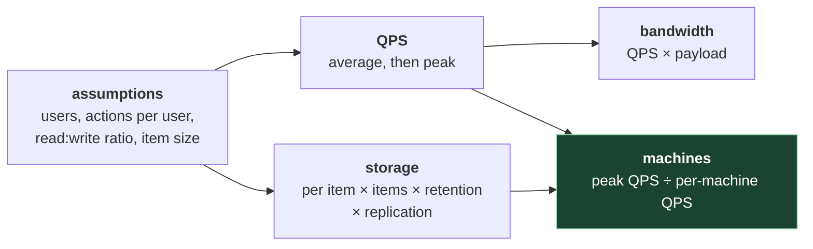

# 2. Back-of-envelope estimation

## The problem

Two designs for the same URL shortener: one Postgres box with a Redis in front, or a
sharded wide-column cluster behind a fleet of stateless services and a Kafka pipeline.
Which is right? You can't tell without a number. At 40 writes a second the first is
correct and the second is a liability. At 400,000 it's the other way round. Estimation is
how you find out which world you're in *before* drawing, and it takes five minutes.

Its job is a decision, not a figure. Nobody checks your arithmetic to the third digit; they
check whether the number changed what you built.

## 2.1 The handful of numbers to know by heart

**Powers of two**, because storage is counted in them:

| Power | Exact | Roughly | Name |
|---|---|---|---|
| 2¹⁰ | 1,024 | a thousand | KiB (kilobyte, loosely) |
| 2²⁰ | 1,048,576 | a million | MiB |
| 2³⁰ | ~1.07 × 10⁹ | a billion | GiB |
| 2⁴⁰ | ~1.1 × 10¹² | a trillion | TiB |
| 2⁵⁰ | ~1.13 × 10¹⁵ | a quadrillion | PiB |

In an interview, treat 1 KB = 10³ bytes and so on. The 2.4% difference per step never
changes a decision.

**Time**, because rates are per second and requirements are per day:

| Period | Seconds | Use it as |
|---|---|---|
| Day | 86,400 | ~10⁵ |
| 30-day month | 2,592,000 | ~2.5 × 10⁶ |
| Year | ~31.5 million | ~3 × 10⁷ |

One handy consequence: **1 million requests a day is about 12 a second** (10⁶ / 86,400 ≈ 11.6).
So 100 million a day is about 1,200 a second, on average.

## 2.2 Latency numbers, and why they're dated

The list everyone quotes as "latency numbers every programmer should know" has a history
worth knowing, partly because the history *is* a lesson about using it.

**Where it comes from.** Jeff Dean put a slide titled "Numbers Everyone Should Know" in at
least two talks, introduced with: "Important skill: ability to estimate performance of a
system design – without actually having to build it!" One was a Stanford CS295 talk
([slides](https://static.googleusercontent.com/media/research.google.com/en//people/jeff/stanford-295-talk.pdf),
commonly dated 2007; I couldn't confirm the date). The other was his LADIS 2009 keynote
([slides](https://www.cs.cornell.edu/projects/ladis2009/talks/dean-keynote-ladis2009.pdf)).
Peter Norvig's essay [*Teach Yourself Programming in Ten Years*](https://norvig.com/21-days.html#answers)
has an overlapping table of "approximate timing for various operations on a typical PC"
(when it was first added, I couldn't establish). The popular title comes from a GitHub gist
by Jonas Bonér, a secondary compilation that has changed rows over the years; don't treat
it as Dean's numbers.

The two Dean decks **don't agree with each other**:

| Operation | Dean, CS295 | Dean, LADIS 2009 | Norvig |
|---|---|---|---|
| L1 cache reference | 0.5 ns | 0.5 ns | 0.5 ns |
| Branch mispredict | 5 ns | 5 ns | 5 ns |
| L2 cache reference | 7 ns | 7 ns | 7 ns |
| Mutex lock/unlock | 100 ns | 25 ns | 25 ns |
| Main memory reference | 100 ns | 100 ns | 100 ns |
| Compress 1 KB with Zippy | 10 µs | 3 µs | — |
| Send 2 KB over 1 Gbps network | 20 µs | 20 µs | 20 µs |
| Read 1 MB sequentially from memory | 250 µs | 250 µs | 250 µs |
| Round trip within same datacenter | 500 µs | 500 µs | — |
| Disk seek | 10 ms | 10 ms | 8 ms |
| Read 1 MB sequentially from disk | 30 ms | 20 ms | 20 ms |
| Packet California → Netherlands → California | 150 ms | 150 ms | 150 ms |

That disagreement is fine, and instructive: these were always order-of-magnitude figures.
The author changed his own numbers by 4× between talks and nobody's estimates broke.

**Why they're dated.** These describe hardware of the late 2000s: spinning disks, 1 Gbps
networks, no SSDs on the list. Two updated sources, and how far to trust each:

- Colin Scott's [interactive version](https://colin-scott.github.io/personal_website/research/interactive_latency.html)
  has a year slider. Read its source before trusting it: the numbers are **extrapolated**
  from trend assumptions (for instance, "Clock speed stopped at ~3GHz in ~2005", NIC bandwidth
  doubling every two years from 2003), with the latest anchor data from around 2012–2014. A
  2026 value on that page is a projected curve, not a measurement.
- Simon Eskildsen's [napkin-math](https://github.com/sirupsen/napkin-math) is
  **measured**: Rust benchmarks, with the README saying some rows were re-measured on Google
  Cloud machines on 8 March 2026, and numbers "rounded for memorization, not faux precision".

Selected rows from napkin-math's README, as published:

| Operation | Latency | Throughput |
|---|---|---|
| Sequential memory read/write (64 bytes) | 0.5 ns | 20 GiB/s single thread |
| Random memory read/write (64 bytes) | 20 ns | 3 GiB/s |
| System call | 300 ns | — |
| Random SSD read (8 KiB) | 100 µs | 70 MiB/s |
| Sequential SSD write with fsync (8 KiB) | 300 µs | 30 MiB/s |
| Network round trip within a cloud region | 250 µs | 2 GiB/s |
| A MySQL / Memcached / Redis query | 500 µs | — |
| Random HDD read (8 KiB) | 10 ms | 0.7 MiB/s |
| Blob storage GET, one connection (128 KiB) | 80 ms | — |
| Network, North America east ↔ west | 60 ms | — |
| Network, EU west ↔ North America east | 80 ms | — |

What survives across all of these versions is the **ladder**, and that's what to memorise:

```
memory           ~100 ns         ┐
SSD random read  ~100 µs         │  each rung roughly
in-region RTT    ~0.25–0.5 ms    │  10–1000× the one above
HDD seek         ~10 ms          │
cross-continent  ~60–150 ms      ┘  physics: you can't cache your way past distance
```

Consequences you'll use: a request that makes 20 sequential database calls in-region
spends ~10 ms just on round trips before any work; a design that reads from another
continent on every request has a 100 ms+ floor; anything served from memory is effectively
free next to anything that crosses a network.

> **Teacher's aside.** People treat the latency table as facts to recite. Its real use is
> ratios. "Memory is about a thousand times faster than an SSD random read, which is a few
> times faster than a round trip to another machine" is the sentence that changes designs:
> it's why caches exist, why you batch, and why chatty service-to-service calls hurt. If an
> interviewer asks for a specific number, give the order of magnitude and say it's
> hardware-dependent. That's more correct than a confident "100 nanoseconds".

## 2.3 The method

Four quantities, in this order. Write each assumption down where the interviewer can see it.



| Quantity | Formula | Shakiest input |
|---|---|---|
| Average QPS | daily active users × actions per user per day ÷ 86,400 | Actions per user |
| Peak QPS | average × a peak factor | The peak factor. 2–10× is a common assumption; real traffic (a sale, a cricket final) can be far spikier. Say which you're assuming |
| Storage | items per day × bytes per item × days retained × replication factor | Bytes per item: count the metadata, not just the payload |
| Bandwidth | QPS × bytes per request (or response) | Payload size |
| Machines | peak QPS ÷ what one machine handles | Per-machine capacity: varies by 100× with the work done per request. Say it's an assumption, or a number you'd measure |

The green box is where the design is decided, and its input is the least reliable number on
the page. That's normal. The output you want is "one machine", "a handful", or "hundreds",
not "37".

## 2.4 Worked example: a URL shortener

Assumptions, stated:

- 100 million new short links a month.
- Reads (redirects) outnumber writes 100 : 1.
- Each record (code, long URL, owner, timestamps) is about 500 bytes.
- Keep links for 10 years.

**QPS.**

```
writes:  100,000,000 / 2,592,000 s  ≈  39 /s      → call it 40 /s
reads:   40 × 100                    ≈  4,000 /s   average
peak:    × 3 (assumed)               ≈  12,000 /s  reads
```

**Storage.**

```
per month:  100M × 500 B             =  50 GB
10 years:   50 GB × 120              =  6 TB     (before replication)
replicated: × 3                      ≈  18 TB
```

**Keyspace** (how long must codes be?).

```
links in 10 years:  100M × 120       =  12 billion
62^6                                 ≈  56.8 billion   ← 6 base-62 characters suffice
62^7                                 ≈  3.5 trillion   ← 7 gives lots of headroom
```

**Cache.** If a small fraction of links gets most clicks (a reasonable assumption for links,
not a measurement), caching even last month's 100 million records is 50 GB. A hot subset of
that fits in one Redis node's memory.

**What the numbers decided.** 40 writes a second is nothing; one Postgres leader handles
it. 12,000 reads a second at peak is mostly answered from cache. 6 TB over a decade fits on
one well-provisioned database, or a few shards if you'd rather not. So the design is: a
small stateless service, a cache, one replicated database. No Kafka, no exotic store.
[File 10 §10.1](10-worked-designs.md#101-url-shortener) builds it.

## 2.5 Worked example: chat message storage

Assumptions: 50 million daily active users, 40 messages each per day, about 200 bytes per
message including metadata.

```
messages per day:   50M × 40          =  2 billion
average write QPS:  2B / 86,400       ≈  23,000 /s
peak (× 3):                           ≈  70,000 /s
storage per day:    2B × 200 B        =  400 GB
per year:           400 GB × 365      ≈  146 TB   (× 3 replicas ≈ 440 TB)
```

**What the numbers decided.** This is a different world from the shortener. 70,000 writes
a second and hundreds of terabytes a year won't fit one leader. You need sharding from day
one (by conversation id, since the dominant query is "messages in this conversation, newest
first"), a store built for high write volume, and probably tiered storage, since old
messages are rarely read. [File 10 §10.3](10-worked-designs.md#103-chat-and-messaging).

> ⚠️ **Precision theatre.** "We need 37.4 servers" is worse than "a few dozen", because it
> claims an accuracy the inputs don't have. Round aggressively, keep one significant figure,
> and spend the saved minutes on what the number implies.

## Asked in interviews

| Prompt | Where |
|---|---|
| "Estimate the QPS / storage / bandwidth for this." | §2.3, §2.4 |
| "How many servers do you need?" | §2.3: say per-machine capacity is an assumption |
| "How long should the short code be?" | §2.4, keyspace |
| "How long does a memory read take versus a disk read versus a network call?" | §2.2: answer with the ladder |
| "Will this fit on one machine?" | §2.4, §2.5, "What the numbers decided" |

## Check yourself

1. A service gets 250 million requests a day. What's the average QPS, and what peak would
   you plan for? Say what your peak factor depends on.
2. Your design makes 30 sequential calls to a cache in the same region for each user
   request. Using the ladder, what's the latency floor from round trips alone? What would
   you change?
3. Recompute the shortener's storage assuming each long URL averages 2 KB rather than the
   500-byte record. Does it change any decision in §2.4?
4. An interviewer says "Colin Scott's page says an SSD read takes 16 µs in 2026". What do
   you know about where that number comes from, and how would you answer?
5. For the chat estimate, which single assumption, if wrong by 10×, would change the
   architecture most? Defend your choice.
6. A photo app: 10 million uploads a day, average 2 MB, kept for ever, three replicas. How
   much storage per year? Would you put the photos in the same database as the metadata?
   Why not?
