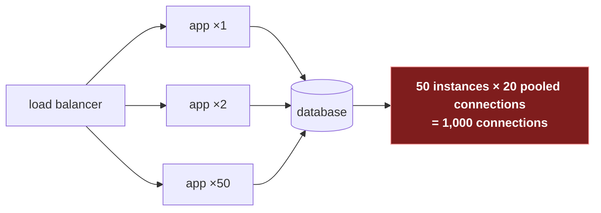

# 3. Scaling a service

## The problem

Your service runs on one machine. Traffic doubles; it slows down. You can buy a bigger
machine, and for a while that works. Eventually there's no bigger machine to buy, or the
one machine dies at 3 a.m. and takes everything with it. The answer is many machines, and
the moment you have many machines, two new questions appear: how does a request find one
of them, and does it matter *which* one it finds? This chapter answers both.

## 3.1 Vertical and horizontal

| | Vertical ("scale up") | Horizontal ("scale out") |
|---|---|---|
| What you do | Bigger machine: more cores, memory, faster disks | More machines of the same size |
| Code changes | None | The service must be stateless (§3.2), and something must spread traffic (§3.3) |
| Ceiling | The largest machine you can buy, and its price curve | Mostly your architecture and your database |
| Failure | One machine: when it dies, you're down | Lose one of N, lose 1/N of capacity |
| Good for | Databases, early on; anything hard to split | Stateless app servers, almost always |

The honest default: scale **app servers** horizontally from the start (it's cheap to keep
them stateless, and you need at least two for availability anyway) and scale the
**database** vertically for as long as you can, because splitting it ([file 05 §5.4](05-data-storage.md#54-sharding-when-one-leader-isnt-enough))
is the expensive step. Saying so in an interview is a sign of judgement, not timidity.

## 3.2 Statelessness: the precondition

A restaurant analogy. If every waiter keeps your order in their head, you must get the same
waiter all evening, and if they go home, your order goes with them. If orders are written on
a ticket that lives in the kitchen, any waiter can serve any table. **Stateless** servers are
the second restaurant: anything needed across requests lives somewhere shared, not in one
server's memory.

| State | Where it should live instead |
|---|---|
| Login session | A shared store (Redis), or a signed token the client carries (a JWT, a signed cookie) |
| Uploaded files | Object storage (S3-style), not the server's disk |
| In-progress multi-step work | The database, or a queue |
| Caches | Fine to keep locally, *if* losing them only costs speed |

With that done, any server can handle any request, so you can add servers, remove them, and
lose them without users noticing.

> ⚠️ **"Sticky sessions" as a fix.** Configuring the load balancer to always send a user to
> the same server makes in-memory sessions work, until that server is deployed, scaled
> down or dies, and its users are logged out. It also unbalances load. Fine as a stopgap;
> a poor answer to "how do you scale this?"

## 3.3 Load balancers

A **load balancer** is the single address clients talk to, which forwards each connection
or request to one of the healthy servers behind it.

### Layer 4 or layer 7

The layers are from the OSI model. Layer 4 is transport (TCP/UDP); layer 7 is the
application protocol (HTTP). AWS's two balancers are a clean illustration:
an Application Load Balancer "functions at the application layer, the seventh layer of the
Open Systems Interconnection (OSI) model" and a Network Load Balancer "functions at the
fourth layer" ([ALB docs](https://docs.aws.amazon.com/elasticloadbalancing/latest/application/introduction.html),
[NLB docs](https://docs.aws.amazon.com/elasticloadbalancing/latest/network/introduction.html)).

| | Layer 4 | Layer 7 |
|---|---|---|
| Sees | IP addresses and ports; bytes | Full HTTP requests: path, headers, cookies |
| Decides per | Connection | Request |
| Can route `/api` and `/images` differently | No | Yes |
| Can terminate TLS, add headers, retry, rate-limit | Generally no | Yes |
| Cost | Very cheap per packet; very high throughput | More CPU per request |
| Examples | AWS NLB, Google's Maglev | AWS ALB, NGINX, HAProxy, Envoy |

Google's [Maglev](https://www.usenix.org/conference/nsdi16/technical-sessions/presentation/eisenbud)
(NSDI 2016) is the well-documented case of a software network load balancer at huge scale,
"equipped with consistent hashing and connection tracking features" so that connections
survive machines coming and going.

> **Teacher's aside.** The difference "per connection versus per request" bites with
> long-lived connections. AWS documents that an NLB "routes each individual TCP connection
> to a single target for the life of the connection." HTTP/2 and gRPC send many requests
> over one connection (see [http/02, "HTTP/2 wraps everything in frames"](../../http/02-versions-and-framing.md#http2-wraps-everything-in-frames)),
> so a layer-4 balancer in front of gRPC services balances *connections*, and one client
> with one busy connection pins all its load on one server. The fix is a layer-7 balancer
> that understands HTTP/2, or client-side balancing. People discover this when one pod
> runs at 90% CPU and its neighbours at 5%.

### Choosing a server

| Algorithm | How | Good when | Weakness |
|---|---|---|---|
| **Round robin** | Each server in turn. NGINX's default: "a weighted round-robin balancing method" ([docs](https://nginx.org/en/docs/http/ngx_http_upstream_module.html)) | Requests cost about the same | A slow server gets as many requests as a fast one |
| **Least connections** | Server with fewest active connections | Requests vary in cost | Needs a global view of counts |
| **Power of two choices** | Pick two at random; send to the less loaded | Many balancers, no shared view | Slightly worse than perfect, much cheaper |
| **Hash (IP, key)** | Same client or key → same server | Per-server caches, session affinity | Uneven if keys are skewed; reshuffles when servers change, unless consistent ([file 05 §5.5](05-data-storage.md#55-consistent-hashing)) |

The power-of-two result is one of the nicer pieces of theory with direct practical use.
Michael Mitzenmacher ([*The Power of Two Choices in Randomized Load Balancing*](https://www.eecs.harvard.edu/~michaelm/postscripts/tpds2001.pdf),
IEEE TPDS 2001): "Having d = 2 choices leads to exponential improvements in the expected time
a customer spends in the system over d = 1, whereas having d = 3 choices is only a constant
factor better than d = 2." Envoy's least-request balancer uses it by default: it "selects N
random available hosts as specified in the configuration (2 by default) and picks the host
which has the fewest active requests"
([Envoy docs](https://www.envoyproxy.io/docs/envoy/latest/intro/arch_overview/upstream/load_balancing/load_balancers)).

### Health checks

A balancer must stop sending traffic to a dead server. Two ways to notice:

| | Active | Passive |
|---|---|---|
| How | The balancer calls `/healthz` on each server every few seconds | The balancer watches real traffic: errors, timeouts |
| Catches | A server that's down or reports itself unready | A server that answers health checks but fails real requests |
| Example | Kubernetes readiness probes; Envoy active health checking | NGINX `max_fails` (default 1) and `fail_timeout`; Envoy **outlier detection**, "a form of passive health checking" ([docs](https://www.envoyproxy.io/docs/envoy/latest/intro/arch_overview/upstream/outlier)) |

Use both. And keep the two Kubernetes questions apart: "Liveness probes determine when to
restart a container"; "Readiness probes determine when a container is ready to accept
traffic" ([Kubernetes docs](https://kubernetes.io/docs/concepts/configuration/liveness-readiness-startup-probes/)).
The same page warns: "Incorrect implementation of liveness probes can lead to cascading
failures." The specific mistake (a liveness check that calls the database, so a database
blip restarts every pod at once) is worked through in
[go-services/03, "Checking dependencies at startup and in probes"](../../go-services/03-the-http-server.md#checking-dependencies-at-startup-and-in-probes).

### The balancer isn't a single point of failure (if you design it so)

"What if the load balancer dies?" is a standard follow-up. Answers, in rising order of
scale: a pair of balancers sharing a floating IP (one takes over if the other dies); a
managed cloud balancer (already redundant internally); several balancer addresses behind
DNS; anycast, where many sites announce the same IP and the network routes users to the
nearest. Naming the first two is enough at this level.

## 3.4 What breaks when you scale out

Adding app servers moves the bottleneck; it doesn't remove it. The usual next walls:

- **Database connections.** Each instance keeps a connection pool. Fifty instances with
  twenty connections each is a thousand connections, more than many databases are
  configured to accept, and each costs the database memory. Fixes: smaller pools, a
  connection pooler (PgBouncer for Postgres), fewer bigger instances.
- **The database itself.** Read replicas for reads, a cache, then sharding. [File 04](04-caching.md), [file 05](05-data-storage.md).
- **Anything that assumed one process.** In-memory rate limits (each instance has its own
  counter: [file 08 §8.1](08-reliability-patterns.md#81-rate-limiting)), in-memory locks,
  cron jobs that now run fifty times.
- **Deploys.** Instances must shut down without dropping requests in flight.
  [go-services/03, "Graceful shutdown"](../../go-services/03-the-http-server.md#graceful-shutdown).

**Autoscaling** (adding instances when CPU or request rate rises) handles daily cycles
well. It's slow to react to sudden spikes, since new instances take time to start and warm
up, so it doesn't replace rate limiting and load shedding ([file 08](08-reliability-patterns.md)).

## Asked in interviews

| Prompt | Where |
|---|---|
| "How do you scale this to 10× traffic?" | §3.1, §3.4 |
| "Vertical or horizontal scaling?" | §3.1 table |
| "Where do sessions live?" "What's a stateless service?" | §3.2 |
| "L4 versus L7 load balancer?" "Which would you use for gRPC?" | §3.3, teacher's aside |
| "Which load-balancing algorithm, and why?" | §3.3, "Choosing a server" |
| "How does the load balancer know a server is down?" "What if the load balancer fails?" | §3.3, health checks and the last subsection |

## Check yourself

1. Your service stores the user's shopping cart in a Go map on the server. You go from one
   instance to three behind a round-robin balancer. Describe exactly what a user sees, and
   two ways to fix it.
2. Twenty clients each hold one HTTP/2 connection to a gRPC service behind an L4 balancer
   with five backends. One client sends 80% of all requests. What does the CPU graph of
   the five backends look like, and what would you change?
3. Why does picking the less-loaded of *two random* servers work almost as well as picking
   the least-loaded of all of them? What does it save in a system with many independent
   load balancers?
4. A service's liveness probe checks that the database is reachable. The database fails
   over, taking 30 seconds. Walk through what Kubernetes does to the service, and what
   happens when the database comes back.
5. You scale from 4 to 40 app instances and the service gets *slower*. Name two likely
   causes and how you'd tell them apart.
