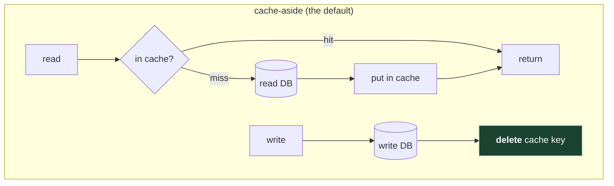
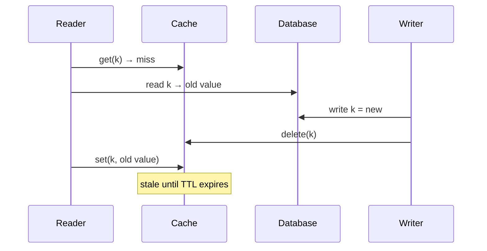

# 4. Caching

## The problem

A product page reads the same product row ten thousand times a minute, and the row changes
twice a day. Every one of those reads costs a database round trip and some database CPU,
and the database is the hardest part of the system to scale ([file 05](05-data-storage.md)).
A **cache** keeps a copy of the answer somewhere faster and cheaper to reach, so most
requests never get as far as the database.

The catch is in the word *copy*. The moment there are two copies of a fact, they can
disagree, and nearly every hard question about caching is a question about what to do when
they do.

## 4.1 Where caches sit

Caches exist at every hop of the request path in [file 01 §1.3](01-foundations.md#13-one-request-end-to-end).
Closer to the user is faster and serves fewer people per copy:

| Layer | Holds | Shared by | Typical invalidation |
|---|---|---|---|
| Browser / app | Static assets, some API responses | One user | `Cache-Control` headers, versioned file names |
| **CDN edge** | Static assets, public pages, video segments | Everyone near that edge | TTL; explicit purge |
| Reverse proxy / gateway | Whole HTTP responses | Everyone | TTL |
| In-process (inside the app) | Hot objects, config | One instance | TTL; lost on restart |
| **Distributed cache** (Redis, Memcached) | Objects, query results, sessions, counters | All instances | TTL; delete on write |
| Database's own buffer cache | Pages of tables and indexes | All queries | Automatic |

## 4.2 How the cache and the database stay in step

Four patterns, distinguished by who writes the cache and when.



| Pattern | Read path | Write path | Good | Bad |
|---|---|---|---|---|
| **Cache-aside** (lazy loading) | App checks cache; on miss reads DB and fills cache | App writes DB, then deletes (or updates) the cache entry | Simple; cache holds only what's read; cache failure isn't fatal | First read after a write is a miss; race conditions (§4.5) |
| **Read-through** | Cache library loads from DB on a miss itself | — | Miss logic in one place | Needs a cache that supports it |
| **Write-through** | — | Write goes to cache and DB together, synchronously | Cache is always fresh for what was written | Every write pays both; caches data nobody reads |
| **Write-behind** (write-back) | — | Write goes to cache; cache writes DB later, asynchronously | Very fast writes; can batch | Data loss if the cache dies before flushing; hard to reason about |

Microsoft's [Cache-Aside pattern](https://learn.microsoft.com/en-us/azure/architecture/patterns/cache-aside)
describes the standard write path: "When an application updates information, it writes the
change to the data store and then invalidates the corresponding item in the cache", with the
ordering rule "Update the data store *before* removing the item from the cache". It is also
blunt that "The Cache-Aside pattern doesn't guarantee consistency between the data store and
the cache." (I found good descriptions of write-behind but no definitive primary source; the
table row is the standard description, not a quote.)

**Delete, don't update.** Facebook's memcache paper (Nishtala et al.,
[*Scaling Memcache at Facebook*](https://www.usenix.org/system/files/conference/nsdi13/nsdi13-final170_update.pdf),
NSDI 2013) explains the choice in one line: the web server "sends a delete request to
memcache that invalidates any stale data. We choose to delete cached data instead of
updating it because deletes are idempotent." Two concurrent updates that each *write* the
cache can land in the wrong order and leave the older value; two deletes can't.

## 4.3 What to cache, and for how long

- **Cache things read far more than written**, where slightly stale is acceptable. Product
  details: yes. A wallet balance used to authorise a payment: no, read the source of truth.
- **Every entry gets a TTL** (time to live), even with explicit invalidation. The TTL is your
  backstop for the invalidation you forgot or that failed. Choose it from "how stale can
  this be?", not from "how long until memory fills".
- **Cache the shape the reader needs**: the rendered product card, not five rows the app
  re-joins each time.

## 4.4 Eviction, and an LRU cache in code

Memory is finite, so when the cache is full something must go. The **eviction policy**
decides what:

| Policy | Evicts | Suits |
|---|---|---|
| **LRU** (least recently used) | What hasn't been touched for longest | General purpose; recency predicts reuse |
| **LFU** (least frequently used) | What's been used least often | Stable popularity; resists one-off scans pushing out hot keys |
| **TTL-based** | Whatever expires soonest | Data with natural freshness limits |
| **Random** | Anything | Surprisingly fine; cheapest |

Redis is the concrete case. Its [eviction docs](https://redis.io/docs/latest/develop/reference/eviction/)
list the policies (`allkeys-lru`, `allkeys-lfu`, `volatile-ttl` and others; Redis 8.6 added
a least-recently-*modified* family), and two details matter:

- The default, set in [`redis.conf`](https://github.com/redis/redis/blob/unstable/redis.conf),
  is `noeviction`: when memory is full, writes **fail**. Using Redis as a cache means
  choosing a policy deliberately.
- Its LRU is approximate: "The Redis LRU algorithm uses an approximation of the least recently
  used keys rather than calculating them exactly. It samples a small number of keys at
  random", five by default (`maxmemory-samples`). Exact LRU needs per-key bookkeeping Redis
  decided wasn't worth the memory.

Exact LRU is also a favourite coding question, in this round and in machine coding
([file 11 §11.8](11-lld-and-machine-coding.md#118-other-problems-youll-see)). The classic
answer is a **hash map plus a doubly linked list**: the map finds an entry in O(1), the list
keeps entries in recency order so moving one to the front and dropping the back are O(1)
too.

```
map:   "a" ──┐   "c" ──┐
             ▼         ▼
list:  head ⇄ [c] ⇄ [a] ⇄ tail      most recent ←──→ least recent (evict here)
```

```go
package main

import (
	"container/list"
	"fmt"
)

type entry struct {
	key   string
	value int
}

// LRU is a fixed-size cache that evicts the least recently used key.
// The map finds an entry in O(1); the list keeps recency order in O(1).
// Not safe for concurrent use: wrap it in a sync.Mutex if goroutines share it.
type LRU struct {
	cap   int
	order *list.List               // front = most recent
	items map[string]*list.Element // key -> its node in order
}

func NewLRU(capacity int) *LRU {
	return &LRU{cap: capacity, order: list.New(), items: map[string]*list.Element{}}
}

func (c *LRU) Get(key string) (int, bool) {
	el, ok := c.items[key]
	if !ok {
		return 0, false
	}
	c.order.MoveToFront(el)
	return el.Value.(*entry).value, true
}

func (c *LRU) Put(key string, value int) {
	if el, ok := c.items[key]; ok {
		el.Value.(*entry).value = value
		c.order.MoveToFront(el)
		return
	}
	if c.order.Len() == c.cap {
		oldest := c.order.Back()
		c.order.Remove(oldest)
		delete(c.items, oldest.Value.(*entry).key)
	}
	c.items[key] = c.order.PushFront(&entry{key, value})
}

func main() {
	c := NewLRU(2)
	c.Put("a", 1)
	c.Put("b", 2)
	c.Get("a")    // a is now most recent
	c.Put("c", 3) // evicts b
	_, okB := c.Get("b")
	va, okA := c.Get("a")
	fmt.Println(okB, va, okA) // false 1 true
}
```

The four languages diverge in an instructive way here, because a doubly linked list is
exactly the data structure that ownership rules and standard libraries treat differently.

<details><summary>Rust</summary>

```rust
use std::collections::HashMap;

// Rust's ownership rules make a pointer-based doubly linked list painful
// (each node would be owned by two neighbours). The idiomatic answer is an
// arena: nodes live in a Vec and link to each other by index.
const NIL: usize = usize::MAX;

struct Node {
    key: String,
    value: i64,
    prev: usize,
    next: usize,
}

pub struct Lru {
    cap: usize,
    nodes: Vec<Node>,
    map: HashMap<String, usize>, // key -> index into nodes
    head: usize,                 // most recent
    tail: usize,                 // least recent
}

impl Lru {
    pub fn new(cap: usize) -> Self {
        assert!(cap > 0);
        Self { cap, nodes: Vec::with_capacity(cap), map: HashMap::new(), head: NIL, tail: NIL }
    }

    fn unlink(&mut self, i: usize) {
        let (p, n) = (self.nodes[i].prev, self.nodes[i].next);
        if p != NIL { self.nodes[p].next = n } else { self.head = n }
        if n != NIL { self.nodes[n].prev = p } else { self.tail = p }
    }

    fn push_front(&mut self, i: usize) {
        self.nodes[i].prev = NIL;
        self.nodes[i].next = self.head;
        if self.head != NIL { self.nodes[self.head].prev = i }
        self.head = i;
        if self.tail == NIL { self.tail = i }
    }

    pub fn get(&mut self, key: &str) -> Option<i64> {
        let i = *self.map.get(key)?;
        self.unlink(i);
        self.push_front(i);
        Some(self.nodes[i].value)
    }

    pub fn put(&mut self, key: &str, value: i64) {
        if let Some(&i) = self.map.get(key) {
            self.nodes[i].value = value;
            self.unlink(i);
            self.push_front(i);
            return;
        }
        let i = if self.nodes.len() < self.cap {
            self.nodes.push(Node { key: key.to_string(), value, prev: NIL, next: NIL });
            self.nodes.len() - 1
        } else {
            // reuse the least recently used slot
            let t = self.tail;
            self.unlink(t);
            self.map.remove(&self.nodes[t].key);
            self.nodes[t].key = key.to_string();
            self.nodes[t].value = value;
            t
        };
        self.map.insert(key.to_string(), i);
        self.push_front(i);
    }
}

fn main() {
    let mut c = Lru::new(2);
    c.put("a", 1);
    c.put("b", 2);
    c.get("a");
    c.put("c", 3); // evicts b
    println!("{:?} {:?}", c.get("b"), c.get("a")); // None Some(1)
}
```

A pointer-based doubly linked list is where Rust's ownership model pushes back hardest:
each node would be pointed to by two neighbours, and safe Rust allows only one owner. The
idiomatic answer is an **arena**: nodes live in a `Vec` and refer to each other by index.
It's also cache-friendly. (Crates such as `lru` do the unsafe version for you; in an
interview, say that and then write this.)

</details>

<details><summary>C++</summary>

```cpp
#include <iostream>
#include <list>
#include <optional>
#include <string>
#include <unordered_map>
#include <utility>

// std::list iterators stay valid when other elements are added or removed,
// and splice() moves a node to the front in O(1) without copying it.
class LRU {
public:
    explicit LRU(size_t cap) : cap_(cap) {}

    std::optional<int> get(const std::string& key) {
        auto it = index_.find(key);
        if (it == index_.end()) return std::nullopt;
        order_.splice(order_.begin(), order_, it->second);
        return it->second->second;
    }

    void put(const std::string& key, int value) {
        if (auto it = index_.find(key); it != index_.end()) {
            it->second->second = value;
            order_.splice(order_.begin(), order_, it->second);
            return;
        }
        if (order_.size() == cap_) {
            index_.erase(order_.back().first);
            order_.pop_back();
        }
        order_.emplace_front(key, value);
        index_[key] = order_.begin();
    }

private:
    size_t cap_;
    std::list<std::pair<std::string, int>> order_;  // front = most recent
    std::unordered_map<std::string, std::list<std::pair<std::string, int>>::iterator> index_;
};

int main() {
    LRU c(2);
    c.put("a", 1);
    c.put("b", 2);
    c.get("a");
    c.put("c", 3);  // evicts b
    std::cout << c.get("b").has_value() << " " << c.get("a").value_or(-1) << "\n";  // 0 1
}
```

`std::list::splice` moves a node to the front in O(1) without copying, and list iterators
stay valid while other nodes are inserted and removed, so the map can store them. That
guarantee is what makes this the shortest correct version of the four.

</details>

<details><summary>JavaScript</summary>

```js
// A JavaScript Map iterates in insertion order, so it already is an ordered
// structure: delete-and-reinsert moves a key to the "newest" end, and the
// first key from keys() is the oldest. No linked list needed.
class LRU {
  constructor(capacity) {
    this.capacity = capacity;
    this.map = new Map();
  }

  get(key) {
    if (!this.map.has(key)) return undefined;
    const value = this.map.get(key);
    this.map.delete(key);
    this.map.set(key, value);
    return value;
  }

  put(key, value) {
    if (this.map.has(key)) this.map.delete(key);
    else if (this.map.size === this.capacity) {
      this.map.delete(this.map.keys().next().value); // least recently used
    }
    this.map.set(key, value);
  }
}

const c = new LRU(2);
c.put("a", 1);
c.put("b", 2);
c.get("a");
c.put("c", 3); // evicts b
console.log(c.get("b"), c.get("a")); // undefined 1
```

No linked list at all: a `Map` "iterates entries, keys, and values in the order of entry
insertion" ([MDN](https://developer.mozilla.org/en-US/docs/Web/JavaScript/Reference/Global_Objects/Map)),
so the first key is the oldest.

> ⚠️ `map.set()` on an *existing* key updates the value but **doesn't move it**: insertion
> order is set by the first insertion. That's why `get` and `put` delete before re-setting.
> Leave the delete out and the cache silently becomes FIFO.

</details>

All four are single-threaded data structures. Shared across goroutines or threads, they
need a lock around every operation, *including* `Get`, because a read moves a node.

## 4.5 Invalidation, and the race in cache-aside

Here's a sequence that leaves a stale value in the cache with nothing ever fixing it but
the TTL:



The reader's `set` was based on a read that happened before the write, but it landed
after the delete. Facebook's paper calls this a **stale set**, and fixes it with **leases**
(below). Simpler mitigations: short TTLs, or a delayed second delete.

## 4.6 Thundering herds and stampedes

A popular key expires. In the next 50 ms, a thousand requests miss, and all thousand go to
the database to recompute the same value. That's a **cache stampede** (or **thundering
herd**), and it can take a database down at exactly the moment the cache stops protecting
it. A cold cache after a restart is the same problem for every key at once.

| Fix | How it works | Source |
|---|---|---|
| **Request coalescing** | Concurrent misses for one key wait for a single recompute. In Go, [`singleflight`](https://pkg.go.dev/golang.org/x/sync/singleflight): `Do` runs a function "making sure that only one execution is in-flight for a given key at a time" | Per process, not cluster-wide |
| **Leases** | On a miss, the cache hands one client a token to recompute; others wait briefly or get a stale value | Facebook: tokens issued "only once every 10 seconds per key" |
| **Probabilistic early expiry** | Each reader may recompute *before* expiry, with probability rising as expiry approaches, so one request refreshes early | Vattani et al., [*Optimal Probabilistic Cache Stampede Prevention*](https://www.vldb.org/pvldb/vol8/p886-vattani.pdf), VLDB 2015 ("XFetch") |
| **Jittered TTLs** | Add randomness to TTLs so keys written together don't expire together | Standard practice |
| **Serve stale while revalidating** | Return the old value and refresh in the background | HTTP has a directive for it (§4.7) |

Facebook's measured effect of leases, on "a set of keys particularly susceptible to
thundering herds" for one week: "Without leases, all of the cache misses resulted in a peak
database query rate of 17K/s. With leases, the peak database query rate was 1.3K/s." A
13× reduction on the worst keys; note it's not a whole-system figure.

The XFetch rule, for the curious: recompute early if
`now − Δ·β·ln(rand()) ≥ expiry`, where Δ is how long the last recompute took and β ≥ 1
tunes eagerness. Since `ln(rand())` is negative, the left side is "now plus a random
head-start proportional to how slow the recompute is". Expensive values refresh earlier.

> **Teacher's aside.** People add a cache to take load off the database, and then the
> system quietly comes to *depend* on the cache to survive. Run a cache at a 99% hit rate
> and the database sees 1% of the traffic; it gets sized for that 1%. Now the cache
> restarts. The database is suddenly asked for 100× its normal load, falls over, and the
> cache can't refill because the database is down. A cache is a performance feature right up
> until it's an availability dependency. Ask, in every design: what happens on a cold cache?

## 4.7 CDNs

A **content delivery network** is a cache run by someone else, at hundreds of locations
close to users. It turns the cross-continent row of [file 02's ladder](02-estimation.md#22-latency-numbers-and-why-theyre-dated)
into a same-city one for anything it can store.

You control it mostly with HTTP headers, defined in RFC 9111,
[*HTTP Caching*](https://www.rfc-editor.org/rfc/rfc9111):

| Header / directive | Effect |
|---|---|
| `Cache-Control: max-age=N` | Fresh for N seconds, everywhere |
| `s-maxage=N` | Overrides `max-age` "for a shared cache" (a CDN or proxy, i.e. a cache "that stores responses for reuse by more than one user") |
| `private` | Only the user's own browser may store it, never a CDN. Use for anything personalised |
| `no-store` | Nobody stores it |
| `stale-while-revalidate=N` | Serve stale for up to N seconds while fetching a fresh copy. From RFC 5861 ([link](https://www.rfc-editor.org/rfc/rfc5861)), an Informational RFC, widely supported |

For static assets the standard trick is **versioned file names** (`app.3f9a1c.js`) with a
very long `max-age`: a new deploy produces new names, so you never need to invalidate.

> ⚠️ Caching a personalised response at a CDN without `private` serves one user's page to
> the next user. It's one of the more embarrassing production incidents available, and it
> usually comes from a framework default plus a CDN rule written for static files.

## Asked in interviews

| Prompt | Where |
|---|---|
| "Where would you add caching?" | §4.1 |
| "Cache-aside versus write-through?" "How do you keep the cache consistent?" | §4.2, §4.5 |
| "What eviction policy?" "Implement an LRU cache." | §4.4 |
| "A hot key expires and the database falls over. What happened? Fix it." | §4.6 |
| "What if the cache goes down?" | §4.6 teacher's aside |
| "How does a CDN help? What do you put on it?" | §4.7 |

## Check yourself

1. Why does Facebook delete a cache entry on write rather than set the new value? Construct
   the interleaving of two writers that breaks the "set" approach.
2. In the stale-set diagram, how long does the stale value survive, and what are two
   changes that shorten or remove the window?
3. Your Go LRU is shared by 32 goroutines and you wrap `Put` in a mutex but not `Get`,
   since "Get only reads". What can go wrong, concretely?
4. You run Redis with default settings as a cache. Traffic grows until memory is full.
   What happens to your application, and which setting fixes it?
5. A cache has a 98% hit rate in front of a database provisioned for 3× its normal load.
   The cache cluster restarts. Estimate the database's load relative to capacity, and give
   three things that would have prevented the outage.
6. An API response contains the user's name and the day's prices. You want the CDN to
   cache prices. What do you change about the API, and which headers go on each part?
