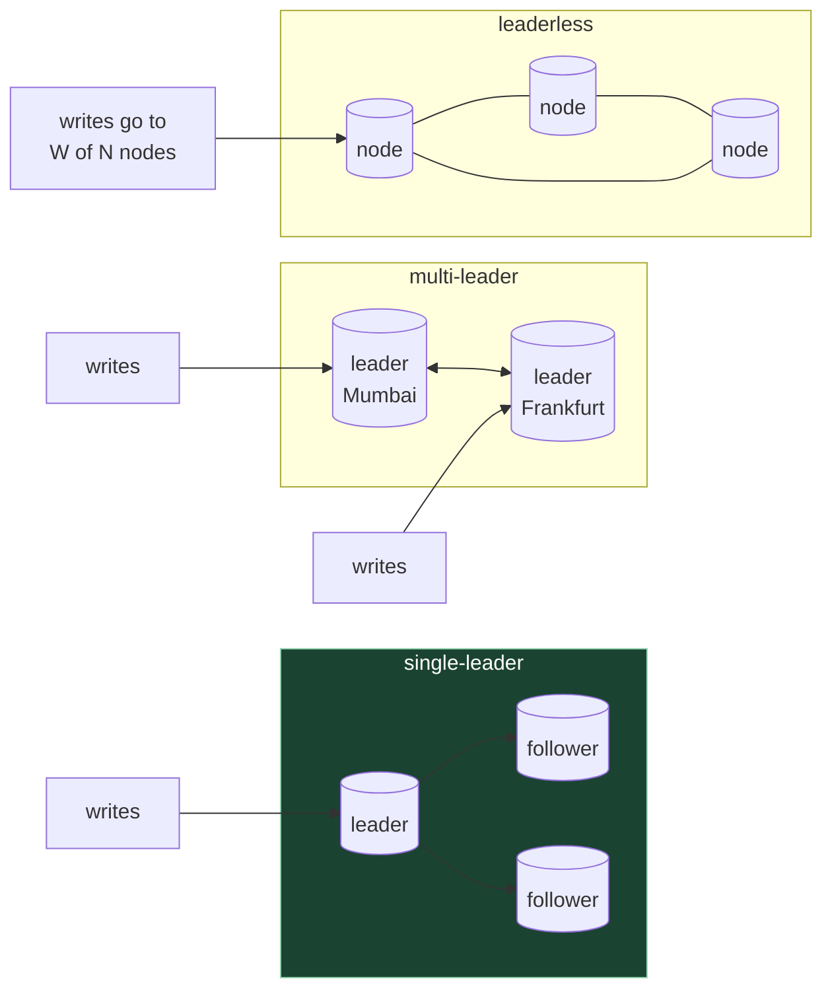
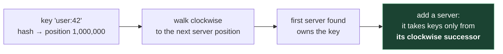

# 5. Data storage: choosing, replicating, sharding

## The problem

Every design in this course starts with one database on one machine, and that's the right
start. Then three things happen, usually in this order. The machine dies, and everything
stops. Reads outgrow it. Then the *data* outgrows it, or writes do. Each of those has a
different fix (copies, more copies, and splitting), and each fix brings its own new
problem. This chapter is those three fixes and what they cost, plus the question that
comes before all of them: which kind of database.

The deepest treatment of everything here is Martin Kleppmann's *Designing Data-Intensive
Applications* (DDIA). The second edition, with Chris Riccomini, came out from O'Reilly in
March 2026 ([Kleppmann's announcement](https://martin.kleppmann.com/2026/03/24/designing-data-intensive-applications-2e.html)).
I haven't been able to check its chapter layout against a copy; search snippets of
O'Reilly's pages show chapters on replication, on **sharding** (the first edition called it
partitioning), and on consistency and consensus. If you read one book for this round, it's
that one.

## 5.1 SQL or NoSQL: the categories blur

The interview question is usually phrased as a binary. It isn't one any more, and saying
so (briefly) is a good sign.

- PostgreSQL stores and indexes JSON documents (`jsonb`), so "use NoSQL because the data is
  semi-structured" is weaker than it sounds.
- MongoDB has supported multi-document ACID transactions since 4.0 (2018), within a replica
  set, and across shards since 4.2. "Use SQL because you need transactions" is weaker too.
- Several "NewSQL" systems (Spanner, CockroachDB, YugabyteDB, TiDB) speak SQL and shard
  automatically.

So pick by **data model and access pattern**, not by the label:

| Model | Shape | Reach for it when | Examples |
|---|---|---|---|
| **Relational** | Tables, joins, constraints, transactions | Default. Data has relationships; you need correctness (money, inventory, bookings); queries you can't predict yet | PostgreSQL, MySQL |
| **Key-value** | Opaque value by key | You only ever look things up by one key; cache, sessions, counters | Redis, DynamoDB (also document-ish), Memcached |
| **Document** | Self-contained JSON-like records | Each read wants one whole aggregate (a product with its variants), few cross-record joins | MongoDB, Couchbase; Postgres `jsonb` |
| **Wide-column** | Rows keyed by partition key, many sorted columns | Very high write volume, queries known in advance, keyed by one id plus a time range | Cassandra, ScyllaDB, HBase, Bigtable |
| **Search** | Inverted index over text | Full-text search, faceting, fuzzy matching | Elasticsearch, OpenSearch |
| **Columnar / analytical** | Columns stored separately | Aggregations over billions of rows, not single-row lookups | ClickHouse, BigQuery |
| **Graph** | Nodes and edges | Queries that walk relationships many hops deep | Neo4j |
| **Vector** | Embeddings, nearest-neighbour search | "Find similar items" | Qdrant, pgvector |

Two of these have their own courses here: columnar storage in
[clickhouse/01, "Columns, not rows"](../../clickhouse/01-what-clickhouse-does-with-a-table.md#columns-not-rows)
and vector search in [vector-search/01](../../vector-search/01-what-vector-search-is.md).

The honest default for an interview: **start relational, and move a specific access
pattern elsewhere when you can name why**. "The feed is read 100× more than written, keyed
by user id and time, so it lives in a wide-column store" is a reason. "NoSQL scales better"
is not: scaling comes from the sharding below, which you can do to either.

> ⚠️ A common cause of a bad answer: choosing the database before the access patterns are
> written down. Do [file 01 §1.4](01-foundations.md#14-a-working-method)'s data-model step
> first (list the queries), and the choice usually falls out.

## 5.2 How a single node keeps data safe

One idea from inside a database you need for everything below: a database writes every
change to an append-only **write-ahead log** before changing its data files, so a crash can
be recovered by replaying the log. That same log is what replicas consume. The Postgres
course covers it in
[postgres/01, "Every change is logged first: the WAL"](../../postgres/01-what-postgres-does-with-a-query.md#every-change-is-logged-first-the-wal).
Replication, below, is "ship the log to other machines and replay it there."

## 5.3 Replication: three shapes

**Replication** means keeping copies of the same data on several machines. You do it for
three reasons: survive a machine dying (availability), serve more reads (scale), and put
data near users (latency). DDIA's taxonomy names three shapes:



The green one is where you start, and where most systems stay.

| | Single-leader | Multi-leader | Leaderless |
|---|---|---|---|
| Who accepts writes | One leader | Several leaders (typically one per region) | Any replica; client writes to several |
| Write conflicts | Impossible: one node orders all writes | Possible, must be resolved | Possible, must be resolved |
| Typical use | Almost everything: Postgres, MySQL, MongoDB replica sets | Multi-region writes, offline-capable apps | Dynamo-style stores: Cassandra, Riak, ScyllaDB |
| Main pain | Leader is a bottleneck for writes; failover | Conflict resolution | Reasoning about what a read returns |

### Single-leader, and replication lag

Writes go to the leader; the leader streams its log to followers; reads can go to either.
The choice that matters is whether the leader waits for followers before confirming a
write:

| | Synchronous | Asynchronous |
|---|---|---|
| Leader confirms a write after | A follower has it too | Writing it locally |
| If the leader dies right after | The write survives on the follower | The write may be lost |
| Write latency | Includes a round trip to the follower | Local only |
| If the follower is slow or down | Writes stall | Nothing happens to writes |

Most setups are asynchronous, or "one synchronous, the rest asynchronous". Asynchronous
means followers lag, usually by milliseconds, occasionally by minutes. That lag is where
the user-visible bugs come from: the user saves a profile, the next page reads from a
follower that hasn't caught up, and the save appears to have failed. That's a
**read-your-writes** violation, defined in [file 06 §6.1](06-consistency-and-cap.md#61-first-what-consistent-means).
Standard fixes: read your own recently changed data from the leader, or remember the log
position of the user's last write and only read from a follower that has passed it.

**Failover** (promoting a follower when the leader dies) sounds simple and is where the
outages live: deciding the leader is dead (a timeout, which can be wrong), choosing the
most up-to-date follower, losing any asynchronous writes it hadn't received, and making
sure the old leader doesn't come back still believing it's in charge (**split brain**).

### Multi-leader

One leader per region lets each region accept writes locally. The price is that two regions
can change the same row at the same time, and something must decide the outcome. "Last
write wins" by timestamp is common and **silently discards** one of the writes; clocks on
different machines disagree, so "last" isn't even well defined. Avoid it in an interview
design unless the data tolerates loss, or the conflicts can't happen (each user's data is
only ever written in their home region).

### Leaderless and quorums

Amazon's Dynamo paper (DeCandia et al.,
[*Dynamo: Amazon's Highly Available Key-value Store*](https://www.allthingsdistributed.com/files/amazon-dynamo-sosp2007.pdf),
SOSP 2007) made this shape famous. It was built for the shopping cart, which "must allow
customers to add and remove items from their shopping cart even amidst network and server
failures". The design is "always writeable".

Each key lives on **N** replicas. A write is sent to all N and succeeds when **W** confirm. A
read asks all N and waits for **R** answers. If **R + W > N**, every read set overlaps every
write set in at least one node, so a read normally sees the latest successful write. The
paper: "The common (N,R,W) configuration used by several instances of Dynamo is (3,2,2)."

```
N = 3 replicas:   [A] [B] [C]
write, W = 2:     [A✓] [B✓] [C ]      ← C missed it
read,  R = 2:          [B✓] [C ]      ← B overlaps; newest version wins
```

The machinery around that, all from the Dynamo paper, is vocabulary interviewers expect:

| Term | Problem it solves |
|---|---|
| **Sloppy quorum** | Some of the N "home" nodes are down. Write to the first N *healthy* nodes instead of failing |
| **Hinted handoff** | A stand-in node holds the write with a note saying whose it is, and hands it back when that node recovers |
| **Vector clocks** | Two versions exist; did one overwrite the other, or were they concurrent? Track causality to tell |
| **Read repair** | A read notices a stale replica and writes the newer value back to it |
| **Anti-entropy with Merkle trees** | Find which keys differ between two replicas by comparing hash trees, without shipping every key |

> ⚠️ R + W > N is not linearizability. With sloppy quorums the "overlap" can be on stand-in
> nodes; concurrent writes still need resolving. Abadi notes these systems "cannot achieve
> full consistency as defined by Gilbert and Lynch, even if R + W > N" (file 06 §6.6).

## 5.4 Sharding: when one leader isn't enough

Replication copies the whole dataset everywhere, so it doesn't help when the data is too
big for one machine, or *writes* are too many for one leader. For that you split the data:
**sharding** (DDIA's first edition says *partitioning*; MongoDB and Elasticsearch say
*shards*; Kafka, Cassandra and DynamoDB say *partitions*; it's the same idea). Each shard
holds a subset of keys and is usually itself replicated.

The decision is the **shard key**, and the way you map keys to shards:

| Strategy | How | Good at | Bad at |
|---|---|---|---|
| **By key range** | Shard 1 holds `a`–`f`, shard 2 `g`–`m`… | Range scans ("all orders for user 42 in March") | Hot spots: time-ordered keys put every new write on the last shard |
| **By hash of key** | `shard = f(hash(key))` | Spreading load evenly | Range queries now hit every shard |
| **Directory / lookup table** | A service records which shard holds each key or tenant | Moving one big tenant on its own | One more component, which must be fast and available |

Problems that come with sharding, all common follow-ups:

- **Hot keys.** Hashing spreads *keys* evenly, not *traffic*. One celebrity's post, one
  merchant on a sale day, lands on one shard however you hash. Fixes: cache it, or split
  that key (append a small random suffix on write, read all the suffixes back).
- **Queries not by the shard key** have to ask every shard ("scatter-gather"), and are as
  slow as the slowest shard. Pick the shard key from the most common query.
- **Secondary indexes** are either local to each shard (cheap writes, scatter-gather
  reads) or global and themselves sharded (fast reads, every write touches two places).
- **Cross-shard transactions** are slow and hard. Design so that one request's data lives
  on one shard where you can, for example by sharding everything for a user by user id.
- **Rebalancing** when you add machines. That's the next section.

## 5.5 Consistent hashing

Here's the problem it solves. Shard by `hash(key) % N`. Now add a fourth server to three.
I ran this for 10,000 keys with 32-bit FNV-1a: going from `% 3` to `% 4` moved **7,559**
of them, about three quarters, because almost every key's remainder changes. For a cache,
that's three quarters of your hit rate gone at once, and the database behind it takes the
full load.

**Consistent hashing** (Karger et al.,
[*Consistent Hashing and Random Trees*](https://cs.brown.edu/courses/csci2950-u/f09/papers/chash97stoc.pdf),
STOC 1997, designed for web caches) fixes it. Their definition: "a consistent hash function
is one which changes minimally as the range of the function changes."

The picture is a clock face. Hash every server onto a point on a ring of 2³² positions.
Hash each key onto the ring too, and walk clockwise: the first server you meet owns it.
Add a server, and it takes over only the keys between itself and its anticlockwise
neighbour. Everything else stays put.



One point per server gives very uneven arcs, so each server is placed at many points:
**virtual nodes**. Dynamo does exactly this: "each node gets assigned to multiple points in
the ring. To this end, Dynamo uses the concept of 'virtual nodes'." Virtual nodes also let
a bigger machine take more points.

In Go, the whole thing is a sorted slice and a binary search:

```go
package ring

import (
	"hash/fnv"
	"sort"
	"strconv"
)

// Ring is a consistent-hash ring with virtual nodes.
type Ring struct {
	vnodes int
	hashes []uint32          // sorted positions on the ring
	owner  map[uint32]string // position -> physical node
}

func NewRing(vnodes int) *Ring {
	return &Ring{vnodes: vnodes, owner: map[uint32]string{}}
}

func hash32(s string) uint32 { // FNV-1a, 32-bit
	h := fnv.New32a()
	h.Write([]byte(s))
	return h.Sum32()
}

func (r *Ring) Add(node string) {
	for i := 0; i < r.vnodes; i++ {
		h := hash32(node + "#" + strconv.Itoa(i))
		r.owner[h] = node // a collision silently reassigns; fine for teaching, not for production
		r.hashes = append(r.hashes, h)
	}
	sort.Slice(r.hashes, func(i, j int) bool { return r.hashes[i] < r.hashes[j] })
}

// Get walks clockwise from the key's position to the first virtual node.
func (r *Ring) Get(key string) string {
	h := hash32(key)
	i := sort.Search(len(r.hashes), func(i int) bool { return r.hashes[i] >= h })
	if i == len(r.hashes) {
		i = 0 // wrap around
	}
	return r.owner[r.hashes[i]]
}
```

<details><summary>Rust</summary>

```rust
use std::collections::HashMap;

fn hash32(s: &str) -> u32 {
    // FNV-1a, 32-bit: same function as Go's hash/fnv New32a
    let mut h: u32 = 0x811c9dc5;
    for b in s.bytes() {
        h ^= b as u32;
        h = h.wrapping_mul(0x01000193);
    }
    h
}

pub struct Ring {
    vnodes: usize,
    hashes: Vec<u32>,            // sorted positions on the ring
    owner: HashMap<u32, String>, // position -> physical node
}

impl Ring {
    pub fn new(vnodes: usize) -> Self {
        Self { vnodes, hashes: Vec::new(), owner: HashMap::new() }
    }

    pub fn add(&mut self, node: &str) {
        for i in 0..self.vnodes {
            let h = hash32(&format!("{node}#{i}"));
            self.owner.insert(h, node.to_string());
            self.hashes.push(h);
        }
        self.hashes.sort_unstable();
    }

    pub fn get(&self, key: &str) -> Option<&str> {
        if self.hashes.is_empty() {
            return None;
        }
        let h = hash32(key);
        // first position >= h, wrapping to 0 past the end
        let i = self.hashes.partition_point(|&p| p < h) % self.hashes.len();
        self.owner.get(&self.hashes[i]).map(|s| s.as_str())
    }
}
```

Rust returns `Option` where Go returned the zero value: an empty ring is a case the caller
must handle, not a silent empty string.

</details>

<details><summary>C++</summary>

```cpp
#include <cstdint>
#include <map>
#include <string>

uint32_t hash32(const std::string& s) {  // FNV-1a, 32-bit
    uint32_t h = 0x811c9dc5u;
    for (unsigned char c : s) { h ^= c; h *= 0x01000193u; }
    return h;
}

// std::map is already a sorted tree, so it can be the ring itself:
// lower_bound finds the first position >= the key's hash.
class Ring {
public:
    explicit Ring(int vnodes) : vnodes_(vnodes) {}

    void add(const std::string& node) {
        for (int i = 0; i < vnodes_; i++)
            ring_[hash32(node + "#" + std::to_string(i))] = node;
    }

    const std::string& get(const std::string& key) const {  // ring must be non-empty
        auto it = ring_.lower_bound(hash32(key));
        if (it == ring_.end()) it = ring_.begin();  // wrap around
        return it->second;
    }

private:
    int vnodes_;
    std::map<uint32_t, std::string> ring_;
};
```

The standard library's ordered map does the sorting and searching, so there's no separate
slice to keep in step. Adding a node is O(v log n) instead of a full re-sort.

</details>

<details><summary>JavaScript</summary>

```js
function hash32(s) {
  // FNV-1a, 32-bit, over UTF-8 bytes. Math.imul keeps the multiply in 32 bits;
  // >>> 0 turns the result back into an unsigned integer.
  let h = 0x811c9dc5;
  for (const byte of new TextEncoder().encode(s)) {
    h ^= byte;
    h = Math.imul(h, 0x01000193);
  }
  return h >>> 0;
}

class Ring {
  constructor(vnodes) {
    this.vnodes = vnodes;
    this.hashes = []; // sorted positions on the ring
    this.owner = new Map(); // position -> physical node
  }

  add(node) {
    for (let i = 0; i < this.vnodes; i++) {
      const h = hash32(`${node}#${i}`);
      this.owner.set(h, node);
      this.hashes.push(h);
    }
    this.hashes.sort((a, b) => a - b); // numeric sort: the default sorts as strings
  }

  get(key) {
    const h = hash32(key);
    let lo = 0, hi = this.hashes.length; // binary search: first position >= h
    while (lo < hi) {
      const mid = (lo + hi) >>> 1;
      if (this.hashes[mid] < h) lo = mid + 1; else hi = mid;
    }
    return this.owner.get(this.hashes[lo === this.hashes.length ? 0 : lo]);
  }
}
```

Two JavaScript-specific traps are in the comments: numbers are doubles, so 32-bit
multiplication needs `Math.imul`, and `Array.prototype.sort` without a comparator sorts
numbers as strings.

</details>

All four versions give identical assignments, because they share the hash function. I ran
each with 3 nodes × 100 virtual nodes over 10,000 keys, then added a fourth node:

| | Measured (all four languages) |
|---|---|
| Keys per node, 3 nodes | 3,551 / 2,694 / 3,755 |
| Keys moved when a 4th node joined | 2,492 of 10,000 (ideal: 2,500) |
| Keys moved under `% N`, 3 → 4 | 7,559 of 10,000 |

Note the first row honestly: even with 100 virtual nodes, one node got 39% more keys than
another. More virtual nodes, or a better-mixing hash than FNV-1a, narrows that. It doesn't
reach zero.

Alternatives worth naming if asked:

| Scheme | Idea | Trade-off |
|---|---|---|
| **Rendezvous (HRW) hashing** | For each key, score every node with `hash(key, node)`; the highest wins. Thaler & Ravishankar, 1996 tech report, 1998 journal | No ring to maintain; O(nodes) per lookup |
| **Jump consistent hash** | Lamping & Veach, [arXiv:1406.2294](https://arxiv.org/abs/1406.2294), 2014: "about 5 lines of code", no memory | Nodes are numbered 0..n−1; you can only add or remove at the end |
| **Many fixed partitions** | Create far more partitions than machines up front, hash keys to partitions with plain modulo, and move *whole partitions* between machines | Simple and common; the partition count is hard to change later. Kafka's version of this, and what changing the count does to keys, is in [kafka/02, "Changing the partition count moves keys"](../../kafka/02-partitions-keys-and-order.md#changing-the-partition-count-moves-keys) |

> **Teacher's aside.** Consistent hashing gets drawn in nearly every interview answer about
> scaling, often where it isn't needed. It earns its place when the *set of servers changes
> often and moving keys is expensive*: caches (where a moved key is a miss) and
> peer-to-peer stores like Dynamo. A sharded Postgres with a lookup table, or a Kafka topic
> with fixed partitions, doesn't need it. Say which problem it's solving in your design, and
> you'll sound like you've used it rather than read about it.

## Asked in interviews

| Prompt | Where |
|---|---|
| "SQL or NoSQL for this?" | §5.1: answer with access patterns |
| "How does your database survive a machine failure?" | §5.3, single-leader and failover |
| "A user updates something and doesn't see it on refresh. Why?" | §5.3, replication lag |
| "Explain quorum reads and writes." "What's N, R, W?" | §5.3, leaderless |
| "Your table is 20 TB. What now?" "How do you pick a shard key?" | §5.4 |
| "What happens when one key gets most of the traffic?" | §5.4, hot keys |
| "Explain consistent hashing. Why virtual nodes?" Sometimes: "Code it." | §5.5 |

## Check yourself

1. You add read replicas to fix a slow write-heavy workload. Why doesn't it help, and what
   would?
2. A user's "order placed" page sometimes shows "no orders yet". Writes go to the leader,
   reads to async followers. Give two fixes, and the cost of each.
3. You shard orders by `order_id` hash. The most common query is "this user's orders, newest
   first". What happens to that query, and what shard key would you choose instead? What
   does your new choice make worse?
4. With N = 3, which (R, W) settings give overlapping quorums? Which would you choose for a
   write-heavy workload, and what happens to writes when one node is down under each?
5. A cache cluster of 10 nodes uses `hash % 10`. One node dies and the client switches to
   `% 9`. Roughly what fraction of keys now miss, and what does the database see? How does
   consistent hashing change that number?
6. In the measured table, one node holds 3,755 keys and another 2,694. Explain where the
   imbalance comes from, and two ways to reduce it. Why might a team accept it anyway?
