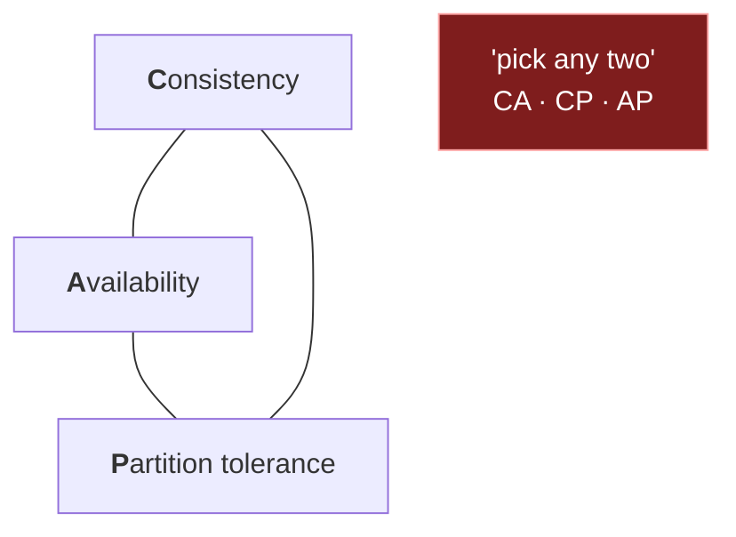
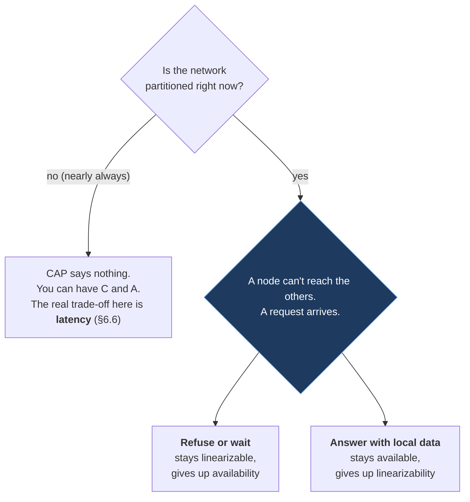

# 6. Consistency and CAP

## The problem

You have two copies of a user's balance, in Mumbai and in Singapore, kept in step over a
network link. The link fails. A request in Singapore asks for the balance, and the last
deposit only reached Mumbai. The Singapore node has two choices: answer with the number it
has, which may be stale, or refuse to answer until it can check with Mumbai, which may be
never. There is no third option, and that much is genuinely a theorem.

What isn't a theorem is most of what gets said about it. "CAP: pick two of three" is the
most quoted idea in system design and one of the most misread. This chapter goes through
what the people involved actually said, because **the disagreement between them is the
lesson**: once you see why each version exists, you can use the vocabulary in an
interview without saying something an informed interviewer will pick apart.

Needs [file 05](05-data-storage.md) for replication. Skip §6.1 if you can already say what
linearizable means.

## 6.1 First: what "consistent" means

The word is overloaded, and half the confusion about CAP comes from that. Start with an
analogy. You post a photo and immediately refresh. Which of these would you accept?

- You see the photo. Always. And so does everyone else, the moment your post succeeded.
- *You* see it, but a friend on another server might not for a few seconds.
- Nobody sees it for a few seconds, but it shows up eventually.

Those are three different consistency models, and real systems choose between them per
feature. The formal names, strongest first:

| Model | What a reader is promised | Source |
|---|---|---|
| **Linearizable** (also *atomic*, *strong*) | The system behaves as if there's one copy. Every operation appears to take effect at a single instant between its start and its finish, so once a write completes, every later read sees it | Herlihy & Wing, [*Linearizability*](https://www.cs.columbia.edu/~wing/publications/HerlihyWing90.pdf), ACM TOPLAS 1990 |
| **Causal** | If one write could have influenced another (a reply to a comment), everyone sees them in that order. Unrelated writes may appear in different orders to different readers | DDIA, consistency chapter |
| **Read-your-writes** | *You* always see your own earlier writes. Others may not yet | Terry et al., [*Session Guarantees for Weakly Consistent Replicated Data*](https://pages.cs.wisc.edu/~remzi/Classes/739/Fall2016/Papers/bayou-sessions94.pdf), PDIS 1994 |
| **Monotonic reads** | You never see time go backwards: once you've seen a value, later reads don't show an older one | Terry et al. 1994 |
| **Eventual** | If writes stop, all replicas eventually converge. Says nothing about *when*, or what you read meanwhile | Vogels, [*Eventually Consistent*](https://www.cs.princeton.edu/courses/archive/fall15/cos518/papers/ec-vogels.pdf), ACM Queue 2008 |

Herlihy and Wing's phrasing is worth memorising: linearizability "provides the illusion that
each operation applied by concurrent processes takes effect instantaneously at some point
between its invocation and its response." Terry's session guarantees are worth knowing
because they're the cheap fixes: read-your-writes is often all a user actually notices,
and it's much cheaper than linearizability (route a user's reads to the leader for a few
seconds after they write, say).

> ⚠️ **The C in CAP is not the C in ACID.** ACID's consistency means "the database moves from
> one valid state to another" (constraints hold). CAP's consistency means linearizability of
> a single object. Gilbert and Lynch point this out in a footnote of their proof. An
> interviewer who hears you conflate them will notice.

## 6.2 CAP as it's usually taught

Eric Brewer put it on a slide in his keynote at PODC 2000,
[*Towards Robust Distributed Systems*](https://people.eecs.berkeley.edu/~brewer/cs262b-2004/PODC-keynote.pdf):
"Consistency / Availability / Tolerance to network Partitions. Theorem: You can have at most
two of these properties for any shared-data system." (The slide says *theorem*. The word
*conjecture* comes from Gilbert and Lynch, who then proved a version of it.)

That became the triangle in every blog post:

The red box is the part that misleads, for a reason §6.4 makes plain: you don't get to
pick P away.

## 6.3 What was actually proved

Seth Gilbert and Nancy Lynch, [*Brewer's Conjecture and the Feasibility of Consistent,
Available, Partition-Tolerant Web Services*](https://www.comp.nus.edu.sg/~gilbert/pubs/BrewersConjecture-SigAct.pdf),
ACM SIGACT News, June 2002. Their definitions are precise and narrow:

| Term | Their definition |
|---|---|
| Consistency | "Atomic, or linearizable": "there must exist a total order on all operations such that each operation looks as if it were completed at a single instant" |
| Availability | "every request received by a non-failing node in the system must result in a response" |
| Partition | "the network will be allowed to lose arbitrarily many messages sent from one node to another" |

And the theorem: "It is impossible in the asynchronous network model to implement a
read/write data object that guarantees the following properties: Availability; Atomic
consistency in all fair executions (including those in which messages are lost)."

Read what that does and doesn't cover:

| CAP (the theorem) says something about… | It says nothing about… |
|---|---|
| A single read/write register | Transactions, multi-object operations, queries |
| Linearizability, and only that | Any weaker model in §6.1 (those *can* stay available) |
| Behaviour while messages are being lost | Behaviour when the network is fine, i.e. almost always |
| Whether every non-failing node *eventually* responds | How *fast* it responds. A reply after an hour counts as available |

That last row is the surprising one. Their footnote notes Brewer originally asked only that
*almost all* requests get a response, and that they require 100%. So CAP-availability is
both stricter than an SLO (every request, not 99.9%) and laxer (no time limit). Neither
matches what you mean by "available" in [file 01 §1.2](01-foundations.md#12-the-vocabulary).

## 6.4 Brewer, twelve years later

Brewer revisited it himself in [*CAP Twelve Years Later: How the "Rules" Have Changed*](https://www.infoq.com/articles/cap-twelve-years-later-how-the-rules-have-changed/)
(IEEE Computer, February 2012). Two sentences carry most of it:

- "The '2 of 3' formulation was always misleading because it tended to oversimplify the
  tensions among properties."
- "Because partitions are rare, there is little reason to forfeit C or A when the system is
  not partitioned."

So the honest shape is a decision that only exists *during* a partition:

> **Teacher's aside.** "We chose AP" or "CA system" sounds like a design decision. It
> usually isn't. Partitions aren't optional: cables get cut, switches reboot, a GC pause
> makes a node look dead. A system that claims to be "CA" is really saying "we haven't
> decided what happens during a partition", which means it'll be decided for you, by
> whatever the code happens to do. The useful statement is per operation: "during a
> partition, a balance read on the minority side returns an error; a feed read returns
> what it has."

## 6.5 Kleppmann: stop calling databases CP or AP

In 2015 Martin Kleppmann (author of DDIA) went further, in a post titled
[*Please stop calling databases CP or AP*](https://martin.kleppmann.com/2015/05/11/please-stop-calling-databases-cp-or-ap.html),
backed by a paper, [*A Critique of the CAP Theorem*](https://arxiv.org/abs/1509.05393).
His argument: under the theorem's precise definitions, most real systems are neither.

Take the most ordinary setup there is: one Postgres leader with asynchronous read replicas,
reads served from replicas.

- Reads from a lagging replica can be stale, so it isn't linearizable. Not CAP-C.
- A replica cut off from the leader can't accept writes, so not every non-failing node can
  answer every request. Not CAP-A.

In his words: "these systems are neither CAP-consistent nor CAP-available. They are neither
'CP' nor 'AP', they are just 'P', whatever that means." And: "The CAP theorem is too
simplistic and too widely misunderstood to be of much use for characterizing systems." His
recommendation is to "use more precise terminology to reason about our trade-offs": say
which consistency model each operation gets, and what latency it costs.

## 6.6 PACELC: the trade-off you make every day

Daniel Abadi's point, in [*Consistency Tradeoffs in Modern Distributed Database System
Design: CAP is Only Part of the Story*](https://www.cs.umd.edu/~abadi/papers/abadi-pacelc.pdf)
(IEEE Computer, February 2012; first sketched on his blog in 2010), is that CAP talks about
the rare case and ignores the common one. Even with a healthy network, keeping replicas
consistent means waiting for them, and waiting is latency. His definition: "if there is a
partition (P), how does the system trade off availability and consistency (A and C); else
(E), when the system is running normally in the absence of partitions, how does the system
trade off latency (L) and consistency (C)?"

His classification of systems, as of 2012, quoted from the paper:

| Class | During a partition | Normally | Abadi's examples (default configurations) |
|---|---|---|---|
| **PA/EL** | Stay available | Prefer low latency | Dynamo, Cassandra, Riak |
| **PC/EC** | Stay consistent | Pay latency for consistency | VoltDB/H-Store, Megastore, BigTable, HBase |
| **PA/EC** | Stay available | Prefer consistency | MongoDB (he hedges this one) |
| **PC/EL** | Stay consistent | Prefer low latency | Yahoo's PNUTS |

Two cautions. These are *defaults in 2012*; most of these systems let you tune per request
and several have changed defaults since, so check current documentation rather than
quoting the table about today's product. And Abadi himself notes PA/EL systems "cannot
achieve full consistency as defined by Gilbert and Lynch, even if R + W > N": quorum
arithmetic ([file 05 §5.3](05-data-storage.md#53-replication-three-shapes)) isn't the same
as linearizability.

## 6.7 Where the sources disagree, and what to say

| Source | Says | Status |
|---|---|---|
| Brewer 2000 | At most two of C, A, P for any shared-data system | A keynote claim, informal definitions |
| Gilbert & Lynch 2002 | No linearizable *and* always-responding register when messages can be lost | Proved, for exactly that |
| Brewer 2012 | "2 of 3" was misleading; only during partitions do you choose | The author retracting the slogan |
| Abadi 2012 | The everyday trade-off is latency versus consistency | Widely adopted framing (PACELC) |
| Kleppmann 2015 | Most systems are neither CP nor AP; drop the labels | Argued from the formal definitions |

Which does the evidence support? The theorem is solid and narrow. For *describing systems*,
Brewer's own 2012 view, Abadi and Kleppmann all point the same way: state per-operation
consistency guarantees and their latency cost, and say what happens during a partition.
The slogan "pick two" is the one claim none of them defend.

What that means in an interview: use CAP as a hook, then immediately make it precise.

| Feature | Consistency it needs | Why |
|---|---|---|
| Wallet balance, inventory decrement, seat booking | Linearizable (or a single leader + transactions) | Two people must not spend the same rupee or book the same seat |
| A user editing their own profile | Read-your-writes | They'll think the save failed if they don't see it |
| Like counts, view counts | Eventual | Nobody can tell 1,203 from 1,207 |
| Chat messages in one conversation | Causal (replies after what they reply to) | Out-of-order replies read as nonsense |
| A news feed | Eventual, with read-your-writes for your own posts | Others can lag; *you* can't |

## Asked in interviews

| Prompt | Where |
|---|---|
| "Explain the CAP theorem." Then: "Is your design CP or AP?" | §6.3, §6.4: answer per operation, during a partition |
| "Can a system be CA?" | §6.4 teacher's aside |
| "What consistency does a like counter need? A bank balance?" | §6.7 table |
| "What's eventual consistency? How eventual?" | §6.1; Vogels sets no bound, so ask what lag you can measure |
| "Have you heard of PACELC?" | §6.6 |
| "The user updates their profile and doesn't see it. Why, and how do you fix it?" | §6.1 read-your-writes; [file 05 §5.3](05-data-storage.md#53-replication-three-shapes) |

## Check yourself

1. Your interviewer says "we'll use an AP database for the shopping cart". Rewrite that
   claim as a precise statement about what one request does during a partition.
2. Why does a Postgres leader with async read replicas fail *both* CAP-consistency and
   CAP-availability? Be specific about which requests fail which property.
3. Gilbert and Lynch's availability has no time bound. Construct a system that is
   CAP-available and useless, and one that meets a 99.9% SLO but isn't CAP-available.
4. A user changes their display name, the page reloads, and shows the old name. Name the
   consistency guarantee that was violated, and give two ways to provide it without
   making every read linearizable.
5. Your system has no partitions at all for a month. According to PACELC, what trade-off
   were you still making every day, and where would you see it on a dashboard?
6. A Dynamo-style store with N=3, R=2, W=2 has two clients writing the same key at the same
   moment. Why doesn't R + W > N make this linearizable? (Abadi's caveat; think about
   concurrent writes and what "latest" means.)
