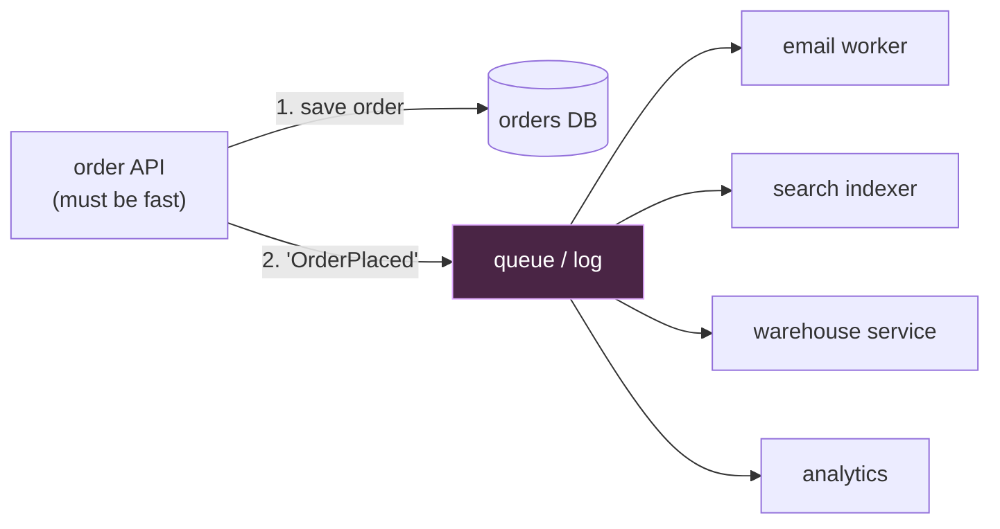
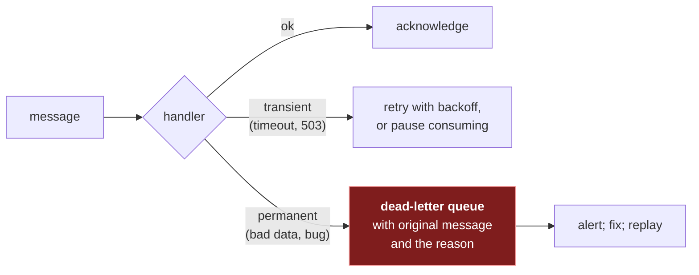

# 7. Asynchronous work: queues, logs and delivery

## The problem

A user places an order. Your handler saves it, then sends a confirmation email, updates the
search index, notifies the warehouse, and records analytics, all before replying. The email
provider is slow today, so checkout takes eight seconds. Tomorrow the analytics service is
down, so checkout fails, for a reason the user doesn't care about. And on sale day, ten
times the usual orders arrive in one minute and everything downstream is swamped at once.

The fix is to split the work in two: the part the user must wait for (save the order), and
the part that can happen a moment later (everything else). The second part goes through a
**queue** or **log**: a durable buffer between the code that knows something happened and
the code that reacts to it.

This chapter is the system-design view. The mechanics of one real log, Kafka, are a whole
course here: [kafka/](../../kafka/README.md). I link into it rather than repeat it.

## 7.1 What a buffer in the middle buys you

| Benefit | Without the buffer | With it |
|---|---|---|
| **Latency** | The user waits for every downstream step | The user waits for one write |
| **Isolation** | A slow or failed consumer slows or fails the request | It falls behind and catches up later |
| **Load levelling** | A spike hits every downstream at once | The buffer absorbs it; consumers drain at their own pace |
| **Decoupling** | The producer knows every consumer | Consumers subscribe; adding one doesn't change the producer |

What it costs: the work is no longer done when the user gets a response ("eventually" is
now a requirement to discuss), failures happen where no user sees them (so you need
monitoring and a dead-letter path), and you've added a component that must itself be
available and durable.

## 7.2 Queue or log

Both are buffers. They differ in what reading does.

| | Queue (RabbitMQ, SQS) | Log (Kafka, Kinesis, Pulsar) |
|---|---|---|
| Reading a message | Removes it, once acknowledged | Leaves it; the reader moves a bookmark |
| Several independent readers | Each needs its own queue (fan-out) | Each reader group keeps its own bookmark on one log |
| Replay old messages | Gone once acknowledged | Rewind the bookmark, within retention |
| Ordering | Per queue, weakened by redelivery and parallel consumers | Per partition, strictly |
| Natural fit | Task distribution: "someone send this email" | Event streams: "this happened", read by many |

The Kafka course's first chapter makes this distinction at length:
[kafka/01, "A log, not a queue"](../../kafka/01-what-kafka-is.md#a-log-not-a-queue).

**Pub/sub** (publish/subscribe) is the pattern where publishers send to a topic without
knowing who's listening, and every subscriber gets its own copy. A log gives you pub/sub for
free (each consumer group is a subscriber); a queue system does it with fan-out exchanges
or one queue per subscriber.

In an interview, either is defensible. Say which property you need: "I need several
independent consumers and the ability to replay into a new search index, so a log" is a
reason.

## 7.3 Delivery guarantees

The question that matters for correctness: if something fails halfway, is a message
processed zero times, once, or twice?

| Guarantee | Means | How you get it | Cost |
|---|---|---|---|
| **At-most-once** | Never twice; sometimes never | Acknowledge before processing | Silent loss on any crash |
| **At-least-once** | Never lost; sometimes twice | Acknowledge after processing | Duplicates; handlers must cope |
| **Exactly-once** | Once | Not possible end to end across independent systems in general; approximated (below) | — |

The Kafka course shows why the order of "process" and "commit" decides this, with the
diagram that makes it obvious:
[kafka/03, "Where you commit decides the guarantee"](../../kafka/03-offsets-and-delivery-guarantees.md#where-you-commit-decides-the-guarantee).
And duplicates aren't only after crashes: rebalances and timeouts redeliver too
([kafka/03, "Redelivery isn't only after crashes"](../../kafka/03-offsets-and-delivery-guarantees.md#redelivery-isnt-only-after-crashes)).

So the standard design is **at-least-once delivery plus idempotent processing**, which
together give an *effect* of exactly once. Some brokers advertise "exactly-once" features;
they're real, but they cover the broker's own writes, not your email provider or your
database, so the handler still needs to be idempotent.

## 7.4 Idempotent consumers

An operation is **idempotent** if doing it twice has the same effect as doing it once. Some
are idempotent naturally; the rest need help.

| Operation | Idempotent? | How to make it so |
|---|---|---|
| `SET status = 'SHIPPED' WHERE order_id = 42` | Yes | — |
| `UPDATE balance = balance + 100` | No | Record the event id in the same transaction; skip if seen |
| `INSERT` a row per event | No | Unique constraint on the event id; `INSERT … ON CONFLICT DO NOTHING` |
| Send an email | No | Record "sent for event X" before or atomically with sending; accept a rare duplicate, or use the provider's idempotency key |
| Call a payment API | No | Pass an idempotency key the provider deduplicates on ([file 09 §9.4](09-api-design.md#94-idempotency-and-idempotency-keys)) |

The Postgres side of this (a unique key on the event's identity, and three edge cases that
make it misbehave on the first real duplicate) is
[postgres/06, "The shape"](../../postgres/06-upserts-and-duplicate-events.md#the-shape).

> **Teacher's aside.** People design for duplicates and forget **reordering**. With retries
> and parallel consumers, "status = PAID" can be processed *after* "status = REFUNDED" for
> the same order, and an idempotent handler will happily apply both in the wrong order.
> Logs order messages per partition only, and only if every message for one entity goes to
> the same partition ([kafka/02, "The key chooses the partition, if the producer uses it"](../../kafka/02-partitions-keys-and-order.md#the-key-chooses-the-partition-if-the-producer-uses-it)).
> Where order matters, carry a version or timestamp in the event, and have the handler
> ignore anything older than what it already has.

## 7.5 Getting the event out reliably: the dual write

The order handler writes the database and then publishes "OrderPlaced". Those are two
systems with no shared transaction. If the process dies between them, the order exists and
the event doesn't (or, the other way round, the event announces an order that was rolled
back). This is the **dual-write problem**.

The standard fix is the **transactional outbox**: write the event into an `outbox` table in
the same database transaction as the order, and let a separate relay publish rows from that
table, at least once. The Kafka course works through it, including why fire-and-forget
publishing widens the window:
[kafka/05, "Two writes, no transaction"](../../kafka/05-publishing-from-a-request.md#two-writes-no-transaction)
and [kafka/05, "The fix: the transactional outbox"](../../kafka/05-publishing-from-a-request.md#the-fix-the-transactional-outbox).
The same dual write shows up when keeping a search or vector index in step with a database:
[vector-search/03, "The dual write"](../../vector-search/03-keeping-an-index-in-step.md#the-dual-write).

## 7.6 When messages fail

Some messages will never succeed: malformed payloads, references to deleted records, a bug.
Retrying them for ever blocks everything behind them (a **poison pill**). The pattern:

The classification matters: a transient failure sent to the dead-letter queue floods it
during every outage; a permanent one retried in place blocks the partition. The details
(what a dead-letter message must carry, and committing only after the DLQ write is
confirmed) are in [kafka/04, "Two kinds of failure"](../../kafka/04-when-a-message-fails.md#two-kinds-of-failure).

## 7.7 Back-pressure and consumer lag

A buffer absorbs spikes, but it can't absorb a consumer that's permanently slower than its
producer: the backlog grows without bound. **Consumer lag** (how far behind the newest
message a consumer is) is the metric to watch, and to alert on, for every async pipeline.
Options when it grows: more consumers (up to the number of partitions, for a log), faster
processing (batching), or **back-pressure**: making the producer slow down or shed work
rather than letting the buffer fill.

## Asked in interviews

| Prompt | Where |
|---|---|
| "Why put a queue here?" "What happens if the consumer is down?" | §7.1 |
| "Kafka or RabbitMQ?" "Queue versus pub/sub?" | §7.2 |
| "At-least-once or exactly-once?" "How do you get exactly-once?" | §7.3 |
| "The consumer processed a payment message twice. How do you prevent that?" | §7.4 |
| "How do you make sure the event is published if the DB write succeeds?" | §7.5 |
| "What do you do with messages that keep failing?" | §7.6 |
| "The queue keeps growing. What do you do?" | §7.7 |

## Check yourself

1. A consumer acknowledges each message, then processes it. It crashes once a day. What do
   users see, and what single change fixes it? What new problem does that change create?
2. Make "add ₹100 to the wallet for event E" idempotent. Say what you store, where, and why
   it must be in the same transaction as the balance update.
3. Two events for one order, "PAID" (v3) and "REFUNDED" (v4), are processed in the order
   v4, v3 because of a retry. Your handler is idempotent. What's the final status, and what
   change makes it right?
4. An order service writes the order, then publishes an event. Describe both failure
   orders (DB succeeds and publish fails; publish succeeds and DB rolls back) and what a
   downstream warehouse sees in each. How does an outbox remove both?
5. A consumer's lag grows by 1,000 messages a minute, every minute, all day. It has 4
   instances on a 4-partition topic. Why won't adding a fifth instance help, and what will?
6. During a 20-minute outage of the email provider, your email worker sends every failure
   straight to the dead-letter queue. What does the DLQ look like afterwards, and what
   should the worker have done instead?
