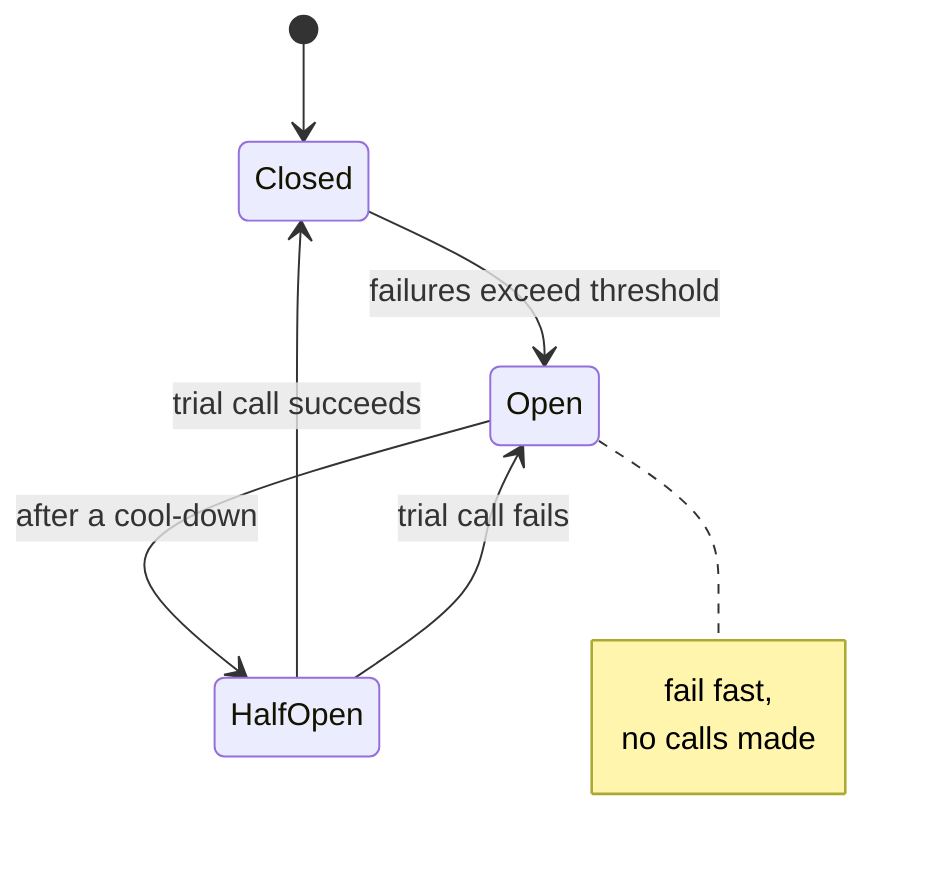

# 8. Reliability patterns: rate limits, timeouts, retries, breakers

## The problem

Distributed systems rarely fail by everything stopping. They fail by one dependency getting
slow, and the slowness spreading. Callers wait, so their threads and connections fill up,
so *their* callers wait. Clients retry, so the slow dependency gets more traffic, not less.
The Google SRE book's chapter on this has a one-line definition worth keeping: "A cascading
failure is a failure that grows over time as a result of positive feedback"
([SRE book, ch. 22](https://sre.google/sre-book/addressing-cascading-failures/)).

Each pattern in this chapter breaks one of those feedback loops. Rate limits stop too much
traffic getting in. Timeouts stop waiting from piling up. Backoff and budgets stop retries
from multiplying load. Circuit breakers stop calls to something that's already down.

The Go service course covers deadlines and retries in code, in depth:
[go-services/04](../../go-services/04-deadlines-and-retries.md). Here they're at the design
level, with the parts it doesn't cover.

## 8.1 Rate limiting

A **rate limiter** caps how many requests a client (a user, an API key, an IP) can make in
some period. It protects the service from abuse and from one noisy customer starving the
rest, and it's both a deep-dive topic and a standalone design question
([file 10 §10.2](10-worked-designs.md#102-a-distributed-rate-limiter)).

### Four algorithms

| Algorithm | Idea | Allows bursts? | Memory per client | Weakness |
|---|---|---|---|---|
| **Token bucket** | A bucket holds up to *b* tokens, refilled at *r* per second; each request spends one | Yes, up to *b* | Two numbers | Two parameters to explain |
| **Leaky bucket** | Requests drain out at a fixed rate; overflow is rejected | No (as a queue) | A counter or a queue | Smooths traffic; adds delay if queued |
| **Fixed window counter** | Count requests per calendar minute; reset at the boundary | Yes, up to 2× at a boundary | One counter | 100 at 09:00:59 and 100 at 09:01:00 both pass |
| **Sliding window log** | Keep a timestamp per request; count those in the last minute | No | One entry per request | Memory grows with the limit |
| **Sliding window counter** | Weight the previous window's count by how much of it still overlaps | Barely | Two counters | An approximation |

Two sources worth knowing:

- Stripe ([*Scaling your API with rate limiters*](https://stripe.com/blog/rate-limiters),
  2017) describes "the four basic kinds of rate limiters we use" (a request rate limiter, a
  concurrent requests limiter, and two load shedders) and says "We use the token bucket
  algorithm to do rate limiting… every Stripe user has a bucket, and every time they make a
  request we remove a token from that bucket."
- Cloudflare ([*How we built rate limiting capable of scaling to millions of domains*](https://blog.cloudflare.com/counting-things-a-lot-of-different-things/),
  2017) uses the sliding window counter, with the worked example
  `rate = 42 × ((60 − 15) / 60) + 18 = 49.5` (42 requests in the previous minute, 15 seconds
  into the current one, 18 so far). It "assumes a constant rate of requests during the
  previous sampling period", and measured on 400 million requests: "0.003% of requests have
  been wrongly allowed or rate limited".

"Leaky bucket" means two different things in the literature. As a **meter** it's
mathematically the token bucket seen from the other side; as a **queue** it actually holds
requests and releases them at a fixed rate. (I've seen this distinction only via secondary
sources; the networking literature it comes from is older than web APIs.) If an
interviewer says "leaky bucket", ask which.

### A token bucket in code

Lazy refill is the trick: no timer or background goroutine, just credit the time elapsed
since the last request.

```go
package main

import (
	"fmt"
	"sync"
	"time"
)

// TokenBucket holds up to capacity tokens and refills at rate tokens per second.
// Each request spends one token; no token, no request.
type TokenBucket struct {
	mu       sync.Mutex
	capacity float64
	rate     float64
	tokens   float64
	last     time.Time
}

func NewTokenBucket(capacity, rate float64, now time.Time) *TokenBucket {
	return &TokenBucket{capacity: capacity, rate: rate, tokens: capacity, last: now}
}

// Allow takes the current time as an argument so tests can control the clock.
func (b *TokenBucket) Allow(now time.Time) bool {
	b.mu.Lock()
	defer b.mu.Unlock()

	// Refill lazily: no background goroutine, just credit the time since the last call.
	if elapsed := now.Sub(b.last).Seconds(); elapsed > 0 {
		b.tokens = min(b.capacity, b.tokens+elapsed*b.rate)
		b.last = now
	}
	if b.tokens < 1 {
		return false
	}
	b.tokens--
	return true
}

func main() {
	t0 := time.Now()
	b := NewTokenBucket(5, 1, t0) // burst of 5, then 1 per second
	allowed := 0
	for i := 0; i < 10; i++ {
		if b.Allow(t0) {
			allowed++
		}
	}
	fmt.Println("burst at t=0:", allowed)                     // 5
	fmt.Println("t=0.5s:", b.Allow(t0.Add(500*time.Millisecond))) // false
	fmt.Println("t=1s:", b.Allow(t0.Add(time.Second)))             // true
}
```

<details><summary>Rust</summary>

```rust
use std::sync::Mutex;
use std::time::{Duration, Instant};

// The Mutex owns the mutable state: the compiler won't let you touch
// tokens or last without holding the lock.
struct State {
    tokens: f64,
    last: Instant,
}

pub struct TokenBucket {
    capacity: f64,
    rate: f64, // tokens per second
    state: Mutex<State>,
}

impl TokenBucket {
    pub fn new(capacity: f64, rate: f64, now: Instant) -> Self {
        Self { capacity, rate, state: Mutex::new(State { tokens: capacity, last: now }) }
    }

    pub fn allow(&self, now: Instant) -> bool {
        let mut s = self.state.lock().unwrap();
        let elapsed = now.saturating_duration_since(s.last).as_secs_f64();
        if elapsed > 0.0 {
            s.tokens = (s.tokens + elapsed * self.rate).min(self.capacity);
            s.last = now;
        }
        if s.tokens < 1.0 {
            return false;
        }
        s.tokens -= 1.0;
        true
    }
}

fn main() {
    let t0 = Instant::now();
    let b = TokenBucket::new(5.0, 1.0, t0);
    let allowed = (0..10).filter(|_| b.allow(t0)).count();
    println!("burst at t=0: {allowed}"); // 5
    println!("t=0.5s: {}", b.allow(t0 + Duration::from_millis(500))); // false
    println!("t=1s: {}", b.allow(t0 + Duration::from_secs(1))); // true
}
```

`Mutex<State>` wraps the data it protects, so reading `tokens` without the lock isn't a
race you can forget to prevent: it doesn't compile. `Instant` is monotonic, and
`saturating_duration_since` returns zero rather than panicking if callers race and pass an
earlier time.

</details>

<details><summary>C++</summary>

```cpp
#include <algorithm>
#include <chrono>
#include <iostream>
#include <mutex>

using Clock = std::chrono::steady_clock;

class TokenBucket {
public:
    TokenBucket(double capacity, double rate, Clock::time_point now)
        : capacity_(capacity), rate_(rate), tokens_(capacity), last_(now) {}

    bool allow(Clock::time_point now) {
        std::lock_guard<std::mutex> lock(mu_);  // unlocks when lock goes out of scope
        std::chrono::duration<double> elapsed = now - last_;
        if (elapsed.count() > 0) {
            tokens_ = std::min(capacity_, tokens_ + elapsed.count() * rate_);
            last_ = now;
        }
        if (tokens_ < 1) return false;
        tokens_ -= 1;
        return true;
    }

private:
    std::mutex mu_;
    const double capacity_, rate_;
    double tokens_;
    Clock::time_point last_;
};

int main() {
    using namespace std::chrono_literals;
    auto t0 = Clock::now();
    TokenBucket b(5, 1, t0);
    int allowed = 0;
    for (int i = 0; i < 10; i++) allowed += b.allow(t0);
    std::cout << "burst at t=0: " << allowed << "\n";                       // 5
    std::cout << std::boolalpha << "t=0.5s: " << b.allow(t0 + 500ms) << "\n"; // false
    std::cout << "t=1s: " << b.allow(t0 + 1s) << "\n";                        // true
}
```

`steady_clock` is the monotonic one; `system_clock` can jump backwards when NTP corrects it,
which would hand out free tokens or freeze the bucket.

</details>

<details><summary>JavaScript</summary>

```js
// No lock: JavaScript runs one callback at a time on the event loop, so
// nothing can interleave between the check and the decrement, as long as
// there is no `await` in between. (Each Node process, worker thread or
// cluster member still has its own bucket.)
class TokenBucket {
  constructor(capacity, ratePerSec, nowMs) {
    this.capacity = capacity;
    this.rate = ratePerSec;
    this.tokens = capacity;
    this.last = nowMs;
  }

  allow(nowMs) {
    const elapsed = (nowMs - this.last) / 1000;
    if (elapsed > 0) {
      this.tokens = Math.min(this.capacity, this.tokens + elapsed * this.rate);
      this.last = nowMs;
    }
    if (this.tokens < 1) return false;
    this.tokens -= 1;
    return true;
  }
}

const t0 = performance.now();
const b = new TokenBucket(5, 1, t0);
let allowed = 0;
for (let i = 0; i < 10; i++) if (b.allow(t0)) allowed++;
console.log("burst at t=0:", allowed); // 5
console.log("t=0.5s:", b.allow(t0 + 500)); // false
console.log("t=1s:", b.allow(t0 + 1000)); // true
```

**This is where the language changes the design.** The Go, Rust and C++ versions need a
lock because two threads can run `allow` at once. Node runs one callback at a time:
MDN's [execution model page](https://developer.mozilla.org/en-US/docs/Web/JavaScript/Reference/Execution_model)
says "whenever a function runs, it cannot be preempted and will run entirely before any
other code runs". So check-then-decrement is atomic here for free, as long as nothing in
between `await`s. Add an `await` (say, to read the bucket from Redis) and the guarantee is
gone: two requests can both read "1 token left".

</details>

The sliding window counter, in Go only (the shape carries over directly):

```go
package main

import (
	"fmt"
	"sync"
	"time"
)

// SlidingWindow approximates "at most limit requests in any window-long span"
// with two counters: this fixed window and the previous one.
type SlidingWindow struct {
	mu        sync.Mutex
	limit     int
	window    time.Duration
	start     time.Time // start of the current fixed window
	cur, prev int
}

func (s *SlidingWindow) Allow(now time.Time) bool {
	s.mu.Lock()
	defer s.mu.Unlock()
	if start := now.Truncate(s.window); !start.Equal(s.start) {
		if start.Sub(s.start) == s.window {
			s.prev = s.cur // the window just rolled over
		} else {
			s.prev = 0 // idle for more than a whole window
		}
		s.cur, s.start = 0, start
	}
	// Assume the previous window's requests were spread evenly, and count
	// only the fraction of it that still overlaps the sliding window.
	overlap := 1 - float64(now.Sub(s.start))/float64(s.window)
	if float64(s.prev)*overlap+float64(s.cur) >= float64(s.limit) {
		return false
	}
	s.cur++
	return true
}

func main() {
	s := &SlidingWindow{limit: 10, window: time.Minute}
	t0 := time.Date(2026, 10, 8, 9, 0, 0, 0, time.UTC)
	n := 0
	for i := 0; i < 10; i++ {
		if s.Allow(t0.Add(50 * time.Second)) { // a burst late in the 09:00 window
			n++
		}
	}
	fmt.Println("09:00:50 burst allowed:", n) // 10
	// 09:01:15: a fixed window would reset to 0 and allow 10 more.
	// Here 75% of the previous window still overlaps: 10*0.75 = 7.5, so 3 more fit.
	n = 0
	for i := 0; i < 10; i++ {
		if s.Allow(t0.Add(75 * time.Second)) {
			n++
		}
	}
	fmt.Println("09:01:15 burst allowed:", n)
}
```

### Where the limiter lives

Every version above is **per process**. Run 20 instances behind a load balancer and a
"100 per minute" limit becomes up to 2,000. Options:

| Placement | How | Trade-off |
|---|---|---|
| Per instance, limit ÷ N | Each of N instances allows 1/N of the limit | Simple; wrong when the balancer is uneven or N changes |
| **Shared store** | Counters in Redis, updated atomically (a Lua script or `INCR` + `EXPIRE`) | Correct; adds a network hop per request and a dependency |
| At the gateway | The API gateway or edge does it | One place to configure; coarse |

Stripe's limiters live in Redis, and they fail **open**: if the limiter is broken, requests
are allowed. That's the usual choice for a protective limiter, because an outage of the
limiter shouldn't become an outage of the API. A limiter enforcing a paid quota might
reasonably choose the other way. Say which, and why.

### What the client sees

`429 Too Many Requests`, from RFC 6585: "The 429 status code indicates that the user has
sent too many requests in a given amount of time" ([§4](https://www.rfc-editor.org/rfc/rfc6585#section-4)),
ideally with a `Retry-After` header (RFC 9110 §10.2.3) saying when to try again. There's an
IETF draft for standard `RateLimit` headers describing remaining quota; as of October 2026
it's still a draft, not an RFC, so don't call it a standard.

## 8.2 Timeouts and deadlines

Every network call needs a timeout. Without one, a hung dependency holds a thread, a
connection and some memory per request *for ever*, and enough of those take your service
down with it.

The design-level rules, each worked through in Go in the linked sections:

- **A deadline belongs to the request**, and travels with it to every downstream call, so
  work stops when the user has gone. The SRE book: "Rather than inventing a deadline when
  sending RPCs to backends, servers should employ deadline propagation."
  [go-services/04, "A deadline belongs to the request, not to the call"](../../go-services/04-deadlines-and-retries.md#a-deadline-belongs-to-the-request-not-to-the-call).
- **Add up the worst case**: per-attempt timeout × attempts + backoff must fit inside the
  caller's deadline. [go-services/04, "Add up the worst case"](../../go-services/04-deadlines-and-retries.md#add-up-the-worst-case).
- **Choose timeouts from measured latency** (somewhat above the dependency's p99), not
  round numbers. A 30-second timeout on a call whose p99 is 80 ms just means 30 seconds of
  held resources during an incident.

## 8.3 Retries, backoff and jitter

A retry is a bet that the next attempt will go differently. It's a good bet against a
dropped packet and a bad one against an overloaded dependency, because your retry is part of
the overload. Three rules, all covered in Go in
[go-services/04](../../go-services/04-deadlines-and-retries.md): retry only transient errors,
retry only operations that are safe to repeat ([file 09 §9.4](09-api-design.md#94-idempotency-and-idempotency-keys)),
and retry at one layer.

**Backoff and jitter.** Marc Brooker's [*Exponential Backoff And Jitter*](https://aws.amazon.com/blogs/architecture/exponential-backoff-and-jitter/)
(AWS Architecture Blog, 2015) compares the variants by simulation. Its formulas:

| Variant | Sleep before the next attempt |
|---|---|
| Exponential, no jitter | `min(cap, base × 2^attempt)` |
| **Full jitter** | `random_between(0, min(cap, base × 2^attempt))` |
| Equal jitter | `temp = min(cap, base × 2^attempt); temp/2 + random_between(0, temp/2)` |
| Decorrelated jitter | `min(cap, random_between(base, previous_sleep × 3))` |

His conclusions: "The no-jitter exponential backoff approach is the clear loser", equal
jitter is the weaker of the jittered ones, and the choice between full and decorrelated "is
less clear". Without jitter, every client that failed together retries together, in waves.

```go
package main

import (
	"context"
	"errors"
	"fmt"
	"math/rand/v2"
	"time"
)

// Retry calls op up to attempts times, sleeping a "full jitter" backoff between
// attempts: a random duration in [0, min(maxWait, base*2^i)].
// It stops early on success, on a non-retryable error, or when ctx is done.
func Retry(ctx context.Context, attempts int, base, maxWait time.Duration,
	retryable func(error) bool, op func(context.Context) error) error {

	var err error
	for i := 0; i < attempts; i++ {
		if err = op(ctx); err == nil || !retryable(err) {
			return err
		}
		if i == attempts-1 {
			break // no sleep after the last attempt
		}
		ceiling := min(maxWait, base<<i)
		wait := time.Duration(rand.Int64N(int64(ceiling) + 1))
		select {
		case <-time.After(wait):
		case <-ctx.Done():
			return errors.Join(err, ctx.Err())
		}
	}
	return err
}

var errUnavailable = errors.New("503 service unavailable")

func main() {
	calls := 0
	op := func(ctx context.Context) error {
		calls++
		if calls < 3 {
			return errUnavailable
		}
		return nil
	}
	retryable := func(err error) bool { return errors.Is(err, errUnavailable) }

	ctx, cancel := context.WithTimeout(context.Background(), 2*time.Second)
	defer cancel()
	err := Retry(ctx, 5, 50*time.Millisecond, time.Second, retryable, op)
	fmt.Println("err:", err, "calls:", calls) // err: <nil> calls: 3
}
```

<details><summary>Rust</summary>

```rust
use std::thread::sleep;
use std::time::{Duration, Instant};

#[derive(Debug, PartialEq)]
enum CallError {
    Unavailable,   // transient: worth retrying
    #[allow(dead_code)]
    BadRequest,    // permanent: the same request gets the same answer
}

impl CallError {
    fn retryable(&self) -> bool {
        matches!(self, CallError::Unavailable)
    }
}

/// Full jitter: sleep a random time in [0, min(max_wait, base * 2^i)].
/// Blocking version; with tokio, swap sleep for tokio::time::sleep(..).await.
fn retry<T>(
    attempts: u32,
    base: Duration,
    max_wait: Duration,
    deadline: Instant,
    mut op: impl FnMut() -> Result<T, CallError>,
) -> Result<T, CallError> {
    let mut i = 0;
    loop {
        let err = match op() {
            Ok(v) => return Ok(v),
            Err(e) => e,
        };
        i += 1;
        if !err.retryable() || i == attempts {
            return Err(err);
        }
        let ceiling = max_wait.min(base.saturating_mul(1 << (i - 1)));
        let wait = Duration::from_nanos(rand::random_range(0..=ceiling.as_nanos() as u64));
        if Instant::now() + wait >= deadline {
            return Err(err); // the caller will have given up by then
        }
        sleep(wait);
    }
}

fn main() {
    let mut calls = 0;
    let deadline = Instant::now() + Duration::from_secs(2);
    let r = retry(5, Duration::from_millis(50), Duration::from_secs(1), deadline, || {
        calls += 1;
        if calls < 3 { Err(CallError::Unavailable) } else { Ok("done") }
    });
    println!("{:?} calls: {calls}", r); // Ok("done") calls: 3
}
```

Uses the `rand` crate (0.9 or later) for `random_range`; the standard library has no random
number generator. Retryability is a method on the error enum, so the compiler makes you
decide it for every new error variant you add.

</details>

<details><summary>C++</summary>

```cpp
#include <algorithm>
#include <chrono>
#include <functional>
#include <iostream>
#include <random>
#include <stdexcept>
#include <thread>

using namespace std::chrono;

struct Transient : std::runtime_error { using std::runtime_error::runtime_error; };

// Retries only Transient errors; anything else propagates immediately.
// Full jitter: sleep uniformly in [0, min(maxWait, base * 2^i)].
template <typename F>
auto retry(int attempts, milliseconds base, milliseconds maxWait,
           steady_clock::time_point deadline, F op) -> decltype(op()) {
    static thread_local std::mt19937_64 rng{std::random_device{}()};
    for (int i = 0;; i++) {
        try {
            return op();
        } catch (const Transient&) {
            if (i + 1 == attempts) throw;
            auto ceiling = std::min(maxWait, base * (1LL << i));
            std::uniform_int_distribution<long long> dist(0, ceiling.count());
            milliseconds wait{dist(rng)};
            if (steady_clock::now() + wait >= deadline) throw;  // caller has given up by then
            std::this_thread::sleep_for(wait);
        }
    }
}

int main() {
    int calls = 0;
    auto deadline = steady_clock::now() + seconds(2);
    auto r = retry(5, milliseconds(50), seconds(1), deadline, [&] {
        if (++calls < 3) throw Transient("503 service unavailable");
        return std::string("done");
    });
    std::cout << r << " calls: " << calls << "\n";  // done calls: 3
}
```

Transient failures are a distinct exception type, so `catch (const Transient&)` is the
retryability check and anything else propagates untouched. The random engine is
`thread_local` because `std::mt19937_64` isn't safe to share between threads.

</details>

<details><summary>JavaScript</summary>

```js
import { setTimeout as sleep } from "node:timers/promises"; // Node; in a browser, wrap setTimeout yourself

class TransientError extends Error {}

// Full jitter: wait a random time in [0, min(maxWaitMs, baseMs * 2^i)].
// Awaiting the sleep doesn't block the event loop; other requests keep running.
async function retry(op, { attempts = 5, baseMs = 50, maxWaitMs = 1000, signal } = {}) {
  for (let i = 0; ; i++) {
    try {
      return await op(signal);
    } catch (err) {
      if (!(err instanceof TransientError) || i + 1 === attempts) throw err;
      const ceiling = Math.min(maxWaitMs, baseMs * 2 ** i);
      await sleep(Math.random() * ceiling, undefined, { signal }); // rejects if signal aborts
    }
  }
}

let calls = 0;
const result = await retry(
  async () => {
    if (++calls < 3) throw new TransientError("503 service unavailable");
    return "done";
  },
  { signal: AbortSignal.timeout(2000) },
);
console.log(result, "calls:", calls); // done calls: 3
```

`await sleep(...)` yields to the event loop, so the process keeps serving other requests
while this one waits; a blocking sleep (as in the Rust and C++ versions) parks a whole
thread. The `AbortSignal` plays the part of Go's `context`.

</details>

**Amplification, and an off-by-one in the literature.** If every layer of a call chain
retries, attempts multiply. Brooker's Builders' Library article
([*Timeouts, retries, and backoff with jitter*](https://builder.aws.com/content/3EumjoZascWd1oZiEgL8ORlv3qE/timeouts-retries-and-backoff-with-jitter))
gives "243x" for five layers; the SRE book gives "64 attempts (4^3)" for three layers that
"all issue 3 retries (4 attempts)". Both are right: 243 is 3⁵, counting three *attempts* per
layer; 64 is 4³, counting three *retries* (four attempts) per layer. When you quote this,
say which you're counting.

**Retry budgets** cap retries as a fraction of traffic rather than per request, so that
when everything is failing, retries stop. The SRE book's [chapter 21](https://sre.google/sre-book/handling-overload/)
describes a per-client budget where "A request will only be retried as long as this ratio is
below 10%"; Brooker describes a token bucket for retries, which AWS added to its SDKs in
2016.

## 8.4 Circuit breakers

A **circuit breaker** wraps calls to a dependency and, after enough failures, stops making
them for a while, failing immediately instead. Martin Fowler's
[description](https://martinfowler.com/bliki/CircuitBreaker.html) credits Michael Nygard's
*Release It!* (2nd edition, 2018) with popularising it: "Once the failures reach a certain
threshold, the circuit breaker trips, and all further calls to the circuit breaker return
with an error, without the protected call being made at all."



| State | Calls go through? | Purpose |
|---|---|---|
| **Closed** | Yes; failures counted | Normal operation |
| **Open** | No; fail immediately | Give the dependency room to recover; stop wasting your own threads |
| **Half-open** | A few trial calls | "the circuit is ready to make a real call as trial to see if the problem is fixed" (Fowler) |

What it buys: your service stops holding resources waiting on something that's down, and
the dependency stops receiving traffic it can't serve. What to do when it's open: return a
fallback (cached data, a default, a degraded page) or a clear error.

Two honest notes. Netflix's Hystrix, the library that made breakers mainstream, says in its
README that it "is no longer in active development, and is currently in maintenance mode",
and points to resilience4j and adaptive concurrency limits. And Brooker's article cautions
that breakers "introduce modal behavior into systems that can be difficult to test": a
system that behaves differently in an incident from how it behaves in testing. They're
useful; they're not free.

## 8.5 Bulkheads, load shedding and hedging

| Pattern | Problem | Idea |
|---|---|---|
| **Bulkhead** (Nygard) | One slow dependency consumes every thread or connection | Separate pools per dependency, so one can't sink the ship |
| **Load shedding** | More work arrives than you can do | Reject some early and cheaply (`503`), prioritising important traffic, rather than doing all of it slowly. The SRE book labels requests from `CRITICAL_PLUS` down to `SHEDDABLE` |
| **Hedged requests** | Tail latency from occasionally slow replicas | After a short delay, send a second copy to another replica and take whichever answers first |

Hedging has a well-known measurement. Dean and Barroso,
[*The Tail at Scale*](https://www.barroso.org/publications/TheTailAtScale.pdf): "sending a
hedging request after a 10ms delay reduces the 99.9th-percentile latency for retrieving all
1,000 values from 1,800ms to 74ms while sending just 2% more requests." Only hedge
idempotent reads.

> **Teacher's aside.** Most of these patterns are ways of *failing faster*. That feels
> backwards: surely the reliable thing is to try harder? But in a distributed system, a fast
> error frees resources, tells the caller something true, and lets the dependency recover; a
> slow success that arrives after the user has given up has cost everything and delivered
> nothing. When an interviewer asks "what happens when X is slow?", the strong answer usually
> involves something *refusing* work early.

## Asked in interviews

| Prompt | Where |
|---|---|
| "Design a rate limiter." "Token bucket versus sliding window?" | §8.1, [file 10 §10.2](10-worked-designs.md#102-a-distributed-rate-limiter) |
| "How does rate limiting work across 20 servers?" | §8.1, "Where the limiter lives" |
| "What timeout would you set?" | §8.2 |
| "How should a client retry?" "Why jitter?" | §8.3 |
| "What's a circuit breaker? What happens when it's open?" | §8.4 |
| "A downstream service is slow. How do you stop it taking you down?" | §8.2–§8.5 |
| "What's a cascading failure?" | Opening, §8.3 amplification |

## Check yourself

1. A token bucket has capacity 10 and refills 1 per second. A client sends 15 requests at
   t = 0, then one per second from t = 1. How many of the first 15 succeed, and from when
   does every request succeed?
2. With a fixed one-minute window and a limit of 100, show how a client gets 200 requests
   through in about one second. What does the sliding window counter allow in the same
   situation?
3. Your JavaScript token bucket moves its state into Redis: `get`, compute, `set`, each
   `await`ed. Describe the race, and the Redis feature that removes it.
4. Three layers each make up to 3 attempts. One request fails at the bottom. How many
   attempts reach the database? Recount if each layer makes 3 *retries*. Where would you
   keep retries?
5. A dependency is down for 60 seconds. Compare what your service does during that minute
   with (a) a 10 s timeout and no breaker, (b) a breaker that opens after 5 failures with a
   30 s cool-down. Think about threads held and calls made.
6. Why is hedging safe for a cache read and dangerous for "create order"? What would make
   it safe for the second?
