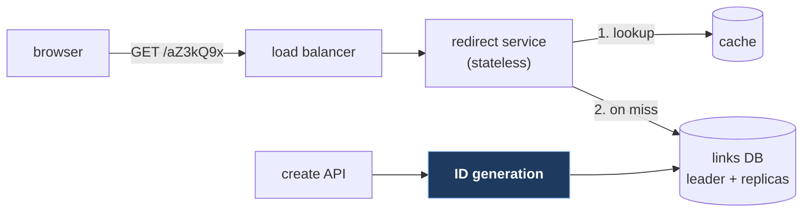
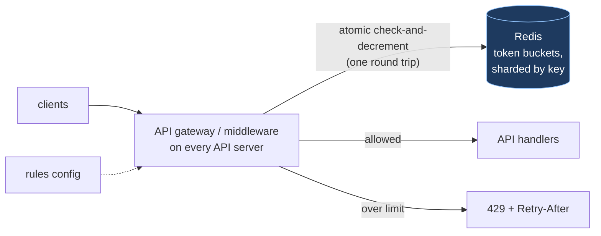
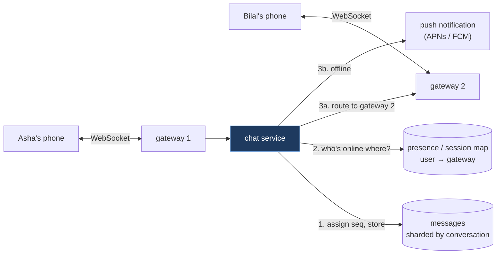
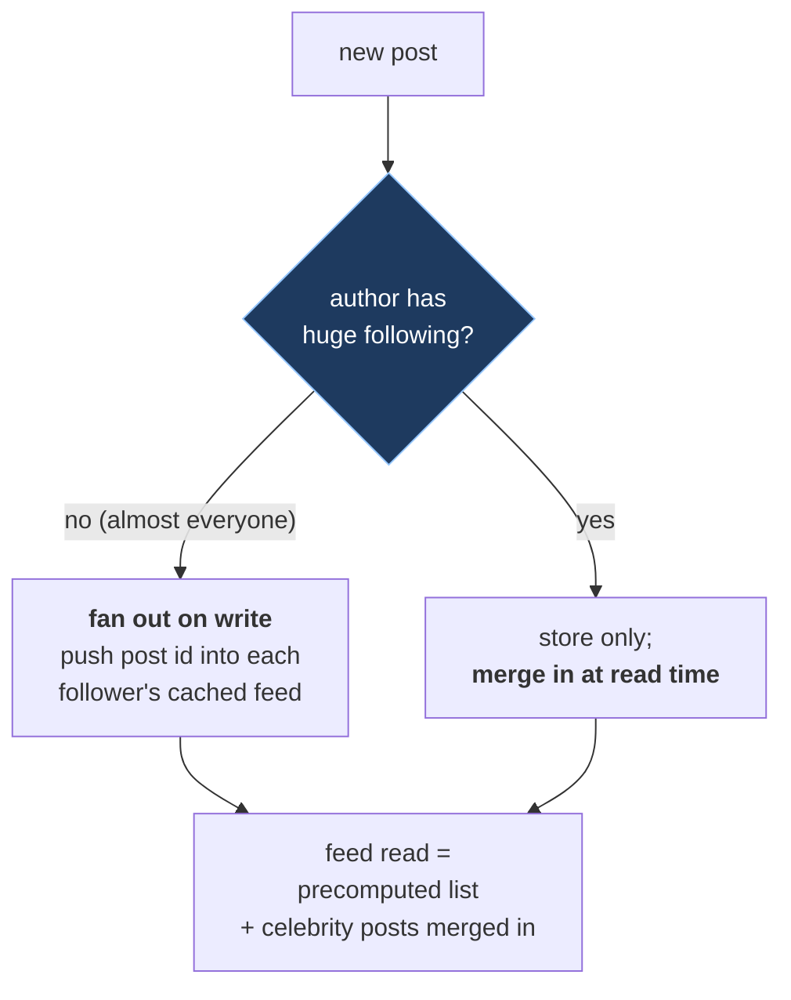

# 10. Worked designs

## The problem

Knowing what a cache, a queue and a shard are doesn't tell you how to put them together
under a clock. This chapter runs four of the most commonly reported prompts through the
method from [file 01 §1.4](01-foundations.md#14-a-working-method), at the depth a basic
round expects: complete enough to defend, short enough to say in 45 minutes.

Each design is *a* good answer, not *the* answer. Where a reasonable person would choose
differently, the trade-offs section says so, because that's what the interviewer is
probing for.

## 10.1 URL shortener

**Requirements.**

- Functional: create a short link for a long URL; visiting the short link redirects;
  optionally a custom alias and an expiry.
- Non-functional: redirects must be fast (they're on the user's path) and highly available;
  creation can be slower; a link, once created, must never point somewhere else.
- Out of scope: analytics dashboards, user accounts beyond an owner id.

**Estimates.** From [file 02 §2.4](02-estimation.md#24-worked-example-a-url-shortener):
~40 writes/s, ~4,000 reads/s average, ~12,000 at peak, 6 TB over ten years, 7-character
codes give ample keyspace. Conclusion: read-heavy, small, cache-friendly.

**API.**

```
POST /api/links   {long_url, custom_alias?, expires_at?}  → 201 {code, short_url}
GET  /{code}                                              → 302 Location: <long_url>   (or 404 / 410)
```

**Data model.** One table, one access pattern (lookup by code):

```
links(code PRIMARY KEY, long_url, owner_id, created_at, expires_at)
```

**High-level design.**



**Deep dive 1: generating codes.** The interesting part, highlighted above.

| Approach | How | Trade-off |
|---|---|---|
| Hash the URL, take 7 chars | `base62(md5(url))[:7]` | Same URL gives the same code (maybe wanted); collisions must be detected and resolved |
| Random 7 chars, check uniqueness | Generate; `INSERT`; retry on unique-key conflict | Simple; collisions rare while the keyspace is mostly empty |
| **Counter + base62** | A unique 64-bit id, encoded | No collisions; codes are guessable/sequential unless you shuffle the id |

For the counter, a single database sequence handles 40 writes a second easily. If you need
ids generated without coordination, Twitter's Snowflake layout is the standard reference.
Its [README](https://github.com/twitter-archive/snowflake/blob/snowflake-2010/README.mkd):
"time - 41 bits (millisecond precision w/ a custom epoch gives us 69 years)", "configured
machine id - 10 bits - gives us up to 1024 machines", "sequence number - 12 bits - rolls
over every 4096 per machine". That's 63 bits; the sign bit stays zero.

Base62 encoding in Go:

```go
package main

import "fmt"

const alphabet = "0123456789abcdefghijklmnopqrstuvwxyzABCDEFGHIJKLMNOPQRSTUVWXYZ"

// Base62 turns a numeric id into a short string: 62^7 ≈ 3.5 trillion codes in 7 characters.
func Base62(n uint64) string {
	if n == 0 {
		return "0"
	}
	var buf [11]byte // 62^11 > 2^64, so 11 characters always suffice
	i := len(buf)
	for n > 0 {
		i--
		buf[i] = alphabet[n%62]
		n /= 62
	}
	return string(buf[i:])
}

func main() {
	fmt.Println(Base62(125), Base62(3_521_614_606_207), Base62(1<<64-1))
}
```

(Prints `21 ZZZZZZZ lYGhA16ahyf`: 3,521,614,606,207 is 62⁷ − 1, the largest 7-character code.)

**Deep dive 2: 301 or 302?** RFC 9110 says a 301 "is heuristically cacheable"
([§15.4.2](https://www.rfc-editor.org/rfc/rfc9110#section-15.4.2)): browsers and proxies may
remember it and skip your server next time. A 302 means "the client ought to continue to use
the target URI for future requests" ([§15.4.3](https://www.rfc-editor.org/rfc/rfc9110#section-15.4.3)),
so every click reaches you. Choose 301 to save load; 302 if you need click counts, expiry,
or the ability to disable a malicious link. Most shorteners that sell analytics use 302.

**Trade-offs and failure.** The cache absorbs the read load; if it dies, the database sees
4,000+ reads/s, which a leader with two replicas can serve, so size for that
([file 04 §4.6](04-caching.md#46-thundering-herds-and-stampedes)). Redirects can be served
from replicas; a new link may be invisible on a lagging replica for a moment, so read your
own new links from the leader. Abuse (phishing links) needs a blocklist check on create and
the ability to disable a code, which is another argument for 302.

## 10.2 A distributed rate limiter

**Requirements.**

- Functional: limit each API key to N requests per window, configurable per endpoint;
  over-limit requests get `429` with `Retry-After`.
- Non-functional: adds at most a millisecond or two per request; correct across many API
  servers; if the limiter fails, the API keeps working (fail open).

**Estimates.** Say 50,000 requests/s across the fleet, 1 million active API keys. State per
key is two numbers, ~50 bytes with overhead: 50 MB. Fits in memory on one node; the question
is throughput and latency, not size.

**API.** Internal: `allow(key, rule) → (allowed, remaining, retry_after)`. External: the
`429` response ([file 08 §8.1](08-reliability-patterns.md#81-rate-limiting)).

**High-level design.**



**Deep dive: atomicity.** The per-process token bucket in file 08 is correct because one lock
guards it. Across servers, "read tokens, compute, write tokens" from two servers interleaves
and both allow the last token. Make the whole update one atomic operation in Redis: a Lua
script (Redis runs each script atomically) that refills, checks and decrements in one round
trip. A fixed-window counter is simpler still: `INCR key:window` and `EXPIRE`, both atomic.

**Trade-offs.** One Redis round trip per request is ~0.5 ms in-region (the napkin-math row in
[file 02 §2.2](02-estimation.md#22-latency-numbers-and-why-theyre-dated)). To cut it, keep a
small local allowance per server and sync periodically, accepting some overshoot. If Redis is
unreachable, allow the request (fail open) and alert; Stripe's limiters do the same. Shard
Redis by key, and watch for one huge customer as a hot key.

## 10.3 Chat and messaging

**Requirements.**

- Functional: one-to-one and small group chats; send and receive in real time; message
  history; delivered/read receipts; offline users get messages when they return.
- Non-functional: low delivery latency (well under a second); messages never lost once the
  sender sees "sent"; order preserved within a conversation.
- Out of scope: voice, media upload (would go to object storage), end-to-end encryption
  (mention it exists; it changes what the server can see).

**Estimates.** From [file 02 §2.5](02-estimation.md#25-worked-example-chat-message-storage):
~23,000 messages/s average, ~70,000 peak, ~146 TB a year before replication. Plus
connections: if 50 million users are online at peak (assumed), that's 50 million open
connections. At, say, 100,000 connections per server (an assumption that depends heavily
on the server and runtime), 500 connection servers.

**API.** Over a persistent connection:

```
client → server:  send {conversation_id, client_msg_id, body}
server → client:  ack  {client_msg_id, message_id, seq}
server → client:  message {conversation_id, message_id, seq, sender, body, sent_at}
client → server:  read_receipt {conversation_id, up_to_seq}
HTTP:  GET /conversations/{id}/messages?before_seq=…&limit=50     (history, cursor-paged)
```

`client_msg_id` makes sends idempotent across reconnects ([file 09 §9.4](09-api-design.md#94-idempotency-and-idempotency-keys)).

**Real-time transport.** The server must push. Options:

| | How | Notes |
|---|---|---|
| **WebSocket** | "an opening handshake followed by basic message framing, layered over TCP" ([RFC 6455](https://www.rfc-editor.org/rfc/rfc6455)) | Full duplex; the usual choice |
| Server-sent events | Server → client stream over HTTP ([WHATWG HTML §9.2](https://html.spec.whatwg.org/multipage/server-sent-events.html)) | One-way; sends go over normal HTTP |
| Long polling | Server holds each request until there's data, client re-requests ([RFC 6202](https://www.rfc-editor.org/rfc/rfc6202)) | Works everywhere; more overhead |

**Data model.** Messages keyed by `(conversation_id, seq)`. Shard by `conversation_id` so a
conversation's history is on one shard and reads in order; at this write volume, a
wide-column store (Cassandra, ScyllaDB) or a sharded relational store.

```
messages(conversation_id, seq, message_id, sender_id, body, sent_at)   PRIMARY KEY (conversation_id, seq)
memberships(user_id, conversation_id, last_read_seq)
```

**High-level design.**



**Deep dive 1: ordering.** Clocks on phones disagree, so `sent_at` can't order messages.
Give each message a per-conversation sequence number when the server stores it (one writer
per conversation at a time, or an atomic increment on the conversation row). Clients display
by `seq`, and notice a gap (got 41, then 43) as "fetch history".

**Deep dive 2: delivery guarantees.** "Sent" means stored durably, then acked to the sender.
Delivery to recipients is at-least-once: the client acks by `seq`, the server redelivers
anything unacknowledged after a reconnect, and the client deduplicates by `message_id`.
That's [file 07 §7.3](07-asynchronous-work.md#73-delivery-guarantees) applied to a socket.

**Trade-offs.** Gateways hold state (open connections), so they're the one stateful tier;
a gateway dying drops its users, who reconnect to another and resync from their last `seq`.
Big groups turn one send into thousands of deliveries: fan out through a queue rather than
inline. Presence ("online") is high-churn and can be eventually consistent; message storage
can't.

## 10.4 News feed

**Requirements.**

- Functional: users follow others; a home feed shows recent posts from people they follow,
  newest first; posting.
- Non-functional: the feed loads fast (it's the first screen); a new post appears in
  followers' feeds within seconds (eventual is fine); reads vastly outnumber writes.

**Estimates.** The one public reference point is Twitter around 2012, and it's second-hand:
High Scalability's [write-up](https://highscalability.com/the-architecture-twitter-uses-to-deal-with-150m-active-users/)
of Raffi Krikorian's QCon talk ([*Timelines at Scale*](https://www.infoq.com/presentations/Twitter-Timeline-Scalability/))
reports "300K QPS are spent reading timelines and only 6000 requests per second are spent on
writes". I couldn't check those numbers against the talk itself, and the same article gives
another write figure elsewhere, so treat them as illustrative of the *ratio*: reads
outnumbered writes by about fifty to one.

**API.**

```
POST /posts                         {body}            → 201
GET  /feed?cursor=…&limit=20                          → {posts[], next_cursor}
POST /users/{id}/follow
```

**The deep dive is the whole question: fan-out on write, or on read?**

| | Fan-out on write ("push") | Fan-out on read ("pull") |
|---|---|---|
| On post | Insert the post id into every follower's precomputed feed | Store the post once |
| On feed read | Read one precomputed list: fast | Fetch recent posts from everyone you follow, merge, sort: slow |
| Cost driver | Followers per post | Followings per reader |
| Breaks on | A celebrity with 50 million followers: one post, 50 million writes | Users following thousands of accounts |



The **hybrid** in the diagram is the standard answer: push for ordinary users, pull for the
few accounts with enormous followings, merged when the feed is read. In the High Scalability
write-up of Twitter's 2012 talk, the timeline is described as sitting "in a Redis cluster" with
"a maximum of 800 entries", and the celebrity merge appears under "The Future" ("For people
like Taylor Swift don't bother with fanout anymore, instead merge in her timeline at read
time"), i.e. a direction they described, not necessarily what shipped then.

**Data model.** `posts(post_id, author_id, body, created_at)` in a sharded store;
`follows(follower_id, followee_id)` with indexes both ways; `feed:{user_id}` as a capped list
of post ids in a cache, rebuilt from `follows` + `posts` if lost. Store ids in the feed and
hydrate post bodies from a post cache, so an edited or deleted post is fixed once, not in
millions of feeds.

**Trade-offs.** Fan-out runs asynchronously through a queue ([file 07](07-asynchronous-work.md)),
so a post reaches followers in seconds, not instantly, which the requirements allowed.
Inactive users' feeds needn't be precomputed: build them on their next visit. Ranking
("most relevant" rather than newest) is a separate system that reorders the candidates this
produces; say that it exists and is out of scope for a basic round.

> **Teacher's aside.** Notice that all four designs turned on one deep dive each: code
> generation, atomicity, ordering and delivery, fan-out. The boxes in the diagrams are nearly
> the same every time (balancer, stateless service, cache, database, queue). That's typical.
> Interviewers aren't impressed by the boxes; they're waiting to see whether you find the one
> part of *this* problem that's actually hard, and say so before they have to ask.

## Asked in interviews

| Prompt | Where |
|---|---|
| "Design a URL shortener / TinyURL / bit.ly" | §10.1 |
| "How do you generate unique short codes?" "301 or 302?" | §10.1 deep dives |
| "Design a rate limiter (for an API gateway)" | §10.2 |
| "Design WhatsApp / a chat app / Slack" | §10.3 |
| "How do you keep messages in order?" "What if the recipient is offline?" | §10.3 deep dives |
| "Design Twitter's / Instagram's home feed" | §10.4 |
| "What about celebrities?" | §10.4, the hybrid |

## Check yourself

1. In the shortener, a teammate proposes `base62(md5(long_url))[:7]` to avoid a counter.
   What happens when two different URLs collide, and how would your write path detect and
   handle it?
2. Your shortener uses 301 redirects. Marketing now wants click counts per link, and legal
   wants to disable a phishing link immediately. What breaks, and what do you change?
3. The rate limiter's Redis node fails for two minutes. Describe the behaviour of the API
   under fail-open and fail-closed, and who'd want each.
4. In the chat design, a phone loses signal for ten minutes and reconnects to a different
   gateway. Walk through how it gets the messages it missed, in order, without duplicates.
5. A user with 30 million followers posts. Under pure fan-out-on-write, estimate the work
   created, and say how long it delays other users' posts if fan-out workers manage 1
   million feed inserts a second.
6. Pick one of the four designs and name the single assumption in its requirements that,
   if reversed, would change the architecture most.
