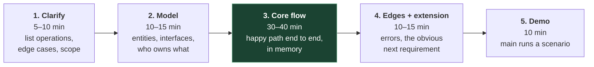
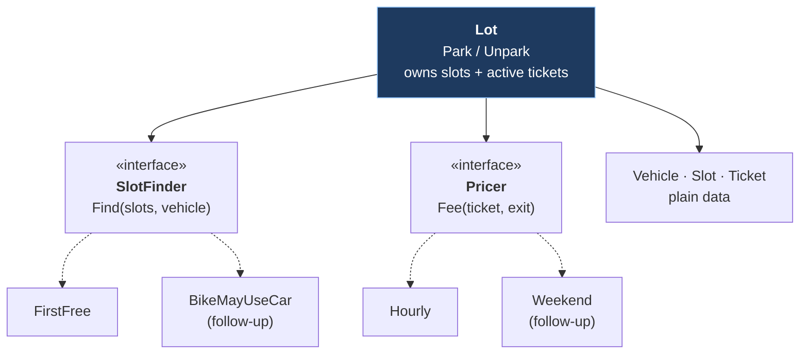

# 11. Low-level design and the machine coding round

## The problem

Here's how this round usually goes wrong. The candidate reads "design a parking lot",
writes a working `park()` in forty minutes, and feels fine. Then the interviewer says "now
bikes can use car slots when the bike slots are full", and the change touches six places,
breaks two of them, and the last twenty minutes go on debugging. The code worked. It just
couldn't absorb a second requirement, and absorbing the second requirement was the test.

High-level design (the rest of this course) is boxes and arrows. **Low-level design (LLD)**
is the inside of one box: the types, the interfaces between them, and where each rule
lives. The **machine coding round** asks you to prove it by building it, running, in a
fixed time.

## 11.1 Three rounds that get called "design"

| | HLD / system design | LLD (discussion) | Machine coding |
|---|---|---|---|
| You produce | Diagram, APIs, data model, trade-offs | Class/interface design, maybe signatures | A working program, usually in-memory |
| Time | 45–60 min | 45–60 min | Commonly reported as 90–120 min, including a demo |
| Judged on | Reasoning about scale and failure | Modelling and responsibilities | Code that runs, reads well, and extends |
| Typical prompt | Design a URL shortener | Design the classes for an elevator | Build Splitwise; it must run |

## 11.2 How common is it, really?

This needs saying carefully, because it's the kind of thing people repeat with confidence.

**What the evidence is.** I couldn't find a single Indian product company's own careers
page or engineering blog describing a machine coding round. The format is documented by
candidates and prep sites. The most cited description, on
[workat.tech](https://workat.tech/machine-coding/article/what-is-a-machine-coding-round-omfn1w54ojlg)
(undated, a prep site), says it "involves solving a design problem in a matter of a couple
of hours" and names "Flipkart, Uber, Swiggy, Ola, Cred, etc." as companies where "the
first onsite round is the machine coding round". Candidate reports on GeeksforGeeks match
that shape: a Flipkart SDE-1 report describes "Machine Coding - 90 mins" in "any
programming language", evaluated by two engineers running test cases
([GfG, Flipkart set 41](https://www.geeksforgeeks.org/interview-experiences/flipkart-interview-experience-set-41-for-sde-1/));
a Flipkart SDE-2 report (2021, two years' experience) describes "90 minutes for coding and
then 30 min to explain and demo", followed by a separate design round covering both LLD and
HLD. So: consistently reported, by many candidates, over years, at Indian product
companies. Anecdotal, and formats change.

**Big tech is different, and also mostly anecdotal.** Amazon's own
[SDE II prep page](https://www.amazon.jobs/content/en/how-we-hire/sde-ii-interview-prep)
says "Expect at least one question on software systems design" and "Expect to be asked to
write syntactically correct code—no pseudo code", and doesn't mention a separate
object-oriented design round, though candidate reports often do. Atlassian's
[engineering interview page](https://www.atlassian.com/company/careers/resources/interviewing/engineering)
splits its coding interview into "Data Structures" and "Code Design", the nearest official
analogue I found. I found nothing official saying Google runs machine coding; a prep firm's
article says Google doesn't run *system* design at L3–L4 at all
([Hello Interview](https://www.hellointerview.com/blog/google-interview-process),
commercial, not confirmed by Google).

The tendency in candidate reports, to hold loosely: SDE-1 loops at Indian product companies
lean on machine coding plus DSA; SDE-2 (roughly two to three years and up) adds an HLD
round.

## 11.3 What they're judging

The workat.tech list is the clearest statement of the bar, and it matches what candidates
report being told:

| Criterion (quoted) | What it means in practice |
|---|---|
| "Code should be working and demonstrable" | A `main` that runs a scenario. Half-finished elegant code loses to finished plain code |
| "Code should be functionally correct" | Edge cases: full lot, unknown ticket, paying twice |
| "Code should be modular and readable" | Names a stranger understands; small functions |
| "Separation of concerns should be addressed" | Entities, rules and storage in different places |
| "Code should easily accommodate new requirements with minimal changes" | The follow-up requirement lands in one new type, not six edits |
| "There should be a main method from where the code could be easily testable" | They'll run it. Make that easy |

## 11.4 A method for ninety minutes

Pick **one language you're fluent in** and use it. This round is a bad place to show
range: the interviewer is judging design under time pressure, and every minute spent
remembering a standard library is a minute not spent on it. (The other languages in this
chapter are here so you can compare how each expresses the same design, not so you switch
mid-round.)



The timings are mine, not a standard; adjust to the stated length. The green box is the
one people under-budget: get a thin version working end to end before polishing anything.

Habits that score:

- **Write the operations as method signatures first**, from the requirements. They're your
  contract and your demo script.
- **Store data in memory behind a small interface** (`TicketStore`), so "now persist it"
  is a new implementation rather than a rewrite. Don't bring a database unless asked.
- **Guess the next requirement** and make *that* the interface. Pricing and allocation
  rules change in a parking lot; vehicle plates don't.
- **Return errors for the expected failures** (lot full, unknown ticket) rather than
  crashing or printing.
- **Concurrency**: say where a lock goes even if the demo is single-threaded.

## 11.5 SOLID, applied rather than recited

Robert C. Martin collected these principles in his 2000 paper *Design Principles and Design
Patterns*; the SOLID acronym is usually credited to Michael Feathers, around 2004 (I've
only confirmed that attribution from secondary sources). Two of them are older: the
open/closed principle is Bertrand Meyer's (*Object-Oriented Software Construction*, 1988),
and substitution is Barbara Liskov's (keynote 1987; Liskov & Wing, *A Behavioral Notion of
Subtyping*, 1994).

Reciting definitions earns nothing. Showing where each one changed your code does:

| Principle | One-line meaning | In the parking lot below |
|---|---|---|
| **S**ingle responsibility | One reason to change per type | `Lot` manages occupancy; `Hourly` knows prices. A tariff change doesn't touch `Lot` |
| **O**pen/closed | Add behaviour by adding code, not editing it | Weekend pricing is a new `Pricer`, not an `if` inside `Fee` |
| **L**iskov substitution | Anything implementing an interface must honour its contract | A `SlotFinder` must never return an occupied slot, or `Lot` breaks |
| **I**nterface segregation | Small interfaces, shaped by the caller | `Pricer` has one method. `Lot` doesn't depend on a `ParkingManager` with twenty |
| **D**ependency inversion | Depend on interfaces; inject implementations | `NewLot` takes a `SlotFinder` and a `Pricer`; tests can pass fakes |

> ⚠️ **Pattern bingo.** A `VehicleFactory`, a `SlotFactory`, a singleton `ParkingLotManager`
> and an observer for a display board, in a 90-minute round, mostly produce code that
> isn't finished. Use a pattern when the requirement asks for its flexibility; strategy
> (an interface with swappable implementations) is the one that almost always earns its
> place. Name it when you use it.

## 11.6 The language changes the design

The classic LLD textbook answer is an inheritance tree: `Vehicle` → `Car`, `Bike`, `Truck`,
each overriding methods. Two of the four languages here don't have class inheritance at
all, and that's a good thing to understand rather than work around.

| | How you write an extension point | What that pushes you towards |
|---|---|---|
| **Go** | An interface, satisfied implicitly: any type with the methods qualifies | Small interfaces defined by the consumer; composition by embedding or by fields. The [Go FAQ](https://go.dev/doc/faq#inheritance): "Rather than requiring the programmer to declare ahead of time that two types are related, in Go a type automatically satisfies any interface that specifies a subset of its methods." |
| **Rust** | A trait, implemented explicitly; `Box<dyn Trait>` for runtime choice, generics for compile-time | Data in enums and structs, behaviour in traits. The [Rust book, ch. 18](https://doc.rust-lang.org/book/ch18-01-what-is-oo.html): "There is no way to define a struct that inherits the parent struct's fields and method implementations without using a macro." |
| **C++** | An abstract class with pure virtual functions and a virtual destructor | Inheritance is available. Inherit *interfaces*; avoid deep trees that inherit *implementation* |
| **JavaScript** | Any object with the right methods (duck typing); classes are optional | Nothing checks the shape until it's called. TypeScript's interfaces add the check at compile time |

The modelling consequence: a vehicle's type is **data** (an enum field), not a subclass,
unless types genuinely behave differently. In this problem they don't: a car and a bike
differ in which slot fits and what they pay, and both of those are rules owned elsewhere.
"Favour composition over inheritance" (from the Gang of Four's *Design Patterns*, 1994) is
what Go and Rust make you do anyway.

## 11.7 Worked example: a parking lot

**Requirements, as I'd clarify them:**

- A lot has slots across levels. Each slot fits one vehicle type: bike, car or truck.
- `Park(vehicle)` assigns a free slot and returns a ticket, or fails if none fits.
- `Unpark(ticket)` frees the slot and returns the fee. Unknown or used tickets fail.
- Fee: per started hour, one-hour minimum, rate by vehicle type. (The rupee rates in the
  demo are made up.)
- Out of scope unless asked: payments, persistence, multiple entry gates, a display board.

**The model.** Entities are plain data. Two interfaces carry the rules most likely to
change. The `Lot` service owns state and depends only on those interfaces.



The dashed boxes are where follow-up requirements land: as new types, with `Lot` untouched.

**Go**, the whole program:

```go
package main

import (
	"errors"
	"fmt"
	"sync"
	"time"
)

// ---- Entities: plain data, no behaviour worth hiding ----

type VehicleType int

const (
	Bike VehicleType = iota
	Car
	Truck
)

type Vehicle struct {
	Plate string
	Type  VehicleType
}

type Slot struct {
	ID       string
	Level    int
	Fits     VehicleType
	Occupied bool
}

type Ticket struct {
	ID      string
	Vehicle Vehicle
	SlotID  string
	Entry   time.Time
}

// ---- Extension points: the parts an interviewer will ask you to change ----

// SlotFinder decides which free slot a vehicle gets.
type SlotFinder interface {
	Find(slots []*Slot, v Vehicle) (*Slot, bool)
}

// Pricer decides what a stay costs, in whole rupees.
type Pricer interface {
	Fee(t Ticket, exit time.Time) int
}

// FirstFree returns the first free slot of the right type, lowest level first
// (slots are stored in level order).
type FirstFree struct{}

func (FirstFree) Find(slots []*Slot, v Vehicle) (*Slot, bool) {
	for _, s := range slots {
		if !s.Occupied && s.Fits == v.Type {
			return s, true
		}
	}
	return nil, false
}

// Hourly charges per started hour, with a one-hour minimum.
type Hourly struct {
	PerHour map[VehicleType]int
}

func (h Hourly) Fee(t Ticket, exit time.Time) int {
	d := exit.Sub(t.Entry)
	hours := int((d + time.Hour - 1) / time.Hour) // round up
	return max(1, hours) * h.PerHour[t.Vehicle.Type]
}

// ---- The service: owns state, enforces the rules, depends only on interfaces ----

var (
	ErrFull          = errors.New("no free slot for this vehicle type")
	ErrUnknownTicket = errors.New("unknown or already used ticket")
)

type Lot struct {
	mu      sync.Mutex
	slots   []*Slot
	byID    map[string]*Slot
	active  map[string]Ticket
	finder  SlotFinder
	pricer  Pricer
	counter int
}

func NewLot(slots []*Slot, f SlotFinder, p Pricer) *Lot {
	byID := map[string]*Slot{}
	for _, s := range slots {
		byID[s.ID] = s
	}
	return &Lot{slots: slots, byID: byID, active: map[string]Ticket{}, finder: f, pricer: p}
}

func (l *Lot) Park(v Vehicle, now time.Time) (Ticket, error) {
	l.mu.Lock()
	defer l.mu.Unlock()
	s, ok := l.finder.Find(l.slots, v)
	if !ok {
		return Ticket{}, ErrFull
	}
	s.Occupied = true
	l.counter++
	t := Ticket{ID: fmt.Sprintf("T%d", l.counter), Vehicle: v, SlotID: s.ID, Entry: now}
	l.active[t.ID] = t
	return t, nil
}

func (l *Lot) Unpark(ticketID string, now time.Time) (int, error) {
	l.mu.Lock()
	defer l.mu.Unlock()
	t, ok := l.active[ticketID]
	if !ok {
		return 0, ErrUnknownTicket
	}
	delete(l.active, ticketID)
	l.byID[t.SlotID].Occupied = false
	return l.pricer.Fee(t, now), nil
}

func main() {
	slots := []*Slot{
		{ID: "L1-B1", Level: 1, Fits: Bike},
		{ID: "L1-C1", Level: 1, Fits: Car},
		{ID: "L2-C1", Level: 2, Fits: Car},
		{ID: "L2-T1", Level: 2, Fits: Truck},
	}
	lot := NewLot(slots, FirstFree{}, Hourly{PerHour: map[VehicleType]int{Bike: 20, Car: 40, Truck: 100}})

	t0 := time.Date(2026, 10, 8, 9, 0, 0, 0, time.UTC)
	a, _ := lot.Park(Vehicle{"KA01AB1234", Car}, t0)
	b, _ := lot.Park(Vehicle{"KA05XY9876", Car}, t0)
	_, err := lot.Park(Vehicle{"MH12CD0001", Car}, t0)
	fmt.Println(a.SlotID, b.SlotID, err) // L1-C1 L2-C1 no free slot for this vehicle type

	fee, _ := lot.Unpark(a.ID, t0.Add(2*time.Hour+30*time.Minute))
	fmt.Println("fee:", fee) // fee: 120  (3 started hours x 40)
	_, err = lot.Unpark(a.ID, t0.Add(3*time.Hour))
	fmt.Println(err) // unknown or already used ticket
}
```

Running it prints:

```
L1-C1 L2-C1 no free slot for this vehicle type
fee: 120
unknown or already used ticket
```

<details><summary>Rust</summary>

```rust
use std::collections::HashMap;
use std::time::Duration;

#[derive(Clone, Copy, PartialEq, Eq, Hash, Debug)]
enum VehicleType { Bike, Car, Truck }

#[derive(Clone, Debug)]
struct Vehicle { plate: String, kind: VehicleType }

struct Slot { id: String, fits: VehicleType, occupied: bool }

#[derive(Clone)]
struct Ticket { id: String, vehicle: Vehicle, slot: usize, entry: Duration }

// Extension points are traits. No base class, no inheritance:
// a Lot is *composed* of whichever finder and pricer it is given.
trait SlotFinder {
    fn find(&self, slots: &[Slot], v: &Vehicle) -> Option<usize>;
}
trait Pricer {
    fn fee(&self, t: &Ticket, exit: Duration) -> u32;
}

struct FirstFree;
impl SlotFinder for FirstFree {
    fn find(&self, slots: &[Slot], v: &Vehicle) -> Option<usize> {
        slots.iter().position(|s| !s.occupied && s.fits == v.kind)
    }
}

struct Hourly { per_hour: HashMap<VehicleType, u32> }
impl Pricer for Hourly {
    fn fee(&self, t: &Ticket, exit: Duration) -> u32 {
        let secs = exit.saturating_sub(t.entry).as_secs();
        let hours = secs.div_ceil(3600).max(1) as u32;
        hours * self.per_hour[&t.vehicle.kind]
    }
}

#[derive(Debug)]
enum LotError { Full, UnknownTicket }

struct Lot {
    slots: Vec<Slot>,
    active: HashMap<String, Ticket>,
    finder: Box<dyn SlotFinder>,
    pricer: Box<dyn Pricer>,
    counter: u32,
}

impl Lot {
    fn park(&mut self, v: Vehicle, now: Duration) -> Result<Ticket, LotError> {
        let i = self.finder.find(&self.slots, &v).ok_or(LotError::Full)?;
        self.slots[i].occupied = true;
        self.counter += 1;
        let t = Ticket { id: format!("T{}", self.counter), vehicle: v, slot: i, entry: now };
        self.active.insert(t.id.clone(), t.clone());
        Ok(t)
    }

    fn unpark(&mut self, ticket_id: &str, now: Duration) -> Result<u32, LotError> {
        let t = self.active.remove(ticket_id).ok_or(LotError::UnknownTicket)?;
        self.slots[t.slot].occupied = false;
        Ok(self.pricer.fee(&t, now))
    }
}

fn main() {
    let slot = |id: &str, fits| Slot { id: id.into(), fits, occupied: false };
    let mut lot = Lot {
        slots: vec![slot("L1-B1", VehicleType::Bike), slot("L1-C1", VehicleType::Car),
                    slot("L2-C1", VehicleType::Car), slot("L2-T1", VehicleType::Truck)],
        active: HashMap::new(),
        finder: Box::new(FirstFree),
        pricer: Box::new(Hourly { per_hour: HashMap::from([
            (VehicleType::Bike, 20), (VehicleType::Car, 40), (VehicleType::Truck, 100)]) }),
        counter: 0,
    };
    let car = |p: &str| Vehicle { plate: p.into(), kind: VehicleType::Car };
    let t0 = Duration::ZERO;
    let a = lot.park(car("KA01AB1234"), t0).unwrap();
    let b = lot.park(car("KA05XY9876"), t0).unwrap();
    let c = lot.park(car("MH12CD0001"), t0);
    println!("{} {} {:?}", lot.slots[a.slot].id, lot.slots[b.slot].id, c.err()); // L1-C1 L2-C1 Some(Full)
    println!("plate {} fee: {:?}", a.vehicle.plate,
             lot.unpark(&a.id, Duration::from_secs(2 * 3600 + 30 * 60))); // Ok(120)
    println!("{:?}", lot.unpark(&a.id, Duration::from_secs(3 * 3600)).err()); // Some(UnknownTicket)
}
```

Differences worth noticing: errors are an `enum` in a `Result`, so a caller can't forget the
full-lot case; `&mut self` on `park` means the compiler forbids two simultaneous parks on
the same `Lot` (share it across threads with `Arc<Mutex<Lot>>`, and the lock becomes
visible in the type); and the extension points are `Box<dyn Trait>`, chosen at run time.

</details>

<details><summary>C++</summary>

```cpp
#include <algorithm>
#include <chrono>
#include <iostream>
#include <map>
#include <memory>
#include <mutex>
#include <optional>
#include <stdexcept>
#include <string>
#include <unordered_map>
#include <vector>

using std::chrono::minutes;

enum class VehicleType { Bike, Car, Truck };
struct Vehicle { std::string plate; VehicleType type; };
struct Slot { std::string id; VehicleType fits; bool occupied = false; };
struct Ticket { std::string id; Vehicle vehicle; size_t slot; minutes entry; };

// C++ spells an interface as an abstract class: pure virtual functions,
// a virtual destructor, no data. Inheriting from it is fine; inheriting
// *implementation* (a deep Vehicle -> Car -> SUV tree) is what to avoid.
struct SlotFinder {
    virtual ~SlotFinder() = default;
    virtual std::optional<size_t> find(const std::vector<Slot>&, const Vehicle&) const = 0;
};
struct Pricer {
    virtual ~Pricer() = default;
    virtual int fee(const Ticket&, minutes exit) const = 0;
};

struct FirstFree : SlotFinder {
    std::optional<size_t> find(const std::vector<Slot>& slots, const Vehicle& v) const override {
        for (size_t i = 0; i < slots.size(); i++)
            if (!slots[i].occupied && slots[i].fits == v.type) return i;
        return std::nullopt;
    }
};

struct Hourly : Pricer {
    std::map<VehicleType, int> perHour;
    explicit Hourly(std::map<VehicleType, int> p) : perHour(std::move(p)) {}
    int fee(const Ticket& t, minutes exit) const override {
        long long mins = (exit - t.entry).count();
        long long hours = std::max(1LL, (mins + 59) / 60);
        return static_cast<int>(hours) * perHour.at(t.vehicle.type);
    }
};

class Lot {
public:
    Lot(std::vector<Slot> slots, std::unique_ptr<SlotFinder> f, std::unique_ptr<Pricer> p)
        : slots_(std::move(slots)), finder_(std::move(f)), pricer_(std::move(p)) {}

    Ticket park(const Vehicle& v, minutes now) {
        std::lock_guard<std::mutex> lock(mu_);
        auto i = finder_->find(slots_, v);
        if (!i) throw std::runtime_error("no free slot for this vehicle type");
        slots_[*i].occupied = true;
        Ticket t{"T" + std::to_string(++counter_), v, *i, now};
        active_[t.id] = t;
        return t;
    }

    int unpark(const std::string& ticketId, minutes now) {
        std::lock_guard<std::mutex> lock(mu_);
        auto it = active_.find(ticketId);
        if (it == active_.end()) throw std::runtime_error("unknown or already used ticket");
        Ticket t = it->second;
        active_.erase(it);
        slots_[t.slot].occupied = false;
        return pricer_->fee(t, now);
    }

    const Slot& slot(size_t i) const { return slots_[i]; }

private:
    std::mutex mu_;
    std::vector<Slot> slots_;
    std::unordered_map<std::string, Ticket> active_;
    std::unique_ptr<SlotFinder> finder_;
    std::unique_ptr<Pricer> pricer_;
    int counter_ = 0;
};

int main() {
    using VT = VehicleType;
    Lot lot({{"L1-B1", VT::Bike}, {"L1-C1", VT::Car}, {"L2-C1", VT::Car}, {"L2-T1", VT::Truck}},
            std::make_unique<FirstFree>(),
            std::make_unique<Hourly>(std::map<VT, int>{{VT::Bike, 20}, {VT::Car, 40}, {VT::Truck, 100}}));
    auto a = lot.park({"KA01AB1234", VT::Car}, minutes(0));
    auto b = lot.park({"KA05XY9876", VT::Car}, minutes(0));
    std::cout << lot.slot(a.slot).id << " " << lot.slot(b.slot).id << "\n";  // L1-C1 L2-C1
    try { lot.park({"MH12CD0001", VT::Car}, minutes(0)); }
    catch (const std::exception& e) { std::cout << e.what() << "\n"; }
    std::cout << "fee: " << lot.unpark(a.id, minutes(150)) << "\n";  // fee: 120
    try { lot.unpark(a.id, minutes(180)); }
    catch (const std::exception& e) { std::cout << e.what() << "\n"; }
}
```

C++ has inheritance, and the interfaces here use it, but only for interfaces: no data and no
behaviour lives in `SlotFinder` or `Pricer`. `std::unique_ptr` makes the `Lot` the sole
owner of its strategies. Expected failures are exceptions here; returning
`std::expected` (C++23) is the alternative if your interviewer prefers errors as values.

</details>

<details><summary>JavaScript</summary>

```js
// JavaScript has classes, but an "interface" is just a shape: any object
// with a find() method is a slot finder. Nothing checks it until it's called
// (TypeScript would check it at compile time).
const VehicleType = Object.freeze({ BIKE: "bike", CAR: "car", TRUCK: "truck" });

const firstFree = {
  find(slots, vehicle) {
    return slots.findIndex((s) => !s.occupied && s.fits === vehicle.type); // -1 if none
  },
};

const hourly = (perHour) => ({
  fee(ticket, exitMs) {
    const hours = Math.max(1, Math.ceil((exitMs - ticket.entryMs) / 3_600_000));
    return hours * perHour[ticket.vehicle.type];
  },
});

class Lot {
  #slots; #active = new Map(); #finder; #pricer; #counter = 0;

  constructor(slots, finder, pricer) {
    this.#slots = slots.map((s) => ({ ...s, occupied: false }));
    this.#finder = finder;
    this.#pricer = pricer;
  }

  park(vehicle, nowMs) {
    const i = this.#finder.find(this.#slots, vehicle);
    if (i < 0) throw new Error("no free slot for this vehicle type");
    this.#slots[i].occupied = true;
    const ticket = { id: `T${++this.#counter}`, vehicle, slot: this.#slots[i].id, slotIndex: i, entryMs: nowMs };
    this.#active.set(ticket.id, ticket);
    return ticket;
  }

  unpark(ticketId, nowMs) {
    const t = this.#active.get(ticketId);
    if (!t) throw new Error("unknown or already used ticket");
    this.#active.delete(ticketId);
    this.#slots[t.slotIndex].occupied = false;
    return this.#pricer.fee(t, nowMs);
  }
}

const { BIKE, CAR, TRUCK } = VehicleType;
const lot = new Lot(
  [{ id: "L1-B1", fits: BIKE }, { id: "L1-C1", fits: CAR }, { id: "L2-C1", fits: CAR }, { id: "L2-T1", fits: TRUCK }],
  firstFree,
  hourly({ [BIKE]: 20, [CAR]: 40, [TRUCK]: 100 }),
);
const a = lot.park({ plate: "KA01AB1234", type: CAR }, 0);
const b = lot.park({ plate: "KA05XY9876", type: CAR }, 0);
console.log(a.slot, b.slot); // L1-C1 L2-C1
try { lot.park({ plate: "MH12CD0001", type: CAR }, 0); } catch (e) { console.log(e.message); }
console.log("fee:", lot.unpark(a.id, 150 * 60_000)); // fee: 120
try { lot.unpark(a.id, 180 * 60_000); } catch (e) { console.log(e.message); }
```

The "interfaces" are just objects with the right method, and the pricer is a closure
rather than a class: idiomatic JavaScript, and the same strategy pattern. `#private` fields
keep callers from editing slots directly. No lock: Node runs one callback at a time, so two
`park` calls can't interleave (they could if `park` ever `await`ed between finding and
claiming a slot).

</details>

**The follow-ups, and where each lands:**

| Interviewer says | Change | Touches `Lot`? |
|---|---|---|
| "Bikes may use a car slot when bike slots are full" | New `SlotFinder` that tries the exact type, then the next size up | No |
| "Weekend rates are 1.5×" | New `Pricer` that wraps `Hourly` and scales by the entry day | No |
| "Two entry gates, concurrently" | Already locked; say so. In a real system the lock becomes a database transaction or a conditional update on the slot row | No |
| "Persist tickets" | Move `active` behind a `TicketStore` interface with an in-memory and a database implementation | Yes, once, then no |
| "Show free slots per level on a display" | A query method on `Lot`, or publish an event on each park/unpark | Small addition |

> **Teacher's aside.** The thing that makes a design "extensible" isn't the number of
> interfaces. It's that you guessed *which* things would change, and put a seam exactly
> there. Too few seams and the follow-up becomes surgery; too many and nothing's finished at
> minute 90. So the skill being tested is really product judgement: in a parking lot,
> prices and allocation rules change all the time and plates never do. Say that reasoning
> out loud while you model, and the interviewer hears design rather than typing.

## 11.8 Other problems you'll see

Candidate reports mention these repeatedly. Each one has a natural seam:

| Problem | Where the seam goes |
|---|---|
| **LRU cache** | Eviction policy behind an interface (LRU now, LFU later). Implemented in four languages in [file 04 §4.4](04-caching.md#44-eviction-and-an-lru-cache-in-code) |
| **Rate limiter** | Algorithm behind an interface (token bucket, sliding window). [File 08 §8.1](08-reliability-patterns.md#81-rate-limiting) |
| **Splitwise** | Split strategy (equal, exact amounts, percentages); balance simplification as a separate step |
| **Snake and ladder** | Board configuration as data; dice as an interface so tests can roll fixed numbers |
| **Elevator** | Scheduling strategy (nearest car, direction-aware) separate from the car state machine |
| **Cab booking** | Matching strategy; pricing (surge) strategy |
| **BookMyShow** | Seat locking with expiry: the one place where concurrency is the actual question |

## Asked in interviews

| Prompt | Where |
|---|---|
| "Build a parking lot / Splitwise / snake and ladder in 90 minutes; it must run" | §11.4 method, §11.7 |
| "Now add <second requirement>" | §11.7 follow-ups table |
| "Explain SOLID with an example from your code" | §11.5 table |
| "Why didn't you use inheritance for vehicle types?" | §11.6 |
| "Is this thread-safe?" | §11.4 habits, §11.7 follow-ups |
| "Implement an LRU cache" | [File 04 §4.4](04-caching.md#44-eviction-and-an-lru-cache-in-code) |

## Check yourself

1. In the Go version, `Lot` takes a `SlotFinder` instead of calling `FirstFree` directly.
   Name one requirement change and one testing need that this choice makes cheap.
2. Write (in words or code) the `SlotFinder` for "bikes may use a car slot if bike slots
   are full". Which SOLID principle does it rely on, and what invariant must it keep so
   that `Lot` doesn't break?
3. A candidate models `Car`, `Bike` and `Truck` as three structs each with its own `Park`
   method. What goes wrong when the pricing rule changes, and when a new vehicle type
   (electric car, needs a charging slot) is added?
4. The JavaScript version has no lock. Describe the exact code change that would introduce
   a double-booking bug in it, and why the same bug in Go needs no such change.
5. Your interviewer says "now persist this in a database, and run three instances of the
   service behind a load balancer". Why does the `sync.Mutex` stop protecting you, and
   what replaces it?
6. You have 90 minutes and the problem is Splitwise. Lay out your first 15 minutes: the
   operations, the entities, and the one interface you'd introduce first, with reasons.
