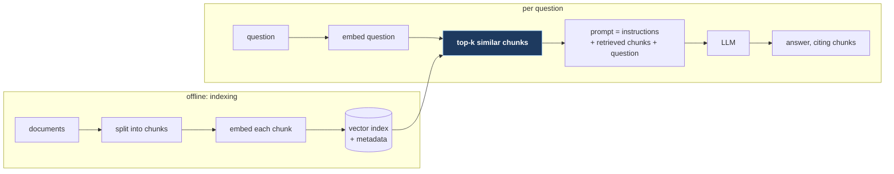

# 12. System design in the AI era

## The problem

Two questions get mixed together under this heading, and they deserve separate answers.
First: has the system design *interview* changed now that candidates and engineers use AI
assistants? Second: when you're asked to design a system that *calls* a large language
model (LLM), what's different about that dependency? The first has a short, honest answer
with thin evidence. The second is ordinary system design with one unusual component, and
most of this course applies to it directly.

This chapter earns its place mainly through the second half. I considered folding the first
half into file 01; it's here because the two belong together when someone asks "what about
AI?", and because the honest answer to the first is part of the material.

## 12.1 Has the interview changed?

Here's what I could verify, labelled by kind of source, as of October 2026:

| What | Source | Kind | What it says about *system design* |
|---|---|---|---|
| Canva added an "AI-Assisted Coding" round, replacing its CS-fundamentals round for backend, ML and frontend roles; it judges whether candidates "understand when and how to leverage AI effectively" and can "identify and fix issues in AI-generated code" | [Canva engineering blog](https://canva.dev/blog/engineering/yes-you-can-use-ai-in-our-interviews), June 2025 | Company | Nothing; coding only |
| Meta began letting candidates use AI in a coding interview; an internal message called it "more representative of the developer environment that our future employees will work in" | [404 Media](https://www.404media.co/meta-is-going-to-let-job-candidates-use-ai-during-coding-tests/), July 2025 | Press | Nothing reported |
| Sundar Pichai, at a Google town hall: "I think it's worth thinking about some fraction of the interviews being in person", in a discussion of AI-assisted cheating | [CNBC](https://www.cnbc.com/2025/03/09/google-ai-interview-coder-cheat.html), March 2025 | Press, quoting audio | Nothing specific. Later reports that Google "confirmed" in-person rounds are second-hand |
| Anthropic's candidate guidance: in live interviews, "This is all you–no AI assistance unless we indicate otherwise" | [Anthropic](https://www.anthropic.com/candidate-ai-guidance), updated July 2025 | Company | Covers all live rounds |
| Prep firms now sell "GenAI system design" material (for example a ByteByteGo book with "A 7-step framework" for such questions) | [ByteByteGo](https://blog.bytebytego.com/p/our-new-book-generative-ai-system), Nov 2024 | Commercial | Mostly ML-modelling questions, for ML roles |

What that adds up to:

- **The verified changes are to coding rounds**, in two directions at once: some companies
  allowing AI (Canva, Meta), others pushing for in-person rounds to stop it being used
  covertly (Google's discussion; tools sold explicitly for interview cheating made the news
  in 2025).
- **I found no official source saying system design rounds have changed.** That may be
  because a whiteboard conversation about trade-offs is already hard to outsource to a tool
  in real time.
- **"Design ChatGPT" or "design a RAG system" as interview prompts** are documented by prep
  firms and candidate posts, mostly for AI/ML engineering roles. For a backend role it's
  reasonable to expect an LLM to appear *as a component* in an otherwise ordinary design,
  which is what §12.2 prepares you for. That's my inference, not a finding.
- **India specifically:** I found no Indian product company officially allowing AI in
  interviews, and reports about AI-assisted interview fraud came from low-quality outlets.
  Evidence is thin; don't build preparation around rumours.

If the format matters to you, ask the recruiter directly whether AI tools are allowed in
each round. Companies that allow them say so; using one where it isn't allowed is treated as
cheating everywhere I looked.

## 12.2 An LLM as a dependency

Treat an LLM API the way [file 08](08-reliability-patterns.md) treats any remote dependency,
then adjust for five properties that make it unusual:

| Property | Typical database call | LLM API call |
|---|---|---|
| **Latency** | Milliseconds | Seconds, growing with output length |
| **Cost** | Fractions of a paisa, mostly fixed infrastructure | Charged per token, in and out; can dominate the bill |
| **Rate limits** | Your own capacity | The provider's, per minute, in requests *and* tokens |
| **Determinism** | Same query, same answer | Same prompt can give different answers |
| **Correctness** | Right or an error | Fluent and sometimes wrong, with no error code |

Each one changes a design decision.

### Latency: stream, and measure the first token

An answer that takes ten seconds to finish feels much faster if words start appearing after
half a second. Both major providers stream responses as server-sent events: Anthropic's API
lets you "set `"stream": true` to incrementally stream the response using server-sent events
(SSE)" ([docs](https://platform.claude.com/docs/en/build-with-claude/streaming)), and OpenAI
documents the same pattern. Relay that stream to the browser (SSE or WebSocket,
[file 10 §10.3](10-worked-designs.md#103-chat-and-messaging)), and keep your gateway's idle
timeouts above the longest gap between chunks.

The metric that tracks perceived speed is **time to first token** (TTFT). NVIDIA's
benchmarking docs define it as "Time from query submission to the first received token",
which "generally includes request queuing time, prefill time, and network latency"
([NVIDIA NIM](https://docs.nvidia.com/nim/benchmarking/llm/latest/metrics.html)). Track it
separately from total latency; they degrade for different reasons.

For work that takes longer than a user will watch (summarising a thousand documents), don't
hold a request open: put a job on a queue and notify on completion ([file 07](07-asynchronous-work.md)).

### Rate limits and cost: budget in tokens

Provider limits are measured in more than requests. OpenAI's docs list "RPM: requests per
minute" and "TPM: tokens per minute" among others, and exceeding them returns `429` with
`Retry-After` ([docs](https://developers.openai.com/api/docs/guides/rate-limits)). So your own
limiter ([file 08 §8.1](08-reliability-patterns.md#81-rate-limiting)) should count
estimated tokens, not just calls; per-user quotas protect both the provider limit and your
bill; and retries must honour `Retry-After` with jittered backoff, since a 429 storm is the
textbook case for it ([file 08 §8.3](08-reliability-patterns.md#83-retries-backoff-and-jitter)).

### Caching: three different things share the name

| Kind | What's reused | When it's correct | Caveat |
|---|---|---|---|
| **Exact response cache** | The whole answer, keyed by a hash of the full prompt and parameters | Same input, and a stored answer is acceptable | Hit rate is low for free-text user input |
| **Provider prompt caching** | The provider's processing of a repeated prompt *prefix* (a long system prompt, a shared document) | Always: the answer is still generated fresh | Only the prefix; details vary by provider and model |
| **Semantic cache** | A stored answer to a *similar* earlier question, found by embedding similarity | When similar questions really have the same answer | Can return the wrong answer to a look-alike question |

Provider prompt caching is the one most people haven't met. As of October 2026: Anthropic
caches prompt prefixes in the order "`tools` → `system` → `messages`", with a default lifetime
of five minutes and an optional one-hour setting
([docs](https://platform.claude.com/docs/en/build-with-claude/prompt-caching)); OpenAI says
"Prompt caching is enabled by default for supported OpenAI models", with minimum lengths and
retention that vary by model ([docs](https://developers.openai.com/api/docs/guides/prompt-caching)).
These details change; check the pages rather than memorising numbers. The design lesson is
stable: **put the unchanging part of the prompt first** so it can be reused, and the
per-request part last.

Semantic caching deserves its warning in the main text. GPTCache, a library for it, says in
its own README that "you may encounter false positives during cache hits and false negatives
during cache misses" ([repo](https://github.com/zilliztech/GPTCache)); a 2025 paper on the
problem argues that "static thresholds do not give formal correctness guarantees, result in
unexpected error rates" ([vCache, arXiv:2502.03771](https://arxiv.org/abs/2502.03771)). "What's
my refund status?" and "What's my order status?" can be close in embedding space and need
different answers. It's [file 04](04-caching.md)'s consistency problem in a new form, and the
same threshold problem as [vector-search/02](../../vector-search/02-parameters-that-change-the-answer.md).

## 12.3 Retrieval-augmented generation, at a glance

An LLM only knows its training data. To answer questions about *your* documents (a help
centre, internal policies), you retrieve relevant passages and put them in the prompt. That's
**retrieval-augmented generation** (RAG), named in Lewis et al.,
[*Retrieval-Augmented Generation for Knowledge-Intensive NLP Tasks*](https://arxiv.org/abs/2005.11401)
(NeurIPS 2020). The paper's version trains the retriever and generator together; in
application design, "RAG" now usually means the simpler pipeline below.

The highlighted step is where most quality problems live: if the right passage isn't
retrieved, the model can't use it, and it'll often answer fluently anyway. The vector-search
course covers what happens inside that step (embeddings, approximate search and its silent
misses): [vector-search/01](../../vector-search/01-what-vector-search-is.md), especially
["Approximate nearest neighbours: HNSW"](../../vector-search/01-what-vector-search-is.md#approximate-nearest-neighbours-hnsw).
Keeping the index in step with the documents is the dual-write problem again:
[vector-search/03, "The dual write"](../../vector-search/03-keeping-an-index-in-step.md#the-dual-write).

System-design questions a RAG prompt leads to: how documents get re-indexed when they
change; filtering by permissions *before* retrieval, so one tenant never sees another's
chunks; and how you'd know the answers are any good.

## 12.4 What isn't solved

Say this plainly if asked. **Evaluating answer quality** is the weak point. You can measure
latency, cost and error rates exactly; whether answers are correct needs labelled test
questions, human review or another model acting as judge, and each of those has known
weaknesses. Teams build regression sets of real questions with known good answers, and
re-run them on every prompt or model change. That's the honest state of practice, not a
solved problem.

> **Teacher's aside.** The pull is to treat "add AI" as a new kind of architecture. It
> mostly isn't. An LLM is a slow, expensive, rate-limited, sometimes-wrong remote
> dependency, and this course already has a chapter for each of those adjectives: async
> work for slow, caching and quotas for expensive, rate limiting and backoff for
> rate-limited, idempotency and review for wrong. Candidates who answer the AI question with
> those fundamentals sound more senior than ones who answer with model names.

> ⚠️ **Prompt injection.** Text retrieved from documents or supplied by users ends up inside
> the prompt, where the model may treat it as instructions. Never give the model's output
> authority you wouldn't give the least trusted input that reached it: validate any action it
> requests, and enforce permissions in your code, not in the prompt.

## Asked in interviews

| Prompt | Where |
|---|---|
| "Can I use AI tools in this interview?" (a question *you* should ask) | §12.1 |
| "Add an AI summary / chatbot / smart reply to this design" | §12.2 |
| "The LLM call takes 8 seconds. What do you do?" | §12.2, latency |
| "How do you control cost?" "How would you cache LLM responses?" | §12.2, rate limits and caching |
| "Design a Q&A bot over our documentation" | §12.3 |
| "How do you know it's giving good answers?" | §12.4 |

## Check yourself

1. Summarise the verified evidence on whether system design rounds have changed because of
   AI. Which claims in §12.1 come from the company itself, and which second-hand?
2. Your product summarises support tickets with an LLM. Median latency is 6 s and users
   complain. Without changing the model, name three design changes and what each one
   improves (perceived latency, real latency, or neither).
3. Your provider allows 100,000 tokens per minute. Requests average 2,000 tokens in and 500
   out. What's the maximum sustained request rate? What does your own limiter count, and
   what should happen to the request that would exceed the budget?
4. A teammate proposes a semantic cache with a 0.9 similarity threshold for a banking
   assistant. Give a concrete pair of questions that could produce a harmful false hit, and
   say where you'd allow semantic caching and where you wouldn't.
5. You put the user's question at the start of the prompt and a 20-page policy document
   after it. Why does that waste the provider's prompt cache, and what's the fix?
6. In a RAG system over a company wiki, an employee gets an answer quoting a page they don't
   have access to. Where in the pipeline diagram did the design go wrong, and where should
   the permission check sit?
