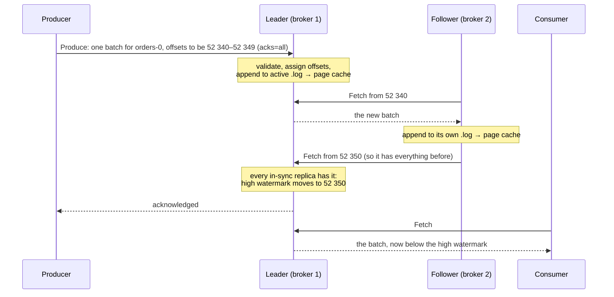

# 7. Inside the broker: how a partition lives on disk

## The problem

The other chapters treat the broker as a box that stores records and hands them back in
order. That's enough to write a correct client. It isn't enough to answer the questions that
come up when something goes wrong on the broker side: what "acknowledged" means physically,
what a power cut loses, why a topic with seven-day retention still holds two-week-old data, or
why one consumer replaying last week's events makes every other reader slower. All of those
follow from how a partition is laid out in files, which is what this chapter covers.

Assumes [chapter 1](01-what-kafka-is.md), and belongs straight after it in reading order. It
was added later, so it takes the next number. Sources are the Kafka 4.3
[design](https://kafka.apache.org/43/design/design/) and
[implementation](https://kafka.apache.org/43/implementation/_print/) pages, the
[topic](https://kafka.apache.org/43/configuration/topic-configs/) and
[broker](https://kafka.apache.org/43/configuration/broker-configs/) configuration references,
and the broker's storage code on Apache Kafka's `trunk` branch
(`storage/src/main/java/org/apache/kafka/storage/internals/log/`), read in November 2026.
Class and method names on `trunk` move, so treat them as pointers, not as a stable API.

## Why a log on disk, not a queue in memory

The design most people expect from a message broker keeps messages in memory, spills them to
disk when memory runs out, and deletes each one when it's acknowledged. Every acknowledgement is
then a small change somewhere in a data structure on disk, and small scattered changes are what
disks are worst at.

Kafka's design page starts from an observation about hardware: "the throughput of hard drives
has been diverging from the latency of a disk seek". Moving to a new place on the disk is slow,
and streaming bytes in order is fast. So Kafka never updates anything in place. Each partition is
a set of files that only grow at the end. Reading never changes them, and old data goes away a
whole file at a time. "These linear reads and writes are the most predictable of all usage
patterns", and every operation is constant time: "all operations are O(1) and reads do not block
writes or each other."

| | Queue that deletes on ack | Kafka partition log |
|---|---|---|
| Write | Insert into an indexed structure | Append bytes to the end of one file |
| Read | Look up by message id | Read forward from a position |
| Acknowledge | Change or delete that message on disk | Nothing on disk changes; the reader's offset moves ([chapter 3](03-offsets-and-delivery-guarantees.md)) |
| Delete | Per message | One file at a time, once it's old enough |
| Cache | Usually in the broker's own memory | The operating system's page cache |

The design page's argument is made for spinning disks. On SSDs, random access is far cheaper and
the gap between scattered and sequential I/O is smaller. The design still pays off through the
batching and caching below, but I haven't found a primary source that measures the SSD case, so
treat "sequential is why it's fast" as the hard-disk half of the story.

### The page cache does the caching

The last row of that table needs explaining. When a program calls `write()` on a file, the
operating system doesn't wait for the disk. It copies the bytes into the **page cache**, a pool of
otherwise unused RAM that the kernel manages for every file on the machine, marks those pages
dirty, returns, and writes them to the device later. Reads of recently written or recently read
data are served from the same RAM.

Kafka relies on this rather than building its own cache. From the design page: "All data is
immediately written to a persistent log on the filesystem without necessarily flushing to disk.
In effect this just means that it is transferred into the kernel's pagecache." It gives two
reasons. A cache inside the JVM would hold every message twice, once in the heap and once in the
page cache, and pay garbage-collection costs for it, whereas leaving memory to the kernel gives
"a cache of up to 28-30GB on a 32GB machine without GC penalties". And the page cache belongs to
the kernel, not the process, so it stays warm when the broker restarts.

## What's on disk

Every broker has one or more data directories (`log.dirs`). Inside, each partition the broker
holds, as leader or follower, is a directory named `<topic>-<partition>` containing a series of
**segments**. The offsets below are illustrative:

```
/tmp/kafka-logs/                          ← log.dir's default (see the trap below)
├── orders-0/                             ← one directory per partition replica
│   ├── 00000000000000000000.log          ← closed segment: offsets 0 … 41 999
│   ├── 00000000000000000000.index
│   ├── 00000000000000000000.timeindex
│   ├── 00000000000000042000.log          ← active segment: the only file being appended to
│   ├── 00000000000000042000.index
│   ├── 00000000000000042000.timeindex
│   └── leader-epoch-checkpoint
├── orders-1/
├── __consumer_offsets-17/                ← committed offsets are a topic like any other
├── recovery-point-offset-checkpoint
├── replication-offset-checkpoint
├── log-start-offset-checkpoint
└── .lock
```

Each segment is named after the first offset it contains, padded to twenty digits. The code's own
comment gives the reason: "so that ls sorts the files numerically"
(`LogFileUtils.filenamePrefixFromOffset`).

| File | Holds | Notes |
|---|---|---|
| `.log` | The record batches, as the producer sent them plus the offsets the leader assigned | Append-only |
| `.index` | Sparse map from offset to byte position in the `.log` | Memory-mapped, 8-byte entries |
| `.timeindex` | Sparse map from timestamp to offset | For "the offset at 09:00" lookups |
| `.txnindex` | Aborted transactions in this segment | Only on topics written by transactional producers |
| `.snapshot` | Producer ids and sequence numbers | Lets the broker reject a retried batch it already has |
| `.deleted`, `.cleaned`, `.swap` | A segment being deleted or compacted | Temporary suffixes |
| `leader-epoch-checkpoint` | The offset at which each leader epoch started | See "Truncation and leader epochs" |
| `recovery-point-offset-checkpoint` | Per partition, the offset up to which data is known to be flushed | Where crash recovery starts |
| `replication-offset-checkpoint` | Per partition, the high watermark | See "Replication, one level down" |
| `log-start-offset-checkpoint` | Per partition, the first offset still available | Moves forward as retention deletes |

> ⚠️ **`log.dir` defaults to `/tmp/kafka-logs`.** Many systems clear `/tmp` on reboot. A broker
> left on the default can come back from a reboot with no data at all and re-replicate every
> partition it held. Set `log.dirs` explicitly, on a disk that survives restarts.

### Why a partition is split into segments

Because deletion works on whole files. Retention can't cut the front off a file that's still being
appended to, but it can remove a closed file in one operation. A segment is closed and a new active
one started, which Kafka calls **rolling**, when the first of these happens
(`UnifiedLog.maybeRoll`, `LogSegment.shouldRoll`):

| Trigger | Setting | Default |
|---|---|---|
| The segment reaches its size limit | `segment.bytes` | 1 GiB |
| A new batch's timestamp is more than this after the segment's first batch | `segment.ms` | 7 days |
| The segment's offset or time index is full | `segment.index.bytes` | 10 MiB |

Only the active segment is ever written. A closed segment is never modified until it's deleted
or compacted.

### Committed offsets are records too

Chapter 3's committed offsets aren't kept in a special database. They're records in an internal
topic, `__consumer_offsets`, which has 50 partitions by default (`offsets.topic.num.partitions`)
and replication factor 3 (`offsets.topic.replication.factor`). A commit is a produce to that
topic, stored in the same kind of segments. The topic is compacted, so it keeps only the latest
commit for each group and partition.

## Writing: what happens to one produce request



Step by step:

1. **The producer batches.** Records for the same partition are grouped into one **record batch**
   (`batch.size` 16 KiB and `linger.ms` 5 ms by default) and, if compression is configured, the
   whole batch is compressed together.
2. **The leader validates.** "The broker decompresses the batch in order to validate it," then
   writes it "to disk in compressed form". The batch stays compressed in the log and goes to
   consumers compressed. The topic's `compression.type` defaults to `producer`, meaning keep
   whatever the producer chose.
3. **The leader assigns offsets.** Each record in a batch stores its offset and timestamp as a delta
   (`offsetDelta`, `timestampDelta`) from the batch header, so giving a whole batch its offsets
   means setting one header field, `baseOffset`.
4. **The leader appends.** The batch's bytes go on the end of the active `.log` file. That's a
   `write()` into the page cache, with no fsync. Once at least `index.interval.bytes` (4 KiB) has
   been written since the last index entry, it adds one entry to `.index` and, conditionally, to
   `.timeindex`.
5. **Followers pull.** Replication means followers sending fetch requests to the leader
   (`num.replica.fetchers`: "Number of fetcher threads used to replicate records from each source
   broker"). Each follower appends what it receives to its own copy of the segment, into its own
   page cache. The offset a follower asks for next tells the leader how far it has got.
6. **Commit and acknowledge.** When every in-sync replica has the batch, it's **committed**. The
   high watermark moves past it, and an `acks=all` producer gets its answer.

### The batch on disk

The [implementation page](https://kafka.apache.org/43/implementation/_print/) lists the format.
Byte positions are added up from its field sizes:

```
Record batch (magic v2): a 61-byte header, then the records

 pos  size  field
   0    8   baseOffset              ← set by the leader
   8    4   batchLength
  12    4   partitionLeaderEpoch    ← set by the leader
  16    1   magic (= 2)
  17    4   crc ── CRC-32C over every byte after this field
  21    2   attributes (compression, timestamp type, transactional, control)
  23    4   lastOffsetDelta
  27    8   baseTimestamp
  35    8   maxTimestamp
  43    8   producerId
  51    2   producerEpoch
  53    4   baseSequence
  57    4   recordsCount
  61    …   records, compressed together if compression is on
            each record: length, attributes, timestampDelta, offsetDelta,
                         key, value, headers (lengths as varints)
```

Two things follow from that layout:

- **The leader can stamp a batch without re-checksumming it.** The two fields it fills in,
  `baseOffset` and `partitionLeaderEpoch`, sit before the CRC and outside the bytes it covers. The
  page says the epoch is left out "to avoid the need to recompute the CRC" for every batch the
  broker receives. The compressed records are never touched on the way in.
- **The 61-byte header is paid once per batch, not once per record.** That's part of why one batch
  of 500 records costs so much less than 500 single-record batches.

## Durability: written is not flushed

Two topic settings decide when Kafka forces data from the page cache onto the device: `flush.messages`
and `flush.ms`. Both default to 9223372036854775807, Java's `Long.MAX_VALUE`, which in practice means
never. The configuration reference says why: "In general we recommend you not set this and use
replication for durability".

So an `acks=all` acknowledgement means the batch is in the page cache of every in-sync replica. It
doesn't mean the batch is on any disk. Kafka does fsync at specific moments, just not per write:

| When | What's flushed | Where |
|---|---|---|
| A segment rolls | The segment just closed, in the background: "Schedule an asynchronous flush of the old segment" | `UnifiedLog.roll` |
| Clean shutdown | Every log | `LogManager.shutdown` |
| `flush.messages` or `flush.ms` is set | The log, once that many messages or that much time has accumulated | `UnifiedLog.append` |

What each kind of failure costs the broker it happens to:

| Failure | Page cache | Lost on that broker |
|---|---|---|
| The broker process dies (`kill -9`, OOM kill, JVM crash) | Survives, because it belongs to the kernel | Nothing. On restart, recovery re-reads the unflushed segments and finds them intact |
| The machine loses power, or the kernel panics | Gone | The unflushed tail: whatever arrived since the last flush |
| The disk fails | Irrelevant | Everything on that disk |

One broker losing its tail is a case Kafka is designed for. The design page: "Kafka does not
require that crashed nodes recover with all their data intact", and a replica that comes back "must
fully re-sync again even if it lost unflushed data in its crash". The broker that lost data is out
of the ISR, truncates its log, fetches what it's missing from the current leader, and can't be
elected leader until it's back in sync. The acknowledged batch survives on the replicas that kept
their power.

The case this doesn't cover is every replica losing power at once: one rack, one power feed, one
availability zone. Every copy then loses the same unflushed tail, and acknowledged writes are gone
with nobody left to re-fetch them from. There are two remedies. Place replicas in separate failure
domains (`broker.rack` makes replica assignment rack-aware), or set `flush.messages` or `flush.ms`
and pay for fsyncs on the write path.

> **Teacher's aside.** "Kafka is durable because it writes to disk" is the common picture, and it's
> the wrong way round. An acknowledged write is in the RAM of several machines. It's durable because
> those machines are unlikely to fail together, and because a broker that loses its tail can recover
> it from the others. The disk is what lets a restarted broker come back with most of its data
> instead of re-copying all of it. Make sure the replicas don't share a power supply, because that
> assumption is what the durability rests on.

### Where the sources disagree

Jack Vanlightly's
[*Why Apache Kafka doesn't need fsync to be safe*](https://jack-vanlightly.com/blog/2023/4/24/why-apache-kafka-doesnt-need-fsync-to-be-safe)
(April 2023) and Redpanda's
[*Why fsync(): losing unsynced data on a single node leads to global data loss*](https://www.redpanda.com/blog/why-fsync-is-needed-for-data-safety-in-kafka-or-non-byzantine-protocols)
(May 2023, with a reproduction against Kafka) reach opposite conclusions.

Vanlightly's argument turns on who decides elections. In Raft, a node's own log decides whether it
can win an election, so "Raft depends on the log itself for the correctness of the protocol" and
each node must fsync. In Kafka, the controller picks leaders from the ISR it tracks, and a broker
that lost data "cannot be a candidate for leadership until it has at least recovered the data it
previously lost." He concedes two holes: "simultaneous power failure is a problem", and an edge case
he calls "last replica standing", where the ISR has shrunk to the leader alone and that leader
loses its tail.

The evidence supports Vanlightly for independent failures, because the protocol is built around
recovery, not around trusting a local disk. The correlated-power case is a real gap, and it's closed
by how you deploy, not by the defaults. Last replica standing is what KIP-966, **Eligible Leader
Replicas**, addresses. The [operations docs](https://kafka.apache.org/43/operations/eligible-leader-replicas/)
say it's "enabled by default on new clusters starting 4.1". On 4.0 you enable it with
`eligible.leader.replicas.version=1`. I haven't checked whether Redpanda's reproduction is the
last-replica-standing scenario. If it is, the two posts agree more than their titles suggest.

## Reading: how a fetch finds offset N

A consumer asks for offset 52 345 in `orders-0`:

1. **Find the segment.** The broker keeps every segment's base offset in memory, sorted, and picks the
   largest one at or below 52 345: here `00000000000000042000`. The implementation page calls it "a
   simple binary search variation against an in-memory range maintained for each file."
2. **Find a position in the file.** In that segment's `.index`, look for the last entry at or below
   the relative offset 52 345 − 42 000 = 10 345. The index is sparse ("it may not hold an entry for
   all messages in the log"), each entry is "a 4 byte "relative" offset and a 4 byte file location",
   and lookups are a binary search over a memory map of the file (`OffsetIndex`).
3. **Scan.** From that byte position, read forward header by header. Each header carries `baseOffset`
   and `lastOffsetDelta`, so the broker can step over a whole batch without opening its records, until
   it reaches the batch that contains 52 345.
4. **Send.** Return bytes from the start of that batch, up to the fetch size limit. Batches go out
   whole, and a compressed batch can't be cut, so the first one may start before 52 345 and the client
   discards the records it didn't ask for. The end of a response can also be a partial batch: a read
   buffer "often ends with a partial message", which the client detects because every batch carries
   its length.

The index stays small. With one entry per 4 KiB of log, a full 1 GiB segment needs about
1 GiB / 4 KiB = 262 144 entries, at 8 bytes each about 2 MiB, so the index for every active segment
fits comfortably in memory.

### Zero copy

Serving a file over a socket the obvious way takes, in the design page's words, "four copies and two
system calls". The kernel reads disk into the page cache, the application copies it into its own
buffer, copies it back into a kernel socket buffer, and the kernel copies that to the network card.
With the `sendfile` system call, the kernel sends "the data from pagecache to the network directly".
Kafka can use it because the bytes on disk are already the bytes on the wire, in the same batch
format and still compressed, so the broker never needs to look at them.

Combined with the page cache, the design page says "on a Kafka cluster where the consumers are mostly
caught up you will see no read activity on the disks whatsoever as they will be serving data entirely
from cache."

> ⚠️ **TLS turns zero copy off.** "Due to this restriction, `sendfile` is not used when SSL is enabled."
> Encryption runs in the JVM's user-space TLS library, so every byte has to come out of the page cache,
> be encrypted, and go back into the kernel. That applies to consumer fetches over TLS, and to follower
> fetches if the inter-broker listener uses TLS. I haven't found a primary measurement of the cost, and
> I'm not quoting a vendor's number.

### Why one lagging consumer slows everyone

This part is reasoning from how the page cache works, not a statement from the Kafka docs. Caught-up
consumers and followers read data written seconds ago, which is still in the page cache, so they cost
no disk reads. A group replaying last week reads segments that aren't cached. Those reads go to the
device, and the pages they bring in compete for the same RAM, pushing out recent pages. The other
readers start missing the cache too, and producers' appends compete with all of it for I/O. How much
it matters depends on RAM relative to the data being read, and I can't give you a general number.

## Deleting: retention works on whole segments

"Data is deleted one log segment at a time." Every `log.retention.check.interval.ms` (5 minutes),
the broker checks each partition's segments, oldest first:

- **By time:** a segment can be deleted once its newest record is older than `retention.ms`. The code
  is `startMs - segment.largestTimestamp() > retentionMs` (`UnifiedLog.deleteRetentionMsBreachedSegments`).
- **By size:** if the partition is larger than `retention.bytes` (default -1, no limit), the oldest
  segments go until it isn't.
- **An expired active segment** (nothing written for a whole retention period) is rolled first and
  deleted on the next pass: "Roll the active segment when it breaches the configured retention policy."

Deletion takes two steps. The segment's files are renamed with a `.deleted` suffix, then removed after
`file.delete.delay.ms` (1 minute). A reader already partway through the segment carries on, because
reads work from "an immutable static snapshot view of the log segments while deletes are progressing".

A worked example. A topic with default settings receives one record an hour. It never reaches 1 GiB,
so segments roll by time: a segment closes when a batch arrives more than seven days after the
segment's first batch, so each segment spans about seven days. It becomes deletable when its newest
record is seven days old. By then its first record has been on disk for about fourteen days, plus up
to five minutes until the next check and a minute of delete delay.

> ⚠️ **Retention is a minimum, not a deadline.** Data is kept for at least `retention.ms` and, with
> default segment settings, for up to about `segment.ms` + `retention.ms`. If data must be gone by a
> date, as with a legal obligation to delete it, lower `segment.ms` as well. Timestamps also come from
> the producer by default (`message.timestamp.type` is `CreateTime`), so a producer with a wrong clock
> shifts both the roll and the deletion.

`cleanup.policy=compact` uses the same files differently. A background cleaner copies old segments
into new ones that keep only the latest record for each key, and swaps them in (the `.cleaned` and
`.swap` suffixes). The design page calls the cleaned part the tail and the recent part the head: "The
head of the log is identical to a traditional Kafka log." How the cleaner chooses what to clean, and
what tombstones do, is left for a later chapter.

Tiered storage, enabled per topic with `remote.storage.enable` (default `false`), also works on
segments. Closed segments are copied to remote storage and deleted locally after `local.retention.ms`,
while `retention.ms` still decides when they disappear entirely. It's beyond this chapter.

## Crash and recovery

What a broker does at start-up depends on how it stopped.

**After a clean shutdown,** `LogManager.shutdown` has flushed every log, written the checkpoint files,
and written a clean-shutdown marker. On the next start, `LogLoader` finds the marker and skips
recovery: "If we have the clean shutdown marker, skip recovery."

**After anything else** (`kill -9`, the OOM killer, power loss) there's no marker. The broker reads
`recovery-point-offset-checkpoint`, which records how far each partition's log was known to be flushed
(`log.flush.offset.checkpoint.interval.ms`, every minute: "the persistent record of the last flush
which acts as the log recovery point"). Every segment from that point on is treated as suspect, logged
as "Recovering unflushed segment", and re-read batch by batch (`LogSegment.recover`):

- each batch is checked against its CRC-32C, so a torn write or a page that never reached the disk
  shows up as an invalid batch;
- the offset and time indexes are rebuilt from the batches;
- at the first invalid batch, the segment is truncated there and every later segment is deleted ("we
  had an invalid message, delete all remaining log").

Because each roll schedules a flush of the segment it closed, the recovery point is usually near the
start of the active segment, and recovery mostly means re-reading each partition's active segment. The
implementation page describes only that simple case ("iterates over all messages in the newest log
segment"). The code is more general: it starts from the recovery point, which can be further back if a
flush hadn't finished. Recovery runs on `num.recovery.threads.per.data.dir` threads (default 2) per data
directory. A broker holding thousands of partitions has to do this for each of them, so the first
start after a crash takes noticeably longer than a normal restart.

Local recovery only makes the log self-consistent. If the broker lost its tail, it's now behind the
leader, and replication has to bring it back in line.

## Replication, one level down

Chapter 1 introduced leaders, followers and the ISR. Two more terms make the mechanism precise. A
replica's **log end offset** (LEO) is the offset its next appended record would get. The **high
watermark** is the offset up to which every in-sync replica has the data, which makes it the smallest
LEO across the ISR.

```
                 offsets   0  1  2  3  4  5  6
leader      (ISR)         [■][■][■][■][■][■][■]     LEO 7
follower A  (ISR)         [■][■][■][■][■]           LEO 5
follower B  (ISR)         [■][■][■][■][■][■]        LEO 6
                                         ▲
                          high watermark 5: offsets 0–4 are committed
```

- **Consumers only read below the high watermark.** "Only committed messages are ever given out to the
  consumer", whatever `acks` the producer used. `acks` changes when the producer hears back, not when
  consumers can read.
- **Staying in the ISR.** A follower is dropped from the ISR if it "hasn't sent any fetch requests or
  hasn't consumed up to the leader's log end offset" for `replica.lag.time.max.ms` (30 s).
- **A minimum ISR for committing.** Current docs add a second condition for a message to become visible:
  "The number of the in-sync replicas is no less than the `min.insync.replicas` setting". The ELR page
  states the same rule as "the high watermark for the data partition can't advance if the size of the
  ISR is smaller than the min ISR".
- **Only ISR members can become leader,** unless `unclean.leader.election.enable` (default `false`
  since 0.11.0.0) is on. If it is, an out-of-sync replica's "log becomes the source of truth even
  though it is not guaranteed to have every committed message."

### Truncation and leader epochs

A broker that comes back, after a crash or after losing leadership, may hold records the current
leader never had, or lack some it has. Before fetching, it has to cut its log back to a point it
shares with the leader. Kafka originally cut back to the follower's own high watermark.
[KIP-101](https://cwiki.apache.org/confluence/display/KAFKA/KIP-101+-+Alter+Replication+Protocol+to+use+Leader+Epoch+rather+than+High+Watermark+for+Truncation)
describes two ways that went wrong: a committed message "lost permanently", and replicas whose logs
quietly diverged after hard failures, because "messages are flushed to disk asynchronously".

The fix is the **leader epoch**: "A 32 bit, monotonically increasing number representing a continuous
period of leadership for a single partition." Every batch records the epoch of the leader that wrote it
(`partitionLeaderEpoch`, one of the fields outside the CRC). Each replica keeps a
`leader-epoch-checkpoint` file listing each epoch and the offset it started at. A returning follower
asks the leader where the last epoch it knows about ended (`OffsetForLeaderEpoch`). The answer is "the
start offset of the first Leader Epoch larger than" the one asked about, and the follower truncates
there:

```
broker 1: leader in epoch 3, wrote 0–9, crashed after only 0–7 had replicated
broker 2: became leader in epoch 4, starting at offset 8, wrote new records 8–12

broker 1 on return    epoch 3: 0–9                  asks: "where did epoch 3 end?"
broker 2 (leader)     epoch 3: 0–7, epoch 4: 8–12   answers: 8
broker 1 truncates to 8, dropping its own 8–9, then fetches 8–12 from broker 2
```

Broker 1's offsets 8–9 were never committed, because they never reached the high watermark, so no
consumer ever saw them and dropping them loses nothing that was promised.

## Why it's fast, in one table

| Technique | What it avoids | Source |
|---|---|---|
| Append-only files | Seeks and in-place updates | Design page, Persistence |
| Page cache rather than an in-process cache | Holding data twice, GC pauses, a cold cache after restart | Design page, Persistence |
| Batches from producer to disk to consumer | Per-message overhead in the network, on disk, and in the 61-byte header | Design page, Efficiency; record batch format |
| Batches stored compressed | Recompressing on the broker; compression saves disk as well as network | Design page, End-to-end batch compression |
| `sendfile` | Copying every byte through the JVM on the way out (lost with TLS) | Design page, Efficiency |
| Sparse, memory-mapped index | An index too big for memory | `OffsetIndex` |

The design page gives no throughput figures for any of these, and I'm not adding any.

## Check yourself

1. A broker is killed with `kill -9` a millisecond after acknowledging an `acks=all` write, and the
   machine stays up. Is the write still on that broker when it restarts? Repeat with the machine losing
   power instead. In each case, can consumers still read the write?
2. A partition has segments starting at offsets 0, 42 000 and 84 000. A consumer fetches from 52 345.
   Walk through how the broker finds the bytes, and explain why the client may receive records it
   didn't ask for.
3. A topic with default settings receives one record an hour. Roughly how long does the first record of
   a segment stay on disk? Which two settings would you change so that no record outlives seven days,
   and what does the change cost?
4. Nine consumer groups are caught up on a topic. A tenth starts replaying from a week ago, and
   producers' latency and the other groups' fetch latency rise, although the tenth group's traffic is
   modest. Explain the mechanism.
5. You turn on TLS for client connections, and broker CPU rises noticeably although the message rate
   hasn't changed. Which optimisation did you lose, and why can't Kafka keep it?
6. A topic has replication factor 3 and `min.insync.replicas=2`, and all three brokers share one power
   feed, which fails. Which acknowledged writes can be lost, why doesn't Kafka's recovery protect them,
   and what are the two remedies and their costs?
