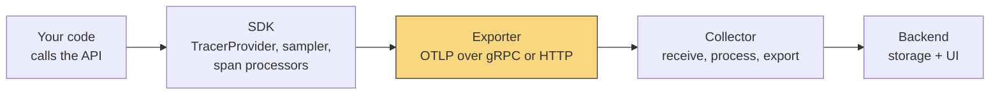

# 1. What observability is, and how OpenTelemetry models it

**Who can skip this:** if you can explain the difference between a trace, a span and a span
context, say what the API, SDK, exporter and Collector each do in OpenTelemetry, and know which
HTTP status codes make a server span an error, skip to chapter 2. Everyone else, read this
first: every later chapter assumes its vocabulary.

## The problem

A request comes in, touches four services and a queue, and comes back slow or wrong. Each
service has logs. Each log line is true. None of them tells you which other lines belong to the
same request, how long each step took, or which step failed first. You end up grepping five
log streams by timestamp and guessing.

**Observability** is the practice of making a running system answer questions about itself
that you didn't think to ask in advance: "why was *this* request slow?", "which customers hit
this error?", "where did this message go?". The raw material is **telemetry**, data the system
emits about its own behaviour. The rest of this course is about emitting the right telemetry,
connecting it across process boundaries, and not emitting what you shouldn't.

## The three signals

Telemetry comes in three shapes. They answer different questions and cost different amounts.

| Signal | What one record is | Answers | Cost grows with |
|---|---|---|---|
| **Metrics** | A number aggregated over time, keyed by labels: requests per second by route and status | "Is something wrong, and how much?" | The number of distinct label combinations |
| **Logs** | A timestamped event with a message and fields | "What exactly happened here?" | Volume of events |
| **Traces** | A tree of timed operations that together served one request | "Where did the time go, and which hop failed?" | Requests × operations per request |

You need all three. A metric tells you the error rate jumped at 14:02. A trace from 14:02 shows
the failing hop. The logs attached to that trace tell you why. The useful trick, and the subject
of chapters 2 and 3, is making it possible to go from one to the next without guessing.

## Traces, spans and span context

A **span** is one timed operation: "handle `GET /orders/{id}`", "query the orders table",
"publish to the payments topic". It has a name, a start and end time, a **kind**, a **status**,
and **attributes** (key-value pairs such as `http.request.method = GET`). It can also carry
**events**, timestamped notes within the span, of which a recorded exception is the commonest.

A **trace** is the set of spans that share one **trace id**. Spans form a tree: each span except
the root records the id of its **parent**. Draw the tree on a time axis and you get the
waterfall view every tracing backend shows.

```
trace 4bf92f35...  (one request)
│
├─ SERVER   GET /orders/{id}            ████████████████████████  120 ms
│  ├─ CLIENT  SELECT orders               ████                       18 ms
│  ├─ CLIENT  GET payments-svc /status          ██████████████       70 ms
│  │  └─ SERVER  GET /status  (other service)    ████████████        62 ms
│  └─ PRODUCER send order-events                              ██      6 ms
```

The part of a span that has to travel, to the next function or the next service, is its
**span context**: the trace id, the span id, the **trace flags** (one bit of which says whether
the trace is being sampled), and an optional vendor-specific **trace state**. Everything else
about a span stays in the process that created it. A span context that arrived from another
process is called **remote**.

**Span kind** tells the backend which side of a hop a span represents, so it can pair them up:

| Kind | Meaning | Example |
|---|---|---|
| `SERVER` | Handling an incoming synchronous request | An HTTP handler |
| `CLIENT` | Making an outgoing synchronous request | An HTTP client call, a database query |
| `PRODUCER` | Creating or sending a message that will be processed later | Publishing to a topic |
| `CONSUMER` | Processing a message that was produced earlier | A queue worker handling one message |
| `INTERNAL` | Work inside the process with no remote side | A pure computation step |

## Context: how a span knows its parent

Inside one process, the "current span" travels in a **context**. In Go that's literally
`context.Context`: starting a span reads the parent from the context you pass and returns a new
context holding the child. In Rust's `tracing`, JavaScript's OpenTelemetry API and C++, there is
an implicit "current" context per thread or async task instead. Either way, the rule is the same:
**a span started from a context that doesn't hold the parent becomes the root of a new trace.**
Nothing warns you. Chapter 2 is mostly about the places this happens.

```go
func (h *Handler) GetOrder(w http.ResponseWriter, r *http.Request) {
    ctx, span := h.tracer.Start(r.Context(), "load order") // child of the server span
    defer span.End()

    order, err := h.repo.Find(ctx, id) // spans started inside Find are children of "load order"
    ...
}
```

## OpenTelemetry's moving parts

**OpenTelemetry** (OTel) is the vendor-neutral standard most tracing now goes through. It
defines an API, an SDK per language, a wire protocol and a standalone Collector. Knowing which
part does what is what lets you debug "my spans don't arrive".



| Part | Job | What goes wrong |
|---|---|---|
| **API** | What instrumentation calls: `Tracer.Start`, `Span.End`, propagators | Without an SDK installed every call is a no-op, by design, so libraries can instrument themselves without forcing a dependency |
| **SDK** | Implements the API: creates real spans, samples, batches, hands them to exporters | Never installed, or shut down before the last batch is flushed |
| **Span processor** | Hook on span start and end. The batch processor queues ended spans for the exporter | A synchronous processor on the hot path; a processor that tries to edit an ended span (it can't, see chapter 4) |
| **Exporter** | Serialises and sends: usually **OTLP**, the OpenTelemetry Protocol | Wrong endpoint, wrong protocol, TLS mismatched with the receiver |
| **Collector** | A separate process that receives telemetry, processes it (batching, filtering, redaction) and forwards it | Configured, but not where the exporter is pointing |
| **Resource** | Attributes describing the emitting process: `service.name`, version, host | Missing `service.name`, so every service shows up as `unknown_service` |
| **Instrumentation scope** | The name (and version) of the library that created a span, such as an HTTP or database instrumentation package | Ignored, when it's exactly the key you need to filter attributes by (chapter 4) |

The no-op default is worth dwelling on, because it explains a whole class of silent failures.
The [propagators specification](https://opentelemetry.io/docs/specs/otel/context/api-propagators/#global-propagators)
says "The OpenTelemetry API MUST use no-op propagators unless explicitly configured otherwise",
and the global tracer, meter and logger providers behave the same way until you install an SDK.
Instrumented code with nothing configured compiles, runs and records nothing.

## Getting telemetry out: the exporter

Most exporters speak OTLP, over either gRPC (default port 4317) or HTTP with protobuf bodies
(default port 4318). The [OTLP exporter configuration spec](https://opentelemetry.io/docs/specs/otel/protocol/exporter/)
defines a set of environment variables every SDK should honour: `OTEL_EXPORTER_OTLP_ENDPOINT`,
`OTEL_EXPORTER_OTLP_PROTOCOL` (default `http/protobuf`, "unless there are strong reasons for SDKs
to select `grpc`"), `OTEL_EXPORTER_OTLP_INSECURE`, and per-signal variants such as
`OTEL_EXPORTER_OTLP_TRACES_ENDPOINT`.

The setting that costs people an afternoon is **TLS**. For OTLP over gRPC, the spec says two
things decide it:

| You configure | Result |
|---|---|
| Endpoint with `https://` | TLS. "takes precedence over the `insecure` configuration setting" |
| Endpoint with `http://` | Plaintext. Also takes precedence over `insecure` |
| Endpoint with no scheme (`collector:4317`) | Decided by the insecure flag, which defaults to `false`, so TLS |

Language SDKs map this onto their own options. Go's gRPC trace exporter documents it plainly:
"by default, client security is required unless WithInsecure is used"
([`otlptracegrpc.WithInsecure`](https://pkg.go.dev/go.opentelemetry.io/otel/exporters/otlp/otlptrace/otlptracegrpc#WithInsecure)).
Its `WithEndpoint` takes `host:port` with no scheme, while `WithEndpointURL` takes a full URL and
reads the scheme.

So a service pointed at an in-cluster Collector that listens in plaintext, with an endpoint
written as `collector:4317`, tries a TLS handshake against a plaintext server. The handshake
fails, the batch processor drops the batch, and the only evidence is an error from the SDK's
internal logger, which often goes nowhere. The application runs normally. The backend is empty.

```go
exp, err := otlptracegrpc.New(ctx,
    otlptracegrpc.WithEndpoint("collector:4317"),
    otlptracegrpc.WithInsecure(), // the Collector listens in plaintext inside the cluster
)
```

<details><summary>Rust</summary>

With the `opentelemetry-otlp` crate's tonic (gRPC) exporter, TLS needs one of its TLS cargo
features plus a TLS config on the builder ([`exporter/tonic/mod.rs`](https://github.com/open-telemetry/opentelemetry-rust/blob/main/opentelemetry-otlp/src/exporter/tonic/mod.rs)).
An `http://` endpoint with no TLS config connects in plaintext; write the scheme explicitly so the
intent is visible.

```rust
use opentelemetry_otlp::{SpanExporter, WithExportConfig};

let exporter = SpanExporter::builder()
    .with_tonic()
    .with_endpoint("http://collector:4317") // http:// = plaintext gRPC
    .build()?;
```

</details>

<details><summary>C++</summary>

```cpp
#include "opentelemetry/exporters/otlp/otlp_grpc_exporter_factory.h"
#include "opentelemetry/exporters/otlp/otlp_grpc_exporter_options.h"

opentelemetry::exporter::otlp::OtlpGrpcExporterOptions opts;
opts.endpoint = "collector:4317";
opts.use_ssl_credentials = false; // plaintext; must match the Collector's receiver
auto exporter = opentelemetry::exporter::otlp::OtlpGrpcExporterFactory::Create(opts);
```

</details>

<details><summary>JavaScript</summary>

```js
const { OTLPTraceExporter } = require('@opentelemetry/exporter-trace-otlp-grpc');
const { credentials } = require('@grpc/grpc-js');

// The package README: "By default, the exporter creates a secure (TLS) connection."
// Either the http:// scheme or insecure credentials switches it to plaintext.
const exporter = new OTLPTraceExporter({
  url: 'collector:4317',
  credentials: credentials.createInsecure(), // must match the Collector's receiver
});
```

</details>

> ⚠️ **Plaintext is a decision, not a fix.** Turning off TLS makes the error go away; whether
> that's acceptable depends on where the traffic runs. Inside a private network to a sidecar or
> node-local Collector it's common. Across anything you don't control, it sends every span
> attribute in the clear, and chapter 4 explains why those attributes are worth protecting.
> Choose the mode that matches the receiver on purpose, and make the SDK's own errors visible
> (chapter 3, "The pipeline must not log into itself") so the next mismatch is loud.

## Span status: what counts as an error

Every span has a **status**: `Unset` (the default), `Ok`, or `Error`. Backends use it for error
rates and for the red marks in a waterfall, so it needs to mean the same thing everywhere. For
HTTP, the [semantic conventions](https://opentelemetry.io/docs/specs/semconv/http/http-spans/#status)
say:

| Response | `SERVER` span | `CLIENT` span |
|---|---|---|
| 1xx, 2xx, 3xx | Unset | Unset |
| 4xx | **Unset** | Error |
| 5xx | Error | Error |
| No response (connection refused, timeout) | Error | Error, with `error.type` set |
| Caller cancelled on purpose | Unset | Unset |

The asymmetry on 4xx is deliberate. A server that answers `404` to a request for something that
doesn't exist has done its job correctly; marking that span red would make every probe for a
missing record look like a server fault. The client, though, wanted the thing and didn't get it,
so from its side the operation failed.

The trap is panics. Go's HTTP server recovers a panicking handler ("It recovers the panic, logs
a stack trace to the server error log", in `net/http`'s `Handler` docs), and frameworks add their
own recovery middleware that turns a panic into a `500`. If the tracing middleware sits outside
the recovery, it sees a normal `500` and marks the span as an error, but the panic value and
stack are gone from the trace. If the panic unwinds straight past a tracing middleware that ends
its span in a `defer` and doesn't look for panics, the span closes while the stack unwinds, with
no status and no hint that anything happened. Check what your instrumentation library does here
rather than assuming. The fix is a small piece of middleware, placed inside the tracing span, that
records the panic on the span and then **re-panics** so the normal recovery path still answers
the client:

```go
func RecordPanics(next http.Handler) http.Handler {
    return http.HandlerFunc(func(w http.ResponseWriter, r *http.Request) {
        defer func() {
            if v := recover(); v != nil {
                span := trace.SpanFromContext(r.Context())
                span.RecordError(fmt.Errorf("panic: %v", v), trace.WithStackTrace(true))
                span.SetStatus(codes.Error, "panic")
                panic(v) // let the existing recovery produce the 500
            }
        }()
        next.ServeHTTP(w, r)
    })
}
```

Re-panicking matters. Swallowing the panic here would bypass whatever the service already does
on a panic (the response, the log line, the crash metric), and a tracing helper must never change
how the program behaves.

<details><summary>Rust</summary>

Rust services rarely unwind through handlers, but a panicking task in an async server is caught
by the runtime or framework. With `tracing-opentelemetry`, record failures on the span via the
special `otel.status_code` field.

```rust
let span = tracing::info_span!("handle", otel.status_code = tracing::field::Empty);
let result = std::panic::AssertUnwindSafe(handler(req))
    .catch_unwind() // futures::FutureExt
    .instrument(span.clone())
    .await;
if let Err(payload) = result {
    span.record("otel.status_code", "ERROR");
    std::panic::resume_unwind(payload); // keep the existing behaviour
}
```

</details>

<details><summary>C++</summary>

```cpp
auto span = tracer->StartSpan("handle");
auto scope = tracer->WithActiveSpan(span);
try {
  handle(request);
} catch (const std::exception& e) {
  span->AddEvent("exception", {{"exception.message", e.what()}});
  span->SetStatus(opentelemetry::trace::StatusCode::kError, "unhandled exception");
  span->End();
  throw; // rethrow so the existing handler answers
}
span->End();
```

</details>

<details><summary>JavaScript</summary>

```js
const { trace, SpanStatusCode } = require('@opentelemetry/api');

function recordErrors(handler) {
  return async (req, res) => {
    try {
      return await handler(req, res);
    } catch (err) {
      const span = trace.getActiveSpan();
      span?.recordException(err);
      span?.setStatus({ code: SpanStatusCode.ERROR, message: 'unhandled exception' });
      throw err; // let the framework's error handler answer
    }
  };
}
```

</details>

> **Teacher's aside.** People treat instrumentation as something you add and forget. It's
> closer to a second, quieter program running alongside yours: it has its own configuration,
> defaults that do nothing, its own failure modes and its own logs. Almost every "tracing doesn't
> work" problem in this course is that second program failing silently while the first one runs
> fine. The habit that fixes most of them is to verify telemetry end to end, in the backend,
> the same way you'd verify a feature, rather than trusting that the code compiled.

## Check yourself

1. A service has OpenTelemetry instrumentation libraries for its HTTP server and database
   client, but nobody installed an SDK. What does the backend show, and does the service behave
   any differently?
2. Draw the span tree for a request that hits service A, which queries a database and then calls
   service B over HTTP, which publishes one message to a topic. Label each span's kind.
3. A handler returns `404` for an unknown id, and the calling service sees the `404`. Which of
   the two spans should be marked `Error`, and why does the convention differ by side?
4. A Go service exports to `OTEL_EXPORTER_OTLP_ENDPOINT=collector:4317` over gRPC. The Collector
   listens in plaintext. The service runs normally but no spans arrive. Explain the mechanism,
   and give two different configuration changes that fix it.
5. A tracing middleware recovers panics and returns `500` itself instead of re-panicking. The
   service already had a recovery middleware that logs the panic with a stack trace and
   increments a crash counter. What changes in production?
