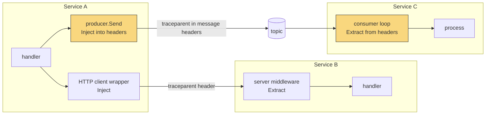

# 2. Carrying a trace across services and messages

## The problem

Every service is instrumented. Each one's spans show up in the backend. But a request that
crosses three services appears as three unrelated traces, and a message that goes through a
queue starts a fresh trace on the consumer side. The waterfall that was supposed to show the
whole request stops at every boundary.

Nothing is broken in any single service. What's missing is the thing that carries the trace
across the gap: a few bytes of span context written into the outgoing request or message, and
read back on the other side. If nothing writes them, or something in between throws them away,
the next service has no parent to attach to and starts a new trace. This chapter is about every
place that can happen.

## What crosses the wire: `traceparent`

The [W3C Trace Context Recommendation](https://www.w3.org/TR/trace-context/) (Level 1, published
23 November 2021) standardises the headers. The important one is `traceparent`:

```
traceparent: 00-4bf92f3577b34da6a3ce929d0e0e4736-00f067aa0ba902b7-01
             ││ └──────────── trace-id ────────┘ └─ parent-id ──┘ └┴ trace-flags
             └┴ version
```

| Field | Size | Meaning |
|---|---|---|
| `version` | 2 hex chars | `00` in this spec; `ff` is forbidden |
| `trace-id` | 32 hex chars (16 bytes) | The whole trace's id. All zeros is invalid |
| `parent-id` | 16 hex chars (8 bytes) | The id of the span that made this call: the caller's span, which becomes the callee's parent. All zeros is invalid |
| `trace-flags` | 2 hex chars | Bit 0 is `sampled`: "the caller may have recorded trace data" |

A second header, `tracestate`, carries vendor-specific key-value pairs alongside. If a receiver
finds `traceparent` invalid, the spec says it creates a new one and deletes `tracestate`: in
other words it starts a new trace (§4.3). So a malformed header doesn't fail the request. It
silently breaks the trace, which is the theme of this chapter.

Two lines in the spec matter later. §8.2: "Randomly generated value of trace-id SHOULD be
preferred over other algorithms of generating a globally unique identifiers." And §6: "Tracing
vendors MUST NOT use traceparent and tracestate fields for any personally identifiable or
otherwise sensitive information."

## Propagators: the piece that's off by default

A **propagator** is the code that writes span context into a carrier and reads it back. The
OpenTelemetry [propagators API](https://opentelemetry.io/docs/specs/otel/context/api-propagators/)
defines two operations:

- **Inject**: "Injects the value into a carrier. For example, into the headers of an HTTP request."
- **Extract**: "Extracts the value from an incoming request." If the value can't be parsed, it
  "MUST NOT throw an exception and MUST NOT store a new value in the `Context`". You get back the
  context you passed in, with no parent, and the next span is a root.

The **carrier** is whatever holds string key-value pairs: HTTP headers, message headers, a map.

Now the trap. The same spec says "The OpenTelemetry API MUST use no-op propagators unless
explicitly configured otherwise." Go follows it. `otel.GetTextMapPropagator` "returns the global
TextMapPropagator. If none has been set, a No-Op TextMapPropagator is returned"
([pkg.go.dev](https://pkg.go.dev/go.opentelemetry.io/otel#GetTextMapPropagator)). The Rust crate
initialises its global with a `NoopTextMapPropagator`
([`global/propagation.rs`](https://github.com/open-telemetry/opentelemetry-rust/blob/main/opentelemetry/src/global/propagation.rs)),
and the C++ API's global starts as a `NoOpPropagator`
([`global_propagator.h`](https://github.com/open-telemetry/opentelemetry-cpp/blob/main/api/include/opentelemetry/context/propagation/global_propagator.h)).

Instrumentation libraries use that global. Go's `otelhttp` documents its `WithPropagators`
option as: "If this option isn't specified, then the global TextMapPropagator is used." So you
can wrap every HTTP client and server in `otelhttp`, see client and server spans in every
service, and still get disconnected traces, because the propagator they all call does nothing.
The Go contrib package `autoprop` says it outright: the spec requires a no-op default, "However,
for systems that perform propagation this default is not ideal"
([`autoprop`](https://pkg.go.dev/go.opentelemetry.io/contrib/propagators/autoprop)).

Register one at startup, next to the tracer provider:

```go
import (
    "go.opentelemetry.io/otel"
    "go.opentelemetry.io/otel/propagation"
)

func setupPropagation() {
    otel.SetTextMapPropagator(propagation.NewCompositeTextMapPropagator(
        propagation.TraceContext{}, // traceparent, tracestate
        propagation.Baggage{},      // baggage
    ))
}
```

<details><summary>Rust</summary>

```rust
use opentelemetry::global;
use opentelemetry_sdk::propagation::TraceContextPropagator;

fn setup_propagation() {
    global::set_text_map_propagator(TraceContextPropagator::new());
}
```

</details>

<details><summary>C++</summary>

```cpp
#include "opentelemetry/context/propagation/global_propagator.h"
#include "opentelemetry/trace/propagation/http_trace_context.h"

namespace prop = opentelemetry::context::propagation;

void SetupPropagation() {
  prop::GlobalTextMapPropagator::SetGlobalPropagator(
      opentelemetry::nostd::shared_ptr<prop::TextMapPropagator>(
          new opentelemetry::trace::propagation::HttpTraceContext()));
}
```

</details>

<details><summary>JavaScript</summary>

Node's `NodeSDK` defaults to a composite of W3C Trace Context and Baggage (its README, option
`textMapPropagator`); with the bare API you set one yourself.

```js
const { propagation } = require('@opentelemetry/api');
const { W3CTraceContextPropagator } = require('@opentelemetry/core');

propagation.setGlobalPropagator(new W3CTraceContextPropagator());
```

</details>

## Inject and extract inside the transport wrapper

With a working propagator, the next way to lose a trace is to inject at *some* call sites. Someone
adds `Inject` to the three HTTP calls they were debugging; the fourth call, written later, doesn't
have it; that hop breaks. The same happens with message publishing, where publish calls are
scattered through business code.

The fix is structural: **inject inside the one wrapper every outbound call already goes through**,
and **extract inside the one place every inbound request or message arrives**. Then no call site
can forget, because no call site is involved.



For HTTP in Go, `otelhttp.NewTransport` and `otelhttp.NewHandler` are those wrappers. Build the
service's shared `http.Client` once with the instrumented transport, and every request through it
injects. A client constructed ad hoc with a plain transport is the hole.

For messaging there's usually no off-the-shelf wrapper you trust, so you write it, and there's a
second way to lose context: **the message type in between**. Many services convert the broker's
record into their own `Message` struct before handing it to business code. If that struct has no
field for headers, the conversion throws the injected `traceparent` away, and the consumer extracts
from nothing. The producer side is fine; the bug is in a struct definition nobody thinks of as
tracing code.

## Messages: producer and consumer spans

The [messaging semantic conventions](https://opentelemetry.io/docs/specs/semconv/messaging/messaging-spans/)
(status: Development) call the span context attached to a message its **creation context**: "A
producer SHOULD attach a message creation context to each message." They deliberately don't say
how; with Kafka, record headers are the natural carrier.

A producer wrapper that does it for every publish:

```go
type Message struct {
    Topic   string
    Key     []byte
    Value   []byte
    Headers map[string]string // must survive every conversion, or the trace dies here
}

func (p *Producer) Send(ctx context.Context, m Message) error {
    ctx, span := p.tracer.Start(ctx, "send "+m.Topic, trace.WithSpanKind(trace.SpanKindProducer))
    defer span.End()

    if m.Headers == nil {
        m.Headers = map[string]string{}
    }
    otel.GetTextMapPropagator().Inject(ctx, propagation.MapCarrier(m.Headers))

    if err := p.client.Write(ctx, m); err != nil {
        span.RecordError(err)
        span.SetStatus(codes.Error, "send failed")
        return err
    }
    return nil
}
```

On the consumer side, the order of operations matters. **Open the consumer span before you
deserialise the payload.** If you parse first and only start a span on success, a malformed
message (the poison pill that's stalling your partition) produces no span at all, and the one
message you most need to see is invisible. Started first, it becomes a span that's linked to its
producer and marked as an error:

```go
func (c *Consumer) handle(m Message) {
    parent := otel.GetTextMapPropagator().Extract(context.Background(), propagation.MapCarrier(m.Headers))
    ctx, span := c.tracer.Start(parent, "process "+m.Topic, trace.WithSpanKind(trace.SpanKindConsumer))
    defer span.End()

    var order Order
    if err := json.Unmarshal(m.Value, &order); err != nil {
        span.RecordError(err)
        span.SetStatus(codes.Error, "malformed message")
        c.deadLetter(ctx, m, err)
        return
    }
    c.process(ctx, order)
}
```

<details><summary>Rust</summary>

With `tracing` and `tracing-opentelemetry`. `HashMap<String, String>` implements the
`Extractor` and `Injector` traits.

```rust
use opentelemetry::global;
use tracing::Instrument;
use tracing_opentelemetry::OpenTelemetrySpanExt;

async fn handle(msg: Message) {
    let parent = global::get_text_map_propagator(|p| p.extract(&msg.headers));
    let span = tracing::info_span!(
        "process orders",
        otel.kind = "consumer",
        otel.status_code = tracing::field::Empty,
    );
    let _ = span.set_parent(parent); // returns a Result in recent versions

    async {
        match serde_json::from_slice::<Order>(&msg.value) {
            Ok(order) => process(order).await,
            Err(e) => {
                tracing::Span::current().record("otel.status_code", "ERROR");
                tracing::error!(error = %e, "malformed message");
                dead_letter(&msg).await;
            }
        }
    }
    .instrument(span)
    .await
}
```

</details>

<details><summary>C++</summary>

```cpp
namespace otel = opentelemetry;

class MapCarrier : public otel::context::propagation::TextMapCarrier {
 public:
  explicit MapCarrier(std::map<std::string, std::string>& h) : h_(h) {}
  otel::nostd::string_view Get(otel::nostd::string_view key) const noexcept override {
    auto it = h_.find(std::string(key));
    return it == h_.end() ? otel::nostd::string_view() : otel::nostd::string_view(it->second);
  }
  void Set(otel::nostd::string_view key, otel::nostd::string_view value) noexcept override {
    h_[std::string(key)] = std::string(value);
  }
 private:
  std::map<std::string, std::string>& h_;
};

void Handle(Message& msg) {
  auto prop = otel::context::propagation::GlobalTextMapPropagator::GetGlobalPropagator();
  MapCarrier carrier(msg.headers);
  auto parent = prop->Extract(carrier, otel::context::RuntimeContext::GetCurrent());

  otel::trace::StartSpanOptions opts;
  opts.kind = otel::trace::SpanKind::kConsumer;
  opts.parent = otel::trace::GetSpan(parent)->GetContext();
  auto span = tracer->StartSpan("process orders", opts);
  auto scope = tracer->WithActiveSpan(span);

  auto order = ParseOrder(msg.value);  // returns std::optional<Order>
  if (!order) {
    span->SetStatus(otel::trace::StatusCode::kError, "malformed message");
    DeadLetter(msg);
  } else {
    Process(*order);
  }
  span->End();
}
```

</details>

<details><summary>JavaScript</summary>

```js
const { context, propagation, trace, SpanKind, SpanStatusCode, ROOT_CONTEXT } = require('@opentelemetry/api');
const tracer = trace.getTracer('orders-consumer');

async function handle(msg) {
  const parent = propagation.extract(ROOT_CONTEXT, msg.headers);
  const span = tracer.startSpan('process orders', { kind: SpanKind.CONSUMER }, parent);
  await context.with(trace.setSpan(parent, span), async () => {
    let order;
    try {
      order = JSON.parse(msg.value);
    } catch (err) {
      span.recordException(err);
      span.setStatus({ code: SpanStatusCode.ERROR, message: 'malformed message' });
      await deadLetter(msg);
      return;
    }
    await processOrder(order);
  }).finally(() => span.end());
}
```

</details>

### Parent or link? Where the convention and common practice differ

The code above makes the producer's span the consumer span's **parent**, so the consumer appears
inside the producer's trace. That's what most people want to see, and it's what the original
symptom asked for. But it isn't the semantic conventions' default. They say:

- "For each message it accounts for, the "Process" or "Receive" span SHOULD link to the message's
  creation context."
- "Exclusively for single messages scenarios, the "Process" span MAY use the message's creation
  context as its parent".

A **link** is a reference from one span to another that isn't a parent: the consumer span starts
its own trace and points back at the producer. The reason links are the default is batching. A
consumer that processes 500 messages in one span has 500 creation contexts and a span can have
only one parent; links are "the only option to correlate producer and consumer(s) in batch
scenarios".

| | Parent | Link |
|---|---|---|
| Waterfall | Consumer nested in producer's trace | Separate trace, with a pointer back |
| Batch of N messages | Impossible: one parent | One span, N links |
| Trace duration | Stretches across queue lag (minutes or hours for a backlog) | Producer trace ends when the publish does |
| Convention | MAY, single-message only | SHOULD |

So: parent when one message is processed in one span and you want one end-to-end trace; links
when you batch, or when queue lag would make traces absurdly long. Many backends draw links
poorly, which is part of why people choose parenting. In Go, a link is
`trace.WithLinks(trace.Link{SpanContext: trace.SpanContextFromContext(parent)})` on a span started
from a fresh context.

## Goroutines and async tasks

Process boundaries aren't the only gaps. Inside a process, the context can be dropped too.

In Go the context is explicit, so the failure is visible in code review if you look for it: a
goroutine started with `context.Background()` starts a new trace. The usual reason is legitimate:
the background work must outlive the request, so it can't use the request's context, which is
cancelled when the handler returns. `context.WithoutCancel` (Go 1.21) keeps the values, including
the current span, and drops the cancellation:

```go
go h.warmCache(context.WithoutCancel(ctx), id) // same trace, not cancelled with the request
```

Rust's `tracing` uses an implicit current span per task, and the failure is subtler.
`Span::enter` returns a guard, and the span stays current until the guard drops. In async code the
task can yield at every `.await` with the guard still alive, and whatever else runs on that thread
in the meantime is attributed to your span, or your work to theirs. The
[`tracing` docs](https://docs.rs/tracing/latest/tracing/struct.Span.html#in-asynchronous-code) are
blunt: "Holding the drop guard returned by `Span::enter` across `.await` points will result in
incorrect traces." Use `.instrument(span)` instead, which enters the span "_every_ time the future
is polled, and exit[s] it whenever the future yields", or the `#[instrument]` attribute.

<details><summary>Rust</summary>

```rust
use tracing::Instrument;

// Wrong: the guard lives across the await.
async fn wrong(id: u64) {
    let span = tracing::info_span!("load", id);
    let _guard = span.enter();
    fetch(id).await; // other tasks polled on this thread now run "inside" load
}

// Right: the span is entered only while this future is being polled.
async fn right(id: u64) {
    fetch(id).instrument(tracing::info_span!("load", id)).await;
}

// Spawned work: hand the current span to the new task explicitly.
tokio::spawn(warm_cache(id).instrument(tracing::Span::current()));
```

</details>

<details><summary>C++</summary>

OpenTelemetry C++ keeps the active span in a thread-local runtime context. Work posted to another
thread doesn't inherit it, so capture the span and make it active there.

```cpp
auto span = opentelemetry::trace::Tracer::GetCurrentSpan();
pool.post([span, id]() mutable {  // WithActiveSpan takes a non-const reference
  auto scope = opentelemetry::trace::Tracer::WithActiveSpan(span);
  WarmCache(id);
});
```

</details>

<details><summary>JavaScript</summary>

Node's context manager follows `async`/`await` and promises, but callbacks from libraries that
pool work can lose it. Bind the context explicitly.

```js
const { context } = require('@opentelemetry/api');
setImmediate(context.bind(context.active(), () => warmCache(id)));
```

</details>

## One trace for a flow that spans many requests

Some business flows aren't one request. A verification session might be created, then updated by
a dozen calls from a mobile app over ten minutes, then finalised. Each call is its own trace, and
seeing the session means searching for a dozen traces and lining them up by hand.

One approach is to **derive the trace id deterministically from the flow's id**, and on every
request install it as a remote parent before the server span starts. Every request's spans then
share one trace id, while span ids stay random. In Go:

```go
func flowContext(ctx context.Context, flowID uuid.UUID, key []byte) context.Context {
    mac := hmac.New(sha256.New, key) // keyed, so the trace id doesn't reveal the flow id
    mac.Write(flowID[:])
    var tid trace.TraceID
    copy(tid[:], mac.Sum(nil)[:16])

    var sid trace.SpanID
    rand.Read(sid[:]) // a synthetic parent; nothing will ever export a span with this id
    sc := trace.NewSpanContext(trace.SpanContextConfig{
        TraceID: tid, SpanID: sid, TraceFlags: trace.FlagsSampled, Remote: true,
    })
    return trace.ContextWithRemoteSpanContext(ctx, sc)
}
```

<details><summary>Rust</summary>

```rust
use hmac::{Hmac, KeyInit, Mac};
use opentelemetry::trace::{SpanContext, SpanId, TraceContextExt, TraceFlags, TraceId, TraceState};
use opentelemetry::Context;
use sha2::Sha256;

fn flow_context(flow_id: &[u8; 16], key: &[u8]) -> Context {
    let mut mac = Hmac::<Sha256>::new_from_slice(key).expect("HMAC takes any key length");
    mac.update(flow_id);
    let mut tid = [0u8; 16];
    tid.copy_from_slice(&mac.finalize().into_bytes()[..16]);
    let sc = SpanContext::new(
        TraceId::from_bytes(tid),
        SpanId::from_bytes(rand::random::<[u8; 8]>()), // synthetic parent
        TraceFlags::SAMPLED,
        true, // remote
        TraceState::default(),
    );
    Context::new().with_remote_span_context(sc) // then span.set_parent(cx) on the server span
}
```

</details>

<details><summary>C++</summary>

```cpp
#include <openssl/hmac.h>
#include <openssl/rand.h>
namespace trace_api = opentelemetry::trace;

trace_api::SpanContext FlowSpanContext(const std::string& flow_id, const std::string& key) {
  unsigned char mac[EVP_MAX_MD_SIZE];
  unsigned int len = 0;
  HMAC(EVP_sha256(), key.data(), static_cast<int>(key.size()),
       reinterpret_cast<const unsigned char*>(flow_id.data()), flow_id.size(), mac, &len);
  uint8_t tid[16], sid[8];
  std::memcpy(tid, mac, sizeof tid);
  RAND_bytes(sid, sizeof sid);  // synthetic parent
  return trace_api::SpanContext(
      trace_api::TraceId(opentelemetry::nostd::span<const uint8_t, 16>(tid)),
      trace_api::SpanId(opentelemetry::nostd::span<const uint8_t, 8>(sid)),
      trace_api::TraceFlags(trace_api::TraceFlags::kIsSampled),
      /*is_remote=*/true);
}
// Use it as StartSpanOptions::parent for the server span.
```

</details>

<details><summary>JavaScript</summary>

```js
const { createHmac, randomBytes } = require('node:crypto');
const { context, trace, TraceFlags } = require('@opentelemetry/api');

function flowContext(flowId, key) {
  return trace.setSpanContext(context.active(), {
    traceId: createHmac('sha256', key).update(flowId).digest('hex').slice(0, 32),
    spanId: randomBytes(8).toString('hex'), // synthetic parent
    traceFlags: TraceFlags.SAMPLED,
    isRemote: true,
  });
}
```

</details>

`trace.ContextWithRemoteSpanContext` "returns a copy of parent with rsc set explicitly as a
remote SpanContext and as the current Span"
([source](https://github.com/open-telemetry/opentelemetry-go/blob/main/trace/context.go)), so the
server span that starts next becomes its child.

It works, and it bends two parts of the spec, which you should do knowingly:

- §8.2 prefers random trace ids. A derived one is still unique per flow, but every request in the
  flow now shares it, so "one trace = one request" no longer holds for tools that assume it.
- §6 forbids putting identifying or sensitive information in `traceparent`, which every downstream
  service, and any third party you call, can read. Copying the flow id's raw bytes into the trace
  id would leak it; if that id is also a bearer token, it leaks a credential. Hence the keyed hash.

The alternatives are often enough: record the flow id as a span attribute (if it's not sensitive,
chapter 4) and search by it, or link each request's root span to the flow's first span.

> **Teacher's aside.** "Is my trace connected?" is not a question you answer by reading code. The
> code that injects can be right while a struct conversion drops the headers, a proxy strips
> unknown headers, or the propagator is still the no-op. Answer it in the backend: find the
> consumer span and check that its parent span id equals the producer span's span id (or that its
> link points there). Then turn that check into a test with an in-memory exporter, so the next
> refactor can't silently break it.

## Check yourself

1. Two Go services both wrap their HTTP client and server in `otelhttp`. Traces are disconnected.
   Explain, mechanically, what happens to the trace context on the outgoing request, and the
   one-line fix.
2. A producer injects `traceparent` correctly, verified by logging the outgoing headers. The
   consumer extracts and still starts new traces. Name two places the context could be lost
   between the two `Inject` and `Extract` calls.
3. Your consumer parses the payload, then starts a span if parsing succeeded. A malformed message
   is retried forever and stalls the partition. What does the tracing backend show, and what
   change makes the problem visible?
4. A consumer processes messages in batches of 200 in one span. A colleague wants the span to
   "have the producer as its parent". What's wrong with that, and what should the span carry
   instead?
5. A Rust handler does `let _g = span.enter();` and then awaits two downstream calls. Under load,
   traces show downstream spans from unrelated requests nested under this span. Explain why.
6. You derive a trace id from the raw bytes of a session token so a whole session shows as one
   trace. What does every downstream service, including a third-party API you call, now learn?
   What would you change, and what does it cost you?
