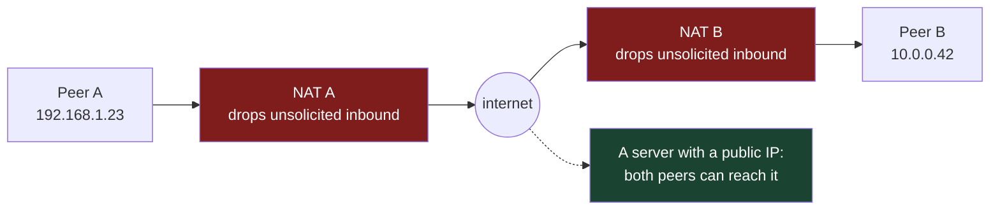
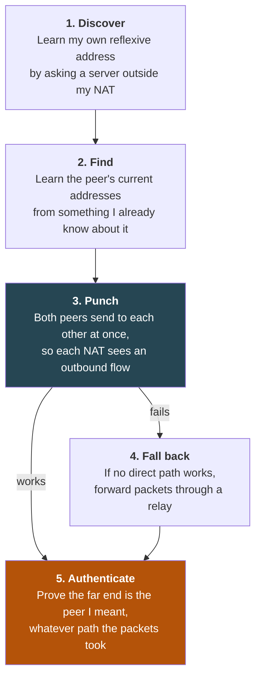

# 1. Foundations: why you can't just dial their IP

## The problem

Every server you've written had a public IP address. A client somewhere dialled
it, the packets arrived, you answered. Now put the server on a laptop at home and
the client on a laptop in an office, and the same `net.Dial` fails. It doesn't get
refused. It times out, because the packets never reach anything that could refuse
them.

This chapter explains why, names the pieces that stand in the way, and lays out
the five-step model every peer-to-peer system follows to get around them. Every
later chapter is a close-up of one of those steps.

**Who can skip this.** If you can already say why a peer needs a server to learn
its own public address, what "hole punching" does to a NAT's state table, and why
every serious peer-to-peer system still runs relays, skim the vocabulary table in
§1.6 and move on to [file 02](02-nat-behaviour.md).

Assumes IP addresses, ports, TCP and UDP at the level of
[cs-fundamentals file 09](../interview/cs-fundamentals/09-networks-layers-and-tcp.md),
and QUIC at the level of [http file 04](../http/04-quic.md).

## 1.1 The address you have isn't an address anyone can reach

Run `ifconfig` or `ip addr` on a laptop at home and you'll see something like
`192.168.1.23`. That address is real on your home network and meaningless
everywhere else. Thousands of other homes have a machine at `192.168.1.23` right
now.

RFC 1918 (1996) set aside three blocks for exactly this, addresses any private
network may use internally and that the public internet never routes:

| Block | Size | Where you see it |
|---|---|---|
| `10.0.0.0/8` | ~16.7 million addresses | Offices, cloud VPCs, Docker networks |
| `172.16.0.0/12` | ~1 million | Docker's default bridge, some offices |
| `192.168.0.0/16` | 65,536 | Almost every home router |
| `100.64.0.0/10` | ~4.2 million | Not RFC 1918: RFC 6598's **shared address space**, used between an ISP's carrier-grade NAT and your router ([file 02 §2.7](02-nat-behaviour.md#27-carrier-grade-nat-two-nats-in-a-row)) |

So the first obstacle is simple: the address the other machine would have to
dial does not exist on the public internet. Your packets to `192.168.1.23` go to
whatever `192.168.1.23` is on *your* network, or nowhere.

## 1.2 NAT: one public address, many machines behind it

Your home has one public IPv4 address, assigned by your ISP. Your router lets every
device in the house share it by rewriting packets as they pass. That rewriting is
**network address translation**, and the router doing it is a **NAT**.

An analogy that holds up well: an office with one public phone number and a
receptionist. When you call out, the person you call sees the office's main
number, not your extension. The receptionist makes a note: "extension 23 is on a
call with this outside number". When that outside number speaks, the receptionist
knows to put it through to extension 23. When a stranger rings the main number
and asks for nobody in particular, there's no note, so the call goes nowhere.

The note is a **mapping** (RFC 4787's word; you'll also see "binding"). Here's
what the router's table looks like after your laptop opens a connection:

```
  laptop                         NAT (home router)                      server
  192.168.1.23:51000  ──────►    public 198.51.100.7                    203.0.113.10:443
                                 ┌────────────────────────────────────────────────┐
                                 │ internal              external        remote   │
                                 │ 192.168.1.23:51000 ↔ 198.51.100.7:62001  ...   │
                                 └────────────────────────────────────────────────┘
  outbound: src 192.168.1.23:51000  →  rewritten to src 198.51.100.7:62001
  reply:    dst 198.51.100.7:62001  →  rewritten to dst 192.168.1.23:51000
```

The server sees a connection from `198.51.100.7:62001`. It has no idea
`192.168.1.23` exists. That external address and port is your laptop's
**reflexive address**: the address you appear to have, as reflected back by
someone outside.

Three things about mappings matter for everything that follows:

| Fact | Consequence |
|---|---|
| A mapping is created by an **outbound** packet | Nothing outside can create one for you |
| A mapping **expires** if no packets use it for a while | A quiet connection silently dies ([file 02 §2.5](02-nat-behaviour.md#25-timeouts-and-keepalives)) |
| The external port is the NAT's choice, not yours | You can't know your reflexive address without asking someone outside |

## 1.3 Firewalls: deciding what's allowed in

A NAT translates. A **firewall** filters: it decides which packets may pass. Most
home routers do both in one box, which is why people blur them, but they're
separate jobs and they fail separately.

A **stateful firewall** remembers outbound flows and admits inbound packets that
look like replies to them. That's the whole policy of most home and office
networks: anything inside may start a conversation; nothing outside may.

The NAT's mapping table and the firewall's state table usually live in the same
place, and RFC 4787 treats the firewall part as the NAT's **filtering** behaviour.
[File 02](02-nat-behaviour.md) separates the two properly, because a NAT can be
generous about one and strict about the other.

Firewalls are why removing NAT doesn't solve the problem. IPv6 gives every device
a globally routable address, so there's no translation, but the router in front
still typically drops unsolicited inbound traffic ([file 02 §2.8](02-nat-behaviour.md#28-ipv6-no-translation-still-a-firewall)).

## 1.4 Why client–server never noticed

All of this is invisible to the client–server world for one reason: **the client
always speaks first**. The client's outbound packet creates the mapping and the
firewall state, and the server's replies ride back through the hole that packet
opened. The server, meanwhile, has a public address and no filter in front of it
for its listening port. One side is reachable, so it works.

Peer-to-peer breaks that asymmetry. Both machines are behind NATs and firewalls.
Each is willing to *send*, but each will drop anything that arrives before it has
sent. Two receptionists, both refusing unsolicited calls.



That server in the corner is the way out, and it's why peer-to-peer is never
quite serverless.

## 1.5 The working model: five steps

Every system in this course (WebRTC, Tailscale, iroh, libp2p) does the same five
things. The names and the order of the middle steps vary; the jobs don't.



| Step | The question | Standard tool | Covered in |
|---|---|---|---|
| Discover | What address do I appear to have? | STUN (RFC 8489), or QUIC Address Discovery | [File 03 §3.1](03-hole-punching.md#31-stun-asking-whats-my-address) |
| Find | Where is the peer right now? | A signalling server, DNS records, local multicast, a pasted ticket | [File 05](05-identity-and-discovery.md) |
| Punch | Can we get packets through both NATs? | Simultaneous sending; ICE (RFC 8445) to organise the attempts | [File 03](03-hole-punching.md) |
| Fall back | What if we can't? | TURN (RFC 8656), Tailscale's DERP, iroh's relay | [File 04](04-relays.md) |
| Authenticate | Is this really them? | A key the peer proves it holds, inside the handshake | [File 05](05-identity-and-discovery.md) |

Steps 2 and 3 hide a chicken-and-egg problem. To punch, both peers must send *at
roughly the same time* to *each other's* addresses. So before they have a direct
connection, they need some other channel to swap addresses and agree when to
start. That channel is called **signalling** (WebRTC, ICE) or the **rendezvous**
(RFC 5128). It's usually a server both can reach, and in Tailscale and iroh it's
the relay itself ([file 04](04-relays.md)).

> **Teacher's aside.** "Peer-to-peer" sounds like "no servers". The accurate
> version is narrower: **peer-to-peer moves servers off the data path, not out of
> the system.** You still need a server outside every NAT to tell peers their own
> addresses, a channel to exchange addresses before a direct path exists, and a
> relay for the pairs that can never connect directly. What you gain is that, when
> it works, the bulk of the traffic flows straight between the peers, at their
> latency, on their bandwidth, and the servers only carry kilobytes of
> coordination. Plan for the servers from day one; they're not a fallback you can
> add later.

## 1.6 Vocabulary

Every core term in the course, introduced here so no later chapter is the first
place you meet it. The glossary ([file 08](08-glossary.md)) has the full list.

| Term | Meaning |
|---|---|
| **NAT** | A device that rewrites addresses and ports so many internal hosts share one external address |
| **Mapping** | A NAT's record that internal `IP:port` X is currently using external `IP:port` X′ |
| **Filtering** | The NAT's rule for which inbound packets may use a mapping |
| **Firewall** | A device that filters packets. Usually the same box as the NAT at home |
| **Private address** | An address from RFC 1918 (or RFC 6598) blocks; not routable on the public internet |
| **Host address** | The address a machine sees on its own interface, often private |
| **Reflexive address** | The external `IP:port` a NAT gave you, as seen by someone outside |
| **Candidate** | Any address a peer might be reachable at: host, reflexive or relayed (ICE's term) |
| **STUN** | A protocol for asking a server "what address did my packet come from?" |
| **Hole punching** | Both peers sending to each other so each NAT creates the mapping and state the other's packets need |
| **NAT traversal** | The umbrella term: every technique for connecting through NATs and firewalls |
| **Signalling / rendezvous** | The out-of-band channel peers use to exchange candidates before a direct path exists |
| **Relay** | A server with a public address that forwards packets between peers that can't connect directly |
| **Keepalive** | A small packet sent to stop a mapping or firewall state from expiring |
| **4-tuple** | Source IP, source port, destination IP, destination port: what a NAT or firewall keys a flow on |
| **CGNAT** | Carrier-grade NAT: a NAT run by the ISP, so the customer's router is behind a second NAT |
| **Public-key addressing** | Naming a peer by its public key rather than an IP, so its address can change without its identity changing |

## 1.7 What servers remain

Since the aside says servers remain, here's the inventory. Not every system runs
all of them as separate machines (iroh folds most into the relay) but every system
needs every role.

| Role | Why it can't be peer-to-peer | Carries |
|---|---|---|
| Address discovery (STUN or equivalent) | Must be outside your NAT to see your reflexive address | A few bytes per check |
| Signalling / rendezvous | Peers can't reach each other yet | Candidates, keys, timing |
| Directory / lookup | Something has to map "the peer I want" to "where it is now" | Small signed records |
| Relay | Some NAT pairs never connect directly | Everything, for those pairs |

> ⚠️ **Testing on one network proves nothing.** Two machines on the same Wi-Fi
> connect directly over their private addresses: no NAT is crossed, so nothing in
> this course is exercised. Two processes on one laptop prove even less. A
> peer-to-peer feature that has only been tested on an office LAN has been tested
> for the one case that would work without any of it. Test across two different
> networks, and include a phone on mobile data, which is often behind a
> carrier-grade NAT.

## Check yourself

1. Your Go service on a laptop at home listens on `0.0.0.0:4000`. A colleague in
   another city runs `nc -u <your public IP> 4000`. Nothing arrives. Name the two
   separate reasons, and say which one IPv6 would remove.
2. Why does a normal HTTPS request from your laptop to a public server work
   through the same NAT that blocks your colleague's packets? Describe what state
   the request creates and in which device.
3. Two peers each learn their own reflexive address from a server. Why can't they
   just send to each other's reflexive address at any time they like? What extra
   thing do they need, and what does it carry?
4. A teammate says "we're peer-to-peer, so we don't need to run infrastructure".
   List the server roles that remain and, for each, what fails if you don't run it.
5. You test your peer-to-peer feature between two laptops in the office and it
   works every time. Give two reasons this test tells you almost nothing about
   production, and describe a better minimal test setup.

(Answers in [09-exercises.md](09-exercises.md).)
