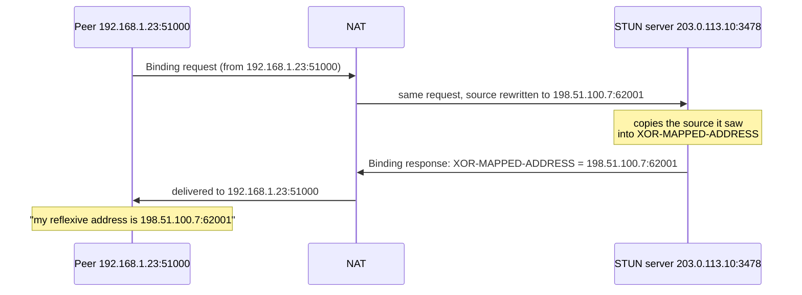
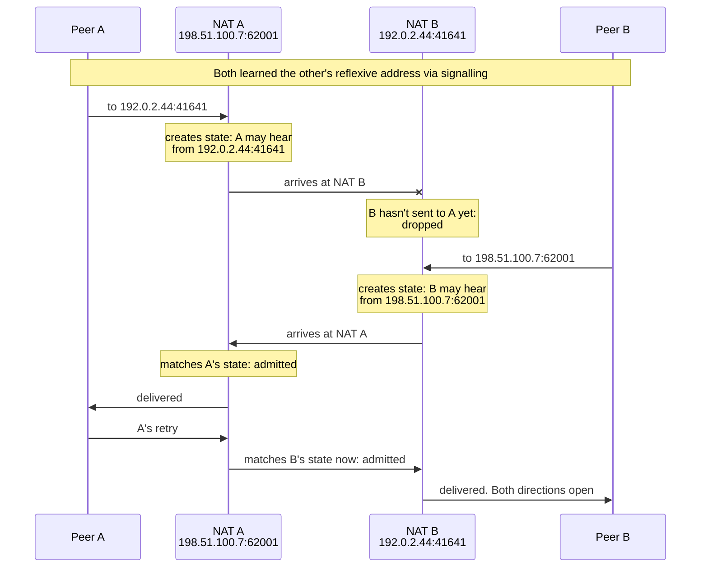
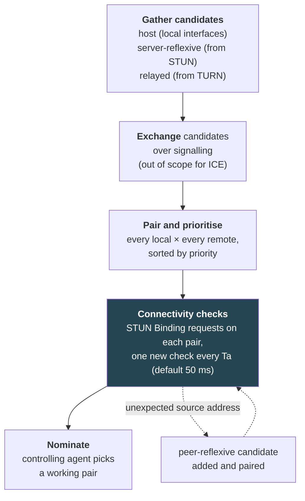

# 3. Hole punching

## The problem

Two peers, each behind a NAT that drops anything arriving before its own host has
sent ([file 01 §1.4](01-foundations.md#14-why-clientserver-never-noticed)). Neither
can receive first, so neither can be the server. The way through is to have both
send at once, so each NAT sees an outbound flow and opens the matching state, and
the packets cross in the middle. To do that, each peer first has to learn the
address its NAT will show the world. This chapter is those two steps, why they
fail for some pairs, how often, and the framework (ICE) that organises the
attempts.

## 3.1 STUN: asking what's my address

A peer can't learn its reflexive address by looking at itself: the NAT made it
up, and only someone outside the NAT can see it. So you ask a server on the public
internet: "what source address did my packet arrive from?"

That's **STUN**, Session Traversal Utilities for NAT, currently RFC 8489 (February
2020, obsoleting RFC 5389). The exchange is a single round trip:



Details worth knowing:

| Detail | Source |
|---|---|
| Default port 3478 for UDP and TCP; 5349 for STUN over TLS/DTLS | RFC 8489 §8.1 |
| Every message carries a fixed magic cookie, `0x2112A442`, and a 96-bit transaction ID | §5 |
| A basic STUN server "SHOULD NOT" demand credentials: authenticating costs more than answering | §12 |
| The same Binding message can be sent periodically to keep a mapping alive | §1 |

The address comes back **XORed** with the magic cookie rather than in plain binary.
The reason is a nice piece of field history. RFC 8489 §14.2:

> deployment experience found that some NATs rewrite the 32-bit binary payloads
> containing the NAT's public IP address, such as STUN's MAPPED-ADDRESS
> attribute, in the well-meaning but misguided attempt to provide a generic
> Application Layer Gateway (ALG) function.

The NAT saw its own public address inside the packet and "helpfully" translated
it back to the private one, which destroyed the answer. XORing hides the bytes from
that pattern-match.

STUN describes itself modestly. RFC 8489 §1 calls it "a tool for dealing with
Network Address Translators", meant to be used inside "NAT traversal solutions"
called STUN Usages, of which ICE is one. That's accurate: STUN tells you your
address and nothing about whether a peer can use it.

> ⚠️ **Ask from the socket you'll actually use.** A mapping belongs to one internal
> `IP:port`. If you send STUN from one UDP socket and then punch from another, the
> NAT gives the second socket its own mapping and your reflexive address is for the
> wrong socket. The data socket, the STUN probes and the punching packets must all
> share one bound UDP port. The QUIC NAT traversal draft states the same
> requirement: candidates must be gathered "from the same UDP socket that takes
> part in the holepunching".

**What one STUN server can't tell you.** A single answer doesn't reveal whether
your NAT is EIM or EDM. Ask two STUN servers at different IPs from the same
socket: if they report the same external port, your mapping is (probably)
endpoint-independent; if they differ, it isn't. iroh records exactly this as
`mapping_varies_by_dest_ipv4` / `_ipv6` in its network report
(`iroh/src/net_report/report.rs` at v1.3.0).

**A newer alternative.** QUIC Address Discovery (draft-ietf-quic-address-discovery,
an IETF QUIC working-group draft, not yet an RFC as of October 2026) does the same
job inside a QUIC connection with an `OBSERVED_ADDRESS` frame. Because it's inside
QUIC it's encrypted, and it doesn't produce the recognisable STUN packets that some
networks block. iroh removed STUN in favour of it in version 0.94
([file 06](06-iroh-end-to-end.md)).

## 3.2 Simultaneous open over UDP

Now both peers know their own reflexive addresses. They swap them, plus their
private addresses, over the signalling channel ([file 01 §1.5](01-foundations.md#15-the-working-model-five-steps)),
and each starts sending to the other's addresses.

Assume both NATs are EIM with address-and-port-dependent filtering, the common
case:



The first packet usually dies, and that's fine: its job was to create state in
the sender's own NAT. "Simultaneous" really means "both send before either gives
up": the window is however long the mapping and state last, so peers retry for a
few seconds rather than coordinating to the millisecond.

Peers try every candidate pair at once (private addresses in case they're on the
same network, reflexive addresses, IPv4 and IPv6) and keep whichever answers.
Ford, Srisuresh and Kegel's 2005 paper (USENIX ATC), the reference description of
the technique, has the rendezvous server hand each peer both the other's private
and public endpoints for exactly this reason.

> **Teacher's aside.** "Hole punching" sounds like an exploit, and people
> sometimes assume it works by tricking a firewall into something it shouldn't do.
> It doesn't trick anything. **Each NAT only ever admits packets on a flow its own
> host started**, which is exactly the policy it was configured with. The trick is
> purely in the timing: arranging for both hosts to start the same flow from both
> ends. That's why it's robust where it works, and also why it can't be forced
> where it doesn't. If a NAT gives the flow toward the peer an external port nobody
> could predict, there's no flow to "both start", and no clever packet fixes that.

## 3.3 Why it fails for some pairs

The walkthrough above relied on one thing: the port NAT B used toward the STUN
server is the port it uses toward A. That's EIM. Take it away and see what breaks.

Peer B is behind an endpoint-dependent NAT. It told A its reflexive address
`192.0.2.44:41641`, learned from the STUN server. When B sends to A, NAT B creates
a *new* mapping, say `192.0.2.44:50312`, which nobody has been told about.

| NAT A (EIM) filtering | What happens to B's packet from port 50312 | Outcome |
|---|---|---|
| **EIF** | Admitted: anyone may send to A's mapping | A sees the real source port, replies to it, and B's NAT admits the reply. **Works** |
| **ADF** | Admitted: A has sent to B's *IP* (to port 41641, but only the IP is checked) | Same as above. **Works** |
| **APDF** | Dropped: A has sent to `:41641`, not `:50312` | A never learns the real port. **Fails** without guessing |

This is the RFC 4787 REQ-8 justification from [file 02 §2.2](02-nat-behaviour.md#22-filtering-who-may-send-to-my-mapping),
worked out: lenient filtering on one side rescues an endpoint-dependent NAT on the
other. When A *does* receive a packet from an address it wasn't told about, that
new address is a **peer-reflexive** candidate in ICE's vocabulary ([§3.7](#37-ice-the-general-framework)):
discovered during the checks rather than gathered beforehand.

The pair table, then:

| Peer A | Peer B | Direct path? |
|---|---|---|
| EIM | EIM | Yes, whatever the filtering |
| EIM, EIF or ADF | EDM | Yes, via the peer-reflexive address |
| EIM, APDF | EDM | Not by plain punching. Port probing can work ([§3.4](#34-the-birthday-trick)) |
| EDM | EDM | In practice no. Relay ([file 04](04-relays.md)) |

Address-dependent mapping counts as endpoint-dependent here. The STUN server and
the peer are always different IPs, so an ADM NAT always hands the peer a different
port from the one STUN reported.

## 3.4 The birthday trick

When one side is EIM-with-APDF and the other is EDM, there's a probabilistic way
through, described in Tailscale's "How NAT traversal works" (David Anderson,
August 2020). The hard side opens 256 sockets, each sending to the easy side's
reflexive address, which creates 256 unknown mappings. The easy side sends probes
to random ports on the hard side's IP. Any probe that hits one of the 256 open
ports gets through.

The probability after n random probes is close to `1 − (1 − 256/65536)^n`:

| Probes from the easy side | Chance of success |
|---|---|
| 174 | 50% |
| 256 | 64% |
| 1024 | 98% |
| 2048 | 99.9% |

Those are Anderson's figures, and they check out against the formula (49.4%,
63.3%, 98.2%, 99.97%). At 100 probes a second, half the time it works within two
seconds. These are calculated probabilities, not measured success rates: they
assume the NAT allocates ports uniformly at random and doesn't rate-limit or
reuse.

Between two hard NATs the search space squares: you need the right *pair* of
ports. Anderson's numbers: with the same probe counts, "after 20 seconds … our
chance of success is… 0.01%"; 99.9% would need "each side to send 170,000 probes",
28 minutes at 100 packets a second. That's why EDM-to-EDM goes to a relay.

The costs are practical rather than mathematical. Spraying a thousand ports looks
like a port scan to intrusion detection; a CGN caps ports per subscriber (RFC 6888
REQ-4); and NATs that pick ports with a predictable sequence, which older
port-prediction tricks in RFC 5128 §3.5 relied on, are increasingly rare because
CGNs are told to make ports hard to guess (RFC 6888 REQ-15).

## 3.5 How often does it work?

This is the question everyone wants one number for, and the honest answer is a
table of numbers that measure different things.

| Source | What was measured | Result | How far to trust it |
|---|---|---|---|
| Ford, Srisuresh & Kegel, USENIX ATC 2005 | Per NAT device: did it behave in a way that allows hole punching? 380 reports, 68 vendors, via the NAT Check tool | UDP: 310/380 (82%). TCP: 184/286 (64%). UDP hairpin: 80/335 (24%). TCP hairpin: 37/286 (13%) | Old hardware. The authors warn the reports came from "a 'self-selecting' community of volunteers" and "do not constitute a random sample". Per device, not per pair |
| Halkes & Pouwelse, IFIP Networking 2011 | Real hole-punching attempts in a deployed P2P network | "approximately 64% of all peers are behind a NAT box or firewall which should allow hole punching to work, and more than 80% of hole punching attempts between these peers succeed" | Measured, but the 80% is among peers already classified as compatible |
| Trautwein, Ihle, Schubotz & Gipp, arXiv 2510.27500 (2025) | libp2p's DCUtR protocol in the IPFS network: 4.4 million attempts, 85,000+ networks, 167 countries | 70% ± 7.1% for the hole-punching stage. TCP and QUIC "both close to ∼70%" | The largest data set. **Conditional**: ~29% of data where the relay or address discovery failed beforehand was excluded. Clients were volunteers, which the authors say may overestimate success |
| Tailscale (Anderson, 2020) | Not measured | "I'd estimate you could get a direct connection over 90% of the time" with basic techniques | An engineer's estimate, stated as such |
| iroh documentation (2026) | Not stated | "roughly 9 out of 10 network configurations allow a direct connection" | Vendor-reported, no published methodology |

What the evidence supports: **most pairs connect directly and a meaningful
minority don't.** The best-measured modern figure is about 70% per attempt, and
that's conditional on the earlier stages having worked. Vendor figures of around
90% may be counting something different (configurations rather than attempts,
after relay-assisted tricks) and come without methodology. Nobody's figure gets
close enough to 100% to skip the relay.

The 2025 study also dents a piece of folklore. It's widely believed UDP hole
punching works much better than TCP; Ford's 2005 numbers (82% vs 64%) are where
that came from. Trautwein et al. found the two indistinguishable at about 70%,
and attribute it to precise, RTT-based synchronisation of the two sides' attempts.
They also identify endpoint-dependent mapping as a main failure cause, with about
11% of their monitored peers behind EDM NATs.

## 3.6 TCP hole punching, briefly

TCP can be punched too. TCP has always allowed a **simultaneous open**: both sides
send a SYN, each sees the other's SYN, and a connection forms with no listener
(RFC 793 Figure 8). If each NAT has already seen its host's outbound SYN, the
crossing SYNs are admitted. RFC 5128 §3.4 describes it and its fragility: a SYN
that arrives too early can be answered with a RST, which closes the half-open
mapping.

It matters less now because the modern stacks (WebRTC data, Tailscale's
WireGuard, iroh's QUIC) all run over UDP anyway. The 2025 measurement above is a
reason not to dismiss TCP, though, and libp2p punches both.

## 3.7 ICE: the general framework

Everything above is a set of techniques. **ICE**, Interactive Connectivity
Establishment (RFC 8445, July 2018, obsoleting RFC 5245), is the standard
procedure for using them together. Tailscale's summary is the best one-liner:
"try everything at once, and pick the best thing that works."



The parts that carry the design:

**Candidate types and priorities.** Each candidate gets a priority (RFC 8445
§5.1.2.1):

```
priority = 2^24 × (type preference) + 2^8 × (local preference) + (256 − component ID)
```

The recommended type preferences (§5.1.2.2) encode the preference order directly:

| Candidate type | Learned from | Type preference |
|---|---|---|
| Host | The machine's own interfaces | 126 |
| Peer-reflexive | A check arriving from an unexpected address | 110 |
| Server-reflexive | A STUN server | 100 |
| Relayed | A TURN server | 0 ("used as a last resort") |

So ICE prefers a direct local path, then a direct path through NATs, then a relay,
and the arithmetic makes that a strict ordering.

**Checks are STUN.** Each connectivity check is a STUN Binding request sent on the
candidate pair itself. That's why STUN and the media must share a socket. A check
both tests the path and creates the NAT state for it: probing *is* punching.

**One side decides.** In every session one agent is **controlling** and the other
**controlled**; the controlling one nominates the pair to use (RFC 8445 §4). RFC
8445 kept "regular nomination" and deprecated RFC 5245's "aggressive nomination",
where the first working pair was nominated immediately.

**Signalling is not ICE's problem.** ICE says what must be exchanged and leaves the
channel to the application: SIP in its original world, whatever the web page uses
in WebRTC. Trickle ICE (RFC 8838) lets candidates be sent as they're found, so
checks start before gathering finishes.

ICE is the reference model even for systems that don't implement it. Tailscale
and iroh both use its ideas (candidate gathering, pairing, checks that double as
punches) without its wire format. The QUIC NAT traversal drafts that iroh follows
say they use "the address matching logic described in [RFC8445]" without ICE
itself ([file 06](06-iroh-end-to-end.md)).

## Check yourself

1. Why does the STUN server copy the address into the response *body*, and why
   XOR it? What breaks if it sent the address in plain binary through a NAT with
   a generic ALG?
2. In the simultaneous-open sequence, peer A's first packet is dropped by NAT B.
   What did that packet nevertheless achieve, and what happens if A sends exactly
   one packet and gives up?
3. Peer A is behind EIM with address-dependent filtering; peer B is behind
   address-and-port-dependent mapping. Trace the packets and explain why a direct
   path forms. Then change A's filtering to address-and-port-dependent and explain
   what breaks.
4. Your service sends STUN requests from a helper goroutine's socket and data from
   the main socket. Users behind some NATs connect fine; others never punch
   through. Explain the mechanism and the fix.
5. A product page says "direct connections succeed 9 times out of 10". Using §3.5,
   list three questions you'd ask before repeating that number, and say what the
   best-measured figure you know of is and what it's conditional on.
6. ICE gives relayed candidates a type preference of 0 and host candidates 126.
   Explain what that ordering achieves, and describe a network situation where a
   relayed pair is nominated even though both peers have host and reflexive
   candidates.

(Answers in [09-exercises.md](09-exercises.md).)
