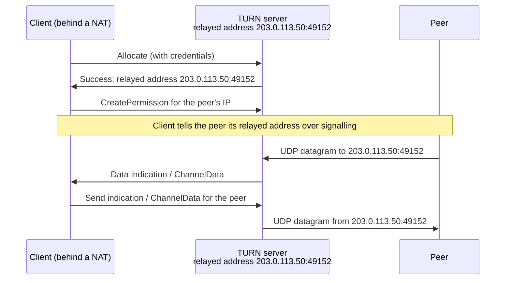

# 4. Relays

## The problem

Hole punching fails for some pairs, and no amount of retrying fixes an
endpoint-dependent NAT on both sides ([file 03 §3.3](03-hole-punching.md#33-why-it-fails-for-some-pairs)).
The best measurements put direct success at around 70% per attempt
([file 03 §3.5](03-hole-punching.md#35-how-often-does-it-work)), so the remaining
pairs need a third party with a public address that both can reach and that
forwards packets between them. That's a **relay**.

Relays turn out to do a second job too. Before any direct path exists, the peers
need a channel to swap addresses and time their punches. A server both are
already connected to is the obvious channel. Modern designs use the relay for
both, and that changes how they're built.

This chapter covers three relays that make different choices: TURN, the IETF
standard; DERP, Tailscale's; and iroh's, which descends from DERP.

## 4.1 Two ways to address a relayed packet

A relay receives a packet and has to decide who it's for. There are two basic
answers, and they lead to quite different systems.

| | Address-based | Key-based |
|---|---|---|
| Example | TURN | DERP, iroh relay |
| The relay gives you… | A public `IP:port` of your own on the relay | Nothing new: you're known by your public key |
| A peer sends to… | That `IP:port`, like any UDP address | The relay, labelled with your public key |
| The relay looks up… | Which client owns the port | Which connected client holds that key |
| Fits naturally with… | ICE: a relayed address is just another candidate | Systems where peers are already named by keys ([file 05](05-identity-and-discovery.md)) |

## 4.2 TURN

**TURN**, Traversal Using Relays around NAT, is RFC 8656 (February 2020,
obsoleting RFC 5766). It's an extension of STUN: "Most, though not all, TURN
messages are STUN-formatted messages" (§1).

A client asks the TURN server for an **allocation**, and gets back a **relayed
transport address**: a public `IP:port` on the server. Anything a peer sends to
that address is forwarded to the client; anything the client sends through the
allocation goes out from that address.

The parts that shape how it's used:

| Feature | Detail (RFC 8656) |
|---|---|
| Transports | Client↔server over UDP, TCP, TLS-over-TCP or DTLS-over-UDP; server↔peer always UDP in this spec (§3.1). TCP allocations are a separate extension, RFC 6062 |
| Allocation lifetime | Default 10 minutes, refreshed by the client (§3.2) |
| **Permissions** | Inbound packets are relayed only from peer IPs the client has permitted; a permission "expires after 5 minutes if it is not refreshed" (§3.3). They exist "to ease concerns amongst enterprise IT administrators that TURN could be used to bypass corporate firewall security" and "mimic the address-restricted filtering mechanism of NATs" |
| **Channels** | Send and Data indications add 36 bytes per packet; a bound channel uses a 4-byte header instead (§3.5). Matters for small voice packets |
| Credentials | Allocations need authentication, because a relay is an open bandwidth tap otherwise |

In ICE, the relayed address is just a candidate with type preference 0, the last
resort ([file 03 §3.7](03-hole-punching.md#37-ice-the-general-framework)). ICE
tries everything, and a TURN path wins only when nothing direct works. RFC 8656 §1
is blunt about why:

> Though the use of a TURN server to enable communication between two hosts
> behind NATs is very likely to work, it comes at a high cost to the provider of
> the TURN server since the server typically needs a high-bandwidth connection to
> the Internet. As a consequence, it is best to use a TURN server only when a
> direct communication path cannot be found.

**What TURN does not do** is encrypt your traffic end to end. It forwards whatever
datagrams you give it. Optional TLS or DTLS between client and server protects
that one hop, not the payload from the server. In WebRTC the payload is already
DTLS- and SRTP-encrypted between the browsers, so a TURN server sees ciphertext.
That's a property of WebRTC, not of TURN.

## 4.3 DERP

Tailscale built its own relay, **DERP**. Tailscale's own documents expand the name
two ways: "Detoured Encrypted Routing Protocol" in Anderson's 2020 NAT traversal
post, "Designated Encrypted Relay for Packets" in Pennarun's "How Tailscale works"
and the current knowledge base. The second is the one Tailscale uses today.

What it does differently from TURN:

- **Packets are addressed by WireGuard public key.** From the NAT traversal post:
  DERP "relays encrypted payloads based on the destination's public key." No
  allocations, no relayed `IP:port`.
- **It runs over HTTPS on TCP port 443.** Tailscale's firewall documentation:
  "data connections to the DERP relays use HTTPS on port 443." A network that
  allows web browsing allows DERP.
- **It's the signalling channel too.** "We use this communication path both as a
  data relay when NAT traversal fails (in the same role as TURN in other systems)
  and as the side channel to help with NAT traversal." Peers exchange candidates
  and coordinate punches through DERP.
- **Connections start relayed.** Since every peer is always connected to a home
  DERP server, a connection can begin immediately through it: "all connections
  start out with DERP preselected … after a few seconds, we'll have found a better
  path, and your connection transparently upgrades to it."
- **It can't read what it forwards.** WireGuard encrypts between the two devices;
  the knowledge base: "Because Tailscale private keys never leave the local device
  that generated them, it's impossible for a DERP server to decrypt your traffic."

Tailscale has since added **peer relays**, relays run on your own nodes, which
its documentation says are tried before falling back to DERP and "offer lower
latency and better performance than DERP servers because they run within your own
network or infrastructure".

## 4.4 iroh's relay

iroh's relay is DERP's descendant. The crate documentation (`iroh-relay/src/lib.rs`
at v1.3.0) describes its protocol as "a revised version of the Designated
Encrypted Relay for Packets (DERP) protocol written by Tailscale."

| Aspect | How it works | Source |
|---|---|---|
| Transport | HTTPS on TCP 443, upgraded to a WebSocket on the `/relay` path | `iroh-relay/src/http.rs:13`; iroh's "Deploying to enterprise networks" guide |
| Addressing | Datagrams carry the destination `EndpointId`, an Ed25519 public key | `iroh-relay/src/protos/relay.rs` |
| Proving who you are | The client proves it holds the secret key for its `EndpointId`: either by signing a server challenge, or, saving a round trip, by signing keying material exported from the TLS session (RFC 5705) | `iroh-relay/src/protos/handshake.rs:1-23` |
| Address discovery | Relays also run a QUIC Address Discovery server on UDP 7842 | Enterprise networks guide |
| Home relay | Each endpoint picks the closest relay by latency and stays connected to it | `iroh/src/lib.rs` crate docs |
| Load | Public relays rate-limit per connection by throttling reads, so traffic slows rather than drops | "Rate Limiting" docs page |

The handshake detail matters. Without it, anyone could connect to a relay claiming
someone else's key and receive their packets. Those packets would be encrypted and
useless to the impostor, but it would still be a denial of service. Proving
possession of the key at connect time closes that.

iroh's relay is also the signalling channel, the same as DERP. In iroh 1.x it
goes further: the relay path is one path of the actual QUIC connection, so the
connection exists from the first packet and later gains direct paths alongside
([file 06](06-iroh-end-to-end.md)).

## 4.5 Side by side

| | TURN | DERP | iroh relay |
|---|---|---|---|
| Specified in | RFC 8656 | Tailscale's code | iroh's code ("revised DERP") |
| Client reaches relay over | UDP, TCP, TLS or DTLS | HTTPS, TCP 443 | HTTPS → WebSocket, TCP 443 |
| Addressed by | Relayed `IP:port` + permissions | WireGuard public key | `EndpointId` (Ed25519 key) |
| Also the signalling channel? | No; ICE uses separate signalling | Yes | Yes |
| Used when | Only when ICE finds no direct pair | From the start, until a direct path is found | From the start, as one path of the QUIC connection |
| End-to-end encryption comes from | The application (DTLS/SRTP in WebRTC) | WireGuard | QUIC's TLS 1.3 |
| Server sees | Peer IPs, timing, volume; payload if the app didn't encrypt | Which keys talk, when, how much | Which keys talk, when, how much (iroh's security docs) |

## 4.6 What "the relay can't read it" does and doesn't mean

All three can be deployed so the relay sees only ciphertext. iroh's security page
says relays "cannot read" traffic and then, usefully, lists what they *can* see:
"The identities of the devices connected to it, which pairs are exchanging
traffic, when, and how much." It adds a subtlety: the relay "is also not told when
a pair goes direct. From its point of view traffic simply stops", so it can't tell
how long a conversation lasted overall.

> **Teacher's aside.** "The relay can't read it" is a property of the end-to-end
> protocol, not of the relay, and it's narrower than it sounds. A relay that can't
> decrypt can still **see the metadata** (who talks to whom, when, how much),
> **drop or delay** anything it likes, and, most importantly, **sit in the middle
> of the key exchange** if the peers don't verify each other's keys. Encryption
> to *a* key is worthless if the relay chose the key. So the claim holds only when
> each peer checks, inside the handshake, that the far end holds the specific key
> it expected, and that expectation came from somewhere the relay doesn't control.
> That's the whole subject of [file 05](05-identity-and-discovery.md). DERP and
> iroh's relay address packets *by* the key, which makes the check unavoidable;
> TURN leaves it to whatever runs on top.

## 4.7 The costs of relaying

| Cost | Why | What people do |
|---|---|---|
| **Bandwidth** | Every relayed byte crosses the relay twice: in and out | Relay only as a fallback; rate-limit; charge for it |
| **Latency** | The path detours through the relay's location | Run relays in many regions; each peer picks the nearest as home |
| **TCP underneath** | DERP and iroh's relay run over TCP 443. A lost packet on the relay leg is retransmitted by TCP, stalling everything behind it, including QUIC packets that were meant to be independent | Accept it as the price of getting through UDP-hostile networks; upgrade to a direct path quickly. TURN over UDP avoids this |
| **Two congestion controllers** | A QUIC connection over a TCP relay leg runs QUIC's congestion control on top of TCP's | Same: the relay path is meant to be temporary |
| **Metadata** | The operator learns the social graph of relayed connections | Run your own relays ("If it matters to you, run your own relay and it stays with you", iroh docs) |
| **Availability** | Relay down = relayed pairs disconnected; signalling gone for everyone on it | Multiple relays; clients reconnect elsewhere. iroh's relays hold no application state, which makes this cheap |

> ⚠️ **The relayed minority is a capacity plan, not a rounding error.** If 70–90%
> of pairs go direct, 10–30% don't, and those users push *all* their traffic
> through your relays for the whole session. Worse, they're not random: they
> cluster on particular mobile carriers and corporate networks. A relay fleet
> sized for "the rare failure" falls over the first time a large customer on a
> strict corporate network adopts the product. Measure the relayed fraction in
> production and provision for it.

## Check yourself

1. A TURN client has an allocation but forgot to create a permission for its
   peer. The peer sends datagrams to the relayed address. What happens, and why
   did RFC 8656 design it that way?
2. Explain why ICE ranks a relayed candidate below everything else, using RFC
   8656's own justification. Then explain why Tailscale and iroh nonetheless start
   every connection on the relay.
3. Why would a relay protocol run over HTTPS on TCP 443 when the traffic it
   carries is UDP? Name what it gains and what it costs once the connection is
   carrying a real-time stream.
4. An iroh relay did not require clients to prove possession of their key. Since
   all traffic is end-to-end encrypted, what could an attacker do with that, and
   what couldn't they?
5. A colleague says "the relay can't read our traffic, so relays are a solved
   privacy problem". Give three things a relay can still learn or do, and the one
   condition under which "can't read" holds at all.

(Answers in [09-exercises.md](09-exercises.md).)
