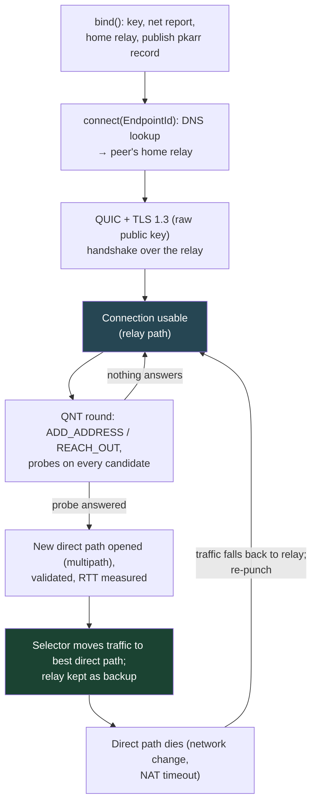

# 6. Worked example: iroh, end to end

## The problem

Files 01–05 describe the pieces one at a time. In a real system they interlock,
and the order matters: whether you punch before or after you have a connection,
whether the relay is a last resort or the starting point, how the transport finds
out its path changed. This chapter follows one implementation from `bind()` to a
steady direct connection, then compares it with Tailscale and WebRTC, which made
different choices.

iroh is a good subject because it is open source, small enough to read, and built
on QUIC, so the transport concepts carry straight over from
[http file 04](../http/04-quic.md).

## 6.1 Which iroh this describes

iroh's APIs, terms and even its wire protocol changed several times on the way to
1.0, and tutorials from different eras use different names for the same thing.
Code references here are relative to the repository root at **tag v1.3.0**
(released 28 September 2026), from <https://github.com/n0-computer/iroh>.

| Version | Date (CHANGELOG.md) | What changed that this course cares about |
|---|---|---|
| 0.34.0 | 2025-03-17 | "Switch TLS authentication to raw public keys" |
| 0.94.0 | 2025-10-21 | "Rename Node to Endpoint in all cases": `NodeId` → `EndpointId`, `NodeAddr` → `EndpointAddr`. Also "Remove stun-rs": STUN replaced by QUIC Address Discovery |
| 0.96.0 | 2026-01-28 | QUIC multipath; hole punching moved into QUIC (QNT), replacing iroh's own protocol; `Discovery` renamed `AddressLookup`. A wire-breaking release |
| 0.97.0 | 2026-03-16 | "Switch noq": iroh's QUIC stack becomes **noq**, n0's fork of Quinn |
| 1.0.0 | 2026-06-15 | First stable release |
| 1.1.0 | 2026-08-25 | "Don't send SNI": the `EndpointId` is no longer sent as the TLS server name (`iroh/src/tls/name.rs:3-5`) |

> ⚠️ **Old tutorials are a different protocol.** Anything that says `NodeId`,
> `NodeAddr`, `Discovery`, or describes STUN servers or a "disco" side protocol
> describes iroh before 0.94–0.96. The concepts mostly carry over; the code won't
> compile and the wire formats won't interoperate. Check the version before
> trusting an example, including this chapter.

## 6.2 Starting up: identity, home relay, publishing

```rust
let ep = Endpoint::builder(presets::N0)
    .alpns(vec![b"my-app/1".to_vec()])
    .bind()
    .await?;
```

(The accept-side example from `iroh/src/lib.rs`, with `presets::N0` meaning "use
n0's public relays and DNS address lookup".)

`bind()` does four things that map onto the five-step model of
[file 01 §1.5](01-foundations.md#15-the-working-model-five-steps):

| Step | What iroh does | Where |
|---|---|---|
| Identity | Generates an Ed25519 keypair. **A fresh one on every start** unless you persist and load the `SecretKey` | iroh docs, Endpoints |
| Discover | Runs a "net report": QUIC Address Discovery probes to relays (UDP 7842) to learn reflexive addresses, HTTPS probes for latency, and a check of whether the mapping varies by destination | `iroh/src/net_report/` |
| Home relay | Connects to the closest relay and keeps that connection open | `iroh/src/lib.rs:66-72` |
| Publish | Signs a pkarr record with its key (home relay URL) and publishes it to `dns.iroh.link` | iroh docs, Address Lookup ([file 05 §5.5](05-identity-and-discovery.md#55-discovery-from-a-key-to-an-address)) |

It also asks the local gateway for a port mapping over UPnP, NAT-PMP or PCP by
default ([file 02 §2.6](02-nat-behaviour.md#26-asking-the-nat-directly)).

## 6.3 Dialling: a real connection, over the relay, immediately

```rust
let conn = ep.connect(endpoint_id, b"my-app/1").await?;
```

Given only an `EndpointId`, iroh looks up the peer's record in DNS, finds its home
relay, and performs an ordinary QUIC handshake **through that relay**. TLS 1.3
with raw public keys checks the far end holds the key you dialled
([file 05 §5.3](05-identity-and-discovery.md#53-how-iroh-does-it)), and ALPN picks
the application protocol, which is mandatory: "To accept connections at least one
ALPN must be configured" (`iroh/src/lib.rs`).

When `connect` returns, you have a working, authenticated, encrypted QUIC
connection, and every packet so far has crossed the relay. The QUIC stack treats
the relay as just another path. n0's draft describing the protocol says the relay
path "looks like a normal IP path that uses IPv6 Unique Local Addresses as far as
the QUIC stack is concerned" (draft-bruynooghe-n0-quic-nat-traversal-00 §3.1).

> **Teacher's aside.** ICE's order is *find a path, then connect*: gather, check,
> nominate, and only then start DTLS and media. iroh and Tailscale invert it:
> *connect, then find a better path*. The connection exists from the first
> round trip, over the relay, and hole punching happens afterwards as a path
> upgrade inside it. You get the application running immediately and you never
> wait on the slowest NAT, at the price of running relays that carry the first
> seconds of every connection, and of letting the relay operator see that a
> connection started. Neither order is "right"; they're answers to different
> priorities, and knowing which order a system uses tells you where its latency
> and its infrastructure costs come from.

## 6.4 Hole punching inside QUIC

Since 0.96, the punching happens in the QUIC layer itself, as a QUIC extension.
iroh's variant is documented in an Internet-Draft, **draft-bruynooghe-n0-quic-nat-traversal-00**
(July 2026), which describes itself as "how noq … performs NAT traversal for
iroh … including all current bugs. This is not yet a specification". It's
"based on [draft-seemann-quic-nat-traversal], but with heavy modifications",
including different frame names and codepoints. Neither draft is an RFC.

The roles follow QUIC's: the dialler is the QUIC client, the acceptor the server.

```mermaid
sequenceDiagram
    participant C as Dialler (QUIC client)
    participant R as Relay
    participant S as Acceptor (QUIC server)
    C->>R: QUIC Initial, addressed to the acceptor's EndpointId
    R->>S: forwarded
    S-->>R: handshake reply
    R-->>C: forwarded. Connection up; NAT traversal extension negotiated
    Note over C,S: Each side already knows its reflexive<br/>addresses from QUIC Address Discovery
    S->>C: ADD_ADDRESS frames: my candidate addresses (via relay, encrypted)
    C->>S: REACH_OUT frames: my candidates, round n (via relay)
    par probes cross
        C->>S: PATH_CHALLENGE probes to each server candidate (direct, UDP)
    and
        S->>C: PATH_CHALLENGE probes to each client candidate (direct, UDP)
    end
    S->>C: PATH_RESPONSE (direct)
    Note over C,S: A probe got through: open it as a new<br/>multipath path, validate it properly, measure RTT
    rect rgb(27, 67, 50)
    C->>S: application data now on the direct path
    end
```

How it maps onto earlier chapters:

| Classic concept | In iroh 1.x |
|---|---|
| STUN Binding request ([file 03 §3.1](03-hole-punching.md#31-stun-asking-whats-my-address)) | QUIC Address Discovery: an `OBSERVED_ADDRESS` frame from a relay, on "a separate connection to a cooperating server" from the same UDP socket (n0 draft §3.2) |
| Signalling channel | The QUIC connection itself, over the relay. Candidates travel as encrypted frames |
| ICE connectivity checks that double as punches | NAT probes: QUIC packets carrying `PATH_CHALLENGE`, sent to every candidate (n0 draft §3.5.1) |
| ICE's controlling agent | The QUIC client starts each round with `REACH_OUT`; a server sending one is a protocol violation |
| Peer-reflexive candidates | A response arriving from an unexpected address becomes a path |

Two details from the draft are worth knowing because they look odd until you see
why. NAT probes "are not padded to 1200 bytes", unlike normal QUIC path
validation, so a successful probe only shows the address is reachable, not that
the path carries full-size packets. The path is properly validated once it's
opened. And the client must *initiate* rounds because RFC 9000 only lets clients
migrate ("Clients are responsible for initiating all migrations", §9); the draft
notes it introduces "path validation on the server side" to make punching
symmetric.

## 6.5 Choosing and switching paths

With QUIC multipath, a connection holds several paths at once (relay, IPv4 over
Wi-Fi, IPv6 over Wi-Fi, the same over mobile data) each with its own RTT estimate
and congestion state. iroh's blog post on multipath (August 2025) explains why
that mattered: before it, "Iroh completely lies to the QUIC stack and tells it to
send packets to some private IPv6 range" while swapping the real path underneath,
so the congestion controller never knew the path had changed.

The default selector is `BiasedRttPathSelector`
(`iroh/src/socket/biased_rtt_path_selector.rs:79-88`):

| Rule | Value at v1.3.0 |
|---|---|
| Two tiers: **primary** (IPv4, IPv6, custom transports) and **backup** (the relay) | Relay is used only if no primary path works |
| Within a tier, lowest biased RTT wins | IPv6 gets a 3 ms advantage (`:19`) |
| Stickiness: switch within a tier only if the candidate is at least this much better | 5 ms (`:23`), "this avoids flapping under jitter" |
| Across tiers | Switch immediately |

The chosen path is marked `Available` and the others `Backup`; spare IP paths are
closed, but one is kept open (`remote_state.rs:678-685`). So when the direct path
dies, the relay path is already there, which is what makes the fallback seamless.

Keeping it all alive:

| Behaviour | Value | Where |
|---|---|---|
| Keepalive on an idle path | every 5 s (`HEARTBEAT_INTERVAL`) | `iroh/src/socket.rs:109` |
| Give up on a silent path | 15 s (`PATH_MAX_IDLE_TIMEOUT`) | `iroh/src/socket.rs:117` |
| Look for a better path | every 60 s, unless a direct path already has RTT ≤ 10 ms | `remote_state.rs:55, 66, 756` |
| Re-punch when local addresses change | immediately | `remote_state.rs` actor loop |
| Minimum gap between rounds with no new candidates | 5 s | `remote_state.rs:52` |

Those timers are the answer to [file 02 §2.5](02-nat-behaviour.md#25-timeouts-and-keepalives):
5 s keepalives sit well inside the ~30 s NAT timeouts practitioners design for.

**What isn't solved.** The 0.96 release notes listed a known issue:
"Holepunching is not re-triggered when your network conditions change in most
circumstances." The v1.3.0 code above does re-trigger on local address changes,
so that has at least partly moved on, but the n0 draft's own description ("including
all current bugs") is the honest status: this is a young protocol with no RFC
behind it. And iroh's claim that "roughly 9 out of 10" configurations allow a direct
connection is unmeasured as far as its published docs go
([file 03 §3.5](03-hole-punching.md#35-how-often-does-it-work)).

## 6.6 The whole lifecycle



## 6.7 Tailscale and WebRTC, compared

The same five jobs, three different designs:

| | iroh 1.x | Tailscale | WebRTC |
|---|---|---|---|
| What it gives you | A QUIC connection to a key | A layer-3 VPN: every device gets an IP on a private network | Browser APIs for media and data |
| Peer identity | Ed25519 `EndpointId`, checked as a raw public key in TLS 1.3 | WireGuard public key | DTLS certificate, whose fingerprint is in the SDP |
| Where you get the key | Whatever gave you the `EndpointId` | The coordination server (control plane) | The app's signalling server |
| Address discovery | QUIC Address Discovery via relays | STUN (UDP 3478) | STUN |
| Signalling | Inside the QUIC connection, over the relay | DERP and the control plane | Application-defined; not specified |
| Traversal procedure | QNT inside QUIC; probes are QUIC packets | Its own, described in Anderson's 2020 post | ICE (RFC 8445) |
| Relay | iroh relay (DERP-derived), HTTPS 443 | DERP, HTTPS 443; peer relays | TURN |
| Connection starts on | The relay | DERP | Nothing until ICE nominates a pair |
| Direct transport | QUIC over UDP | WireGuard over UDP (default source port 41641) | SRTP for media; SCTP over DTLS for data channels (RFC 8831) |

The patterns worth noticing:

- **iroh and Tailscale are close relatives.** Key-addressed relays over 443 that
  double as the signalling channel, connections that start relayed and upgrade.
  The big difference is the layer: Tailscale hands the OS a network interface,
  iroh hands your program a QUIC connection.
- **WebRTC is the standards-track design.** ICE, STUN and TURN are all RFCs, which
  is why it interoperates across browsers. The cost is that identity rides on the
  signalling server ([file 05 §5.4](05-identity-and-discovery.md#54-where-the-key-comes-from)),
  and nothing flows until ICE finishes.
- **All three end up in the same place:** most traffic direct, a relay for the
  rest, and the relay unable to read what it carries.

## Check yourself

1. You find a blog post from 2024 using `NodeAddr` and a STUN server URL in its
   iroh config. Name two things that will differ in iroh 1.x, and say whether a
   1.x endpoint can talk to a 0.3x endpoint.
2. Your iroh app restarts and everyone's saved contact for it stops working,
   though the relays and DNS are fine. What happened, and what's the fix?
3. Explain why, in iroh 1.x, `connect()` can return successfully before any hole
   punching has happened. What is carrying the traffic at that moment, and what
   does the QUIC stack think that path is?
4. In QNT, why does the server advertise addresses with `ADD_ADDRESS` while only
   the client may send `REACH_OUT`? Connect this to a rule in RFC 9000.
5. A connection moved off the relay onto a direct IPv4 path with a 4 ms RTT. A
   few seconds later an IPv6 path is validated at 5 ms. Does iroh's default
   selector switch to IPv6? Later the IPv4 path's RTT rises to 9 ms and IPv6 stays
   at 5 ms. Does it switch now? Work through the numbers.
6. Contrast "connect, then upgrade" (iroh, Tailscale) with "find a path, then
   connect" (ICE in WebRTC). For a one-shot file transfer started by someone on a
   strict corporate network, which would you expect to start sending sooner, and
   which puts less load on your infrastructure?

(Answers in [09-exercises.md](09-exercises.md).)
