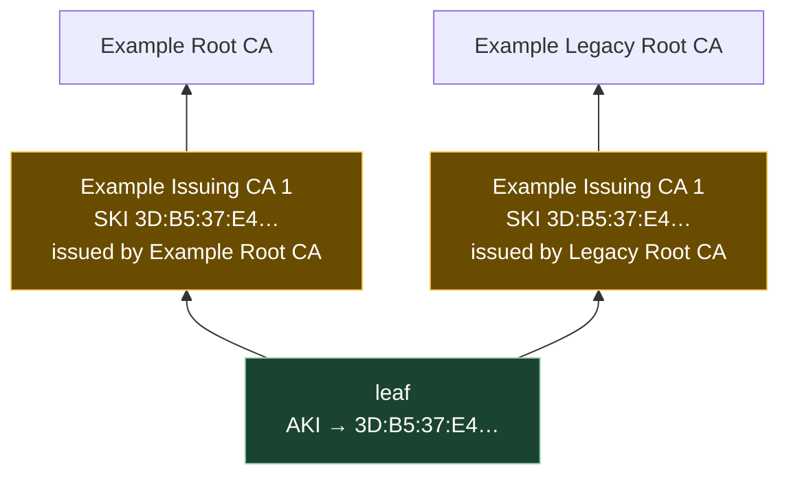

# 2. Building a chain, and walking it

Assumes [file 01](01-what-a-certificate-is.md) — in particular §1.3, that `issuer` is a hint
and the signature is the proof.

## The problem

File 01 described a chain as "a list of certificates where each one's subject is the next
one's issuer". That makes it sound like a linked list you follow.

It isn't. Nobody hands you the list. What you are actually given is:

- **one certificate** you care about — a card's, a server's, an attested key's; and
- **a bag of other certificates**, of unknown completeness, in no particular order, possibly
  containing several that could plausibly be the next link, possibly missing the one you need.

Turning that into a list is a *search*. Checking the list is an *algorithm*. They are
different jobs, they fail differently, and conflating them is why "certificate verification
failed" is such an unhelpful thing to read in a log.

## 2.1 Two jobs that get called one thing

| | **Path building** | **Path validation** |
|---|---|---|
| The job | find a candidate chain from the leaf to an anchor | decide whether a given chain is good |
| Specified by | RFC 4158 — *informational*, a guide | RFC 5280 §6.1 — normative, an algorithm |
| Shape | a search, with backtracking | a linear pass with state |
| Fails because | a certificate is **missing**, or you picked the wrong candidate | a certificate is **bad**: expired, wrong constraints, broken signature |
| Fix | get the missing certificate; order the bag better | nothing you can do client-side. The certificate is wrong |

RFC 4158 is explicit that building is deliberately left outside the standards:

> "Unlike certification path validation, certification path building is not addressed by the
> standards that define the semantics and structure of a PKI. This is because the validation of
> a certification path is unaffected by the method in which the certification path was built."

Which is true, and is also the source of every interoperability surprise in this chapter.
Validation is specified, so implementations agree. Building is not, so they don't.

## 2.2 Validation: the checks, and what each one stops

RFC 5280 §6.1, in the order it matters. For **every** certificate in the path:

| # | Check | Stops |
|---|---|---|
| 1 | the signature verifies under the **issuer's** public key | forgery — the only check that can't be talked around |
| 2 | the current time is within `validity` | use of a certificate past its intended life |
| 3 | for every CA in the path: `basicConstraints` `cA` TRUE, and `keyCertSign` if `keyUsage` is present | a leaf holder minting certificates (file 01 §1.4) |
| 4 | `pathLenConstraint` from above is not exceeded | a CA delegating further than it was permitted to |
| 5 | name constraints from above are satisfied | a CA issuing outside the namespace it was limited to |
| 6 | the certificate is not revoked | use of a certificate withdrawn before expiry |

Check 6 is a different kind of thing from 1–5: it needs a network call or a downloaded list,
and it has its **own** trust anchor, because the revocation answer is itself signed. That is a
chapter's worth of trouble on its own and it's already written —
[`smartcards/07`](../smartcards/07-verifying-the-card-certificate.md) §Is it still good?
Revocation covers OCSP's CertID, who may sign a response, what to check before believing one,
and the big one: an answer covers **one certificate, never the chain above it**.

Here is checks 1–5 failing for real. A three-level chain — root → issuing CA → leaf — generated
for this chapter with `openssl req`/`openssl x509`; the recipe is in
[`06-exercises.md`](06-exercises.md) so you can rebuild it. OpenSSL 3.6.4 on macOS.

**The happy path**, so you know what success looks like:

```
$ openssl verify -CAfile root.pem -untrusted inter.pem -show_chain leaf.pem
leaf.pem: OK
Chain:
depth=0: C=GB, O=Example Scheme, CN=card-00412 (untrusted)
depth=1: C=GB, O=Example Scheme, CN=Example Issuing CA 1 (untrusted)
depth=2: C=GB, O=Example Scheme, CN=Example Root CA
```

Read `(untrusted)` carefully: it is not a complaint. It marks the certificates that arrived as
*input* rather than from the trust store. Exactly one certificate in a good chain lacks that
marker — the anchor. If you ever see it absent twice, you have two anchors in play and should
work out why.

**Check 2, expiry:**

```
$ openssl verify -CAfile root.pem -untrusted inter.pem expired.pem
C=GB, O=Example Scheme, CN=card-00412
error 10 at 0 depth lookup: certificate has expired
error expired.pem: verification failed
```

**Checks 3 and 4, a leaf trying to be a CA.** This is the file 01 §1.4 attack, run for real:
take `leaf.pem` — `cA:FALSE` — and use its key to sign a certificate for something else.

```
$ openssl verify -CAfile root.pem -untrusted leaf-and-inter.pem rogue.pem
C=GB, O=Example Scheme, CN=card-00412
error 79 at 1 depth lookup: invalid CA certificate
C=GB, O=Example Scheme, CN=Example Issuing CA 1
error 25 at 2 depth lookup: path length constraint exceeded
C=GB, O=Example Scheme, CN=card-00412
error 32 at 1 depth lookup: key usage does not include certificate signing
```

Three independent refusals for one forgery: the leaf isn't a CA (79), the issuing CA above it
said `pathlen:0` so there may be no CA below it (25), and the leaf's `keyUsage` lacks
`keyCertSign` (32). Every signature in that chain is cryptographically perfect. Checks 3 and 4
are the entire reason it fails — which is the most direct demonstration available that
signature-checking alone is not verification.

## 2.3 Building is a search, because a name can lead two ways

The reason building needs backtracking is that **"the issuer of this certificate" can match
more than one certificate you hold.** The leaf names an issuer and points at a key id; several
certificates can legitimately satisfy both.

The clean case is a **cross-certificate**: a second CA issues a certificate for an existing
CA's *same public key*. Now one intermediate key has two certificates, identical in subject and
in SKI, differing only in who signed them — and therefore two different paths upward.



Two certificates, one key. The leaf cannot tell them apart — its AKI points at the key, and
both have that key. So a verifier holding only `Example Root CA` needs the left path, a
verifier holding only `Example Legacy Root CA` needs the right one, and **the same leaf with
the same bag of certificates has to resolve differently for each.**

This is not a contrived shape. It is how a PKI reaches clients with old trust stores. Let's
Encrypt did exactly this to keep working on old Android: IdenTrust cross-signed ISRG Root X1
from the expiring DST Root CA X3, so the chain
`Subscriber ← R3 ← ISRG Root X1 ← DST Root CA X3` validated on devices that had only the old
root, while current clients stopped at ISRG Root X1
([letsencrypt.org, December 2020](https://letsencrypt.org/2020/12/21/extending-android-compatibility/)).
One set of certificates, two populations, two different valid paths.

## 2.4 What that costs in practice: order decides the verdict

I built that exact shape to see what a real verifier does with it — two certificates for one
intermediate key, differing only in issuer — and varied nothing but **the order of the two
certificates in the `-untrusted` bundle**.

```
########## anchor = Example Legacy Root CA only ##########
bundle order: inter.pem, inter-cross.pem
    error 20 at 1 depth lookup: unable to get local issuer certificate
    error leaf.pem: verification failed          ← FAILS

bundle order: inter-cross.pem, inter.pem
    leaf.pem: OK                                  ← SUCCEEDS

########## anchor = Example Root CA only ##########
bundle order: inter.pem, inter-cross.pem
    leaf.pem: OK                                  ← SUCCEEDS

bundle order: inter-cross.pem, inter.pem
    error 20 at 1 depth lookup: unable to get local issuer certificate
    error leaf.pem: verification failed          ← FAILS
```

Same leaf. Same anchor. Same two certificates present in the bundle, both times. **A valid
path existed in every one of those four runs**, and two of them failed. The first matching
intermediate in the bundle was taken, and when it led to a root that wasn't the configured
anchor, verification failed rather than backing up to try the other candidate. Deterministic
across repeated runs, and unchanged by `-trusted_first`.

That isn't a bug, and OpenSSL documents the exact mechanism. From `X509_verify_cert(3ssl)`,
on chain construction:

> "Starting from the target certificate, the verification machinery seeks an issuer for the
> certificate currently at the top of the chain, drawing candidates from *ctx*'s untrusted stack
> and from the trust store. […] When an untrusted-first search fails to reach a trust anchor and
> `X509_V_FLAG_NO_ALT_CHAINS` is not set, the search is retried **with progressively shorter
> untrusted prefixes** in an attempt to find an alternative trusted path. […] **If more than one
> chain is possible, only one is taken.**"

Read the retry strategy carefully, because it explains the measurement exactly. OpenSSL *does*
backtrack — but it backtracks by **dropping untrusted certificates off the front**, not by
swapping in a *different* candidate at the same position. In the failing runs it took the first
matching intermediate, failed to reach the anchor, then retried with a shorter untrusted prefix
— which means trying to find the leaf's issuer directly in the trust store, where it isn't.
The sibling certificate that *would* have worked is never reconsidered, because the retry axis
is prefix length, not candidate choice.

And "if more than one chain is possible, only one is taken" is the general warning, in the
documentation, in one sentence. The lesson stands and is now mechanical rather than
anecdotal: **path building is best-effort and implementation-specific in a way path validation
is not.** A chain one verifier builds, another may not, from identical inputs.

> **Teacher's aside.** The practical consequence is a mental reclassification. People treat the
> certificates a sender provides as *the chain*, and so read a failure as "their certificate is
> bad". Those certificates are better understood as **a hint about where to look** — the sender
> guessing which path suits you, with no knowledge of your trust store. That's why servers can
> be misconfigured in ways that break some clients and not others, why `AuthorityInformationAccess`
> exists so a verifier can go and *fetch* a better candidate, and why mature verifiers keep
> their own pool of intermediates instead of relying on what arrives. When a chain fails to
> build, the useful first question is not "what's wrong with this certificate" but **"which
> certificate am I missing, and who has it?"**

## 2.5 Reading the errors

The single most useful table in this course. These are the codes observed in the runs above;
the split that matters is the right-hand column.

| OpenSSL error | Text | Which job failed |
|---|---|---|
| 20 | `unable to get local issuer certificate` | **building** — the issuer wasn't in the trust store or the bundle |
| 2 | `unable to get issuer certificate` | **building** — a candidate was found but has no issuer above it and isn't an anchor |
| 10 | `certificate has expired` | validation, check 2 |
| 79 | `invalid CA certificate` | validation, check 3 — `cA` is not TRUE |
| 32 | `key usage does not include certificate signing` | validation, check 3 — `keyCertSign` missing |
| 25 | `path length constraint exceeded` | validation, check 4 |

> ⚠️ **Error 20 is not a verdict on the certificate.** It is the verifier saying "I could not
> find the next link". The certificate in front of you may be perfectly good; you may be the
> one who is missing something. It is also, maddeningly, the *same* error you get when a
> certificate is from a scheme you have no business trusting at all — nothing in the message
> separates "I'm missing one of our own CAs" from "this is a foreign certificate".
> [`smartcards/07`](../smartcards/07-verifying-the-card-certificate.md) §Which CA, when the
> issuer has several works through what that ambiguity costs when an issuer has rotated keys.

## 2.6 The anchor is wherever you say it is

Everything in §1.6 said the anchor is configuration. Here is that with teeth.

Suppose you hold only the **intermediate**, not the root, and try to verify the leaf:

```
$ openssl verify -CAfile inter.pem leaf.pem
error 2 at 1 depth lookup: unable to get issuer certificate
error leaf.pem: verification failed

$ openssl verify -partial_chain -CAfile inter.pem -show_chain leaf.pem
leaf.pem: OK
Chain:
depth=0: C=GB, O=Example Scheme, CN=card-00412 (untrusted)
depth=1: C=GB, O=Example Scheme, CN=Example Issuing CA 1
```

`-partial_chain` is documented as "accept chains anchored by intermediate trust-store CAs"
(`openssl verify -help`, 3.6.4). With it, the intermediate *becomes* an anchor: the chain is
two certificates long and stops there.

Both results are correct. The difference is entirely a statement about what you decided to
trust, and it's worth being deliberate about which you want:

| Anchor at | You are saying | You give up |
|---|---|---|
| the **root** | "I trust this scheme, including CAs it adds in future" | nothing — but you inherit every future issuing CA under that root |
| an **intermediate** | "I trust exactly this issuing CA" | future CAs won't verify; you must add each one. Also: **nothing above the intermediate is checked any more**, including whether the root ever revoked it |

That second row is the trap. Pinning an intermediate is a tighter, often *better* policy — it's
what eID verifiers and the Android attestation verifier in file 03 effectively do — but you
have to notice that you have cut off the only mechanism that could have told you the
intermediate was withdrawn. An anchor is never checked (file 01 §1.6), so promoting a
certificate to anchor status silently retires every check above it.

## 2.7 What a built, validated chain actually buys you

A chain that builds and validates tells you exactly one thing:

> A keypair you decided to trust, or something it transitively authorised, signed a statement
> binding this public key to this subject name — and nobody has lied about the bytes.

That is a lot. It is also much less than people read into it. It does not tell you:

- that the **holder** of the certificate holds the matching private key — that needs a fresh
  challenge, signed now ([`smartcards/06`](../smartcards/06-proving-genuineness.md));
- that the certificate hasn't been **revoked** — that's check 6, a separate pass with its own
  anchor;
- that the **name** means what you think — name semantics are per-scheme and are where file 03
  spends its time;
- that the issuer was **honest or correct** when it signed. Validation checks arithmetic, not
  diligence.

File 03 takes four real chains and shows how differently they answer each of those.

## Check yourself

1. A log line reads `error 20 at 1 depth lookup: unable to get local issuer certificate`. Say
   which of the two jobs failed, what you would go and get, and why "the certificate is
   invalid" is the wrong conclusion to draw.
2. A chain validates on your laptop and fails in your container, with the same certificate
   files. Give two mechanically different causes, one in each of the two jobs.
3. Every signature in a three-certificate path verifies and no certificate is expired, yet
   validation fails with three errors at once. Explain what the submitter tried to do and which
   check caught it first.
4. Two intermediates share a subject and a subject key identifier, differing only in issuer.
   Explain why that is a legitimate and useful thing to deploy, and then explain why it makes a
   verifier's behaviour depend on something RFC 5280 says nothing about.
5. You switch your trust anchor from a scheme's root to its current issuing CA, to be stricter.
   Name the check you have just stopped performing, and the event that would now go unnoticed.
6. A colleague proposes caching successfully-built chains by leaf serial number to save the
   search. Serials are unique per issuer (file 01 §1.2). Say what breaks, and when.

(Answers in [`06-exercises.md`](06-exercises.md).)
