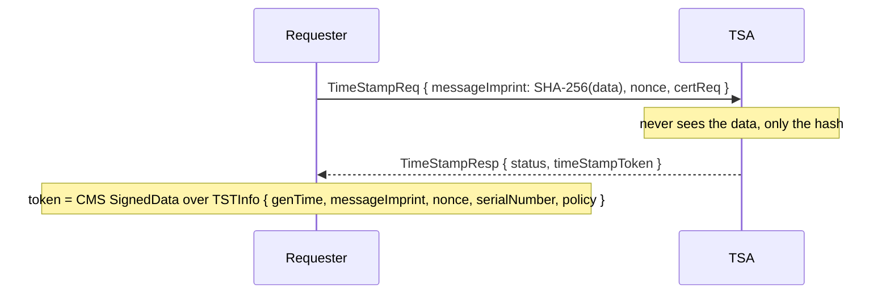

# 5. Signatures that outlive their certificate

Assumes files [01](01-what-a-certificate-is.md)–[02](02-building-and-walking-a-chain.md) —
chains, validity periods and revocation.

## The problem

A signed contract has to verify in ten years. By then the signing certificate has expired, may
have been revoked, the CA's OCSP responder may have been switched off, and the hash algorithm
may be considered weak. Every one of those turns a perfectly good signature into a failure — or
worse, into a shrug.

The question a verifier needs answered is not "is this certificate valid **now**?" but "was it
valid **when the signature was made**?". File 02's path validation answers the first. Nothing in
a basic signature answers the second, because the only time it carries is the one the signer
wrote down themselves.

This chapter is about the evidence that fixes that: **trusted timestamps** and **embedded
validation material**, and the PDF profile (PAdES) that packages them into four levels.

## 5.1 The claimed time proves nothing

A signature made with a key says "the holder of this key signed these bytes". It does not say
when. Most formats carry a time anyway, and it is worth being clear about what kind of time it
is.

In a PAdES baseline signature the signing time lives in the PDF signature dictionary's `M`
entry — "the claimed UTC time of the signature". The CMS `signing-time` attribute, which other
CAdES profiles use, **shall not be present** at any level
([ETSI EN 319 142-1 V1.2.1](https://www.etsi.org/deliver/etsi_en/319100_319199/31914201/01.02.01_60/en_31914201v010201p.pdf)
§6.3, Table 1 and requirement g)). Either way, it is a value the signer chose. A signer whose
certificate was revoked on Tuesday can sign on Wednesday and write Monday.

> **Teacher's aside.** People read the date in a signature panel as a fact. It's a claim, made
> by the one party with a motive to get it wrong — exactly like the `issuer` field in file 01
> §1.3 is a claim and the signature is the evidence. To turn the date into evidence you need
> someone *else's* signature over it.

## 5.2 Borrowing a clock: RFC 3161

A **time-stamping authority** (TSA) is a service that signs a statement "this hash existed at
this time", using its own key. The protocol is
[RFC 3161](https://www.rfc-editor.org/rfc/rfc3161).



| Piece | What it is | Where |
|---|---|---|
| `messageImprint` | the hash algorithm and the hash of whatever is being timestamped | §2.4.1 |
| `nonce` | a random number; "the same nonce value MUST be included in the response, otherwise the response shall be rejected" | §2.4.1 |
| `certReq` | asks the TSA to include its certificate in the token | §2.4.1 |
| `genTime` | "the time at which the time-stamp token has been created by the TSA" | §2.4.2 |
| status | `granted (0)`, `grantedWithMods (1)`, `rejection (2)`, … | §2.4.2 |

Three requirements on the TSA explain why it can be shared by strangers. It must "only
time-stamp a hash representation of the datum", must "not … examine the imprint being
time-stamped in any way", and must "not … include any identification of the requesting entity"
(§2.1, items 6, 8, 9). The TSA learns nothing about your document and puts nothing about you in
the token.

Its key, though, is special-purpose. The TSA's certificate "MUST contain only one instance of
the extended key usage field extension", with the purpose `id-kp-timeStamping`, and "this
extension MUST be critical" (§2.3) — so a TLS or document-signing certificate cannot be passed
off as a TSA.

Over HTTP the request goes out as `application/timestamp-query` and comes back as
`application/timestamp-reply` (§3.4). The same section's last paragraph calls the response
type `application/timestamp-response`, which contradicts it; implementations use `-reply`.

### Doing it by hand

OpenSSL ships a toy TSA, which is enough to see every field. With a throwaway CA and a TSA
certificate carrying the critical EKU (OpenSSL 3.6.4, macOS):

```text
$ openssl x509 -in tsa.pem -noout -ext extendedKeyUsage
X509v3 Extended Key Usage: critical
    Time Stamping

$ openssl ts -query -data sigvalue.bin -sha256 -cert -out req.tsq
$ openssl ts -query -in req.tsq -text
Version: 1
Hash Algorithm: sha256
Message data:
    0000 - 2b 82 e2 82 a4 38 18 e0-11 d4 09 bc 79 63 95 2f   +....8......yc./
    0010 - 5c 85 14 46 fc 00 36 c3-9d 79 01 7d 9d a0 29 fc   \..F..6..y.}..).
Policy OID: unspecified
Nonce: 0xE8027F10DE4FD9CE
Certificate required: yes

$ openssl ts -reply -config tsa.cnf -queryfile req.tsq -out resp.tsr
$ openssl ts -reply -in resp.tsr -text
Status info:
Status: Granted.
TST info:
Version: 1
Policy OID: tsa_policy1
Hash Algorithm: sha256
Message data:
    0000 - 2b 82 e2 82 a4 38 18 e0-11 d4 09 bc 79 63 95 2f   +....8......yc./
    0010 - 5c 85 14 46 fc 00 36 c3-9d 79 01 7d 9d a0 29 fc   \..F..6..y.}..).
Serial number: 0x02
Time stamp: Nov  4 01:08:23 2026 GMT
Accuracy: 0x01 seconds, unspecified millis, unspecified micros
Nonce: 0xE8027F10DE4FD9CE
TSA: DirName:/CN=Demo TSA

$ openssl ts -verify -data sigvalue.bin -in resp.tsr -CAfile ca.pem
Verification: OK
$ openssl ts -verify -data other.bin -in resp.tsr -CAfile ca.pem
…:ts_check_imprints:message imprint mismatch:…
Verification: FAILED
```

The request is 70 bytes; the response, with the TSA's certificate inside, 1,357. The nonce
round-trips, and a token checked against different bytes fails on the imprint, not on the
signature — the token is fine, it just isn't about those bytes.

## 5.3 What you timestamp is the signature

The obvious move is to timestamp the document. The standard move is to timestamp the
**signature value**. RFC 3161 Appendix A defines a CMS attribute, `id-aa-timeStampToken`
(`1.2.840.113549.1.9.16.2.14`, from the arc given there), whose token covers "a hash of the
value of signature field within SignerInfo".

Why the signature and not the document? Because the question is "did *this signature* exist at
T?". A hash of the document proves the bytes existed, which anyone could have had. A hash of
the signature value proves the signing had already happened.

It goes in as an **unsigned** attribute — outside the bytes the signer's key covered — which is
what makes it possible to add after the signature is computed, and even later by someone else
(§5.8). In PAdES this is the **signature-time-stamp**; the trusted time for B-T "shall be
provided either by a signature-time-stamp attribute or a document-time-stamp"
(EN 319 142-1 §6.3 requirement n)).

## 5.4 How a verifier uses the time

Here is the payoff, and it is more precise than "a timestamp makes old signatures valid".
[ETSI EN 319 102-1 V1.4.1](https://www.etsi.org/deliver/etsi_en/319100_319199/31910201/01.04.01_60/en_31910201v010401p.pdf)
§5.5.4 has the verifier keep one variable, **best-signature-time**: "the earliest time when it
can be trusted … that a signature has existed". It starts as **the current time**. Each
signature timestamp that validates, and is earlier, moves it back to that token's `genTime`.
Then the certificate's history is compared against it.

The evidence that moves it is a **proof of existence** (POE) — "evidence that proves that an
object existed at a specific date/time" (§3.1).

| Certificate's history | No timestamp (best-signature-time = now) | Timestamp at T, before the event |
|---|---|---|
| Revoked after signing | INDETERMINATE / `REVOKED_NO_POE` | can reach TOTAL-PASSED — revoked after T (§5.5.4 step 4 a)) |
| Expired after signing | INDETERMINATE / `OUT_OF_BOUNDS_NO_POE` (or `…_NOT_REVOKED`) | can pass — T within the validity period |
| Not yet valid when "signed" | not detectable — the claimed time is the signer's | FAILED / `NOT_YET_VALID` if T precedes `notBefore` (step 4 b)) |
| Revoked **before** T | — | still fails: revocation precedes the proven time |

```text
 issued        signed      timestamped T      revoked              you validate
   │             │             │                 │                       │
───┼─────────────┼─────────────┼─────────────────┼───────────────────────┼────►
   └──────────── certificate valid ─────────────┘
                               ▲
                     best-signature-time: T < revocation  →  can pass
         without the token, best-signature-time = now > revocation  →  INDETERMINATE
```

> **Teacher's aside.** A timestamp does not make revocation irrelevant; it changes **which**
> revocation matters. Revoked after T: the signature stands, because the key was still good
> when it was used. Revoked before T: no timestamp rescues it. That's the whole reason a
> verifier still needs revocation data, which is the next section.

The INDETERMINATE row is the one to dwell on. Without a timestamp, a revocation five years after
signing does not make the signature *invalid* — it makes it *unknowable*. The verifier cannot
tell whether the signing happened before the revocation, and EN 319 102-1 refuses to guess
(Table 5 in §5.1.3 lists the indications).

## 5.5 Validation material disappears

Checking the certificate "as of T" still needs the chain and its revocation status from around
T. In ten years the CA may have stopped publishing CRLs, decommissioned its OCSP responder, or
ceased to exist. The evidence has to be **collected while it still exists** and kept with the
signature.

PAdES does that with the **Document Security Store** (DSS), defined in EN 319 142-1 §5.4.2 as
an extension to ISO 32000-1: a dictionary hung off the document catalogue.

| Key | Holds |
|---|---|
| `Certs` | streams, each one DER X.509 certificate usable to validate any signature in the document |
| `OCSPs` | streams, each one DER `OCSPResponse` ([RFC 6960](https://www.rfc-editor.org/rfc/rfc6960)) |
| `CRLs` | streams, each one DER CRL ([RFC 5280](https://www.rfc-editor.org/rfc/rfc5280)) |
| `VRI` | per-signature dictionaries keyed by "the base-16-encoded (uppercase) SHA1 digest of the signature" |

For B-LT the set has to be **complete**: every certificate used to validate the signing
certificate — including the anchor when it is available as a certificate — **and the TSA's**,
plus "the full set of revocation data … that have been used in the validation of the signer
and CA certificates", again including the TSA's (§6.3 requirements r) and t)). Forgetting the
TSA's chain is the classic way to build a document that is B-LT in name only: the timestamp
that anchors everything can no longer itself be validated.

`VRI` is on its way out: the 2024 edition says it "should not be used", and anything it
references must also be in the top-level arrays (§6.3 requirement v)).

## 5.6 The PDF mechanics: `ByteRange` and incremental updates

A PDF signature does not cover "the document". It covers the byte ranges listed in the
signature dictionary's `ByteRange`: everything in the file except the hole where the signature
itself sits. For PAdES, "the ByteRange shall cover the entire file, including the Signature
Dictionary but excluding the PDF Signature itself" (§6.3 requirement k)) — the entire file **as
it was when signed**.

Adding a DSS afterwards therefore cannot touch those bytes. PDF's answer is the **incremental
update** (ISO 32000-1 §7.5.6): new and changed objects are appended after the original
`%%EOF`, with a new cross-reference section, and the earlier bytes are left exactly as they
were. The signature still covers its revision; the DSS lives in the next one. EN 319 142-1
places VRI dictionaries "in document incremental update sections", later than the signature they
describe (§5.4.2.2), and exempts DSS updates from a certifying signature's DocMDP restrictions
(§5.4.2.3).

> ⚠️ **Never re-save a signed PDF.** A library that loads the file and writes it back in full —
> to append a page, to "optimise", to add metadata — renumbers objects and moves bytes, and
> every `ByteRange` then points at the wrong offsets. Every validator reports the signature
> broken. It looks fine in a viewer that doesn't check. Anything added after signing must be
> an incremental update, and anything that is *part* of the signed document must be added
> **before** signing.

A cheap invariant to test: for the **last** signature in a file with no later updates,
`ByteRange[2] + ByteRange[3]` equals the file length. Once a DSS has been appended, that holds
for the revision instead, and the bytes after it must parse as an incremental update.

## 5.7 Renewing the evidence: B-LTA

B-LT has its own expiry date: the TSA's certificate, the embedded CRLs and OCSP responses, and
the hash algorithms all age. B-LTA adds a **document time-stamp** — a signature dictionary with
`Type` `DocTimeStamp` and `SubFilter` `ETSI.RFC3161`, whose token is over the bytes covered by
its own `ByteRange`, i.e. the whole document including the DSS (§5.4.3; §6.3 y)). That freezes
the validation material at a time a fresh TSA vouches for.

The protection can be extended again "by adding further DSS information to validate the
previous last document time-stamp along with a new document time-stamp", each DSS carrying the
previous one's values (§5.4.1). The document becomes a stack of revisions, each timestamp
vouching for everything beneath it.

This is also the defence against algorithm ageing: a signature made with a hash later
considered weak can still be validated if a POE shows it existed before the weakness mattered
(EN 319 102-1 §5.5.4, the `CRYPTO_CONSTRAINTS_FAILURE_NO_POE` case).

## 5.8 The four levels

EN 319 142-1 §6.1 defines four PAdES baseline levels, each including the one before.

| Level | Adds | Survives | Needs at signing time |
|---|---|---|---|
| **B-B** | the CMS signature, signing certificate protection, the claimed time in `M` | nothing past certificate expiry or revocation — those become INDETERMINATE | the signing key |
| **B-T** | a trusted time: signature-time-stamp or document-time-stamp | expiry and later revocation of the **signing** certificate | a reachable TSA |
| **B-LT** | DSS with every certificate and revocation response, the TSA's included | the CA's services disappearing | reachable OCSP responders or CRL distribution points, for both chains |
| **B-LTA** | a document time-stamp over the DSS; renewable | the TSA's certificate expiring, algorithm ageing | a TSA again — and again at each renewal |

A B-B signature can be raised later: §6.3 requirement q) allows reserving space for a
signature-time-stamp, or adding a document-time-stamp that covers the existing signature value.
What a later upgrade cannot do is prove an *earlier* time — the POE is when the upgrade
happened.

## 5.9 What isn't solved

- **Every level above B-B needs the network at signing time.** A TSA for B-T, OCSP or CRL
  endpoints for B-LT. An offline or air-gapped signer has to run its own TSA and revocation
  sources inside the perimeter, or reach out through an approved route, or accept B-B and
  upgrade later — with the POE dated to the upgrade.
- **The TSA is another trust anchor.** Everything in §5.4 assumes the verifier trusts the TSA's
  chain; choosing a TSA is choosing whose clock you anchor on, and file 04's operational
  questions apply to it.
- **"Long term" is a maintenance process, not a property.** B-LTA only stays valid if someone
  keeps adding document timestamps before the last one ages out. A file left on a disk for
  twenty years without renewal decays to its last timestamp's horizon.
- **A green tick is a summary.** EN 319 102-1 specifies indications and sub-indications, not how
  a viewer displays them. When the level matters, use a validator that reports the indication
  itself — `INDETERMINATE/REVOKED_NO_POE` says far more than a yellow triangle.

## Check yourself

1. A signer's certificate was revoked last month. Their contract from two years ago has a
   B-B signature. What does an EN 319 102-1 validator report, and why is "invalid" the wrong
   word for it?
2. Why does the signature-time-stamp hash the **signature value** rather than the document?
   What would a hash of the document fail to prove?
3. A B-T document's TSA certificate expires. The signing certificate has also expired. What can
   still be proven, what can't, and which level would have covered it?
4. A service signs a PDF and then appends a cover page by loading and saving the file with a
   PDF library. Describe, at the byte level, what a validator finds — and the two correct ways
   to get the cover page into the signed file.
5. You are asked to make every signature "LTV-enabled" by embedding the signer's chain and OCSP
   responses in a DSS. What has been left out, and what does a validator do in ten years
   because of it?
6. A signing service has no outbound network access. Lay out its options for reaching B-T and
   B-LT, and what each one costs in trust or in proof.

(Answers in [`07-exercises.md`](07-exercises.md).)
