# 1. Foundations: what voice looks like to a computer

## The problem

A voice app moves sound from one person's mouth to another person's ear, live. Every later
chapter is about one part of that journey breaking: a thread missing its deadline, a codec
frame being lost, a packet arriving late. You can't reason about any of those failures
until you can picture what's actually in the buffer: what one number means, how many of
them arrive per second, and where on the path each one waits.

**Who can skip this.** If you can already say what an interleaved stereo `f32` buffer at
48 kHz looks like in memory, why 960 is a magic number, and roughly where the delay goes
between a microphone and a remote speaker, skim §1.6 and §1.8 and move on to
[file 02](02-realtime-audio-threads.md). Everyone else: every later chapter assumes this one.

## 1.1 Sound is pressure over time; a sample is one measurement

Sound is air pressure wobbling back and forth. A microphone turns that wobble into a
voltage that wobbles the same way. That voltage is a smooth, continuous curve.

A computer can't store a continuous curve. What it can do is **measure the curve at
regular instants** and keep the list of measurements. Each measurement is a **sample**.
The number of measurements per second is the **sample rate**, in hertz (Hz). The chip
that does the measuring is the **ADC** (analogue-to-digital converter); its mirror image
on the playback side, the **DAC**, turns a list of numbers back into a voltage for the
speaker.

Think of a spreadsheet with one column. Row *n* holds the pressure at time *n* / sample
rate. At 48 kHz, row 48,000 is exactly one second in. That's the whole data model. This
representation (equally spaced samples, each a plain number) is called **PCM**, pulse code
modulation. Xiph's primer puts it bluntly: PCM "is far and away dominant" and "an audio
engineer can spend an entire career without running into anything else"
([Xiph, *A Digital Media Primer for Geeks*](https://wiki.xiph.org/Videos/A_Digital_Media_Primer_For_Geeks)).

Sample rates you'll meet:

| Rate | Where it comes from | Highest frequency it can hold (§1.2) |
|---|---|---|
| 8 kHz | Classic digital telephony. "A bit muffled but perfectly intelligible for voice" (Xiph primer) | 4 kHz |
| 16 kHz | "Wideband" speech. A big step up in clarity over telephone audio | 8 kHz |
| 44.1 kHz | The CD. Now common on consumer hardware | 22.05 kHz |
| 48 kHz | Video and pro audio, and the rate Opus is built around (file 03) | 24 kHz |

Opus accepts input at 8, 12, 16, 24 or 48 kHz and **not** at 44.1 kHz
([libopus encoder API](https://opus-codec.org/docs/opus_api-1.5/group__opus__encoder.html)).
If a sound card hands you 44.1 kHz, you resample before encoding. File 02 §2.7 covers
that.

## 1.2 Nyquist, intuitively

How fast do you need to sample? The intuition comes from film. A wagon wheel filmed at 24
frames per second can look like it's spinning backwards, because between frames the spokes
moved almost a full turn and the camera can't tell that apart from a small backwards turn.
Sampling too slowly doesn't just lose fast motion; it **turns fast motion into fake slow
motion**.

Sound behaves the same way. The **sampling theorem** says two things (Xiph's phrasing):

1. A signal sampled at rate *f*ₛ can't represent any frequency above *f*ₛ / 2. That limit
   is the **Nyquist frequency**.
2. Frequencies above it that are present when you sample aren't simply dropped: they
   **fold down** into the audible range as **aliasing**, a distortion that "sounds freakin'
   awful".

So a 48 kHz stream can carry anything up to 24 kHz. Human hearing tops out around 20 kHz,
which is why 44.1 and 48 kHz are enough for everything and why Opus "never codes audio
above 20 kHz" ([RFC 6716 §2](https://www.rfc-editor.org/rfc/rfc6716.html#section-2)).

The ADC hardware filters out too-high frequencies before sampling, so you don't worry
about aliasing at capture. You **do** worry about it when your own code changes the sample
rate.

> ⚠️ **Throwing away samples is not downsampling.** Turning 48 kHz into 16 kHz by keeping
> every third sample skips the low-pass filter, so everything between 8 and 24 kHz folds
> back into the speech band as aliasing. Always use a real resampler (file 02 §2.7), which
> filters first.

For speech, what matters is that most intelligibility lives in the low few kilohertz (8 kHz
sampling is muffled but intelligible), while sibilants like "s" and "f" carry energy
higher up. That's why wideband (16 kHz) and fullband (48 kHz) voice sound so much more
natural than the telephone.

## 1.3 The numbers themselves: bit depth, `i16` vs `f32`, and clipping

Each sample is a number, and you have to pick how to store it. Two formats dominate:

| | `i16` (16-bit signed integer) | `f32` (32-bit IEEE 754 float) |
|---|---|---|
| Range | −32,768 … +32,767 | Nominally −1.0 … +1.0 |
| Full scale ("0 dBFS") | The largest absolute value | ±1.0 |
| Bytes per sample | 2 | 4 |
| What happens past full scale | Can't be represented. The value **clips** | Representable (1.7 is a valid float), so mixing can go over temporarily. Clips only when converted for the DAC |
| Typical use | Storage, network, older APIs, many codecs' integer path | Processing, mixing, and the native format of many audio APIs |

**Bit depth** sets how finely each sample is measured. Each extra bit doubles the number
of levels, and doubling a ratio is 20·log₁₀(2) ≈ 6.02 dB, so you get about 6 dB of
**dynamic range** (the ratio between the loudest and quietest things you can represent)
per bit. 16 bits gives about 96 dB. Xiph's
[24/192 article](https://people.xiph.org/~xiphmont/demo/neil-young.html) argues that with
proper dither the effective range of 16-bit audio is deeper still, and concludes "16 bits
is enough to store all we can hear", while noting that engineers want more than 16 bits
*during mixing*. For a voice app, 16-bit precision is more than you need. You'll still
often process in `f32`, because it's convenient and it gives you headroom.

**Clipping** is what happens when a signal asks for a value beyond full scale. The top of
the waveform is sliced flat. Flat tops contain sharp corners, and sharp corners mean
high-frequency energy that wasn't in the original: clipping sounds harsh and crackly, not
just loud. In voice apps it comes from a hot microphone gain, from summing several voices
(file 06), or from a bug that scales samples wrongly.

Converting between the formats is a scale factor:

```
f32 = i16 as f32 / 32768.0          // −32768 → −1.0,  32767 → 0.99997
i16 = (f32 * 32767.0).round().clamp(−32768, 32767)
```

> ⚠️ **The clamp is not optional.** `f32` values above 1.0 are legal, and casting
> `1.2 * 32767.0` to `i16` without clamping either saturates or wraps, depending on the
> language and how you cast. A wrapped sample jumps from loud-positive to loud-negative,
> which is a click far worse than clipping. (Rust's `as` from float to int saturates; a
> manual bit-twiddling conversion or a C library might not.)

## 1.4 Channels, interleaving, and the three meanings of "frame"

Stereo has two channels, left and right. A voice app usually wants **mono**, one
channel, but sound cards often hand you stereo even from a single microphone.

Raw PCM stores several channels by **interleaving**: one sample from each channel in turn
(Xiph: "the convention in raw PCM is to encode multiple channels by interleaving the
samples of each channel together into a single stream").

```
Interleaved stereo buffer, f32, as it sits in memory:

index:   0     1     2     3     4     5     6     7
       ┌─────┬─────┬─────┬─────┬─────┬─────┬─────┬─────┐
       │ L0  │ R0  │ L1  │ R1  │ L2  │ R2  │ L3  │ R3  │
       └─────┴─────┴─────┴─────┴─────┴─────┴─────┴─────┘
       └─ frame 0 ─┘└─ frame 1 ─┘└─ frame 2 ─┘└─ frame 3 ─┘

8 samples  =  4 frames  =  4 / 48,000 s  ≈ 0.083 ms at 48 kHz
```

The word **frame** now bites, because it means three different things in this course:

| Context | "Frame" means | Example |
|---|---|---|
| Audio I/O (cpal, CoreAudio, ALSA) | One sample per channel, taken at the same instant | A stereo frame is 2 samples |
| Codecs (Opus) | A chunk of audio encoded as one unit | A 20 ms Opus frame is 960 samples per channel at 48 kHz |
| Networking | A link-layer packet (Ethernet frame) | Not used in this course, but your colleagues will say it |

Where it matters, I'll write "I/O frame" or "codec frame".

> ⚠️ **"Buffer of 512" is ambiguous.** 512 samples or 512 frames? For stereo those differ
> by a factor of two, and the difference is a pitch-shifted, double-speed (or half-speed)
> mess. cpal's `BufferSize::Fixed(n)` counts **frames**
> ([docs.rs/cpal, `BufferSize`](https://docs.rs/cpal/latest/cpal/enum.BufferSize.html)),
> while the `&[f32]` slice your callback receives has frames × channels elements. Always
> divide by the channel count before treating a length as time.

## 1.5 How much data is one second of voice?

Multiply it out. This is the number that justifies codecs.

| Format | Arithmetic | Bitrate |
|---|---|---|
| 8 kHz, 16-bit, mono (telephone) | 8,000 × 16 × 1 | 128 kbit/s |
| 16 kHz, 16-bit, mono | 16,000 × 16 × 1 | 256 kbit/s |
| 48 kHz, 16-bit, mono | 48,000 × 16 × 1 | 768 kbit/s |
| 48 kHz, 16-bit, stereo (CD-like) | 48,000 × 16 × 2 | 1,536 kbit/s |
| 48 kHz, `f32`, mono | 48,000 × 32 × 1 | 1,536 kbit/s |

Opus carries fullband speech well at 28–40 kbit/s (RFC 6716 §2.1.1's "sweet spot"), about
a twentieth to a thirtieth of the 768 kbit/s raw mono stream. File 03 covers what it
throws away to get there.

## 1.6 The pipeline, end to end

Here is the whole journey of one syllable. Every box is a place where audio waits.

```mermaid
flowchart LR
    MIC["Mic + ADC"] --> CAP["Capture callback<br/>(audio thread)"]
    CAP --> RB1["Ring buffer"]
    RB1 --> ENC["Encoder<br/>(collects a codec frame)"]
    ENC --> NET["Packetise + send<br/>seq, timestamp"]
    NET -->|network| RX["Receive"]
    RX --> JB["<b>Jitter buffer</b><br/>reorder, wait,<br/>detect loss"]
    JB --> DEC["Decoder<br/>+ PLC / FEC"]
    DEC --> RB2["Ring buffer"]
    RB2 --> PLAY["Playback callback<br/>(audio thread)"]
    PLAY --> SPK["DAC + speaker"]

    style JB fill:#6a4c00,stroke:#ffd166,color:#fff
    style CAP fill:#264653,stroke:#8ecae6,color:#fff
    style PLAY fill:#264653,stroke:#8ecae6,color:#fff
```



| Stage | What it does | Covered in |
|---|---|---|
| Mic + ADC | Turns pressure into samples at the device's clock rate | §1.1 |
| Capture callback | The OS hands you a buffer of fresh samples on a high-priority thread | [File 02](02-realtime-audio-threads.md) |
| Ring buffer | Moves samples between the real-time thread and the rest of your program without locking | File 02 §2.5 |
| Encoder | Waits for a full codec frame (say 20 ms), then compresses it | [File 03](03-codecs-and-opus.md) |
| Packetise + send | Adds a sequence number and timestamp, sends over UDP or similar | [File 04](04-packet-loss-and-jitter.md) §4.3 |
| Jitter buffer | Holds packets long enough to smooth out uneven arrival; notices loss | File 04 §4.4 |
| Decoder + PLC/FEC | Decompresses; invents plausible audio for lost packets | File 04 §4.6–4.7 |
| Playback callback | The OS asks you to fill a buffer *now*, on a high-priority thread | File 02 |
| DAC + speaker | Turns samples back into pressure at the output device's clock rate | §1.1 |

The highlighted jitter buffer is the one component that exists purely because of the
network, and it's usually the largest single deliberate delay in the chain.

## 1.7 Three sources of trouble

Almost every bug in a voice app comes from one of three mismatches. Naming them now makes
the later chapters easier to file.

| Mismatch | Where | Symptom | Chapter |
|---|---|---|---|
| **Deadline**: the audio hardware wants samples on a fixed schedule, and your code is late | Callbacks | Clicks, crackle, gaps | 02 |
| **Clock**: two devices that both claim 48 kHz disagree slightly about what a second is | Mic vs speaker; sender vs receiver | Buffers that slowly fill or drain, then glitch every few minutes | 02 §2.7, 04 §4.5 |
| **Network**: packets don't arrive evenly, in order, or at all | Transport | Robotic or choppy audio, growing delay | 04 |

## 1.8 The latency budget idea

**Latency** here means mouth-to-ear delay: from the moment a person speaks to the moment
the listener hears it. It's a **sum**. Each stage in §1.6 adds its own delay, and nothing
later can win back time spent earlier.

That makes latency a budget, like a page-load budget in web work. You decide on a total,
then allocate it across stages. The ITU's planning guidance (G.114, quoted carefully in
[file 05](05-latency-echo-and-testing.md) §5.1) says that if mouth-to-ear delay stays
below 150 ms, "most applications, both speech and non-speech, will experience essentially
transparent interactivity."

A sketch of where the milliseconds go. These are **illustrative**, not measurements; file
05 §5.2 discusses real ranges and how to measure your own.

```
mouth                                                                    ear
  │ capture buf │ codec frame │lookahead│   network one-way   │ jitter buffer │ playback buf │
  │   ~5–10 ms  │    20 ms    │ 6.5 ms  │  ~5 ms LAN … 150+ ms│   ~20–80 ms   │   ~5–10 ms   │
  └─────────────┴─────────────┴─────────┴─────────────────────┴───────────────┴──────────────┘
     file 02        file 03     file 03       not yours           file 04        file 02
```

Three things to notice:

- **The network is the only stage you don't control**, and on a long route it can eat most
  of the budget by itself.
- **Every other stage is a dial you set**, and each dial trades latency against something:
  glitches (buffer sizes), bitrate and loss sensitivity (codec frame size), or loss
  tolerance (jitter-buffer depth).
- **Buffers on both ends add up.** A "small" 10 ms buffer appears at capture, at playback,
  and often again inside the OS and driver.

> **Teacher's aside.** Backend engineers are trained to optimise throughput and tail
> latency of *requests*: a slow request is bad, but it still completes. Real-time audio
> inverts this. A sample that arrives late is not slow, it is **wrong**: the moment it was
> meant to be heard has passed and something else (silence, a click, a guess) was played
> instead. So the central trade in this whole course isn't speed versus cost. It's
> **delay versus glitches**. Every buffer you add buys glitch-resistance with latency, and
> every buffer you remove spends glitch-resistance to buy latency back. Once you see each
> component as a position on that dial, the design decisions stop looking arbitrary.

---

## Check yourself

1. A callback hands you an `&[f32]` of length 1,024 from a stereo device at 48 kHz. How
   many milliseconds of audio is that, and what goes wrong if you assume it's 1,024 frames?
2. You need 16 kHz mono for a speech model, and the device gives you 48 kHz. A colleague
   proposes `samples.iter().step_by(3)`. What, physically, will the output contain that the
   input's first 8 kHz didn't?
3. You mix two `f32` voices by adding them, and each peaks at 0.7. Where along the pipeline
   does this become an audible problem, and why not earlier?
4. Why does Opus never need to code anything above 20 kHz, even at a 48 kHz sample rate?
   What is the space between 20 and 24 kHz for, at the ADC?
5. Using the §1.8 sketch, someone proposes cutting latency by halving the codec frame from
   20 ms to 10 ms. What do they save, and what does the decision cost elsewhere? (You'll
   be able to answer the second half fully after file 03.)

(Answers in [08-exercises.md](08-exercises.md).)
