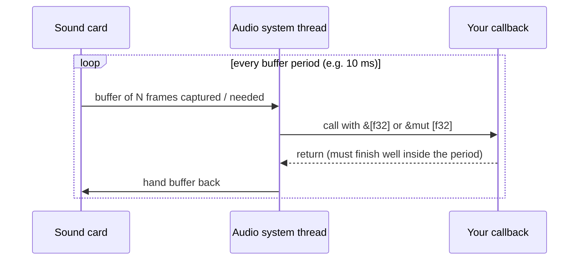
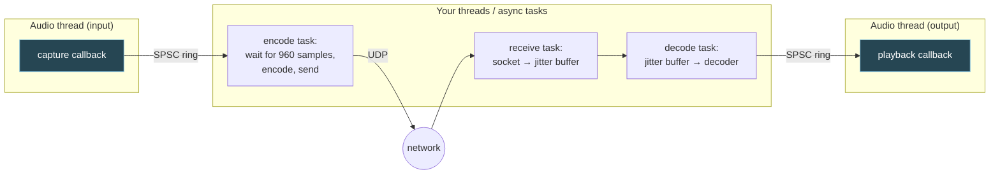

# 2. Real-time audio threads

## The problem

The sound card plays samples at a fixed rate whether or not your program is ready. If the
next buffer isn't there when the hardware needs it, the listener hears a click or a gap,
and no amount of later speed can undo it. Code that's correct and fast *on average* can
still glitch every few seconds. This chapter is about writing the small piece of code that
runs on that hardware schedule, and about how it talks to the rest of your program without
ever being made to wait.

Assumes [file 01](01-foundations.md): samples, I/O frames, interleaving. For threads,
scheduling and mutexes themselves, see
[cs-fundamentals file 02](../interview/cs-fundamentals/02-processes-and-threads.md) and
[file 04](../interview/cs-fundamentals/04-synchronisation-and-deadlock.md), which this
chapter builds on rather than repeats.

## 2.1 Who calls whom: callback-driven I/O

In a Go service, you call `conn.Read` when *you* want data. Audio I/O on every mainstream
OS works the other way round: **the audio system calls you**. You register a function, the
**callback**, and the OS invokes it each time the hardware has a buffer of captured samples
for you (input) or needs a buffer of samples from you (output).

cpal, the Rust cross-platform audio library, uses exactly this model
([docs.rs/cpal](https://docs.rs/cpal/latest/cpal/), 0.18 at the time of writing):

| cpal concept | What it is |
|---|---|
| `Host` | The platform audio system (CoreAudio, WASAPI, ALSA…). `cpal::default_host()` always exists |
| `Device` | A microphone, speaker, headset, interface |
| `StreamConfig` | `channels`, `sample_rate`, `buffer_size` |
| `Stream` | An open flow of audio. Built paused; nothing happens until `stream.play()` |
| Data callback | Your closure. Input: gets `&[T]` of captured samples. Output: gets `&mut [T]` to fill |
| Error callback | Your closure for stream errors (device unplugged, and so on) |

The docs say creating and running a stream "will *not* block the thread" and that
callbacks run on "a dedicated, high-priority thread". That thread belongs to the audio
system, not to you, and it has a deadline.



## 2.2 The deadline: buffer size is latency

The callback is invoked once per **buffer period**: the buffer size in frames divided by
the sample rate. That period is both your deadline and a chunk of latency.

| Buffer (frames) | Period at 48 kHz | Notes |
|---|---|---|
| 64 | 1.33 ms | Bencina calls ~1 ms buffers "pretty good" for low-latency music software |
| 128 | 2.67 ms | |
| 256 | 5.33 ms | Bencina's example: 256 at 44.1 kHz gives 5.8 ms |
| 480 | 10 ms | A convenient divisor of a 20 ms Opus frame |
| 512 | 10.67 ms | |
| 1,024 | 21.33 ms | |
| 2,048 | 42.67 ms | |

Ross Bencina's
[*Real-time audio programming 101: time waits for nothing*](http://www.rossbencina.com/code/real-time-audio-programming-101-time-waits-for-nothing)
(2011) is the classic text here and the rest of this chapter leans on it. His framing:
with a 256-sample buffer at 44.1 kHz, "your callback would have to compute each and every
buffer in less than 5.8 milliseconds … Each and every buffer. No exceptions." He considered
1–5 ms buffers "normal and achievable" on desktop OSes in 2011. A voice app doesn't need
music-grade buffers. Its latency budget is dominated by the codec frame and the network
(file 01 §1.8), so 5–10 ms device buffers are a reasonable starting point. Treat that as a
rule of thumb, not a standard.

In cpal you ask for a size with `BufferSize::Fixed(frames)`, but the docs are explicit that
this is a **request**: "no guarantees can be made about the actual callback size", the
host may round it, and "the callback size may vary between calls (especially on mobile
platforms)". `BufferSize::Default` "may be surprisingly large, leading to higher latency."

> ⚠️ **Never assume the callback length.** Code that does `encoder.encode(data)` because "I
> asked for 960 frames" will work on your laptop and break on the next device. The callback
> size and the codec frame size are independent; the ring buffer in §2.5 is what
> reconciles them.

## 2.3 Underruns and overruns: what they sound like

When the deadline is missed, one of two things has gone wrong, depending on direction.

| Event | Direction | What happened | What you hear |
|---|---|---|---|
| **Underrun** (output) | Playback | The hardware needed samples and you didn't have them in time. The system plays silence or repeats stale data | A click or pop at each occurrence; at high rates, crackle or "robotic" stutter |
| **Overrun** (input) | Capture | Fresh samples arrived and there was nowhere to put them, so some were discarded | A discontinuity in what you *send*: the far end hears a click or a chopped syllable |
| Queue growth (your own) | Either | Your internal buffer between threads keeps filling because the consumer is slower | No glitch, but delay that creeps up second by second until something overflows |

Why a click? A waveform is smooth. When a stretch of samples goes missing, the curve jumps
straight from one value to an unrelated one, and an instantaneous jump contains energy at
every frequency, so you hear a broadband tick. Regular underruns at, say, every 10 ms
callback merge into a buzz at that rate.

The third row is the quiet killer. Nothing sounds broken; the conversation just gets
harder. File 05 shows how to measure it.

## 2.4 The rules: what the callback must never do

Bencina reduces all glitch sources in your code to one cardinal rule:

> **"If you don't know how long it will take, don't do it."**

Not "don't do slow things": don't do things whose **worst case** you can't bound. His
summary list, verbatim:

> - Don't allocate or deallocate memory
> - Don't lock a mutex
> - Don't read or write to the filesystem or otherwise perform i/o. (In case there's any
>   doubt, this includes things like calling printf or NSLog, or GUI APIs.)
> - Don't call OS functions that may block waiting for something
> - Don't execute any code that has unpredictable or poor worst-case timing behavior
> - Don't call any code that does or may do any of the above
> - Don't call any code that you don't trust to follow these rules

Why each one, in terms of mechanism:

| Forbidden | Why it can take unbounded time | Rust things that do it quietly |
|---|---|---|
| Allocation / deallocation | The allocator "may use a lock", "may have to ask the OS for more memory" (possibly paging), and "may use algorithms that take unpredictable amounts of time" (Bencina) | `Vec::push` past capacity, `format!`, `String`, `Box::new`, `collect()`, and **dropping** the last `Arc`/`Vec`/`Box` |
| Locking a mutex | **Priority inversion**: the low-priority thread holding the lock can be preempted by anything, and your highest-priority thread waits behind it. See [cs-fundamentals 04 §4.8](../interview/cs-fundamentals/04-synchronisation-and-deadlock.md) | `Mutex::lock`, `RwLock`, most channel sends that may wake a receiver |
| I/O | Disk seeks, network stacks and terminal writes all wait on things outside your process | `println!`, `log::info!` with a blocking logger, `socket.send` |
| Blocking OS calls | The scheduler decides when you resume | `thread::sleep`, condition variables, `join` |
| Poor worst-case algorithms | "Optimising for throughput instead of latency": fast 99.9% of the time, 1000× slower occasionally | Hash map resize, sorting a growing list, clearing a large buffer in one go |

Bencina also names the invisible ones: garbage collection ("if … the GC kicks in while
your audio thread is running you will probably be in trouble") and page faults on memory
that was swapped out.

> **Teacher's aside.** If you come from Go, the rule against allocation will feel
> familiar: you've seen a GC pause blow a p99. The surprise is the **mutex**. In normal
> concurrent code a short critical section is the *correct* answer, and Bencina quotes two
> official docs (Android's OpenSL ES and the JACK wiki) giving exactly that advice for audio
> before explaining why it's wrong here. The mutex isn't slow. The problem is that taking
> it hands control of your deadline to whichever thread holds it, at whatever priority it
> runs, for however long the scheduler pleases. A lock-free queue isn't about speed either.
> It's about **who is allowed to make you wait**: with a lock-free single-producer
> single-consumer queue, the answer is nobody. And note that a Go channel would not
> qualify: `hchan` in the Go runtime is protected by a `lock mutex` field
> ([`runtime/chan.go`](https://github.com/golang/go/blob/master/src/runtime/chan.go)).

> ⚠️ **Dropping is deallocation.** The classic Rust version of this bug: the callback
> holds the last clone of an `Arc<Vec<f32>>` (say, a swapped-in settings buffer), the
> control thread replaces it, and the old one is freed *inside the callback* when it goes
> out of scope there. Send retired objects back to a non-real-time thread to be dropped.

Bencina's escape hatch for state you only *sometimes* need is a **try-lock**: attempt the
lock, and if it's taken, skip this callback's use of the shared state. That's acceptable
for "pick up new settings when you can", never for "I must have this every callback".

## 2.5 The lock-free SPSC ring buffer

So the callback can't lock, can't allocate and can't do I/O, yet its samples have to reach
a network socket. The standard bridge, which Bencina calls the "best practice", is a
**lock-free FIFO**. For audio, the workhorse is the **single-producer, single-consumer
(SPSC) ring buffer**.

### How it works

A fixed array, allocated once up front, plus two indices: where the producer writes next
(**write index**) and where the consumer reads next (**read index**). Both chase each other
around the array.

```
capacity 8, 5 samples waiting

        read                     write
         ▼                         ▼
  ┌────┬────┬────┬────┬────┬────┬────┬────┐
  │    │ s0 │ s1 │ s2 │ s3 │ s4 │    │    │
  └────┴────┴────┴────┴────┴────┴────┴────┘
        └──── occupied: 5 ─────┘
  vacant: slots 6, 7 and 0 (the write index wraps round to 0 after 7)

producer: writes s5 at [write], then advances write    (only it touches write)
consumer: reads s0 at [read], then advances read       (only it touches read)
```

Why no lock is needed:

1. **Each index has exactly one writer.** The producer only ever stores to the write
   index; the consumer only ever stores to the read index. There is no read-modify-write
   race to protect.
2. **Atomic loads and stores with ordering.** The producer writes the sample *then*
   publishes the new write index with a release store; the consumer reads the write index
   with an acquire load and is then guaranteed to see the sample. The same in reverse for
   freeing slots. [cs-fundamentals 04 §4.2](../interview/cs-fundamentals/04-synchronisation-and-deadlock.md)
   covers atomic instructions; the extra ingredient here is the *ordering* (release on
   publish, acquire on read), which makes the sample itself visible, not just the index.
3. **Full and empty are answers, not waits.** If the buffer is full, `push` returns
   failure immediately. The callback decides what to do; it never sleeps.

The bounded worst case comes from those three properties together: a push or pop is a few
loads, a copy and a store, every time.

### In Rust: `ringbuf`

[`ringbuf`](https://docs.rs/ringbuf/latest/ringbuf/) (0.5 at the time of writing) describes
itself as a "lock-free SPSC FIFO ring buffer with direct access to inner data". The shape
of the API:

```rust
use ringbuf::{traits::*, HeapRb};

let rb = HeapRb::<f32>::new(9_600);        // storage allocated here, once
let (mut prod, mut cons) = rb.split();     // move `prod` into the callback, `cons` elsewhere

prod.try_push(0.25).ok();                  // single sample; Err(sample) if full
let n = prod.push_slice(&samples);         // as many as fit; returns how many
let m = cons.pop_slice(&mut out);          // as many as available; returns how many
let waiting = cons.occupied_len();
```

Batch operations (`push_slice`, `pop_slice`) are cheaper than per-sample calls because
they synchronise once per batch. The crate's docs make the same point.

### Policy when it's full or empty

The ring buffer tells you "full" or "empty". **What happens next is a design decision**,
and it differs by side:

| Situation | Where | Sensible policy | Why |
|---|---|---|---|
| Ring full, capture side | Capture callback can't push | Drop the new samples, bump an atomic counter | The consumer has fallen behind; blocking isn't an option |
| Ring empty, playback side | Playback callback can't pop enough | Fill the rest with silence (or a short fade), bump a counter | You must return *something* now |
| Ring persistently too full | Either | The **consumer** discards the oldest to get back to target | Keeps latency bounded. Only the consumer may move the read index, so it does the skipping |

## 2.6 Bridging to the async and network side

Put the pieces together and a voice client has four kinds of thread:



The rule: **the two audio callbacks touch nothing but their ring buffer and atomics.**
Encoding, decoding, the jitter buffer and the socket all live on your side. (Encoding in
the callback is sometimes done in practice, but it ties your deadline to the codec's worst
case, and frames rarely line up with callbacks anyway. Keep it out unless you've measured
it.)

A capture sketch with cpal and ringbuf, to show the shape rather than a finished program:

```rust
use cpal::traits::{DeviceTrait, HostTrait, StreamTrait};
use ringbuf::{traits::*, HeapRb};

let host = cpal::default_host();
let device = host.default_input_device().expect("no input device");
let supported = device.default_input_config()?;   // also tells you sample_format()
let channels = supported.channels() as usize;
let config: cpal::StreamConfig = supported.config();

let (mut prod, mut cons) = HeapRb::<f32>::new(9_600).split(); // 200 ms mono at 48 kHz

let stream = device.build_input_stream(
    &config,
    move |data: &[f32], _info: &cpal::InputCallbackInfo| {
        // Audio thread. No allocation, no locks, no I/O.
        for frame in data.chunks_exact(channels) {
            let _ = prod.try_push(frame[0]); // take channel 0 as mono; on Err, count a drop
        }
    },
    move |err| { /* stream error: record it for another thread to report */ },
    None,                                           // timeout for building the stream
)?;
stream.play()?;   // streams start paused; keep `stream` alive or it stops
```

And the consumer, on your side, assembling exact codec frames:

```rust
let mut frame = [0f32; 960];                        // 20 ms at 48 kHz, mono
loop {
    tick.tick().await;                              // e.g. a 5 ms interval
    while cons.occupied_len() >= frame.len() {
        cons.pop_slice(&mut frame);
        let n = encoder.encode_float(&frame, &mut packet)?;
        socket.send(&packet[..n]).await?;
    }
}
```

> ⚠️ **The sample format isn't always `f32`.** `default_input_config()` reports the
> device's native format, which may be `I16` or `U16`. Building an `f32` stream against a
> device that doesn't offer it is an error, not a silent conversion. Match on
> `supported.sample_format()` and convert inside the callback (a multiply, no allocation).

### Waking the consumer

How does the encode task know samples are ready? Two options:

| Approach | How | Trade-off |
|---|---|---|
| **Poll at a cadence** | A timer every few ms checks `occupied_len()` (the sketch above) | The callback does nothing extra. Adds up to one polling interval of latency; costs a little idle CPU |
| **Signal from the callback** | The callback sets an atomic flag or calls a wake primitive | Lower latency. But many wake primitives take a lock internally: tokio's `Notify`, for example, keeps its waiter list in a `Mutex` ([`tokio/src/sync/notify.rs`](https://github.com/tokio-rs/tokio/blob/master/tokio/src/sync/notify.rs)). Read the implementation before calling one from the audio thread |

Polling at a cadence well below the codec frame (say 2–5 ms against 20 ms frames) is the
simple, defensible default. (Rust mechanics such as `move` closures and `Send` bounds
belong to the [`rust/`](../rust/README.md) course and aren't repeated here.)

## 2.7 Clock drift: when "48 kHz" means two different things

There is no global clock. Each audio device samples from its own crystal oscillator, and
no two crystals agree exactly. A microphone running at 48,000.5 Hz and a speaker running at
47,999.5 Hz both "are" 48 kHz.

RFC 6716 §4.4.1 defines the problem plainly: "Clock drift refers to the gradual
desynchronization of two endpoints whose sample clocks run at different frequencies …
For long-lived streams, the time difference between sender and receiver can grow without
bound."

Crystal error is quoted in **parts per million (ppm)**. How large is it for audio
hardware? I couldn't find an authoritative standard for consumer sound cards. Crystal
datasheets and practitioner discussion put it in the tens of ppm, with figures up to about
±100 ppm quoted for cheap parts. Treat that as a rule of thumb and measure your own
devices. The arithmetic shows why even small numbers matter:

| Disagreement | Samples per second at 48 kHz | Per hour | As time per hour |
|---|---|---|---|
| 10 ppm | 0.48 | 1,728 | 36 ms |
| 50 ppm | 2.4 | 8,640 | 180 ms |
| 100 ppm | 4.8 | 17,280 | 360 ms |

A 200 ms ring buffer between a 100 ppm-fast microphone and a slow consumer fills up within
the hour. That's the signature of drift: **a buffer that glitches on a schedule** (every
few minutes or tens of minutes) rather than at random.

### Where drift appears in a voice app

| Clock pair | Example | Who absorbs it |
|---|---|---|
| Local mic vs local speaker | USB headset mic, built-in laptop speakers | Only matters if you pipe one into the other directly (sidetone, local loopback, echo cancellation reference) |
| Your device vs Opus's nominal 48 kHz | Mic actually runs at 48,003 Hz | Nobody needs to: you encode what you got. The *receiver* sees it as drift |
| **Sender's mic vs receiver's speaker** | Every call | The receiver's jitter buffer: file 04 §4.5 |

The third row is the one every call has. The sender produces 50 packets per *its* second;
the receiver plays 50 packets per *its* second. RFC 6716 §4.4.1 describes the two
directions: a slow sender looks "similar to packet loss: too few packets are received" and
the receiver may conceal it with PLC; a fast sender means "too many packets", and the
receiver "MAY respond by skipping any packet". It also points to WebRTC's NetEq, which
"compensates for drift by adding or removing one period when the signal is highly
periodic".

### Fixing drift, from crude to good

| Method | What it does | Sounds like |
|---|---|---|
| Drop or duplicate a sample (or a packet) when the buffer is out of range | Snaps occupancy back | A click each time, or a missing 20 ms with whole packets |
| Drop or insert during silence | Same, but timed when nobody is speaking | Inaudible if your silence detection is right |
| Time-stretch during voiced speech | Add or remove one pitch period (NetEq's approach) | Usually inaudible |
| **Adaptive resampling** | Resample by a ratio like 1.00005, steered by a control loop that watches buffer occupancy | Inaudible; the standard answer for continuous device-to-device paths |

For adaptive resampling in Rust, [`rubato`](https://docs.rs/rubato/latest/rubato/)
distinguishes the two cases explicitly. **Synchronous** resampling is for rates "fixed and
locked to each other" (converting 44.1 kHz to 48 kHz). **Asynchronous** resampling is for
when "the input and output sample rates are not locked, and the ratio may vary slightly
over time … common in real-time audio streams where the input and output devices have
different clocks that may drift." Its asynchronous resamplers let you change the ratio at
runtime, and its docs say `process_into_buffer()` "performs no allocations", which is what
you need if it ever runs near the audio thread.

> ⚠️ **Rate conversion and drift are different problems.** A 44.1 kHz device feeding a
> 48 kHz Opus encoder needs a fixed-ratio conversion (147:160) all the time. Drift needs a
> ratio that wanders by a few ppm. Fix the first with a synchronous resampler. If you also
> need the second, use one asynchronous resampler with a nominal ratio of 160/147, nudged
> by the control loop, rather than two resamplers in series.

---

## Check yourself

1. Your playback callback is asked for 480 frames at 48 kHz. Your decode path normally
   takes 0.3 ms but, once a minute, a hash map inside it resizes and takes 15 ms. What
   does the listener hear, and how often? Why doesn't a 0.3 ms average help you?
2. A colleague protects the shared jitter-buffer state with a `Mutex` and points out that
   the critical section is only "three lines". Explain, mechanically, how the playback
   callback can still miss its deadline because of it.
3. In an SPSC ring buffer, why is it safe for the producer to write a sample and then
   publish the write index without a lock, and what breaks if *two* threads push into the
   same ring?
4. Capture runs at 512-frame callbacks; the encoder wants exactly 960 samples. Walk through
   the ring buffer's occupancy across the first four callbacks and say when the first
   packet can go out.
5. A call works perfectly for 25 minutes and then starts producing a click every few
   seconds, getting worse over time. Restarting the call fixes it. Give the most likely
   cause and two fixes, from crudest to best.
6. Why is it wrong to fix drift between sender and receiver by having the receiver resample
   the *decoded* audio by the ratio of its clock to the sender's nominal 48 kHz?

(Answers in [08-exercises.md](08-exercises.md).)
