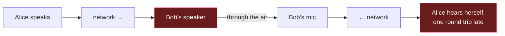

# 5. Latency budgets, echo, and testing under bad networks

## The problem

Every previous chapter added a buffer for a good reason. Added together, they can make a
call where people talk over each other and then both stop. You need a target, a way to
see where the milliseconds actually went, and a way to test the design against a network
worse than your office Wi-Fi. And once the delay is low enough for conversation, a new
problem appears: the far end's voice comes out of your speaker, into your microphone, and
back to them.

Assumes files [01](01-foundations.md) to [04](04-packet-loss-and-jitter.md).

## 5.1 What ITU-T G.114 actually says

G.114, *One-way transmission time*, is the number everyone quotes and few people have
read. The edition in force is **05/2003** (with amendments in 2003 and 2009; the 2009 one
adds an appendix on delay variation on access lines)
([ITU-T G.114](https://www.itu.int/rec/T-REC-G.114)). Its §4, in full on the two numbers
people cite:

> "Regardless of the type of application, it is recommended to not exceed a one-way delay
> of 400 ms for general network planning … However, it is desirable to keep the delays
> seen by user applications as low as possible."

> "Although a few applications may be slightly affected by end-to-end (i.e.,
> 'mouth-to-ear' in the case of speech) delays of less than 150 ms, if delays can be kept
> below this figure, most applications, both speech and non-speech, will experience
> essentially transparent interactivity."

And on the 400 ms figure: "delays above 400 ms are unacceptable for general network
planning purposes", with exceptions such as "an unavoidable double satellite hop".

For speech, it points to the **E-model** (ITU-T G.107) as the actual assessment tool, and
its Figure 1 plots predicted quality (the rating *R*) against mouth-to-ear delay from 0 to
500 ms, with bands from "users very satisfied" down to "nearly all users dissatisfied".
The notes under that figure matter: the curve assumes **no echo** and **no codec
impairment**. Real calls have both, so real quality at a given delay is lower than the
curve.

### The version you've probably been told

Many articles present G.114 as a three-band table: 0–150 ms acceptable, 150–400 ms
acceptable with care, over 400 ms unacceptable. That framing comes from **earlier
editions**. The 2003 introduction explains why it was dropped: previous versions "noted
that if delays were kept below 150 ms, then most applications would not be significantly
affected", and also gave a 400 ms planning limit, but "this parallel treatment of network
delays on one hand, with application ('mouth-to-ear') level delays on the other hand, led
to confusion". The current edition replaces the bands with the E-model curve.

So when someone says "G.114 says 150 ms", the accurate version is:

| Claim | Status |
|---|---|
| "Below 150 ms mouth-to-ear, most applications get essentially transparent interactivity" | ✅ Current text, §4 |
| "400 ms one-way should not be exceeded for general network planning" | ✅ Current text, §4. A *network-planning* bound, UNI to UNI |
| "150–400 ms is the acceptable band" | ⚠️ Older editions' framing; the current one says use the E-model |
| "Highly interactive tasks can be affected below 100 ms" | ✅ §1, citing test results from earlier editions |

> **Teacher's aside.** People hear "150 ms" as a cliff: under it you're fine, over it
> you're broken. G.114 doesn't say that. It says 150 ms is roughly where delay stops being
> *noticeable* for most uses, and its Figure 1 is a smooth curve with no cliff anywhere.
> Its own Appendix II calls about 225 ms on a 10,000 km inter-regional call "certainly not
> as low (or as desirable) as 150 ms, but still quite satisfactory for the vast majority of
> users", and warns that local calls must not get those delays because "user expectations
> are that such calls be completely delay-transparent". The real lesson: **delay
> tolerance depends on what users expect**, and the 150 ms figure is a design target, not a
> pass/fail line.

## 5.2 Where each millisecond goes

Here is the file 01 §1.8 sketch again, now with sources. The ranges are **illustrative**.
The ones marked "set by you" are configuration; the ones marked "measured" vary by device
and network and you must measure them.

| Stage | Typical contribution | Kind | Notes and source |
|---|---|---|---|
| Capture device + driver | A few ms to tens of ms | Measured | Hardware and OS buffering below your callback. Varies a lot by device and API |
| Capture callback buffer | 1 × buffer period, e.g. 10 ms | Set by you | File 02 §2.2. cpal's `BufferSize::Fixed` is a request |
| Waiting to fill a codec frame | Up to 1 frame, e.g. 20 ms | Set by you | File 03 §3.2 |
| Codec look-ahead | 6.5 ms (2.5 ms in restricted low-delay) | Set by you | libopus `OPUS_GET_LOOKAHEAD`, file 03 §3.4 |
| Encode + decode compute | Depends on CPU and complexity setting | Measured | G.114 A.2 plans for a full frame time as a conservative assumption. Real compute time depends on the CPU and Opus's complexity setting (0–10); measure it on your slowest target |
| Sender scheduling, polling | 0 to 1 polling interval | Set by you | File 02 §2.6 |
| **Network one-way** | ~1 ms LAN to 100+ ms intercontinental | Measured | Not yours. G.114 A.1 plans optical fibre at 5 µs/km, so 10,000 km of fibre alone is 50 ms |
| **Jitter buffer** | Tens of ms; adaptive | Set by you, driven by network | G.114 A.3: plan for half its peak. NetEq starts at 80 ms (file 04 §4.5) |
| Playback buffer | 1 × buffer period plus ring-buffer slack | Set by you | File 02 |
| Playback device + driver | A few ms to tens of ms | Measured | As for capture |

G.114 Annex A.2 gives the conventional planning formula for codec delay as **2 × frame
size + look-ahead**: one frame to collect, one frame assumed for processing. For Opus at
20 ms that's 46.5 ms. Treat that as a planning upper bound. The processing frame is an
assumption ("the time required to process an input frame is assumed to be the same as the
frame length"), not a property of Opus.

An illustrative tally for two people in the same region, using the middle of each range:

```
capture dev+drv  ▓▓▓▓▓                                                10
capture buffer   ▓▓▓▓▓                                                10
codec frame      ▓▓▓▓▓▓▓▓▓▓                                           20
look-ahead       ▓▓▓                                                   6.5
network          ▓▓▓▓▓▓▓▓▓▓▓▓▓▓▓                                      30
jitter buffer    ▓▓▓▓▓▓▓▓▓▓▓▓▓▓▓▓▓▓▓▓                                 40
playback buffer  ▓▓▓▓▓                                                10
playback dev+drv ▓▓▓▓▓                                                10
                                                         total ≈ 137 ms
```

These numbers are made up to show proportion, not measured. Their point is that **you
control more than half of the total**, and the biggest single item you control is usually
the jitter buffer.

## 5.3 Measuring mouth-to-ear delay

You can't add up the table above and trust the result: the device and driver rows are
invisible to your code. Measure end to end.

| Method | How | Measures | Caveats |
|---|---|---|---|
| **One recorder, two devices** | Put a third device (a phone recording audio) where it hears both the talker and the listener's speaker. Clap or tap at the sender. In an audio editor, measure the gap between the clap and its playback | True mouth-to-ear, including everything | Manual; repeat several times and take the spread; the recorder's distance to each source adds ~3 ms per metre of air |
| **Loopback** | Two clients on one machine, or a cable from one device's output to another's input; send a click, time its return | Round trip through your whole pipeline | You get round trip; halving it assumes symmetry |
| **Per-stage instrumentation** | Timestamp each stage. cpal's input callback info carries a `capture` instant ("the instant that data was captured from the device") and a `callback` instant; output has the equivalent for playback | Where the time goes, continuously, in production | Cross-machine stages need synchronised clocks; without them, one-way network delay is RTT/2, which is wrong for asymmetric paths |

Do the first one before trusting the third. Instrumentation tells you where your own code
spends time; only an acoustic measurement catches a 40 ms driver buffer you didn't know
about.

Things worth graphing in production, per call:

| Metric | Why |
|---|---|
| Jitter-buffer target and actual depth over time | Shows adaptation and creeping latency |
| Late-packet rate | The loss your buffer *caused* by being too shallow |
| Network loss rate (sequence gaps) | The loss the network caused |
| Concealed vs FEC-recovered vs normal frames | What the listener actually heard |
| Ring-buffer drops and underruns, both ends | The local deadline misses from file 02 |

## 5.4 Echo and feedback

Once two people are talking with low delay, a new failure appears. The far end's voice
plays from your **speaker**, reaches your **microphone** a few milliseconds later, gets
encoded and sent back. The far-end talker hears their own voice, delayed by the full round
trip. That's **acoustic echo**.



> ⚠️ **The person who hears the echo is not the person causing it.** Alice hears echo
> because *Bob's* speaker leaks into *Bob's* microphone. If a user reports "I hear myself",
> the fix belongs on the other participant's device.

Echo gets more annoying as delay grows: a very short echo blends in like a room's own
reflection, while a long one is a separate, distracting voice. That's why the E-model
curve in §5.1 assumes "the complete absence of any echo", and why G.114 lists echo
control (ITU-T G.131) alongside delay. **Feedback** (howling) is the extreme case: when
both ends play loudly into open mics and the loop gain exceeds one, the signal grows each
time round until it saturates.

### Why acoustic echo cancellation is hard

**Acoustic echo cancellation (AEC)** tries to predict what the speaker's sound will look
like by the time it reaches the microphone, and subtract it. You know exactly what you sent
to the speaker, so in principle this is easy. In practice:

| Difficulty | Why it hurts |
|---|---|
| The echo path is unknown | It depends on the room, the speaker, the mic, and where the person's head is. The canceller must learn it with an adaptive filter, and relearn when anything moves |
| Delay between reference and echo is unknown and variable | The OS's output and input buffering differ by device and can change mid-call |
| Clock drift between output and input devices | The canceller assumes the two streams share a timeline. Different clocks (file 02 §2.7) make the echo appear to slide. Recent research still treats compensating sample-rate offset in AEC as an open problem worth papers ([Sample Rate Offset Compensated AEC, 2025](https://arxiv.org/abs/2507.05399)) |
| Non-linearity | Cheap speakers driven loud distort; a linear filter can't model the distortion, so residual echo leaks through |
| Double-talk | When both people speak at once, the filter must not adapt to the near-end voice, or it "cancels" the person who's actually talking |

For reference, WebRTC ships a production canceller (AEC3) in
[`modules/audio_processing/aec3`](https://webrtc.googlesource.com/src/+/refs/heads/main/modules/audio_processing/aec3/),
and operating systems offer "voice processing" input modes that include one. Using one is
far more realistic than writing one.

### The practical answers

| Approach | Cost | Echo outcome |
|---|---|---|
| **Headphones** | Asking users to wear them | Speaker sound never reaches the mic. The echo problem is gone, with no processing and no added delay |
| Platform voice-processing input | Less control over the signal; platform-specific | Usually good; quality varies by OS and device |
| A library AEC (e.g. WebRTC's) | Integration work: feeding it the exact playback reference with correct alignment | Good when the reference timing is right |
| Push-to-talk or half-duplex ducking | Conversation feels like a radio | Can't echo what isn't being transmitted (file 06) |

For a first version, **headphones are the honest engineering answer**. Say so in the UI.

## 5.5 Simulating loss and jitter

Your LAN has near-zero loss and jitter, so nothing in files 02–04 will be exercised until
you break the network on purpose.

### At the OS: Linux `netem`

The Linux network emulator is a queueing discipline that adds impairments to outgoing
packets on an interface
([`tc-netem(8)`](https://man7.org/linux/man-pages/man8/tc-netem.8.html)). Examples
adapted from the man page:

```bash
# 100 ms ± 20 ms delay, normally distributed
tc qdisc add dev eth0 root netem delay 100ms 20ms distribution normal

# change it: 1% independent random loss
tc qdisc change dev eth0 root netem loss 1%

# bursty loss with a Gilbert-Elliott model, plus 1% duplication
tc qdisc change dev eth0 root netem loss gemodel 1% 10% delay 50ms 10ms duplicate 1%

# remove
tc qdisc del dev eth0 root
```

What it offers, per the man page: `delay` with jitter, correlation and a `distribution`
(uniform, normal, pareto, paretonormal); `loss` as independent `random`, a 4-state Markov
`state` model, or `gemodel` (Gilbert-Elliott, "burst loss"); `duplicate`; `reorder`;
`corrupt`; `rate`; and a `seed` "to guide and reproduce the randomly generated loss or
corruption events".

> ⚠️ **netem impairs what leaves the interface**, and with jitter, each packet draws its
> own delay, so a later packet can draw a shorter one and overtake: you'll see reordering
> as a side effect. The man page also warns that "if the delay is less than the
> inter-packet arrival time then no reordering will be seen" and that it is "limited by
> the timer granularity in the kernel."

On macOS, Apple's Network Link Conditioner (distributed with Xcode's additional tools)
offers similar profiles through a GUI. I haven't verified its exact parameter set for
this course; check its current documentation before relying on it for reproducible
tests.

### In your app: an impairment shim

For automated tests, an in-process shim between your packetiser and your socket (or
between the socket and the jitter buffer) is often better than OS tooling: it runs on any
OS, needs no root, and is deterministic with a fixed seed.

| Impairment | Model it as | Why that model |
|---|---|---|
| Random loss | Drop with probability *p* | Baseline; exercises PLC |
| **Burst loss** | Two-state Gilbert-Elliott: a "good" state with rare loss, a "bad" state with heavy loss | Real loss is bursty; this is what defeats single-packet FEC (file 04 §4.7) |
| Jitter | Add a random delay per packet from a long-tailed distribution | Spikes, not the mean, cause late packets (file 04 §4.5) |
| Reordering | Hold back a packet behind the next one | Exercises jitter-buffer insertion |
| Duplication | Send some packets twice | RFC 7587 requires discarding duplicates |
| Sequence wraparound | Start sequence numbers at 65,530 | Catches the file 04 §4.3 bug in seconds rather than 22 minutes |
| Clock drift | Scale the sender's timing by 1.0001 | Catches buffers that slowly fill or starve (file 02 §2.7) |
| Network change | Step the base delay from 20 ms to 120 ms mid-call | Exercises adaptation |

A test matrix that covers the course in a dozen runs: {clean, 2% random, 5% bursty} loss ×
{0, 20, 60 ms} jitter, with drift and wraparound always on. For each run, record the
§5.3 metrics, and **listen** to at least the worst cases. A dashboard of concealment
percentages won't tell you that the concealment sounds like a robot.

---

## Check yourself

1. A product manager says "G.114 says anything over 150 ms is unacceptable." Correct them
   precisely, citing what the current edition says about 150 ms and 400 ms and what it
   uses instead of bands.
2. Your measured mouth-to-ear delay is 210 ms. Instrumentation inside your app accounts for
   120 ms, and RTT/2 from pings is 25 ms. Where are the other 65 ms most likely to be, and
   how would you prove it?
3. User A reports hearing their own voice a fraction of a second after speaking, only when
   talking to user B. Which device do you investigate, and what's your first
   recommendation?
4. Why does clock drift between a laptop's speaker and a USB microphone hurt an echo
   canceller, even though the whole call sounds fine without one?
5. You test FEC with netem's `loss 5%` and see a big quality improvement. In production,
   users with 5% loss see almost none. What's the most likely difference between your test
   and reality, and how would you change the test?
6. Design the cheapest test that would have caught a jitter buffer comparing sequence
   numbers with plain `<`, and say why it's faster than running a call for half an hour.

(Answers in [08-exercises.md](08-exercises.md).)
