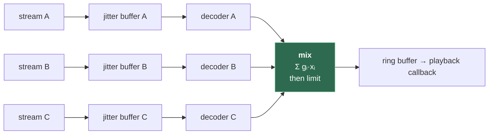

# 6. Mixing several voices, push-to-talk and voice activity detection

## The problem

Two-person calls have one incoming stream. As soon as there's a third person, the receiver
has several decoded streams and one speaker, and has to combine them without clipping
(file 01 §1.3) or making everyone quiet. Separately, an open microphone sends breathing,
keyboards and echo all the time; deciding **when to transmit** at all is the cheapest way
to cut bandwidth, noise and echo at once.

This chapter is a stretch topic: a two-person app doesn't need it. Assumes files
[01](01-foundations.md)–[04](04-packet-loss-and-jitter.md).

## 6.1 Mixing is addition

Sound waves in air add: two people talking at once produce a pressure that is the sum of
the two. Digital mixing does the same thing, sample by sample:

```
out[n] = g₁·a[n] + g₂·b[n] + g₃·c[n] + …
```

Each **gain** *g* is a per-stream volume. Gains are usually discussed in decibels, where
amplitude gain in dB = 20·log₁₀(*g*):

| Linear gain | dB | Effect |
|---|---|---|
| 2.0 | +6.0 dB | Twice the amplitude |
| 1.0 | 0 dB | Unchanged |
| 0.5 | −6.0 dB | Half the amplitude |
| 0.25 | −12.0 dB | |
| 0.1 | −20 dB | |
| 0 | −∞ | Muted |

Mixing in `f32` makes this easy: the sum may exceed ±1.0 in the middle of the calculation
without harm, as long as it's brought back within range before it reaches the device or
an `i16` conversion (file 01 §1.3).

Each incoming stream needs its **own jitter buffer and its own decoder**, because each has
its own sequence numbers, timing, loss and codec state. The mix happens after decoding, at
the playback tick: pull one frame's worth from each stream's decoder (real audio,
concealment, or comfort noise) and add them.



## 6.2 Headroom and clipping

Add *N* full-scale voices and the peak can reach *N* times full scale. How loud the sum
actually gets depends on how the signals relate:

| Signals | Sum of N, each at amplitude 1 | In dB |
|---|---|---|
| Identical and in phase (worst case) | Peak N | +20·log₁₀ N (2 voices: +6 dB) |
| Unrelated (independent speech) | RMS grows as √N | +10·log₁₀ N (2 voices: +3 dB) |

Unrelated speech mostly adds like the second row, but **peaks** occasionally line up, and
a single coinciding peak above 1.0 is a click. So you need a policy:

| Policy | How | Trade-off |
|---|---|---|
| Divide by N | `out = Σ x / N` | Never clips, but one person talking alone sounds 1/N as loud. Bad with more than two people |
| Fixed headroom | Scale every stream by, say, 0.5 (−6 dB) | Simple; occasional clipping with many simultaneous talkers |
| **Limiter** | Sum normally; if the result nears full scale, reduce gain smoothly for a short time | Natural loudness for a single talker, no clipping. The usual choice |
| Soft clip | Pass the sum through a smooth curve such as `tanh` that approaches ±1 gently | Cheap, no state. Adds mild distortion on loud peaks rather than hard clipping |
| Hard clamp | `clamp(−1, 1)` | Last-resort safety net. Harsh if it triggers often |

A reasonable layering is fixed headroom, then a limiter, then a clamp as the backstop that
should almost never fire. Count how often it does.

> **Teacher's aside.** "Normalise by the number of speakers" is the first idea everyone
> has, and it's the wrong one, because it scales by how many people are *connected*
> rather than how many are *talking*. In a six-person call with one person speaking, the
> listener hears that person at a sixth of their volume, and every time someone joins, the
> current speaker gets quieter. Mixing is a dynamics problem about the signal you actually
> have, which is why the field reaches for limiters (signal-dependent) rather than fixed
> divisions (membership-dependent).

### Where to mix

| Design | Who mixes | Upload | Download per client | Notes |
|---|---|---|---|---|
| Each client mixes (mesh, or a forwarding server, often called an SFU) | Every receiver | 1 stream (to server) or N−1 (mesh) | N−1 streams | No added server latency; receivers need N−1 decoders and jitter buffers |
| A server mixes (often called an MCU) | The server | 1 stream | 1 stream | Server decodes, mixes, re-encodes: adds a full jitter buffer and a codec frame of delay, and costs server CPU |

Neither SFU nor MCU is a formal standard term with one definition; they're widely used
industry labels. The latency point is the one that matters for this course: **mixing on a
server adds a second jitter buffer and a second codec delay to the path.** Topology belongs
to the [`peer-to-peer/`](../peer-to-peer/README.md) course.

> ⚠️ **Don't mix the local talker into their own playback** unless you mean to. Hearing
> yourself through your own earphones with a small delay (sidetone) is a deliberate
> feature in some apps; hearing yourself with network delay is just echo you built
> yourself.

## 6.3 Push-to-talk

**Push-to-talk (PTT)** transmits only while a key is held. It's the oldest and most
reliable answer to echo and noise: what isn't sent can't echo.

Details that matter:

| Detail | What to do | Why |
|---|---|---|
| Edges | Fade in and out over a few milliseconds when the key goes down and up | Starting or stopping mid-waveform is a step, which is a click (file 02 §2.3) |
| Key-down latency | Keep the capture stream running all the time; gate what's *sent* | Starting a cpal stream on key-down takes time and may lose the first syllable |
| Pre-roll | Optionally keep the last ~100–200 ms of capture and send it on key-down | People start speaking a moment before pressing; a rule of thumb, not a standard figure |
| Timestamps while silent | Keep advancing the timestamp by one frame per frame period even when not sending | RFC 3550: the timestamp advances "regardless of whether the block is transmitted in a packet or dropped as silent" |
| Sequence numbers while silent | Don't advance them (nothing was sent) | The receiver must see "no loss, time jumped": exactly the DTX signature (file 04 §4.3) |
| Marker bit | Set it on the first packet after each release | RFC 3551 §4.1: the first packet of a talkspurt "SHOULD be distinguished by setting the marker bit"; a natural point for the receiver to resize its jitter buffer |

Pre-roll has a cost. Sending 200 ms of buffered audio on key-down means either a burst of
packets (which can itself cause jitter) or permanently playing 200 ms behind. Many apps
skip it.

## 6.4 Voice activity detection

**Voice activity detection (VAD)** does PTT automatically: it classifies each frame as
speech or not, and you transmit only speech. Its errors are asymmetric:

| Error | Effect | Usually worse? |
|---|---|---|
| False negative (speech classed as silence) | First syllables clipped, quiet speakers cut out | **Yes**: lost words |
| False positive (noise classed as speech) | Keyboard, fan, breathing transmitted | Annoying, but nothing is lost |

So VADs are tuned to prefer false positives, with two standard tricks:

- **Hangover**: keep transmitting for a few hundred milliseconds after the last speech
  frame, so word endings and short pauses aren't chopped. (The exact length is a tuning
  choice, not a standard.)
- **Hysteresis**: require a stronger signal to *start* transmitting than to *keep*
  transmitting, so the gate doesn't flutter on borderline frames.

The simplest VAD is an energy threshold on each frame (RMS above some level). It fails in
noisy rooms, where background noise crosses any fixed threshold, and on quiet speakers.

A step up is WebRTC's classic VAD
([`common_audio/vad`](https://webrtc.googlesource.com/src/+/refs/heads/main/common_audio/vad/)).
Its source models speech and noise as **Gaussian mixtures** (two Gaussians for each of six
frequency bands), and its API takes 10, 20 or 30 ms frames at 8, 16 or 32 kHz, with an
aggressiveness mode from 0 to 3 where "a more aggressive (higher mode) VAD is more
restrictive in reporting speech … As a consequence also the missed detection rate goes
up." Neural VADs also exist and generally do better in noise; I haven't evaluated specific
ones for this course.

### PTT, VAD, DTX, open mic

| Mode | Who decides to send | Bandwidth in silence | Echo risk | Feel |
|---|---|---|---|---|
| Open mic | Nobody: always send | Full | Highest | Natural; relies on headphones or AEC |
| Open mic + Opus DTX | The Opus encoder | One frame per 400 ms (file 03 §3.6) | Unchanged: echo is "sound", so it's sent | Natural |
| VAD gate | Your VAD | None | Lower, not zero: loud echo can trip the VAD | Mostly natural; occasional clipped onsets |
| Push-to-talk | The user | None | Lowest | Radio-like; very robust |

Note the DTX row: DTX saves bandwidth, but it doesn't decide *whether you're talking* in
any sense that helps with echo or noise. It's a codec feature, not a gate.

---

## Check yourself

1. Three people speak at once, each peaking at 0.6 in `f32`. Is clipping guaranteed,
   possible, or impossible? What if they're three copies of the same recording, in sync?
2. Explain why "divide the mix by the number of participants" makes the experience worse as
   a call grows, using a six-person call as the example.
3. Why does each incoming stream need its own jitter buffer and decoder, rather than mixing
   packets first and decoding once?
4. With push-to-talk, the sender stops for 3 seconds then resumes. What should the next
   packet's sequence number, timestamp and marker bit be, and what does the receiver
   conclude from each?
5. Your VAD clips the first syllable of every sentence for quiet speakers. Give two fixes
   and the cost of each.
6. User C is on laptop speakers with a VAD gate and no echo canceller. The other
   participants hear echoes of their own voices, but only when they speak loudly; quiet
   speech never echoes. Explain the mechanism.

(Answers in [08-exercises.md](08-exercises.md).)
