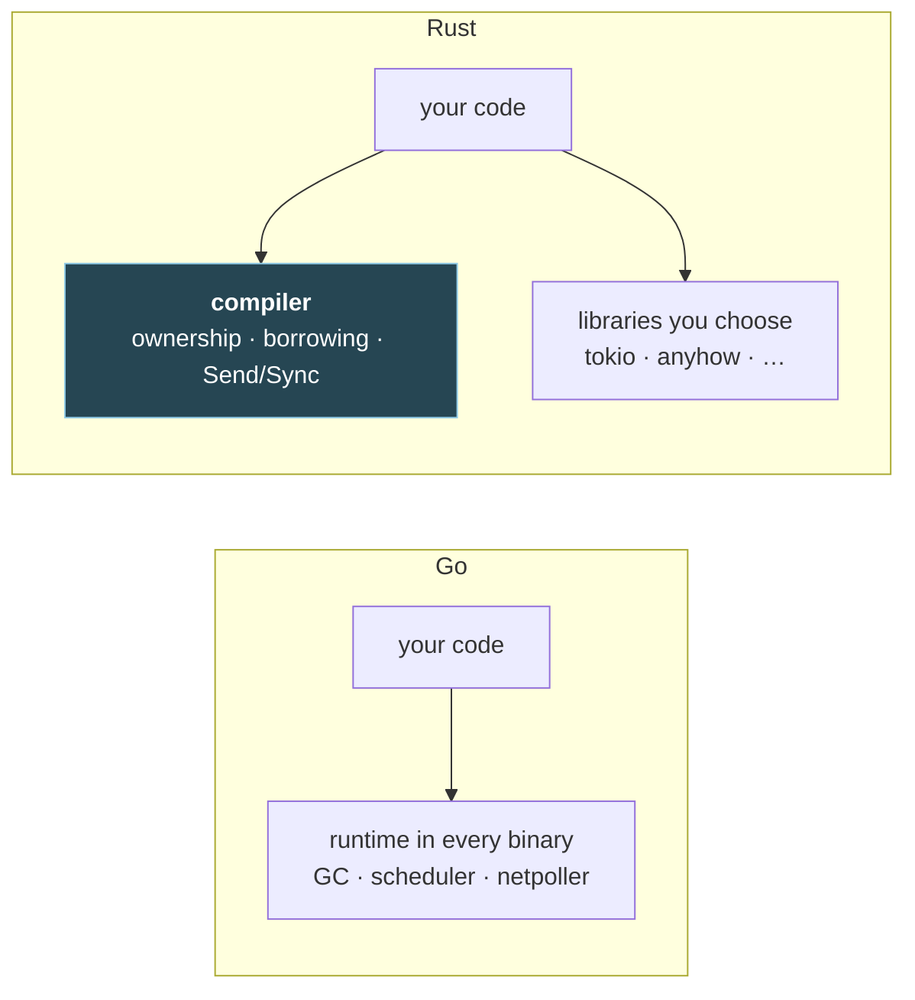

# 1. Foundations: Rust's working model, for a Go programmer

## The problem

Rust syntax takes an afternoon for someone who writes Go. What takes weeks is the
working model. In Go, a lot of work happens at run time on your behalf: the garbage
collector decides when memory is free, the scheduler decides which goroutine runs, the
race detector (if you remember to turn it on) tells you about unsynchronised access.
Rust has none of that at run time. Most of it moved into the compiler, and the rest
moved into libraries you pick. Until you know where each job went, every compiler
error reads as pedantry. Once you do, most of them read as the question the Go runtime
would have answered for you, asked earlier.

This chapter is that map, plus the vocabulary and the shape of a Rust program, so that
no later chapter is the first place a core term appears.

**Who can skip it:** if you can say what a crate is versus a module, what `Option` and
`Result` replace in Go, why `match` on an enum won't compile with a variant missing,
and what `cargo check` is for, skim the table in §1.1 and move on.

## 1.1 Where Go's runtime went

A compiled Go binary carries the Go runtime: garbage collector, goroutine scheduler,
network poller, stack growth. You don't link it; it's just there. A Rust binary carries
almost nothing comparable. The standard library gives you OS threads, collections, I/O
and synchronisation, and the rest is either checked by the compiler or chosen by you.

| Job | In Go | In Rust |
|---|---|---|
| Freeing memory | Garbage collector, at run time | The compiler inserts the free where the owner goes out of scope ([chapter 2](02-ownership-and-borrowing.md)) |
| Running many concurrent tasks | Goroutines, scheduled by the runtime | OS threads from `std`, or an **async runtime** you add as a library, usually tokio ([chapter 6](06-async-and-tokio.md)) |
| Waiting on sockets without a thread each | The runtime's netpoller | The async runtime's reactor (tokio, again) |
| Catching unsynchronised access | `go test -race`, at run time, on the paths you exercised | The type system refuses to compile a data race in safe code ([chapter 4 §4.6](04-traits-and-generics.md#46-send-and-sync-marker-traits)) |
| "No value" | `nil`, for pointers, maps, slices, interfaces, channels | `Option<T>`; there is no null in safe Rust |
| Reporting failure | A second return value of type `error` | `Result<T, E>`, an enum that holds either the value or the error ([chapter 3](03-errors.md)) |
| Default values | Every type has a zero value | No implicit zero values. A type opts in by implementing `Default` |
| Cleanup | `defer`, at function return | `Drop`, when a value goes out of scope ([chapter 5 §5.8](05-shared-state-and-threads.md#58-drop-versus-defer)) |

The Rust Book's introduction to ownership puts the trade plainly: "In languages with a
garbage collector (GC), the GC keeps track of and cleans up memory that isn't being used
anymore", whereas in Rust "the memory is automatically returned once the variable that
owns it goes out of scope"
([ch04-01](https://doc.rust-lang.org/book/ch04-01-what-is-ownership.html)).



The highlighted box is the point. A good share of what Go does while the program runs,
Rust does while it compiles. That's why a Rust compile takes longer and refuses more
programs, and why the programs it accepts can't have certain bugs at all.

> **Teacher's aside.** People coming from Go often say the borrow checker "doesn't trust
> them". A more useful reading: the checker is asking the questions the garbage collector
> used to answer silently. Who is responsible for freeing this? Can anyone still see it
> after that? Is anyone writing to it while someone else reads? Go answers the first two
> at run time, and the third not at all unless you run the race detector on the right
> path. Rust wants all three answered in the source. When an error confuses you, ask
> which of those three questions it is.

## 1.2 Syntax you'll meet, by Go equivalent

This isn't a syntax course, but a table saves a lot of squinting.

| Go | Rust | Note |
|---|---|---|
| `x := 5` | `let x = 5;` | Immutable by default |
| `var x int; x = 5` | `let mut x: i32 = 5;` | `mut` to allow reassignment or mutation |
| `type User struct { Name string }` | `struct User { name: String }` | Fields are snake_case by convention |
| `func (u *User) Rename(n string)` | `impl User { fn rename(&mut self, n: &str) { … } }` | Methods live in `impl` blocks. `&mut self` means "this method mutates" |
| `type Stringer interface{ String() string }` | `trait Display { fn fmt(…) … }` | Traits are implemented explicitly ([chapter 4](04-traits-and-generics.md)) |
| `[]int` | `Vec<i32>` (owned), `&[i32]` (borrowed view) | Two types where Go has one ([chapter 2 §2.5](02-ownership-and-borrowing.md#25-owned-and-borrowed-twins-string-and-str-vec-and-slices)) |
| `string` | `String` (owned), `&str` (borrowed view) | Same split. Both are UTF-8 |
| `map[string]int` | `HashMap<String, i32>` | In `std::collections`, not built in |
| `nil` | `None` (of `Option<T>`) | Only where the type says `Option` |
| `v, err := f()` | `let v = f()?;` | `?` returns early on error ([chapter 3](03-errors.md)) |
| `switch` | `match` | Exhaustive: every case must be handled |
| `for i, x := range xs` | `for (i, x) in xs.iter().enumerate()` | Iterators, not a built-in `range` |
| `go f()` | `std::thread::spawn(f)` or `tokio::spawn(fut)` | Which one depends on threads versus async |
| `chan T` | `std::sync::mpsc`, `tokio::sync::mpsc` and friends | Library types ([chapter 7](07-concurrency-patterns.md)) |
| Capitalised name = exported | `pub` keyword | Private by default |
| `go.mod` | `Cargo.toml` | §1.5 |

Two things in that table carry more weight than they look.

**Everything is an expression.** A block's last expression, without a semicolon, is its
value. So `if`, `match` and plain `{ }` blocks all produce values:

```rust
let label = if count == 1 { "item" } else { "items" };
```

There is no ternary operator because `if` already is one.

**Immutable by default.** `let x = vec![1]; x.push(2);` doesn't compile. You write
`let mut x` when you mean it. This is the first, small appearance of an idea that runs
through the whole language: the source says who can change what.

## 1.3 Enums carry data, and `match` must cover them all

Go has no sum types. To model "a connection is idle, or connecting with an attempt
count, or connected to an address", you write a struct with a state field and some
fields that only mean something in some states, and you remember which.

```go
type ConnState int
const (
    Idle ConnState = iota
    Connecting
    Connected
)
type Conn struct {
    State   ConnState
    Attempt int    // only meaningful when Connecting
    Addr    string // only meaningful when Connected
}
```

Nothing stops `Conn{State: Idle, Addr: "10.0.0.1"}`. Rust's `enum` puts the data inside
the variant, so the impossible combinations can't be written:

```rust
enum Conn {
    Idle,
    Connecting { attempt: u32 },
    Connected(String),
}

fn describe(c: &Conn) -> String {
    match c {
        Conn::Idle => "idle".to_string(),
        Conn::Connecting { attempt } => format!("try {attempt}"),
        Conn::Connected(addr) => format!("up: {addr}"),
    }
}
```

`match` must handle every variant. Leave one out and the program doesn't compile. I
removed the `Connected` arm and rustc 1.96 said:

```
error[E0004]: non-exhaustive patterns: `&Conn::Connected(_)` not covered
```

That's the property to remember: **add a variant, and the compiler lists every `match`
that has to change.** In Go, adding a constant to an `iota` block silently falls through
every `switch` that lacked a `default`, or silently takes the `default`.

The two enums you'll use more than any others are in the standard library:

```rust
enum Option<T> { None, Some(T) }        // a value that might be absent
enum Result<T, E> { Ok(T), Err(E) }     // a value, or the reason there isn't one
```

`Option` replaces `nil`, and `Result` replaces the `(T, error)` pair. The difference
from Go is that you can't reach the `T` without going through the enum, so you can't
forget the check. [Chapter 3](03-errors.md) is about `Result`.

## 1.4 Generics, traits and `impl`: just enough to read code

You'll see angle brackets and trait names from the first page of any Rust codebase, so
here's the minimum. [Chapter 4](04-traits-and-generics.md) does it properly.

- `Vec<T>` is a generic type, like Go's `[]T` but in the library.
- A **trait** is a named set of methods, like a Go interface. `Display` is "can be
  formatted for users", `Debug` is "can be formatted for programmers", `Clone` is "can be
  duplicated".
- `#[derive(Debug, Clone)]` on a struct asks the compiler to write those trait
  implementations for you.
- `fn show<T: Display>(x: T)` is a generic function whose `T` must implement `Display`.
  The same thing is often written `fn show(x: impl Display)`.

## 1.5 Crates, modules and Cargo, versus Go modules and packages

The names collide, so it's worth a careful table. A **crate** is Rust's unit of
compilation: the compiler starts at one root file and builds everything reachable from
it. The Book: "A crate can come in one of two forms: a binary crate or a library crate"
([ch07-01](https://doc.rust-lang.org/book/ch07-01-packages-and-crates.html)). A
**package** is a directory with a `Cargo.toml` that builds one or more crates: "A package
can contain as many binary crates as you like, but at most only one library crate."

| Go | Rust | The difference that bites |
|---|---|---|
| Module (`go.mod`) | Package (`Cargo.toml`) | Roughly the same role: a versioned unit you publish and depend on |
| Package (one directory) | Module (`mod name;`) | Rust modules form a tree declared in code, rooted at `main.rs` or `lib.rs`. A file isn't part of the build until some module declares it |
| — | Crate | Go has no separate word. The `lib.rs` tree is one crate; each binary is another |
| Exported if capitalised | `pub` | "Code within a module is private from its parent modules by default" ([ch07-02](https://doc.rust-lang.org/book/ch07-02-defining-modules-to-control-scope-and-privacy.html)) |
| `import "example.com/x/y"` | `use crate::y::Thing;` / `use tokio::sync::mpsc;` | `use` only shortens a path. Dependencies come from `Cargo.toml` |
| proxy.golang.org | crates.io | The default registry |
| `go.sum` | `Cargo.lock` | Different jobs, see below |
| Minimal version selection | Newest compatible version | See below |

The last two rows matter when you upgrade things. Go uses **minimal version selection**:
it builds with the *lowest* version that satisfies every `go.mod` in the graph
([Go modules reference](https://go.dev/ref/mod#minimal-version-selection)), and `go.sum`
holds checksums. Cargo does the opposite: "Generally, Cargo prefers the highest version
currently available" within the semver-compatible range
([Cargo resolver](https://doc.rust-lang.org/cargo/reference/resolver.html)), and
`Cargo.lock` records exactly what it chose so the next build picks the same. A
dependency written as `tokio = "1.40"` means "1.40 or any later 1.x", because caret
requirements are the default. So in Rust, the lockfile is what keeps builds reproducible.
[Chapter 8](08-cargo-and-project-hygiene.md) covers this along with workspaces and
features.

## 1.6 The commands you'll run

| Command | What it does | Go nearest |
|---|---|---|
| `cargo new name` | Create a package with `src/main.rs` (`--lib` for a library) | `go mod init` |
| `cargo check` | Type-check and borrow-check without generating code | `go vet` / `go build` without the link |
| `cargo build` | Debug build into `target/debug/` | `go build` |
| `cargo build --release` | Optimised build into `target/release/` | `go build` (Go has one mode) |
| `cargo run -- args` | Build and run | `go run . args` |
| `cargo test` | Unit, integration and doc tests | `go test ./...` |
| `cargo clippy` | Lints | `go vet` plus `staticcheck` |
| `cargo fmt` | Format | `gofmt` |
| `cargo add tokio --features full` | Add a dependency to `Cargo.toml` | `go get` |

`cargo check` is the one Go doesn't train you to use. It's much faster than a build, and
it's where the borrow checker runs, so it's what your editor runs on every save.

> ⚠️ **Debug builds are slow, and not only a bit.** Go has one build mode and it's
> optimised. Cargo's default `dev` profile isn't, and it also turns on integer-overflow
> panics: "Integer operators will panic when they overflow when compiled in debug mode"
> ([Reference: overflow](https://doc.rust-lang.org/reference/expressions/operator-expr.html#overflow)).
> In release builds, by default, "Rust performs two's complement wrapping" instead
> ([Book ch03-02](https://doc.rust-lang.org/book/ch03-02-data-types.html)). Never benchmark or judge
> latency from a debug build, and don't be surprised when a test that passes in release
> panics in debug.

## 1.7 One program, end to end

A word counter: reads stdin, counts words, prints the top N. It touches most of the
above: an enum, `match`, `Result` from `main`, `?`, a `HashMap`, iterators, borrowing.

```rust
use std::collections::HashMap;
use std::io::{self, BufRead};

enum Mode {
    Top(usize),
    All,
}

fn parse_mode(arg: Option<String>) -> Result<Mode, String> {
    match arg {
        None => Ok(Mode::All),
        Some(s) => {
            let n: usize = s.parse().map_err(|e| format!("bad count {s:?}: {e}"))?;
            Ok(Mode::Top(n))
        }
    }
}

fn count_words(lines: impl Iterator<Item = String>) -> HashMap<String, usize> {
    let mut counts = HashMap::new();
    for line in lines {
        for word in line.split_whitespace() {
            *counts.entry(word.to_lowercase()).or_insert(0) += 1;
        }
    }
    counts
}

fn main() -> Result<(), String> {
    let mode = parse_mode(std::env::args().nth(1))?;
    let stdin = io::stdin();
    let lines = stdin.lock().lines().map_while(Result::ok);
    let counts = count_words(lines);

    let mut sorted: Vec<(&String, &usize)> = counts.iter().collect();
    sorted.sort_by(|a, b| b.1.cmp(a.1).then(a.0.cmp(b.0)));

    let shown = match mode {
        Mode::Top(n) => &sorted[..n.min(sorted.len())],
        Mode::All => &sorted[..],
    };
    for (word, n) in shown {
        println!("{n:>5} {word}");
    }
    Ok(())
}
```

Run with rustc 1.96:

```
$ printf 'the cat sat on the mat\nThe dog sat\n' | cargo run -q -- 3
    3 the
    2 sat
    1 cat
$ printf 'x\n' | cargo run -q -- three; echo "exit=$?"
Error: "bad count \"three\": invalid digit found in string"
exit=1
```

Things to notice, each covered later:

- `main` returns `Result`. Returning `Err` exits non-zero (the Book: "will exit with a
  nonzero value if main returns an Err value",
  [ch09-02](https://doc.rust-lang.org/book/ch09-02-recoverable-errors-with-result.html)),
  and, as the quotes in the output show, prints the error with `Debug` formatting. Chapter 3 shows the `anyhow` version,
  which prints better.
- `?` in `parse_mode` returns the error early, exactly like `if err != nil { return … }`.
- `counts.iter()` gives **borrowed** pairs, `(&String, &usize)`. `sorted` doesn't own any
  strings; it points into `counts`. If you tried to drop `counts` while `sorted` was still
  in use, it wouldn't compile. That's chapter 2.
- `&sorted[..n]` is a slice: a borrowed view into the `Vec`, like `sorted[:n]` in Go.
- `lines()` yields `Result<String, io::Error>` per line, because reading can fail
  mid-stream. `map_while(Result::ok)` stops at the first error. Real code would decide
  more carefully.

## Check yourself

1. A colleague says "Rust has no runtime, so it can't do what goroutines do." What's
   right and what's wrong about that?
2. You add a `Reconnecting { after: Duration }` variant to the `Conn` enum in §1.3. What
   happens at build time, and what would have happened with the Go `iota` version?
3. Your `Cargo.toml` says `serde = "1.0.100"` and `1.0.210` is the newest 1.x release.
   With no `Cargo.lock`, which version does Cargo build with? Which would Go's MVS pick
   in the equivalent situation, and why does that make the lockfile matter more in Rust?
4. A teammate's latency benchmark shows Rust slower than the Go version. What's the
   first thing you ask?
5. In the word counter, why can `sorted` hold `&String` instead of `String`, and what
   would have to be true of `counts` for that to be allowed?

(Answers in [10-exercises.md](10-exercises.md).)
